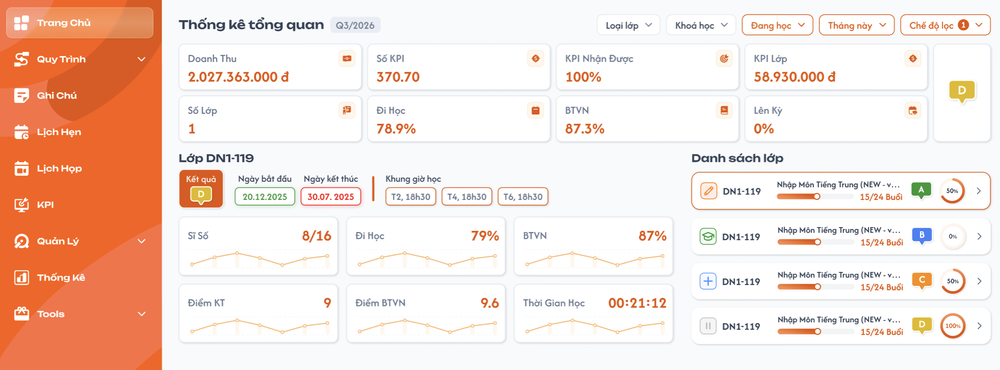

# [Phụ trách lớp] Trang chủ — Thống kê tổng quan

> Trang chủ của role `Class Handler` (Phụ trách lớp). Tổng hợp số liệu hoá đơn, KPI và học tập của **các lớp mà Phụ trách lớp được thêm vào** (khu vực Phụ trách lớp tại [Tab Trợ giảng & Phụ trách lớp](../../management_requirement/class_management/class_detail_support_handlers_requirements.md)), kèm danh sách lớp để xem nhanh và vào Chi tiết lớp. Số liệu trong ảnh là dữ liệu mẫu.
>
> Công thức dùng chung, không tính lại khác: [Giáo viên — Lớp](../../teacher_role/class_list/class_list_requirements.md) (Đi học, BTVN), [Hoá đơn](../../receipt_management/receipt/receipt.md) (Người phụ trách, Số KPI), [Tab KPI của Phụ trách lớp](../../management_requirement/class_management/class_detail_kpi_requirements.md), [Chi tiết lớp — Tổng quan](../../management_requirement/class_management/class_detail_overview_requirements.md), [Danh sách lớp](../../management_requirement/class_management/class_management_requirements.md).

## 1. UI

### Trang 1: Thống kê tổng quan



**Mô tả:**

- Phụ trách lớp đăng nhập, mở menu `Trang Chủ` để theo dõi doanh thu, KPI của bản thân và tình hình học tập của các lớp mình phụ trách. Bấm một lớp để xem nhanh chỉ số bên trái; bấm `>` để vào Chi tiết lớp.
- Bố cục: tiêu đề + bộ lọc; 8 thẻ chỉ số + badge hạng tổng; khối `Lớp <mã lớp>` bên trái; `Danh sách lớp` bên phải.
- Menu `Quản Lý` của role này gồm `Lớp học`, `Học viên`, `Giáo viên`, `Hoá đơn`, `Ship sách`, UI giống role Admin (đặc tả riêng). Bấm `>` tại trang chủ mở **Quản lý → Lớp học → Chi tiết lớp → Tổng quan lớp**.

**Điểm cần lưu ý:**

**a. Phạm vi và bộ lọc**

- Phụ trách lớp **không chọn trung tâm ở header**; trung tâm được lọc bằng bộ lọc `Trung tâm` trên trang.
- **Tập lớp** = lớp có Phụ trách lớp đang đăng nhập trong danh sách Phụ trách lớp, khớp tất cả bộ lọc. Hàng thẻ dựa trên lớp, khối lớp và Danh sách lớp dùng chung tập này. Bị xoá khỏi lớp thì lớp đó không còn xuất hiện.
- Bộ lọc (giá trị đang chọn tô cam; chọn nhiều hiển thị số lượng đã chọn): trong cùng bộ lọc là `OR`, giữa các bộ lọc là `AND`. Mọi bộ lọc áp dụng đồng bộ cho toàn trang.

| Bộ lọc | Giá trị | Mặc định |
|---|---|---|
| `Trung tâm` | Chọn nhiều, danh sách trung tâm | Tất cả |
| `Loại lớp` | Chọn nhiều: `Lớp 1-1`, `Lớp chung`, `Lớp demo` | Tất cả |
| `Khoá học` | Chọn nhiều, danh sách khoá học đã define | Tất cả |
| Trạng thái (nút hiển thị giá trị đang chọn) | Chọn nhiều, **chỉ** `Đang học`, `Hoàn thành` | `Đang học` |
| Thời gian (nút hiển thị giá trị đang chọn) | Chọn 1: Tới hạn, Hôm nay, Hôm qua, Hôm nay và hôm qua, Tuần này, Tuần trước, Tháng này, Tháng trước, 3 tháng trước, Năm nay, Năm trước, Tùy chọn (phạm vi từng giá trị theo Danh sách lớp) | `Tháng này` |
| `Chế độ lọc` | Chọn nhiều mốc ngày lớp: `Ngày bắt đầu dự kiến`, `Ngày kết thúc dự kiến`, `Ngày bắt đầu chính thức`, `Ngày kết thúc chính thức`; badge số trên nút = số mốc đã chọn | `Ngày kết thúc chính thức` |

- Trạng thái chỉ có 2 giá trị: lớp ở trạng thái khác (Mới tạo, Khai giảng, Tạm dừng, Hủy, Xóa, Trải nghiệm) không bao giờ vào tập lớp. Bỏ chọn hết = cả 2 trạng thái.
- **Thời gian + Chế độ lọc trên tập lớp** — lấy lớp *đang dạy trong khoảng thời gian*. Với khoảng `[Từ, Đến]`, mỗi mốc được chọn tạo một điều kiện, các điều kiện kết hợp `AND`:

| Mốc được chọn | Điều kiện để lớp thỏa |
|---|---|
| Ngày bắt đầu (dự kiến/chính thức) | Mốc đó có giá trị và `≤ Đến` (lớp đã bắt đầu trước khi khoảng kết thúc) |
| Ngày kết thúc (dự kiến/chính thức) | Mốc đó `≥ Từ` (lớp chưa kết thúc trước khi khoảng bắt đầu); chưa có ngày kết thúc thì vẫn thỏa |

  Ví dụ chọn `Ngày bắt đầu chính thức` + `Ngày kết thúc chính thức`, Thời gian `Tháng này` (01/10–31/10): lớp học 15/09–05/10 thỏa; lớp bắt đầu 02/11 không thỏa; lớp kết thúc 30/09 không thỏa.
- Mặc định `Chế độ lọc` = `Ngày kết thúc chính thức` → lấy lớp chưa kết thúc trước ngày đầu khoảng Thời gian (kể cả lớp chưa có ngày kết thúc chính thức).
- **Bỏ chọn hết mốc** trong `Chế độ lọc` → Thời gian không lọc tập lớp, hiển thị tất cả lớp thỏa các bộ lọc còn lại. Thời gian vẫn áp cho thẻ hoá đơn.
- **Thời gian trên thẻ hoá đơn** (`Doanh Thu`, `Số KPI`, `KPI Nhận Được`): hoá đơn có `Ngày ghi nhận` trong khoảng Thời gian, thuộc `Trung tâm` đã chọn. Hoá đơn không gắn class_id nên Loại lớp, Khoá học, Trạng thái, Chế độ lọc không áp dụng cho 3 thẻ này.
- Đổi bất kỳ bộ lọc nào → tính lại hàng thẻ, tải lại Danh sách lớp, chọn lại lớp đầu tiên.

**b. Hàng thẻ chỉ số**

Gọi **hoá đơn của PTL** = hoá đơn chưa xoá có Phụ trách lớp đang đăng nhập trong phần Người phụ trách, thỏa Trung tâm + Thời gian. Với mỗi hoá đơn: `KPI PTL` = Số KPI của Phụ trách lớp đó; `Tổng KPI HĐ` = tổng Số KPI của tất cả người phụ trách trên hoá đơn; `Giá trị HĐ` = giá trị hoá đơn đã quy đổi ra VND cuối cùng (field `Quy đổi (VND)`; hoá đơn VND thì bằng Số tiền, ngoại tệ thì lấy giá trị quy đổi đã nhập). Số KPI cộng đại số: KPI dương cộng vào, KPI âm trừ ra.

| Thẻ | Cách tính | Hiển thị |
|---|---|---|
| `Doanh Thu` | `Σ (Giá trị HĐ × KPI PTL / Tổng KPI HĐ)` trên các hoá đơn của PTL; phần của hoá đơn có KPI PTL âm thì trừ ra. Hoá đơn có `Tổng KPI HĐ = 0` không tham gia (không chia 0). | `2.027.363.000 đ` (làm tròn đến đồng) |
| `Số KPI` | `Σ KPI PTL` trên các hoá đơn của PTL. Không lọc theo trạng thái người phụ trách. | 2 chữ số thập phân, VD `370.70`; âm có dấu `-` |
| `KPI Nhận Được` | `Σ KPI PTL / Σ Tổng KPI HĐ × 100` trên các hoá đơn của PTL. Mẫu = 0 hoặc không có hoá đơn → `0%`. | `%`, 1 chữ số thập phân (bỏ `.0`) |
| `KPI Lớp` | Tổng tiền thực tế các khoản KPI `Đã xác nhận` có người nhận là Phụ trách lớp đang đăng nhập, **thuộc các lớp trong tập lớp**. Không tính Mới/Đã hủy/Đã xóa; không dùng giá trị gốc mẫu. | `58.930.000 đ` |
| `Số Lớp` | Đếm lớp trong tập. | Số nguyên |
| `Đi Học` | Tỷ lệ đi học mỗi học viên = lượt `Có mặt`, `Vào trễ`, `Ra sớm`, `Vào trễ & Ra sớm` / tổng lượt phải tham gia × 100; thẻ = trung bình cộng của mọi học viên trong các lớp của tập. | 1 chữ số thập phân `%` |
| `BTVN` | Tỷ lệ mỗi học viên = BTVN đã nộp / BTVN được giao × 100; thẻ = trung bình cộng của mọi học viên trong tập. | 1 chữ số thập phân `%` |
| `Lên Kỳ` | Tính tỷ lệ lên kỳ của từng lớp (bảng bên dưới), rồi lấy trung bình cộng các lớp trong tập, mỗi lớp trọng số bằng nhau. | 1 chữ số thập phân `%` |
| Badge hạng tổng | `getEvaluate(trung bình Q)` của các lớp chính thức trong tập, Q = `scoreEvaluateClass()` theo [Hồ sơ học viên — Lịch sử lớp](../../management_requirement/student_management/student_management_requirements.md#lịch-sử-lớp); không có lớp chính thức → trống. | Chữ `A`–`F` theo màu chuẩn |

- **Tỷ lệ lên kỳ của một lớp** (dùng cho thẻ `Lên Kỳ` và vòng `%` trên card lớp), tính trên học viên của cả lớp:

| Trạng thái lớp | Tử số | Mẫu số |
|---|---|---|
| Hoàn thành | Số học viên ở trạng thái `Up-sale`, `Force`, `Super up-sale` hoặc `Hoàn thành` | Số học viên còn tính = tổng học viên, loại `Remove`, `Moved`, `Audit`, `Testing`, `Viewer` |
| Chưa hoàn thành (Đang học) | Số học viên `Đang học` | Tổng học viên − số học viên chuyển lớp (`Moved`) |

  Mẫu số = 0 → tỷ lệ lớp `0%`, không chia 0. Ví dụ lớp Hoàn thành 10 học viên, 6 Up-sale/Hoàn thành, 2 Viewer → 6/8 = 75%; lớp Đang học 10 học viên, 1 chuyển lớp, 6 Đang học → 6/9 ≈ 66.7%; thẻ `Lên Kỳ` = (75 + 66.67) / 2 = 70.8%.
- `Đi Học`, `BTVN` dùng đúng công thức trang Lớp của role Giáo viên. Học viên không có mẫu số hợp lệ (chưa có buổi phải tham gia / chưa được giao BTVN) không tham gia trung bình của chỉ số đó; 0% hợp lệ vẫn tính.
- Không làm tròn từng học viên/hoá đơn trước khi cộng/lấy trung bình; chỉ làm tròn kết quả cuối. Không chia 0, tập rỗng hiển thị `0%` / `0 đ`, không NaN.
- Đang tải hoặc tải lỗi không hiển thị `0` giả.

**c. Khối `Lớp <mã lớp>` (lớp đang chọn)**

- Bấm card trong Danh sách lớp → khối hiển thị thông số nhanh của lớp đó. Mặc định chọn lớp đầu tiên; tập lớp rỗng → ẩn toàn bộ khối.
- `Kết quả`: badge `getEvaluate(Q)` của lớp; Q = -1 thì trống.
- `Ngày bắt đầu` / `Ngày kết thúc`: định dạng `dd.MM.yyyy` theo Thông tin lớp. `Ngày kết thúc` **viền đỏ khi chưa đến ngày kết thúc** (hôm nay < ngày kết thúc); đã đến/qua ngày kết thúc thì không viền đỏ.
- `Khung giờ học`: mỗi lịch cố định của lớp một chip dạng `T2, 18h30`; không có lịch thì ẩn mục.
- 6 chỉ số `Sĩ Số`, `Đi Học`, `BTVN`, `Điểm KT`, `Điểm BTVN`, `Thời Gian Học` và biểu đồ nhỏ theo bài học: dùng đúng công thức mục *Thống kê học tập trung bình của lớp* và *Biểu đồ theo bài học* của Tổng quan lớp (Sĩ số `x/y` gồm đủ 7 trạng thái học viên; điểm 1 chữ số thập phân; thời gian `HH:mm:ss`).

**d. Danh sách lớp**

- Mỗi card một lớp trong tập; sắp xếp theo mã lớp tăng dần; tải toàn bộ, không phân trang. Card đang chọn viền cam.
- Icon trạng thái lớp theo bộ icon của Danh sách lớp (`Đang học` bút cam, `Hoàn thành` mũ tốt nghiệp xanh); hover hiện tên trạng thái.
- Mã lớp và tên khoá học dài cắt `…`, hover hiện đủ.
- Thanh tiến độ `x/y Buổi`: cùng nguồn tiến độ của Danh sách lớp (x = buổi đã thực hiện, y = tổng buổi của khoá). x > y thì thanh tô đầy, số vẫn giữ nguyên.
- Badge hạng: `getEvaluate(Q)` của lớp. Vòng `%`: tỷ lệ lên kỳ của lớp theo bảng ở mục b (nhánh Hoàn thành / Đang học), số nguyên `%`.
- Bấm vùng card → chọn lớp, cập nhật khối bên trái (không điều hướng). Bấm `>` cuối card → mở Quản lý → Lớp học → Chi tiết lớp, menu Tổng quan lớp, của đúng class_id.
- Tập rỗng → hiển thị `Bảng dữ liệu này đang trống`.

---

## 2. Yêu cầu

### 2.1. Flow chính

**Flow 1: Mở Trang chủ**

```
Phụ trách lớp đăng nhập → menu Trang Chủ
      → FE gọi API với bộ lọc mặc định (Trung tâm = Tất cả, Trạng thái = Đang học, Thời gian = Tháng này, Chế độ lọc = Ngày kết thúc chính thức)
      → BE lấy lớp có user trong danh sách Phụ trách lớp, khớp bộ lọc → tập lớp
      → BE lấy hoá đơn có user là Người phụ trách, khớp Trung tâm + Thời gian
      → BE tính 8 thẻ + badge hạng tổng; trả Danh sách lớp
      → FE render, chọn sẵn lớp đầu tiên → khối lớp bên trái
                    ↓ (tập lớp rỗng)
              Thẻ học tập 0/trống theo rule; ẩn khối lớp; danh sách "Bảng dữ liệu này đang trống"
```

**Flow 2: Lọc**

```
Đổi Trung tâm / Loại lớp / Khoá học / Trạng thái / Thời gian / Chế độ lọc
      → BE tính lại tập lớp (Thời gian + Chế độ lọc theo điều kiện "đang dạy trong khoảng")
      → BE tính lại thẻ hoá đơn (Trung tâm + Thời gian theo Ngày ghi nhận)
      → FE cập nhật toàn bộ thẻ, danh sách, chọn lại lớp đầu tiên
                    ↓ (Tùy chọn: Từ ngày > Đến ngày)
              Báo lỗi tại bộ lọc, giữ điều kiện cũ
```

**Flow 3: Xem nhanh và vào Chi tiết lớp**

```
Bấm card lớp → FE tải chỉ số lớp → khối bên trái đổi theo lớp, card viền cam
      → Bấm ">" → mở Quản lý → Lớp học → Chi tiết lớp → Tổng quan lớp của đúng class_id
```

### 2.2. Ngoại lệ

- **EX01:** Phụ trách lớp chưa được thêm vào lớp nào / bộ lọc không ra lớp → `Số Lớp` = 0, `KPI Lớp` = `0 đ`, Đi Học/BTVN/Lên Kỳ `0%`, badge trống; ẩn khối lớp; danh sách `Bảng dữ liệu này đang trống`. Thẻ hoá đơn vẫn tính độc lập theo Trung tâm + Thời gian.
- **EX02:** Tải dữ liệu thất bại → vùng lỗi có `Thử lại`; không hiển thị `0` giả, không giữ số liệu của bộ lọc cũ.
- **EX03:** Đổi bộ lọc liên tục, response cũ về sau → bỏ qua response cũ, chỉ render theo bộ lọc mới nhất.
- **EX04:** Truy cập Chi tiết lớp không được phân công (sửa URL) hoặc bị xoá khỏi lớp trong lúc đang xem → backend từ chối, thông báo không có quyền, tải lại danh sách.
- **EX05:** Hoá đơn có `Tổng KPI HĐ = 0` → không tham gia `Doanh Thu`, `KPI Nhận Được`; không chia 0.

### 2.3. Yêu cầu khác

| Mã | Tên yêu cầu | Mô tả |
|---|---|---|
| REQ01 | Phạm vi dữ liệu | Không dùng trung tâm ở header. Chỉ lớp có user trong danh sách Phụ trách lớp và hoá đơn có user là Người phụ trách. Backend xác định user từ token, không nhận `handler_id` từ client. |
| REQ02 | Bộ lọc đồng bộ | Trung tâm (mặc định Tất cả), Loại lớp, Khoá học, Trạng thái (`Đang học`, `Hoàn thành`; mặc định Đang học), Thời gian (mặc định Tháng này), Chế độ lọc (4 mốc ngày, chọn nhiều; mặc định Ngày kết thúc chính thức; bỏ chọn hết thì Thời gian không lọc tập lớp). Mọi bộ lọc áp cho tập lớp; thẻ hoá đơn áp Trung tâm + Thời gian. |
| REQ03 | Thẻ hoá đơn & KPI | Doanh Thu = Σ Giá trị HĐ × KPI PTL / Tổng KPI HĐ; Số KPI = Σ KPI PTL; KPI Nhận Được = Σ KPI PTL / Σ Tổng KPI HĐ; KPI Lớp = tiền KPI Đã xác nhận của user thuộc các lớp trong tập. |
| REQ04 | Thẻ học tập | Số Lớp; Đi Học, BTVN theo công thức trang Lớp role Giáo viên (trung bình theo học viên); Lên Kỳ = trung bình tỷ lệ lên kỳ từng lớp (lớp Hoàn thành: Up-sale/Force/Super up-sale/Hoàn thành ÷ học viên còn tính; lớp chưa hoàn thành: Đang học ÷ (tổng − chuyển lớp)); 1 chữ số thập phân; badge hạng tổng getEvaluate. |
| REQ08 | Tỷ lệ lên kỳ lớp | Vòng `%` trên card và thẻ Lên Kỳ dùng cùng tỷ lệ lên kỳ của lớp; mẫu số 0 → 0%. |
| REQ05 | Khối lớp đang chọn | Bấm card hiện thông số nhanh; mặc định lớp đầu tiên; Kết quả, ngày (kết thúc viền đỏ khi chưa đến hạn), khung giờ, 6 chỉ số + biểu đồ theo Tổng quan lớp. |
| REQ06 | Danh sách lớp | Card: icon trạng thái, mã lớp, khoá học, tiến độ `x/y Buổi`, badge hạng, vòng KPI lớp, `>` vào Quản lý → Lớp học → Tổng quan lớp. Sắp theo mã lớp, không phân trang. |
| REQ07 | Chỉ xem | Trang không có thao tác thêm/sửa/xoá; không có Toast CRUD. |

### 2.4. Ràng buộc

#### Quyền

| Role | Xem Trang chủ Phụ trách lớp | Xem nhanh lớp | Vào Chi tiết lớp từ `>` | Sửa dữ liệu tại trang |
|---|:---:|:---:|:---:|:---:|
| Class Handler | ✅ (lớp/hoá đơn của mình) | ✅ | ✅ (lớp của mình) | ❌ |
| Admin / Support / Teacher / Sale | ❌ (dùng menu riêng) | — | — | ❌ |

#### Ràng buộc khác

- Backend kiểm tra role và quan hệ Phụ trách lớp–lớp, Phụ trách lớp–hoá đơn ở mọi API (thẻ, danh sách, chỉ số lớp); không chỉ ẩn ở client.
- `KPI Lớp` chỉ tính khoản KPI có người nhận là chính user; không lộ tiền KPI của Phụ trách lớp khác cùng lớp.
- Mọi thẻ tính trên toàn bộ tập lớp/hoá đơn, không phụ thuộc số card đang hiển thị.
- Dữ liệu cùng nguồn với Hoá đơn, Tab KPI và Danh sách lớp của Admin; thay đổi ở nơi khác thì lần tải sau phản ánh đúng.

---

## 3. Testcase

### Feature: Trang chủ Phụ trách lớp — Thống kê tổng quan

| Tên testcase | Priority | Scenario | Role | Pre-condition | Given/When/Then | Expected Result |
|---|---|---|---|---|---|---|
| Case 1: Mở Trang chủ với bộ lọc mặc định | High | Flow 1 / REQ01 / REQ02 | Class Handler | H được thêm vào 6 lớp ở trung tâm A và B (4 Đang học, 1 Hoàn thành, 1 Tạm dừng), đều đang dạy trong tháng này | **Given:** H đăng nhập<br>**When:** mở menu Trang Chủ<br>**Then:** tải với Trung tâm = Tất cả, Trạng thái = Đang học, Thời gian = Tháng này | - Không có chọn trung tâm ở header<br>- Số Lớp = 4, gồm lớp của cả A và B<br>- Chọn sẵn lớp đầu tiên, card viền cam |
| Case 2: Bộ lọc Trạng thái và Trung tâm | High | Flow 2 / REQ02 | Class Handler | Như Case 1 | **Given:** mở bộ lọc Trạng thái, chọn thêm Hoàn thành; chọn Trung tâm = A<br>**When:** áp dụng<br>**Then:** chỉ lớp Đang học/Hoàn thành của trung tâm A | - Dropdown Trạng thái chỉ có 2 giá trị<br>- Lớp Tạm dừng không bao giờ xuất hiện<br>- Thẻ hoá đơn chỉ tính hoá đơn trung tâm A |
| Case 3: Thời gian + Chế độ lọc "đang dạy" | High | Flow 2 / REQ02 | Class Handler | Chế độ lọc = Ngày bắt đầu chính thức + Ngày kết thúc chính thức; lớp X 15/09–05/10, Y bắt đầu 02/11, Z 01/08–30/09, W bắt đầu 20/09 chưa có ngày kết thúc | **Given:** Thời gian = Tháng này (10/2026)<br>**When:** áp dụng<br>**Then:** tập lớp = X, W | - Y, Z bị loại<br>- Chỉ giữ mốc bắt đầu thì Z vào lại tập<br>- Chỉ giữ mốc kết thúc (mặc định) thì Y vào lại tập<br>- Bỏ chọn hết mốc thì hiển thị cả X, Y, Z, W<br>- Badge Chế độ lọc hiển thị số mốc đã chọn |
| Case 4: Doanh Thu, Số KPI, KPI Nhận Được | High | REQ03 / EX05 | Class Handler | Tháng này: HĐ1 10.000.000 đ, KPI H = 1, KPI người khác = 1; HĐ2 100 USD quy đổi 2.500.000 đ, chỉ H, KPI = 2; HĐ3 đã xoá; HĐ4 tổng KPI = 0 | **Given:** H mở Trang chủ<br>**When:** tính thẻ<br>**Then:** Doanh Thu = 5.000.000 + 2.500.000 = 7.500.000 đ; Số KPI = 3.00; KPI Nhận Được = 3/4 = 75% | - HĐ2 dùng giá trị quy đổi VND<br>- Không tính HĐ3, HĐ4 không chia 0<br>- Đổi Loại lớp/Khoá học không làm đổi 3 thẻ này |
| Case 13: KPI âm trên hoá đơn | High | REQ03 | Class Handler | HĐ5 8.000.000 đ: KPI H = -1, KPI người khác = 3 (tổng 2); HĐ6 4.000.000 đ, chỉ H, KPI = 2 | **Given:** chỉ có HĐ5, HĐ6 trong khoảng<br>**When:** tính thẻ<br>**Then:** Doanh Thu = -4.000.000 + 4.000.000 = 0 đ; Số KPI = 1.00; KPI Nhận Được = 1/4 = 25% | - KPI âm trừ ra, KPI dương cộng vào<br>- Không bỏ qua hoá đơn có KPI âm |
| Case 5: KPI Lớp theo lớp | High | REQ03 | Class Handler | Lớp X (trong tập) có KPI của H: Mới 100.000 đ, Đã xác nhận 300.000 đ, Đã hủy 200.000 đ; KPI Đã xác nhận của K 500.000 đ; lớp V ngoài tập có KPI H 400.000 đ Đã xác nhận | **Given:** xem thẻ KPI Lớp<br>**When:** tính<br>**Then:** 300.000 đ | - Không cộng KPI của K<br>- Không cộng lớp V ngoài tập<br>- Không cộng Mới/Hủy |
| Case 6: Đi Học, BTVN | High | REQ04 | Class Handler | Học viên A Đi học 80%, BTVN 90%; B 60%, 50%; C chưa được giao BTVN, Đi học 70% | **Given:** tính thẻ<br>**When:** trung bình theo học viên<br>**Then:** Đi Học = 70.0%, BTVN = 70.0% | - C không vào BTVN<br>- Không làm tròn từng học viên |
| Case 12: Lên Kỳ và vòng % lớp | High | REQ04 / REQ08 | Class Handler | Lớp X Hoàn thành: 10 HV, 6 Up-sale/Force/Super up-sale/Hoàn thành, 2 Viewer; lớp Y Đang học: 10 HV, 1 chuyển lớp, 6 Đang học; lớp Z Đang học, 0 HV | **Given:** Trạng thái = Đang học + Hoàn thành, tập gồm X, Y, Z<br>**When:** tính tỷ lệ lên kỳ<br>**Then:** X = 75%, Y ≈ 66.7%, Z = 0% | - Vòng `%`: X `75%`, Y `67%`, Z `0%`<br>- Thẻ Lên Kỳ = (75 + 66.67 + 0) / 3 = 47.2%<br>- Không chia 0 |
| Case 7: Xem nhanh lớp | High | Flow 3 / REQ05 | Class Handler | Danh sách nhiều lớp; lớp thứ 2 có ngày kết thúc sau hôm nay | **Given:** bấm vùng card lớp thứ 2<br>**When:** tải chỉ số<br>**Then:** khối bên trái đổi sang lớp thứ 2, không điều hướng | - Kết quả, ngày `dd.MM.yyyy`, khung giờ, 6 chỉ số đúng Tổng quan lớp<br>- Ngày kết thúc viền đỏ; lớp đã qua ngày kết thúc thì không viền đỏ |
| Case 8: Vào Chi tiết lớp | High | Flow 3 / REQ06 | Class Handler | Lớp tiến độ 30/24 buổi, tỷ lệ lên kỳ lớp 50% | **Given:** xem card<br>**When:** bấm `>`<br>**Then:** mở Quản lý → Lớp học → Chi tiết lớp, menu Tổng quan lớp, đúng class_id | - Thanh tô đầy, số giữ `30/24 Buổi`<br>- Vòng `50%`, icon đúng trạng thái, hover hiện tên |
| Case 9: Không có lớp | Medium | EX01 | Class Handler | Chưa được thêm vào lớp nào, có hoá đơn tháng này | **Given:** mở Trang chủ<br>**When:** tải xong<br>**Then:** trạng thái rỗng phần lớp | - Số Lớp 0, KPI Lớp 0 đ, Đi Học/BTVN/Lên Kỳ 0%<br>- Ẩn khối lớp, `Bảng dữ liệu này đang trống`<br>- Thẻ hoá đơn vẫn có số liệu |
| Case 10: Lỗi tải và response cũ | Medium | EX02 / EX03 | Class Handler | API lỗi; đổi bộ lọc liên tục | **Given:** API thẻ lỗi hoặc response cũ về sau<br>**When:** render<br>**Then:** vùng lỗi có `Thử lại`; chỉ giữ kết quả bộ lọc mới nhất | - Không hiện `0` giả<br>- Không trộn số liệu hai bộ lọc |
| Case 11: Chặn quyền và phạm vi | High | EX04 / Ràng buộc quyền | Class Handler; Support/Teacher | Lớp Z không có H | **Given:** H mở URL Chi tiết lớp Z hoặc gọi API thẻ với handler_id khác; Support mở Trang chủ PTL<br>**When:** backend kiểm tra<br>**Then:** từ chối | - Không trả dữ liệu lớp Z, hoá đơn/KPI người khác<br>- Support/Teacher không truy cập được trang |
