# Kiến thức (S1)

> Màn **Kiến thức (S1)** nằm trong từng **khoá học** của role **CD**, dùng để định nghĩa toàn bộ kiến thức của khoá theo
> từng loại: Từ vựng, Ngữ pháp, Mẫu câu, Hanzi, Kanji, Phát âm — mọi trung tâm đều có đủ 6 loại; loại Bảng chữ chỉ có ở
> trung tâm có hệ chữ riêng (Sakumi, Saechang). Dữ liệu theo trung tâm CD đang chọn ở header (CD và Giáo viên
> được chia theo trung tâm).
> Mỗi mục kiến thức là **bản ghi của Thư viện dữ liệu**: S1 tham chiếu bản ghi thư viện; thêm mới hoặc sửa tại S1 ghi
> thẳng vào thư viện. Kiến thức chỉ được sửa tại S1; Chi tiết bài học chỉ **thêm / gỡ** kiến thức đã có trong S1.
>
> **Quyền sửa theo trạng thái khoá học:** chỉ sửa được khi khoá học đang `Nháp`. Khoá học `Công Khai` / `Vô hiệu`: màn hình này chỉ đọc (ẩn / disable mọi thao tác thêm, sửa, xoá, kéo thả); backend từ chối mọi request ghi. Muốn thay đổi thì nhân bản khoá học rồi sửa trên bản sao `Nháp` — nhân bản sao chép toàn bộ dữ liệu của màn hình này (xem [Quản lý khoá học](../course_management.md) REQ10, REQ11). Khi nhân bản khoá học, mỗi mục S1 được tạo bản ghi thư viện mới cùng nội dung.
>
> Ảnh là Figma `CD-KH-030400` → `CD-KH-030540` và `CD-KH-030270`. Những chỗ chưa có thiết kế được ghi rõ là
> **UI cần bổ sung** ngay tại khu vực tương ứng. Bản đồ field ↔ cột sheet dữ liệu gốc: xem Phụ lục A.

## 1. UI

### Khung màn hình và tab loại kiến thức

<p align="center">
  <a href="./images/01-tu-vung.png">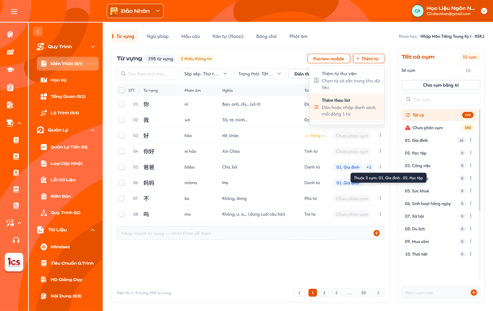</a><br>
  <em>Kiến thức (S1) — tab Từ vựng, menu Thêm từ đang mở — nhấn để xem ảnh gốc</em>
</p>

<p align="center">
  <a href="./images/08-ngu-phap.png">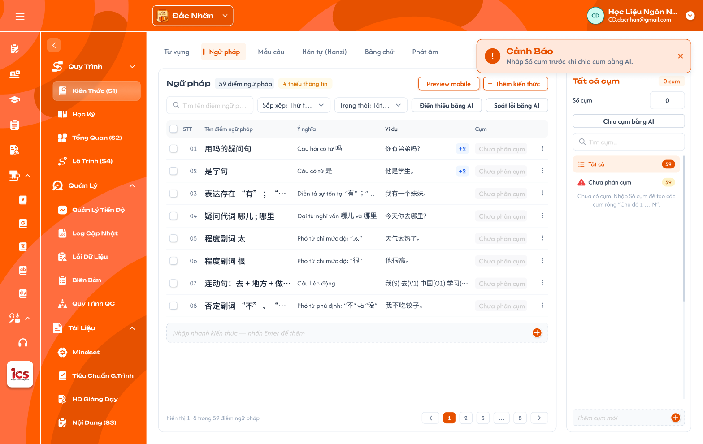</a><br>
  <em>Tab Ngữ pháp: bảng dùng cột Cụm; chưa có cụm thì panel gợi ý nhập Số cụm — nhấn để xem ảnh gốc</em>
</p>

**Mô tả:**

- CD chọn trung tâm ở header (`Switch Center`), vào khoá học, chọn `Kiến thức (S1)` trong menu của khoá để xem và định
  nghĩa kiến thức của khoá học đó.
- Mỗi loại kiến thức là **một tab riêng** ở đầu màn; mọi trung tâm có đủ 6 tab, tab Bảng chữ chỉ hiện ở trung tâm
  có hệ chữ riêng (khoá học không có field ngôn ngữ riêng).
- Mỗi tab gồm: bảng danh sách mục của loại đó (bên trái) và panel **Cụm** của loại đó (bên phải).

**Giải thích thành phần:**

| Thành phần | Yêu cầu |
|---|---|
| Switch Center (header) | Trung tâm CD đang làm việc (vd `Đắc Nhân`); đổi trung tâm thì toàn bộ dữ liệu khoá học và S1 tải lại theo trung tâm mới, kể cả danh sách Từ loại theo ngôn ngữ và tab Bảng chữ. |
| Tab loại kiến thức | Mỗi loại 1 tab, thứ tự: Từ vựng, Ngữ pháp, Mẫu câu, Hanzi, Kanji, Bảng chữ, Phát âm. Mọi trung tâm có đủ 6 tab; tab Bảng chữ chỉ hiện ở trung tâm có hệ chữ riêng (bảng bên dưới). |
| Tiêu đề bảng | Tên loại (hoặc tên cụm đang chọn) + badge số mục (vd `398 từ vựng`) + badge số mục thiếu thông tin (vd `2 thiếu thông tin`). |
| `Preview mobile` | Mở panel xem trước trên điện thoại của mục đang chọn (xem khu vực Preview mobile). |
| `+ Thêm …` | Mở menu thêm mục: `Thêm từ thư viện`, `Thêm theo list`. Tên nút theo loại (vd `Thêm từ`, `Thêm kiến thức`). |
| `Thêm bằng AI` | Nút riêng: AI tạo mục mới theo yêu cầu, chọn số lượng tối đa 50 mục / lần (xem khu vực AI). |
| Thanh công cụ | Tìm kiếm, Sắp xếp, Trạng thái, `Soát lỗi bằng AI` (toàn bộ mục của tab, không giới hạn số lượng). `Điền thiếu bằng AI` nằm ở thanh hàng loạt, chạy cho mục đang chọn (xem khu vực AI). |
| Panel Cụm | Danh sách cụm của loại đang mở, `Số cụm`, `Chia cụm bằng AI` (xem khu vực Panel Cụm). |

**Tab Bảng chữ theo trung tâm:**

| Trung tâm | Ngôn ngữ | Tab Bảng chữ |
|---|---|---|
| Sakumi | Tiếng Nhật | Có — Hiragana / Katakana (Phụ lục A.7.1) |
| Saechang | Tiếng Hàn | Có — Hangul (Phụ lục A.7.2) |
| Đắc Nhân, Creative English, Betreux, Créatis | Tiếng Trung, Anh, Đức, Pháp | Không có |

**Điểm cần lưu ý:**

- Góc phải thanh tab hiện khoá học đang mở, vd `Khoá học: Nhập Môn Tiếng Trung Kỳ I · HSK1`.
- Ngôn ngữ lấy theo **trung tâm** CD đang chọn ở header (Đắc Nhân = Trung, Sakumi = Nhật, Saechang = Hàn,
  Créatis = Pháp, Creative English = Anh, Betreux = Đức); không suy từ Danh mục hay Cấp độ của khoá.
- Tab chưa có dữ liệu ở trung tâm (vd Kanji ở Đắc Nhân) vẫn hiện, bảng rỗng; CD thêm mục như các tab khác.
- Cột phiên âm dùng chung tên `Phiên âm` cho mọi ngôn ngữ (không dùng `Pinyin`).
- Bảng chữ và Phát âm giữ **đúng cấu trúc dữ liệu app học viên đang dùng** (Phụ lục A.6, A.7). Mỗi loại có dữ liệu
  và audio riêng, không loại nào lấy dữ liệu của loại kia.

#### Testcase — Khung màn hình và tab loại kiến thức

| Tên testcase | Priority | Loại test | Scenario | Role | Pre-condition | Given / When / Then | Expected Result |
|---|---| --- |---|---|---|---|---|
| Case 1: Mở Kiến thức (S1) của khoá học | High | Smoke | Flow 1 / REQ01 / REQ02 | CD | Đang chọn trung tâm Đắc Nhân; khoá có dữ liệu | **Given** CD đang ở khoá học<br>**When** chọn `Kiến thức (S1)`<br>**Then** hiển thị tab Từ vựng và danh sách của đúng khoá | - Có 5 tab theo bảng tiếng Trung<br>- Dữ liệu đúng khoá và trung tâm đang chọn |
| Case 2: Đủ tab ở mọi trung tâm | High |  | REQ02 | CD | CD được gán Đắc Nhân và Sakumi | **Given** mở S1 của 1 khoá ở từng trung tâm<br>**When** xem thanh tab<br>**Then** cả hai có Từ vựng, Ngữ pháp, Mẫu câu, Hanzi, Kanji, Phát âm | - Sakumi có thêm Bảng chữ trước Phát âm (ảnh `17-kanji.png`)<br>- Đắc Nhân không có Bảng chữ |
| Case 3: Đổi trung tâm | High |  | REQ01 | CD | CD được gán 2 trung tâm | **Given** đang ở S1 trung tâm A<br>**When** đổi sang trung tâm B ở header<br>**Then** dữ liệu tải lại theo trung tâm B | - Không còn dữ liệu của trung tâm A |
| Case 4: Đổi tab | Medium |  | Flow 1 / REQ02 | CD | Đang ở tab Từ vựng | **Given** S1 đang mở<br>**When** chọn tab Ngữ pháp<br>**Then** bảng và panel Cụm đổi theo Ngữ pháp | - Cột bảng đúng field Ngữ pháp<br>- Panel Cụm là cụm của Ngữ pháp |
| Case 4a: Khoá Công Khai / Vô hiệu: S1 chỉ đọc | High |  | Quyền theo trạng thái khoá (REQ10 khoá học) | CD | Khoá `Công Khai` có dữ liệu S1 | **Given** mở Kiến thức (S1)<br>**When** tìm thao tác thêm, sửa, gỡ, kéo thả, AI; gửi request ghi trực tiếp<br>**Then** thao tác ghi bị ẩn / disable | - Tìm kiếm, lọc, Preview vẫn dùng được<br>- Backend từ chối request ghi |
| Case 4b: Role khác truy cập S1 / gọi API | High |  | EX06 / REQ14 | Role khác CD | - | **Given** đăng nhập role không phải CD<br>**When** mở URL Kiến thức (S1) của khoá; gửi request thêm / sửa mục<br>**Then** bị từ chối | - Không thay đổi dữ liệu |
| Case 4c: Truy cập khoá học của trung tâm khác | High |  | EX08 | CD | Đang chọn trung tâm A; có URL S1 của khoá thuộc trung tâm B | **Given** CD đang ở trung tâm A<br>**When** mở URL S1 của khoá trung tâm B<br>**Then** bị từ chối | - Không hiển thị dữ liệu |
| Case 4d: Truy cập tab Bảng chữ ở trung tâm không có hệ chữ | Medium |  | EX07 | CD | Trung tâm Đắc Nhân | **Given** mở URL tab Bảng chữ của S1<br>**When** gửi request lấy dữ liệu Bảng chữ<br>**Then** bị từ chối | - Không trả dữ liệu Bảng chữ |

### Field của từng loại kiến thức

**Mô tả:**

- Mỗi loại có bộ field riêng (theo dữ liệu `HSK1 - DATA`, sheet `kanji` khoá N5, `BẢNG CHỮ - N5 (ver 2.2)` và
  `Phát Âm Final`). Không có field Bài học / Khoá học:
  kiến thức gắn vào khoá qua S1, vào cụm, và cụm liên kết bài học.
- Mục **thiếu thông tin** khi trống **bất kỳ field bắt buộc** nào của loại đó. Field không bắt buộc trống vẫn tính là
  đủ.

**Giải thích field/thành phần:**

| Loại | Field bắt buộc | Field không bắt buộc |
|---|---|---|
| Từ vựng | Từ, Phiên âm, Nghĩa, Từ loại, Hán Việt (chỉ tiếng Trung), Ví dụ (≥ 1; mỗi ví dụ gồm câu, phiên âm, nghĩa) | Nâng cao, Audio |
| Ngữ pháp | Tên điểm ngữ pháp, Ý nghĩa, Cấu trúc, Cách dùng, Ví dụ (≥ 1; mỗi ví dụ gồm câu, phiên âm, nghĩa) | Lưu ý, Video, Nâng cao |
| Mẫu câu | Câu, Phiên âm, Nghĩa | Audio |
| Hanzi | Chữ, Phiên âm, Âm Hán Việt, Nghĩa (ít nhất 1), Bộ thủ, Thành phần, Thứ tự nét | Mẹo nhớ, Chữ giống, Từ liên quan, Nét viết (SVG), Nâng cao |
| Kanji | Chữ, Âm On hoặc Âm Kun (ít nhất 1), Âm Hán Việt, Nghĩa, Bộ thủ, Thành phần | Mẹo nhớ, Từ liên quan, Nét viết (SVG) |
| Phát âm — tiếng Trung (pinyin) | Âm, Loại âm; Nhóm và Hướng dẫn phát âm (khi Loại = Thanh mẫu / Vận mẫu); Thanh mẫu và Vận mẫu thành phần (khi Loại = Âm tiết) | Cách đọc, Âm dễ nhầm, Audio theo thanh, Video hướng dẫn |
| Bảng chữ — tiếng Nhật (Kana) | Hiragana, Katakana, Romaji, Loại, Hàng | Chữ dễ nhầm, Mẹo nhớ, Từ ví dụ, Audio, Thứ tự nét |
| Bảng chữ — tiếng Hàn (Hangul) | Chữ, Tên gọi, Phiên âm (Romaja đầu / cuối), Loại | Từ ví dụ, Audio, Thứ tự nét |

**Field Hán Việt và Nghĩa theo loại** (tên field dữ liệu, cũng là tiêu đề cột khi Import / Export Excel; chi tiết ở Phụ lục A):

| Loại | Hán Việt | Nghĩa |
|---|---|---|
| Từ vựng (tiếng Trung) | `sino_vietnamese` | `mean` |
| Kanji | `mean` | `explanation` |
| Hanzi | `mean` | `meanings` (danh sách nghĩa, ít nhất 1) |

Cùng tên `mean` nhưng ý nghĩa khác theo loại: ở Từ vựng `mean` là Nghĩa, ở Kanji và Hanzi `mean` là Âm Hán Việt.

| Field | Quy tắc |
|---|---|
| Từ loại | Chọn **1 hoặc nhiều** giá trị từ **danh sách cố định theo ngôn ngữ** (Phụ lục A), không nhập tự do. Mục dạng câu / cụm (vd `はじめまして。`) vẫn là Từ vựng, nhận biết bằng Từ loại `Câu`. |
| Phiên âm từng chữ (furigana) | Dạng `{chữ\|phiên âm}`; hệ thống tự sinh từ Từ / Câu và Phiên âm, CD không nhập. |
| Ví dụ | **Danh sách ví dụ**, mỗi ví dụ gồm câu, phiên âm, nghĩa; tối thiểu 1, thêm bằng `+ Thêm ví dụ` ở Chi tiết mục. Bảng hiện ví dụ đầu, nhiều hơn thì thêm nhãn `+N` (ảnh `08-ngu-phap.png`). Cho phép đánh dấu từ đang học bằng `<...>` (vd `<{你\|nǐ}>{好\|hǎo}{吗\|ma}？`). Dữ liệu cũ gộp nhiều ví dụ trong 1 ô thì import tách theo dòng trống. |
| Cách dùng / Lưu ý (Ngữ pháp) | Nội dung nhiều đoạn, có ví dụ kèm phiên âm và nghĩa theo định dạng dữ liệu hiện có. |
| Nâng cao | `Không` (mặc định) = đẩy lên 3 bước học; `Có` = không đẩy lên 3 bước nhưng vẫn hiện trong danh sách. |
| Nghĩa (Hán tự) | Một chữ có nhiều nghĩa tiếng Việt; bắt buộc ít nhất 1. |
| Bộ thủ (Kanji, Hán tự) | Chọn **1 bộ** trong **214 bộ thủ Khang Hy** (có số thứ tự 1–214, chữ bộ, tên Hán Việt, số nét và các biến thể viết như `亻`, `氵`, `讠`, `⺮`); dùng chung Hán tự và Kanji; hằng số hệ thống. |
| Chuỗi tìm kiếm (Kanji) | Hệ thống tự sinh từ Âm On / Âm Kun (romaji, kana), CD không nhập. |
| Audio | Không bắt buộc; CD tải file âm thanh. Không có file thì app đọc bằng TTS. |
| Phiên âm | Tiếng Trung: pinyin có dấu thanh (`nǐ`); tiếng Nhật: romaji (`hajimemashite`); ngôn ngữ khác theo IPA hoặc cách đọc quy ước của trung tâm. |
| Video (Ngữ pháp) | Link video (vd YouTube), không bắt buộc. |
| Hiragana, Katakana (Bảng chữ Nhật) | Một mục là một cặp chữ cùng âm: nhập cả hai bộ chữ trên cùng dòng (`あ` / `ア`). |
| Loại (Bảng chữ Nhật) | Chọn từ danh sách cố định: `Âm cơ bản` (46), `Âm đục` (20), `Âm bán đục` (5), `Âm ghép` (33) — ánh xạ Bảng con của sheet, Phụ lục A.7.1. Âm ngắt `っ` và trường âm ghi ở Từ ví dụ / Mẹo nhớ, không là mục riêng. |
| Hàng (Bảng chữ Nhật) | Chọn từ danh sách cố định `あ行`, `か行`, `さ行`, `た行`, `な行`, `は行`, `ま行`, `や行`, `ら行`, `わ行`, `ん`; cột nguyên âm `a / i / u / e / o` hệ thống suy từ Romaji. |
| Loại (Bảng chữ Hàn) | Chọn từ danh sách cố định: `Phụ âm thường` (9), `Phụ âm bật hơi` (5), `Phụ âm căng` (5), `Nguyên âm đơn` (10), `Nguyên âm ghép` (11) — Phụ lục A.7.2. |
| Phiên âm (Bảng chữ Hàn) | Romaja dạng `đầu / cuối` (vd `g / k`); nguyên âm chỉ có một giá trị (`a`). |
| Loại âm, Nhóm, Thanh điệu (Phát âm) | Chọn từ danh sách cố định: Loại `Thanh mẫu` / `Vận mẫu` / `Âm tiết`; 12 Nhóm (6 nhóm thanh mẫu, 6 nhóm vận mẫu); 4 thanh `ˉ ˊ ˇ ˋ` — Phụ lục A.7. |
| Audio (Phát âm) | Audio riêng của Phát âm. Thanh mẫu 1 file; Vận mẫu và Âm tiết mỗi thanh 1 file; tên file theo quy ước app `pinyin_<thanh>.mp3` (vd `ba_1.mp3`), thanh mẫu `b.mp3`. Không có file thì TTS. |
| Cụm | Không phải field nhập; **mỗi mục thuộc tối đa 1 cụm** (hoặc `Chưa phân cụm`) (xem Panel Cụm). |

**Điểm cần lưu ý:**

- Bảng chỉ hiện field chính của từng tab (xem khu vực Bảng danh sách). Các field còn lại (Hán Việt, Nâng cao, Cách
  dùng, Lưu ý, Audio, Thành phần, Thứ tự nét…) nhập / sửa ở drawer `Chi tiết mục` (menu dòng `Mở chi tiết …`, xem
  khu vực Chi tiết mục).
- Từ loại và Bộ thủ là **hằng số hệ thống**, chưa có màn quản lý; danh sách và cách map dữ liệu cũ ở Phụ lục A.
- Ô field bắt buộc đang trống hiển thị `— trống —` trên bảng; Preview mobile ghi rõ số field trống (vd
  `1 trường trống · Từ loại`).
- Badge `N thiếu thông tin` và bộ lọc Trạng thái tính theo field bắt buộc của bảng trên.

#### Testcase — Field của từng loại kiến thức

| Tên testcase | Priority | Loại test | Scenario | Role | Pre-condition | Given / When / Then | Expected Result |
|---|---| --- |---|---|---|---|---|
| Case 5: Tính thiếu thông tin | High |  | REQ03 | CD | Từ `好` có đủ field trừ Từ loại | **Given** tab Từ vựng<br>**When** xem dòng `好` và badge<br>**Then** dòng tính là thiếu | - Ô Từ loại hiện `— trống —`<br>- Được đếm vào `N thiếu thông tin`<br>- Có trong lọc `Thiếu thông tin` |
| Case 6: Field không bắt buộc trống | Medium |  | REQ03 | CD | Từ đủ field bắt buộc, không có Audio | **Given** tab Từ vựng<br>**When** xem trạng thái của từ<br>**Then** từ tính là đủ thông tin | - Không đếm vào thiếu thông tin |
| Case 7: Từ loại chọn từ danh sách | Medium |  | REQ03 | CD | Đang sửa một từ ở trung tâm Đắc Nhân | **Given** ô Từ loại đang sửa<br>**When** nhập giá trị<br>**Then** chỉ chọn được giá trị trong danh sách tiếng Trung, chọn được nhiều giá trị | - Không lưu được giá trị gõ tự do<br>- Từ `会` chọn `Động từ` + `Động từ năng nguyện` thì cột Từ loại hiện cả 2 |
| Case 7a: Ví dụ nhiều mục | Medium |  | REQ03 | CD | Điểm ngữ pháp có 3 ví dụ | **Given** tab Ngữ pháp<br>**When** xem cột Ví dụ<br>**Then** hiện ví dụ đầu kèm `+2` | - Chi tiết mục liệt kê đủ 3 ví dụ, mỗi ví dụ có câu, phiên âm, nghĩa |
| Case 8: Kanji cần ít nhất 1 âm | Medium |  | REQ03 | CD | Khoá tiếng Nhật; chữ Kanji có Âm Kun, không có Âm On | **Given** tab Kanji<br>**When** xem trạng thái chữ<br>**Then** không tính thiếu vì Âm On / Âm Kun | - Chỉ tính thiếu khi trống cả Âm On và Âm Kun |

### Bảng danh sách, tìm kiếm, sắp xếp và lọc

<p align="center">
  <a href="./images/02-menu-dong.png">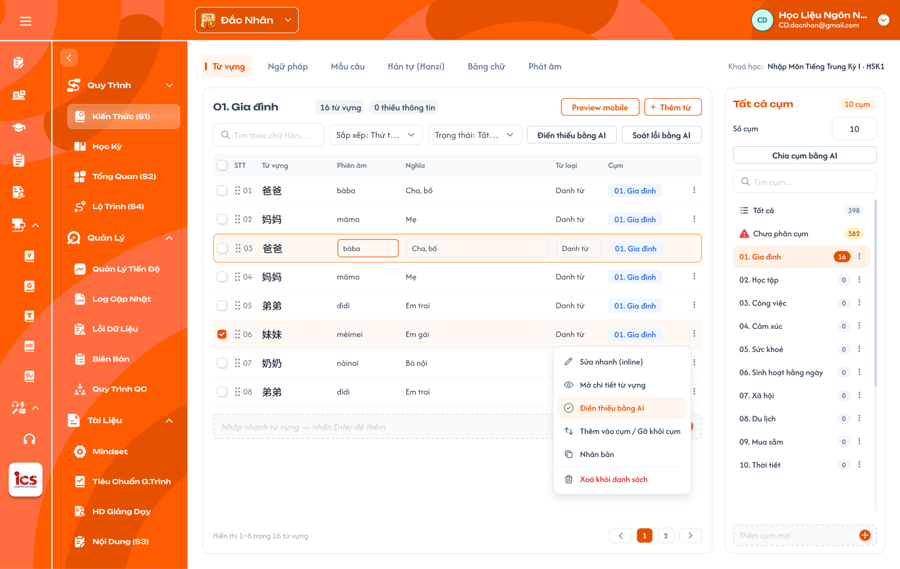</a><br>
  <em>Đang xem cụm `01. Gia đình`, sửa nhanh dòng 03 và menu ⋮ của một dòng — nhấn để xem ảnh gốc</em>
</p>

<p align="center">
  <a href="./images/14-mau-cau.png">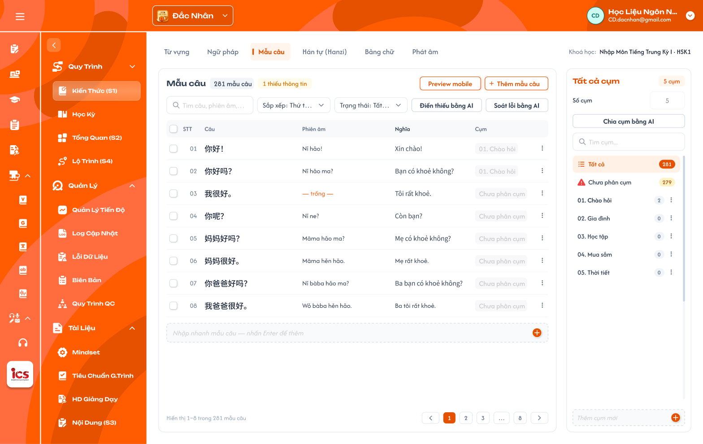</a><br>
  <em>Tab Mẫu câu: cột Câu, Phiên âm, Nghĩa, Cụm — nhấn để xem ảnh gốc</em>
</p>

<p align="center">
  <a href="./images/15-han-tu.png"></a><br>
  <em>Tab Hanzi: cột Chữ, Phiên âm, Hán Việt, Nghĩa, Bộ thủ, Cụm — nhấn để xem ảnh gốc</em>
</p>

<p align="center">
  <a href="./images/16-phat-am.png">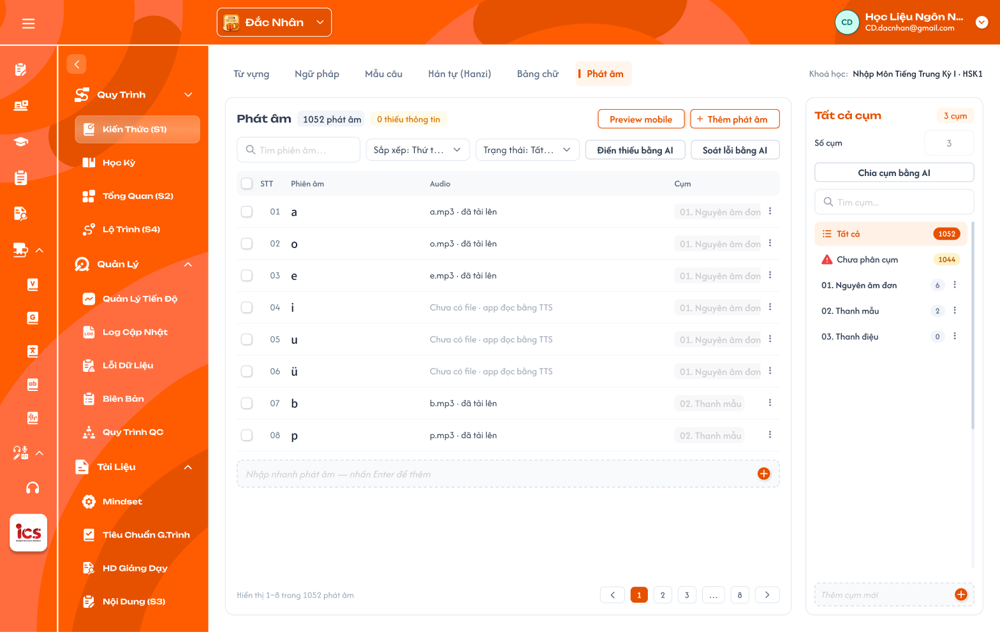</a><br>
  <em>Tab Phát âm: cột Phiên âm, Audio, Cụm — nhấn để xem ảnh gốc</em>
</p>

<p align="center">
  <a href="./images/17-kanji.png"></a><br>
  <em>Tab Kanji (trung tâm Sakumi, khoá N5): cột Chữ, Âm On, Âm Kun, Hán Việt, Nghĩa, Cụm — nhấn để xem ảnh gốc</em>
</p>

- **UI cần sửa:** thanh tab ở trung tâm Đắc Nhân (ảnh `16-phat-am.png`) còn `Bảng chữ` — tiếng Trung không có Bảng
  chữ; thanh tab Sakumi (ảnh `17-kanji.png`) thiếu `Hanzi` — mọi trung tâm đủ 6 tab. Bảng Phát âm mới có cột Phiên âm,
  Audio — cần đủ cột theo bảng pinyin (khu vực Bảng danh sách); badge `1052 phát âm` là số dòng sheet HSK1, dữ liệu gộp
  mỗi âm 1 mục (Phụ lục A.6).
- **UI cần bổ sung:** bảng của tab Bảng chữ tiếng Nhật và tiếng Hàn ở S1 — cột theo bảng Cột field, dạng danh sách
  như [Thư viện kiến thức](../library/library.md) (ảnh `06-bang-chu-nhat-danh-sach.png`, `08-bang-chu-han-danh-sach.png`);
  S1 không có dạng lưới. Dạng lưới thanh mẫu / vận mẫu theo Nhóm cho tab Phát âm (tham khảo sheet `mẫu UI pinyin`,
  Phụ lục A.6).

**Mô tả:**

- Bảng liệt kê các mục của loại đang mở trong khoá học; chọn `Tất cả` hoặc một cụm ở panel Cụm để lọc theo cụm.
- Mỗi tab có bộ cột riêng theo field chính của loại (bảng dưới); cấu trúc toolbar, thanh hàng loạt, Nhập nhanh,
  phân trang và panel Cụm giống nhau ở mọi tab.

**Giải thích thành phần:**

| Thành phần | Yêu cầu |
|---|---|
| Checkbox | Chọn dòng để thao tác hàng loạt; checkbox ở header chọn / bỏ chọn các dòng của trang. |
| STT + tay nắm kéo thả | STT theo thứ tự hiển thị; tay nắm chỉ hiện khi đang xem 1 cụm và Sắp xếp = `Thứ tự trong cụm`. |
| Cột field | **Đủ mọi field** của loại theo bảng Field (Phụ lục A), kể cả Nâng cao, Audio, Ví dụ (hiện ví dụ đầu + `+N`), field dài cắt `…` có tooltip; bảng **cuộn ngang**, ghim cố định checkbox, STT và cột field chính bên trái, cột Cụm và ⋮ bên phải (**UI cần cập nhật**, Figma chỉ vẽ field chính). Cột field chính: Từ vựng: Từ vựng · Ngữ pháp: Tên điểm ngữ pháp · Mẫu câu: Câu · Hán tự / Kanji: Chữ · Phát âm: Âm · Bảng chữ: Chữ. |
| Cụm | Nhãn cụm duy nhất của mục (vd `01. Gia đình`); không thuộc cụm nào hiện `Chưa phân cụm`. Bỏ nhãn `+N` trên Figma (`01-tu-vung.png`, **UI cần cập nhật**). Bấm nhãn mở popup Thêm vào cụm / Gỡ khỏi cụm của mục đó. |
| ⋮ | Menu thao tác dòng (xem khu vực Menu thao tác dòng). |
| Tìm kiếm | Tìm theo các field chính của loại (Từ vựng: chữ, phiên âm, nghĩa; Ngữ pháp: tên, ý nghĩa; Hán tự: chữ, phiên âm, Hán Việt; Kanji: chữ, âm On / Kun, nghĩa; Phát âm: âm, thanh mẫu, vận mẫu; Bảng chữ Nhật: hiragana, katakana, romaji; Bảng chữ Hàn: chữ, tên gọi, phiên âm). |
| Sắp xếp | `Thứ tự thêm` (mặc định), `A–Z`, `Mới cập nhật`, `Thứ tự trong cụm` (chỉ khi đang xem 1 cụm). |
| Trạng thái | Chọn 1: `Tất cả`, `Đủ thông tin`, `Thiếu thông tin`, `AI nghi sai`. |
| Nâng cao | Chọn 1: `Tất cả` (mặc định), `Có`, `Không` theo field Nâng cao của mục (**UI cần bổ sung**). |
| Phân trang | `Hiển thị a–b trong N …` và Trước / số trang / Sau; theo UI mỗi trang 8 dòng. |
| Nhập nhanh | Dòng cuối bảng (xem khu vực Nhập nhanh). |

**Điểm cần lưu ý:**

- Tìm kiếm, Trạng thái, Nâng cao, cụm đang chọn kết hợp với nhau; đổi điều kiện thì về trang 1, badge và tổng số cập nhật theo.
- Cuộn ngang chỉ đổi vùng cột, không đổi tập hàng; cột ghim luôn thấy.
- Kéo thả chỉ đổi **thứ tự mục trong cụm** (là thứ tự hiển thị ở bài học liên kết); các kiểu sắp xếp khác chỉ để xem.
- Bảng mọi tab dùng cột `Cụm` (không có cột `Bài học`).

#### Testcase — Bảng danh sách, tìm kiếm, sắp xếp và lọc

| Tên testcase | Priority | Loại test | Scenario | Role | Pre-condition | Given / When / Then | Expected Result |
|---|---| --- |---|---|---|---|---|
| Case 9: Xem danh sách theo cụm | High | Smoke | Flow 1 / REQ11 | CD | Cụm `Gia đình` có 16 từ | **Given** tab Từ vựng<br>**When** chọn cụm `Gia đình`<br>**Then** bảng chỉ hiện 16 từ của cụm | - Tiêu đề `Gia đình` + `16 từ vựng`<br>- Badge thiếu thông tin tính trong cụm |
| Case 10: Tìm kiếm và lọc kết hợp | High |  | REQ11 | CD | Có từ thiếu và đủ thông tin | **Given** tab Từ vựng<br>**When** nhập từ khoá và chọn `Thiếu thông tin`<br>**Then** chỉ hiện từ khớp cả hai điều kiện | - Về trang 1<br>- Tổng số đúng kết quả lọc |
| Case 11: Kéo thả thứ tự trong cụm | Medium |  | REQ11 | CD | Đang xem 1 cụm, Sắp xếp = `Thứ tự trong cụm` | **Given** bảng của cụm<br>**When** kéo dòng 3 lên vị trí 1<br>**Then** thứ tự trong cụm được lưu | - Tải lại vẫn giữ thứ tự<br>- Thứ tự ở cụm khác không đổi |
| Case 12: Không kéo thả khi sắp xếp khác | Low |  | REQ11 | CD | Sắp xếp = `A–Z` | **Given** bảng đang sắp xếp A–Z<br>**When** thử kéo dòng<br>**Then** không cho kéo | - Thứ tự đã lưu không đổi |
| Case 12a: Nhãn cụm của mục | Medium |  | REQ08 / REQ11 | CD | Từ `爸爸` thuộc cụm `Gia đình` | **Given** cột Cụm hiện `01. Gia đình`<br>**When** bấm nhãn<br>**Then** mở popup `Cụm của 1 mục` | - Không có nhãn `+N`<br>- Popup chọn sẵn `Gia đình` |
| Case 12b: Cột bảng theo tab | Medium |  | REQ02 / REQ03 | CD | Trung tâm Đắc Nhân | **Given** lần lượt mở tab Mẫu câu, Hán tự, Phát âm<br>**When** xem header bảng<br>**Then** cột đúng bảng Cột field | - Hán tự có cột Bộ thủ, Phát âm có cột Audio |
| Case 12c: Bảng đủ cột, cuộn ngang | Medium |  | REQ11 | CD | Tab Từ vựng, màn 1440px | **Given** xem bảng<br>**When** cuộn ngang sang phải<br>**Then** thấy đủ cột Từ loại, Hán Việt, Ví dụ, Nâng cao, Audio; checkbox, STT, Từ vựng ghim trái; Cụm, ⋮ ghim phải | - Số hàng không đổi khi cuộn |
| Case 12d: Lọc Nâng cao | Medium |  | REQ11 | CD | 5 từ Nâng cao = Có | **Given** chọn `Nâng cao: Có`<br>**When** lọc<br>**Then** 5 từ | - Kết hợp được với Trạng thái và cụm |

### Menu thêm, Popup Thêm từ thư viện dữ liệu

<p align="center">
  <a href="./images/09-popup-thu-vien.png">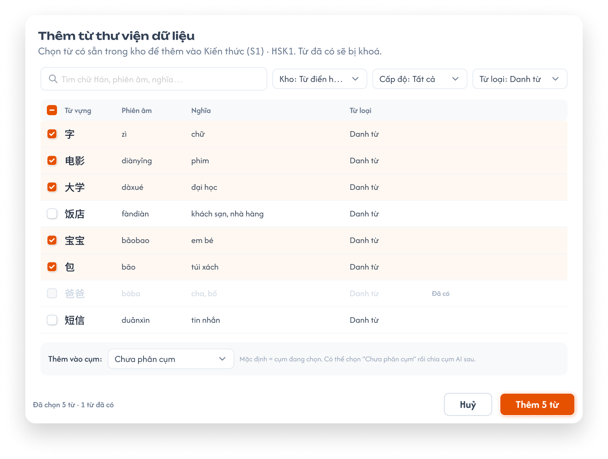</a><br>
  <em>Popup Thêm từ thư viện dữ liệu — nhấn để xem ảnh gốc</em>
</p>

**Mô tả:**

- Nút `+ Thêm …` mở menu 2 mục: `Thêm từ thư viện` (chọn từ có sẵn trong kho dữ liệu) và `Thêm theo list`.
- Popup thư viện cho CD chọn nhiều mục có sẵn trong Thư viện dữ liệu để gắn vào S1 của khoá học. Khoá học **tham chiếu**
  bản ghi thư viện, không sao chép.

**Giải thích field/thành phần:**

| Thành phần | Yêu cầu |
|---|---|
| Tiêu đề / mô tả | `Thêm từ thư viện dữ liệu`; mô tả ghi khoá đang thêm (vd `Kiến thức (S1) · HSK1`). |
| Tìm kiếm | Tìm theo chữ, phiên âm, nghĩa. |
| Kho | Chọn 1: `Tất cả` (mặc định), `Từ điển` (dữ liệu import sẵn theo ngôn ngữ, vd sheet `relation` của HSK1 / N5), `Khoá học` (bản ghi tạo từ S1 của các khoá trong trung tâm; dòng hiện tên khoá gốc). |
| Cấp độ, Từ loại | Lọc danh sách thư viện. |
| Danh sách | Checkbox, các field chính; mọi bản ghi đều chọn được, kể cả bản ghi đã gắn vào khoá (không khoá, không nhãn `Đã có`). |
| Thêm vào cụm | Mặc định là cụm đang chọn ở panel Cụm; chọn được `Chưa phân cụm`. |
| Chân popup | `Đã chọn N từ`; `Huỷ`; `Thêm N từ` (N là số mục đang chọn). |

**Điểm cần lưu ý:**

- **Không có rule bắt trùng:** cùng một bản ghi thư viện gắn được nhiều lần vào cùng khoá (mỗi lần gắn là 1 dòng S1);
  bản ghi khác có nội dung giống cũng thêm bình thường. Hệ thống không cảnh báo, không chặn.
- Sửa mục sau khi thêm là sửa bản ghi thư viện, mọi khoá đang dùng bản ghi đó thấy thay đổi.
- `Thêm N từ` chỉ bấm được khi N ≥ 1.
- Thư viện dữ liệu chỉ chứa bản ghi cùng **ngôn ngữ** với trung tâm đang chọn.
- Thư viện có màn quản lý riêng (menu CD `Thư Viện Kiến Thức`: Từ Vựng, Ngữ Pháp, Hanzi, Ký Tự, Phát Âm) — thuộc
  requirement riêng, ngoài phạm vi tài liệu này.

#### Testcase — Popup Thêm từ thư viện dữ liệu

| Tên testcase | Priority | Loại test | Scenario | Role | Pre-condition | Given / When / Then | Expected Result |
|---|---| --- |---|---|---|---|---|
| Case 13: Thêm nhiều mục từ thư viện | High | Smoke | Flow 2 / REQ04 / REQ05 | CD | Thư viện có từ chưa gắn khoá | **Given** popup thư viện đang mở<br>**When** chọn 5 từ, cụm `Chưa phân cụm`, bấm `Thêm 5 từ`<br>**Then** 5 từ xuất hiện trong S1 | - Là tham chiếu bản ghi thư viện<br>- Thuộc `Chưa phân cụm`<br>- Toast `Thành Công` |
| Case 14: Thêm lại bản ghi đã có trong khoá | High |  | REQ04 | CD | Từ `爸爸` đã gắn khoá | **Given** popup thư viện<br>**When** tìm `爸爸`, tick và bấm `Thêm 1 từ`<br>**Then** thêm thành công | - Dòng `爸爸` không mờ, không có nhãn `Đã có`<br>- S1 có thêm 1 dòng `爸爸`, không có cảnh báo trùng |
| Case 15: Thêm vào cụm đang chọn | Medium |  | REQ04 / REQ08 | CD | Đang chọn cụm `Gia đình` | **Given** mở popup từ cụm `Gia đình`<br>**When** xem ô Thêm vào cụm<br>**Then** mặc định `Gia đình` | - Từ thêm vào thuộc cụm `Gia đình` |
| Case 15a: Lọc theo kho | Medium |  | REQ04 | CD | Thư viện có từ của Từ điển và từ tạo từ khoá khác | **Given** popup thư viện<br>**When** chọn `Kho: Khoá học`<br>**Then** chỉ hiện bản ghi tạo từ S1 các khoá, kèm tên khoá gốc | - `Kho: Từ điển` chỉ hiện dữ liệu import sẵn |

### Popup Thêm theo list

<p align="center">
  <a href="./images/10-popup-theo-list.png">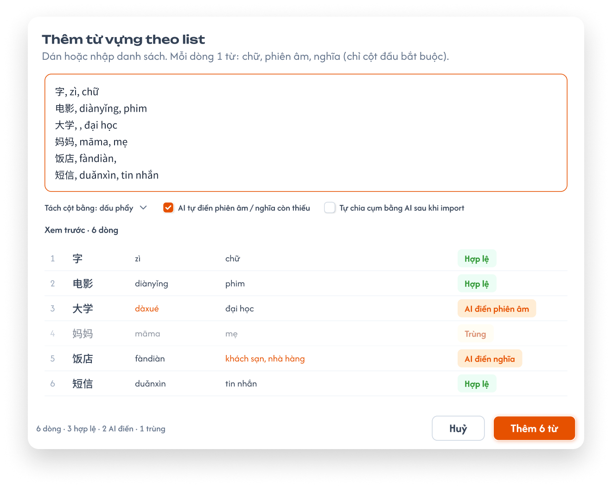</a><br>
  <em>Popup Thêm theo list — dán / nhập, mỗi dòng 1 mục — nhấn để xem ảnh gốc</em>
</p>

**Mô tả:**

- CD dán hoặc tự gõ danh sách vào ô văn bản, **mỗi dòng 1 mục**; hệ thống tách cột, xem trước rồi tạo mới bản ghi thư
  viện và gắn vào khoá.

**Giải thích field/thành phần:**

| Thành phần | Yêu cầu |
|---|---|
| Tiêu đề / mô tả | `Thêm từ vựng theo list`; `Dán hoặc nhập danh sách. Mỗi dòng 1 từ: chữ, phiên âm, nghĩa (chỉ cột đầu bắt buộc).` |
| Ô văn bản | Mỗi dòng = các field chính theo thứ tự cố định của loại (bảng Thứ tự cột bên dưới), tách bằng dấu phẩy. Chỉ cột đầu bắt buộc; cột sau được để trống. Field nhiều giá trị (Nghĩa Hán tự, Âm On / Kun) tách bằng `;` trong cùng cột. |
| Tách cột bằng | Mặc định `dấu phẩy`. |
| `AI tự điền … còn thiếu` | Tick thì sau khi thêm, AI điền các field trống của các dòng vừa thêm theo đúng rule Điền thiếu bằng AI (lưu luôn, tối đa 50 dòng / lần). |
| `Tự chia cụm bằng AI sau khi import` | Tick thì sau khi thêm mở luồng Chia cụm bằng AI cho các mục vừa thêm. |
| Xem trước | Bảng các dòng đã tách, nhãn từng dòng: `Hợp lệ`, `AI điền …` hoặc lỗi `Thiếu cột đầu`. |
| Thêm vào cụm | Mục mới vào cụm đang chọn ở panel Cụm (nếu đang chọn cụm). |
| Chân popup | Tổng `N dòng · a hợp lệ · b AI điền · c lỗi`; `Huỷ`; `Thêm N từ`. |

**Điểm cần lưu ý:**

- Không có tải file Excel / CSV; menu `Thêm theo list` ghi `Dán hoặc nhập danh sách, mỗi dòng 1 từ`.
- Không kiểm tra trùng: dòng có nội dung giống mục đã có trong khoá (hoặc giống dòng khác trong list) vẫn là `Hợp lệ`
  và tạo bản ghi mới. CD bỏ được từng dòng khỏi danh sách trước khi thêm.
- Thứ tự cột theo loại (chỉ cột 1 bắt buộc):

| Loại | Thứ tự cột trên mỗi dòng |
|---|---|
| Từ vựng | `chữ, phiên âm, nghĩa` |
| Ngữ pháp | `tên điểm ngữ pháp, ý nghĩa, cấu trúc` |
| Mẫu câu | `câu, phiên âm, nghĩa` |
| Hán tự | `chữ, phiên âm, âm Hán Việt, nghĩa` (nhiều nghĩa tách `;`) |
| Kanji | `chữ, âm On, âm Kun, âm Hán Việt, nghĩa` (nhiều âm tách `;`) |
| Phát âm (tiếng Trung) | `âm, loại âm` (`Thanh mẫu` / `Vận mẫu` / `Âm tiết`; Âm tiết tự tách Thanh mẫu + Vận mẫu nếu khớp) |
| Bảng chữ — tiếng Nhật | `hiragana, katakana, romaji, loại, hàng` |
| Bảng chữ — tiếng Hàn | `chữ, tên gọi, phiên âm, loại` |

- Field dài (Cách dùng, Ví dụ, Thành phần, Thứ tự nét…) không nhập qua list; để AI điền hoặc nhập ở Chi tiết mục.
- Dòng trống không tạo mục.

#### Testcase — Popup Thêm theo list

| Tên testcase | Priority | Loại test | Scenario | Role | Pre-condition | Given / When / Then | Expected Result |
|---|---| --- |---|---|---|---|---|
| Case 16: Thêm theo list | High | Smoke | Flow 3 / REQ05 | CD | Popup Thêm theo list đang mở | **Given** dán 3 dòng `chữ, phiên âm, nghĩa` hợp lệ<br>**When** bấm `Thêm 3 từ`<br>**Then** tạo 3 bản ghi thư viện và gắn vào khoá | - 3 dòng mới trong bảng<br>- Toast `Thành Công` |
| Case 17: Cột trống và AI điền | High |  | Flow 3 / REQ10 | CD | Tick `AI tự điền …` | **Given** dòng `大学, , đại học`<br>**When** xem trước rồi bấm Thêm<br>**Then** dòng có nhãn `AI điền phiên âm`; sau khi thêm AI điền phiên âm | - Phiên âm lưu luôn, không có nhãn AI / chờ duyệt |
| Case 18: Không kiểm tra trùng | Medium |  | REQ05 | CD | Khoá đã có `妈妈, māma, mẹ` | **Given** dán lại dòng đó<br>**When** xem trước và bấm Thêm<br>**Then** dòng là `Hợp lệ`, không có nhãn / cảnh báo trùng | - Có 2 bản ghi `妈妈` khác nhau |
| Case 19: Thiếu cột đầu | Medium |  | EX01 | CD | Popup đang mở | **Given** dòng `, māma, mẹ`<br>**When** xem trước<br>**Then** dòng báo lỗi, không tạo | - Các dòng hợp lệ khác vẫn thêm được |
| Case 19a: Thứ tự cột của Hán tự | Medium |  | REQ05 | CD | Tab Hán tự, popup Thêm theo list | **Given** dòng `好, hǎo; hào, HẢO, Tốt; Thích`<br>**When** xem trước<br>**Then** tách đúng 4 cột, Nghĩa có 2 giá trị | - Mô tả popup ghi `chữ, phiên âm, âm Hán Việt, nghĩa` |

### Nhập nhanh cuối bảng

<p align="center">
  <a href="./images/05-nhap-nhanh.png"></a><br>
  <em>Ô nhập nhanh cuối bảng, đang gõ `电影` — nhấn để xem ảnh gốc</em>
</p>

**Mô tả:**

- Dòng `Nhập nhanh … — nhấn Enter để thêm` ở cuối bảng để thêm nhanh 1 mục chỉ với field đầu (vd Từ).

**Giải thích field/thành phần:**

| Thành phần | Yêu cầu |
|---|---|
| Ô nhập | Nhập field đầu của loại (Từ vựng: Từ; Ngữ pháp: Tên điểm ngữ pháp…). |
| Enter / `+` | Tạo bản ghi thư viện mới, gắn vào khoá, thêm dòng vào cuối bảng; ô nhập xoá trống để nhập tiếp; Toast `Thành Công` — `Đã thêm 1 từ vào <tên cụm>.` (vd `Đã thêm 1 từ vào Chưa phân cụm.`). |

**Điểm cần lưu ý:**

- Mục mới thiếu các field bắt buộc còn lại nên tính là `Thiếu thông tin`; CD sửa hoặc dùng `Điền thiếu bằng AI`.
- Đang chọn cụm thì mục mới thuộc cụm đó; đang ở `Tất cả` thì thuộc `Chưa phân cụm`.
- Ô trống hoặc chỉ khoảng trắng: không tạo mục.

#### Testcase — Nhập nhanh cuối bảng

| Tên testcase | Priority | Loại test | Scenario | Role | Pre-condition | Given / When / Then | Expected Result |
|---|---| --- |---|---|---|---|---|
| Case 20: Nhập nhanh một từ | High | Smoke | Flow 4 / REQ05 | CD | Tab Từ vựng, đang ở `Tất cả` | **Given** gõ `电影`<br>**When** nhấn Enter<br>**Then** thêm dòng `电影` cuối bảng | - Thuộc `Chưa phân cụm`<br>- Tính là thiếu thông tin<br>- Ô nhập trống lại<br>- Toast `Đã thêm 1 từ vào Chưa phân cụm.` |
| Case 21: Nhập nhanh trong cụm | Medium |  | REQ05 / REQ08 | CD | Đang chọn cụm `Gia đình` | **Given** gõ `哥哥`<br>**When** nhấn Enter<br>**Then** từ mới thuộc cụm `Gia đình` | - Số từ của cụm tăng 1 |
| Case 22: Ô trống | Low |  | EX02 | CD | Ô nhập trống | **Given** ô chỉ có khoảng trắng<br>**When** nhấn Enter<br>**Then** không tạo mục | - Không có Toast thành công |

### Menu thao tác dòng và sửa mục

**Mô tả:**

- Menu ⋮ của mỗi dòng (ảnh `02-menu-dong.png` ở khu vực Bảng danh sách) gồm các thao tác trên 1 mục.

**Giải thích thành phần:**

| Thao tác | Yêu cầu |
|---|---|
| `Sửa nhanh (inline)` | Sửa trực tiếp các ô field chính trên dòng; Enter / rời dòng thì lưu, Esc thì huỷ. |
| `Mở chi tiết …` | Mở drawer `Chi tiết mục` (xem khu vực Chi tiết mục) để xem / sửa **đầy đủ** field của loại. |
| `Điền thiếu bằng AI` | AI điền các field bắt buộc đang trống của mục (xem khu vực AI). |
| `Thêm vào cụm / Gỡ khỏi cụm` | Mở popup chọn cụm (xem Popup Thêm vào cụm / Gỡ khỏi cụm). |
| `Nhân bản` | Tạo bản ghi thư viện mới có cùng nội dung, gắn vào khoá, cùng cụm với mục gốc. |
| `Xoá khỏi danh sách` | Gỡ mục khỏi khoá (xem Popup xác nhận gỡ mục khỏi khoá). |

**Điểm cần lưu ý:**

- Sửa ở S1 là sửa **bản ghi thư viện**; mọi khoá và bài học đang dùng mục thấy nội dung mới.
- Sắp xếp thứ tự dùng tay nắm kéo thả trên dòng, không có mục riêng trong menu.

#### Testcase — Menu thao tác dòng và sửa mục

| Tên testcase | Priority | Loại test | Scenario | Role | Pre-condition | Given / When / Then | Expected Result |
|---|---| --- |---|---|---|---|---|
| Case 23: Sửa nhanh inline | High | Smoke | Flow 5 / REQ06 | CD | Có từ `爸爸` | **Given** chọn `Sửa nhanh (inline)`<br>**When** sửa Nghĩa và nhấn Enter<br>**Then** lưu nghĩa mới | - Toast `Thành Công`<br>- Khoá khác dùng cùng bản ghi thấy nghĩa mới |
| Case 24: Huỷ sửa inline | Medium |  | REQ06 | CD | Đang sửa inline | **Given** đã đổi giá trị ô<br>**When** nhấn Esc<br>**Then** giữ giá trị cũ | - Không có Toast CRUD |
| Case 25: Nhân bản | Medium |  | REQ06 | CD | Từ `弟弟` thuộc cụm `Gia đình` | **Given** chọn `Nhân bản`<br>**When** hệ thống xử lý<br>**Then** có thêm 1 dòng `弟弟` | - Là bản ghi thư viện mới<br>- Thuộc cụm `Gia đình` |

### Chi tiết mục (drawer)

<p align="center">
  <a href="./images/18-chi-tiet-muc.png">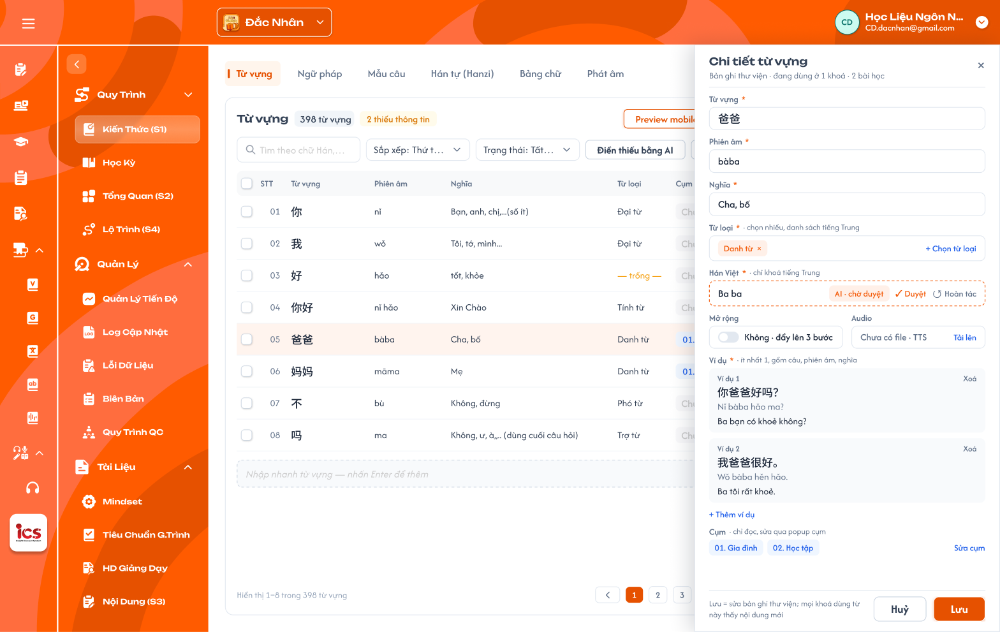</a><br>
  <em>Drawer Chi tiết từ vựng của `爸爸`: đủ field, danh sách ví dụ (ảnh cũ còn nhãn AI chờ duyệt — đã bỏ, mỗi field có `↻ Tạo lại`) — nhấn để xem ảnh gốc</em>
</p>

**Mô tả:**

- Mở từ menu dòng `Mở chi tiết …` (hoặc bấm vào tên mục). Drawer trượt từ phải, phủ lên panel Cụm; bảng bên trái
  vẫn hiện, dòng đang mở được tô sáng. Mỗi loại có form riêng theo bảng Field (Phụ lục A); ảnh minh hoạ Từ vựng.
- Lưu = sửa **bản ghi thư viện**; mọi khoá và bài học dùng mục đó thấy nội dung mới.

**Giải thích thành phần:**

| Thành phần | Yêu cầu |
|---|---|
| Tiêu đề | `Chi tiết <loại>` + dòng phụ `Bản ghi thư viện · đang dùng ở N khoá · M bài học`; `×` đóng (hỏi xác nhận nếu có thay đổi chưa lưu). |
| Field bắt buộc | Đánh dấu `*`; trống thì viền đỏ khi Lưu và mục vẫn tính thiếu thông tin. |
| Từ loại | Chọn nhiều chip từ danh sách theo ngôn ngữ; `×` trên chip để bỏ; `+ Chọn từ loại`. |
| Hán Việt | Chỉ hiện ở trung tâm tiếng Trung. |
| `↻ Tạo lại` | Nút cạnh **từng field** (mọi field văn bản và media, trừ field hệ thống tự sinh): AI sinh lại giá trị field đó và **ghi đè** giá trị cũ sau khi CD xác nhận. Trước đây chỉ có ở media. |
| Nâng cao | Toggle `Không · đẩy lên 3 bước học` (mặc định) / `Có · không đẩy lên 3 bước`. |
| Audio | `Chưa có file · TTS` + `Tải lên`; có file thì hiện tên file, nút nghe, `Thay`, `Xoá`. |
| Ví dụ | Danh sách thẻ `Ví dụ n` gồm câu, phiên âm, nghĩa; `Xoá` từng ví dụ (không xoá được khi chỉ còn 1); `+ Thêm ví dụ`. |
| Cụm | Chỉ đọc: chip cụm đang thuộc (hoặc `Chưa phân cụm`); `Sửa cụm` mở popup Thêm vào cụm / Gỡ khỏi cụm. |
| Chân drawer | Ghi chú `Lưu = sửa bản ghi thư viện; mọi khoá dùng từ này thấy nội dung mới`; `Huỷ`; `Lưu`. |

**Điểm cần lưu ý:**

- Field theo loại: Ngữ pháp có Cấu trúc, Cách dùng, Lưu ý (ô nhiều dòng), Video, Nâng cao; Hán tự có Thành phần,
  Thứ tự nét, Mẹo nhớ, Chữ giống, Từ liên quan (chọn từ S1), Nét viết SVG; Kanji có Âm On, Âm Kun, Bộ thủ,
  Thành phần, Mẹo nhớ, Từ liên quan, Nét viết SVG; Phát âm (tiếng Trung) có Loại âm, Nhóm, Thanh mẫu, Vận mẫu,
  Cách đọc, Hướng dẫn phát âm, Âm dễ nhầm, Audio theo 4 thanh, Video hướng dẫn; Bảng chữ Nhật có Hiragana, Katakana,
  Romaji, Loại, Hàng, Chữ dễ nhầm, Mẹo nhớ, Từ ví dụ (danh sách từ, romaji, nghĩa), Audio, Thứ tự nét; Bảng chữ Hàn
  có Chữ, Tên gọi, Phiên âm, Loại, Từ ví dụ, Audio, Thứ tự nét.
- Field hệ thống tự sinh (Phiên âm từng chữ, Chuỗi tìm kiếm Kanji) không hiện để sửa.
- Mục đang được AI xử lý thì drawer chỉ đọc (xem khu vực AI).

### Chi tiết mục — Tab Câu hỏi (bộ câu hỏi của mục)

**Mô tả:**

- Drawer Chi tiết mục có **2 tab** ở đầu: `Thông tin` (form field như trên, mặc định) và `Câu hỏi` kèm badge số câu
  (vd `Câu hỏi 12`). **Mọi loại kiến thức** (Từ vựng, Ngữ pháp, Mẫu câu, Hán tự, Kanji, Phát âm, Bảng chữ) đều có tab này.
- Tab `Câu hỏi` là **bộ câu hỏi đầy đủ như BTVN & Kiểm tra**, dùng lại nguyên thành phần của
  [Bài tập về nhà và Kiểm tra](../homework-test/homework-test.md): thẻ tổng quan (Tổng số câu, Tổng điểm, Cơ cấu theo dạng
  câu), bảng câu hỏi (8 loại câu, câu hỏi con, đáp án, điểm, menu `⋮`), nhập nhanh cuối bảng, popup Chọn loại câu,
  popup Soạn câu hỏi, Import / Export Excel, Soát lỗi bằng AI, Generate bằng AI, Preview mobile.
- Bộ câu hỏi thuộc **bản ghi thư viện** của mục (như các field khác của drawer): mọi khoá dùng mục thấy cùng bộ câu hỏi.
- App học viên dùng bộ này ở chế độ **Luyện tập** của mục (không lưu điểm); mục chưa có câu hỏi thì app tự sinh câu luyện
  tập như cũ (xem [App học viên – Kiến thức](../../student_app/knowledge/knowledge.md)).

**Khác với BTVN & Kiểm tra:**

| Thành phần | Yêu cầu |
|---|---|
| Cây kỳ / bài | Không có; bộ câu hỏi là của mục đang mở. |
| Cột / field `Kiến thức / Kỹ năng` | Tự gắn mục đang mở, **chỉ đọc**, không bắt buộc chọn; bộ lọc Kiến thức / Kỹ năng ẩn. |
| Generate bằng AI | Không có bước chọn cụm; AI sinh câu theo nội dung mục đang mở (từ, nghĩa, ví dụ, cấu trúc…) + prompt. |
| Thẻ tổng quan | Không có thời gian làm bài (giống BTVN). |
| Export | Tên file `<Khoá học>_<Loại>_<nội dung mục>.xlsx`. |
| Import | Mọi dòng hợp lệ được thêm vào cuối bộ câu hỏi **của mục đang mở**; cột `id`, `lesson_id`, mã mục trong file (nếu có) **bỏ qua**; dòng thiếu field bắt buộc (`STT`, `Câu hỏi`, `Loại câu`) bị bỏ, các dòng khác vẫn thêm, popup kết quả liệt kê lỗi theo số dòng (vd `Dòng 5: thiếu Loại câu`). Câu con nối với câu cha theo `STT` dạng `7.1`, `7.2` trong file; không tìm thấy câu cha thì bỏ câu con, báo lỗi dòng. |

**Điểm cần lưu ý:**

- Thêm / sửa / xoá câu hỏi lưu ngay theo từng thao tác (như BTVN), không đi qua nút `Lưu` của tab Thông tin.
- Khoá `Công Khai` / `Vô hiệu`: tab chỉ đọc (ẩn thêm, sửa, xoá, Import, Generate; Export vẫn dùng được).
- Gỡ mục khỏi khoá (REQ07) **không** xoá bộ câu hỏi (vẫn ở bản ghi thư viện); popup gỡ ghi thêm `Mục có N câu hỏi, vẫn giữ trong thư viện.`

#### Testcase — Tab Câu hỏi của mục

| Tên testcase | Priority | Loại test | Scenario | Role | Pre-condition | Given / When / Then | Expected Result |
|---|---| --- |---|---|---|---|---|
| Case 25g: Mở tab Câu hỏi | High | Smoke | Flow 14 / REQ16 | CD | Từ `爸爸` có 3 câu (2 Trắc nghiệm, 1 Sắp xếp) | **Given** mở Chi tiết `爸爸`<br>**When** bấm tab `Câu hỏi 3`<br>**Then** hiện thẻ tổng quan và bảng 3 câu | - Cột Kiến thức / Kỹ năng hiện `爸爸`, không sửa được<br>- Có đủ nút `+ Thêm câu hỏi`, Import / Export, Soát lỗi, Generate bằng AI |
| Case 25h: Thêm câu và câu con | High | Smoke | Flow 14 / REQ16 | CD | Mục Ngữ pháp `是` chưa có câu | **Given** tab Câu hỏi trống<br>**When** thêm 1 câu Trắc nghiệm và 1 câu hỏi con có 2 câu con<br>**Then** bộ có 2 câu, dòng `2.1`, `2.2` | - Badge tab `Câu hỏi 2`<br>- Khoá khác dùng `是` thấy cùng bộ câu |
| Case 25i: Import không theo id | High |  | Flow 14 / REQ16 / EX14 | CD | File 10 dòng: cột `lesson_id`, `vocabulary_id` là mã của mục khác; dòng 4 thiếu `Loại câu`; dòng `9.1` không có câu `9` | **Given** tab Câu hỏi của `爸爸`<br>**When** Import file<br>**Then** 8 câu được thêm vào `爸爸` | - Cột id bỏ qua, không báo lỗi<br>- Popup kết quả: `Dòng 4: thiếu Loại câu`, `Dòng 10: không tìm thấy câu cha 9`<br>- Toast `Thành Công` `Đã import 8 câu hỏi.` |
| Case 25j: Generate theo mục | Medium |  | Flow 14 / REQ16 | CD | Từ `爸爸` có nghĩa, ví dụ | **Given** Generate bằng AI, Số câu 5<br>**When** Generate, thêm các dòng đã chọn<br>**Then** 5 câu về `爸爸` | - Không có bước chọn cụm |
| Case 25k: Khoá Công khai và gỡ mục | Medium |  | REQ16 / REQ07 | CD | (a) khoá `Công Khai`; (b) khoá `Nháp`, `爸爸` có 3 câu | **Given** mở tab Câu hỏi; gỡ `爸爸` khỏi khoá<br>**When** quan sát<br>**Then** (a) chỉ đọc, Export vẫn dùng; (b) popup gỡ ghi `Mục có 3 câu hỏi, vẫn giữ trong thư viện.` | - Thêm lại `爸爸` từ thư viện thấy đủ 3 câu |

#### Testcase — Chi tiết mục (drawer)

| Tên testcase | Priority | Loại test | Scenario | Role | Pre-condition | Given / When / Then | Expected Result |
|---|---| --- |---|---|---|---|---|
| Case 25a: Sửa đủ field ở Chi tiết mục | High | Smoke | Flow 5 / REQ06 | CD | Từ `爸爸` thiếu Ví dụ | **Given** mở `Mở chi tiết …`<br>**When** thêm 1 ví dụ (câu, phiên âm, nghĩa), bấm `Lưu`<br>**Then** bản ghi thư viện cập nhật | - Toast `Thành Công`<br>- Mục hết thiếu thông tin<br>- Khoá khác dùng `爸爸` thấy ví dụ mới |
| Case 25b: Thêm và xoá ví dụ | Medium |  | REQ03 / REQ06 | CD | Mục có 2 ví dụ | **Given** drawer đang mở<br>**When** `Xoá` ví dụ 2 rồi Lưu<br>**Then** còn 1 ví dụ | - Không xoá được ví dụ cuối cùng |
| Case 25c: Tạo lại một field | Medium |  | REQ10 | CD | Từ `爸爸` có Nghĩa `bố` | **Given** drawer đang mở<br>**When** bấm `↻ Tạo lại` cạnh Nghĩa, xác nhận<br>**Then** AI sinh nghĩa mới, ghi đè `bố` | - Field khác giữ nguyên<br>- Huỷ ở bước xác nhận thì không đổi<br>- Field nào cũng có `↻ Tạo lại` (trừ field hệ thống tự sinh) |
| Case 25d: Đóng khi chưa lưu | Low |  | REQ06 | CD | Đã sửa Nghĩa | **Given** bấm `×`<br>**When** xác nhận bỏ thay đổi<br>**Then** drawer đóng, dữ liệu cũ giữ nguyên | - Không có Toast CRUD |
| Case 25e: Lưu với Ví dụ rỗng / Từ loại ngoài danh sách | Medium |  | EX12 | CD | Có mục `爸爸` | **Given** gửi request lưu Chi tiết mục với 0 ví dụ, hoặc Từ loại không có trong danh sách (qua API)<br>**When** backend xử lý<br>**Then** từ chối, không lưu | - Dữ liệu không đổi<br>- Trên UI không tạo được 2 trường hợp này: không xoá được ví dụ cuối cùng (Case 25b), Từ loại chỉ chọn từ danh sách (Case 7) |
| Case 25f: Lưu thất bại | Medium |  | EX09 | CD | Drawer đang mở, giả lập mất mạng | **Given** sửa Nghĩa<br>**When** bấm `Lưu`<br>**Then** Toast `Có Lỗi Xảy Ra` | - Dữ liệu giữ giá trị cũ |

### Chọn nhiều và thao tác hàng loạt

<p align="center">
  <a href="./images/03-chon-nhieu.png"></a><br>
  <em>Thanh thao tác khi chọn 3 từ — nhấn để xem ảnh gốc</em>
</p>

**Mô tả:**

- Tick ít nhất 1 dòng thì thanh công cụ đổi thành thanh thao tác hàng loạt.

**Giải thích thành phần:**

| Thành phần | Yêu cầu |
|---|---|
| `Đã chọn N từ` | Số mục đang chọn. |
| `Chọn tất cả N từ` | Chọn toàn bộ mục thoả bộ lọc hiện tại (mọi trang). |
| `Điền thiếu bằng AI (k)` | k = số mục đang chọn **đang thiếu** thông tin và **có field chính**; k = 0 hoặc đang chọn quá 50 mục thì không bấm được (tooltip `Chọn tối đa 50 mục để điền thiếu`). |
| `Thêm vào cụm / Gỡ khỏi cụm` | Mở popup chọn cụm cho các mục đang chọn. |
| `Xoá (N)` | Gỡ N mục khỏi khoá (xem Popup xác nhận gỡ mục khỏi khoá). |
| `Bỏ chọn` | Bỏ chọn toàn bộ. |

**Điểm cần lưu ý:**

- Checkbox header ở trạng thái chọn một phần khi chỉ một số dòng của trang được chọn.
- Khi đã chọn toàn bộ mục thoả bộ lọc thì không hiện `Chọn tất cả N từ`.
- Khi AI đang xử lý các mục đang chọn, thanh hàng loạt chỉ còn `Đang điền x/N · Dừng` và `Bỏ chọn`;
  `Thêm vào cụm / Gỡ khỏi cụm`, `Xoá (N)` mờ (ảnh `07-ai-dien-thieu.png`).
- `Soát lỗi bằng AI` không nằm ở thanh hàng loạt; nút ở thanh công cụ luôn chạy cho toàn bộ mục của tab.

#### Testcase — Chọn nhiều và thao tác hàng loạt

| Tên testcase | Priority | Loại test | Scenario | Role | Pre-condition | Given / When / Then | Expected Result |
|---|---| --- |---|---|---|---|---|
| Case 26: Đếm mục thiếu khi chọn nhiều | High |  | REQ10 | CD | Chọn 3 từ, 1 từ thiếu thông tin | **Given** thanh hàng loạt hiện<br>**When** xem nút AI<br>**Then** hiện `Điền thiếu bằng AI (1)` | - AI chỉ chạy cho 1 từ thiếu |
| Case 26a: Điền thiếu tối đa 50 mục | High |  | REQ10 | CD | Tab có 120 từ thiếu thông tin | **Given** `Chọn tất cả 120 từ`<br>**When** xem nút `Điền thiếu bằng AI`<br>**Then** nút mờ, tooltip `Chọn tối đa 50 mục để điền thiếu` | - Bỏ chọn còn 50 mục thì nút bấm được<br>- Gọi API điền thiếu > 50 mục bị từ chối |
| Case 27: Chọn tất cả theo bộ lọc | Medium |  | REQ11 | CD | Lọc `Thiếu thông tin` có 2 từ | **Given** đã chọn 1 từ<br>**When** bấm `Chọn tất cả 2 từ`<br>**Then** cả 2 từ được chọn | - Chỉ chọn mục thoả bộ lọc |

### Popup Thêm vào cụm / Gỡ khỏi cụm

<p align="center">
  <a href="./images/04-them-go-cum.png">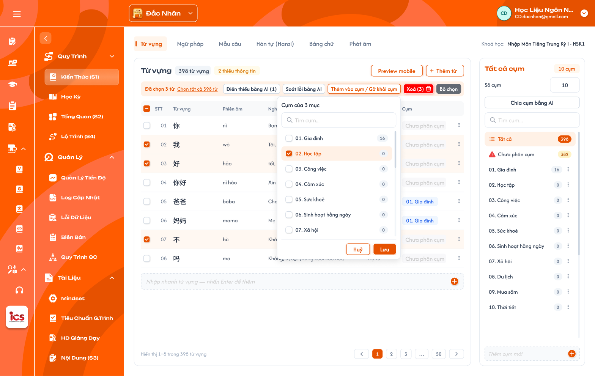</a><br>
  <em>Popup `Cụm của 3 mục` — Figma đang vẽ tick nhiều cụm, <b>cần cập nhật</b> sang chọn 1 cụm — nhấn để xem ảnh gốc</em>
</p>

**Mô tả:**

- Gán các mục đang chọn vào **một** cụm (chuyển cụm nếu đã có), hoặc gỡ khỏi cụm. **Mỗi mục thuộc tối đa 1 cụm.**

**Giải thích field/thành phần:**

| Thành phần | Yêu cầu |
|---|---|
| Tiêu đề | `Cụm của N mục` (N mục đang chọn). |
| Tìm cụm | Tìm theo tên cụm. |
| Danh sách cụm | **Radio** từng cụm + số mục của cụm, thêm lựa chọn `Chưa phân cụm` (= gỡ khỏi cụm). Mọi mục đang chọn cùng cụm thì chọn sẵn cụm đó; khác cụm thì không chọn sẵn. |
| `Huỷ` / `Lưu` | Lưu: mọi mục đang chọn chuyển vào cụm đã chọn (rời cụm cũ); chọn `Chưa phân cụm` thì gỡ khỏi cụm. |

**Điểm cần lưu ý:**

- Popup không tạo cụm mới (tạo cụm ở panel Cụm › `Thêm cụm mới` hoặc qua Chia cụm bằng AI).
- Mục bị gỡ khỏi cụm thì về `Chưa phân cụm`; mục `Chưa phân cụm` không xuất hiện ở bài học nào.
- Chuyển mục sang cụm khác thì bài học liên kết cụm cũ không còn mục, bài học liên kết cụm mới có thêm mục; không cần cảnh báo, không có popup phụ.

#### Testcase — Popup Thêm vào cụm / Gỡ khỏi cụm

| Tên testcase | Priority | Loại test | Scenario | Role | Pre-condition | Given / When / Then | Expected Result |
|---|---| --- |---|---|---|---|---|
| Case 28: Thêm mục vào cụm | High | Smoke | Flow 9 / REQ08 | CD | Chọn 3 từ chưa phân cụm | **Given** popup cụm đang mở<br>**When** chọn `Gia đình`, bấm Lưu<br>**Then** 3 từ thuộc `Gia đình` | - Chỉ chọn được 1 cụm<br>- Số mục `Gia đình` +3, Chưa phân cụm −3 |
| Case 28a: Chuyển cụm mục đang hiển thị ở bài học | High |  | Flow 9 / REQ08 | CD | Từ `爸爸` thuộc `Gia đình` (liên kết Bài 1); `Học tập` liên kết Bài 3 | **Given** popup cụm<br>**When** chọn `Học tập`, Lưu<br>**Then** từ chuyển cụm, không có cảnh báo | - Bài 1 hết `爸爸`, Bài 3 có `爸爸`<br>- Từ rời `Gia đình`, vào `Học tập`, mất khỏi Bài 1 |
| Case 29: Gỡ khỏi cụm | Medium |  | REQ08 | CD | Từ thuộc cụm `Gia đình` | **Given** popup cụm<br>**When** chọn `Chưa phân cụm`, Lưu<br>**Then** từ về `Chưa phân cụm` | - Từ vẫn còn trong khoá |

### Panel Cụm và Số cụm

**Mô tả:**

- Panel bên phải của mỗi tab quản lý cụm của **loại đó** (mỗi loại có bộ cụm riêng): xem số mục mỗi cụm, chọn cụm để
  lọc bảng, thêm / đổi tên / xoá cụm, liên kết cụm với bài học, Chia cụm bằng AI. Cụm **chỉ được tạo** khi CD `Thêm cụm mới`
  hoặc khi `Chia cụm bằng AI`; Tổng quan (S2) **không** tự tạo / xoá cụm, chỉ cung cấp số cụm mặc định cho popup Chia cụm bằng AI.

**Giải thích thành phần:**

| Thành phần | Yêu cầu |
|---|---|
| `Tất cả cụm` + badge `N cụm` | Tiêu đề panel và số cụm hiện có. |
| `Tất cả cụm` (số cụm) | Badge `N cụm` = số cụm hiện có của loại; không có ô nhập Số cụm ở panel (Số cụm nhập trong popup Chia cụm bằng AI). Loại chưa có cụm: panel hiện `Chưa có cụm. Thêm cụm mới hoặc Chia cụm bằng AI.` |
| `Chia cụm bằng AI` | Mở popup Chia cụm bằng AI. |
| Tìm cụm | Tìm theo tên cụm. |
| `Tất cả` | Hiện mọi mục của loại; badge tổng số mục. |
| `Chưa phân cụm` | Mục không thuộc cụm nào; icon cảnh báo + số mục. |
| Dòng cụm | Số thứ tự + tên + số mục + chip bài học đã liên kết (`HK I · Bài 3`) hoặc nhãn cam `Chưa liên kết`; menu ⋮: `Đổi tên`, `Liên kết bài học`, `Xoá cụm`. |
| Popup `Liên kết bài học` | Tiêu đề `Liên kết cụm <tên cụm> với bài học`; cây `<kỳ> › Bài N: <tên>` của khoá, radio chọn **đúng 1 bài**; bài đã có cụm **cùng loại** mờ kèm nhãn `Đã liên kết: <tên cụm kia>`; lựa chọn `Bỏ liên kết`; `Huỷ` / `Lưu`. (**UI cần bổ sung**) |
| `Thêm cụm mới` | Ô nhập cuối danh sách cụm: gõ tên + Enter → tạo cụm rỗng ở cuối (tên trống thì mặc định `Chủ đề {k}`). |
| Popup `Xoá cụm` | Tiêu đề `Xoá cụm`; nội dung `Cụm <tên> có N mục{, đang liên kết <kỳ> · Bài k}. Mục sẽ về Chưa phân cụm, bài học không còn mục của cụm này.`; nút `Huỷ` / `Xoá cụm`. Mục không bị gỡ khỏi khoá. |

**Điểm cần lưu ý:**

- Thêm / xoá cụm làm tại panel này (hoặc AI tạo thêm cụm khi chia); đổi Loại / Số buổi ở S2 **không** làm thay đổi cụm.
- Xoá cụm: mục trong cụm về `Chưa phân cụm`, liên kết cụm ↔ bài học bị bỏ (tag loại ở bài học theo S4 không đổi).
- **Liên kết bài học:** một cụm liên kết **đúng 1** bài học; một bài học nhận **tối đa 1 cụm mỗi loại** (Từ vựng, Ngữ pháp, …, Nghe, Đọc…). BE kiểm tra khi lưu: bài đã có cụm cùng loại → từ chối, Toast `Cảnh Báo` `Bài 1 đã liên kết cụm Từ vựng "Gia đình".`. Đổi sang bài khác = gỡ liên kết cũ, lập liên kết mới. Chi tiết bài học hiển thị mục của cụm đã liên kết (xem khu vực Cụm liên kết với Chi tiết bài học).
- Thêm / gỡ / chuyển mục giữa các cụm **không** cần cảnh báo bài học: bài học luôn hiển thị mục hiện có của cụm đã liên kết.
- Cụm là mắt xích duy nhất giữa mục và bài học: thêm mục vào cụm thì bài học liên kết thấy ngay; gỡ mục khỏi cụm thì bài học không còn mục đó.
- Nhân bản khoá học sao chép cụm, mục trong cụm và liên kết cụm ↔ bài học sang bản sao.

#### Testcase — Panel Cụm và Số cụm

| Tên testcase | Priority | Loại test | Scenario | Role | Pre-condition | Given / When / Then | Expected Result |
|---|---| --- |---|---|---|---|---|
| Case 30: Không tự sinh cụm từ S2 | High | Smoke | Flow 8 / REQ08 | CD | Loại Từ vựng chưa có cụm; S2 có dòng Loại Từ vựng tổng 24 buổi | **Given** mở tab Từ vựng<br>**When** xem panel Cụm; sửa Số buổi ở S2 thành 30, quay lại<br>**Then** panel vẫn `0 cụm`, hiện `Chưa có cụm. Thêm cụm mới hoặc Chia cụm bằng AI.` | - Không có ô Số cụm ở panel<br>- Đổi S2 không tạo / xoá cụm |
| Case 31: Liên kết cụm với bài học | High | Smoke | Flow 8 / REQ08 | CD | Cụm `Gia đình`, Bài 1 chưa có cụm Từ vựng | **Given** ⋮ cụm › `Liên kết bài học`, chọn `HK I · Bài 1`<br>**When** Lưu<br>**Then** dòng cụm hiện chip `HK I · Bài 1`; Chi tiết Bài 1 tab Kiến thức hiện mục của cụm | - Toast `Thành Công` |
| Case 31a: Bài đã có cụm cùng loại | High |  | EX13 / REQ08 | CD | Bài 1 đã liên kết cụm Từ vựng `Gia đình` | **Given** cụm `Học tập` › `Liên kết bài học`<br>**When** xem Bài 1, rồi gửi request trực tiếp<br>**Then** Bài 1 mờ, nhãn `Đã liên kết: Gia đình`; API từ chối | - Bài 1 liên kết được cụm Ngữ pháp |
| Case 31b: Đổi bài học của cụm | Medium |  | Flow 8 / REQ08 | CD | Cụm `Gia đình` đang liên kết Bài 1 | **Given** chọn `HK I · Bài 2`, Lưu<br>**When** lưu xong<br>**Then** Bài 1 hết cụm Từ vựng, Bài 2 có cụm `Gia đình` | - Chọn `Bỏ liên kết` thì cụm về `Chưa liên kết` |
| Case 32: Xoá cụm | Medium |  | Flow 8 / REQ08 | CD | Cụm `Gia đình` có 20 từ, liên kết `HK I · Bài 1` | **Given** ⋮ cụm › `Xoá cụm`<br>**When** xem popup; bấm `Xoá cụm`<br>**Then** cụm bị xoá | - Popup nêu 20 mục và Bài 1<br>- 20 từ về `Chưa phân cụm`, vẫn trong khoá<br>- Chi tiết Bài 1 tab Kiến thức loại Từ vựng hiện trạng thái chưa liên kết; tag `Từ vựng` (theo S4) giữ nguyên |
| Case 30a: Thêm cụm tay | Medium |  | Flow 8 / REQ08 | CD | Có 2 cụm | **Given** ô `Thêm cụm mới`<br>**When** gõ `Gia đình` + Enter; Enter với ô trống<br>**Then** thêm cụm `Gia đình`, rồi `Chủ đề 4` ở cuối | - Badge `4 cụm`<br>- Cụm mới `Chưa liên kết`, 0 mục |
| Case 33: Cụm riêng theo loại | Medium |  | REQ08 | CD | Từ vựng có 24 cụm | **Given** tab Ngữ pháp<br>**When** xem panel Cụm<br>**Then** hiện cụm của Ngữ pháp | - Không lẫn cụm của Từ vựng |

### Popup Chia cụm bằng AI

<p align="center">
  <a href="./images/11-popup-chia-cum-ai.png">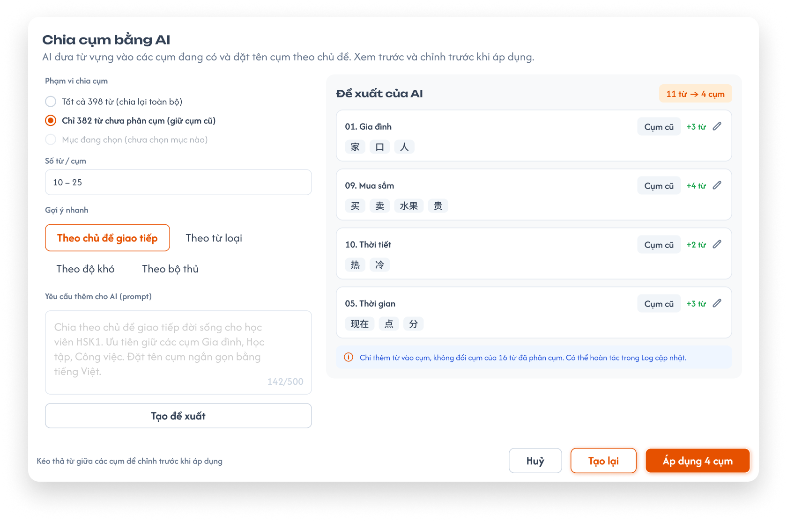</a><br>
  <em>Popup Chia cụm bằng AI — AI đưa từ vào các cụm đang có — nhấn để xem ảnh gốc</em>
</p>

**Mô tả:**

- AI chia các mục vào **đúng Số cụm** CD nhập: dùng các cụm đang có trước, **tạo thêm cụm mới** cho đủ Số cụm, đặt tên cụm
  theo chủ đề và prompt của CD; CD xem trước, chỉnh rồi áp dụng. Ví dụ 500 từ vựng, chưa có cụm, Số cụm 24: AI tạo 24 cụm
  và chia 500 từ vào đó.
- **Số cụm mặc định** = tổng `Số buổi` của các dòng Nội dung buổi học có loại này ở [Tổng quan (S2)](../overview-s2/overview-s2.md)
  (dòng chọn nhiều loại tính cho từng loại). Ví dụ `Từ vựng A` 5 buổi + `Từ vựng B` 10 buổi → mặc định `15`; CD gõ số khác được.

**Giải thích field/thành phần:**

| Thành phần | Yêu cầu |
|---|---|
| Tiêu đề / mô tả | `Chia cụm bằng AI`; `AI đưa từ vựng vào các cụm đang có và đặt tên cụm theo chủ đề. Xem trước và chỉnh trước khi áp dụng.` |
| `Số cụm` | **Bắt buộc**, số nguyên ≥ 1 và ≥ số cụm hiện có của loại. Điền sẵn tổng Số buổi của loại ở S2 kèm ghi chú `Theo Tổng quan (S2) · N buổi`; loại chưa có ở S2 thì để trống. Nhỏ hơn số cụm hiện có: lỗi dưới ô `Số cụm không được nhỏ hơn số cụm hiện có (K). Xoá bớt cụm ở panel Cụm trước.` |
| Phạm vi chia cụm | Chọn 1: `Tất cả N từ (chia lại toàn bộ)`, `Chỉ M từ chưa phân cụm (giữ cụm cũ)`, `Mục đang chọn` (mờ, ghi `chưa chọn mục nào` khi chưa chọn). |
| Số từ / cụm | Khoảng số mục mỗi cụm để AI tham khảo (vd `10 – 25`); **không bắt buộc**, trống thì AI tự cân đối. |
| Gợi ý nhanh | Mẫu tiêu chí điền nhanh vào prompt: `Theo chủ đề giao tiếp`, `Theo từ loại`, `Theo độ khó`, `Theo bộ thủ`. Không có gợi ý theo bài học (cụm không gắn bài học). |
| Yêu cầu thêm cho AI (prompt) | Ô nhập, tối đa 500 ký tự (bộ đếm `x/500`). |
| `Tạo đề xuất` | Gửi yêu cầu cho AI. |
| Đề xuất của AI | Badge `N mục → M cụm`; mỗi cụm 1 thẻ: tên cụm (AI đặt theo chủ đề, sửa được bằng icon bút), nhãn `Cụm cũ` hoặc `Cụm mới`, `+k từ`, danh sách mục. Kéo thả mục giữa các cụm để chỉnh. |
| Ghi chú phạm vi | Vd `Chỉ thêm từ vào cụm, không đổi cụm của 16 từ đã phân cụm`. |
| `Huỷ` / `Tạo lại` / `Áp dụng M cụm` | Huỷ: không đổi gì; Tạo lại: AI đề xuất lại; Áp dụng: lưu phân bổ và tên cụm, ghi 1 dòng `Chia cụm bằng AI: N mục → M cụm` vào Log cập nhật. |

**Điểm cần lưu ý:**

- AI **không tạo cụm con, không xoá cụm**; số cụm sau áp dụng = `Số cụm` đã nhập (cụm cũ giữ nguyên, thiếu thì tạo thêm cụm mới
  nhãn `Cụm mới`). Cụm mới chỉ được lưu khi bấm `Áp dụng`; `Huỷ` thì không tạo cụm nào.
- `Số cụm` trống hoặc 0 → nút `Tạo đề xuất` disable, dưới ô hiện `Nhập Số cụm để chia.`
- Áp dụng với phạm vi `Chỉ M mục chưa phân cụm` chỉ **thêm** mục vào cụm, không đổi cụm của mục đã phân cụm.
- Mỗi mục chỉ thuộc 1 cụm: AI đưa mỗi mục vào đúng 1 cụm; kéo thả trong đề xuất là chuyển cụm.
- Hoàn tác sau khi áp dụng là chức năng của `Log cập nhật` (requirement riêng), không nằm trong S1; dòng ghi chú
  `Có thể hoàn tác trong Log cập nhật` trên popup chỉ dẫn sang đó.

#### Testcase — Popup Chia cụm bằng AI

| Tên testcase | Priority | Loại test | Scenario | Role | Pre-condition | Given / When / Then | Expected Result |
|---|---| --- |---|---|---|---|---|
| Case 34: Chia cụm bằng AI, Số cụm mặc định theo S2 | High | Smoke | Flow 10 / REQ09 | CD | 500 từ chưa phân cụm, chưa có cụm; S2 có `Từ vựng A` 5 buổi, `Từ vựng B` 10 buổi | **Given** mở popup<br>**When** xem ô `Số cụm`; giữ `15`, chọn `Chỉ 500 mục chưa phân cụm`, nhập prompt, `Tạo đề xuất`, `Áp dụng 15 cụm`<br>**Then** tạo 15 cụm và chia 500 từ | - Ô `Số cụm` điền sẵn `15`, ghi chú `Theo Tổng quan (S2) · 15 buổi`<br>- 15 thẻ nhãn `Cụm mới`, tên theo chủ đề<br>- Toast `Thành Công`, badge panel `15 cụm` |
| Case 34a: Sửa Số cụm | High |  | REQ09 | CD | Đang có 10 cụm; mặc định S2 `15` | **Given** popup<br>**When** gõ `20` rồi chia; mở lại, gõ `8`<br>**Then** kết quả | - `20`: đề xuất 10 `Cụm cũ` + 10 `Cụm mới`; áp dụng xong `20 cụm`<br>- `8`: lỗi `Số cụm không được nhỏ hơn số cụm hiện có (20)…`, không gửi AI |
| Case 35: Giữ cụm cũ | High |  | REQ09 | CD | 16 từ đã ở cụm `Gia đình` | **Given** phạm vi `Chỉ … chưa phân cụm`<br>**When** áp dụng<br>**Then** 16 từ giữ nguyên cụm | - Chỉ từ chưa phân cụm được thêm vào cụm |
| Case 36: Chỉnh đề xuất trước khi áp dụng | Medium |  | REQ09 | CD | Đã có đề xuất | **Given** đề xuất AI<br>**When** kéo 1 từ sang cụm khác và sửa tên cụm<br>**Then** áp dụng đúng theo bản đã chỉnh | - Tên cụm theo bản sửa |
| Case 37: Số cụm trống | Medium |  | EX05 | CD | Loại chưa có dòng nào ở S2, chưa có cụm | **Given** popup Chia cụm bằng AI<br>**When** xem ô `Số cụm`; bấm `Tạo đề xuất`<br>**Then** ô trống, nút disable, gợi ý `Nhập Số cụm để chia.` | - Nhập `5` thì nút bật, AI tạo 5 cụm mới |
| Case 38: Huỷ | Low |  | REQ09 | CD | Đã có đề xuất | **Given** popup<br>**When** bấm `Huỷ`<br>**Then** đóng popup | - Cụm không thay đổi<br>- Không có Toast CRUD |

### AI: Thêm bằng AI, Điền thiếu, Soát lỗi, Tạo lại

<p align="center">
  <a href="./images/07-ai-dien-thieu.png">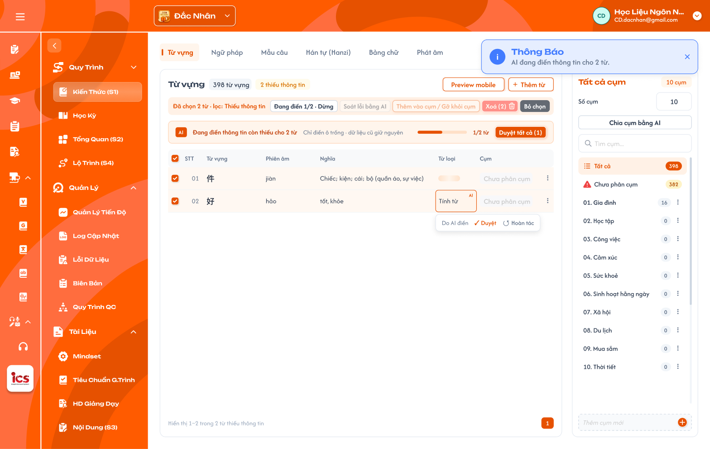</a><br>
  <em>Điền thiếu bằng AI đang chạy (ảnh cũ còn nhãn AI · Duyệt / Hoàn tác — đã bỏ, xem mô tả) — nhấn để xem ảnh gốc</em>
</p>

<p align="center">
  <a href="./images/12-soat-loi-ai.png">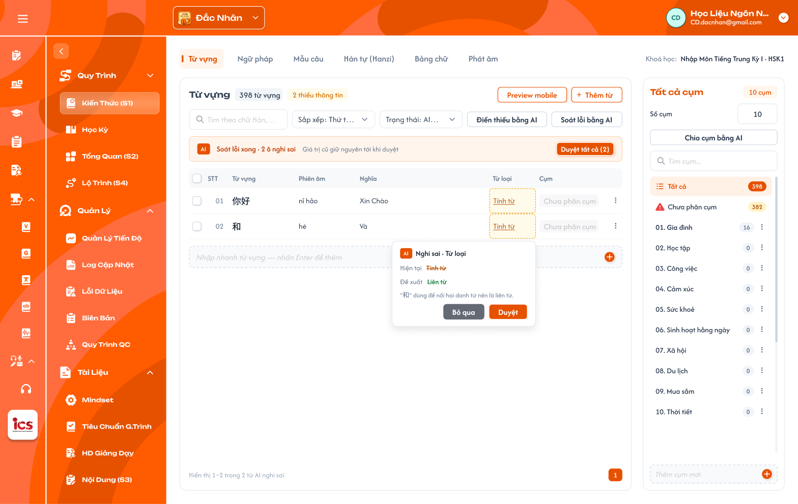</a><br>
  <em>Soát lỗi bằng AI: ô nghi sai viền nét đứt, popover Hiện tại / Đề xuất / lý do — nhấn để xem ảnh gốc</em>
</p>

**Mô tả:** S1 có 4 chức năng AI, mỗi chức năng một nút riêng:

- **Thêm bằng AI:** AI tạo mục mới theo yêu cầu của CD, số lượng 1–50 mục / lần.
- **Điền thiếu bằng AI:** chạy cho các mục **đang chọn**, tối đa **50 mục / lần**; AI tự điền mọi field đang trống và
  **lưu luôn**, giữ nguyên dữ liệu đã có.
- **Soát lỗi bằng AI:** chạy cho **toàn bộ** mục của tab, **không giới hạn** số lượng; AI kiểm tra các field đã có dữ
  liệu (vd phiên âm sai thanh điệu, nghĩa không khớp, từ loại sai), đánh dấu ô nghi sai và đề xuất sửa kèm lý do.
- **Tạo lại:** nút `↻` cạnh từng field trong Chi tiết mục; AI sinh lại giá trị field đó và ghi đè sau khi CD xác nhận.

**Giải thích thành phần:**

| Thành phần | Yêu cầu |
|---|---|
| Popup `Thêm bằng AI` | Ô yêu cầu (prompt, tối đa 500 ký tự), `Số lượng` (số nguyên 1–50, mặc định 10; nhập > 50 báo `Tối đa 50 mục mỗi lần`), `Thêm vào cụm` (mặc định cụm đang chọn), `Tạo`. AI trả bảng xem trước N dòng đủ field; CD bỏ được từng dòng; `Thêm N …` tạo N bản ghi thư viện mới, gắn vào khoá. |
| Điểm gọi Điền thiếu | Thanh hàng loạt `Điền thiếu bằng AI (k)` (mục đang chọn, tối đa 50); menu dòng (1 mục); Preview mobile `Điền thiếu từ này`. |
| Field chính bắt buộc trước khi điền thiếu | Mục phải có field chính thì AI mới điền: Từ vựng → `Từ`; Ngữ pháp → `Tên điểm ngữ pháp`; Mẫu câu → `Câu`; Hanzi, Kanji → `Chữ`; Phát âm → `Âm`; Bảng chữ Nhật → `Hiragana`; Bảng chữ Hàn → `Chữ`. Mục thiếu field chính không được tính vào k và bị bỏ qua. |
| Thanh tiến độ Điền thiếu | `Đang điền thông tin còn thiếu cho N từ · Chỉ điền ô trống · dữ liệu cũ giữ nguyên`, thanh `x/N từ`; nút `Đang điền x/N · Dừng` trên thanh hàng loạt. Toast `Thông Báo` — `AI đang điền thông tin cho N từ.` |
| Kết quả Điền thiếu | Giá trị AI điền **lưu ngay** như CD tự nhập: không nhãn / tag AI, không trạng thái chờ duyệt, không `Duyệt` / `Hoàn tác`. Mục đủ field bắt buộc thì hết `Thiếu thông tin`. |
| Điểm gọi Soát lỗi | Nút `Soát lỗi bằng AI` ở thanh công cụ, luôn chạy cho toàn bộ mục của tab (không phụ thuộc mục đang chọn, không giới hạn 50). |
| Thanh kết quả Soát lỗi | `Soát lỗi xong · N ô nghi sai · Giá trị cũ giữ nguyên tới khi duyệt`, `Duyệt tất cả (N)`; bảng lọc `AI nghi sai`. |
| Ô AI nghi sai | Viền nét đứt; bấm ô hiện popover `Nghi sai · <tên field>`: `Hiện tại` (gạch ngang), `Đề xuất`, lý do (vd `"和" dùng để nối hai danh từ nên là liên từ.`); `Bỏ qua` / `Duyệt` (thay bằng đề xuất). |
| `↻ Tạo lại` (Chi tiết mục) | Có ở mọi field văn bản và media (ảnh, audio), trừ field hệ thống tự sinh (Phiên âm từng chữ, Chuỗi tìm kiếm Kanji). Bấm → xác nhận `Tạo lại <tên field>? Giá trị hiện tại sẽ bị thay.` → AI sinh giá trị mới, ghi đè, Toast `Thành Công`. |

**Điểm cần lưu ý:**

- Điền thiếu chỉ điền field **đang trống**; không sửa field đã có dữ liệu. Media (ảnh, audio) không tự điền, tạo bằng
  `↻ Tạo lại` ở Chi tiết mục.
- `Dừng`: mục chưa xử lý giữ nguyên; mục đã điền giữ giá trị AI đã lưu.
- Đề xuất của Soát lỗi **không ghi đè** giá trị cũ cho tới khi CD duyệt.
- Lọc Trạng thái có `AI nghi sai` để duyệt nhanh kết quả Soát lỗi; không còn lọc `AI chờ duyệt`.
- **Khoá mục AI đang xử lý:** trong lúc Điền thiếu / Soát lỗi / Tạo lại chạy, các mục đang xử lý không sửa inline được,
  không mở Chi tiết mục để sửa, `Xoá`, `Thêm vào cụm / Gỡ khỏi cụm` mờ; thanh hàng loạt chỉ còn `Dừng`, `Bỏ chọn`.
  Mục khác và Nhập nhanh vẫn thao tác bình thường. API thay đổi mục đang xử lý bị từ chối (EX10).

#### Testcase — AI: Thêm bằng AI, Điền thiếu, Soát lỗi, Tạo lại

| Tên testcase | Priority | Loại test | Scenario | Role | Pre-condition | Given / When / Then | Expected Result |
|---|---| --- |---|---|---|---|---|
| Case 38a: Thêm bằng AI theo số lượng | High | Smoke | Flow 6a / REQ10 | CD | Tab Từ vựng | **Given** popup `Thêm bằng AI`, prompt `từ vựng chủ đề gia đình`, Số lượng `10`<br>**When** bấm `Tạo` rồi `Thêm 10 từ`<br>**Then** 10 từ mới đủ field trong S1 | - Tạo bản ghi thư viện mới, vào cụm đang chọn<br>- Toast `Thành Công` |
| Case 38b: Thêm bằng AI quá 50 | Medium |  | REQ10 | CD | Popup `Thêm bằng AI` | **Given** nhập Số lượng `60`<br>**When** bấm `Tạo`<br>**Then** báo `Tối đa 50 mục mỗi lần`, không gửi yêu cầu | - API với số lượng > 50 bị từ chối |
| Case 39: Điền thiếu lưu luôn | High | Smoke | Flow 6 / REQ10 | CD | Từ `好` thiếu Từ loại | **Given** menu dòng của `好`<br>**When** chọn `Điền thiếu bằng AI`<br>**Then** Từ loại được lưu ngay | - Không có nhãn AI, không chờ duyệt<br>- Mục tính là đủ thông tin (nếu đủ field bắt buộc) |
| Case 40: Chỉ điền ô trống | High |  | REQ10 | CD | Từ có Nghĩa, thiếu Phiên âm | **Given** chạy Điền thiếu<br>**When** AI xử lý xong<br>**Then** Phiên âm được điền | - Nghĩa giữ nguyên |
| Case 41: Thiếu field chính thì không điền | High |  | REQ10 | CD | Mục Từ vựng chỉ có Nghĩa, trống `Từ` (tạo qua API / dữ liệu cũ) | **Given** chọn mục đó và 1 từ thiếu Phiên âm<br>**When** xem nút<br>**Then** `Điền thiếu bằng AI (1)` | - Chạy xong chỉ từ có `Từ` được điền; mục trống `Từ` giữ nguyên |
| Case 42: Dừng giữa chừng | Medium |  | REQ10 / EX04 | CD | Đang điền 1/2 từ | **Given** thanh tiến độ<br>**When** bấm `Dừng`<br>**Then** từ thứ 2 không được điền | - Từ thứ 1 giữ giá trị AI đã lưu |
| Case 43a: Khoá mục đang AI xử lý | High |  | REQ10 / EX10 | CD | Đang điền 1/2 từ | **Given** thanh hàng loạt<br>**When** xem nút và thử sửa inline mục đang xử lý<br>**Then** `Xoá (2)`, `Thêm vào cụm / Gỡ khỏi cụm` mờ, không sửa được | - Mục khác và Nhập nhanh vẫn dùng được<br>- Gọi API xoá mục đang xử lý bị từ chối |
| Case 43: Soát lỗi toàn bộ tab | High |  | Flow 7 / REQ10 | CD | Tab có 120 từ, 1 từ phiên âm sai thanh điệu, không chọn mục nào | **Given** thanh công cụ<br>**When** bấm `Soát lỗi bằng AI`<br>**Then** AI soát cả 120 từ, ô phiên âm sai được đánh dấu kèm đề xuất | - Không giới hạn 50<br>- Giá trị cũ giữ nguyên tới khi duyệt<br>- Có trong lọc `AI nghi sai` |

### Preview mobile

<p align="center">
  <a href="./images/06-preview-mobile.png">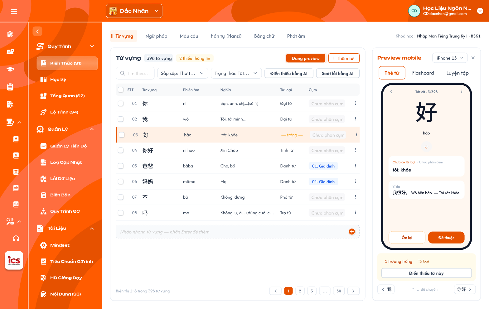</a><br>
  <em>Preview mobile theo từ đang chọn — nhấn để xem ảnh gốc</em>
</p>

**Mô tả:**

- Xem trước mục đang chọn như trên app học viên; panel Preview thay chỗ panel Cụm. Mọi loại kiến thức đều có Preview,
  mỗi loại 1 dạng thẻ riêng.

**Giải thích thành phần:**

| Thành phần | Yêu cầu |
|---|---|
| Nút | `Preview mobile` đổi thành `Đang preview` khi panel mở; `×` đóng panel. |
| Thiết bị | Chọn kích thước máy (vd `iPhone 15`). |
| Tab dạng thẻ | Từ vựng: `Thẻ từ`, `Flashcard`, `Luyện tập`. Loại khác: tái hiện đúng **màn học thật của app học viên** cho loại đó (danh sách thẻ từng loại — mục 3, chờ ảnh màn app). |
| Thẻ | Vị trí `Tất cả · 3/398`; nội dung theo field của mục; icon loa phát Audio (không có file thì TTS). |
| Thông tin thiếu | `N trường trống` + tên field + `Điền thiếu từ này`. |
| Điều hướng | Nút mục trước / sau, phím ↑ ↓ để chuyển. |

**Điểm cần lưu ý:**

- Preview chỉ hiển thị, nút học viên trên thẻ (`Ôn lại`, `Đã thuộc`) không ghi dữ liệu học.
- Giá trị do Điền thiếu bằng AI điền đã lưu như giá trị chính thức; đề xuất của Soát lỗi chưa duyệt không hiển thị.
- **UI cần bổ sung:** Preview cho Ngữ pháp, Mẫu câu, Hán tự, Kanji, Bảng chữ, Phát âm — vẽ theo màn app học viên
  sau khi có ảnh / mô tả màn app (mục 3).

#### Testcase — Preview mobile

| Tên testcase | Priority | Loại test | Scenario | Role | Pre-condition | Given / When / Then | Expected Result |
|---|---| --- |---|---|---|---|---|
| Case 44: Xem trước từ đang chọn | Medium |  | Flow 13 / REQ12 | CD | Đang chọn từ `好` | **Given** bấm `Preview mobile`<br>**When** panel mở<br>**Then** hiện thẻ của `好` | - Vị trí `3/398`<br>- Hiện `1 trường trống · Từ loại` |
| Case 45: Chuyển mục bằng phím | Low |  | REQ12 | CD | Panel Preview đang mở | **Given** đang xem `好`<br>**When** nhấn ↓<br>**Then** chuyển sang mục kế tiếp | - Dòng tương ứng trên bảng được chọn |

### Popup xác nhận gỡ mục khỏi khoá

<p align="center">
  <a href="./images/13-popup-go-muc.png">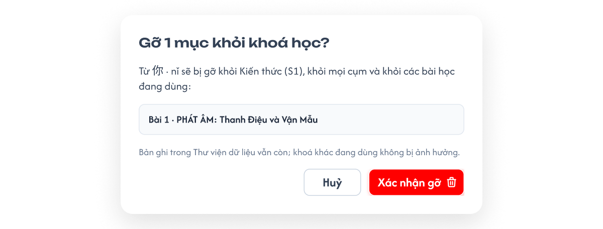</a><br>
  <em>Popup gỡ mục khỏi khoá học, liệt kê bài đang dùng — nhấn để xem ảnh gốc</em>
</p>

**Mô tả:**

- `Xoá khỏi danh sách` (1 mục) hoặc `Xoá (N)` (hàng loạt) **gỡ mục khỏi khoá học**; bản ghi thư viện vẫn còn.

**Giải thích thành phần:**

| Thành phần | Yêu cầu |
|---|---|
| Tiêu đề | `Gỡ N mục khỏi khoá học?` |
| Nội dung | Vd `Từ 你 · nǐ sẽ bị gỡ khỏi Kiến thức (S1), khỏi cụm và khỏi bài học mà cụm liên kết:` + dòng `Cụm <tên> · <kỳ> · <bài>` (nếu mục thuộc cụm đã liên kết). |
| Ghi chú | `Bản ghi trong Thư viện dữ liệu vẫn còn; khoá khác đang dùng không bị ảnh hưởng.` |
| `Huỷ` | Đóng popup, không thay đổi. |
| `Xác nhận gỡ` | Gỡ mục khỏi khoá và khỏi cụm; bài học liên kết cụm không còn mục này. |
| Mục chưa phân cụm hoặc cụm chưa liên kết | Không hiện dòng bài học, chỉ hiện nội dung gỡ khỏi S1 (và cụm). |

**Điểm cần lưu ý:**

- Gỡ không xoá bản ghi thư viện; khoá khác đang dùng bản ghi không bị ảnh hưởng.

#### Testcase — Popup xác nhận gỡ mục khỏi khoá

| Tên testcase | Priority | Loại test | Scenario | Role | Pre-condition | Given / When / Then | Expected Result |
|---|---| --- |---|---|---|---|---|
| Case 46: Gỡ mục thuộc cụm đã liên kết bài học | High | Smoke | Flow 11 / REQ07 | CD | Từ `你` thuộc cụm `Chào hỏi` liên kết Bài 1 | **Given** menu dòng `Xoá khỏi khoá`<br>**When** popup nêu `Cụm Chào hỏi · HK I · Bài 1`, xác nhận<br>**Then** từ mất khỏi S1, cụm và Bài 1 | - Bản ghi thư viện còn<br>- Khoá khác không đổi |
| Case 47: Huỷ gỡ | Medium |  | REQ07 | CD | Popup đang mở | **Given** popup xác nhận<br>**When** bấm `Huỷ`<br>**Then** không thay đổi | - Không có Toast CRUD |

### Cụm liên kết với Chi tiết bài học

<p align="center">
  <a href="./images/19-popup-them-vao-bai.png">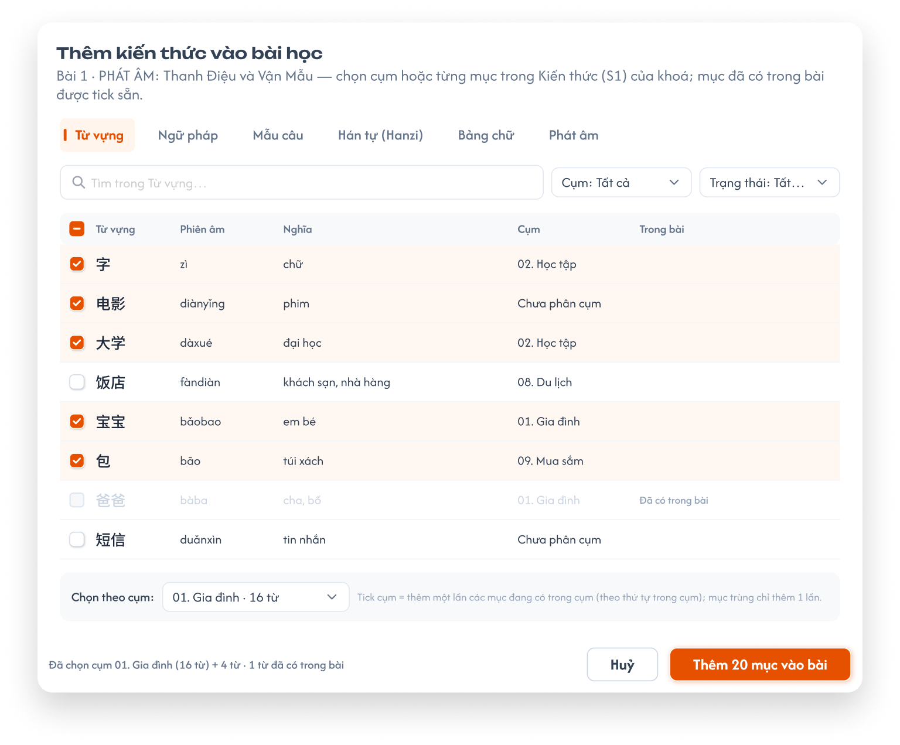</a><br>
  <em>Figma `CD-KH-030270` vẽ popup thêm từng mục vào bài học — <b>đã bỏ</b>, bài học chỉ hiển thị mục của cụm đã liên kết; cần vẽ lại tab chỉ xem — nhấn để xem ảnh gốc</em>
</p>

**Mô tả:**

- Bài học **không** chọn mục; liên kết duy nhất là **cụm ↔ bài học** lập tại panel Cụm của S1 (menu ⋮ cụm › `Liên kết bài học`). Tab `Kiến thức` của Chi tiết bài học chỉ **hiển thị** mục hiện có của các cụm đã liên kết với bài đó, lọc theo loại; không có nút thêm, gỡ, sửa.
- Đặc tả UI chi tiết (bộ lọc loại, tiêu đề theo tên cụm, 2 khung) xem [Học kỳ — Bài học](../semester/lesson/lesson.md) tab Kiến thức; mục dưới đây chỉ ghi quy tắc dữ liệu S1.
- **Tag loại và badge tab** ở Chi tiết bài học **không** lấy từ cụm mà từ tick ở [Lộ trình (S4)](../learning-path-s4/learning-path-s4.md) tab `Kiến thức/Kỹ năng` (độc lập với cụm).

**Giải thích thành phần:**

| Thành phần | Yêu cầu |
|---|---|
| Nguồn dữ liệu | Với mỗi loại kiến thức, bài học có tối đa 1 cụm liên kết; tab hiện mục của cụm đó theo `Thứ tự trong cụm`. |
| Bộ lọc loại | Mặc định `Từ vựng`; đổi loại thì hiện cụm của loại đó. |
| Tiêu đề khung | Tên cụm đã liên kết (vd `Cụm từ vựng: Gia đình · 16 từ`); chưa liên kết hiện `Chưa có cụm Từ vựng liên kết với bài này` + hướng dẫn `Liên kết tại Kiến thức (S1) › panel Cụm`. |
| Đồng bộ | Thêm / gỡ / chuyển mục trong cụm ở S1, đổi tên cụm, đổi liên kết → bài học cập nhật ngay, không cần thao tác ở bài học. |

**Điểm cần lưu ý:**

- Mục `Chưa phân cụm` và mục thiếu thông tin vẫn hiện ở bài học nếu thuộc cụm liên kết (mục thiếu có chấm cam), vì bài học chỉ phản ánh cụm.
- Nội dung mục luôn là nội dung hiện tại của bản ghi thư viện.
- Gỡ mục khỏi khoá (Flow 11) thì mục mất khỏi cụm và khỏi bài học liên kết, có cảnh báo nêu cụm và bài học.

#### Testcase — Cụm liên kết với Chi tiết bài học

| Tên testcase | Priority | Loại test | Scenario | Role | Pre-condition | Given / When / Then | Expected Result |
|---|---| --- |---|---|---|---|---|
| Case 48: Bài học hiện mục của cụm liên kết | High | Smoke | Flow 12 / REQ13 | CD | Cụm `Gia đình` (16 từ) liên kết Bài 1 | **Given** mở Chi tiết Bài 1, tab Kiến thức<br>**When** lọc `Từ vựng`<br>**Then** tiêu đề `Cụm từ vựng: Gia đình · 16 từ`, 16 từ đúng thứ tự trong cụm | - Không có nút +, × |
| Case 49: Thêm mục vào cụm, bài học cập nhật | High | Smoke | Flow 12 / REQ13 | CD | Như Case 48 | **Given** ở S1 thêm 1 từ vào cụm `Gia đình`<br>**When** mở lại Bài 1<br>**Then** 17 từ | - Gỡ 1 từ khỏi cụm thì còn 16 |
| Case 50: Loại chưa liên kết | Medium |  | REQ13 | CD | Bài 1 chưa có cụm Ngữ pháp | **Given** tab Kiến thức, lọc `Ngữ pháp`<br>**When** render<br>**Then** `Chưa có cụm Ngữ pháp liên kết với bài này` + hướng dẫn | - Badge tab đếm loại này nếu đã tick ở S4, không phụ thuộc cụm |
| Case 51: Không thao tác tại bài học | Medium |  | REQ13 | CD | Bài có kiến thức | **Given** tab Kiến thức<br>**When** xem thao tác; gửi API gắn mục vào bài<br>**Then** không có thêm / gỡ / sửa; API từ chối | - Chỉ liên kết qua cụm ở S1 |

### Toast phản hồi CRUD

<p align="center">
  <a href="../../images/01-toast-crud.png"></a><br>
  <em>Toast Thành Công, Thông Báo, Cảnh Báo và Có Lỗi Xảy Ra — nhấn để xem ảnh gốc</em>
</p>

**Mô tả:**

- Phản hồi sau thêm / sửa / nhân bản / gỡ mục, thao tác cụm, liên kết bài học và áp dụng AI.

**Giải thích thành phần:**

| Loại Toast | Tiêu đề cố định | Khi sử dụng |
|---|---|---|
| Thành công | `Thành Công` | Backend đã xác nhận thao tác thay đổi dữ liệu thành công (vd `Đã thêm 1 từ vào Chưa phân cụm.`). |
| Thông tin | `Thông Báo` | Thao tác đã được tiếp nhận nhưng cần thời gian xử lý (vd `AI đang điền thông tin cho 2 từ.`). |
| Cảnh báo | `Cảnh Báo` | Dữ liệu chưa hợp lệ hoặc điều kiện cần kiểm tra (vd `Liên kết bài học` bị từ chối vì bài đã có cụm cùng loại). |
| Lỗi | `Có Lỗi Xảy Ra` | Backend / network / AI không hoàn tất thao tác. |

**Điểm cần lưu ý:**

- Mỗi thao tác logic chỉ một Toast kết quả; Huỷ, tìm kiếm, lọc, đổi tab, Preview không có Toast CRUD.
- Toast không thay thế lỗi tại field; không chứa thông tin kỹ thuật.

#### Testcase — Toast phản hồi CRUD

| Tên testcase | Priority | Loại test | Scenario | Role | Pre-condition | Given / When / Then | Expected Result |
|---|---| --- |---|---|---|---|---|
| Toast Case 1: Thành công | High |  | REQ15 | CD | Dữ liệu hợp lệ | **Given** CD xác nhận thao tác thay đổi<br>**When** backend xử lý thành công<br>**Then** hiển thị `Thành Công` | - Chỉ sau khi backend xác nhận<br>- Đúng một Toast |
| Toast Case 2: Cảnh báo | High |  | REQ15 | CD | Điều kiện chưa đủ | **Given** chia cụm AI khi loại chưa có cụm<br>**When** bấm `Chia cụm bằng AI`<br>**Then** hiển thị `Cảnh Báo` — `Nhập Số cụm trước khi chia cụm bằng AI.` | - Không gửi yêu cầu |
| Toast Case 3: Lỗi xử lý | High |  | REQ15 | CD | Backend / AI lỗi | **Given** đã gửi thao tác hợp lệ<br>**When** xử lý thất bại<br>**Then** hiển thị `Có Lỗi Xảy Ra` | - Dữ liệu không cập nhật một phần |
| Toast Case 4: Đang xử lý | Medium |  | REQ15 | CD | AI chạy cho nhiều mục | **Given** đã bấm Điền thiếu cho nhiều mục<br>**When** AI đang chạy<br>**Then** hiển thị `Thông Báo` nếu cần | - Không báo thành công sớm |

---

## 2. Yêu cầu

### 2.1. Flow chính

**Flow 1 / REQ01 / REQ02 / REQ11: Mở Kiến thức (S1) và xem danh sách**

```text
CD chọn trung tâm ở header → vào khoá học → Kiến thức (S1)
      → Hệ thống hiện 6 tab loại kiến thức; trung tâm có hệ chữ riêng có thêm tab Bảng chữ
      → Mở tab đầu (Từ vựng): bảng mục của khoá + panel Cụm của Từ vựng
      → CD tìm kiếm / sắp xếp / lọc Trạng thái / chọn cụm → bảng, badge, phân trang cập nhật
```

**Flow 2 / REQ04 / REQ05: Thêm từ thư viện dữ liệu**

```text
CD bấm + Thêm → Thêm từ thư viện → popup thư viện
      → Lọc Kho (Tất cả / Từ điển / Khoá học), Cấp độ, Từ loại, tìm kiếm → tick các mục (không khoá mục đã có trong khoá)
      → Chọn Thêm vào cụm (mặc định cụm đang chọn) → Thêm N
      → Thành công: gắn tham chiếu bản ghi thư viện vào khoá, thêm vào cụm đã chọn, Toast Thành Công
      → Thất bại: không gắn mục nào, Toast Có Lỗi Xảy Ra
```

**Flow 3 / REQ05 / REQ10: Thêm theo list**

```text
CD bấm + Thêm → Thêm theo list → dán / nhập mỗi dòng 1 mục, các field tách dấu phẩy
      → Hệ thống tách cột, xem trước: Hợp lệ / AI điền … / lỗi thiếu cột đầu (không kiểm tra trùng)
      → (Tuỳ chọn) AI tự điền field trống sau khi thêm — lưu luôn, theo rule Điền thiếu
      → Thêm N → tạo N bản ghi thư viện mới, gắn vào khoá (và cụm đang chọn)
      → (Tuỳ chọn) Tự chia cụm bằng AI → mở Flow 10 cho các mục vừa thêm
```

**Flow 4 / REQ05: Nhập nhanh**

```text
CD gõ field đầu vào ô Nhập nhanh → Enter / +   (Thêm theo list: mỗi dòng theo thứ tự cột của loại)
      → Tạo bản ghi thư viện mới, gắn vào khoá, thêm dòng cuối bảng (vào cụm đang chọn nếu có)
      → Mục tính là Thiếu thông tin cho tới khi đủ field bắt buộc
```

**Flow 5 / REQ06: Sửa và nhân bản mục**

```text
CD chọn Sửa nhanh (inline) hoặc Mở chi tiết (drawer đủ field, danh sách ví dụ, audio) → sửa field → lưu
      → Lưu vào bản ghi thư viện → mọi khoá / bài học dùng bản ghi thấy nội dung mới
CD chọn Nhân bản → tạo bản ghi thư viện mới cùng nội dung, gắn vào khoá, cùng cụm
```

**Flow 6a / REQ10: Thêm bằng AI**

```text
CD bấm Thêm bằng AI → nhập yêu cầu, Số lượng (1–50), Thêm vào cụm → Tạo
      → AI trả bảng xem trước N mục đủ field → CD bỏ dòng không dùng → Thêm N
      → Tạo N bản ghi thư viện mới, gắn vào khoá (và cụm đã chọn), Toast Thành Công
```

**Flow 6 / REQ10: Điền thiếu bằng AI**

```text
CD chọn mục (tối đa 50) → Điền thiếu bằng AI (k)   (hoặc menu dòng / Preview: 1 mục)
      → Bỏ qua mục thiếu field chính (vd Từ vựng chưa có Từ)
      → AI điền mọi field đang trống; thanh tiến độ x/N, có Dừng; mục đang xử lý bị khoá thao tác
      → Giá trị lưu luôn, không nhãn AI, không chờ duyệt
```

**Flow 6b / REQ10: Tạo lại một field**

```text
CD mở Chi tiết mục → bấm ↻ Tạo lại cạnh field → xác nhận
      → AI sinh giá trị mới cho field đó → ghi đè giá trị cũ, Toast Thành Công (Huỷ: không đổi)
```

**Flow 7 / REQ10: Soát lỗi bằng AI**

```text
CD bấm Soát lỗi bằng AI ở thanh công cụ (toàn bộ mục của tab, không giới hạn số lượng)
      → AI kiểm tra field đã có dữ liệu → đánh dấu ô nghi sai + giá trị đề xuất
      → CD Duyệt (thay bằng đề xuất) hoặc Bỏ qua; giá trị cũ giữ nguyên tới khi duyệt
```

**Flow 8 / REQ08: Thêm / đổi tên / xoá cụm và liên kết bài học**

```text
CD Thêm cụm mới (tên + Enter) → cụm rỗng ở cuối; Tổng quan (S2) không tự tạo / xoá cụm
CD Đổi tên cụm → lưu tên mới
CD ⋮ cụm › Xoá cụm → popup nêu số mục + bài liên kết → Xoá: mục về Chưa phân cụm, bỏ liên kết bài học
CD ⋮ cụm › Liên kết bài học → popup cây kỳ › bài, bài đã có cụm cùng loại bị mờ → chọn 1 bài → Lưu
      → BE kiểm tra: bài chưa có cụm cùng loại → lưu liên kết (gỡ liên kết cũ của cụm nếu có); có rồi → từ chối (EX13)
      → Chi tiết bài học hiện mục của cụm
CD chọn Bỏ liên kết → cụm về Chưa liên kết, bài học không còn mục của cụm
```

**Flow 9 / REQ08: Thêm vào cụm / Gỡ khỏi cụm**

```text
CD chọn 1 hoặc nhiều mục → Thêm vào cụm / Gỡ khỏi cụm
      → Chọn 1 cụm hoặc Chưa phân cụm → Lưu
      → Mục chuyển vào cụm / về Chưa phân cụm; bài học liên kết cụm cũ / mới phản ánh ngay, không cảnh báo
```

**Flow 10 / REQ09: Chia cụm bằng AI**

```text
CD bấm Chia cụm bằng AI
      → Ô Số cụm điền sẵn = tổng Số buổi của loại ở S2 (CD sửa được, ≥ số cụm hiện có, bắt buộc)
      → Chọn phạm vi, Số từ / cụm (tuỳ chọn), gợi ý nhanh, nhập prompt → Tạo đề xuất
      → AI dùng cụm đang có + tạo thêm cụm mới cho đủ Số cụm, đặt tên theo chủ đề (không tạo cụm con)
      → CD kéo thả mục giữa cụm, sửa tên cụm; Tạo lại nếu cần
      → Áp dụng: lưu phân bổ + tên cụm, ghi Log cập nhật, Toast Thành Công; Huỷ: không đổi
```

**Flow 11 / REQ07: Gỡ mục khỏi khoá**

```text
CD chọn Xoá khỏi danh sách (1 mục) hoặc Xoá (N)
      → Popup xác nhận: số mục + các bài học đang dùng mục
      → Xác nhận: gỡ mục khỏi khoá, khỏi các cụm và khỏi các bài học; bản ghi thư viện vẫn còn
      → Huỷ: không thay đổi
```

**Flow 12 / REQ13: Xem kiến thức của bài học theo cụm liên kết**

```text
CD mở Chi tiết bài học → tab Kiến thức (mặc định lọc Từ vựng)
      → Hệ thống tìm cụm của loại đó đã liên kết với bài → hiện tên cụm + mục của cụm theo thứ tự trong cụm
      → Đổi loại → hiện cụm liên kết của loại mới; chưa liên kết → thông báo và hướng dẫn liên kết tại S1
CD sửa cụm ở S1 (thêm / gỡ / chuyển mục, đổi tên, đổi liên kết) → bài học cập nhật ngay, không thao tác tại bài
```

**Flow 14 / REQ16: Bộ câu hỏi của mục**

```text
CD mở Chi tiết mục → tab Câu hỏi (badge số câu)
      → Thêm / sửa / xoá câu, câu con, Generate / Soát lỗi bằng AI: như BTVN & Kiểm tra, lưu ngay từng thao tác
      → Import Excel: mọi dòng đủ STT, Câu hỏi, Loại câu vào mục đang mở; cột id bỏ qua; dòng lỗi bỏ, báo theo số dòng
      → Export Excel: tải bộ câu hỏi của mục
      → App học viên dùng bộ câu hỏi ở chế độ Luyện tập; mục không có câu hỏi thì app tự sinh như cũ
```

**Flow 13 / REQ12: Preview mobile**

```text
CD chọn mục → Preview mobile → panel hiện thẻ theo màn học của app học viên cho loại đó
      → Chuyển mục bằng nút / ↑ ↓; mục thiếu thì hiện field trống + Điền thiếu từ này
```

### 2.2. Ngoại lệ

- **EX01:** Dòng Thêm theo list thiếu cột đầu → dòng báo lỗi, không tạo; các dòng hợp lệ khác vẫn thêm được.
- **EX02:** Nhập nhanh rỗng hoặc chỉ khoảng trắng → không tạo mục.
- **EX03:** Điền thiếu bằng AI quá 50 mục / lần hoặc Thêm bằng AI số lượng > 50 → UI chặn (nút mờ / báo `Tối đa 50 mục mỗi lần`); API từ chối, không chạy AI.
- **EX04:** AI lỗi hoặc CD bấm `Dừng` → mục chưa xử lý giữ nguyên; mục đã điền giữ giá trị AI đã lưu; báo lỗi nếu AI
  lỗi.
- **EX05:** Chia cụm bằng AI khi `Số cụm` trống / 0 → nút `Tạo đề xuất` disable, gợi ý nhập Số cụm; nhỏ hơn số cụm hiện có → lỗi dưới ô, không gửi AI.
- **EX06:** Role khác CD truy cập S1 hoặc gọi API thay đổi kiến thức → từ chối, không thay đổi dữ liệu.
- **EX07:** Truy cập tab Bảng chữ ở trung tâm không có hệ chữ riêng (qua URL / API) → từ chối.
- **EX08:** Truy cập khoá học / kiến thức của trung tâm khác trung tâm đang chọn → từ chối.
- **EX09:** Lưu thất bại (sửa, cụm, liên kết bài học, áp dụng AI) → giữ dữ liệu cũ, Toast `Có Lỗi Xảy Ra`.
- **EX10:** Sửa / xoá / đổi cụm mục đang được AI xử lý → UI mờ thao tác; API từ chối, dữ liệu không đổi.
- **EX11:** Đổi Loại / Số buổi ở Tổng quan (S2) → không tạo / xoá cụm ở S1; chỉ đổi số mặc định của ô `Số cụm` trong popup Chia cụm bằng AI.
- **EX13:** Liên kết cụm với bài học đã có cụm cùng loại, hoặc với bài học không thuộc khoá → BE từ chối (409), Toast `Cảnh Báo` nêu cụm đang chiếm; dữ liệu không đổi.
- **EX14:** Import (kiến thức hoặc câu hỏi) có cột `id`, `lesson_id`, mã mục sai / thuộc mục khác / không có → bỏ qua cột, vẫn import vào chỗ đang mở; dòng thiếu field bắt buộc → bỏ dòng, các dòng khác vẫn import, báo lỗi theo số dòng.
- **EX12:** Lưu Chi tiết mục với Ví dụ rỗng (0 ví dụ) hoặc Từ loại ngoài danh sách → báo lỗi tại field, không lưu.

### 2.3. Yêu cầu khác

- **REQ01 – Phạm vi:** Mỗi khoá học có danh sách Kiến thức (S1) riêng; dữ liệu theo trung tâm CD đang chọn ở header.
- **REQ02 – Tab theo loại:** Mỗi loại kiến thức 1 tab; mọi trung tâm có đủ Từ vựng, Ngữ pháp, Mẫu câu, Hanzi, Kanji,
  Phát âm; tab Bảng chữ chỉ ở trung tâm có hệ chữ riêng (Sakumi, Saechang) theo bảng ở khu vực Khung màn hình; khoá
  học không có field ngôn ngữ. Ngôn ngữ của trung tâm chỉ quyết định danh sách Từ loại và nội dung Bảng chữ.
- **REQ03 – Field và thiếu thông tin:** Mỗi loại có bộ field theo bảng Field và Phụ lục A; mục thiếu thông tin khi trống
  bất kỳ field bắt buộc; Từ loại chọn 1 hoặc nhiều giá trị từ danh sách cố định theo ngôn ngữ; Bộ thủ chọn 1 trong 214
  bộ Khang Hy; Ví dụ của Từ vựng / Ngữ pháp là danh sách ≥ 1 (câu, phiên âm, nghĩa); furigana và chuỗi tìm kiếm
  Kanji do hệ thống sinh.
- **REQ04 – Thư viện dữ liệu:** Mục của S1 là tham chiếu bản ghi thư viện; không có rule bắt trùng — một bản ghi gắn được nhiều lần vào cùng khoá. Thêm
  mới tại S1 tạo bản ghi thư viện; sửa tại S1 sửa bản ghi thư viện (mọi khoá dùng bản ghi đổi theo). Thư viện theo
  ngôn ngữ, có 2 kho `Từ điển` (import sẵn) và `Khoá học` (tạo từ S1); màn quản lý thư viện là requirement riêng.
- **REQ05 – Thêm mục:** Thêm từ thư viện, Thêm theo list (mỗi dòng 1 mục theo thứ tự cột của loại, tách dấu phẩy, chỉ cột
  đầu bắt buộc, nhiều giá trị trong 1 cột tách `;`), Nhập nhanh.
  Không kiểm tra trùng ở bất kỳ cách thêm nào (thư viện, list, nhập nhanh, AI, import). Thêm bằng AI tối đa 50 mục / lần.
- **REQ06 – Sửa và nhân bản:** Sửa nhanh inline và drawer Chi tiết mục (đủ field, danh sách ví dụ, audio, `↻ Tạo lại`
  từng field); Nhân bản tạo bản ghi thư viện mới cùng nội dung, cùng cụm.
- **REQ07 – Gỡ khỏi khoá:** Xoá ở S1 là gỡ mục khỏi khoá (bản ghi thư viện còn); có xác nhận, liệt kê bài đang dùng; xác
  nhận thì gỡ luôn khỏi các bài đó.
- **REQ08 – Cụm:** Mỗi loại có bộ cụm riêng; cụm chỉ được tạo khi CD `Thêm cụm mới` hoặc `Chia cụm bằng AI` (S2 không tự
  tạo / xoá cụm); CD đổi tên, xoá cụm (mục về `Chưa phân cụm`), chia mục. **Mỗi mục thuộc tối đa 1 cụm**; cột Cụm
  hiện 1 nhãn, bấm mở popup cụm (chọn 1). **Mỗi cụm liên kết đúng 1 bài học; mỗi bài học nhận tối đa 1 cụm mỗi loại**, BE
  kiểm tra trùng khi lưu (EX13); liên kết lập / đổi / bỏ tại menu ⋮ của cụm. Nhân bản khoá sao chép cụm và liên kết.
- **REQ09 – Chia cụm bằng AI:** `Số cụm` bắt buộc, mặc định = tổng Số buổi của loại ở S2, CD sửa được, ≥ số cụm hiện có;
  AI dùng cụm đang có + tạo thêm cụm mới cho đủ Số cụm, đặt tên theo chủ đề; không tạo cụm con, không xoá cụm; `Số từ / cụm` là gợi ý không bắt buộc; có xem trước, chỉnh, tạo lại, áp dụng; phạm vi `Chỉ … chưa
  phân cụm` giữ cụm cũ; áp dụng ghi Log cập nhật (hoàn tác thuộc Log cập nhật).
- **REQ10 – AI:** 4 nút riêng. (1) `Thêm bằng AI`: tạo mục mới theo prompt, số lượng 1–50 / lần. (2) `Điền thiếu bằng AI`:
  chạy cho mục đang chọn, tối đa 50 / lần; mục phải có field chính (Từ vựng → Từ, Ngữ pháp → Tên điểm ngữ pháp, Mẫu câu →
  Câu, Hanzi / Kanji → Chữ, Phát âm → Âm, Bảng chữ → Hiragana / Chữ); AI điền mọi field trống (trừ media) và lưu luôn,
  không nhãn AI, không chờ duyệt; có Dừng. (3) `Soát lỗi bằng AI`: toàn bộ mục của tab, không giới hạn; đề xuất sửa field
  đã có, không ghi đè tới khi CD duyệt (Duyệt, Duyệt tất cả, Bỏ qua). (4) `↻ Tạo lại` cạnh từng field trong Chi tiết mục
  (mọi field, kể cả media): AI sinh lại và ghi đè sau khi CD xác nhận. Mục đang được AI xử lý bị khoá sửa / xoá / đổi cụm
  tới khi xong hoặc Dừng.
- **REQ11 – Bảng, tìm kiếm, lọc, sắp xếp, kéo thả:** Bảng hiện đủ mọi field của loại, cuộn ngang, ghim checkbox / STT / field
  chính bên trái và Cụm / ⋮ bên phải. Tìm theo field chính; Trạng thái `Tất cả / Đủ thông tin / Thiếu thông tin /
  AI nghi sai`; Nâng cao `Tất cả / Có / Không`; Sắp xếp `Thứ tự thêm / A–Z / Mới cập nhật / Thứ tự trong cụm`; kéo thả chỉ
  đổi thứ tự trong cụm; điều kiện kết hợp, đổi điều kiện về trang 1.
- **REQ12 – Preview và âm thanh:** Mọi loại có Preview mobile tái hiện màn học của app học viên cho loại đó; Audio không
  bắt buộc, không có file thì TTS; Preview không ghi dữ liệu học.
- **REQ13 – Kiến thức trong bài học:** Chi tiết bài học không chọn mục; tab Kiến thức chỉ hiển thị mục hiện có của cụm đã
  liên kết với bài, theo loại đang lọc (mặc định Từ vựng), tiêu đề là tên cụm; mọi thay đổi ở cụm phản ánh ngay; không
  thêm / gỡ / sửa mục tại bài; badge tab và tag loại = các loại đã tick cho bài ở Lộ trình (S4) tab `Kiến thức/Kỹ năng`
  (độc lập với cụm).
- **REQ16 – Bộ câu hỏi của mục:** Mọi loại kiến thức có tab `Câu hỏi` trong Chi tiết mục, đủ chức năng như BTVN & Kiểm tra
  (8 loại câu, câu con, điểm, soạn, Import / Export, Generate, Soát lỗi bằng AI); thuộc bản ghi thư viện; cột Kiến thức / Kỹ
  năng tự gắn mục; import không theo id; khoá không ở `Nháp` thì chỉ đọc; app dùng cho Luyện tập, không lưu điểm.
- **REQ14 – Quyền:** Chỉ CD được truy cập và thao tác S1 trong trung tâm đang chọn; kiểm tra cả UI và API.
- **REQ15 – Phản hồi:** Thao tác thay đổi dữ liệu có đúng một Toast theo kết quả; không báo thành công trước khi lưu xong.

### 2.4. Ràng buộc

#### Quyền

| Role | Xem S1 | Thêm / Sửa / Nhân bản | Gỡ khỏi khoá | Quản lý cụm | Dùng AI | Thêm / gỡ kiến thức trong bài học |
|---|:---:|:---:|:---:|:---:|:---:|:---:|
| CD | ✅ | ✅ | ✅ | ✅ | ✅ | ✅ |
| Các role khác | ❌ | ❌ | ❌ | ❌ | ❌ | ❌ |

#### Phạm vi dữ liệu

- CD chỉ thao tác trên khoá học thuộc trung tâm đang chọn ở header; đổi trung tâm thì dữ liệu tải lại.
- Mục S1 tham chiếu bản ghi thư viện; sửa ở S1 ảnh hưởng mọi khoá đang dùng bản ghi — dùng định danh bản ghi, không dùng
  nội dung (chữ / nghĩa) làm khoá liên kết.
- Bài học chỉ chọn được mục trong S1 của chính khoá học đó.
- Không cho phép truy cập hoặc thực hiện hành động bị đánh dấu `❌`, kể cả khi gọi trực tiếp bằng URL hoặc request.

---

## 3. Cần xác nhận

- **Xoá cụm (10/11):** S2 không còn quản lý số cụm nên S1 có lại `Thêm cụm mới` và `Xoá cụm`. Đề xuất: xoá cụm thì mục về
  `Chưa phân cụm`, bỏ liên kết bài học, có popup xác nhận. Cần xác nhận có chặn xoá khi cụm còn liên kết bài học không.
- **Bảng chữ tiếng Hàn:** chưa có sheet dữ liệu; field lấy theo Figma Thư viện (Phụ lục A.7.2), cần sheet để chốt cột
  dữ liệu và Từ ví dụ. Alphabet (Anh / Đức / Pháp) hiện không có tab Bảng chữ; xác nhận có cần thêm sau không.
- **Phát âm tiếng Nhật / Anh / Đức / Pháp / Hàn:** tab Phát âm có ở mọi trung tâm; cấu trúc dữ liệu mới có cho tiếng
  Trung (Phụ lục A.6), các ngôn ngữ khác cần sheet dữ liệu (vd phiên âm IPA).
- **Dạng thẻ Preview** của Ngữ pháp, Mẫu câu, Hán tự, Kanji, Bảng chữ, Phát âm: tái hiện màn học của app học viên — chờ
  ảnh / mô tả màn app để ghi nội dung thẻ và vẽ Figma.
- **Danh sách Từ loại** tiếng Hàn, Anh, Đức, Pháp: chưa có dữ liệu mẫu (Phụ lục A mới có tiếng Trung và tiếng Nhật).
- **UI cần vẽ theo mô hình cụm ↔ bài học (03/11):** panel Cụm không có ô Số cụm, có `Thêm cụm mới` và ⋮ `Xoá cụm`; popup Chia cụm bằng AI có ô `Số cụm` điền sẵn theo S2 (10/11), menu ⋮ cụm có `Liên kết bài học` + popup chọn bài (bài đã có cụm cùng loại mờ), chip bài học trên dòng cụm, bộ lọc `Nâng cao`, bảng đủ cột cuộn ngang có cột ghim, tab Kiến thức ở Chi tiết bài học chỉ xem theo cụm.

---

## Phụ lục A — Bản đồ field ↔ cột dữ liệu

Nguồn: `HSK1 - DATA (3_2026_2)` (khoá tiếng Trung, HSK1), `KHOÁ N5 THƯỜNG (2.3)` (khoá tiếng Nhật, N5),
`BẢNG CHỮ - N5 (ver 2.2)` (bảng chữ Nhật) và `Phát Âm Final` (Phát âm tiếng Trung — bảng pinyin). Cột `Nhập ở đâu`:
**Bảng** = cột trên bảng và sửa inline · **List n** = cột thứ n khi Thêm theo list · **Nhanh** = ô Nhập nhanh ·
**Chi tiết** = drawer Chi tiết mục · **AI** = Điền thiếu bằng AI điền được · **Hệ thống** = tự sinh, CD không nhập.

**Import không theo id (10/11):** import dữ liệu kiến thức vào khoá **không cần đúng id**: dòng có đủ field `Bắt buộc` (cột
bảng dưới) thì được thêm, cột `id`, `lesson_id` (và `*.lesson_id`) trong file bị **bỏ qua**, không dùng để tìm hoặc tính mã
bài học và không gắn mục vào bài học; dòng thiếu field bắt buộc bị bỏ, các dòng khác vẫn thêm, báo lỗi theo số dòng (EX14).
Mục import vào cụm đang chọn ở
panel Cụm (đang ở `Tất cả` thì `Chưa phân cụm`). Mục hiện ở bài học qua cụm liên kết (panel Cụm › ⋮ ›
`Liên kết bài học`). Mục lặp ở nhiều dòng (cùng nội dung) vẫn gộp thành 1 bản ghi thư viện. Sheet câu hỏi của mục
(`<loại>_question`, `<loại>_subquestion`) import tại tab Câu hỏi của mục, theo cột BTVN.

### A.1. Từ vựng (`vocabulary`)

| Field | Cột sheet HSK1 / N5 | Kiểu | Định dạng / ví dụ dữ liệu | Bắt buộc | Nhập ở đâu |
|---|---|---|---|:---:|---|
| Từ | `word` / `word` | text | `你`; N5 `はじめまして。` | ✅ | Bảng, List 1, Nhanh, Chi tiết |
| Phiên âm | `phonetic` / `phonetic` | text | TQ pinyin `nǐ`; Nhật romaji `hajimemashite` | ✅ | Bảng, List 2, Chi tiết, AI |
| Nghĩa | `mean` / `mean` | text | `Bạn, anh, chị,...(số ít)` | ✅ | Bảng, List 3, Chi tiết, AI |
| Từ loại | `type` / `type` | 1..n giá trị danh sách theo ngôn ngữ | `Đại từ`; N5 `Câu` cho mục dạng câu | ✅ | Bảng, Chi tiết, AI |
| Hán Việt | `sino_vietnamese` / — | text | `Nhĩ`; chỉ có ở tiếng Trung. File dữ liệu cũ ghi tiêu đề `Hán việt` | ✅ (TQ) | Chi tiết, AI |
| Phiên âm từng chữ | `furigana` / `furigana` | markup `{chữ\|âm}` | `{你\|nǐ}`; N5 `お{名前\|なまえ}は？` (182/723 có) | — | Hệ thống |
| Ví dụ · câu (danh sách ≥ 1) | `example` / `example` | text markup `<…>` | `<{你\|nǐ}>{好\|hǎo}{吗\|ma}？`; N5 `<はじめまして>。` | ✅ | Chi tiết, AI |
| Ví dụ · phiên âm | `example_pinyin` / — | text | `<Nǐ> hǎo ma?`; N5 không có cột → AI / hệ thống sinh | ✅ (TQ) | Chi tiết, AI |
| Ví dụ · nghĩa | `example_mean` / `example_mean` | text | `<Bạn> khỏe không?` | ✅ | Chi tiết, AI |
| Nâng cao | `advanced` / `advanced` | boolean | `0` = Không (đẩy lên 3 bước học), `1` = Có; HSK1 27/398 = 1, N5 trống | ❌ | Chi tiết |
| Audio | — / — | file | mp3; không có thì app đọc TTS | ❌ | Chi tiết |

Cột không thành field: `id`, `lesson_id` (bỏ qua khi import, không gắn bài học), `QT`, `note lỗi`, `status` (cột làm việc nội bộ), `sentence`
(cờ `x` của N5 → map sang Từ loại `Câu`). Dữ liệu HSK1 có 398 dòng nhưng 279 từ khác nhau (1 từ lặp ở nhiều bài) →
import gộp thành 1 bản ghi thư viện (không gắn bài học).

### A.2. Ngữ pháp (`grammar`)

| Field | Cột sheet HSK1 / N5 | Kiểu | Định dạng / ví dụ dữ liệu | Bắt buộc | Nhập ở đâu |
|---|---|---|---|:---:|---|
| Tên điểm ngữ pháp | `title` / `title` | text markup | `{用<吗> 的疑问句}`; N5 `N1はN2です` | ✅ | Bảng, List 1, Nhanh, Chi tiết |
| Ý nghĩa | `mean` / `mean` | text | `{Câu hỏi có từ <吗>}`; N5 `N1 là N2` | ✅ | Bảng, List 2, Chi tiết, AI |
| Cấu trúc | `structures` / cột không tên (sau `mean`) | text nhiều dòng, markup `<>` | `Chủ ngữ + Động từ + Tân ngữ + <吗>？` | ✅ | List 3, Chi tiết, AI |
| Cách dùng | `uses` / `uses` | rich text nhiều đoạn, markup `[[ … >>`, `{Ví dụ:}`, `<<< … >>>` | đoạn giải thích + ví dụ kèm phiên âm, nghĩa | ✅ | Chi tiết, AI |
| Lưu ý | `note` / `note` | rich text | HSK1 6/59, N5 43/107 có | ❌ | Chi tiết |
| Ví dụ · câu + phiên âm (danh sách ≥ 1) | `example` / `example` | text; nhiều ví dụ cách nhau **dòng trống**; HSK1 mỗi ví dụ 2 dòng (câu, pinyin), N5 1 dòng câu có furigana | `你有弟弟吗？⏎Nǐ yǒu dìdi ma?⏎⏎她是老师吗？…` | ✅ | Chi tiết, AI; import tách theo dòng trống |
| Ví dụ · nghĩa | `example_mean` / `example_mean` | text, cùng thứ tự ví dụ | `Bạn có em trai không?⏎⏎Cô ấy là giáo viên phải không?` | ✅ | Chi tiết, AI |
| Video | `video` / `video` | URL | N5 `https://youtu.be/…` (102/107); HSK1 trống | ❌ | Chi tiết |
| Nâng cao | `advanced` / — | boolean | HSK1 toàn `0`; N5 không có cột | ❌ | Chi tiết |

Cột không thành field: `signal`, `order2` (trống ở cả 2 file), `id`, `lesson_id`, `QT`, `note lỗi`.

### A.3. Mẫu câu (`sentence`)

| Field | Cột sheet HSK1 / N5 | Kiểu | Định dạng / ví dụ dữ liệu | Bắt buộc | Nhập ở đâu |
|---|---|---|---|:---:|---|
| Câu | `sentence` / `sentence` | text | `你好！`; N5 `おはようございます。` | ✅ | Bảng, List 1, Nhanh, Chi tiết |
| Phiên âm | `phonetic` / `phonetic` | text | trống ở cả 2 file → AI điền hoặc sinh từ furigana (`Nǐ hǎo!`) | ✅ | Bảng, List 2, Chi tiết, AI |
| Nghĩa | `mean` / `mean` | text | `Xin chào!` | ✅ | Bảng, List 3, Chi tiết, AI |
| Phiên âm từng chữ | `furigana` / `furigana` | markup `{chữ\|âm}` | `{你\|Nǐ}{好\|hǎo}！` | — | Hệ thống |
| Audio | — / — | file | mp3; không có thì TTS | ❌ | Chi tiết |

Cột không thành field: `id`, `id_`, `lesson_id`.

### A.4. Hán tự (`hanzi` + `hanzi_mean`, khoá tiếng Trung)

| Field | Cột sheet HSK1 | Kiểu | Định dạng / ví dụ dữ liệu | Bắt buộc | Nhập ở đâu |
|---|---|---|---|:---:|---|
| Chữ | `hanzi` | text | `你` | ✅ | Bảng, List 1, Nhanh, Chi tiết |
| Phiên âm | `pinyin` | text, nhiều âm tách `, ` | `hǎo, hào` | ✅ | Bảng, List 2, Chi tiết, AI |
| Âm Hán Việt | `mean` (không phải Nghĩa) | text in hoa | `NHĨ` | ✅ | Bảng, List 3, Chi tiết, AI |
| Nghĩa (danh sách ≥ 1) | `meanings` | danh sách text; trong Excel nhiều nghĩa tách `;`. File dữ liệu cũ để ở sheet riêng `hanzi_mean.mean` (nhiều dòng / chữ, 534 dòng) | `Bạn, anh, chị, em… (ngôi thứ hai số ít)` | ✅ | Bảng (nghĩa đầu), List 4 tách `;`, Chi tiết, AI |
| Bộ thủ | `radicals` | 1 giá trị trong 214 bộ Khang Hy | `亻` (119 giá trị trong dữ liệu; `竹 （⺮）` map về bộ 118 竹) | ✅ | Bảng, Chi tiết |
| Thành phần | `parts` | text, tách khoảng trắng | `亻 ⺈ 小` | ✅ | Chi tiết, AI |
| Thứ tự nét | `graphical` | text | `ノ丨ノフ丨ノ丶` | ✅ | Chi tiết, AI |
| Mẹo nhớ | `tips` | text | `BẠN 尔 là người nhỏ bé 小 cần được che chở 冖` (446/458) | ❌ | Chi tiết |
| Chữ giống | `similar` | danh sách chữ tách `;` | `您; 尔` | ❌ | Chi tiết |
| Từ liên quan | `vocabularies` | danh sách id Từ vựng tách `;` | `1; 4` → chọn từ S1 Từ vựng | ❌ | Chi tiết |
| Nét viết (SVG) | `path` | SVG | `<svg width="200" height="200">…` | ❌ | Chi tiết (tải / dán) |
| Nâng cao | `advanced` | boolean | 182/458 = `1` | ❌ | Chi tiết |

Cột không thành field: `level` (= cấp độ khoá), `explanation`, `search` (trống), `id`, `lesson_id`.

### A.5. Kanji (`kanji`, khoá tiếng Nhật)

| Field | Cột sheet N5 | Kiểu | Định dạng / ví dụ dữ liệu | Bắt buộc | Nhập ở đâu |
|---|---|---|---|:---:|---|
| Chữ | cột A (tiêu đề `年`) | text | `一` | ✅ | Bảng, List 1, Nhanh, Chi tiết |
| Âm On | `onyomi` | text, nhiều âm tách `/` | `イチ/イツ` | ✅ ít nhất 1 trong On / Kun | Bảng, List 2, Chi tiết, AI |
| Âm Kun | `kunyomi` | text, nhiều âm tách `/`, dấu `.` ngăn okurigana | `ふた.つ/ふた` | (cùng trên) | Bảng, List 3, Chi tiết, AI |
| Âm Hán Việt | `mean` (không phải Nghĩa) | text | `Nhất` | ✅ | Bảng, List 4, Chi tiết, AI |
| Nghĩa | `explanation` | text | `Một` | ✅ | Bảng, List 5, Chi tiết, AI |
| Bộ thủ | `radical_id` + `radical` | số thứ tự Khang Hy + chữ | `1 / 一`, `9 / 人 (亻)`, `88 / 水 (氵, 氺)` | ✅ | Chi tiết |
| Thành phần | `parts` | text, tách khoảng trắng | `一 二` | ✅ | Chi tiết, AI |
| Mẹo nhớ | `look_and_learn` (+ `look_and_learn_id`) | text | `Một được biểu hiện bằng một ngón tay.` | ❌ | Chi tiết |
| Từ liên quan | `vocabularies` | danh sách id Từ vựng tách `;` | `7420; 14207; …` → chọn từ S1 Từ vựng | ❌ | Chi tiết |
| Nét viết (SVG) | `path` | SVG path | `<path d="M11,54.25c…">` | ❌ | Chi tiết (tải / dán) |
| Chuỗi tìm kiếm | `search` | text | `hito - tsu\|ヒト - ツ\|ichi\|いち` | — | Hệ thống (sinh từ On / Kun) |

Cột không thành field: `QT`, `lesson_id`, `id`, `note lỗi`, `status`.

### A.6. Phát âm (`pronunciation`, chỉ tiếng Trung — file `Phát Âm Final`)

Dữ liệu: bảng âm (`pinyin`, 431 dòng + 3 dạng `iou`, `uei`, `uen` bổ sung), nhóm (`group`), thanh điệu (`tone`).

| Field | Cột sheet | Kiểu | Định dạng / ví dụ dữ liệu | Bắt buộc | Nhập ở đâu |
|---|---|---|---|:---:|---|
| Âm | `pinyin.pinyin` | text không dấu thanh | `b`, `a`, `ai`, `mao`, `ü` | ✅ | Bảng, List 1, Nhanh, Chi tiết |
| Loại âm | (suy từ dữ liệu) | danh sách cố định | `Thanh mẫu` (21: id 2–22), `Vận mẫu` (36), `Âm tiết` (còn lại) | ✅ | Bảng, List 2, Chi tiết |
| Nhóm | `pinyin.group` → `group` | danh sách cố định | Thanh mẫu: `Âm Môi`, `Âm Đầu Lưỡi`, `Nhóm âm cuống lưỡi`, `Âm mặt lưỡi`, `Nhóm âm đầu lưỡi trước`, `Nhóm âm đầu lưỡi sau`; Vận mẫu: `Vận mẫu đơn`, `Vận mẫu kép`, `Vận mẫu mũi`, `Vận mẫu kép có i`, `Vận mẫu có u`, `Vận mẫu có ü` | ✅ khi Thanh mẫu / Vận mẫu | Bảng, Chi tiết |
| Thanh mẫu thành phần | `pinyin.initial ( thanh mẫu )` | chọn 1 Thanh mẫu | `mao` → `m` | ✅ khi Âm tiết | Bảng, Chi tiết, AI |
| Vận mẫu thành phần | `pinyin.final (vận mẫu)` | chọn 1 Vận mẫu | `mao` → `ao` | ✅ khi Âm tiết | Bảng, Chi tiết, AI |
| Hướng dẫn phát âm | `pinyin.guide` | text | `Hai môi dính lại rồi tách ra, luồng không khí thoát ra không bật hơi.` (73 dòng có) | ✅ khi Thanh mẫu / Vận mẫu | Chi tiết, AI |
| Cách đọc | `pinyin.sound` | text | `ü` đọc `uu`, `nü` đọc `nuu` (20 dòng; dạng hiện trên văn bản đặt trước, cách đọc trong ngoặc) | ❌ | Chi tiết |
| Âm dễ nhầm | `pinyin.similar` | text | `b` ↔ `p`; `mao` ↔ `mou` (271 dòng có) | ❌ | Bảng, Chi tiết |
| Thanh điệu / Audio | `tone` + quy ước tên file | 4 thanh `ˉ ˊ ˇ ˋ`; mỗi thanh 1 file | `ba_1.mp3` … `ba_4.mp3`; thanh mẫu không có thanh điệu, 1 file `b.mp3`. Hệ thống sinh 4 dạng có dấu (`bā bá bǎ bà`) để hiển thị | ❌ | Chi tiết (tải 1–4 file) |
| Video hướng dẫn | — | URL | Chưa có video (ghi chú trong file) | ❌ | Chi tiết |

Cột không thành field: `pinyin.id`, sheet `Note` (ghi chú quy ước), sheet ẩn `mẫu UI pinyin` (mẫu lưới thanh mẫu ×
vận mẫu cho UI — tham khảo khi vẽ bảng Phát âm dạng lưới).

Sheet `pronunciation` của HSK1 (1052 dòng, 434 âm khác nhau, cột `pinyin`, `lesson_id`) chỉ cho biết âm nào học
ở bài nào → không thành field; import gộp mỗi âm 1 mục (không gắn bài học). 431/434 âm có sẵn trong
bảng pinyin; 3 dạng viết đầy đủ `iou`, `uei`, `uen` (dạng rút gọn `iu`, `ui`, `un`) bổ sung vào bảng. Tab Phát âm
có ở mọi trung tâm; dữ liệu các ngôn ngữ khác chưa có sheet (mục 3).

Dữ liệu BE hiện có (`PronunciationDetail`): `guild` (Hướng dẫn phát âm), `audio` (1 file), `col`, `row`,
`similar_words`, `vocabularies` — chưa có Loại âm, Nhóm, Thanh mẫu / Vận mẫu thành phần, Cách đọc, Video, audio
theo từng thanh. Requirement giữ theo sheet; BE cần bổ sung field.

### A.7. Bảng chữ

Giữ đúng cấu trúc dữ liệu app học viên đang dùng.

#### A.7.1. Tiếng Nhật — Hiragana / Katakana (file `BẢNG CHỮ - N5 (ver 2.2)`)

Dữ liệu sheet 4 tầng: Bộ chữ (`level`) → Bảng con (`type`) → Chữ (`character`) → Từ ví dụ (`chara_voca`), 225 chữ.
Requirement gộp mỗi **cặp Hiragana / Katakana cùng romaji** thành 1 mục (104 mục, trừ `Ảo âm - hiếm gặp` chỉ có ở
Katakana thì mục chỉ có Katakana); import ghép 2 dòng sheet theo `romaji` + `table`.

| Field | Cột sheet | Kiểu | Định dạng / ví dụ dữ liệu | Bắt buộc | Nhập ở đâu |
|---|---|---|---|:---:|---|
| Hiragana | `character` cột A (dòng `level` = Hiragana) | text | `あ`, `か`, `きゃ` | ✅ | Bảng, List 1, Nhanh, Chi tiết |
| Katakana | `character` cột A (dòng `level` = Katakana) | text | `ア`, `カ`, `キャ` | ✅ | Bảng, List 2, Nhanh, Chi tiết |
| Romaji | `character.romaji` | text | `a`, `ka`, `kya` | ✅ | Bảng, List 3, Chi tiết, AI |
| Loại | `character.table_id` → `type` | danh sách cố định | Ánh xạ Bảng con: `Bảng Chữ Chính` → `Âm cơ bản` (46), `Tenten` → `Âm đục` (20), `Maru` → `Âm bán đục` (5), `Ảo âm` + `Ảo âm - hiếm gặp` → `Âm ghép` (33 + 17). Nhóm bài `Cơ bản` / `Biến âm` / `Kết hợp` (`lesson_vi`) suy từ Loại | ✅ | Bảng, List 4, Chi tiết |
| Hàng | `character.position` (phần hàng) | danh sách cố định | `_k_a` → `か行`, `___a` → `あ行`, `_kya` → `か行`; cột nguyên âm (`a/i/u/e/o`) suy từ phần cột hoặc romaji | ✅ | Bảng, List 5, Chi tiết |
| Chữ dễ nhầm | `character.similar` | danh sách chữ tách `;` | `お; め` (135/225 có) | ❌ | Bảng, Chi tiết |
| Mẹo nhớ | `character.vi` | text, markup `<…>` tô âm | `Có một con rắn cuốn vào người, sợ quá nên la <A>aa` (92/225 có) | ❌ | Chi tiết |
| Từ ví dụ (danh sách) | `chara_voca`: `word`, `romaji`, `mean` | danh sách: từ + romaji + nghĩa | `あお · ao · Màu xanh` (1001 từ, 1–10 từ / chữ); Thư viện hiện từ đầu tiên ở cột Ví dụ | ❌ | Chi tiết, AI |
| Audio | — | file | mp3; không có thì TTS | ❌ | Chi tiết |
| Thứ tự nét | — | text / ảnh | Chưa có trong sheet | ❌ | Chi tiết |

Cột không thành field: `character.id`, `character.lesson_id` (bỏ qua khi import, không gắn bài học), `type.id`, `type.table` (mã nội bộ, vd
`hira_basic`), `type.type` / `level` (đã thành 2 cột Hiragana / Katakana), `chara_voca.id`, `chara_voca.character_id`,
`chara_voca.lesson`, `chara_voca.note` (trống).

#### A.7.2. Tiếng Hàn — Hangul (theo Figma Thư viện, chưa có sheet dữ liệu)

Mỗi mục là một **jamo** (40 mục); âm tiết trong lưới `phụ âm × nguyên âm` của Thư viện được ghép tự động, không
phải bản ghi.

| Field | Kiểu | Định dạng / ví dụ dữ liệu | Bắt buộc | Nhập ở đâu |
|---|---|---|:---:|---|
| Chữ | text | `ㄱ`, `ㅏ` | ✅ | Bảng, List 1, Nhanh, Chi tiết |
| Tên gọi | text | `기역`, `아` | ✅ | Bảng, List 2, Chi tiết |
| Phiên âm | text `đầu / cuối` | `g / k`; nguyên âm `a` | ✅ | Bảng, List 3, Chi tiết |
| Loại | danh sách cố định | `Phụ âm thường` (9), `Phụ âm bật hơi` (5), `Phụ âm căng` (5), `Nguyên âm đơn` (10), `Nguyên âm ghép` (11) | ✅ | Bảng, List 4, Chi tiết |
| Từ ví dụ (danh sách) | từ + nghĩa | `가방 · cái cặp` | ❌ | Chi tiết, AI |
| Audio | file | mp3; không có thì TTS | ❌ | Chi tiết |
| Thứ tự nét | text / ảnh | — | ❌ | Chi tiết |

Alphabet (Anh / Đức / Pháp): không có tab Bảng chữ (mục 3).

### A.8. Danh sách Từ loại cố định theo ngôn ngữ

| Ngôn ngữ | Danh sách cố định | Map dữ liệu cũ |
|---|---|---|
| Tiếng Trung (Đắc Nhân) | Danh từ, Danh từ riêng, Động từ, Động từ năng nguyện, Tính từ, Đại từ, Đại từ nghi vấn, Đại từ chỉ thị, Số từ, Lượng từ, Phó từ, Giới từ, Liên từ, Trợ từ, Hậu tố, Cụm từ (16) | `Liên Từ` → Liên từ; `Danh từ ` (thừa khoảng trắng) → Danh từ; `Danh từ / Số từ`, `Danh từ; động từ`, `Động từ / Danh từ`, `Lượng từ / Danh từ`, `Danh từ / Giới từ`, `Đại từ chỉ thị + Động từ` → chọn **2 từ loại**; `Cụm động từ`, `Cụm tính từ`, `Câu chào`, `Cụm từ kính ngữ`, `Cụm từ hỏi` → Cụm từ; trống (`好`, `件`) → thiếu thông tin |
| Tiếng Nhật (Sakumi) | Danh từ, Động từ, Tính từ, Phó từ, Trạng từ, Số đếm, Trợ từ đếm, Trợ từ, Liên từ, Câu, Mẫu câu, Cụm từ (12) | `Tính từ/Danh từ` → 2 từ loại; cờ `sentence = x` → Câu; sheet `relation` dùng mã `N`, `V`, `A`, `adv`, `Conj` → Danh từ, Động từ, Tính từ, Phó từ, Liên từ |
| Tiếng Hàn, Anh, Đức, Pháp | Chưa có dữ liệu — mục 3 | — |

### A.9. Bộ thủ

- Danh sách cố định **214 bộ thủ Khang Hy**: số thứ tự 1–214, chữ bộ, tên Hán Việt, số nét, các biến thể viết (vd
  `9 人 (亻)`, `61 心 (忄, ⺗)`, `85 水 (氵, 氺)`, `118 竹 (⺮)`, `149 言 (讠, 訁)`, `162 辵 (辶, ⻌, ⻍)`, `170 阜 (阝)`).
- Dùng chung cho Hán tự (tiếng Trung) và Kanji (tiếng Nhật); mỗi chữ chọn **1 bộ**. Hiển thị trên bảng bằng chữ bộ
  hoặc biến thể đúng với chữ (vd `你` → `亻`).
- Import: HSK1 `radicals` (119 giá trị, gồm biến thể và dạng `竹 （⺮）`) và N5 `radical_id` / `radical` map về số thứ
  tự Khang Hy; giá trị không map được → thiếu thông tin để CD chọn lại.
