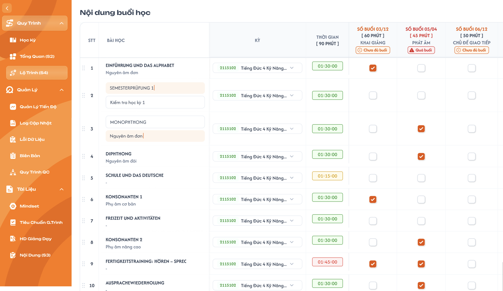
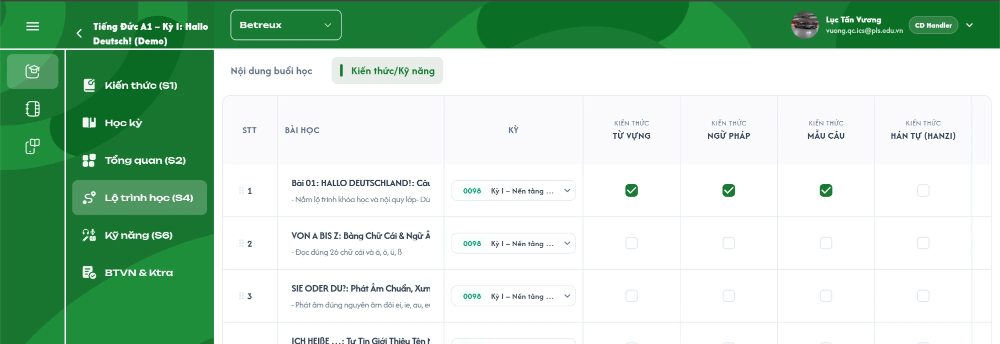

# Lộ Trình (S4)

> **Quyền sửa theo trạng thái khoá học:** chỉ sửa được khi khoá học đang `Nháp`. Khoá học `Công Khai` / `Vô hiệu`: màn hình này chỉ đọc (ẩn / disable mọi thao tác thêm, sửa, xoá, kéo thả); backend từ chối mọi request ghi. Muốn thay đổi thì nhân bản khoá học rồi sửa trên bản sao `Nháp` — nhân bản sao chép toàn bộ dữ liệu của màn hình này (xem [Quản lý khoá học](../course_management.md) REQ10, REQ11).

## 1. UI

### Trang 1: Nội dung buổi học (Lộ Trình S4)

Màn S4 có **2 tab** ở đầu trang: `Nội dung buổi học` (Trang 1, mặc định) và `Kiến thức/Kỹ năng` (Trang 2).



**Mô tả:**
- Role CD xếp lộ trình học bằng cách tick chọn bài học (hàng) sẽ học ở buổi học nào (cột).
- Các cột buổi học (tên, số buổi, phút mỗi buổi) và **phút chuẩn 1 buổi** được define ở màn Tổng Quan (S2); màn này chỉ đọc lại để hiển thị. Phút chuẩn 1 buổi = card `Thời gian mỗi buổi` ở S2 (đơn vị phút, mặc định 90).

**Điểm cần lưu ý:**
- **Freeze layout:** cố định 4 cột đầu (STT, Bài học, Kỳ, Thời gian) và hàng header. Cuộn ngang chỉ các cột buổi học cuộn; cuộn dọc header luôn hiển thị.
- **Header cột Thời gian:** dòng 1 `THỜI GIAN`, dòng 2 `[ {phút chuẩn 1 buổi} PHÚT ]` (lấy từ Tổng Quan (S2), ví dụ `[ 90 PHÚT ]`).
- **Header mỗi cột buổi học** gồm 4 dòng:
  - Dòng 1: `SỐ BUỔI {đã tick}/{tổng số buổi ở S2}`
  - Dòng 2: `[ {tổng phút đã xếp} PHÚT ]` = số tick của cột × phút/buổi của cột (phút/buổi lấy từ S2). Chưa tick thì `[ 0 PHÚT ]`; mỗi lần tick cộng thêm phút/buổi, bỏ tick thì trừ đi. Ví dụ cột "Ngữ pháp" 6 buổi, 80'/buổi: chưa tick `00/06 [ 0 PHÚT ]`, tick 1 ô `01/06 [ 80 PHÚT ]`, tick đủ 6 ô `06/06 [ 480 PHÚT ]`.
  - Dòng 3: tên buổi học (từ S2)
  - Dòng 4: **badge trạng thái** theo số tick so với tổng buổi:

| Điều kiện | Badge | Màu |
|---|---|---|
| tick < tổng buổi | `Chưa đủ buổi` | Cam |
| tick = tổng buổi | `Đủ buổi` | Xanh |
| tick > tổng buổi | `Quá buổi` | Đỏ |

  Màu chữ dòng 1–2 theo màu badge (cam / xanh / đỏ). Tick vượt số buổi vẫn được, không chặn. Cột có tổng buổi = 0: chưa tick (`00/00`) hiển thị `Đủ buổi`; tick thêm thì `Quá buổi`.
- **Ô tick** ở giao điểm (bài học × buổi học). 1 tick = 1 buổi, chỉ 2 trạng thái: đã tick / chưa tick.
- **Cột Thời gian (mỗi hàng):** tự tính, chỉ đọc, định dạng `HH:mm:ss` = tổng phút/buổi của các cột đã tick trong hàng. Chưa tick = `00:00:00`. **Màu theo % so với phút chuẩn 1 buổi (S2)**, cùng rule với tab Bài học của Học kỳ:

| Tỷ lệ | Màu |
|---|---|
| 90% – 100% | Xanh |
| 80% – <90% | Vàng |
| >0 và <80% | Cam |
| `00:00:00` | Xám |
| >100% | Đỏ |

  (Ví dụ phút chuẩn 90: 90' xanh, 75' vàng, 45' cam, 0 xám, 105' đỏ. Không chặn khi vượt.)
- **Cột STT:** số thứ tự hàng theo thứ tự hiện tại; icon kéo thả nằm bên trái STT để sắp xếp bài học.
- **Cột Bài học:** tên (in đậm) + mô tả phụ bên dưới, không có mô tả hiển thị "-". **Sửa trực tiếp tại ô** (click vào tên/mô tả để chuyển sang ô nhập).
- **Cột Kỳ:** dropdown chọn kỳ cho từng bài học, hiển thị mã kỳ (màu xanh) + tên kỳ, text dài cắt bằng "...". Danh sách lấy từ các kỳ của khoá học hiện tại; mặc định là kỳ của bài học. Đổi Kỳ ở đây sẽ chuyển bài học sang học kỳ mới: bài học không còn ở tab Bài học của học kỳ cũ và xuất hiện ở tab Bài học của học kỳ mới (bài học trong học kỳ tự động theo lộ trình S4).

### Trang 2: Kiến thức/Kỹ năng (Lộ Trình S4)



**Mô tả:**
- CD tick bài học (hàng) **có loại kiến thức / kỹ năng nào** (cột). Tick ở đây là **nguồn duy nhất** của tag `Kiến thức` / `Kỹ năng` ở tab Thông tin của [Chi tiết bài học](../semester/lesson/lesson.md) và **đồng bộ hai chiều** với nút `+` / `x` ở đó.
- Tick **độc lập với cụm** ở Kiến thức (S1) / Kỹ năng (S6): tick không tạo, không xoá, không đòi hỏi cụm liên kết; cụm liên kết bài vẫn lập ở S1 / S6 và chỉ quyết định **mục nào** hiện ở tab Kiến thức / Kỹ năng của bài.

**Điểm cần lưu ý:**
- **Cột cố định:** `STT`, `Bài học` (tên in đậm + mô tả, cắt "..."), `Kỳ` (dropdown giống Trang 1). Hàng và thứ tự bài học dùng chung với Trang 1 (kéo thả, sửa tên / mô tả, đổi Kỳ ở Trang 1 đều phản ánh ở đây). Freeze 3 cột đầu và hàng header như Trang 1.
- **Cột loại** theo thứ tự: các loại kiến thức của trung tâm theo thứ tự tab ở S1 (`Từ vựng`, `Ngữ pháp`, `Mẫu câu`, `Hán tự (Hanzi)` / `Kanji`, `Phát âm`, `Bảng chữ`), rồi 4 kỹ năng theo thứ tự tab ở S6 (`Nghe`, `Đọc`, `Viết`, `Nói`). Loại trung tâm không dùng thì **ẩn cột** (vd khoá tiếng Đức không có `Hán tự`, `Kanji`, `Phát âm`; `Bảng chữ` chỉ trung tâm có hệ chữ riêng) — cùng quy tắc tab loại ở S1.
- **Header mỗi cột loại** 3 dòng: dòng 1 nhóm (`KIẾN THỨC` / `KỸ NĂNG`, chữ nhỏ xám), dòng 2 tên loại in hoa, dòng 3 `{N} bài` = số bài đã tick ở cột. **Không có badge** đủ / thiếu.
- **Ô tick:** checkbox, 2 trạng thái. 1 bài tick được nhiều loại; 1 loại tick được nhiều bài; không giới hạn.
- **Không có Import / Export Excel** cho tab này, chỉ thao tác trên màn.

---

## 2. Yêu cầu

### 2.1. Flow chính

**Flow 1: Vào màn**

```
CD mở Lộ Trình (S4)
→ FE gọi API lấy [bài học + cột buổi học & phút chuẩn 1 buổi từ S2 + trạng thái tick + kỳ từng bài học + danh sách kỳ khoá học]
→ FE render bảng, tính header từng cột (số tick, badge, màu) và cột Thời gian từng hàng (số phút, màu)
```

**Flow 2: Tick / bỏ tick**

```
CD click ô (bài học X, buổi học Y) → FE đảo trạng thái tick
→ FE tính lại: header cột Y (số tick, tổng phút đã xếp, badge, màu) + cột Thời gian hàng X (giá trị, màu)
→ FE gọi API cập nhật tick
   ↓ API lỗi: FE hoàn tác ô vừa tick → tính lại header/Thời gian → hiện thông báo lỗi
```

**Flow 3: Ví dụ** (cột "Chủ đề giao tiếp": 5 buổi, 50'/buổi; phút chuẩn 90)

```
Chưa tick  → 00/05 [ 0 PHÚT ] + badge Chưa đủ buổi (cam)
Tick 1     → 01/05 [ 50 PHÚT ] + badge Chưa đủ buổi (cam)
Tick đủ 5  → 05/05 [ 250 PHÚT ] + badge Đủ buổi (xanh)
Tick thêm  → 06/05 [ 300 PHÚT ] + badge Quá buổi (đỏ), vẫn tick được
Bỏ 1 tick  → 05/05 [ 250 PHÚT ], badge Đủ buổi
Hàng tick Khai giảng (60') + Phát âm (45') → Thời gian 01:45:00 (117%, đỏ)
```

**Flow 4: Đổi Kỳ** — CD chọn kỳ khác ở dropdown hàng X → FE gọi API cập nhật kỳ → hiển thị kỳ mới → bài học được chuyển sang học kỳ mới ở tab Bài học của Học kỳ.

**Flow 5: Kéo thả** — CD kéo icon đầu hàng thả vị trí mới → FE cập nhật thứ tự và STT → gọi API lưu thứ tự.

**Flow 6: Sửa tên/mô tả bài học** — CD click ô tên/mô tả, nhập, rời ô hoặc Enter → FE gọi API cập nhật (lỗi: hoàn tác về giá trị cũ + thông báo lỗi).

**Flow 7: Tick loại kiến thức / kỹ năng (Trang 2)**

```
CD mở tab Kiến thức/Kỹ năng → FE gọi API lấy [bài học + kỳ + danh sách loại của trung tâm + loại đã tick của từng bài]
CD click ô (bài học X, loại L) → FE đảo trạng thái tick → cập nhật dòng 3 header cột L (`N bài`)
→ FE gọi API cập nhật tick loại của bài X
   ↓ API lỗi: FE hoàn tác ô → header về số cũ → Toast `Có Lỗi Xảy Ra`
→ Mở Chi tiết bài X: tab Thông tin hiện tag loại L (Kiến thức hoặc Kỹ năng), badge tab tăng theo
Ngược lại: ở Chi tiết bài X bấm `+` thêm loại L hoặc `x` gỡ tag L → "Lưu thay đổi" → ô (X, L) ở S4 đổi theo
```

### 2.2. Ngoại lệ

- **EX01:** Số tick của cột > tổng buổi → vẫn cho tick, badge `Quá buổi` (đỏ), không popup chặn.
- **EX02:** Bỏ tick/đổi S2 làm số tick về = tổng buổi → badge `Đủ buổi`; < tổng buổi → `Chưa đủ buổi`. Trường hợp tổng buổi = 0 và chưa tick (`00/00`) → `Đủ buổi`.
- **EX03:** Hàng chưa tick ô nào → Thời gian `00:00:00`, màu xám.
- **EX04:** S2 đổi số buổi / phút mỗi buổi / phút chuẩn 1 buổi → giữ nguyên tick; tính lại header cột (tổng phút đã xếp = số tick × phút/buổi mới), badge, Thời gian và màu từng hàng theo giá trị mới.
- **EX05:** S2 xoá buổi học → xoá toàn bộ tick của cột đó, tính lại Thời gian các hàng liên quan.
- **EX06:** S2 thêm buổi học → hiển thị thêm cột mới chưa tick (`00/{tổng}`, `[ 0 PHÚT ]`, badge `Chưa đủ buổi`).
- **EX07:** API lưu lỗi (tick, đổi Kỳ, kéo thả, sửa tên/mô tả) → hoàn tác thao tác vừa làm, tính lại hiển thị, hiện thông báo lỗi.
- **EX08:** Tên bài học để trống/chỉ khoảng trắng → không lưu, trả về tên cũ.
- **EX10:** Tick / bỏ tick loại khi bài học **chưa có / vẫn còn** cụm liên kết ở S1 / S6 → luôn cho phép (độc lập); cụm giữ nguyên. Loại đã tick mà chưa có cụm: tab Kiến thức / Kỹ năng của bài hiện trạng thái trống.
- **EX11:** Request tick loại trung tâm không dùng (ẩn cột) → BE từ chối, không lưu.
- **EX12:** Hai người cùng sửa tick (S4 và nút `+` ở Chi tiết bài học) → bản lưu sau cùng thắng; mở lại màn thấy giá trị mới nhất.
- **EX09:** Phút chuẩn 1 buổi luôn có giá trị (S2 mặc định 90 phút, chỉ nhận số nguyên dương) nên cột Thời gian luôn tính được % màu; hàng chưa tick hiển thị màu xám theo EX03.

### 2.3. Yêu cầu khác

| Mã | Tên | Mô tả |
|---|---|---|
| REQ01 | Nguồn dữ liệu | Cột buổi học, số buổi, phút/buổi từng cột, phút chuẩn 1 buổi lấy từ S2; thứ tự cột theo S2. |
| REQ02 | Tính toán realtime | Header cột, badge và cột Thời gian (giá trị + màu) tính lại ngay sau mỗi thao tác, không reload. |
| REQ03 | Công thức | Thời gian hàng = Σ phút/buổi của các cột đã tick trong hàng (`HH:mm:ss`). % màu = Thời gian hàng / phút chuẩn 1 buổi (S2). |
| REQ04 | Badge cột | Theo số tick so với tổng buổi: `Chưa đủ buổi` (cam) / `Đủ buổi` (xanh) / `Quá buổi` (đỏ). `00/00` hiển thị `Đủ buổi`. |
| REQ05 | Màu cột Thời gian | 90–100% xanh, 80–<90% vàng, >0 và <80% cam, 0 xám, >100% đỏ (giống tab Bài học của Học kỳ). Chỉ cảnh báo bằng màu, không chặn. |
| REQ06 | Freeze | Cố định 4 cột đầu và hàng header; cột buổi học không đè lên cột cố định khi cuộn ngang. |
| REQ07 | Header cột buổi học | Dòng 1 `SỐ BUỔI {đã tick}/{tổng số buổi}`; dòng 2 `[ {tổng phút đã xếp} PHÚT ]` = số tick × phút/buổi của cột, bắt đầu từ `0` và cộng/trừ theo từng lần tick/bỏ tick. |
| REQ08 | Kéo thả | Thứ tự bài học được lưu, STT cập nhật theo; chỉ dùng cho màn này. |
| REQ09 | Dropdown Kỳ | Danh sách kỳ của khoá học hiện tại; mặc định kỳ của bài học; hiển thị mã kỳ + tên kỳ. Đổi Kỳ sẽ chuyển bài học sang học kỳ mới (đồng bộ tab Bài học của Học kỳ). |
| REQ10 | Sửa inline | Tên (bắt buộc) và mô tả (không bắt buộc) bài học sửa trực tiếp tại ô; dữ liệu dùng chung với tab Bài học của Học kỳ. |
| REQ11 | Tab Kiến thức/Kỹ năng | Bảng bài học × loại kiến thức / kỹ năng của trung tâm (ẩn loại không dùng); header dòng 3 `{N} bài`, không badge; không có Excel. |
| REQ12 | Nguồn tag bài học | Tick ở Trang 2 là nguồn duy nhất của tag Kiến thức / Kỹ năng và badge tab ở Chi tiết bài học; đồng bộ hai chiều với nút `+` / `x` ở tab Thông tin. |
| REQ13 | Độc lập với cụm | Tick không tạo / xoá / kiểm tra cụm ở S1 / S6; liên kết cụm ↔ bài vẫn lập ở S1 / S6. |

### 2.4. Ràng buộc

| Role | Xem | Tick / bỏ tick (2 tab) | Đổi Kỳ | Kéo thả | Sửa tên/mô tả |
|---|:---:|:---:|:---:|:---:|:---:|
| CD | ✅ | ✅ | ✅ | ✅ | ✅ |
| Role khác | ❌ | ❌ | ❌ | ❌ | ❌ |

- Màn chỉ dành cho CD; role khác không có menu, không truy cập được.
- Một bài học tick được nhiều cột; một cột tick được nhiều bài học; tick vượt số buổi không bị chặn.
- Số buổi, phút/buổi, phút chuẩn 1 buổi chỉ đọc ở màn này, sửa ở Tổng Quan (S2).

---

## 3. Testcase

Dữ liệu giả định: phút chuẩn 1 buổi = 90. Cột "Khai giảng" 12 buổi 60'; "Phát âm" 4 buổi 45'; "Chủ đề giao tiếp" 5 buổi 50'; "Ngữ pháp" 6 buổi 80'; "Ôn tập" 3 buổi 90'.

| Tên testcase | Priority | Loại test | Role / Pre-condition | Given / When / Then | Expected Result |
|---|---| --- |---|---|---|
| Case 1: Hiển thị ban đầu & freeze | High | Smoke | CD; có dữ liệu S2, chưa tick, bảng vượt màn hình | **Given** mở S4<br>**When** load xong, cuộn ngang/dọc<br>**Then** xem header, Thời gian, cột cố định | - Cột và thứ tự khớp S2; header `THỜI GIAN [ 90 PHÚT ]`<br>- Mỗi cột: `00/{tổng}`, `[ 0 PHÚT ]`, badge `Chưa đủ buổi` (ví dụ Ngữ pháp `00/06 [ 0 PHÚT ]`)<br>- Mọi hàng `00:00:00` (xám)<br>- 4 cột STT/Bài học/Kỳ/Thời gian và header luôn hiển thị khi cuộn |
| Case 2: Tick/bỏ tick, header & badge | High | Smoke | CD; cột Phát âm 4 buổi 45' chưa tick | **Given** ở S4<br>**When** tick lần lượt 1→4→5 ô, rồi bỏ 1 ô; thoát mở lại<br>**Then** xem header/badge | - 01/04 `[ 45 PHÚT ]` Chưa đủ buổi (cam); 04/04 `[ 180 PHÚT ]` Đủ buổi (xanh); 05/04 `[ 225 PHÚT ]` Quá buổi (đỏ), tick không bị chặn<br>- Bỏ 1 ô: 04/04 `[ 180 PHÚT ]` Đủ buổi<br>- Mở lại giữ đúng trạng thái tick |
| Case 3: Cột Thời gian: công thức & màu | High |  | CD; các hàng chưa tick | **Given** hàng tick các cột khác nhau<br>**When** tick: Ôn tập (90'); Ngữ pháp (80'); Phát âm (45'); Khai giảng + Phát âm (105'); bỏ hết<br>**Then** xem cột Thời gian | - `01:30:00` xanh (100%); `01:20:00` vàng (89%); `00:45:00` cam (50%); `01:45:00` đỏ (117%); `00:00:00` xám<br>- Header cột Thời gian vẫn `[ 90 PHÚT ]`, tick hàng khác không ảnh hưởng |
| Case 4: S2 đổi số buổi/phút | Medium |  | CD; Phát âm 4 buổi 45', đã tick 4 ô | **Given** sửa S2<br>**When** (a) đổi số buổi 4→3; (b) đổi lại 4 và phút/buổi 45→60; (c) đổi phút chuẩn 90→120; mở lại S4<br>**Then** xem header, badge, Thời gian | - (a) Tick giữ nguyên, 04/03 Quá buổi (đỏ)<br>- (b) 04/04 Đủ buổi, `[ 240 PHÚT ]` (4 × 60), Thời gian các hàng tính lại<br>- (c) Header Thời gian `[ 120 PHÚT ]`, màu từng hàng tính lại theo 120 |
| Case 5: S2 xoá/thêm buổi học | High |  | CD; cột Phát âm đã có tick | **Given** đã có dữ liệu S4<br>**When** xoá buổi Phát âm ở S2, rồi thêm buổi mới, mở lại S4<br>**Then** xem bảng | - Cột Phát âm mất, tick bị xoá, Thời gian hàng liên quan và màu tính lại<br>- Cột mới xuất hiện, chưa tick, `00/{tổng}`, `[ 0 PHÚT ]`, Chưa đủ buổi |
| Case 6: Đổi Kỳ | Medium |  | CD; khoá học có nhiều kỳ | **Given** dropdown Kỳ hàng X mặc định<br>**When** chọn kỳ khác, thoát mở lại; mở tab Bài học của kỳ cũ và kỳ mới<br>**Then** xem dropdown và tab Bài học | - Danh sách = kỳ của khoá học; mặc định đúng kỳ của bài học<br>- Hiển thị mã kỳ + tên cắt "..."<br>- Kỳ mới được lưu<br>- Bài X không còn ở tab Bài học của kỳ cũ, xuất hiện ở kỳ mới |
| Case 7: Kéo thả | Medium |  | CD; ≥ 2 bài học | **Given** ở S4<br>**When** kéo hàng C lên trên hàng A, thoát mở lại<br>**Then** xem thứ tự, STT, tick, kỳ | - Thứ tự mới được giữ, STT cập nhật theo<br>- Tick và kỳ các hàng không đổi |
| Case 8: Sửa tên/mô tả inline | Medium |  | CD | **Given** hàng X có tên và mô tả<br>**When** sửa tên, sửa mô tả, thử để tên trống, thử xoá hết mô tả<br>**Then** xem hiển thị và dữ liệu | - Tên/mô tả mới được lưu, đồng bộ với tab Bài học của Học kỳ<br>- Tên trống: không lưu, trả về tên cũ<br>- Mô tả trống hiển thị "-" |
| Case 9: API lưu lỗi | High |  | CD; cột Chủ đề giao tiếp 04/05 | **Given** mất mạng/API lỗi<br>**When** tick thêm 1 ô; (thử tương tự với đổi Kỳ, kéo thả, sửa tên)<br>**Then** quan sát | - Thao tác được hoàn tác về trạng thái cũ<br>- Header (`04/05 [ 200 PHÚT ]`), badge (Chưa đủ buổi), Thời gian và màu về giá trị cũ<br>- Hiện thông báo lỗi |
| Case 10: Phân quyền | High |  | Role khác CD | **Given** đăng nhập role không phải CD<br>**When** xem menu và truy cập trực tiếp đường dẫn S4<br>**Then** quan sát | - Không có menu Lộ Trình (S4)<br>- Truy cập trực tiếp không được, không xem/sửa được dữ liệu |
| Case 11: Cột có tổng buổi = 0 | Low |  | CD; S2 có buổi học Số buổi = 0 | **Given** mở S4<br>**When** quan sát cột, tick 1 ô; sửa S2 thành 1 buổi và bỏ tick<br>**Then** xem badge | - `00/00`: `Đủ buổi` (xanh)<br>- `01/00`: `Quá buổi` (đỏ)<br>- `00/01`: `Chưa đủ buổi` (cam) |
| Case 12: Tab Kiến thức/Kỹ năng – cột theo trung tâm | High | Smoke | CD; khoá Betreux (tiếng Đức) và khoá Đắc Nhân (tiếng Trung) | **Given** mở S4 tab `Kiến thức/Kỹ năng`<br>**When** xem cột ở từng khoá; gửi API tick loại `Hán tự` cho khoá tiếng Đức<br>**Then** xem cột và kết quả API | - Khoá Đức: `Từ vựng`, `Ngữ pháp`, `Mẫu câu`, rồi `Nghe`, `Đọc`, `Viết`, `Nói`; không có `Hán tự`, `Kanji`, `Phát âm`<br>- Khoá Trung có thêm `Hán tự (Hanzi)`, `Phát âm`<br>- Header 3 dòng, dòng 3 `0 bài` khi chưa tick, không badge<br>- API tick `Hán tự` ở khoá Đức bị từ chối (EX11) |
| Case 13: Tick loại → tag ở Chi tiết bài học | High | Smoke | CD; Bài 1 chưa tick loại nào, chưa có cụm liên kết | **Given** tab `Kiến thức/Kỹ năng`<br>**When** tick `Từ vựng`, `Ngữ pháp`, `Mẫu câu`, `Nghe` cho Bài 1; mở Chi tiết Bài 1<br>**Then** xem header S4 và bài học | - Header các cột tăng `1 bài`<br>- Tab Thông tin: Kiến thức `Từ vựng`, `Ngữ pháp`, `Mẫu câu`; Kỹ năng `Nghe`<br>- Badge tab Kiến thức `03`, Kỹ năng `01`<br>- Tab Kiến thức loại `Từ vựng` (chưa có cụm): trạng thái trống kèm hướng dẫn (EX10) |
| Case 14: Đồng bộ hai chiều, độc lập với cụm | High |  | CD; Bài 1 đã tick `Từ vựng`, có cụm Từ vựng liên kết ở S1 | **Given** mở Chi tiết Bài 1<br>**When** (a) bấm `x` gỡ tag `Từ vựng`, `+` thêm `Đọc`, "Lưu thay đổi", mở lại S4; (b) ở S4 tick lại `Từ vựng`<br>**Then** xem S4, bài học, S1 | - (a) Ô (Bài 1, Từ vựng) bỏ tick, (Bài 1, Đọc) có tick; header cập nhật<br>- Cụm Từ vựng ở S1 vẫn liên kết Bài 1, không bị xoá<br>- (b) Tag `Từ vựng` hiện lại ở bài học |
| Case 15: Tick lỗi và khoá Công khai | Medium |  | CD; (a) API lỗi; (b) khoá `Công Khai` | **Given** tab `Kiến thức/Kỹ năng`<br>**When** (a) tick 1 ô khi mất mạng; (b) mở khoá Công khai, thử tick, gửi API tick<br>**Then** quan sát | - (a) Ô hoàn tác, header về số cũ, Toast `Có Lỗi Xảy Ra`<br>- (b) Ô tick disable, chỉ xem; API bị từ chối |
