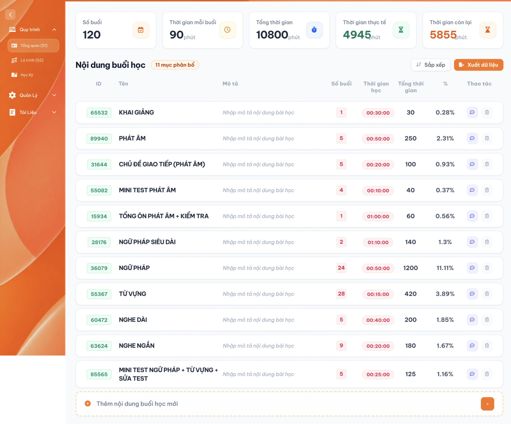

# Tổng quan (S1)

## 1. UI

### Trang 1: Tổng quan (S1)



**Mô tả:**
- CD dùng màn hình này để định nghĩa các **nội dung cần dạy** của khoá học và xem tổng quan phân bổ thời gian của toàn khoá học dựa trên các nội dung đó.

**Điểm cần lưu ý:**
| Card | Ý nghĩa | Cách xác định giá trị |
|---|---|---|
| Số buổi | Tổng số buổi học của khoá học | Ban đầu là **0**, do CD tự nhập tay |
| Thời gian mỗi buổi | Thời lượng chuẩn của 1 buổi học | Ban đầu là **0**, do CD tự nhập tay |
| Tổng thời gian | Tổng thời gian toàn khoá học | Tự tính = Số buổi × Thời gian mỗi buổi |
| Thời gian thực tế | Tổng thời gian đã được phân bổ vào các nội dung bên dưới | Tự tính = tổng cột "Tổng thời gian" của bảng nội dung |
| Thời gian còn lại | Phần thời gian chưa phân bổ | Tự tính = Tổng thời gian − Thời gian thực tế |

---

### Khu vực: Bảng "Nội dung buổi học"

**Mô tả:**
- Liệt kê toàn bộ nội dung cần dạy đã được định nghĩa, mỗi dòng là 1 nội dung với thông tin phân bổ số buổi và thời gian tương ứng.

**Điểm cần lưu ý:**
- Tiêu đề "Nội dung buổi học" kèm badge số lượng nội dung hiện có (ví dụ "11 mục phân bổ").

| Cột | Nhập được? | Mô tả |
|---|:---:|---|
| ID | ❌ | Mã tự sinh, hiển thị dạng badge |
| Tên | ✅ | Tên nội dung, hiển thị in đậm |
| Mô tả | ✅ | Hiển thị placeholder xám "Nhập mô tả nội dung bài học" khi chưa có dữ liệu |
| Số buổi | ✅ | Hiển thị dạng badge số |
| Thời gian học | ✅ | Badge định dạng giờ:phút:giây; là thời lượng của riêng nội dung đó trong 1 buổi, khác với "Thời gian mỗi buổi" ở card tổng quan |
| Tổng thời gian | ❌ | Tự tính = Số buổi × Thời gian học |
| % | ❌ | Tự tính = Tổng thời gian dòng ÷ Tổng thời gian (card) × 100 |
| Thao tác | — | Gồm icon chuyển loại thao tác (Tự chọn/Giảng dạy) và icon thùng rác để xoá |

- Icon trong cột "Thao tác" (trước icon xoá) là nút để **chuyển đổi loại thao tác của nội dung** giữa 2 giá trị: **Tự chọn** và **Giảng dạy** (nhấn vào để đổi qua lại giữa 2 trạng thái này), hover vào hiển thị thao tác hiện tại.
- Cột "Tổng thời gian" và "%" của từng dòng, cùng 2 card "Thời gian thực tế" và "Thời gian còn lại", đều tự động tính lại ngay khi CD thay đổi Số buổi hoặc Thời gian học của bất kỳ dòng nào (xem công thức ở mục 2.3).

---

### Khu vực: Thêm nội dung buổi học mới

**Mô tả:**
- Cho phép CD tạo nhanh một nội dung buổi học mới chỉ với thao tác nhập tên và nhấn Enter.

**Điểm cần lưu ý:**
- Ô "Thêm nội dung buổi học mới" ở cuối bảng: CD chỉ cần **nhập Tên nội dung và nhấn Enter** để tạo nhanh, các field còn lại (Mô tả, Số buổi, Thời gian học) sẽ để trống/mặc định 0 và CD bổ sung sau trực tiếp trên dòng vừa tạo.
- Nút "+" ở cuối dòng có cùng chức năng thêm mới.

---

### Toast phản hồi CRUD

<p align="center">
  <a href="../../images/01-toast-crud.png"></a><br>
  <em>Toast phản hồi Create, Update, Delete và đổi trạng thái — nhấn để xem ảnh gốc</em>
</p>

**Mô tả:** Toast phản hồi kết quả các thao tác thay đổi dữ liệu trong requirement này.

**Giải thích thành phần:**

| Loại | Tiêu đề | Khi sử dụng |
|---|---|---|
| Thành công | `Thành Công` | Backend xác nhận thao tác thành công. |
| Thông tin | `Thông Báo` | Thao tác đã tiếp nhận nhưng dữ liệu cần thời gian đồng bộ. |
| Cảnh báo | `Cảnh Báo` | Dữ liệu/điều kiện cần người dùng kiểm tra. |
| Lỗi | `Có Lỗi Xảy Ra` | Backend/network không hoàn tất thao tác. |

**Điểm cần lưu ý:** Nội dung dòng hai lấy từ flow CRUD tương ứng; mỗi thao tác chỉ có một Toast; Hủy/chỉ đọc không có Toast CRUD; nút `×` đóng thủ công; không hiển thị dữ liệu nhạy cảm.

#### Testcase — Toast phản hồi CRUD

| Tên testcase | Priority | Loại test | Scenario | Role | Pre-condition | Given / When / Then | Expected Result |
|---|---| --- |---|---|---|---|---|
| Toast Case 1: Thành công | High |  | Ràng buộc Toast CRUD | Role có quyền CRUD | Dữ liệu hợp lệ | **Given** người dùng xác nhận thay đổi<br>**When** backend thành công<br>**Then** hiển thị Toast `Thành Công` | - Đúng nội dung nghiệp vụ<br>- Đúng một Toast<br>- Chỉ hiện sau khi backend xác nhận |
| Toast Case 2: Cảnh báo | High |  | Ràng buộc Toast CRUD | Role có quyền CRUD | Dữ liệu/điều kiện chưa hợp lệ | **Given** thao tác chưa đủ điều kiện<br>**When** người dùng xác nhận<br>**Then** hiển thị Toast `Cảnh Báo` nếu flow có Toast validation | - Không lưu dữ liệu sai<br>- Vẫn đánh dấu field lỗi<br>- Không hiện thành công |
| Toast Case 3: Lỗi | High |  | Ràng buộc Toast CRUD | Role có quyền CRUD | Backend/network lỗi | **Given** request hợp lệ đã gửi<br>**When** xử lý thất bại<br>**Then** hiển thị Toast `Có Lỗi Xảy Ra` | - Không cập nhật một phần<br>- Cho phép thử lại<br>- Không lộ lỗi kỹ thuật |
| Toast Case 4: Thông tin, đóng và chống lặp | Medium |  | Ràng buộc Toast CRUD | Role có quyền CRUD | Đang đồng bộ hoặc Toast đang hiển thị | **Given** thao tác xử lý bất đồng bộ hoặc callback lặp<br>**When** UI nhận trạng thái hoặc người dùng bấm `×`<br>**Then** hiển thị tối đa một Toast `Thông Báo` và cho đóng thủ công | - Không báo thành công sớm<br>- Không nhân đôi Toast<br>- Đóng không hoàn tác dữ liệu |

## 2. Yêu cầu

### 2.1. Flow chính

**Flow 1: Nhập Số buổi / Thời gian mỗi buổi ở card tổng quan**

```
CD nhập giá trị "Số buổi" và "Thời gian mỗi buổi" ở 2 card đầu tiên (mặc định là 0)
→ FE lưu giá trị → FE tính lại "Tổng thời gian" (card) = Số buổi × Thời gian mỗi buổi
→ FE tính lại % của toàn bộ các dòng trong bảng (vì mẫu số % đã thay đổi)
```

**Flow 2: Thêm nhanh nội dung buổi học mới**

```
CD nhấn vào ô "Thêm nội dung buổi học mới" → CD nhập Tên nội dung → CD nhấn Enter
→ FE gửi yêu cầu tạo mới với Tên vừa nhập → BE tạo nội dung (ID tự sinh, các field còn lại để trống/mặc định)
→ FE thêm dòng mới vào bảng, cập nhật badge "x mục phân bổ"
```

**Flow 3: Chỉnh sửa thông tin một nội dung**

```
CD sửa trực tiếp Tên / Mô tả / Số buổi / Thời gian học trên 1 dòng 
→ FE gửi dữ liệu lên BE theo từng field → BE cập nhật 
→ FE tính lại Tổng thời gian và % của dòng đó, đồng thời tính lại các card tổng quan liên quan
```

**Flow 4: Đổi loại thao tác (Tự chọn / Giảng dạy)**

```
CD nhấn icon chuyển loại thao tác trên 1 dòng 
→ FE đổi giá trị loại thao tác của dòng đó giữa Tự chọn và Giảng dạy → BE lưu lại giá trị mới
```

**Flow 5: Tự động tính toán**

```
CD cập nhật Số buổi hoặc Thời gian học của 1 dòng
→ FE tính lại Tổng thời gian (dòng) = Số buổi (dòng) × Thời gian học (dòng)
→ FE tính lại % (dòng) = Tổng thời gian (dòng) ÷ Tổng thời gian (card tổng quan) × 100
→ FE tính lại Thời gian thực tế (card) = tổng cột "Tổng thời gian" của tất cả các dòng trong bảng
→ FE tính lại Thời gian còn lại (card) = Tổng thời gian (card) − Thời gian thực tế (card)
    
    ↓ (nếu Thời gian còn lại < 0)
FE hiển thị cảnh báo cho CD
```

**Flow 6: Xoá một nội dung**

```
CD nhấn icon thùng rác trên 1 dòng → FE hiển thị popup xác nhận
    
    ↓ (CD xác nhận)
BE xoá mềm nội dung → FE loại dòng khỏi bảng, cập nhật badge số lượng và tính lại các card tổng quan
    
    ↓ (CD huỷ)
Đóng popup, giữ nguyên dữ liệu
```

### 2.2. Ngoại lệ

- **EX01:** Tổng thời gian các nội dung trong bảng vượt quá "Tổng thời gian" ở card tổng quan (khiến "Thời gian còn lại" âm) → hệ thống **hiển thị cảnh báo** cho CD (không chặn thao tác).

### 2.3. Yêu cầu khác

| Mã | Tên yêu cầu | Mô tả |
|---|---|---|
| REQ01 | Công thức Tổng thời gian (dòng) | Tổng thời gian (dòng) = Số buổi (dòng) × Thời gian học (dòng). |
| REQ02 | Công thức % (dòng) | % (dòng) = Tổng thời gian (dòng) ÷ Tổng thời gian (card tổng quan) × 100. |
| REQ03 | Công thức Tổng thời gian (card) | Tổng thời gian (card tổng quan) = Số buổi (card) × Thời gian mỗi buổi (card). |
| REQ04 | Công thức Thời gian thực tế (card) | Thời gian thực tế (card) = tổng cột "Tổng thời gian" của toàn bộ các dòng trong bảng. |
| REQ05 | Công thức Thời gian còn lại (card) | Thời gian còn lại (card) = Tổng thời gian (card) − Thời gian thực tế (card). |
| REQ06 | Nhập Số buổi / Thời gian mỗi buổi (card) | 2 giá trị này mặc định là 0, do CD tự nhập tay, không tự động lấy từ nguồn dữ liệu khác. |
| REQ07 | Thêm nhanh bằng Tên + Enter | Chỉ cần nhập Tên và nhấn Enter là tạo được nội dung mới; các field khác để trống/mặc định, bổ sung sau. |
| REQ08 | Loại thao tác của nội dung | Mỗi nội dung có loại thao tác là Tự chọn hoặc Giảng dạy, đổi qua lại bằng icon cạnh nút xoá trong cột "Thao tác". |
| REQ09 | Cảnh báo khi Thời gian còn lại âm | Khi tổng thời gian các nội dung vượt quá Tổng thời gian (card), hệ thống hiển thị cảnh báo cho CD. |
| REQ10 | Xoá mềm nội dung | Xoá một nội dung buổi học là xoá mềm, có popup xác nhận trước khi xoá. |

### 2.4. Ràng buộc

#### Quyền

| Role | Xem | Thêm nội dung | Chỉnh sửa | Xoá |
|---|:---:|:---:|:---:|:---:|
| CD | ✅ | ✅ | ✅ | ✅ |
| Các role khác | ❌ | ❌ | ❌ | ❌ |

#### Ràng buộc khác

- Cột "ID", "Tổng thời gian", "%" không cho CD chỉnh sửa trực tiếp, luôn do hệ thống tự sinh/tự tính.
- Không cho phép xem/thao tác nếu không có quyền, kể cả khi gọi trực tiếp bằng URL hoặc request.

---

## 3. Testcase

### Feature: Tổng quan (S1)

| Tên testcase | Priority | Loại test | Scenario | Role | Pre-condition | Given/When/Then | Expected Result |
|---|---| --- |---|---|---|---|---|
| Case 1: Xem tổng quan | High | Smoke | Flow chính | CD | Khoá học đã có sẵn nội dung buổi học | **Given:** CD mở màn hình Tổng quan (S1)<br>**When:** trang tải xong<br>**Then:** hệ thống hiển thị đầy đủ 5 card và bảng nội dung | - 5 card hiển thị đúng giá trị<br>- Bảng hiển thị đầy đủ các nội dung, badge số lượng đúng |
| Case 2: Nhập Số buổi / Thời gian mỗi buổi lần đầu | High |  | Flow 1 / REQ06 | CD | 2 card Số buổi, Thời gian mỗi buổi đang là 0 | **Given:** CD nhập giá trị cho Số buổi và Thời gian mỗi buổi<br>**When:** CD lưu<br>**Then:** hệ thống tính lại Tổng thời gian (card) và % của các dòng | - Tổng thời gian (card) = Số buổi × Thời gian mỗi buổi vừa nhập<br>- % của các dòng trong bảng cập nhật theo mẫu số mới |
| Case 3: Thêm nhanh nội dung mới | High | Smoke | Flow 2 / REQ07 | CD | Đang ở màn hình Tổng quan (S1) | **Given:** CD nhấn vào ô "Thêm nội dung buổi học mới"<br>**When:** CD nhập Tên và nhấn Enter<br>**Then:** hệ thống tạo nội dung mới | - Dòng mới xuất hiện trong bảng với Tên vừa nhập<br>- Các field còn lại để trống/mặc định<br>- Badge số lượng tăng lên |
| Case 4: Sửa Số buổi/Thời gian học → tự tính Tổng thời gian và % | High |  | Flow 5 / REQ01 / REQ02 | CD | Bảng đã có ít nhất 1 nội dung | **Given:** dòng nội dung đang hiển thị Số buổi và Thời gian học hiện tại<br>**When:** CD sửa Số buổi hoặc Thời gian học<br>**Then:** hệ thống tính lại Tổng thời gian và % của dòng đó | - Tổng thời gian = Số buổi × Thời gian học mới<br>- % = Tổng thời gian dòng ÷ Tổng thời gian card × 100, hiển thị đúng |
| Case 5: Tự động cập nhật Thời gian thực tế và Thời gian còn lại | High |  | Flow 5 / REQ04 / REQ05 | CD | Bảng đã có nhiều nội dung | **Given:** card "Thời gian thực tế" và "Thời gian còn lại" đang hiển thị giá trị hiện tại<br>**When:** CD thêm/sửa/xoá 1 nội dung làm thay đổi Tổng thời gian<br>**Then:** hệ thống cập nhật lại 2 card này | - "Thời gian thực tế" = tổng Tổng thời gian mới của bảng<br>- "Thời gian còn lại" = Tổng thời gian (card) − Thời gian thực tế (card) mới |
| Case 6: Đổi loại thao tác Tự chọn/Giảng dạy | Medium |  | Flow 4 / REQ08 | CD | Bảng đã có ít nhất 1 nội dung | **Given:** 1 dòng đang ở loại thao tác "Tự chọn"<br>**When:** CD nhấn icon chuyển loại thao tác<br>**Then:** hệ thống đổi loại thao tác của dòng đó sang "Giảng dạy" | - Giá trị loại thao tác của dòng được cập nhật và lưu lại đúng |
| Case 7: Thời gian còn lại bị âm | Medium |  | EX01 / REQ09 | CD | Tổng thời gian các nội dung sắp vượt "Tổng thời gian" card | **Given:** CD tăng Số buổi hoặc Thời gian học của 1 dòng<br>**When:** tổng Tổng thời gian các dòng vượt quá "Tổng thời gian" card<br>**Then:** hệ thống hiển thị cảnh báo | - "Thời gian còn lại" hiển thị giá trị âm<br>- Hệ thống hiển thị cảnh báo cho CD, không chặn thao tác |
| Case 8: Xoá một nội dung | High |  | Flow 6 / REQ10 | CD | Bảng đã có ít nhất 1 nội dung | **Given:** CD nhấn icon thùng rác trên 1 dòng<br>**When:** popup xác nhận hiển thị và CD xác nhận xoá<br>**Then:** hệ thống xoá mềm nội dung | - Dòng bị xoá (mềm) khỏi bảng<br>- Badge số lượng và các card tổng quan liên quan được cập nhật lại |
| Case 9: Huỷ xoá nội dung | Medium |  | Flow 6 | CD | Bảng đã có ít nhất 1 nội dung | **Given:** popup xác nhận xoá đang hiển thị<br>**When:** CD nhấn huỷ<br>**Then:** hệ thống không xoá nội dung | - Dòng vẫn còn nguyên trong bảng<br>- Dữ liệu không thay đổi |
| Case 10: Kiểm tra quyền truy cập | High |  | Ràng buộc quyền | Role không phải CD | User đã đăng nhập | **Given:** user không có role CD<br>**When:** mở URL màn hình Tổng quan (S1) trực tiếp<br>**Then:** hệ thống từ chối truy cập | - Không xem hoặc thao tác được dữ liệu<br>- Dữ liệu không thay đổi |
