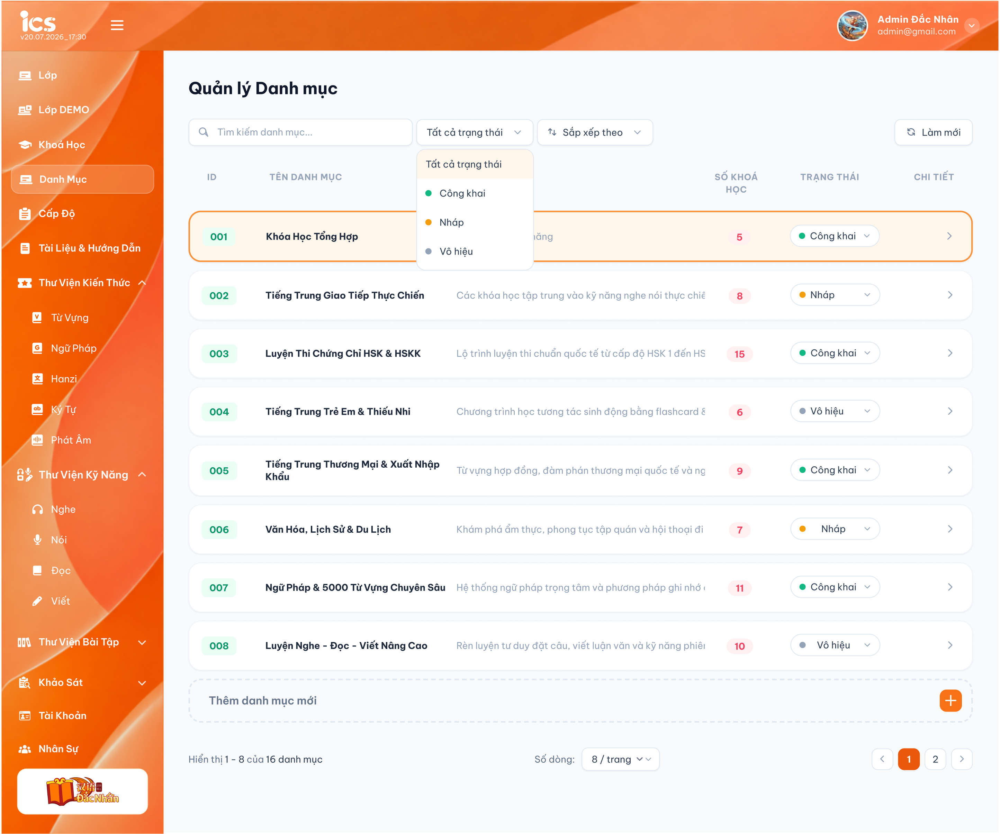
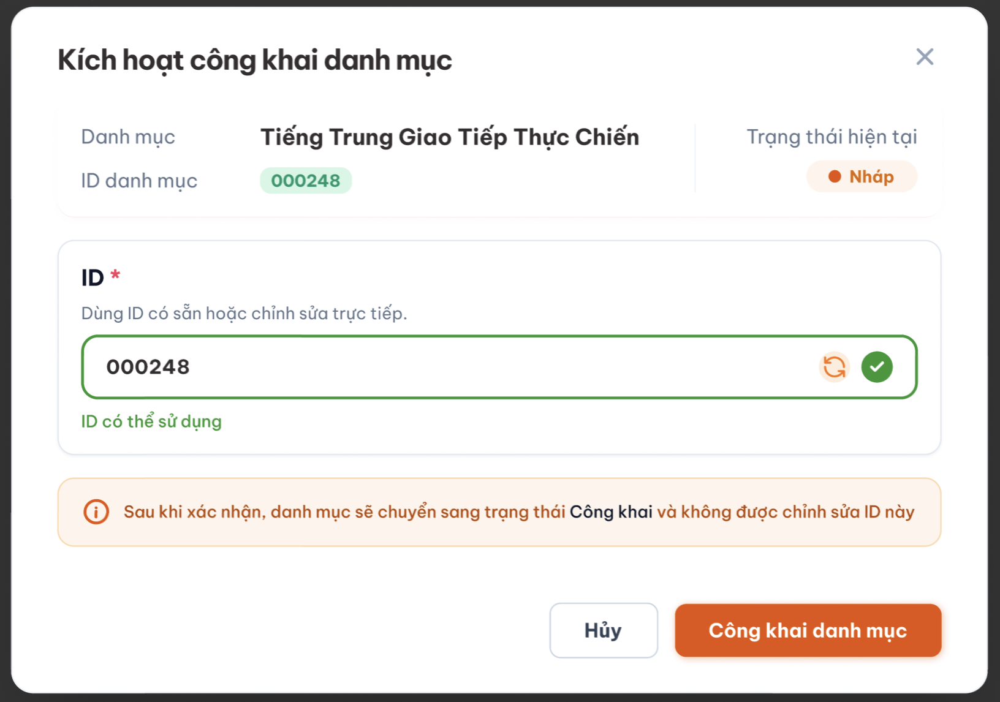
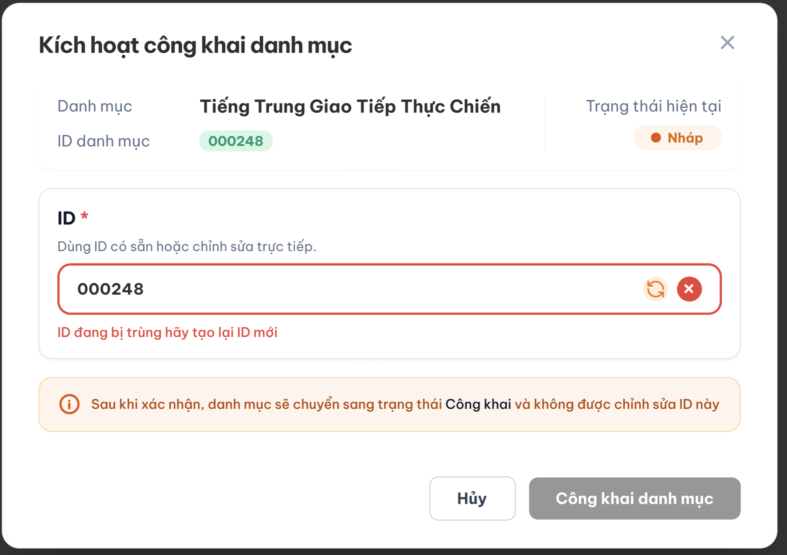

# Quản lý danh sách danh mục

## 1. UI

### Trang danh sách danh mục

<p align="center">
  <a href="./images/01-category-list.png"></a><br>
  <em>Danh sách danh mục — nhấn để xem ảnh gốc</em>
</p>

**Mô tả:**

- `Curriculum Development Handler` có toàn quyền xem và quản lý danh mục.
- Chọn `Chi tiết` (nút mũi tên cuối mỗi hàng) của một danh mục để mở popup quản lý danh mục đó (xem `detail_category.md`).

**Điểm cần lưu ý:**

- Tìm kiếm kích hoạt sau khi nhấn Enter, khớp một phần theo `ID` hoặc `Tên danh mục` (không tìm theo Mô tả). Không phân biệt chữ hoa/thường.
- Danh mục và khóa học có quan hệ `1:n` (xem `detail_category.md`).
- **Chỉ danh mục `Nháp` được xóa**; danh mục `Công Khai` / `Vô hiệu` không được xóa. Danh mục `Nháp` đang có khóa học cũng không được xóa (xem REQ05, Flow 5).
- **Quyền sửa theo trạng thái** (xem REQ08): `Nháp` sửa được toàn bộ (Tên, Mô tả, ID, cấu hình Mindset / Tiêu chuẩn giáo trình / Hướng dẫn giảng dạy). `Công Khai` / `Vô hiệu` **chỉ sửa được Tên và Mô tả**; ID và toàn bộ dữ liệu chi tiết bên trong (cấu hình 3 tab nội dung) chỉ đọc.

| Field | Yêu cầu |
|---|---|
| ID | Bắt buộc ngay khi tạo mới. 2 chữ số (`01`–`99`, xem REQ01), duy nhất toàn hệ thống (tính cả danh mục đã xóa mềm). Sửa tự do khi còn `Nháp`; khóa vĩnh viễn kể từ khi rời `Nháp`. |
| Tên danh mục | Bắt buộc, không giới hạn độ dài. Được phép trùng với danh mục khác. Hệ thống tự cắt khoảng trắng đầu/cuối trước khi lưu. Sửa được ở mọi trạng thái. |
| Mô tả danh mục | Không bắt buộc, không giới hạn độ dài. Sửa được ở mọi trạng thái. |
| Cấu hình Mindset, Tiêu chuẩn giáo trình, Hướng dẫn giảng dạy | Chỉ sửa được khi `Nháp`; `Công Khai` / `Vô hiệu` chỉ đọc (xem `detail_category.md`). |
| Số khóa học | Chỉ đọc, hệ thống tự tính số khoá học thuộc danh mục; mặc định `0`. |
| Trạng thái | 3 trạng thái `Nháp` (mặc định) / `Công Khai` / `Vô hiệu`, theo rule chuyển trạng thái ở REQ02. Menu đổi trạng thái: đang `Nháp` chỉ hiện `Công Khai`; đang `Công Khai` chỉ hiện `Vô hiệu`; đang `Vô hiệu` chỉ hiện `Công Khai`. |

### Xóa danh mục

**Mô tả:**

- Mỗi dòng danh mục có thao tác `Xóa`. **Chỉ bấm được khi danh mục đang `Nháp`**; danh mục `Công Khai` / `Vô hiệu`: `Xóa` hiện mờ, hover hiện tooltip `Chỉ xóa được danh mục ở trạng thái Nháp. Chuyển Vô hiệu nếu muốn ngừng dùng.`
- Khi CD chọn `Xóa` ở danh mục `Nháp`, hệ thống hiển thị popup xác nhận; sau khi CD xác nhận, backend kiểm tra lại trạng thái và danh mục có **đang được sử dụng** hay không rồi mới xóa.
- **Đang được sử dụng:** có ít nhất 1 khóa học chưa bị xóa mềm (ở bất kỳ trạng thái nào) thuộc danh mục, tức `Số khóa học > 0`. Khóa học đã bị xóa mềm không tính.

| Thành phần | Yêu cầu |
|---|---|
| Popup xác nhận xóa | Tiêu đề `Xóa danh mục`; nội dung `Bạn có chắc chắn muốn xóa danh mục "<Tên danh mục>"? Cấu hình Mindset, Tiêu chuẩn giáo trình, Hướng dẫn giảng dạy của danh mục cũng sẽ bị xóa.`; nút `Hủy`, `Xóa`. |
| Toast lỗi không được xóa | Khi backend từ chối xóa: đóng popup xác nhận, hiển thị Toast lỗi `Có Lỗi Xảy Ra` với nội dung do backend trả về: `Danh mục đang được sử dụng, không thể xóa.` (danh mục `Nháp` đang có khóa học) hoặc `Chỉ xóa được danh mục ở trạng thái Nháp.` (gọi API trực tiếp với danh mục `Công Khai` / `Vô hiệu`); danh mục giữ nguyên. |

**Điểm cần lưu ý:**

- Không có lựa chọn "xóa bắt buộc" hay xóa kèm khóa học; muốn xóa danh mục `Nháp` thì phải xóa hết khóa học thuộc danh mục trước (theo rule xóa của khóa học). Danh mục `Công Khai` / `Vô hiệu` không xóa được; muốn ngừng dùng thì chuyển / giữ `Vô hiệu` qua menu đổi trạng thái (Flow 4).
- FE chỉ disable `Xóa` theo trạng thái (không phải `Nháp`); việc danh mục `Nháp` có đang được sử dụng hay không do backend quyết định tại thời điểm xóa, FE chỉ hiển thị Toast theo kết quả backend trả về.

### Popup Kích hoạt công khai danh mục

<p align="center">
  <a href="./images/07-category-publish.png"></a><br>
  <a href="./images/08-category-publish1.png"></a><br>
  <em>Popup Kích hoạt công khai danh mục — nhấn để xem ảnh gốc</em>
</p>

**Mô tả:**

- Popup mở khi CD chọn chuyển một danh mục đang `Nháp` sang `Công Khai`.
- Popup hiển thị đúng danh mục đang thao tác và cho phép xác nhận hoặc chỉnh sửa lần cuối ID trước khi khóa vĩnh viễn.

| Thành phần | Yêu cầu |
|---|---|
| Danh mục | Hiển thị (chỉ đọc) đúng Tên danh mục đang thao tác. |
| Trạng thái hiện tại | Hiển thị badge trạng thái hiện tại của danh mục (`Nháp`) trước khi chuyển. |
| ID danh mục | Hiển thị ID hiện tại (2 chữ số) mà danh mục đã có sẵn từ lúc tạo. |
| Ô nhập ID | Hiển thị sẵn ID hiện tại và cho phép chỉnh sửa trực tiếp lần cuối trước khi khóa. Gõ vào ô sẽ kích hoạt kiểm tra lại (định dạng 2 chữ số + duy nhất toàn hệ thống). |
| Nút làm mới (biểu tượng xoay) | Sinh một ID 2 chữ số mới, chưa được sử dụng, điền vào ô nhập; hệ thống phải kiểm tra lại ID mới này. |
| Biểu tượng kết quả kiểm tra | Dấu tick xanh khi ID hợp lệ và chưa trùng; Dấu x đỏ khi ID sai định dạng hoặc bị trùng. |
| Thông báo trạng thái | `ID có thể sử dụng` khi hợp lệ; `ID đang bị trùng` / `ID sai định dạng` khi không hợp lệ. |
| Ghi chú cảnh báo | Hiển thị cố định: `Sau khi xác nhận, danh mục sẽ chuyển sang trạng thái Công khai, chỉ còn sửa được Tên và Mô tả. ID và cấu hình Mindset, Tiêu chuẩn giáo trình, Hướng dẫn giảng dạy sẽ bị khóa.` |
| Nút `Công khai danh mục` | Chỉ bật khi ID trong ô đang ở trạng thái hợp lệ. Khi bấm, backend kiểm tra lại ID lần cuối rồi lưu ID và chuyển trạng thái sang `Công Khai` trong cùng một giao dịch. |
| Nút `Hủy` / biểu tượng `X` | Đóng popup, không lưu thay đổi ID và không đổi trạng thái danh mục. |

**Điểm cần lưu ý:**

- CD có thể giữ nguyên ID có sẵn (không sửa gì) và bấm `Công khai danh mục` ngay nếu ID đó vẫn còn hợp lệ.
- Mỗi lần ô nhập ID thay đổi giá trị (do gõ tay hoặc do bấm làm mới), kết quả kiểm tra cũ bị hủy hiệu lực; chỉ giá trị mới nhất được dùng để bật nút `Công khai danh mục`.
- Trong lúc đang kiểm tra ID hoặc đang xử lý xác nhận, nút `Công khai danh mục` phải bị vô hiệu hóa để tránh gửi lặp.
- Nếu backend từ chối ở bước kiểm tra cuối (ID vừa bị dùng, hoặc dữ liệu không còn hợp lệ), danh mục giữ nguyên trạng thái `Nháp`, popup giữ mở và hiển thị lỗi tương ứng để CD sửa lại.
- Sau khi xác nhận thành công, ID hiển thị trong popup trở thành ID chính thức, vĩnh viễn không sửa được theo đúng REQ01.

## 2. Yêu cầu

### 2.1. Flow chính

**Flow 1: Thêm nhanh danh mục**
 
```text
CD nhập Tên vào ô "Thêm danh mục mới" → Nhấn nút "+" / Nhấn Enter
  → Hệ thống cắt khoảng trắng đầu/cuối của Tên (Tên được phép trùng với danh mục khác)
  → FE gọi API tạo danh mục (ID tự sinh 2 chữ số duy nhất, Mô tả = trống, Số khóa học = 0, Trạng thái = Nháp) → BE tạo record
  → FE thêm dòng mới vào bảng
```

**Flow 2: Sửa danh mục**
 
```text
CD mở một danh mục (ở bất kỳ trạng thái nào)
  → Sửa Tên và/hoặc Mô tả (sửa được ở mọi trạng thái: Nháp, Công Khai, Vô hiệu)
  → Nếu danh mục đang Nháp: có thể sửa thêm ID (nhập tay 1 mã 2 chữ số khác) và cấu hình Mindset / Tiêu chuẩn giáo trình / Hướng dẫn giảng dạy
  → Nếu danh mục đang Công Khai / Vô hiệu: chỉ sửa Tên, Mô tả; ID và cấu hình 3 tab nội dung chỉ đọc, backend từ chối request sửa (EX04, EX11)
  → Hệ thống cắt khoảng trắng đầu/cuối của Tên, kiểm tra Tên không để trống (Tên được phép trùng); nếu có sửa ID thì kiểm tra đúng 2 chữ số và chưa trùng (kể cả với danh mục đã xóa mềm)
    → Hợp lệ: lưu thay đổi
    → Không hợp lệ: từ chối lưu, báo lỗi tại field tương ứng
```

**Flow 3: Kích hoạt công khai danh mục**

```text
CD đang ở Nháp, chọn chuyển sang Công Khai (menu đổi trạng thái khi Nháp chỉ có lựa chọn này)
  → Hệ thống mở popup Kích hoạt công khai danh mục
  → Popup hiển thị Tên danh mục, ID hiện tại (2 chữ số) và trạng thái hiện tại (Nháp)
  → CD giữ nguyên ID có sẵn hoặc chỉnh sửa trực tiếp trong ô nhập
      → Giữ nguyên: hệ thống dùng ID hiện tại, vẫn kiểm tra lại tính hợp lệ trước khi xác nhận
      → Sửa tay: hệ thống kiểm tra lại định dạng 2 chữ số và tính duy nhất mỗi khi giá trị thay đổi
      → Bấm làm mới: hệ thống sinh một ID 2 chữ số mới, chưa dùng, điền vào ô và kiểm tra lại
  → ID hợp lệ: hiển thị "ID có thể sử dụng", bật nút Công khai danh mục
  → ID không hợp lệ hoặc bị trùng: hiển thị lỗi tương ứng, giữ nút Công khai danh mục tắt
  → CD bấm Công khai danh mục
  → Backend kiểm tra lại ID lần cuối trước khi lưu
      → Hợp lệ: lưu ID và chuyển danh mục sang Công Khai trong cùng một giao dịch; ID bị khóa vĩnh viễn từ đây
      → Không hợp lệ: không lưu, giữ nguyên trạng thái Nháp, giữ popup mở và hiển thị lỗi
  → CD bấm Hủy hoặc đóng popup: không lưu thay đổi ID, không đổi trạng thái danh mục
```

**Flow 4: Đổi trạng thái Công Khai ↔ Vô hiệu**

```text
CD đang ở Công Khai hoặc Vô hiệu, chọn trạng thái còn lại → ID đã bị khóa từ lúc rời Nháp nên không cần popup xác nhận ID
  → BE kiểm tra lại ID còn hợp lệ/chưa trùng trước khi chuyển
  → Hệ thống chuyển trạng thái, giữ nguyên ID đã có
  → CD không được chọn Nháp; UI không hiển thị lựa chọn này trong menu đổi trạng thái (Công Khai chỉ hiện Vô hiệu, Vô hiệu chỉ hiện Công Khai)
  → Danh mục Vô hiệu: khóa học đã thuộc danh mục giữ nguyên; danh mục không hiển thị để chọn mới ở field Danh mục của feature Quản lý khoá học
```

**Flow 5: Xóa danh mục**

```text
CD chọn Xóa danh mục (chỉ bấm được khi danh mục Nháp; Công Khai / Vô hiệu: nút mờ + tooltip) → Hệ thống hiển thị popup xác nhận xóa
  → CD bấm Hủy: đóng popup, không xóa, giữ nguyên dữ liệu
  → CD bấm Xóa → FE gọi API xóa → Backend kiểm tra danh mục đang Nháp và có khóa học nào (chưa bị xóa mềm) không
      → Đang Nháp và chưa được sử dụng: xóa mềm danh mục và cấu hình nội dung của danh mục; FE đóng popup, loại dòng khỏi bảng, hiển thị Toast Thành Công; danh mục không còn trong danh sách lựa chọn ở feature khác
      → Không ở Nháp (gọi API trực tiếp) hoặc đang được sử dụng: backend từ chối, trả lỗi (EX08); FE đóng popup, hiển thị Toast lỗi với nội dung backend trả về; dữ liệu không đổi
```

### 2.2. Ngoại lệ
 
- **EX01:** Tên danh mục mới bị bỏ trống hoặc chỉ chứa khoảng trắng → chặn tạo mới, dữ liệu không thay đổi, disable nút "+". Nếu Enter thì hiện thông báo "Tên danh mục không được bỏ trống".
- **EX02:** Khi sửa lúc `Nháp`, ID sai định dạng (không đúng 2 chữ số) hoặc trùng (kể cả trùng ID của danh mục đã xóa mềm) → hệ thống từ chối lưu, hiển thị lỗi tương ứng, giữ nguyên ID cũ.
- **EX03:** Gọi API hoặc thao tác trực tiếp đổi trạng thái không hợp lệ (từ `Công Khai`/`Vô hiệu` về `Nháp`, hoặc từ `Nháp` sang thẳng `Vô hiệu`) → hệ thống từ chối, hiển thị thông báo lỗi (ví dụ: `"Không thể chuyển sang trạng thái này."`), giữ nguyên trạng thái hiện tại. UI chỉ hiển thị lựa chọn hợp lệ: `Nháp` chỉ có `Công Khai`; `Công Khai` chỉ có `Vô hiệu`; `Vô hiệu` chỉ có `Công Khai`.
- **EX04:** Cố sửa ID khi danh mục có trạng thái khác `Nháp` → hệ thống từ chối, field ID ở trạng thái chỉ đọc/disable.
- **EX05:** ID hợp lệ tại thời điểm nhập nhưng bị đối tượng khác dùng ngay trước lúc backend lưu (race condition) → backend từ chối tại bước kiểm tra cuối, không lưu, giữ nguyên trạng thái và hiển thị lỗi.
- **EX06:** Trong popup Kích hoạt công khai danh mục, ID nhập tay hoặc ID vừa được làm mới sai định dạng (không đúng 2 chữ số) hoặc đã bị trùng → hiển thị lỗi tương ứng ngay trong popup, vô hiệu hóa nút `Công khai danh mục`, giữ danh mục ở `Nháp`.
- **EX07:** CD bấm `Hủy` hoặc đóng popup Kích hoạt công khai danh mục sau khi đã sửa ID trong ô nhập → không lưu ID vừa sửa, ID của danh mục giữ nguyên như trước khi mở popup, trạng thái vẫn là `Nháp`.
- **EX08:** Xóa danh mục `Công Khai` / `Vô hiệu` (gọi API trực tiếp) → backend từ chối, trả lỗi `Chỉ xóa được danh mục ở trạng thái Nháp.`. Xóa danh mục `Nháp` đang có khóa học (qua UI, gọi API trực tiếp, hoặc khóa học được tạo ngay trước lúc backend xóa) → backend từ chối, trả lỗi `Danh mục đang được sử dụng, không thể xóa.`. FE hiển thị Toast lỗi với nội dung backend trả về, dữ liệu không đổi.
- **EX09:** Người dùng không có quyền gửi request xóa trực tiếp → từ chối, không thay đổi dữ liệu.
- **EX10:** Sửa Tên danh mục thành trống hoặc chỉ chứa khoảng trắng (ở bất kỳ trạng thái nào) → từ chối lưu, báo lỗi tại field Tên, giữ nguyên Tên cũ.
- **EX11:** Sửa cấu hình Mindset / Tiêu chuẩn giáo trình / Hướng dẫn giảng dạy (hoặc bất kỳ field nào ngoài Tên, Mô tả) khi danh mục `Công Khai` / `Vô hiệu` (qua UI hoặc gọi API trực tiếp) → UI chỉ đọc; backend từ chối, trả lỗi `Danh mục không ở trạng thái Nháp, chỉ được sửa Tên và Mô tả.`, dữ liệu không đổi.

### 2.3. Yêu cầu khác
 
- **REQ01 – ID danh mục:** Tự động sinh khi tạo mới: đúng 2 chữ số trong dải `01`–`99` (giữ số 0 đứng đầu, ví dụ `05`; không cấp `00` vì `00` trong ID khoá học nghĩa là chưa chọn), duy nhất toàn hệ thống, tính cả danh mục đã xóa mềm; hệ thống lấy mã nhỏ nhất chưa dùng. Hết mã trong dải thì từ chối tạo mới và báo lỗi `Đã hết ID danh mục khả dụng (01–99).`. ID danh mục là đoạn `AA` trong ID khoá học `CCAALLMMM` (xem `course_management.md` REQ06); vì chỉ danh mục `Công Khai` mới được gán cho khoá học nên đoạn `AA` luôn là ID đã khoá, người dùng không nhập tay lúc thêm nhanh. Có thể chỉnh sửa thủ công trong lúc `Nháp`, kể cả ngay trong popup Kích hoạt công khai danh mục trước khi xác nhận; bị khóa vĩnh viễn (không sửa được) kể từ khi rời khỏi `Nháp`.
- **REQ02 – Rule chuyển trạng thái:** `Nháp → Công Khai` (một chiều, bắt buộc qua popup Kích hoạt công khai); `Công Khai ↔ Vô hiệu` (hai chiều); không cho chuyển `Nháp → Vô hiệu` trực tiếp và không cho chuyển về `Nháp` từ hai trạng thái còn lại. UI chỉ hiển thị lựa chọn hợp lệ: đang `Nháp` chỉ hiện `Công Khai`, đang `Công Khai` chỉ hiện `Vô hiệu`, đang `Vô hiệu` chỉ hiện `Công Khai`; nếu có request gọi trực tiếp với transition không hợp lệ, backend từ chối và trả thông báo lỗi (xem EX03).
- **REQ03 – Thông tin cơ bản:** Tên danh mục bắt buộc, không giới hạn độ dài, được phép trùng với danh mục khác; hệ thống tự cắt khoảng trắng đầu/cuối trước khi lưu. Tên và Mô tả sửa được ở mọi trạng thái (`Nháp`, `Công Khai`, `Vô hiệu`). Mô tả không bắt buộc, có thể để trống lúc tạo và bổ sung sau. Số khóa học do hệ thống tự tính, không nhập tay.
- **REQ04 – Popup Kích hoạt công khai danh mục:** Khi chuyển từ `Nháp` sang `Công Khai`, hệ thống bắt buộc mở popup xác nhận, cho phép CD giữ nguyên hoặc chỉnh sửa lần cuối ID (nhập tay hoặc làm mới tự động) trước khi khóa. Nút xác nhận chỉ bật khi ID trong ô đang hợp lệ và chưa trùng; backend luôn kiểm tra lại ngay trước khi lưu và chuyển trạng thái trong cùng một giao dịch.
- **REQ05 – Xóa danh mục:** **Chỉ danh mục `Nháp` được xóa** (xóa mềm), và chỉ khi **chưa có** khóa học nào (chưa bị xóa mềm). Danh mục `Công Khai` / `Vô hiệu` không được xóa (muốn ngừng dùng thì để / chuyển `Vô hiệu`); khóa học đã thuộc danh mục giữ nguyên. Nút `Xóa` mờ + tooltip khi không ở `Nháp`; backend luôn kiểm tra lại trạng thái và tham chiếu ngay tại thời điểm xóa, FE hiển thị Toast lỗi do backend trả về (EX08). Quy tắc chung với Khoá học, Học kỳ, Cấp độ: chỉ `Nháp` được xóa.
- **REQ06 – Ý nghĩa trạng thái Vô hiệu:** Danh mục `Vô hiệu` không hiển thị để chọn mới ở field Danh mục (màn Quản lý khoá học, popup Công khai khoá học); khóa học đã gắn danh mục này vẫn hiển thị đúng thông tin, không bị gỡ hay báo lỗi.
- **REQ07 – Danh mục được gắn vào khóa học:** Chỉ danh mục `Công Khai` mới được chọn gắn vào khóa học từ field Danh mục của feature Quản lý khoá học. Rule này áp dụng giống với Cấp độ. (Khóa học tạo nhanh trong tab Tổng quan của popup Chi tiết danh mục thì thuộc danh mục đó ở mọi trạng thái, xem `detail_category.md`.)
- **REQ08 – Quyền sửa theo trạng thái:** `Nháp`: sửa được Tên, Mô tả, ID, cấu hình 3 tab nội dung. `Công Khai` / `Vô hiệu`: **chỉ sửa Tên và Mô tả**; ID và toàn bộ dữ liệu chi tiết bên trong (cấu hình Mindset, Tiêu chuẩn giáo trình, Hướng dẫn giảng dạy) chỉ đọc; backend từ chối request sửa (EX04, EX11). Danh mục không thể quay về `Nháp`. Quy tắc chung với Khoá học, Học kỳ, Cấp độ (xem `course_management.md` REQ10).

### 2.4. Ràng buộc
 
#### Quyền
 
| Role | Xem | Thêm | Sửa (theo REQ08) / đổi trạng thái | Xóa (chỉ `Nháp`, chưa được sử dụng) |
|---|:---:|:---:|:---:|:---:|
| Curriculum Development Handler | ✅ | ✅ | ✅ | ✅ |
| Các role khác | ❌ | ❌ | ❌ | ❌ |
 
#### Phạm vi dữ liệu
 
- Kiểm tra trùng ID phải thực hiện lại tại backend ngay thời điểm lưu, không chỉ dựa vào kết quả kiểm tra trước đó trên UI.
- Không cho phép truy cập hoặc thực hiện hành động bị đánh dấu `❌`, kể cả khi gọi trực tiếp bằng URL hoặc request.
- Việc lưu ID (khi giữ nguyên hoặc chỉnh sửa trong popup) và chuyển trạng thái sang `Công Khai` phải nguyên tử; không được có trường hợp trạng thái đã đổi nhưng ID chưa được lưu hợp lệ hoặc ngược lại.
- Không được xóa danh mục không ở `Nháp` hoặc đang có khóa học; việc kiểm tra và xóa mềm phải thực hiện tại backend trong cùng một giao dịch, không dựa vào kết quả kiểm tra trên UI.

---
 
## 3. Testcase
 
### Feature: Quản lý danh mục
 
| Tên testcase | Priority | Loại test | Scenario | Role | Pre-condition | Given / When / Then | Expected Result |
|---|---| --- |---|---|---|---|---|
| Case 1: Thêm nhanh danh mục bằng nút "+" | High | Smoke | Flow 1 | Curriculum Development Handler | - | **Given** CD ở trang danh sách<br>**When** nhập tên hợp lệ vào ô "Thêm danh mục mới", nhấn nút "+"<br>**Then** danh mục mới được tạo | - Xuất hiện trong bảng<br>- ID tự sinh 2 chữ số, duy nhất<br>- Mô tả trống, Số khóa học = `0`, Trạng thái = `Nháp` |
| Case 2: Thêm nhanh danh mục bằng phím Enter | High |  | Flow 1 | Curriculum Development Handler | - | **Given** CD ở trang danh sách<br>**When** nhập tên hợp lệ, nhấn Enter<br>**Then** danh mục mới được tạo | - Kết quả tương tự Case 1 |
| Case 3: Chặn thêm khi tên trống | High |  | EX01 | Curriculum Development Handler | - | **Given** CD ở trang danh sách<br>**When** để trống ô nhập, nhấn "+" hoặc Enter<br>**Then** hệ thống không cho tạo | - Không có danh mục mới<br>- Nút "+" bị disable |
| Case 4: Sửa danh mục khi đang Nháp | High | Smoke | Flow 2 / REQ01, REQ03 | Curriculum Development Handler | Danh mục đang `Nháp` | **Given** CD mở danh mục<br>**When** sửa Tên, Mô tả và/hoặc ID (2 chữ số hợp lệ, chưa trùng)<br>**Then** hệ thống lưu thay đổi | - Dữ liệu cập nhật đúng<br>- Có thể sửa lại nhiều lần khi còn `Nháp` |
| Case 5: Chặn sửa khi ID không hợp lệ | Medium |  | EX02 | Curriculum Development Handler | Danh mục đang `Nháp` | **Given** CD sửa ID thành mã sai định dạng hoặc trùng<br>**When** lưu<br>**Then** hệ thống từ chối | - Hiển thị lỗi tương ứng<br>- ID giữ nguyên như trước khi sửa |
| Case 6: Mở popup Kích hoạt công khai danh mục | High |  | Flow 3 / REQ04 | Curriculum Development Handler | Danh mục đang `Nháp` | **Given** CD chọn chuyển danh mục sang `Công Khai`<br>**When** hệ thống mở popup<br>**Then** popup hiển thị đúng thông tin | - Hiển thị đúng Tên danh mục, ID hiện tại, trạng thái `Nháp`<br>- Ô nhập ID đã điền sẵn ID hiện tại<br>- Nút `Công khai danh mục` bật nếu ID hiện tại còn hợp lệ |
| Case 7: Công khai danh mục giữ nguyên ID có sẵn | High | Smoke | Flow 3 / REQ04 | Curriculum Development Handler | Popup đang mở, ID hiện tại còn hợp lệ | **Given** CD không sửa ID<br>**When** bấm `Công khai danh mục`<br>**Then** hệ thống chuyển trạng thái | - Backend kiểm tra lại ID hợp lệ<br>- Trạng thái chuyển thành `Công Khai`<br>- ID giữ nguyên và bị khóa vĩnh viễn |
| Case 8: Công khai danh mục bằng ID làm mới | High |  | Flow 3 / REQ04 | Curriculum Development Handler | Popup đang mở | **Given** CD bấm nút làm mới ID<br>**When** hệ thống trả về ID mới hợp lệ và CD bấm `Công khai danh mục`<br>**Then** hệ thống lưu ID mới và chuyển trạng thái | - ID mới đúng 2 chữ số, duy nhất, chưa từng dùng<br>- Kết quả kiểm tra ID cũ không còn được dùng để xác nhận<br>- Trạng thái chuyển thành `Công Khai` |
| Case 9: Công khai danh mục bằng ID nhập tay trong popup | High |  | Flow 3 / REQ04 | Curriculum Development Handler | Popup đang mở | **Given** CD sửa trực tiếp ô ID thành một mã 2 chữ số khác, chưa dùng<br>**When** hệ thống báo `ID có thể sử dụng` và CD bấm `Công khai danh mục`<br>**Then** hệ thống lưu ID vừa nhập và chuyển trạng thái | - Hiển thị `ID có thể sử dụng` trước khi cho bấm xác nhận<br>- Trạng thái chuyển thành `Công Khai` với đúng ID vừa nhập |
| Case 10: Chặn công khai khi ID trong popup không hợp lệ | High |  | EX06 | Curriculum Development Handler | Popup đang mở | **Given** CD sửa ID thành mã sai định dạng hoặc đã bị trùng<br>**When** hệ thống kiểm tra<br>**Then** hệ thống từ chối cho xác nhận | - Hiển thị lỗi tương ứng ngay trong popup<br>- Nút `Công khai danh mục` bị vô hiệu hóa<br>- Danh mục vẫn ở `Nháp` |
| Case 11: Hủy popup Kích hoạt công khai danh mục | High |  | EX07 | Curriculum Development Handler | Popup đang mở, CD đã sửa ID | **Given** CD đã nhập một ID khác trong ô nhập<br>**When** bấm `Hủy` hoặc đóng popup<br>**Then** hệ thống không lưu thay đổi | - ID của danh mục giữ nguyên như trước khi mở popup<br>- Trạng thái vẫn là `Nháp` |
| Case 12: Khóa ID sau khi rời Nháp | High |  | EX04 / REQ01 | Curriculum Development Handler | Danh mục đang `Công Khai` hoặc `Vô hiệu` | **Given** danh mục đã rời khỏi `Nháp`<br>**When** CD thử sửa ID<br>**Then** hệ thống từ chối | - Field ID chỉ đọc/disable<br>- ID không đổi |
| Case 13: Chuyển đổi Công Khai ↔ Vô hiệu | High |  | Flow 4 / REQ02 | Curriculum Development Handler | Danh mục đang `Công Khai` hoặc `Vô hiệu` | **Given** CD chọn trạng thái còn lại (không phải Nháp)<br>**When** xác nhận<br>**Then** hệ thống chuyển trạng thái | - Trạng thái đổi đúng chiều đã chọn<br>- ID giữ nguyên, không mở popup ID |
| Case 14: Chặn chuyển về Nháp | High |  | EX03 / REQ02 | Curriculum Development Handler | Danh mục đang `Công Khai` hoặc `Vô hiệu` | **Given** CD thử chọn/gọi API chuyển về `Nháp`<br>**When** thao tác được gửi<br>**Then** hệ thống từ chối | - UI không hiển thị lựa chọn `Nháp`<br>- Nếu gọi API trực tiếp: trả lỗi, trạng thái không đổi |
| Case 15: Kiểm tra quyền truy cập trực tiếp | High |  | Ràng buộc quyền | Các role khác | Người dùng không có quyền | **Given** không có quyền quản lý danh mục<br>**When** mở URL hoặc gửi request trực tiếp<br>**Then** hệ thống từ chối | - Không xem/đổi được dữ liệu |
| Case 16: Xóa danh mục chưa được sử dụng | High | Smoke | Flow 5 / REQ05 | Curriculum Development Handler | Danh mục `Nháp`, `Số khóa học = 0` | **Given** CD chọn `Xóa` danh mục<br>**When** hệ thống hiện popup xác nhận, CD bấm `Xóa` hoặc `Hủy`<br>**Then** hệ thống xử lý tương ứng | - Xóa: danh mục bị xóa mềm, không còn trong danh sách và danh sách lựa chọn<br>- Hủy: không xóa, giữ nguyên dữ liệu |
| Case 17: Chặn xóa danh mục Công Khai / Vô hiệu | High | Smoke | Flow 5 / REQ05 / EX08 | Curriculum Development Handler | Danh mục A `Công Khai` (chưa có khóa học); danh mục B `Vô hiệu` | **Given** CD mở thao tác `Xóa` của A và B<br>**When** quan sát nút; gọi API xóa trực tiếp<br>**Then** không xóa được | - Nút `Xóa` mờ, tooltip `Chỉ xóa được danh mục ở trạng thái Nháp. Chuyển Vô hiệu nếu muốn ngừng dùng.`<br>- API trực tiếp: trả lỗi `Chỉ xóa được danh mục ở trạng thái Nháp.`<br>- A, B vẫn còn trong danh sách |
| Case 18: Menu đổi trạng thái theo từng trạng thái | High |  | REQ02 | Curriculum Development Handler | Có danh mục ở cả 3 trạng thái | **Given** CD mở menu đổi trạng thái của từng danh mục<br>**When** quan sát lựa chọn<br>**Then** chỉ hiện lựa chọn hợp lệ | - `Nháp`: chỉ có `Công Khai`<br>- `Công Khai`: chỉ có `Vô hiệu`<br>- `Vô hiệu`: chỉ có `Công Khai` |
| Case 19: Chặn xóa danh mục Nháp đang có khóa học | High |  | EX08 / REQ05 | Curriculum Development Handler | Danh mục `Nháp` có khóa học tạo từ tab Tổng quan (hoặc vừa được thêm ngay trước lúc xóa) | **Given** CD bấm `Xóa` và xác nhận (hoặc gửi request trực tiếp)<br>**When** backend xử lý<br>**Then** backend từ chối | - Trả lỗi `Danh mục đang được sử dụng, không thể xóa.`<br>- Qua UI: hiển thị Toast lỗi với nội dung trên<br>- Dữ liệu không đổi |
| Case 20: Khóa học đã xóa mềm không tính là đang sử dụng | Medium |  | REQ05 | Curriculum Development Handler | Danh mục `Nháp`, mọi khóa học của danh mục đã bị xóa mềm | **Given** CD chọn `Xóa` danh mục<br>**When** hệ thống kiểm tra<br>**Then** cho xóa như danh mục chưa được sử dụng | - Hiển thị popup xác nhận xóa, xác nhận thì xóa mềm thành công |
| Case 21: Sửa Tên, Mô tả khi Công Khai / Vô hiệu | High |  | Flow 2 / REQ03 | Curriculum Development Handler | Danh mục đang `Công Khai` hoặc `Vô hiệu` | **Given** CD mở danh mục<br>**When** sửa Tên và Mô tả rồi lưu<br>**Then** hệ thống lưu thay đổi | - Tên, Mô tả cập nhật đúng<br>- ID và cấu hình Mindset / Tiêu chuẩn giáo trình / Hướng dẫn giảng dạy vẫn chỉ đọc |
| Case 22: Tên trùng và có khoảng trắng đầu/cuối | Medium |  | Flow 1, Flow 2 / REQ03 | Curriculum Development Handler | Đã có danh mục tên `Tiếng Trung` | **Given** CD ở trang danh sách<br>**When** thêm danh mục tên `  Tiếng Trung  `<br>**Then** hệ thống tạo danh mục | - Tạo thành công dù trùng tên<br>- Tên được lưu là `Tiếng Trung` (đã cắt khoảng trắng đầu/cuối) |
| Case 23: Sửa Tên thành trống ở trạng thái Công Khai | Medium |  | EX10 | Curriculum Development Handler | Danh mục đang `Công Khai` | **Given** CD mở danh mục<br>**When** xóa hết Tên rồi lưu<br>**Then** hệ thống từ chối | - Báo lỗi tại field Tên<br>- Tên giữ giá trị cũ |
| Case 24: ID trùng ID danh mục đã xóa mềm | Medium |  | EX02 / REQ01 | Curriculum Development Handler | Danh mục đang `Nháp`; có danh mục đã xóa mềm ID `22` | **Given** CD sửa ID thành `22`<br>**When** lưu (hoặc nhập trong popup Kích hoạt công khai)<br>**Then** hệ thống từ chối | - Báo `ID đang bị trùng`<br>- ID giữ nguyên |
| Case 25: Chặn chuyển Nháp → Vô hiệu | High |  | EX03 / REQ02 | Curriculum Development Handler | Danh mục đang `Nháp` | **Given** CD mở menu đổi trạng thái hoặc gọi API chuyển sang `Vô hiệu`<br>**When** thao tác được gửi<br>**Then** hệ thống từ chối | - UI không có lựa chọn `Vô hiệu`<br>- Gọi API trực tiếp: trả lỗi, trạng thái giữ `Nháp` |
| Case 26: Tìm kiếm không phân biệt hoa thường | Medium |  | UI | Curriculum Development Handler | Có danh mục tên `Tiếng Trung` | **Given** CD ở trang danh sách<br>**When** tìm `TIẾNG TRUNG`, `tiếng trung`, `TiẾnG tRuNg`<br>**Then** hệ thống trả kết quả | - Cả 3 lần đều tìm ra `Tiếng Trung` |
| Case 27: Cấu hình nội dung chỉ đọc khi Công Khai / Vô hiệu | High |  | REQ08 / EX11 | Curriculum Development Handler | Danh mục `Công Khai` (và một danh mục `Vô hiệu`) đã có cấu hình Mindset | **Given** CD mở tab Mindset / Tiêu chuẩn giáo trình / Hướng dẫn giảng dạy<br>**When** thử tick chọn, bỏ chọn, lưu (hoặc gửi request trực tiếp)<br>**Then** hệ thống từ chối | - Checkbox và nút Lưu/Áp dụng disable<br>- API trực tiếp: trả lỗi `Danh mục không ở trạng thái Nháp, chỉ được sửa Tên và Mô tả.`<br>- Cấu hình không đổi |
