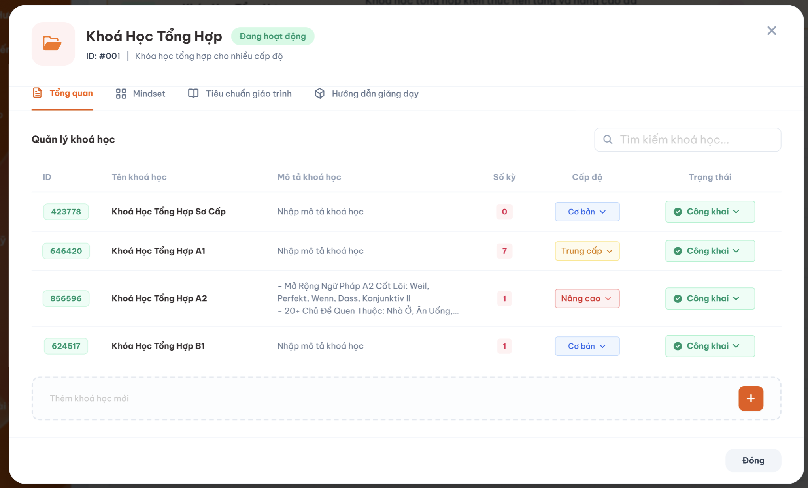
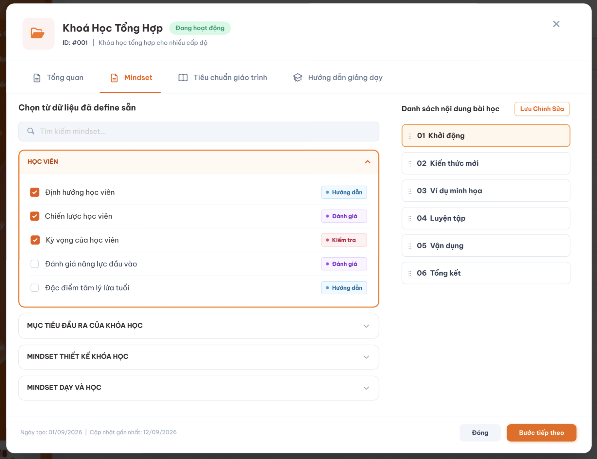
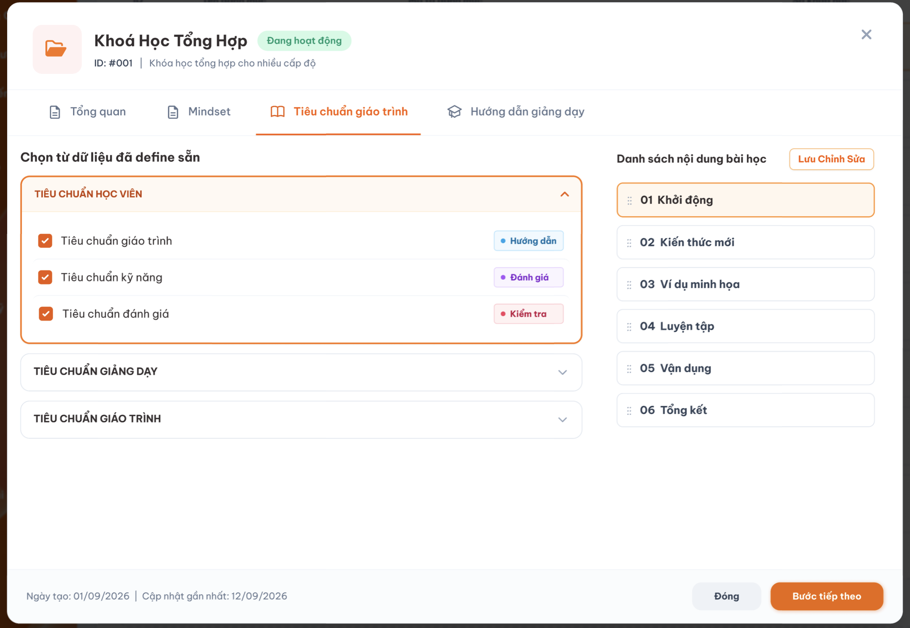
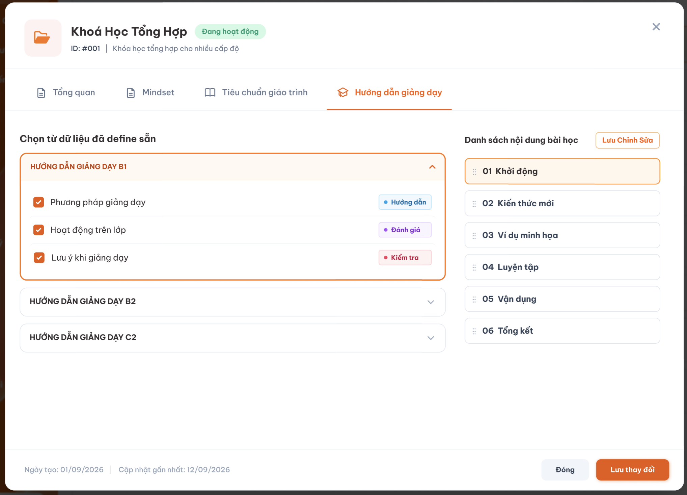
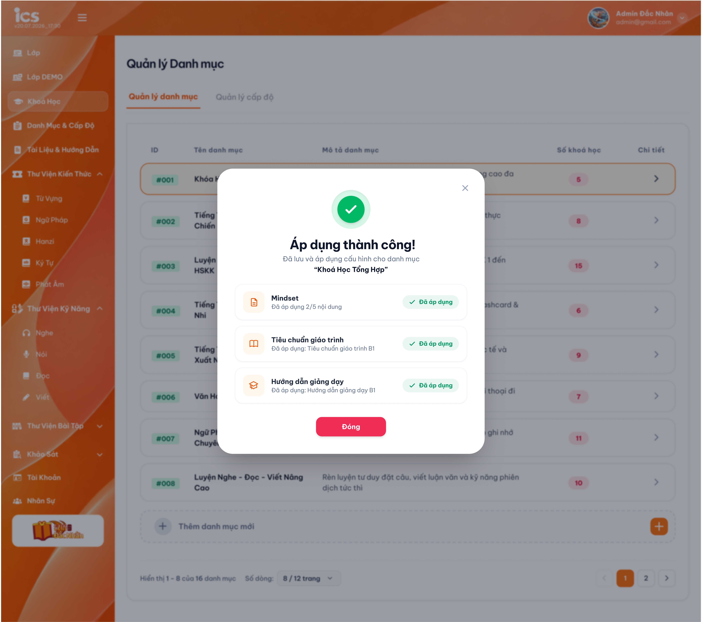

# Chi tiết danh mục (Popup)

## 1. UI

### Popup Chi tiết danh mục

**Mô tả:**

- Hiển thị thông tin của đúng danh mục được chọn, gồm 4 tab: `Tổng quan`, `Mindset`, `Tiêu chuẩn giáo trình`, `Hướng dẫn giảng dạy`.
- Tab mặc định khi mở popup là `Tổng quan`.

### Tab Tổng quan

<p align="center">
  <a href="./images/02-category-overview.png"></a><br>
  <em>Tab Tổng quan và danh sách khóa học thuộc danh mục — nhấn để xem ảnh gốc</em>
</p>

**Mô tả:**

- Hiển thị các khóa học thuộc danh mục hiện tại.
- Ô **"Thêm khóa học mới"** ở đầu danh sách cho phép tạo nhanh chỉ với Tên khóa học (giống cơ chế thêm nhanh danh mục).
- Cho phép thêm khóa học mới bất kể danh mục đang ở trạng thái `Nháp`, `Công Khai` hay `Vô hiệu` (khóa học là đối tượng riêng có trạng thái riêng, không phải dữ liệu chi tiết của danh mục).
- Sửa, xóa, đổi trạng thái, nhân bản khóa học tại tab này tuân theo đúng rule của [Quản lý khoá học](../../course_management/course_management.md): chỉ khóa học `Nháp` được xóa; khóa học `Công Khai` / `Vô hiệu` chỉ sửa được Tên và Mô tả (REQ01, REQ05, REQ10, REQ11 của file đó).

| Field | Yêu cầu |
|---|---|
| ID | 9 chữ số `CCAALLMMM` theo [Quản lý khoá học](../../course_management/course_management.md) REQ06: `AA` = ID danh mục hiện tại, `LL` = ID cấp độ đã chọn, `MMM` do hệ thống cấp. Chưa chọn Cấp độ thì `LL` = `00`. Không nhập tay lúc thêm nhanh; khi còn `Nháp` chỉ sửa được `MMM` (trong popup Kích hoạt công khai khoá học); khóa vĩnh viễn kể từ khi rời `Nháp`. |
| Tên khóa học | Bắt buộc, không giới hạn độ dài nghiệp vụ. |
| Mô tả khóa học | Không bắt buộc |
| Cấp độ | Chọn từ danh sách đã định nghĩa tại feature `Quản lý cấp độ`; không bắt buộc, mặc định `Không` nếu chưa chọn. |
| Số kỳ | Chỉ đọc. Khóa học – kỳ có quan hệ `1:n`; hệ thống tự đếm và cập nhật khi quan hệ được thêm/xóa. |
| Trạng thái | `Nháp` (mặc định) / `Công Khai` / `Vô hiệu`, theo rule chuyển trạng thái của khóa học (`course_management.md` REQ05): `Nháp → Công Khai` (qua popup Công khai khoá học), `Công Khai ↔ Vô hiệu`, không về `Nháp`. |
| Tìm kiếm | Sau khi ngừng nhập `2 giây`, lọc trong danh mục hiện tại theo keyword khớp một phần với ID, Tên hoặc Mô tả. |

### Tab Mindset, Tiêu chuẩn giáo trình và Hướng dẫn giảng dạy

<p align="center">
  <a href="./images/03-category-mindset.png"></a>
  <a href="./images/04-category-curriculum-standard.png"></a>
  <a href="./images/05-category-teaching-guide.png"></a><br>
  <em>Ba tab cấu hình nội dung cho danh mục — nhấn để xem ảnh gốc</em>
</p>

<p align="center">
  <a href="./images/06-category-apply-success.png"></a><br>
  <em>Áp dụng thành công & tóm tắt — nhấn để xem ảnh gốc</em>
</p>

| Thành phần | Yêu cầu |
|---|---|
| Tìm kiếm | Sau khi ngừng nhập `2 giây`, lọc theo keyword khớp một phần với tên package/category hoặc tiêu đề action item. |
| Package/category | Chọn nhiều, không giới hạn số lượng; mỗi package/category tải các action item trực thuộc. |
| Action item | Chọn nhiều từ các package/category đã chọn; không giới hạn số lượng. |
| Lưu/Áp dụng | Lưu tham chiếu vào danh mục hiện tại; không tạo/sửa dữ liệu gốc. |

**Điểm cần lưu ý:**

- Ba tab dùng chung nguyên tắc: chọn package/category trước, rồi chọn action item trực thuộc.
- Nội dung chỉ được **tham chiếu**; khi dữ liệu nguồn thay đổi tại feature định nghĩa, nội dung áp dụng tại danh mục phải phản ánh theo.
- Quyền `Chỉ xem`: xem trước, không được tick/lưu. Quyền `Cập nhật kết quả`: tick chọn và lưu/áp dụng.
- **Theo trạng thái danh mục:** chỉ tick chọn / lưu / áp dụng được khi danh mục đang `Nháp`. Danh mục `Công Khai` / `Vô hiệu`: 3 tab chỉ đọc với mọi quyền (checkbox, nút Lưu/Áp dụng disable); backend từ chối request (EX12). Xem `category_management.md` REQ08.
- Sau khi lưu thành công, hệ thống hiển thị popup `Áp dụng thành công!` tóm tắt kết quả của cả 3 tab.

## 2. Yêu cầu

### 2.1. Flow chính

**Flow 1: Thêm nhanh khóa học**

```text
CD nhập Tên vào ô "Thêm khóa học mới" trong tab Tổng quan
      → Nhấn nút "+" / Nhấn Enter
      → FE gọi API tạo khóa học (Mô tả = trống, Cấp độ = Không → ID = `CCAA00MMM`,
        Số kỳ = 0, Trạng thái = Nháp), gắn vào danh mục hiện tại và trung tâm CD đang chọn ở header
      → BE tạo record, danh mục tự cập nhật Số khóa học
      → FE thêm dòng mới vào bảng
```

**Flow 2: Sửa khóa học khi còn Nháp**

```text
CD mở khóa học đang Nháp
      → Sửa Tên, Mô tả và/hoặc Cấp độ
      → Đổi Cấp độ: `LL` trong ID đổi theo, hệ thống cấp lại `MMM` (course_management.md REQ06)
      → Hệ thống kiểm tra Tên không để trống
      → Hợp lệ: lưu thay đổi
      → Không hợp lệ: từ chối lưu, báo lỗi tại field tương ứng

CD mở khóa học đang Công Khai / Vô hiệu
      → Chỉ sửa được Tên, Mô tả; ID, Cấp độ và toàn bộ dữ liệu bên trong khóa học chỉ đọc (course_management.md REQ10)
```

**Flow 3: Đổi trạng thái khóa học**

```text
CD đang ở Nháp, chọn Công Khai (Nháp chỉ có lựa chọn này, không chuyển thẳng sang Vô hiệu)
      → Mở popup Kích hoạt công khai khoá học như course_management.md Flow 5
      → Sau khi công khai, ID bị khóa, field ID chuyển chỉ đọc

CD đang ở Công Khai hoặc Vô hiệu, chọn trạng thái còn lại
      → Hệ thống chuyển trạng thái, giữ nguyên ID đã có
      → CD không được chọn Nháp; UI không hiển thị lựa chọn này
```

**Flow 4: Cấu hình nội dung cho danh mục**

```text
CD mở 1 trong 3 tab Mindset / Tiêu chuẩn giáo trình / Hướng dẫn giảng dạy
      → Hệ thống hiển thị package/category đã định nghĩa tại feature tương ứng
      → Quyền Chỉ xem: mở xem, không tick/lưu được
      → Danh mục Công Khai / Vô hiệu: chỉ xem, không tick/lưu được (mọi quyền)
      → Danh mục Nháp + quyền Cập nhật kết quả: chọn nhiều package/category, hệ thống tải action item trực thuộc,
        CD chọn nhiều action item cần áp dụng
      → CD lưu/áp dụng → hệ thống kiểm tra dữ liệu vẫn còn hợp lệ
      → Thành công: lưu tham chiếu vào đúng danh mục, không đổi dữ liệu gốc, hiển thị "Áp dụng thành công!"
      → Khi dữ liệu nguồn đổi tại feature định nghĩa, nội dung tham chiếu tại danh mục phản ánh theo
```

### 2.2. Ngoại lệ

- **EX01:** Tên khóa học mới bị bỏ trống hoặc chỉ chứa khoảng trắng → chặn tạo mới, disable nút "+", khi Enter hiện lỗi "Tên khoá học không được bỏ trống".
- **EX02:** Trong popup Kích hoạt công khai khoá học, `MMM` sai định dạng hoặc ID 9 số trùng → từ chối, hiển thị lỗi, giữ nguyên ID cũ (course_management.md EX05).
- **EX03:** Cấp độ đã chọn chuyển sang `Vô hiệu hóa`/không còn khả dụng trước khi lưu → không lưu cấp độ không hợp lệ; dữ liệu đã lưu trước đó không đổi. (Cấp độ đang được khóa học sử dụng không thể bị xóa, chỉ có thể bị Vô hiệu hóa — xem `level_management.md` REQ07.)
- **EX04:** Gọi API/thao tác trực tiếp chuyển trạng thái từ `Công Khai`/`Vô hiệu` về `Nháp` → hệ thống từ chối, báo lỗi, giữ nguyên trạng thái; UI không hiển thị lựa chọn `Nháp`.
- **EX05:** Cố sửa ID khi khóa học đã rời khỏi `Nháp` → từ chối, field ID chỉ đọc/disable.
- **EX06:** ID hợp lệ tại thời điểm nhập nhưng bị đối tượng khác dùng ngay trước lúc backend lưu (race condition) → backend từ chối, giữ nguyên trạng thái, báo lỗi.
- **EX07:** Tìm kiếm khóa học không có kết quả → hiển thị "Không có dữ liệu", không đổi dữ liệu.
- **EX08:** Package/category hoặc action item bị xóa/không còn khả dụng tại feature định nghĩa → nội dung tham chiếu tại danh mục phản ánh trạng thái mới, không hiển thị như còn hiệu lực.
- **EX09:** Lưu/áp dụng cấu hình thất bại → không hiển thị "Áp dụng thành công!", không lưu một phần.
- **EX10:** Người dùng không có quyền, truy cập/gửi request trực tiếp → từ chối, không đổi dữ liệu.
- **EX11:** Quyền `Chỉ xem` gửi request tick chọn/lưu trực tiếp → hệ thống từ chối, giữ nguyên cấu hình danh mục.
- **EX12:** Tick chọn / lưu cấu hình khi danh mục `Công Khai` / `Vô hiệu` (UI hoặc request trực tiếp) → UI chỉ đọc; backend từ chối, trả lỗi `Danh mục không ở trạng thái Nháp, chỉ được sửa Tên và Mô tả.`, cấu hình không đổi.
- **EX13:** Sửa field ngoài Tên, Mô tả của khóa học `Công Khai` / `Vô hiệu`, hoặc xóa khóa học không ở `Nháp` tại tab Tổng quan → backend từ chối theo `course_management.md` EX09, EX11.

### 2.3. Yêu cầu khác

- **REQ01 – ID khóa học:** 9 chữ số `CCAALLMMM`, quy tắc sinh, đồng bộ và khoá theo `course_management.md` REQ06. Khi ID danh mục (đang `Nháp`) đổi, `AA` trong ID mọi khóa học `Nháp` thuộc danh mục đổi theo và hệ thống cấp lại `MMM` nếu trùng trong `CCAALL` mới (khóa học `Công Khai` / `Vô hiệu` không thể thuộc danh mục `Nháp`).
- **REQ02 – Rule chuyển trạng thái khóa học:** theo `course_management.md` REQ05: `Nháp → Công Khai` (một chiều, qua popup); `Công Khai ↔ Vô hiệu` (hai chiều); không cho `Nháp → Vô hiệu` và không cho chuyển về `Nháp`. UI chỉ hiển thị lựa chọn hợp lệ; request trực tiếp với transition không hợp lệ bị backend từ chối.
- **REQ03 – Thông tin cơ bản khóa học:** Tên bắt buộc, không giới hạn độ dài. Mô tả và Cấp độ không bắt buộc (mặc định `Không` nếu chưa chọn Cấp độ); được phép giữ Cấp độ `Không` kể cả khi khóa học đã `Công Khai`, không bắt buộc phải chọn cấp độ cụ thể. Số kỳ tự tính, không nhập tay. Mỗi khóa học thuộc đúng 1 danh mục (`1:n`); được thêm mới bất kể danh mục đang ở trạng thái nào.
- **REQ04 – Cấu hình nội dung danh mục:** Chỉ sửa được khi danh mục `Nháp`; `Công Khai` / `Vô hiệu` chỉ đọc (EX12). Tại mỗi tab Mindset/Tiêu chuẩn giáo trình/Hướng dẫn giảng dạy, chọn nhiều package/category rồi nhiều action item trực thuộc, không giới hạn số lượng. Dữ liệu nguồn chỉ được tham chiếu, không sao chép hay chỉnh sửa; thay đổi tại feature định nghĩa được phản ánh vào nội dung áp dụng.

### 2.4. Ràng buộc

#### Quyền chọn và áp dụng nội dung

| Chế độ quyền | Xem | Tick chọn | Lưu/Áp dụng |
|---|:---:|:---:|:---:|
| Cập nhật kết quả | ✅ | ✅ | ✅ |
| Chỉ xem / Chỉ bình luận | ✅ | ❌ | ❌ |
| Không có quyền | ❌ | ❌ | ❌ |

#### Phạm vi dữ liệu

- Kiểm tra trùng ID khóa học phải thực hiện lại tại backend ngay thời điểm lưu. ID khóa học và ID danh mục kiểm tra trùng **độc lập** theo từng loại đối tượng — ID khóa học (9 số) duy nhất trong phạm vi khóa học, ID danh mục (2 số) duy nhất trong phạm vi danh mục.
- Danh sách khóa học, Số kỳ, cấu hình nội dung phải thuộc đúng danh mục/khóa học đang thao tác.
- Dữ liệu Cấp độ, Mindset, Tiêu chuẩn giáo trình, Hướng dẫn giảng dạy lấy từ feature quản lý tương ứng, không hard-code.
- Không cho phép truy cập/thực hiện hành động bị đánh dấu `❌`, kể cả khi gọi trực tiếp bằng URL hoặc request.

---

## 3. Testcase

### Feature: Chi tiết danh mục

| Tên testcase | Priority | Loại test | Scenario | Role | Pre-condition | Given / When / Then | Expected Result |
|---|---| --- |---|---|---|---|---|
| Case 1: Thêm nhanh khóa học | High | Smoke | Flow 1 | Curriculum Development Handler | Popup danh mục đang mở, tab Tổng quan | **Given** CD nhập tên hợp lệ vào ô "Thêm khóa học mới"<br>**When** nhấn "+" hoặc Enter<br>**Then** khóa học mới được tạo | - ID 9 số `CCAA00MMM` có ngay (`AA` = ID danh mục hiện tại)<br>- Mô tả trống, Cấp độ = Không, Trạng thái = `Nháp`<br>- Số khóa học của danh mục tăng tương ứng |
| Case 2: Chặn thêm khi tên trống | Medium |  | EX01 | Curriculum Development Handler | Tab Tổng quan đang mở | **Given** để trống ô nhập<br>**When** nhấn "+" hoặc Enter<br>**Then** hệ thống không cho tạo | - Không có khóa học mới<br>- Nút "+" bị disable |
| Case 3: Sửa khóa học khi đang Nháp | High |  | Flow 2 / REQ01, REQ03 | Curriculum Development Handler | Khóa học đang `Nháp` | **Given** CD sửa Tên/Mô tả/Cấp độ<br>**When** lưu<br>**Then** hệ thống cập nhật | - Dữ liệu cập nhật đúng<br>- Chọn Cấp độ: ID = `CC` + ID danh mục + ID cấp độ + `MMM`; đổi Cấp độ thì `LL` và `MMM` đổi theo<br>- Có thể sửa lại nhiều lần khi còn `Nháp` |
| Case 4: Chặn sửa khi ID không hợp lệ | Medium |  | EX02 | Curriculum Development Handler | Khóa học đang `Nháp`, popup Kích hoạt công khai đang mở | **Given** CD nhập `MMM` sai định dạng hoặc ID 9 số trùng<br>**When** bấm `Công khai khoá học`<br>**Then** hệ thống từ chối | - Hiển thị lỗi tương ứng<br>- ID giữ nguyên như trước |
| Case 5: Chuyển Nháp → Công Khai | High | Smoke | Flow 3 / REQ02 | Curriculum Development Handler | Khóa học `Nháp` | **Given** CD chọn `Công Khai`<br>**When** hệ thống mở popup Kích hoạt công khai khoá học, CD xác nhận hợp lệ<br>**Then** hệ thống chuyển trạng thái | - Trạng thái = `Công Khai`, ID khóa<br>- Menu khi `Nháp` không có `Vô hiệu` |
| Case 6: Khóa ID và chặn quay về Nháp | High |  | EX04, EX05 / REQ01, REQ02 | Curriculum Development Handler | Khóa học đang `Công Khai` hoặc `Vô hiệu` | **Given** khóa học đã rời `Nháp`<br>**When** CD thử sửa ID hoặc chọn/gọi API chuyển về `Nháp`<br>**Then** hệ thống từ chối cả 2 thao tác | - Field ID chỉ đọc<br>- UI không hiển thị lựa chọn `Nháp`; API trực tiếp bị từ chối |
| Case 7: Chuyển đổi Công Khai ↔ Vô hiệu | Medium |  | Flow 3 / REQ02 | Curriculum Development Handler | Khóa học đang `Công Khai` hoặc `Vô hiệu` | **Given** CD chọn trạng thái còn lại<br>**When** xác nhận<br>**Then** hệ thống chuyển trạng thái | - Trạng thái đổi đúng chiều, ID giữ nguyên |
| Case 8: Áp dụng cấu hình nội dung thành công | High |  | Flow 4 / REQ04 | Curriculum Development Handler | Danh mục `Nháp`; quyền `Cập nhật kết quả`; có dữ liệu đã định nghĩa | **Given** CD chọn nhiều package/category và action item<br>**When** lưu/áp dụng<br>**Then** hệ thống lưu tham chiếu | - Dữ liệu nguồn không đổi<br>- Hiển thị `Áp dụng thành công!` |
| Case 9: Quyền Chỉ xem không được thay đổi cấu hình | High |  | EX11 | Curriculum Development Handler | Quyền `Chỉ xem` | **Given** mở tab cấu hình nội dung<br>**When** cố tick chọn hoặc lưu trực tiếp<br>**Then** hệ thống từ chối | - Không tick/lưu được<br>- Cấu hình danh mục không đổi |
| Case 10: Kiểm tra quyền truy cập trực tiếp | High |  | EX10 | Các role khác | Không có quyền | **Given** không có quyền quản lý danh mục<br>**When** mở URL/gửi request trực tiếp đến popup hoặc API cấu hình<br>**Then** hệ thống từ chối | - Không xem/đổi được dữ liệu |
| Case 11: Cấu hình chỉ đọc khi danh mục Công Khai / Vô hiệu | High |  | REQ04 / EX12 | Curriculum Development Handler | Danh mục `Công Khai`; quyền `Cập nhật kết quả` | **Given** mở tab Mindset<br>**When** thử tick chọn / lưu, hoặc gửi request trực tiếp<br>**Then** hệ thống từ chối | - Checkbox, nút Lưu/Áp dụng disable<br>- API trả lỗi, cấu hình không đổi |
| Case 12: Khóa học Công Khai trong tab Tổng quan chỉ sửa Tên, Mô tả | High |  | Flow 2 / EX13 | Curriculum Development Handler | Danh mục có khóa học `Công Khai` | **Given** CD mở khóa học tại tab Tổng quan<br>**When** sửa Tên, Mô tả; thử sửa Cấp độ, ID, xóa khóa học<br>**Then** chỉ Tên, Mô tả được lưu | - Cấp độ, ID chỉ đọc; Xóa mờ<br>- Vẫn thêm khóa học mới vào danh mục được |
