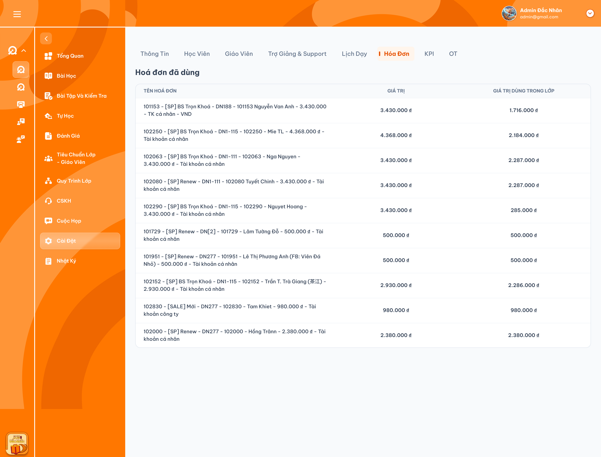

# Chi tiết lớp học — Tab Hóa đơn

> Requirement này đặc tả màn **Chi tiết lớp học → Cài đặt → Tab Hóa đơn**. Tab chỉ hiển thị thông tin hóa đơn và học phí đã dùng trong lớp, có cột Tên học viên, cột Ngày tạo hóa đơn và filter Học viên cho phép chọn một hoặc nhiều người. Hóa đơn được tạo tại Cơm Gạo rồi đồng bộ sang ICS; cột Ngày tạo hóa đơn hiển thị ngày tạo gốc tại Cơm Gạo, không phải ngày đồng bộ. **Không có filter ngày tạo hóa đơn.** Thao tác ghi nhận học phí được đặc tả tại [Tab Học viên](./class_detail_students_requirements.md).

## 1. UI

### Tab Hóa đơn — Bảng Hóa đơn đã dùng

<p align="center">
  <a href="./images/30-class-detail-invoices.png"></a><br>
  <em>Ảnh tham chiếu bố cục cũ — UI cần bổ sung cột Tên học viên, cột Ngày tạo hóa đơn và filter Học viên chọn một/nhiều người; không có filter ngày tạo; nhấn để xem ảnh gốc</em>
</p>

**Mô tả:** Hiển thị các hóa đơn đã được dùng để ghi nhận học phí cho lớp hiện tại. Đây là màn chỉ xem, không có thao tác CRUD hóa đơn hoặc học phí.

**Giải thích field/thành phần:**

| Thành phần | Yêu cầu |
|---|---|
| Tab | Nhãn `Hóa đơn`; làm nổi bật khi đang chọn. |
| Tiêu đề | `Hóa đơn đã dùng`. |
| Tên hóa đơn | Hiển thị tên/mô tả hóa đơn lấy từ dữ liệu hóa đơn; cho xuống dòng để đọc đầy đủ như ảnh. |
| Tên học viên | Cột riêng hiển thị tên học viên liên kết với hóa đơn đã dùng trong lớp; lấy theo quan hệ dữ liệu và student_id, không tách tên từ chuỗi Tên hóa đơn. |
| Ngày tạo hóa đơn | Cột chỉ xem, hiển thị ngày tạo gốc từ Cơm Gạo được đồng bộ sang ICS; không phải ngày đồng bộ hay ngày ghi nhận học phí. Không có control lọc ngày. |
| Giá trị | Tổng giá trị của hóa đơn, không phải số dư còn lại hoặc học phí của riêng lớp này. |
| Giá trị dùng trong lớp | Tổng học phí được ghi nhận từ hóa đơn đó vào **lớp đang xem**. |
| Mỗi dòng | Đại diện cho một hóa đơn, nhận diện bằng invoice_id. Một hóa đơn dùng nhiều lần trong cùng lớp vẫn chỉ có một dòng. |

**Điểm cần lưu ý:**

- Chỉ `Admin`, `Class Handler` và `Support` được xem tab và thông tin tiền trong phạm vi lớp được phân quyền. `Teacher` và mọi role khác không được xem; backend phải từ chối cả request trực tiếp.
- Không có nút thêm/sửa/xóa, input sửa tiền hoặc popup học phí trong tab này. Bấm dòng không tự mở flow chỉnh sửa.
- Không đưa mọi hóa đơn của học viên vào bảng: chỉ hiển thị hóa đơn có học phí đã được ghi nhận cho chính lớp này.
- Không lọc bỏ giao dịch tài chính chỉ vì học viên đã Rời lớp, Nghỉ học hoặc bị xóa mềm khỏi danh sách học viên; dữ liệu học phí vẫn được giữ theo nghiệp vụ đã chốt.
- Danh sách dùng load-more khi cuộn xuống gần cuối, không có phân trang theo số trang. Chỉ bổ sung filter `Học viên`, cho phép chọn một hoặc nhiều người; không có filter `Ngày tạo hóa đơn`.
- Cột Tên học viên không phải nút mở/chỉnh sửa học viên. Cột Ngày tạo hóa đơn chỉ hiển thị, không có thao tác chỉnh ngày tại tab.

#### Testcase — Tab Hóa đơn — Bảng Hóa đơn đã dùng

| Tên testcase | Priority | Loại test | Scenario | Role | Pre-condition | Given / When / Then | Expected Result |
|---|---| --- |---|---|---|---|---|
| Case 1: Mở đúng bảng hóa đơn của lớp | High | Smoke | Flow 1 / REQ01 / REQ08–REQ09 | Admin/Class Handler/Support | Có hóa đơn đã dùng tại nhiều lớp | **Given** mở lớp A<br>**When** chọn Hóa đơn<br>**Then** tải dữ liệu theo class_id của A | - Đúng tiêu đề và năm cột Tên hóa đơn / Tên học viên / Ngày tạo hóa đơn / Giá trị / Giá trị dùng trong lớp<br>- Có filter Học viên chọn một/nhiều người, không có filter ngày tạo<br>- Không trộn hóa đơn chỉ dùng tại lớp B<br>- Không thay đổi dữ liệu |
| Case 2: Một hóa đơn chỉ hiển thị một dòng | High |  | REQ02 | Admin/Class Handler/Support | Một hóa đơn có nhiều lần ghi nhận học phí trong lớp | **Given** các giao dịch cùng invoice_id<br>**When** tải bảng<br>**Then** gộp theo hóa đơn | - Một dòng duy nhất<br>- Không nhân đôi Giá trị hóa đơn<br>- Cộng đủ học phí trong lớp |
| Case 3: Tab chỉ xem | High |  | REQ01 | Admin/Class Handler/Support | Bảng đã tải | **Given** người dùng xem hoặc bấm một dòng<br>**When** kiểm tra control<br>**Then** không có flow CRUD tại tab | - Không có nút thêm/sửa/xóa<br>- Không có input chỉnh tiền<br>- Không gửi request ghi dữ liệu |
| Case 4: Giữ dữ liệu khi học viên không còn học | High |  | REQ02 | Admin/Class Handler/Support | Học viên đã có học phí và chuyển Rời lớp/Nghỉ học/Xóa mềm | **Given** học phí vẫn được lưu<br>**When** mở bảng hóa đơn<br>**Then** vẫn hiển thị hóa đơn đã dùng | - Không mất học phí do đổi trạng thái học viên<br>- Không tự hoàn tiền hoặc trả số dư hóa đơn |

### Filter Học viên và cột Ngày tạo hóa đơn

**Mô tả:** Cho phép Admin / Class Handler / Support lọc hóa đơn đã dùng trong lớp theo một hoặc nhiều học viên. Ngày tạo hóa đơn là cột chỉ xem ngày tạo gốc tại Cơm Gạo, không phải bộ lọc. Filter chỉ thay đổi tập dòng hiển thị, không cập nhật hóa đơn hoặc học phí.

**Giải thích field/thành phần:**

| Thành phần | Yêu cầu |
|---|---|
| Filter Học viên | Cho phép chọn một hoặc nhiều học viên liên kết với hóa đơn trong lớp hiện tại bằng student_id; hiển thị tên để người dùng nhận biết, không so khớp chuỗi trong Tên hóa đơn. Khả năng tìm kiếm trong control chờ xác nhận. |
| Chọn nhiều học viên | Trả hóa đơn của **bất kỳ** học viên nào trong tập đã chọn (OR giữa các student_id), đồng thời chỉ lấy hóa đơn đã dùng trong lớp hiện tại. Không yêu cầu một hóa đơn thuộc tất cả người được chọn. |
| Không chọn học viên | Không giới hạn theo học viên; hiển thị danh sách hóa đơn đã dùng của lớp. |
| Cột Ngày tạo hóa đơn | Hiển thị ngày tạo gốc tại Cơm Gạo đồng bộ sang ICS, chỉ xem. Không có filter ngày, date picker hoặc điều kiện ngày trong request lọc. Định dạng ngày và múi giờ hiển thị chờ xác nhận. |
| Kết quả rỗng | `Không có hóa đơn phù hợp với bộ lọc.`; phân biệt với lớp chưa có hóa đơn được sử dụng. |

**Điểm cần lưu ý:**

- Lọc trên toàn bộ dữ liệu phù hợp của lớp ở backend trước khi chia nhóm load-more; không chỉ lọc các dòng đã tải trên client.
- Khi đổi/xóa điều kiện lọc, bắt đầu lại từ nhóm đầu, reset cursor và dữ liệu của kết quả cũ. Không nối response của bộ lọc cũ vào kết quả mới; retry phải dùng đúng điều kiện đang áp dụng.
- Học viên Rời lớp / Nghỉ học / Xóa mềm có hóa đơn đã dùng vẫn được nhận diện, hiển thị tên và lọc được; không loại dữ liệu tài chính lịch sử do trạng thái học viên.
- Hai học viên trùng tên phải được phân biệt bằng student_id. Tên học viên phải hiển thị an toàn, không thực thi HTML/script.
- Giá trị hóa đơn và tổng học phí theo hóa đơn–lớp vẫn giữ đúng nghĩa đã chốt; không biến cột tiền thành tổng của riêng nhóm tải hoặc tự phân bổ lại theo filter.
- Không dùng ngày ICS nhận đồng bộ, ngày ghi nhận học phí hoặc ngày sửa gần nhất thay cho Ngày tạo hóa đơn. Thiếu ngày tạo gốc thì đánh dấu cột ngày không khả dụng, không tự gán ngày thay thế và không loại hóa đơn khỏi bảng/filter Học viên chỉ vì thiếu ngày.
- Trường hợp một hóa đơn liên kết nhiều học viên chưa được chốt cách hiển thị tên/lọc; không tự đổi quy tắc một dòng mỗi invoice_id.

#### Testcase — Filter Học viên và cột Ngày tạo hóa đơn

| Tên testcase | Priority | Loại test | Scenario | Role | Pre-condition | Given / When / Then | Expected Result |
|---|---| --- |---|---|---|---|---|
| Case 20: Hiển thị cột Tên học viên từ quan hệ dữ liệu | High |  | REQ08 | Admin/Class Handler/Support | Hóa đơn có học viên liên kết và tên hóa đơn không chứa tên học viên | **Given** dữ liệu có student_id và tên học viên<br>**When** tải bảng<br>**Then** hiển thị tên ở cột riêng | - Tên đúng học viên liên kết<br>- Không suy ra tên bằng cách tách chuỗi Tên hóa đơn<br>- Không mở flow sửa từ cột tên |
| Case 21: Lọc một học viên trên toàn bộ dữ liệu | High |  | Flow 4 / REQ08 | Admin/Class Handler/Support | Hóa đơn của học viên cần lọc nằm ngoài nhóm đã tải | **Given** chọn một học viên<br>**When** áp dụng filter<br>**Then** backend lọc theo student_id trong lớp trước khi chia nhóm | - Chỉ trả hóa đơn của học viên đã chọn trong lớp<br>- Tìm thấy hóa đơn dù trước đó chưa tải<br>- Không hiện hóa đơn chỉ dùng ở lớp khác<br>- Không gửi thao tác ghi dữ liệu |
| Case 22: Phân biệt học viên trùng tên | High |  | REQ08 | Admin/Class Handler/Support | Hai học viên cùng tên nhưng student_id khác nhau | **Given** đặt điều kiện theo ID của học viên A<br>**When** lọc hóa đơn<br>**Then** không nhầm với học viên B | - Không lọc theo chuỗi tên đơn thuần<br>- Kết quả đúng quan hệ học viên–hóa đơn |
| Case 23: Hiển thị ngày tạo gốc Cơm Gạo | High |  | REQ09 | Admin/Class Handler/Support | Hóa đơn tạo ngày 21/09/2026 ở Cơm Gạo, đồng bộ ICS ngày 25/09/2026, ghi nhận học phí ngày 27/09/2026 | **Given** hóa đơn đã đồng bộ<br>**When** tải bảng rồi đồng bộ lại cùng hóa đơn<br>**Then** cột Ngày tạo hóa đơn hiển thị ngày 21/09/2026 | - Không hiển thị ngày đồng bộ/ngày ghi nhận học phí thay ngày tạo<br>- Ngày tạo gốc không đổi sau đồng bộ lại<br>- Không tạo dòng trùng |
| Case 24: Lọc nhiều học viên | High |  | Flow 4 / REQ08 | Admin/Class Handler/Support | Lớp có hóa đơn của học viên A, B, C | **Given** chọn đồng thời A và B<br>**When** áp dụng filter<br>**Then** trả hóa đơn của A hoặc B đã dùng trong lớp | - Có hóa đơn của cả A và B, không có C<br>- OR giữa các student_id, không yêu cầu hóa đơn thuộc cả A và B<br>- Mỗi invoice_id vẫn một dòng, tiền không cộng lặp |
| Case 25: Reset load-more khi đổi bộ lọc | High |  | REQ07–REQ08 / EX07 | Admin/Class Handler/Support | Đã tải nhiều nhóm, request bộ lọc cũ chưa hoàn tất | **Given** thêm/bỏ học viên hoặc thay đổi tập đã chọn<br>**When** tải nhóm đầu mới rồi response cũ trả về<br>**Then** giữ kết quả bộ lọc mới | - Reset cursor và dữ liệu cũ<br>- Bỏ response cũ<br>- Tải thêm/retry đúng tập student_id mới<br>- Không trộn, lặp hoặc bỏ sót dòng |
| Case 26: Không có kết quả và bỏ điều kiện lọc | Medium |  | REQ08 / EX08 | Admin/Class Handler/Support | Lớp có hóa đơn nhưng không dòng nào khớp học viên đã chọn | **Given** filter trả rỗng<br>**When** xem rồi bỏ hết học viên đã chọn<br>**Then** tải lại danh sách hóa đơn đã dùng trong lớp | - Thông báo Không có hóa đơn phù hợp với bộ lọc<br>- Bỏ filter khôi phục tập dữ liệu của lớp<br>- Không biến kết quả rỗng thành lỗi hoặc dòng 0đ |
| Case 27: Lọc được học viên đã rời/nghỉ/xóa mềm | High |  | REQ02 / REQ08 | Admin/Class Handler/Support | Có hóa đơn đã dùng của học viên Rời lớp / Nghỉ học / Xóa mềm | **Given** đặt điều kiện học viên đó<br>**When** lọc<br>**Then** vẫn trả hóa đơn đã dùng hợp lệ | - Hiển thị đúng Tên học viên<br>- Học phí lịch sử không mất hoặc bị tính lại<br>- Không khôi phục trạng thái học viên |
| Case 28: Thiếu ngày tạo gốc không dùng ngày đồng bộ thay thế | High |  | REQ09 / EX05 | Admin/Class Handler/Support | Bản ghi đồng bộ thiếu ngày tạo Cơm Gạo nhưng có ngày ICS nhận dữ liệu | **Given** hóa đơn đã dùng hợp lệ và khớp học viên được chọn<br>**When** tải bảng<br>**Then** vẫn hiển thị dòng, đánh dấu cột ngày không khả dụng | - Không tự lấy ngày đồng bộ/ngày học phí/ngày sửa làm ngày tạo<br>- Không gán ngày giả<br>- Không loại hóa đơn hoặc che tên/tiền chỉ vì thiếu ngày |
| Case 29: Ngày tạo chỉ là cột hiển thị, không có filter | High |  | REQ09 | Admin/Class Handler/Support | Bảng có hóa đơn tạo ở nhiều ngày | **Given** mở tab và chọn một/nhiều học viên<br>**When** kiểm tra UI và request đọc dữ liệu<br>**Then** ngày tạo chỉ được hiển thị tại cột | - Không có filter ngày hoặc date picker<br>- Không gửi điều kiện ngày tạo trong request lọc<br>- Không tự giới hạn theo ngày hiện tại<br>- Không sửa ngày từ cột |

### Cột Giá trị và Giá trị dùng trong lớp

**Mô tả:** Hai cột tiền phản ánh hai dữ liệu khác nhau: giá trị toàn bộ hóa đơn và phần học phí đã ghi nhận từ hóa đơn vào lớp hiện tại.

**Giải thích field/thành phần:**

| Cột | Cách lấy dữ liệu | Ví dụ |
|---|---|---|
| Giá trị | Lấy tổng giá trị hóa đơn từ nguồn quản lý hóa đơn. | Hóa đơn 1.000.000đ luôn hiển thị 1.000.000đ dù đã dùng một phần. |
| Giá trị dùng trong lớp | Cộng các lần ghi nhận học phí thuộc cùng invoice_id và class_id đang xem. | Dùng 100.000đ rồi 200.000đ trong lớp A thì hiển thị 300.000đ. |
| Định dạng | Tiền VND, phân cách hàng nghìn bằng dấu chấm và có ký hiệu đồng; căn phải. | `1.000.000 đ`. |

**Điểm cần lưu ý:**

- Ví dụ hóa đơn 1.000.000đ dùng 300.000đ ở lớp A và 400.000đ ở lớp B: tab lớp A hiển thị Giá trị = 1.000.000đ, Giá trị dùng trong lớp = 300.000đ. Số dư 300.000đ không phải giá trị của hai cột này.
- Không cộng phần đã dùng ở lớp khác vào học phí của lớp hiện tại.
- Không tính lần ghi nhận thất bại, chưa lưu hoặc request lặp thành giao dịch mới.
- Không cộng theo tên hóa đơn vì hai hóa đơn khác nhau có thể trùng tên; phải dùng ID.
- Việc hoàn/hủy giao dịch học phí sẽ tuân theo requirement học phí riêng. Tab này không tự đặt quy tắc giảm học phí hoặc xóa lịch sử.

#### Testcase — Cột Giá trị và Giá trị dùng trong lớp

| Tên testcase | Priority | Loại test | Scenario | Role | Pre-condition | Given / When / Then | Expected Result |
|---|---| --- |---|---|---|---|---|
| Case 5: Phân biệt giá trị hóa đơn và học phí | High |  | REQ03 | Admin/Class Handler/Support | Hóa đơn 1.000.000đ, dùng 100.000đ trong lớp | **Given** đã ghi nhận học phí<br>**When** tải bảng<br>**Then** hiển thị hai giá trị đúng nghĩa | - Giá trị = 1.000.000đ<br>- Giá trị dùng trong lớp = 100.000đ<br>- Không hiển thị số dư 900.000đ ở hai cột |
| Case 6: Cộng nhiều lần học phí từ cùng hóa đơn | High |  | Flow 2 / REQ03 | Admin/Class Handler/Support | Ghi nhận 100.000đ và 200.000đ trong cùng lớp | **Given** hai giao dịch hợp lệ cùng hóa đơn<br>**When** tính học phí của dòng<br>**Then** cộng 100.000 + 200.000 | - Hiển thị 300.000đ<br>- Một dòng hóa đơn<br>- Tổng giá trị hóa đơn không bị nhân đôi |
| Case 7: Một hóa đơn dùng ở nhiều lớp | High |  | REQ03 | Admin/Class Handler/Support | Hóa đơn 1.000.000đ; A dùng 300.000đ, B dùng 400.000đ | **Given** đang xem lớp A<br>**When** tải bảng<br>**Then** chỉ tổng hợp học phí của A | - Giá trị = 1.000.000đ<br>- Dùng trong lớp = 300.000đ<br>- Không hiển thị 700.000đ hoặc số dư 300.000đ như tổng đã dùng |
| Case 8: Hai hóa đơn trùng tên | High |  | REQ02–REQ03 | Admin/Class Handler/Support | Hai invoice_id khác nhau có cùng tên | **Given** cả hai đã dùng trong lớp<br>**When** tải bảng<br>**Then** hiển thị hai dòng độc lập | - Không gộp theo tên<br>- Tiền mỗi dòng đúng hóa đơn |
| Case 9: Định dạng tiền và tên dài | Medium |  | REQ04 | Admin/Class Handler/Support | Tên dài và giá trị nhiều chữ số | **Given** bảng render<br>**When** đọc các cột<br>**Then** tên xuống dòng và tiền rõ ràng | - Tiền căn phải, phân cách hàng nghìn và ký hiệu đồng<br>- Không cắt mất giá trị<br>- Không chồng cột |

### Trạng thái tải, rỗng, lỗi và đồng bộ

**Mô tả:** Phản ánh đúng quá trình đọc dữ liệu. Khi học phí được thêm ở tab Học viên, lần mở/tải lại tab Hóa đơn phải hiển thị dữ liệu đã lưu mới nhất.

**Giải thích field/thành phần:**

| Trạng thái | Yêu cầu |
|---|---|
| Loading | Hiển thị loading/skeleton khi đang tải; không trình bày dữ liệu cũ của lớp khác. |
| Rỗng | `Chưa có hóa đơn được sử dụng trong lớp này.` |
| Lỗi | `Không thể tải thông tin hóa đơn và học phí. Vui lòng thử lại.`; có nút Thử lại. |
| Đồng bộ | Khi mở lại tab, đọc dữ liệu mới nhất đã commit; thay đổi học phí hiển thị đúng dòng. |

**Điểm cần lưu ý:**

- Không dùng giá trị 0 hoặc empty state để thay thế lỗi tải dữ liệu.
- Response của lớp cũ không được ghi đè khi người dùng đã chuyển sang lớp khác.
- Không có Toast CRUD vì tab không thực hiện CRUD. Lỗi đọc dữ liệu hiển thị ngay tại bảng.

#### Testcase — Trạng thái tải, rỗng, lỗi và đồng bộ

| Tên testcase | Priority | Loại test | Scenario | Role | Pre-condition | Given / When / Then | Expected Result |
|---|---| --- |---|---|---|---|---|
| Case 10: Chưa có hóa đơn dùng trong lớp | Medium |  | EX01 | Admin/Class Handler/Support | Không có học phí từ hóa đơn trong lớp | **Given** API trả danh sách rỗng<br>**When** render<br>**Then** hiển thị thông báo rỗng | - Không tạo dòng 0đ giả<br>- Không hiện hóa đơn chưa dùng |
| Case 11: Tải thất bại và thử lại | High |  | EX02 | Admin/Class Handler/Support | API lỗi | **Given** mở tab<br>**When** tải thất bại rồi Thử lại thành công<br>**Then** chuyển lỗi → dữ liệu đúng | - Không hiển thị 0 thay lỗi<br>- Không có Toast thành công CRUD |
| Case 12: Cập nhật sau khi thêm học phí | High |  | Flow 2 / REQ05 | Admin/Class Handler/Support | Hóa đơn đã dùng 100.000đ trong lớp | **Given** thêm 200.000đ thành công tại tab Học viên<br>**When** quay lại tab Hóa đơn<br>**Then** dòng hiển thị 300.000đ dùng trong lớp | - Giá trị hóa đơn giữ đúng tổng giá trị<br>- Không tạo dòng trùng<br>- Không tính thao tác thất bại |
| Case 13: Response lớp cũ trả về muộn | High |  | EX03 | Admin/Class Handler/Support | Hai request của hai lớp trả không đúng thứ tự | **Given** chuyển từ lớp A sang B khi A đang tải<br>**When** response A về sau B<br>**Then** vẫn giữ dữ liệu B | - Không trộn invoice/class_id<br>- Header và dữ liệu cùng lớp |
| Case 14: Chặn xem dữ liệu tài chính ngoài quyền | High |  | EX04 / REQ06 | Teacher/Sale/Student; Admin/Class Handler/Support ngoài phạm vi lớp | Có ID lớp/hóa đơn hợp lệ | **Given** gọi API tab Hóa đơn trực tiếp<br>**When** backend kiểm tra quyền<br>**Then** từ chối | - Không trả tên hóa đơn hoặc tiền<br>- Không dựa riêng vào việc ẩn tab ở client |

### Load-more danh sách hóa đơn

**Mô tả:** Khi người dùng cuộn gần cuối các dòng đã tải, hệ thống tự tải thêm hóa đơn của lớp hiện tại và nối vào bảng.

**Giải thích field/thành phần:**

| Thành phần | Yêu cầu |
|---|---|
| Vùng cuộn | Cuộn gần cuối kích hoạt tải nhóm dữ liệu tiếp theo nếu còn hóa đơn. |
| Loading cuối bảng | Hiển thị trong lúc tải thêm; giữ các dòng hiện có và vị trí cuộn. |
| Lỗi tải thêm | Hiển thị lỗi và Thử lại ở cuối bảng; không thay toàn bộ bảng bằng lỗi. |
| Hết dữ liệu | Dừng gọi tải thêm khi backend báo không còn dữ liệu. |

**Điểm cần lưu ý:**

- Mỗi thời điểm chỉ gửi một request tải thêm cho cùng lớp/cursor; cuộn liên tục không tạo nhiều request trùng.
- Dữ liệu phải được tổng hợp theo invoice_id trước khi chia nhóm tải. Học phí mỗi dòng là tổng của hóa đơn trong lớp, không phải tổng của riêng nhóm giao dịch vừa tải.
- Nối danh sách theo invoice_id, không nhân đôi dòng khi response giao nhau hoặc retry. Response của lớp cũ không được nối vào lớp mới.
- Thứ tự và cursor phải ổn định trong một lượt tải để không bỏ sót hoặc lặp hóa đơn. Tiêu chí sắp xếp mặc định vẫn chờ xác nhận.

#### Testcase — Load-more danh sách hóa đơn

| Tên testcase | Priority | Loại test | Scenario | Role | Pre-condition | Given / When / Then | Expected Result |
|---|---| --- |---|---|---|---|---|
| Case 15: Cuộn tải thêm hóa đơn | High |  | Flow 3 / REQ07 | Admin/Class Handler/Support | Còn hóa đơn chưa tải | **Given** nhóm đầu đã hiển thị<br>**When** cuộn gần cuối<br>**Then** tải và nối nhóm tiếp theo | - Loading ở cuối bảng<br>- Giữ dòng/vị trí cuộn hiện có<br>- Không có nút số trang |
| Case 16: Chống request và dòng trùng | High |  | REQ07 | Admin/Class Handler/Support | Request tải thêm đang xử lý hoặc response có invoice_id đã hiển thị | **Given** cuộn liên tục hoặc retry<br>**When** dữ liệu trả về<br>**Then** hợp nhất theo invoice_id | - Một request đang xử lý cho cùng cursor<br>- Mỗi hóa đơn một dòng<br>- Không cộng tiền lại lần nữa |
| Case 17: Tải thêm lỗi và thử lại | High |  | EX06 / REQ07 | Admin/Class Handler/Support | Đã có dữ liệu, request tiếp theo lỗi | **Given** lỗi tải thêm<br>**When** bấm Thử lại<br>**Then** tải lại đúng nhóm chưa thành công | - Giữ dữ liệu cũ<br>- Không quay về đầu bảng<br>- Không bỏ sót/nhân đôi dòng |
| Case 18: Dừng khi hết hóa đơn | Medium |  | REQ07 | Admin/Class Handler/Support | Backend báo hết dữ liệu | **Given** đã tải nhóm cuối<br>**When** tiếp tục cuộn<br>**Then** không gửi thêm request | - Không loading vô hạn<br>- Giữ toàn bộ dòng đã tải |
| Case 19: Teacher và role khác không được xem tab | High |  | REQ06 / EX04 | Teacher/Sale/Student | Có ID lớp hợp lệ | **Given** mở lớp hoặc gọi API trực tiếp<br>**When** kiểm tra quyền xem Hóa đơn<br>**Then** từ chối | - Tab không hiển thị cho role bị chặn<br>- API không trả tên hóa đơn hoặc tiền<br>- Có quyền xem lịch không cấp quyền xem Hóa đơn |

## 2. Yêu cầu

### 2.1. Flow chính

**Flow 1 / REQ01–REQ04: Xem hóa đơn đã dùng**

```text
Mở Chi tiết lớp → chọn tab Hóa đơn
      → Kiểm tra quyền xem dữ liệu tài chính của lớp
      → Lấy hóa đơn đã có học phí ghi nhận trong lớp
      → Gộp theo invoice_id và cộng học phí theo class_id
      → Hiển thị Tên hóa đơn / Tên học viên / Ngày tạo hóa đơn / Giá trị / Giá trị dùng trong lớp
      → Cho phép lọc theo một hoặc nhiều học viên; ngày tạo chỉ hiển thị ở cột
```

**Flow 2 / REQ05: Đồng bộ khi học phí thay đổi**

```text
Ghi nhận học phí thành công tại function khác
      → Mở lại/tải lại tab Hóa đơn
      → Đọc dữ liệu đã commit mới nhất
      → Cập nhật học phí của dòng hóa đơn hoặc thêm dòng nếu lần đầu dùng
```

**Flow 3 / REQ07: Tải thêm khi cuộn**

```text
Cuộn gần cuối bảng → kiểm tra còn dữ liệu và không có request đang xử lý
      → Gửi class_id + tập student_id đang lọc (nếu có) + cursor tiếp theo
      → Hiển thị loading cuối bảng
      → Thành công: hợp nhất theo invoice_id, giữ vị trí cuộn
      → Lỗi: giữ dữ liệu đã tải, cho Thử lại
      → Hết dữ liệu: dừng tải thêm
```

**Flow 4 / REQ08: Lọc hóa đơn theo học viên**

```text
Admin / Class Handler / Support chọn một/nhiều học viên hoặc bỏ lựa chọn
      → Reset dữ liệu và cursor của kết quả cũ
      → Backend kiểm tra quyền và class_id
      → Lọc theo tập student_id (OR) trên toàn bộ dữ liệu của lớp; không lọc ngày tạo
      → Tổng hợp hóa đơn–lớp rồi trả nhóm đầu phù hợp
      → Có kết quả: hiển thị bảng và load-more theo cùng điều kiện
      → Không có kết quả: thông báo không có hóa đơn phù hợp bộ lọc
```

### 2.2. Ngoại lệ

- **EX01:** Chưa có hóa đơn dùng trong lớp → hiển thị empty state.
- **EX02:** API lỗi/hết thời gian chờ → hiển thị lỗi và Thử lại; không biến lỗi thành số 0.
- **EX03:** Response lớp cũ về muộn → bỏ response không còn phù hợp class_id hiện tại.
- **EX04:** Người dùng không có quyền xem tài chính hoặc ngoài phạm vi lớp → từ chối truy cập; không trả tên hóa đơn và tiền.
- **EX05:** Dữ liệu hóa đơn thiếu hoặc không nhất quán → báo trạng thái dữ liệu không khả dụng; không tự suy ra giá trị hóa đơn từ tổng học phí.
- **EX06:** Tải thêm thất bại → giữ các dòng hiện có và cursor chưa thành công; hiển thị Thử lại ở cuối bảng.
- **EX07:** Response bộ lọc cũ trả về sau khi đổi điều kiện → bỏ response, không nối hoặc ghi đè kết quả bộ lọc hiện tại.
- **EX08:** Lớp có hóa đơn nhưng không khớp bộ lọc → hiển thị empty state theo bộ lọc; không báo lớp chưa có hóa đơn.

### 2.3. Yêu cầu khác

- **REQ01 – Chỉ xem:** Tab hiển thị thông tin hóa đơn và học phí; không CRUD và không mở popup chỉnh sửa từ dòng.
- **REQ02 – Danh sách:** Chỉ hóa đơn đã dùng cho lớp hiện tại; một dòng mỗi invoice_id, không gộp theo tên.
- **REQ03 – Giá trị tiền:** Giá trị là tổng giá trị hóa đơn. Giá trị dùng trong lớp là tổng học phí ghi nhận từ hóa đơn cho lớp hiện tại; không phải số dư hoặc tổng dùng ở mọi lớp.
- **REQ04 – Hiển thị:** Tên dài xuống dòng, tiền VND căn phải với dấu phân cách hàng nghìn; layout đọc được trên các kích thước màn hình.
- **REQ05 – Đồng bộ:** Mở/tải lại tab hiển thị dữ liệu mới nhất đã lưu; không nhân đôi giao dịch hoặc dùng dữ liệu ngoài class_id.
- **REQ06 – Quyền và bảo mật:** Chỉ Admin/Class Handler/Support được xem trong phạm vi lớp; Teacher và mọi role khác bị chặn tại UI và API. Nội dung tên hóa đơn hiển thị an toàn, không thực thi HTML/script.
- **REQ07 – Load-more:** Cuộn gần cuối tự tải nhóm hóa đơn tiếp theo; không phân trang số. Giữ vị trí cuộn, chống request/dòng trùng, hỗ trợ thử lại và dừng khi hết dữ liệu.
- **REQ08 – Học viên:** Bổ sung cột Tên học viên và filter Học viên chọn một hoặc nhiều người theo quan hệ student_id với hóa đơn đã dùng trong lớp. Nhiều người áp dụng OR giữa các student_id; không chọn thì không giới hạn theo học viên. Lọc toàn bộ dữ liệu trước load-more; đổi/bỏ lựa chọn phải reset kết quả và cursor, tải thêm/retry theo đúng tập đã chọn. Không suy ra học viên từ tên hóa đơn và không bỏ dữ liệu lịch sử do trạng thái Rời lớp / Nghỉ học / Xóa mềm.
- **REQ09 – Ngày tạo hóa đơn:** Bổ sung cột chỉ xem ngày tạo gốc Cơm Gạo đồng bộ sang ICS, không dùng ngày đồng bộ, ngày học phí hoặc ngày sửa. **Không có filter ngày tạo hóa đơn**, không gửi điều kiện ngày trong request lọc. Thiếu ngày tạo thì đánh dấu cột không khả dụng, không tự thay ngày hoặc loại hóa đơn khỏi bảng.

### 2.4. Ràng buộc

- Tab không làm thay đổi hóa đơn, học phí, số dư hoặc trạng thái học viên.
- Dữ liệu nhận diện dùng class_id, invoice_id và transaction_id; tổng hợp mỗi giao dịch đã lưu đúng một lần.
- Tổng học phí của một dòng phải khớp các giao dịch dùng cùng hóa đơn trong lớp; không phụ thuộc số hàng đang hiển thị trên màn hình.
- Quy tắc số dư, phân bổ vượt giá trị, hoàn/hủy và hiệu lực giao dịch theo requirement Học phí/Hóa đơn riêng.
- Chỉ Admin/Class Handler/Support được xem trong phạm vi lớp. Teacher và mọi role khác không được xem thông tin hóa đơn/học phí, kể cả có quyền xem lịch lớp.
- Tổng hợp học phí theo hóa đơn–lớp trước khi chia nhóm load-more; mỗi dòng hiển thị tổng học phí đầy đủ của hóa đơn trong lớp.
- Không Toast CRUD, không bổ sung nút tạo/sửa/xóa tại tab này.
- Hóa đơn được tạo tại Cơm Gạo rồi đồng bộ sang ICS; tab này chỉ đọc dữ liệu đồng bộ. Bản đồng bộ lại của cùng hóa đơn không được tự tạo dòng trùng hoặc đổi ngày tạo gốc.
- Quyền xem và phạm vi lớp áp dụng cho cả bảng, cột Tên học viên và dữ liệu control filter; không dùng filter để lấy dữ liệu lớp ngoài quyền.

## 3. Cần xác nhận

- Thứ tự hiển thị hóa đơn mặc định theo tiêu chí nào? Cơ chế load-more đã được chốt; tiêu chí sắp xếp chưa được xác nhận.
- Filter Học viên đã chốt chọn một hoặc nhiều người; control có hỗ trợ tìm kiếm theo tên không?
- Cột Ngày tạo hóa đơn hiển thị định dạng ngày nào, có kèm giờ không và theo múi giờ nào? Đã chốt chỉ là cột hiển thị, không có filter ngày.
- Nếu một hóa đơn liên kết nhiều học viên, cột Tên học viên hiển thị thế nào và filter Học viên đối chiếu theo quan hệ nào? Hiện giữ quy tắc một dòng mỗi invoice_id, chưa tự tách dòng.
