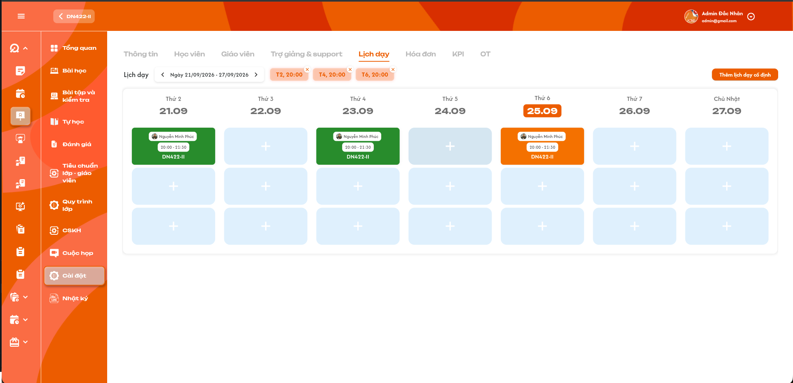
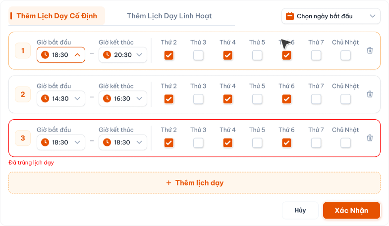
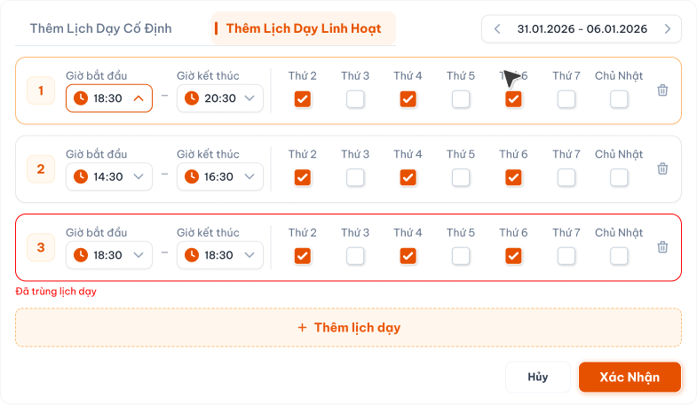
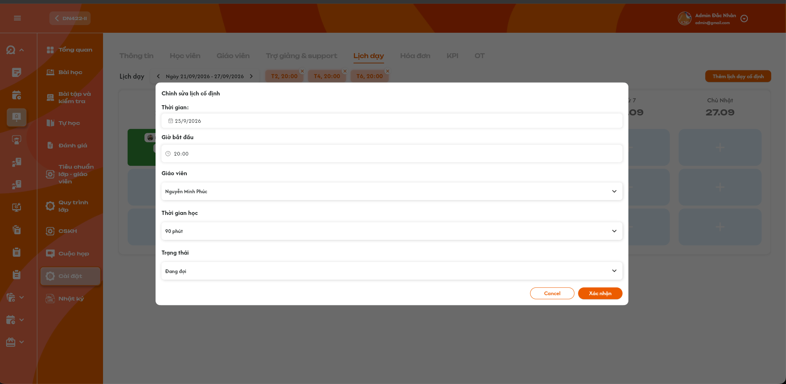

# Chi tiết lớp học — Tab Lịch dạy

> Requirement này đặc tả màn **Chi tiết lớp học → Tab Lịch dạy**. Quy tắc số buổi, ngày bắt đầu, ngày kết thúc dự kiến và tái sinh lịch khi đổi khóa học được dùng chung với [Tạo lớp học](./class_creation_requirements.md) và [Tab Thông tin](./class_detail_information_requirements.md). Nhân sự giáo viên của lớp được đặc tả tại [Tab Giáo viên](./class_detail_teachers_requirements.md).

## 1. UI

### Tab Lịch dạy — Lịch theo tuần

<p align="center">
  <a href="./images/26-class-detail-schedule.png"></a><br>
  <em>Lịch dạy theo tuần của lớp — nhấn để xem ảnh gốc</em>
</p>

**Mô tả:**

- Hiển thị các lịch dạy của đúng lớp theo từng tuần từ Thứ 2 đến Chủ Nhật.
- `Admin`, `Class Handler` và `Support` được xem và CRUD lịch trong phạm vi lớp được phân quyền.
- `Teacher` được xem lịch của lớp mà giáo viên được phân công nhưng không được tạo, sửa, hoàn thành, hủy hoặc xóa lịch **tại tab này**. Lịch mà giáo viên đã chọn khi `Bắt đầu buổi học` sẽ tự chuyển `Hoàn thành` khi giáo viên bấm `Hoàn thành buổi học` (xem [requirement Giáo viên — Bài học](../../teacher_role/class/class_teaching_requirements.md)); đây là hoàn thành qua luồng dạy, không phải thao tác tại tab Lịch dạy.

**Giải thích field/thành phần:**

| Thành phần | Yêu cầu |
|---|---|
| Khoảng tuần | Hiển thị ngày đầu và ngày cuối tuần; nút trái/phải chuyển đúng một tuần. |
| Cột ngày | Hiển thị thứ, ngày/tháng và làm nổi bật ngày hiện tại nhưng không thay đổi dữ liệu lịch. |
| Tag lịch cố định | Hiển thị các khung lặp như `T2, 20:00`; `X` dùng để bỏ khung cố định theo quyền và rule tái sinh lịch. |
| Nút `Thêm lịch dạy cố định` | Mở popup thêm lịch với tab `Thêm Lịch Dạy Cố Định` được chọn sẵn. |
| Ô dấu `+` của ngày | Mở popup thêm lịch với tab `Thêm Lịch Dạy Linh Hoạt` và tuần/ngày vừa bấm được chọn sẵn. |
| Thẻ lịch | Hiển thị tối thiểu giáo viên, mã lớp, giờ bắt đầu–kết thúc và màu/icon trạng thái. |
| Vùng lịch | Số hàng hiển thị phải mở rộng hoặc cuộn theo số lịch thực tế; ba hàng trong ảnh không phải giới hạn nghiệp vụ. |

**Điểm cần lưu ý:**

- Dùng `schedule_id` và `class_id` để tải/thao tác; không dùng mã lớp, tên giáo viên hoặc vị trí ô làm khóa.
- Chuyển tuần chỉ thay phạm vi hiển thị, không tạo, sửa hoặc tự đổi trạng thái lịch.
- Lịch được tải theo timezone của cơ sở/lớp; thời điểm lưu ở backend phải có timezone rõ ràng để không lệch ngày.
- Nếu lớp `Mới tạo` có lịch hợp lệ đầu tiên thì tự chuyển sang `Khai giảng` theo requirement trạng thái lớp.
- Teacher chỉ thấy dữ liệu trong phạm vi lớp được phân công; việc ẩn nút CRUD không thay thế kiểm tra quyền backend.

#### Testcase — Tab Lịch dạy — Lịch theo tuần

| Tên testcase | Priority | Loại test | Scenario | Role | Pre-condition | Given / When / Then | Expected Result |
|---|---| --- |---|---|---|---|---|
| Case 1: Mở đúng lịch tuần của lớp | High | Smoke | Flow 1 / REQ01 | Role có quyền xem | Lớp có lịch ở nhiều tuần | **Given** mở tab Lịch dạy<br>**When** dữ liệu tải thành công<br>**Then** hiển thị đúng tuần và đúng class_id | - Không trộn lớp khác<br>- Thẻ nằm đúng ngày/giờ<br>- Không thay đổi dữ liệu khi tải |
| Case 2: Chuyển tuần trước và sau | High |  | Flow 1 / REQ01 | Role có quyền xem | Có lịch ở các tuần liền kề | **Given** tuần hiện tại đang hiển thị<br>**When** bấm mũi tên trái/phải<br>**Then** tải tuần tương ứng | - Mỗi lần dịch đúng một tuần<br>- Header và dữ liệu cùng khoảng ngày<br>- Không nhân đôi thẻ lịch |
| Case 3: Dấu cộng mở lịch linh hoạt đúng ngày | High |  | Flow 3 / REQ04 | `Admin`, `Class Handler` hoặc `Support` | Tuần đang mở | **Given** bấm `+` tại một ngày<br>**When** popup mở<br>**Then** chọn sẵn tab Linh hoạt và ngày/tuần đó | - Không mở tab Cố định<br>- Giữ đúng class_id<br>- Chưa tạo lịch trước khi xác nhận |
| Case 4: Nút thêm cố định mở đúng tab | High |  | Flow 2 / REQ03 | Role CRUD | Tab lịch đang mở | **Given** bấm `Thêm lịch dạy cố định`<br>**When** popup mở<br>**Then** tab Cố định được chọn | - Không tự lưu<br>- Giữ đúng lớp<br>- Hiển thị cấu hình cố định hiện tại nếu có |
| Case 5: Teacher chỉ xem lịch | High |  | REQ02 / Ràng buộc quyền | `Teacher` | Giáo viên được phân công lớp | **Given** Teacher mở tab<br>**When** xem lịch và thử gọi API CRUD<br>**Then** chỉ được đọc | - Không có/disable nút thêm, X và hành động trạng thái<br>- Backend từ chối request thay đổi<br>- Không lộ lịch ngoài phạm vi |
| Case 6: Hiển thị nhiều hơn ba lịch trong ngày | Medium |  | REQ01 | Role có quyền xem | Một ngày có trên ba lịch hợp lệ | **Given** tuần có nhiều lịch cùng ngày<br>**When** render lịch<br>**Then** hiển thị/truy cập được tất cả | - Không mất lịch thứ tư trở đi<br>- Không chồng thẻ che nội dung<br>- Có scroll/mở rộng phù hợp |

### Thẻ lịch và bốn trạng thái chính thức

<p align="center">
  
  
  
  <br>
  <em>Bộ màu/icon trạng thái lịch chính thức</em>
</p>

**Mô tả:** Mỗi lịch có loại nguồn `Cố định` hoặc `Linh hoạt` và trạng thái xử lý. Khi hoàn thành hoặc hủy, màu hoàn thành/hủy được ưu tiên hiển thị nhưng loại nguồn vẫn được giữ trong dữ liệu/audit.

**Giải thích field/thành phần:**

| Hiển thị | Màu | Ý nghĩa nghiệp vụ |
|---|---|---|
| Lịch cố định | Cam | Buổi chưa hoàn thành/chưa hủy, được sinh từ khung lịch cố định. |
| Lịch linh hoạt | Xanh dương | Buổi chưa hoàn thành/chưa hủy, được thêm linh hoạt vào một ngày/giờ cụ thể. |
| Lịch hoàn thành | Xanh lá | Buổi đã hoàn thành; được tính là một buổi học hợp lệ và phát sinh lương cho giáo viên của lịch. |
| Lịch hủy bỏ | Xám | Buổi đã hủy; bị loại khỏi số buổi hợp lệ của khóa và không phát sinh lương. Hệ thống phải sinh một buổi bù ở cuối. |

**Điểm cần lưu ý:**

- `Hoàn thành` và `Hủy bỏ` là trạng thái, không phải loại lịch. Lịch hoàn thành/hủy vẫn phải lưu nguồn ban đầu là Cố định hay Linh hoạt.
- Tên/tooltip trạng thái phải có ngoài màu để hỗ trợ accessibility.
- Không thể đồng thời hoàn thành và hủy cùng một lịch. Backend phải kiểm tra trạng thái mới nhất và version khi cập nhật.
- Chỉ lịch ở trạng thái `Hoàn thành` mới được ghi nhận lương giáo viên; lịch cố định/linh hoạt chưa hoàn thành và lịch hủy không tính lương.
- Trong cùng một lần hoàn thành, request gửi lặp chỉ được tạo một khoản lương. Nếu lịch được Mở lại rồi hoàn thành lại, lần hoàn thành mới có thể tạo khoản lương mới nhưng tại một thời điểm chỉ một khoản của schedule có hiệu lực.

#### Testcase — Thẻ lịch và bốn trạng thái chính thức

| Tên testcase | Priority | Loại test | Scenario | Role | Pre-condition | Given / When / Then | Expected Result |
|---|---| --- |---|---|---|---|---|
| Case 7: Hiển thị đúng bốn trạng thái | High |  | REQ05 | Role có quyền xem | Có lịch thuộc đủ bốn trạng thái | **Given** tuần tải thành công<br>**When** render các thẻ<br>**Then** màu/icon/tên đúng mapping | - Cố định cam<br>- Hoàn thành xanh lá<br>- Linh hoạt xanh dương<br>- Hủy bỏ xám |
| Case 8: Trạng thái ghi đè màu nhưng giữ loại nguồn | High |  | REQ05 | Role có quyền xem | Có một lịch linh hoạt đã hoàn thành và một lịch cố định đã hủy | **Given** backend trả loại nguồn và trạng thái<br>**When** render<br>**Then** dùng màu trạng thái | - Lịch linh hoạt hoàn thành hiển thị xanh lá nhưng audit vẫn là Linh hoạt<br>- Lịch cố định hủy hiển thị xám nhưng audit vẫn là Cố định |
| Case 9: Không nhận biết chỉ bằng màu | Medium |  | REQ05 | Role có quyền xem | Có nhiều trạng thái | **Given** focus/hover thẻ lịch<br>**When** xem nội dung hỗ trợ<br>**Then** có tên trạng thái | - Tooltip/aria-label đúng<br>- Không tráo tên với màu<br>- Có thể phân biệt khi không nhìn màu |

### Popup Thêm Lịch Dạy Cố Định

<p align="center">
  <a href="./images/27-class-schedule-add-fixed.png"></a><br>
  <em>Thêm các khung lịch cố định — nhấn để xem ảnh gốc</em>
</p>

**Mô tả:** Cho phép role CRUD cấu hình một hoặc nhiều khung giờ lặp theo thứ. Hệ thống dùng các khung này để sinh lịch đến khi đủ đúng số buổi của khóa học.

**Giải thích field/thành phần:**

| Field/thành phần | Yêu cầu |
|---|---|
| Tab Cố định/Linh hoạt | Chuyển đúng form; dữ liệu chưa xác nhận của tab kia không được tự lưu. |
| Chọn ngày bắt đầu | Ngày bắt đầu áp dụng của cấu hình; khi tạo lịch đầu tiên của lớp phải phù hợp để ngày bắt đầu lớp là buổi 1. |
| Giờ bắt đầu/kết thúc | Giờ kết thúc phải sau giờ bắt đầu; lưu cùng timezone lớp. |
| Thứ 2–Chủ Nhật | Mỗi dòng chọn ít nhất một ngày trong tuần. |
| `+ Thêm lịch dạy` | Thêm một dòng khung giờ; chưa lưu backend. |
| Icon thùng rác | Xóa dòng cấu hình chưa xác nhận hoặc bỏ một khung hiện có theo rule tái sinh lịch. |
| Hủy | Đóng mà không lưu thay đổi chưa xác nhận. |
| Xác Nhận | Validate toàn bộ, lưu cấu hình và sinh/tái sinh lịch tương lai nguyên tử. |

**Điểm cần lưu ý:**

- Không cho hai khung của cùng lớp trùng thời gian. Đồng thời phải kiểm tra lịch của giáo viên được phân công trên **tất cả lớp**; nếu giáo viên đã có lịch giao nhau thì hiển thị cảnh báo và không cho xác nhận.
- Mỗi dòng phải có ít nhất một thứ; không cho giờ kết thúc bằng hoặc trước giờ bắt đầu.
- Khi thêm/sửa/bỏ khung, chỉ tái sinh phần lịch chưa mở/chưa hoàn thành. Không thay đổi lịch đã hoàn thành hoặc lịch hủy dùng làm lịch sử.
- Tổng lịch hợp lệ của chương trình luôn bằng `N` là số buổi khóa học. Các lịch tương lai được đánh số/tái sinh theo thứ tự thời gian đến đủ N.
- Nếu không còn khung cố định hợp lệ để sinh đủ N buổi thì không lưu một phần; giữ cấu hình/lịch cũ và trả lỗi xử lý được.
- Ngày kết thúc dự kiến là ngày của buổi hợp lệ thứ N sau khi sinh lịch; người dùng không sửa trực tiếp.

#### Testcase — Popup Thêm Lịch Dạy Cố Định

| Tên testcase | Priority | Loại test | Scenario | Role | Pre-condition | Given / When / Then | Expected Result |
|---|---| --- |---|---|---|---|---|
| Case 10: Thêm nhiều khung cố định hợp lệ | High | Smoke | Flow 2 / REQ03 | Role CRUD | Khóa học có N buổi | **Given** nhập nhiều khung hợp lệ<br>**When** Xác Nhận<br>**Then** lưu cấu hình và sinh lịch | - Có đúng N lịch hợp lệ<br>- Sắp theo thời gian<br>- Ngày kết thúc là buổi N<br>- Toast thành công |
| Case 11: Chặn giờ kết thúc không hợp lệ | High |  | EX02 / REQ03 | Role CRUD | Popup đang mở | **Given** giờ kết thúc bằng/trước giờ bắt đầu<br>**When** xác nhận<br>**Then** không lưu | - Đánh dấu đúng dòng<br>- Giữ dữ liệu để sửa<br>- Không sinh lịch một phần |
| Case 12: Chặn trùng lịch lớp hoặc lịch giáo viên ở lớp khác | High |  | EX02 / REQ03 | Role CRUD | Khung mới trùng lịch của lớp hoặc trùng lịch giáo viên đã được phân công ở một lớp khác | **Given** chọn khoảng thời gian giao nhau<br>**When** validation chạy<br>**Then** hiển thị cảnh báo trùng lịch và chặn xác nhận | - Không tạo lịch trùng<br>- Nêu đúng giáo viên/ngày/khung giờ bị trùng<br>- Không ghi đè lịch cũ<br>- Backend kiểm tra lại trên toàn hệ thống khi commit |
| Case 13: Thêm và xóa dòng trước khi xác nhận | Medium |  | REQ03 | Role CRUD | Popup đang mở | **Given** thêm rồi xóa một dòng<br>**When** chưa Xác Nhận<br>**Then** chỉ thay đổi draft | - Backend chưa đổi<br>- Hủy trả về dữ liệu cũ<br>- Không có Toast CRUD |
| Case 14: Bỏ khung cố định và tái sinh lịch tương lai | High |  | Flow 2 / REQ03 | Role CRUD | Lớp có lịch hoàn thành và lịch tương lai | **Given** bỏ một khung cố định<br>**When** xác nhận<br>**Then** tái sinh phần tương lai bằng các khung còn lại | - Không đổi buổi hoàn thành/hủy lịch sử<br>- Tổng hợp lệ vẫn N<br>- Đánh số liên tục<br>- Cập nhật ngày kết thúc |
| Case 15: Không thể sinh đủ lịch | High |  | EX03 / REQ03 | Role CRUD | Không còn khung hợp lệ | **Given** cấu hình không thể tạo đủ N buổi<br>**When** xác nhận<br>**Then** từ chối toàn bộ | - Giữ cấu hình/lịch cũ<br>- Không có lịch nửa chừng<br>- Nêu rõ cần bổ sung khung |

### Popup Thêm Lịch Dạy Linh Hoạt

<p align="center">
  <a href="./images/28-class-schedule-add-flexible.png"></a><br>
  <em>Thêm một hoặc nhiều lịch linh hoạt trong tuần được chọn — nhấn để xem ảnh gốc</em>
</p>

**Mô tả:** Cho phép thêm một hoặc nhiều lịch linh hoạt tại ngày/giờ cụ thể. Bấm dấu `+` ở một ngày trên lịch tuần mở trực tiếp form này và chọn sẵn ngày tương ứng.

**Giải thích field/thành phần:**

| Field/thành phần | Yêu cầu |
|---|---|
| Khoảng tuần | Mũi tên chuyển tuần cần chọn; các checkbox thứ ánh xạ đúng ngày thực tế trong tuần đó. |
| Giờ bắt đầu/kết thúc | Áp dụng cho các ngày được chọn trên cùng dòng; giờ kết thúc phải sau giờ bắt đầu. |
| Thứ trong tuần | Mỗi checkbox tạo một lịch linh hoạt ở ngày tương ứng trong tuần đang chọn. |
| Thêm lịch dạy | Thêm dòng giờ khác để tạo nhiều lịch trong một lần. |
| Xác Nhận | Validate toàn bộ rồi chèn các lịch linh hoạt nguyên tử vào timeline lớp. |

**Điểm cần lưu ý:**

- Lịch linh hoạt được tính vào tổng N buổi của khóa học. Khi chèn vào giữa timeline, hệ thống sắp xếp lại và điều chỉnh các lịch cố định phía sau để cuối cùng vẫn có đúng N buổi hợp lệ.
- Không được sửa hoặc đẩy lùi các lịch đã mở/hoàn thành. Chỉ điều chỉnh phần lịch tương lai chưa mở.
- Nhiều lịch linh hoạt trong một lần phải lưu nguyên tử; nếu một lịch trùng lịch lớp hoặc trùng lịch giáo viên ở bất kỳ lớp nào thì cảnh báo, chặn xác nhận và không thêm một phần.
- Lịch linh hoạt phải hiển thị xanh dương cho đến khi được hoàn thành hoặc hủy.
- Việc chèn có thể làm thay đổi buổi N và Ngày kết thúc dự kiến; hệ thống cập nhật sau khi commit thành công.

#### Testcase — Popup Thêm Lịch Dạy Linh Hoạt

| Tên testcase | Priority | Loại test | Scenario | Role | Pre-condition | Given / When / Then | Expected Result |
|---|---| --- |---|---|---|---|---|
| Case 16: Tạo lịch linh hoạt từ dấu cộng | High | Smoke | Flow 3 / REQ04 | Role CRUD | Tuần đang hiển thị | **Given** bấm `+` tại ngày D<br>**When** nhập giờ và xác nhận<br>**Then** tạo lịch linh hoạt tại D | - Thẻ xanh dương<br>- Đúng class_id/ngày/giờ<br>- Có Toast thành công |
| Case 17: Thêm nhiều lịch linh hoạt nguyên tử | High |  | Flow 3 / REQ04 | Role CRUD | Các ngày/giờ hợp lệ | **Given** chọn nhiều ngày/dòng giờ<br>**When** xác nhận<br>**Then** thêm tất cả trong một giao dịch | - Không mất lựa chọn<br>- Không tạo trùng<br>- Timeline sắp theo thời gian |
| Case 18: Chèn lịch và cân bằng về đúng N buổi | High |  | Flow 3 / REQ04 | Role CRUD | Lớp đã có đủ N lịch, phần sau chưa mở | **Given** chèn lịch linh hoạt ở giữa<br>**When** commit thành công<br>**Then** điều chỉnh các lịch cố định sau đó | - Tổng lịch hợp lệ vẫn N<br>- Không đổi lịch đã mở/hoàn thành<br>- Đánh số lại liên tục<br>- Ngày kết thúc cập nhật theo buổi N |
| Case 19: Một lịch trong nhóm bị trùng lịch lớp hoặc lịch giáo viên | High |  | EX04 / REQ04 | Role CRUD | Chọn nhiều lịch, có một lịch trùng với lớp hiện tại hoặc lịch của giáo viên tại lớp khác | **Given** một phần tử không hợp lệ<br>**When** xác nhận<br>**Then** cảnh báo và từ chối toàn bộ nhóm | - Không thêm một phần<br>- Chỉ rõ giáo viên/ngày/giờ trùng<br>- Không cho bỏ qua cảnh báo để vẫn tạo<br>- Cho phép sửa và thử lại |
| Case 20: Hủy popup linh hoạt | Medium |  | REQ04 | Role CRUD | Có draft chưa lưu | **Given** đã nhập lịch<br>**When** bấm Hủy<br>**Then** đóng popup | - Không tạo lịch<br>- Không cân bằng lại timeline<br>- Không có Toast thành công |

### Popup xem/chỉnh sửa khi bấm thẻ lịch

<p align="center">
  <a href="./images/29-class-schedule-edit-popup.png"></a><br>
  <em>Bấm một thẻ lịch để xem hoặc chỉnh sửa đúng buổi học — nhấn để xem ảnh gốc</em>
</p>

**Mô tả:** Bấm vào một thẻ lịch mở popup của đúng `schedule_id`. `Admin`, `Class Handler` và `Support` được chỉnh lịch chưa hoàn thành; `Teacher` mở cùng popup ở chế độ chỉ xem.

**Giải thích field/thành phần:**

| Field/thành phần | Yêu cầu |
|---|---|
| Tiêu đề | Lịch nguồn cố định hiển thị `Chỉnh sửa lịch cố định`; lịch nguồn linh hoạt hiển thị `Chỉnh sửa lịch linh hoạt`. Teacher hoặc lịch bị khóa hiển thị theo chế độ xem, không tạo cảm giác có thể sửa. |
| Thời gian/Ngày | Ngày diễn ra của đúng buổi; cho chỉnh khi lịch chưa hoàn thành/hủy. |
| Giờ bắt đầu | Giờ bắt đầu của buổi; phải kết hợp với Thời gian học để tính giờ kết thúc và kiểm tra trùng. |
| Giáo viên | Chọn trong các giáo viên hợp lệ đã được thêm vào lớp. Khi đổi phải kiểm tra lịch giáo viên trên tất cả lớp. |
| Thời gian học | Chọn thời lượng từ cấu hình cho phép, ví dụ `90 phút`; `Giờ kết thúc = Giờ bắt đầu + Thời gian học`. Không cho thời lượng bằng 0 hoặc âm. |
| Lương/giờ | Lương/giờ của giáo viên cho **riêng buổi này**, VNĐ/giờ, số nguyên **lớn hơn 0**, hiển thị phân tách hàng nghìn kèm `đ`. Mặc định lấy `Lương/giờ` trong hồ sơ giáo viên của buổi. Role CRUD sửa được khi lịch chưa hoàn thành/hủy; Teacher chỉ xem. Bên dưới hiển thị `Tiền buổi dự kiến = Lương/giờ × Thời gian học` (vd `200.000 đ × 1,5 giờ = 300.000 đ`). |
| Trạng thái | Với lịch chưa kết thúc, cho chọn `Đang đợi`, `Hoàn thành`, `Hủy bỏ`. Lịch `Hoàn thành` có flow `Mở lại` để trở về `Đang đợi`, đảo lương rồi mới cho sửa/hủy. `Đang đợi` giữ màu theo loại nguồn; hai trạng thái kết thúc kích hoạt nghiệp vụ tương ứng. |
| Hủy | Nút đóng popup, nhãn tiếng Việt là `Hủy`; bỏ thay đổi chưa xác nhận. Không phải hành động Hủy bỏ lịch. |
| Xác nhận | Validate phiên bản, quyền, field, trùng lịch và trạng thái; chỉ cập nhật UI sau khi backend commit. |

**Điểm cần lưu ý:**

- `Hủy` ở chân popup chỉ đóng form; `Hủy bỏ` trong dropdown Trạng thái mới là nghiệp vụ hủy lịch và sinh buổi bù. Hai hành động phải có câu chữ/thiết kế phân biệt rõ.
- Thay đổi ngày, giờ bắt đầu, thời lượng hoặc giáo viên phải kiểm tra cả trùng lịch của lớp hiện tại và trùng lịch giáo viên trên tất cả lớp. Có trùng thì cảnh báo và không cho xác nhận.
- Chỉnh một buổi cố định chỉ tạo override cho occurrence đó, không âm thầm sửa toàn bộ khung lặp phía trên. Nguồn lịch vẫn là `Cố định` để audit; các lần tái sinh sau không được ghi đè occurrence đã override.
- Chuyển `Đang đợi → Hoàn thành` phải tạo lương đúng một lần trong cùng giao dịch. Chuyển `Đang đợi → Hủy bỏ` phải loại buổi khỏi N, sinh bù và cập nhật ngày kết thúc trong cùng giao dịch.
- Lịch `Hủy bỏ` mở ở chế độ chỉ xem. Lịch `Hoàn thành` hiển thị dữ liệu khóa và hành động `Mở lại` cho Admin/Class Handler/Support; chỉ sau khi mở lại và đảo lương thành công mới cho sửa field hoặc hủy lịch.
- Teacher xem được toàn bộ field của lịch trong phạm vi (kể cả `Lương/giờ`) nhưng các control là read-only; không gửi request cập nhật.

**Quy tắc Lương/giờ của buổi:**

- Không còn lương theo lớp. Buổi chưa chỉnh riêng dùng `Lương/giờ` hiện hành trong hồ sơ giáo viên của buổi; đổi hồ sơ thì các buổi này đổi theo.
- Sửa `Lương/giờ` trong popup chỉ tạo mức riêng cho đúng `schedule_id` đó; không đổi hồ sơ giáo viên, không đổi buổi khác. Buổi đã chỉnh riêng không bị thay đổi khi hồ sơ đổi.
- Đổi `Giáo viên` của buổi thì `Lương/giờ` reset về mức trong hồ sơ của giáo viên mới (bỏ mức riêng cũ); người dùng vẫn có thể chỉnh lại trước khi Xác nhận.
- Đổi `Thời gian học` thì tiền buổi dự kiến tính lại theo thời lượng mới.
- Lịch `Hoàn thành` hoặc `Hủy bỏ` khóa `Lương/giờ`. Muốn sửa lương buổi đã hoàn thành phải đi qua flow `Mở lại` (đảo lương) rồi hoàn thành lại.
- Lưu audit `Lương/giờ` trước/sau, người và thời điểm sửa.
- Không dùng hover làm thao tác xóa trực tiếp. Hover chỉ được hiển thị tooltip/trạng thái hoặc affordance mở chi tiết; mọi cập nhật thực hiện trong popup.

#### Testcase — Popup xem/chỉnh sửa khi bấm thẻ lịch

| Tên testcase | Priority | Loại test | Scenario | Role | Pre-condition | Given / When / Then | Expected Result |
|---|---| --- |---|---|---|---|---|
| Case 21: Mở đúng popup của thẻ được bấm | High |  | Flow 4 / REQ10 | Role có quyền xem | Tuần có nhiều lịch | **Given** bấm thẻ lịch A<br>**When** popup mở<br>**Then** tải theo schedule_id của A | - Đúng ngày, giờ, giáo viên, thời lượng, trạng thái<br>- Không lấy dữ liệu lịch B<br>- Tiêu đề đúng loại nguồn |
| Case 22: Teacher xem popup ở chế độ chỉ đọc | High |  | REQ02 / Ràng buộc quyền | `Teacher` | Được phân công lớp | **Given** Teacher bấm một thẻ lịch<br>**When** popup mở<br>**Then** chỉ xem dữ liệu | - Không sửa field/trạng thái<br>- Không có nút xác nhận cập nhật<br>- API sửa trực tiếp bị từ chối |
| Case 23: Chỉnh ngày, giờ hoặc thời lượng hợp lệ | High |  | REQ10 | Role CRUD | Lịch đang Đang đợi | **Given** nhập giá trị mới không trùng<br>**When** Xác nhận<br>**Then** cập nhật đúng occurrence | - Tính lại giờ kết thúc<br>- Không đổi khung lặp chung<br>- Không ghi đè lịch khác<br>- Toast thành công |
| Case 24: Đổi giáo viên không bị trùng lịch | High |  | REQ10 | Role CRUD | Giáo viên mới thuộc lớp và rảnh | **Given** chọn giáo viên mới<br>**When** Xác nhận<br>**Then** cập nhật teacher_id của lịch | - Kiểm tra lịch toàn hệ thống<br>- Thẻ hiển thị giáo viên mới<br>- Không tác động lịch khác |
| Case 25: Chặn chỉnh sửa gây trùng lịch | High |  | EX02 / REQ10 | Role CRUD | Thời gian mới trùng lớp hoặc lịch giáo viên ở lớp khác | **Given** sửa field tạo khoảng giao nhau<br>**When** Xác nhận<br>**Then** cảnh báo và không lưu | - Nêu đúng giáo viên/ngày/giờ trùng<br>- Không có lựa chọn bỏ qua<br>- Giữ dữ liệu cũ ở backend |
| Case 26: Nút Hủy chỉ đóng popup | Medium |  | REQ10 | Role CRUD | Có thay đổi chưa xác nhận | **Given** đã sửa field<br>**When** bấm `Hủy` ở chân popup<br>**Then** đóng form | - Không chuyển trạng thái Hủy bỏ<br>- Không sinh lịch bù<br>- Không lưu draft/Toast thành công |
| Case 27a: Lương/giờ mặc định từ hồ sơ | High |  | REQ10 / REQ12 | Role CRUD | Giáo viên có Lương/giờ `200.000` trong hồ sơ; lịch chưa chỉnh riêng | **Given** bấm thẻ lịch<br>**When** popup mở<br>**Then** Lương/giờ = `200.000 đ` | - Tiền buổi dự kiến = 200.000 × thời lượng<br>- Đổi hồ sơ thành `250.000` thì mở lại popup thấy `250.000 đ` |
| Case 27b: Chỉnh Lương/giờ riêng một buổi | High | Smoke | REQ10 / REQ12 | Role CRUD | Lịch Đang đợi | **Given** sửa Lương/giờ thành `300.000`<br>**When** Xác nhận<br>**Then** chỉ buổi này dùng `300.000` | - Hồ sơ giáo viên không đổi<br>- Buổi khác không đổi<br>- Đổi hồ sơ sau đó không ghi đè buổi này<br>- Có audit và Toast |
| Case 27c: Đổi giáo viên thì reset Lương/giờ | High |  | REQ10 / REQ12 | Role CRUD | Buổi của G đã chỉnh riêng `300.000`; H có hồ sơ `180.000` | **Given** đổi giáo viên sang H<br>**When** popup cập nhật<br>**Then** Lương/giờ = `180.000 đ` | - Bỏ mức riêng cũ<br>- Vẫn cho chỉnh lại trước khi Xác nhận |
| Case 27d: Validation Lương/giờ buổi | High |  | REQ12 | Role CRUD | Lịch Đang đợi | **Given** nhập `0`, số âm, số thập phân hoặc chữ<br>**When** Xác nhận<br>**Then** từ chối | - Chỉ chấp nhận số nguyên > 0<br>- Không lưu giá trị sai |
| Case 27e: Khóa Lương/giờ khi đã hoàn thành và Teacher chỉ xem | High |  | REQ02 / REQ12 | Role CRUD / Teacher | Lịch Hoàn thành; Teacher được phân công | **Given** mở popup<br>**When** xem field Lương/giờ<br>**Then** không sửa được | - Role CRUD phải Mở lại mới sửa<br>- Teacher thấy giá trị nhưng read-only<br>- API sửa trực tiếp bị từ chối |
| Case 27f: Tính tiền buổi khi hoàn thành | High | Smoke | REQ06 / REQ12 | Role CRUD | Lương/giờ `200.000`, thời lượng 90 phút | **Given** chuyển Hoàn thành<br>**When** commit<br>**Then** khoản lương = `300.000 đ` | - Chốt tiền tại lúc hoàn thành<br>- Đổi hồ sơ sau đó không đổi tiền buổi này |
| Case 27: Đổi trạng thái từ popup | High |  | Flow 4–5 / REQ06–REQ07 / REQ10 | Role CRUD | Lịch đang Đang đợi | **Given** lần lượt chọn Hoàn thành và Hủy bỏ trên các lịch hợp lệ<br>**When** Xác nhận<br>**Then** chạy đúng nghiệp vụ trạng thái | - Hoàn thành: xanh lá và tính lương một lần<br>- Hủy bỏ: xám, không lương, sinh bù và cập nhật ngày kết thúc<br>- Không chỉ đổi màu ở client |

### Hoàn thành và hủy lịch

**Mô tả:** Role CRUD có thể cập nhật một lịch hợp lệ thành `Hoàn thành` hoặc `Hủy bỏ`. Hoàn thành làm phát sinh lương giáo viên; hủy loại buổi khỏi chương trình và tự sinh một buổi bù ở cuối theo lịch cố định. Lịch còn được **Hoàn thành qua luồng dạy** của giáo viên: giáo viên chọn lịch khi `Bắt đầu buổi học` (lịch được gắn buổi, giữ `Đang đợi`) và lịch chuyển `Hoàn thành` khi giáo viên bấm `Hoàn thành buổi học`.

**Giải thích field/thành phần:**

| Hành động | Xử lý bắt buộc |
|---|---|
| Hoàn thành | Kiểm tra lịch/giáo viên → chuyển xanh lá → ghi nhận buổi hợp lệ → tạo lương giáo viên đúng một lần. |
| Hoàn thành qua luồng dạy | Khi giáo viên bấm `Hoàn thành buổi học` của bài đã gắn lịch: cùng xử lý như Hoàn thành ở trên (xanh lá, buổi hợp lệ, một khoản lương cho **giáo viên của buổi**), ghi audit nguồn là luồng dạy. Lịch đang gắn với buổi `Đang dạy` / `Chờ hoàn thành` vẫn ở `Đang đợi`, không chọn được cho buổi khác. |
| Hủy bỏ | Chuyển xám → loại khỏi số buổi hợp lệ → không tính lương → sinh một lịch cố định bù sau buổi hợp lệ cuối cùng → tăng Ngày kết thúc dự kiến. |
| Sửa lịch chưa hoàn thành | Cho phép role CRUD sửa ngày/giờ/giáo viên theo field UI chi tiết; phải kiểm tra trùng và cân bằng lịch. |
| Xóa | Không xóa vật lý lịch chương trình. Thao tác loại bỏ lịch phải dùng trạng thái Hủy bỏ để giữ audit và kích hoạt sinh bù. |

**Điểm cần lưu ý:**

- Buổi hủy vẫn hiển thị màu xám trong tuần/lịch sử nhưng không nằm trong tập N buổi hợp lệ.
- Lịch bù được tạo tại khung cố định hợp lệ đầu tiên **sau buổi hợp lệ cuối cùng hiện tại**. Nếu khung đó trùng thì bỏ qua và tìm khung cố định kế tiếp.
- Mỗi lịch hủy tạo đúng một lịch bù. Request hủy gửi lặp không được tạo nhiều lịch bù hoặc kéo dài ngày kết thúc nhiều lần.
- Sau khi sinh bù, Ngày kết thúc dự kiến tự đổi thành ngày của buổi hợp lệ thứ N mới.
- Hoàn thành và tạo lương phải nhất quán: không được có trạng thái xanh lá nhưng thiếu khoản lương, hoặc tạo lương khi trạng thái chưa hoàn thành.
- Không cho hoàn thành lịch đã hủy. Lịch đã hoàn thành không được sửa/hủy trực tiếp; phải đi qua flow `Mở lại`, đảo lương và trở về `Đang đợi` trước.
- Lớp không chính thức được nới điều kiện nội dung/bài học để test nhưng vẫn phải chống ghi lương trùng, lưu audit và kiểm tra quyền.

#### Testcase — Hoàn thành và hủy lịch

| Tên testcase | Priority | Loại test | Scenario | Role | Pre-condition | Given / When / Then | Expected Result |
|---|---| --- |---|---|---|---|---|
| Case 28: Hoàn thành lịch cố định | High | Smoke | Flow 4 / REQ06 | Role CRUD | Lịch cố định hợp lệ, có giáo viên | **Given** lịch màu cam<br>**When** đánh dấu Hoàn thành<br>**Then** cập nhật trạng thái và lương | - Thẻ xanh lá<br>- Vẫn lưu nguồn Cố định<br>- Lương đúng giáo viên/lịch<br>- Một audit và Toast |
| Case 29: Hoàn thành lịch linh hoạt | High |  | Flow 4 / REQ06 | Role CRUD | Lịch linh hoạt hợp lệ, có giáo viên | **Given** lịch màu xanh dương<br>**When** hoàn thành<br>**Then** xử lý như buổi hợp lệ | - Thẻ xanh lá<br>- Vẫn lưu nguồn Linh hoạt<br>- Tính lương đúng một lần |
| Case 30: Gửi lặp hoàn thành | High |  | EX05 / REQ06 | Role CRUD | Lịch đã hoàn thành | **Given** request hoàn thành bị gửi lặp<br>**When** backend xử lý<br>**Then** kết quả idempotent | - Một trạng thái hoàn thành<br>- Một khoản lương<br>- Không nhân đôi Toast/audit logic |
| Case 31: Hủy lịch cố định và sinh buổi bù | High | Smoke | Flow 5 / REQ07 | Role CRUD | Có lịch cố định tương lai và khung cố định hợp lệ | **Given** hủy một lịch màu cam<br>**When** backend commit<br>**Then** chuyển xám và sinh bù ở cuối | - Lịch hủy không tính trong N<br>- Lịch bù màu cam<br>- Tổng hợp lệ vẫn N<br>- Ngày kết thúc tăng theo buổi bù |
| Case 32: Hủy lịch linh hoạt và sinh buổi bù cố định | High |  | Flow 5 / REQ07 | Role CRUD | Có lịch linh hoạt và cấu hình cố định | **Given** hủy lịch xanh dương<br>**When** commit<br>**Then** dùng khung cố định để bù ở cuối | - Lịch cũ màu xám<br>- Không tính lương<br>- Chỉ một lịch bù<br>- Giữ nguồn Linh hoạt trong audit lịch hủy |
| Case 33: Khung bù đầu tiên bị trùng | High |  | EX06 / REQ07 | Role CRUD | Khung cố định kế tiếp đã có lịch trùng | **Given** cần sinh bù<br>**When** gặp thời gian trùng<br>**Then** tìm khung hợp lệ tiếp theo | - Không tạo lịch chồng<br>- Vẫn đủ N<br>- Ngày kết thúc theo lịch bù thực tế |
| Case 34: Hủy lặp không sinh nhiều buổi bù | High |  | EX07 / REQ07 | Role CRUD | Lịch đã hủy và đã có compensation_schedule_id | **Given** request hủy gửi lại<br>**When** backend xử lý<br>**Then** trả trạng thái hiện tại | - Không tạo lịch bù thứ hai<br>- Không tăng ngày kết thúc thêm lần nữa<br>- Không ghi lương |
| Case 35: Chặn hoàn thành lịch hủy hoặc sửa trực tiếp lịch hoàn thành | High |  | EX08 / REQ06 / REQ11 | Role CRUD | Lịch đã ở trạng thái kết thúc | **Given** gửi thao tác hoàn thành lịch đã hủy hoặc sửa field lịch hoàn thành mà chưa Mở lại<br>**When** backend kiểm tra version/trạng thái<br>**Then** từ chối | - Không đổi trạng thái<br>- Không thay lương<br>- Lịch hoàn thành phải đi qua flow Mở lại<br>- Yêu cầu tải lại dữ liệu mới nhất |
| Case 36: Không thể sinh lịch bù | High |  | EX06 / REQ07 | Role CRUD | Không có khung cố định hợp lệ | **Given** yêu cầu hủy<br>**When** backend không tìm được thời gian bù<br>**Then** không commit nửa chừng | - Giữ trạng thái lịch cũ<br>- Không thay N/ngày kết thúc<br>- Báo cần bổ sung lịch cố định |

### Mở lại lịch đã hoàn thành và đảo lương

**Mô tả:** Cho phép `Admin`, `Class Handler` và `Support` mở lại một lịch đã `Hoàn thành` để sửa hoặc hủy. Đây là nghiệp vụ điều chỉnh có ảnh hưởng tài chính nên phải đảo khoản lương hiệu lực và lưu toàn bộ audit trước khi lịch trở về `Đang đợi`.

**Giải thích field/thành phần:**

| Thành phần | Yêu cầu |
|---|---|
| Nút `Mở lại` | Chỉ hiển thị cho role CRUD khi lịch đang Hoàn thành; Teacher không thấy hành động này. |
| Lý do điều chỉnh | Bắt buộc nhập, không chỉ có khoảng trắng; lưu vào audit lịch và bút toán lương. |
| Cảnh báo | Nêu rõ lịch sẽ trở về Đang đợi và khoản lương đã phát sinh sẽ được đảo/điều chỉnh. |
| Hủy | Đóng popup, giữ nguyên lịch Hoàn thành và khoản lương hiện tại. |
| Xác nhận mở lại | Thực hiện đảo lương và đổi trạng thái trong một giao dịch; sau thành công mới mở khóa các field chỉnh sửa. |

**Điểm cần lưu ý:**

- Không xóa vật lý khoản lương cũ. Phải tạo bút toán đảo/điều chỉnh liên kết với khoản lương gốc để lịch sử tài chính có thể truy vết.
- Sau khi mở lại thành công, lịch trở về `Đang đợi` và hiển thị màu theo nguồn ban đầu: cam nếu Cố định, xanh dương nếu Linh hoạt.
- Nếu người dùng tiếp tục chọn `Hủy bỏ`, hệ thống dùng flow hủy bình thường: loại khỏi N, không còn lương hiệu lực, sinh lịch bù ở cuối và cập nhật ngày kết thúc.
- Nếu lịch được hoàn thành lại, hệ thống tạo lần ghi nhận lương mới; tại một thời điểm chỉ có một khoản lương **hiệu lực** cho schedule. Khoản cũ và bút toán đảo vẫn giữ trong lịch sử.
- Điểm danh, bài học, BTVN, bài kiểm tra hoặc dữ liệu liên quan đã phát sinh không được xóa theo flow mở lại; phải giữ audit và hiển thị cảnh báo dữ liệu phụ thuộc.
- Nếu bảng lương đã khóa/chốt, không sửa trực tiếp kỳ cũ. Hệ thống tạo bút toán điều chỉnh ở kỳ cho phép gần nhất; nếu chưa thể tạo điều chỉnh thì không mở lại một phần.
- Request mở lại gửi lặp phải idempotent: chỉ một bút toán đảo và một lần chuyển về Đang đợi.

#### Testcase — Mở lại lịch đã hoàn thành và đảo lương

| Tên testcase | Priority | Loại test | Scenario | Role | Pre-condition | Given / When / Then | Expected Result |
|---|---| --- |---|---|---|---|---|
| Case 37: Hiển thị hành động Mở lại đúng quyền | High |  | Flow 6 / REQ11 | Kiểm thử role CRUD và Teacher | Lịch đã Hoàn thành | **Given** mở popup thẻ lịch<br>**When** kiểm tra action<br>**Then** chỉ role CRUD thấy Mở lại | - Admin/Class Handler/Support thấy action<br>- Teacher chỉ xem<br>- Backend vẫn kiểm tra quyền |
| Case 38: Bắt buộc lý do khi mở lại | High |  | REQ11 | Role CRUD | Popup Mở lại đang mở | **Given** lý do trống/chỉ khoảng trắng<br>**When** xác nhận<br>**Then** không thực hiện | - Báo lỗi đúng field<br>- Lịch vẫn Hoàn thành<br>- Lương vẫn hiệu lực |
| Case 39: Mở lại và đảo lương thành công | High |  | Flow 6 / REQ11 | Role CRUD | Lịch Hoàn thành có một khoản lương hiệu lực | **Given** nhập lý do hợp lệ<br>**When** xác nhận Mở lại<br>**Then** đảo lương và đưa lịch về Đang đợi | - Không xóa khoản lương gốc<br>- Có bút toán đảo liên kết<br>- Không còn lương hiệu lực cho lịch<br>- Thẻ trở về màu nguồn<br>- Có audit/Toast |
| Case 40: Mở lại rồi hủy lịch | High |  | Flow 6 → Flow 5 / REQ07 / REQ11 | Role CRUD | Lịch đã mở lại thành Đang đợi | **Given** chọn Hủy bỏ<br>**When** xác nhận<br>**Then** chạy flow hủy | - Lịch màu xám<br>- Không có lương hiệu lực<br>- Sinh đúng một lịch bù<br>- Cập nhật ngày kết thúc |
| Case 41: Hoàn thành lại sau khi mở | High |  | Flow 6 → Flow 4 / REQ06 / REQ11 | Role CRUD | Lịch đã mở lại và chỉnh hợp lệ | **Given** chọn Hoàn thành lại<br>**When** xác nhận<br>**Then** tạo lần lương mới | - Một khoản lương mới hiệu lực<br>- Lương gốc và bút toán đảo vẫn có audit<br>- Không tạo hai khoản hiệu lực cùng lúc |
| Case 42: Bảng lương đã khóa | High |  | EX10 / REQ11 | Role CRUD | Khoản lương thuộc kỳ đã chốt | **Given** yêu cầu Mở lại<br>**When** backend xử lý<br>**Then** tạo điều chỉnh ở kỳ cho phép hoặc từ chối nguyên tử | - Không sửa/xóa kỳ đã khóa<br>- Không đổi lịch nếu chưa xử lý được điều chỉnh<br>- Nêu rõ lý do và hướng xử lý |
| Case 43: Gửi lặp yêu cầu Mở lại | High |  | EX11 / REQ11 | Role CRUD | Request đầu đã thành công hoặc đang xử lý | **Given** cùng idempotency key được gửi lại<br>**When** backend xử lý<br>**Then** trả kết quả hiện tại | - Một bút toán đảo<br>- Một audit logic<br>- Không đảo lương hai lần |

### Toast phản hồi CRUD lịch

<p align="center">
  <a href="../../images/01-toast-crud.png"></a><br>
  <em>Toast phản hồi tạo, cập nhật, hoàn thành và hủy lịch — nhấn để xem ảnh gốc</em>
</p>

**Mô tả:** Hiển thị kết quả CRUD sau phản hồi backend.

**Giải thích thành phần:**

| Loại | Tiêu đề | Ví dụ nội dung |
|---|---|---|
| Thành công | `Thành Công` | `Đã thêm lịch linh hoạt.`, `Đã hoàn thành buổi học.`, `Đã hủy lịch và tạo buổi bù.`, `Đã mở lại lịch và điều chỉnh lương.` |
| Thông tin | `Thông Báo` | `Lịch đang được tái tạo, danh sách sẽ cập nhật sau ít phút.` |
| Cảnh báo | `Cảnh Báo` | `Giáo viên đã có lịch trong khung giờ này. Vui lòng chọn thời gian khác.` |
| Lỗi | `Có Lỗi Xảy Ra` | `Không thể cập nhật lịch. Vui lòng thử lại.` |

**Điểm cần lưu ý:**

- Chỉ báo thành công sau khi toàn bộ thay đổi liên quan đã commit, gồm lịch, lịch bù, ngày kết thúc và lương nếu có.
- Hủy popup, chuyển tuần, mở thẻ hoặc validation field chưa gửi backend không hiển thị Toast thành công.
- Không hiển thị stack trace, ID nội bộ nhạy cảm hoặc chi tiết tính lương trong Toast.

#### Testcase — Toast phản hồi CRUD lịch

| Tên testcase | Priority | Loại test | Scenario | Role | Pre-condition | Given / When / Then | Expected Result |
|---|---| --- |---|---|---|---|---|
| Case 44: Toast thành công đúng thao tác | High |  | Ràng buộc Toast | Role CRUD | Backend commit thành công | **Given** tạo/sửa/hoàn thành/hủy/mở lại lịch<br>**When** nhận kết quả thành công<br>**Then** hiển thị một Toast | - Nội dung đúng thao tác<br>- Không báo sớm<br>- UI đã đồng bộ dữ liệu |
| Case 45: Toast cảnh báo trùng lịch | High |  | Ràng buộc Toast | Role CRUD | Lịch trùng lớp hoặc trùng lịch giáo viên ở lớp khác | **Given** xác nhận lịch không hợp lệ<br>**When** backend/validation từ chối<br>**Then** hiển thị cảnh báo và không cho tạo | - Không lưu một phần<br>- Nêu giáo viên/ngày/khung cần sửa<br>- Không có lựa chọn bỏ qua cảnh báo<br>- Không hiển thị thành công |
| Case 46: Toast lỗi khi giao dịch thất bại | High |  | Ràng buộc Toast | Role CRUD | Lỗi backend/network | **Given** thao tác đã gửi<br>**When** giao dịch thất bại<br>**Then** hiển thị lỗi | - UI giữ/khôi phục trạng thái cũ<br>- Không có lương/lịch bù/bút toán đảo giả<br>- Cho phép thử lại an toàn |

## 2. Yêu cầu

### 2.1. Flow chính

**Flow 1 / REQ01–REQ02: Xem lịch theo tuần**

```text
Mở Chi tiết lớp → Tab Lịch dạy
      → Backend kiểm tra quyền và phạm vi lớp
      → Tải cấu hình cố định + lịch thuộc tuần
      → Render đúng ngày/giờ/trạng thái
      → Teacher chỉ xem; Admin/Class Handler/Support có control CRUD
```

**Flow 2 / REQ03: Thêm hoặc cập nhật lịch cố định**

```text
Bấm Thêm lịch dạy cố định
      → Nhập ngày áp dụng, khung giờ và thứ
      → Validate giờ, trùng lịch và khả năng sinh đủ N buổi
      → Lưu cấu hình + tái sinh lịch tương lai nguyên tử
      → Cập nhật ngày kết thúc dự kiến và Toast
```

**Flow 3 / REQ04: Thêm lịch linh hoạt**

```text
Bấm + tại ngày hoặc chọn tab Lịch Linh Hoạt
      → Chọn tuần, ngày và giờ
      → Validate toàn bộ nhóm lịch
      → Chèn vào timeline, tính vào N
      → Điều chỉnh lịch cố định phía sau để tổng vẫn đúng N
      → Cập nhật buổi N/ngày kết thúc và Toast
```

**Flow 4 / REQ10, REQ06: Mở thẻ, chỉnh sửa hoặc hoàn thành lịch**

```text
Bấm thẻ lịch → tải popup theo schedule_id
      → Teacher: chỉ xem
      → Role CRUD: sửa field (kể cả Lương/giờ của buổi) hoặc chọn trạng thái
      → Đổi giáo viên: Lương/giờ reset theo hồ sơ giáo viên mới
      → Backend kiểm tra version, quyền, trùng lịch và giáo viên
      → Nếu Hoàn thành: cập nhật trạng thái + tạo khoản lương duy nhất gắn schedule_id, tiền = Lương/giờ của buổi × thời lượng (giờ), chốt tại thời điểm này
      → Commit cùng giao dịch → cập nhật thẻ và Toast
```

**Flow 5 / REQ07: Hủy lịch và sinh buổi bù**

```text
Role CRUD chọn Hủy bỏ
      → Backend kiểm tra lịch chưa hoàn thành
      → Loại lịch khỏi tập N buổi hợp lệ, không tính lương
      → Tìm khung cố định hợp lệ đầu tiên sau buổi cuối hiện tại
      → Tạo đúng một lịch bù
      → Ngày kết thúc dự kiến = ngày của buổi hợp lệ thứ N mới
      → Commit nguyên tử → lịch cũ màu xám + Toast
```

**Flow 6 / REQ11: Mở lại lịch hoàn thành và đảo lương**

```text
Role CRUD mở lịch Hoàn thành → chọn Mở lại
      → Nhập lý do bắt buộc → xác nhận
      → Backend kiểm tra quyền, version và trạng thái bảng lương
      → Tạo bút toán đảo/điều chỉnh liên kết khoản lương gốc
      → Chuyển lịch về Đang đợi, giữ loại nguồn và toàn bộ audit
      → Cho phép sửa hoặc chuyển sang Hủy bỏ
      → Nếu Hoàn thành lại: tạo khoản lương mới, chỉ một khoản hiệu lực
```

### 2.2. Ngoại lệ

- **EX01:** Không có quyền hoặc ngoài phạm vi lớp → không trả control CRUD và backend từ chối request thay đổi.
- **EX02:** Giờ kết thúc không sau giờ bắt đầu, dòng không chọn thứ, trùng lịch của lớp hoặc trùng lịch giáo viên tại bất kỳ lớp nào → cảnh báo, không cho tạo/lưu và đánh dấu đúng dòng/ngày.
- **EX03:** Cấu hình cố định không thể sinh đủ N lịch hợp lệ → rollback toàn bộ cấu hình/lịch mới.
- **EX04:** Một phần tử trong nhóm lịch linh hoạt không hợp lệ hoặc trùng lịch lớp/giáo viên → cảnh báo và không thêm một phần; trả danh sách cần sửa.
- **EX05:** Request của cùng một lần hoàn thành gửi lặp/đồng thời → một trạng thái hoàn thành, một khoản lương hiệu lực cho completion version đó và một kết quả logic.
- **EX06:** Không tìm được khung bù hoặc các khung tiếp theo bị trùng → tiếp tục tìm; nếu không thể xếp thì không commit hủy một phần.
- **EX07:** Request hủy lặp → dùng quan hệ lịch hủy–lịch bù đã lưu, không tạo bù/lịch sử/ngày kết thúc lặp.
- **EX08:** Lịch đã hoàn thành/hủy bị thao tác từ snapshot cũ → từ chối theo version/trạng thái mới nhất và yêu cầu tải lại.
- **EX09:** Tạo/cập nhật lịch thành công nhưng bước liên quan lương, lịch bù hoặc ngày kết thúc lỗi → rollback giao dịch hoặc trả trạng thái phục hồi rõ ràng; không hiển thị thành công giả.
- **EX10:** Khoản lương thuộc bảng lương đã khóa → không sửa/xóa kỳ cũ; tạo bút toán điều chỉnh ở kỳ cho phép hoặc từ chối toàn bộ thao tác Mở lại.
- **EX11:** Request Mở lại gửi lặp/đồng thời → một bút toán đảo, một lần chuyển Đang đợi và một audit logic.

### 2.3. Yêu cầu khác

- **REQ01 – Lịch tuần:** Hiển thị đúng lịch của lớp theo tuần, ngày/giờ, giáo viên, mã lớp và trạng thái; số thẻ trong một ngày không bị giới hạn ở ba.
- **REQ02 – Phân quyền:** Admin/Class Handler/Support được CRUD lịch trong phạm vi; Teacher chỉ xem lịch lớp được phân công tại tab. Lịch giáo viên đã chọn khi bắt đầu buổi học được hoàn thành gián tiếp qua `Hoàn thành buổi học` (requirement Giáo viên — Bài học).
- **REQ03 – Lịch cố định:** Hỗ trợ nhiều khung giờ/ngày lặp; chặn trùng lịch lớp và trùng lịch giáo viên trên tất cả lớp; sinh/tái sinh lịch tương lai đến đủ đúng N buổi của khóa học.
- **REQ04 – Lịch linh hoạt:** Dấu cộng tạo lịch linh hoạt; hỗ trợ một hoặc nhiều ngày/giờ trong tuần; chặn trùng lịch lớp/giáo viên; lịch chèn tính vào N và làm timeline tương lai tự cân bằng.
- **REQ05 – Trạng thái:** Cố định màu cam, Linh hoạt xanh dương, Hoàn thành xanh lá, Hủy bỏ xám. Hoàn thành/Hủy bỏ là trạng thái ghi đè màu nhưng không làm mất loại nguồn.
- **REQ06 – Hoàn thành và lương:** Mỗi lần chuyển hợp lệ từ Đang đợi sang Hoàn thành (tại tab hoặc qua luồng dạy) tạo một khoản lương giáo viên, **ngày tính lương là ngày của lịch**, không phải ngày hoàn thành. Chống lặp theo schedule_id và completion version; tại một thời điểm chỉ một khoản lương hiệu lực, không có trạng thái hoàn thành giả hoặc lương trùng.
- **REQ07 – Hủy và bù:** Lịch hủy bị trừ khỏi N, không tính lương và tạo đúng một lịch bù ở cuối theo khung cố định; tự tăng ngày kết thúc dự kiến.
- **REQ08 – Audit/an toàn:** Lưu người, thời điểm máy chủ, giá trị trước/sau, nguồn lịch, trạng thái và liên kết lịch bù; không tin role, class_id, teacher_id hoặc trạng thái do client tự khai.
- **REQ09 – Toast:** Mọi CRUD có phản hồi đúng loại; chỉ thành công sau khi toàn bộ giao dịch liên quan đã hoàn tất.
- **REQ10 – Popup thẻ lịch:** Bấm thẻ mở đúng schedule_id với Ngày, Giờ bắt đầu, Giáo viên, Thời gian học, Lương/giờ và Trạng thái. Role CRUD được sửa lịch Đang đợi; Teacher chỉ xem. Nút Hủy chỉ đóng form; trạng thái Hủy bỏ mới kích hoạt sinh bù.
- **REQ11 – Mở lại lịch hoàn thành:** Admin/Class Handler/Support được mở lại lịch Hoàn thành khi nhập lý do. Hệ thống không xóa lương gốc mà tạo bút toán đảo/điều chỉnh, đưa lịch về Đang đợi rồi mới cho sửa/hủy. Hoàn thành lại tạo lần lương mới và chỉ một khoản lương có hiệu lực.
- **REQ12 – Lương/giờ của buổi:** Mỗi lịch có `Lương/giờ`, mặc định theo hồ sơ giáo viên của buổi; Role CRUD chỉnh riêng được cho từng buổi chưa hoàn thành/hủy, Teacher chỉ xem. Đổi giáo viên reset theo hồ sơ giáo viên mới. Tiền buổi = Lương/giờ × thời lượng (giờ), chốt khi Hoàn thành; đổi hồ sơ không hồi tố buổi đã hoàn thành và không ghi đè buổi đã chỉnh riêng. Không còn lương theo lớp.

### 2.4. Ràng buộc

#### Quyền tại tab Lịch dạy

| Role | Xem lịch | Tạo cố định/linh hoạt | Sửa lịch | Sửa Lương/giờ buổi | Hoàn thành | Hủy bỏ | Mở lại hoàn thành |
|---|:---:|:---:|:---:|:---:|:---:|:---:|:---:|
| Admin | ✅ | ✅ | ✅ | ✅ | ✅ | ✅ | ✅ |
| Class Handler | ✅ | ✅ | ✅ | ✅ | ✅ | ✅ | ✅ |
| Support | ✅ | ✅ | ✅ | ✅ | ✅ | ✅ | ✅ |
| Teacher được phân công | ✅ | ❌ | ❌ | ❌ (chỉ xem) | ❌ | ❌ | ❌ |
| Role khác | Theo permission/phạm vi | ❌ | ❌ | ❌ | ❌ | ❌ | ❌ |

- Teacher không hoàn thành lịch tại tab; lịch được hoàn thành gián tiếp khi giáo viên bấm `Hoàn thành buổi học` ở menu Bài học (lịch đã chọn lúc bắt đầu buổi).

#### Số buổi và ngày kết thúc

- `N` lấy từ khóa học hiện tại của lớp.
- Tập N buổi hợp lệ gồm lịch Cố định/Linh hoạt chưa hủy và lịch Hoàn thành; không gồm lịch Hủy bỏ.
- Chèn lịch linh hoạt: tính vào N và cân bằng lại phần lịch cố định tương lai.
- Hủy bất kỳ lịch Cố định/Linh hoạt nào: trừ lịch đó khỏi N, giữ bản ghi xám và sinh một lịch cố định bù ở cuối.
- Ngày kết thúc dự kiến luôn bằng ngày của buổi hợp lệ thứ N; không lấy ngày của lịch hủy và không cho nhập thủ công.
- Không sửa, dời hoặc tái sinh đè lên lịch đã hoàn thành.

#### Lương giáo viên

- Chỉ lịch `Hoàn thành` mới phát sinh lương.
- Khoản lương gắn `schedule_id`, `teacher_id`, `class_id`, thời điểm hoàn thành, `Lương/giờ` áp dụng và thời lượng buổi.
- **Số tiền = `Lương/giờ` của buổi × thời lượng buổi (giờ)**, ví dụ `200.000 đ/giờ × 90 phút = 300.000 đ`. `Lương/giờ` của buổi là mức chỉnh riêng nếu có, nếu không là mức trong hồ sơ giáo viên tại thời điểm hoàn thành. Số tiền được chốt khi hoàn thành; đổi hồ sơ sau đó không hồi tố.
- **Ngày tính lương là ngày của lịch**, không phải ngày bấm Hoàn thành. Ví dụ giáo viên chọn lịch ngày 15 để bắt đầu buổi, ngày 20 mới bấm `Hoàn thành buổi học` thì khoản lương thuộc ngày 15. Hoàn thành qua luồng dạy gắn `teacher_id` là giáo viên của buổi (người bấm Bắt đầu buổi học).
- Unique/idempotency bảo đảm một lịch chỉ có một khoản lương hiệu lực tại một thời điểm. Mở lại giữ khoản gốc, tạo bút toán đảo; hoàn thành lại có thể tạo khoản mới nhưng khoản cũ không còn hiệu lực.
- Lịch hủy không phát sinh lương. Nếu lịch đã có lương thì không được hủy theo flow thông thường trong requirement này.
- Muốn hủy lịch đã Hoàn thành phải Mở lại và đảo lương thành công trước, sau đó mới thực hiện Hủy bỏ.

#### Tính toàn vẹn và đồng thời

- Thêm nhóm lịch, tái sinh, hoàn thành + tính lương, hủy + sinh bù + đổi ngày kết thúc, và mở lại + đảo lương phải nguyên tử theo từng thao tác logic.
- Kiểm tra trùng lịch lớp và lịch của giáo viên trên toàn hệ thống ở backend tại thời điểm commit; validation client chỉ hỗ trợ trải nghiệm. Cảnh báo trùng là lỗi chặn, người dùng không được bỏ qua để tiếp tục tạo.
- Dùng version/updated_at hoặc cơ chế tương đương để ngăn snapshot cũ ghi đè trạng thái mới.
- Audit không bị xóa khi hủy lịch hoặc tái sinh timeline.

---

## 3. Cần xác nhận

- Admin/Class Handler/Support sửa hoặc hủy một lịch đang gắn với buổi học `Đang dạy` / `Chờ hoàn thành` (giáo viên đã chọn lúc bắt đầu) thì xử lý thế nào: chặn, hay cho phép và gỡ liên kết với buổi?
- Khi xóa một tag khung cố định bằng dấu `X`, có cần popup xác nhận không hay áp dụng ngay sau một lần bấm?
