# Chi tiết lớp học — Tab Học viên

> Requirement này đặc tả màn **Chi tiết lớp học → Tab Học viên**. Thông tin chung, nhân sự và lịch lớp được đặc tả tại [Tab Thông tin](./class_detail_information_requirements.md), [Tab Giáo viên](./class_detail_teachers_requirements.md), [Tab Trợ giảng & Phụ trách lớp](./class_detail_support_handlers_requirements.md) và [Tab Lịch dạy](./class_detail_schedule_requirements.md). Các nghiệp vụ chi tiết của hồ sơ học viên, lịch hẹn và ba tab lịch sử học viên sẽ được đặc tả ở requirement riêng.

## 1. UI

### Tab Học viên — Danh sách học viên

<p align="center">
  <a href="./images/11-class-detail-students.png">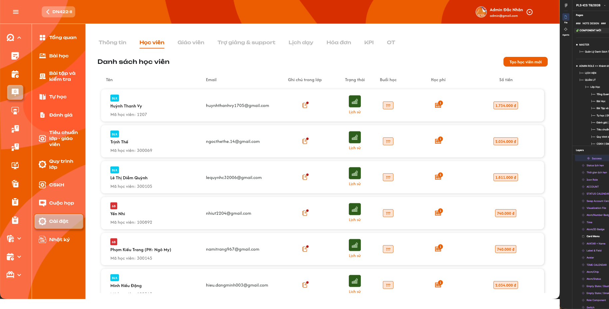</a><br>
  <em>Danh sách học viên trong lớp — nhấn để xem ảnh gốc</em>
</p>

**Mô tả:**

- Hiển thị danh sách học viên thuộc lớp và dữ liệu theo đúng quan hệ **học viên–lớp**.
- `Admin`, `Class Handler` và `Support` được xem tab trong phạm vi lớp được phân quyền.
- Cả ba role được thêm học viên, chỉnh ghi chú, đổi trạng thái và thêm học phí theo permission. Số buổi học bắt buộc chọn khi thêm học phí, không chỉnh trực tiếp ở cột Buổi học. Không có role `Assistant Teacher` riêng; Trợ giảng trên UI sử dụng role `Support`.
- Danh sách không có ô tìm kiếm và không phân trang theo số trang. Khi kéo xuống gần cuối danh sách, hệ thống tự tải thêm dữ liệu.

**Giải thích field/thành phần:**

| Field/thành phần | Yêu cầu |
|---|---|
| Tên | Hiển thị tag học viên, họ tên và mã học viên. Bấm vùng trắng của ô Tên mở Chi tiết học viên; bấm trực tiếp vào tên mở menu thao tác nhanh. Hai vùng bấm phải tách biệt. |
| Tag học viên | Badge như `BLK`, `6B` là tag đang gắn với học viên; không phải trạng thái lớp hay trạng thái học viên. Có thể có nhiều tag và phải hiển thị theo dữ liệu thực tế. |
| Email | Hiển thị email của học viên; không dùng email làm định danh để cập nhật quan hệ học viên–lớp. |
| Ghi chú trong lớp | Ghi chú chỉ thuộc học viên trong lớp hiện tại. Bấm icon mở popup xem/chỉnh ghi chú; có lối mở Lịch sử ghi chú. |
| Trạng thái | Icon màu thể hiện trạng thái hiện tại theo bộ 7 PNG chuẩn bên dưới. `Đang học` dùng bút trắng trên nền cam; icon xanh trong ảnh chụp cũ không còn là chuẩn hiển thị. Bấm icon để chọn trạng thái mới; bấm `Lịch sử` để xem lịch sử thay đổi. |
| Buổi học | Chỉ hiển thị số buổi được phép học đã ghi nhận từ nghiệp vụ học phí; không có dropdown/nút sửa tại cột. Vẫn so sánh số buổi thực tế để cảnh báo vượt buổi khi hover. |
| Học phí | Badge là số lần học viên đã đóng học phí trong lớp. Bấm thao tác thêm tại dòng học viên để mở popup Thêm học phí. |
| Số tiền | Tổng học phí học viên đã đóng cho lớp hiện tại, hiển thị theo định dạng tiền Việt Nam. |
| Tạo học viên mới | Mở popup lựa chọn giữa `Chọn học viên` đã có và `Tạo học viên mới`. Chỉ hiển thị/cho thao tác đối với role có quyền CRUD. |

**Điểm cần lưu ý:**

- Dữ liệu trạng thái, ghi chú, Buổi học, số lần đóng học phí và tổng tiền phải lấy theo đúng học viên và lớp hiện tại; không cộng lẫn dữ liệu ở lớp khác.
- Main list không có search. Search chỉ xuất hiện trong popup chọn học viên có sẵn.
- Load-more phải giữ nguyên vị trí cuộn, không lặp dòng, không bỏ sót dòng và không làm mất thay đổi vừa hoàn tất.
- Một học viên chỉ xuất hiện một lần trong cùng lớp. Backend phải chặn request thêm trùng, kể cả khi hai người thao tác đồng thời.
- `Lớp 1-1` được thêm một hoặc nhiều học viên như `Lớp chung`; không ẩn/disable thao tác thêm chỉ vì lớp đã có học viên.
- Các hành động chỉ đọc như mở Chi tiết, xem lịch sử hoặc sao chép ghi chú không hiển thị Toast CRUD.

#### Testcase — Tab Học viên — Danh sách học viên

| Tên testcase | Priority | Loại test | Scenario | Role | Pre-condition | Given / When / Then | Expected Result |
|---|---| --- |---|---|---|---|---|
| Case 1: Mở tab và hiển thị đúng danh sách | High | Smoke | Flow 1 / REQ01 | Admin / Class Handler / Support | Lớp có học viên | **Given** người dùng được xem lớp<br>**When** mở tab `Học viên`<br>**Then** hệ thống tải dữ liệu mới nhất theo lớp | - Hiển thị đúng Tên, Mã, Email, Tag, Ghi chú, Trạng thái, Buổi học, Học phí và Số tiền<br>- Không trộn dữ liệu lớp khác<br>- Không làm thay đổi dữ liệu |
| Case 2: Kiểm tra quyền xem tab | High |  | Ràng buộc quyền / REQ01 | Lần lượt `Admin`, `Class Handler`, `Support` và role khác | Các tài khoản đang hoạt động | **Given** người dùng truy cập Chi tiết lớp<br>**When** mở tab Học viên hoặc gọi API danh sách<br>**Then** chỉ role/phạm vi hợp lệ được xem | - Ba role được nêu xem được trong phạm vi<br>- Role ngoài phạm vi bị từ chối<br>- Không lộ dữ liệu qua request trực tiếp |
| Case 3: Support thực hiện CRUD theo quyền | High |  | Ràng buộc quyền / REQ01 | `Support` | Support được phân công vào lớp | **Given** danh sách đang hiển thị<br>**When** Support thực hiện thao tác học viên hợp lệ<br>**Then** hệ thống cho phép theo cùng rule CRUD của tab | - Có thể thêm học viên, sửa ghi chú, đổi trạng thái, thêm học phí kèm số buổi bắt buộc<br>- Không chỉnh số buổi ở cột Buổi học<br>- Backend vẫn kiểm tra phạm vi lớp<br>- Support không có quyền chấm BTVN/bài kiểm tra |
| Case 4: Mở Chi tiết học viên từ vùng trắng cột Tên | Medium |  | Flow 1 / REQ02 | Admin / Class Handler / Support | Học viên tồn tại | **Given** con trỏ ở vùng trắng trong ô Tên, không nằm trên tên học viên<br>**When** bấm<br>**Then** điều hướng đến đúng Chi tiết học viên | - Dùng ID học viên, không dùng tên/email<br>- Không mở nhầm menu thao tác nhanh<br>- Quay lại giữ được ngữ cảnh lớp khi hệ thống hỗ trợ |
| Case 5: Load-more khi kéo xuống | High |  | Flow 1 / REQ03 | Admin / Class Handler / Support | Số học viên lớn hơn kích thước một lần tải | **Given** lần tải đầu đã hiển thị<br>**When** kéo xuống gần cuối danh sách<br>**Then** tự tải trang dữ liệu tiếp theo | - Có trạng thái loading<br>- Không có phân trang số và không có search trên main list<br>- Không lặp/bỏ sót học viên<br>- Giữ vị trí cuộn |
| Case 6: Danh sách rỗng hoặc tải thêm thất bại | Medium |  | EX02 / REQ03 | Admin / Class Handler / Support | Lớp không có học viên hoặc mô phỏng lỗi mạng | **Given** tab được mở<br>**When** kết quả rỗng hoặc request load-more lỗi<br>**Then** hiển thị đúng empty/error state | - Không hiển thị dòng giả<br>- Lỗi load-more không xóa dữ liệu đã tải<br>- Cho phép thử lại |
| Case 7: Dữ liệu cập nhật trong lúc đang load-more | Medium |  | EX03 / REQ03 | Admin / Class Handler / Support | Danh sách có nhiều lượt tải | **Given** người dùng vừa cập nhật một dòng<br>**When** load-more trả dữ liệu<br>**Then** hợp nhất dữ liệu theo ID quan hệ | - Không hoàn tác dữ liệu mới bằng snapshot cũ<br>- Không nhân đôi dòng<br>- Tổng badge/tiền vẫn nhất quán |

### Cột Buổi học chỉ xem và cảnh báo vượt buổi

**Mô tả:** Cột Buổi học không còn cho chỉnh sửa. Admin/Class Handler/Support phải chọn số buổi trong popup Thêm học phí. Sau khi giao dịch thành công, cột hiển thị số buổi được phép theo dữ liệu học phí; hover vẫn cảnh báo `Quá buổi học` nếu số thực tế lớn hơn số được phép. Ảnh dropdown tại cột ở phiên bản trước không còn là UI áp dụng.

**Giải thích field/thành phần:**

| Thành phần | Yêu cầu |
|---|---|
| Giá trị hiện tại | Chỉ đọc số buổi được phép học đã ghi nhận. Khi có nhiều lần học phí, rule cộng dồn hay thay thế cần chốt; không tự chọn công thức. |
| Chọn số buổi | Chuyển sang popup Thêm học phí, bắt buộc chọn trước khi lưu. Không mở picker từ cột Buổi học. |
| Số buổi thực tế | Đếm số buổi của lớp mà học viên đã được ghi nhận thực tế tham gia theo dữ liệu điểm danh hợp lệ. Không dùng số lịch đã tạo hoặc số bài học đã mở của cả lớp để thay thế. |
| Cảnh báo vượt buổi | Khi `Số buổi thực tế > Số buổi được phép`, hover vào field/icon Buổi học hiển thị `Quá buổi học`. Có thể kèm chi tiết `Đã học {A}/{N} buổi`, trong đó A là số thực tế và N là số được phép. |
| Cập nhật hiển thị | Chỉ sau khi thêm học phí kèm số buổi thành công; không thay đổi học viên khác và tính lại cảnh báo từ dữ liệu mới. Không có thao tác cập nhật số buổi độc lập tại cột. |

**Điểm cần lưu ý:**

- Quyền chọn số buổi khi thêm học phí và xem cảnh báo `Quá buổi học`: `Admin`, `Class Handler`, `Support`. Cột Buổi học chỉ đọc với cả ba role.
- Chỉ cảnh báo khi số buổi thực tế **lớn hơn** số được phép. Nếu thực tế bằng giới hạn thì chưa tính là quá buổi.
- Ví dụ: Buổi học được đặt là `3`; học viên đã tham gia 3 buổi thì không cảnh báo, từ buổi thực tế thứ 4 trở đi hover hiển thị `Quá buổi học`.
- Cảnh báo phải được tính lại sau khi điểm danh thay đổi, giới hạn Buổi học thay đổi hoặc một kết quả điểm danh bị hủy/điều chỉnh.
- Cảnh báo chỉ hỗ trợ theo dõi, không tự chặn học viên tham gia buổi tiếp theo và không tự đổi trạng thái học viên.

#### Testcase — Cột Buổi học chỉ đọc

| Tên testcase | Priority | Loại test | Scenario | Role | Pre-condition | Given / When / Then | Expected Result |
|---|---| --- |---|---|---|---|---|
| Case 8: Không chỉnh ở cột Buổi học | High |  | Flow 1 / REQ04 | Admin / Class Handler / Support | Danh sách có số buổi đã ghi nhận | **Given** một dòng đang hiển thị<br>**When** click cột Buổi học<br>**Then** không mở dropdown hoặc control sửa | - Giá trị chỉ đọc<br>- Không request cập nhật buổi riêng<br>- Hover cảnh báo vẫn hoạt động |
| Case 9: Từ chối sửa buổi độc lập từ cột | High |  | EX04 / REQ04 | Admin / Class Handler / Support | Có ID quan hệ học viên–lớp | **Given** client cố gửi request cập nhật số buổi riêng như UI cũ<br>**When** backend xử lý<br>**Then** không cho thay số buổi qua thao tác cột | - Dữ liệu cũ giữ nguyên<br>- Phải đi qua nghiệp vụ học phí có số buổi<br>- Không cập nhật học viên khác |
| Case 44: Chưa cảnh báo khi số buổi thực tế bằng giới hạn | High |  | REQ04 | `Admin`, `Class Handler` hoặc `Support` | Buổi học được đặt là 3; học viên đã tham gia đúng 3 buổi | **Given** số thực tế bằng số được phép<br>**When** hover vào Buổi học<br>**Then** không hiển thị `Quá buổi học` | - Không báo vượt tại mốc bằng nhau<br>- Giá trị 3 vẫn hiển thị đúng<br>- Không tự đổi trạng thái học viên |
| Case 45: Cảnh báo khi học viên học vượt giới hạn | High |  | Flow 1 / REQ04 | `Admin`, `Class Handler` hoặc `Support` | Buổi học được đặt là 3; học viên đã tham gia từ 4 buổi trở lên | **Given** số thực tế lớn hơn số được phép<br>**When** hover vào Buổi học<br>**Then** hiển thị `Quá buổi học` | - Có thể hiển thị `Đã học 4/3 buổi`<br>- Không tự chặn buổi tiếp theo<br>- Không tự đổi trạng thái học viên<br>- Cảnh báo thuộc đúng học viên |
| Case 46: Tính lại cảnh báo sau khi thay đổi điểm danh hoặc giới hạn | High |  | REQ04 / EX15 | `Admin`, `Class Handler` hoặc `Support` | Học viên đang hoặc sắp vượt giới hạn | **Given** số buổi thực tế hoặc giới hạn Buổi học thay đổi<br>**When** dữ liệu mới được backend xác nhận<br>**Then** trạng thái cảnh báo được tính lại | - Bật cảnh báo khi `A > N`<br>- Bỏ cảnh báo khi sau điều chỉnh `A ≤ N`<br>- Không cần tải lại toàn bộ trang<br>- Không dùng dữ liệu cache cũ |
| Case 47: Support nhận cảnh báo quản lý quá buổi | Medium |  | Ràng buộc quyền / REQ04 | `Support` | Học viên đã học vượt giới hạn | **Given** Support được phân công vào lớp<br>**When** hover cột Buổi học<br>**Then** hiển thị cảnh báo quản lý | - Hiển thị `Quá buổi học` và dữ liệu A/N nếu có<br>- Cảnh báo thuộc đúng học viên<br>- Không chỉnh giới hạn tại cột; chọn số buổi khi thêm học phí |

### Popup chọn cách thêm học viên

<p align="center">
  <a href="./images/13-class-detail-student-add-choice.png">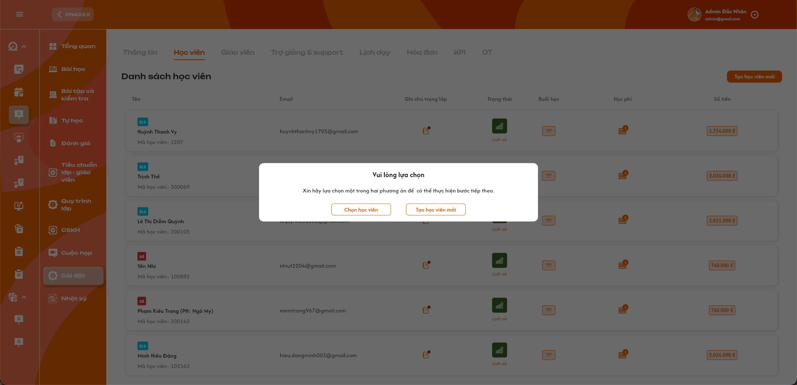</a><br>
  <em>Chọn cách thêm học viên vào lớp — nhấn để xem ảnh gốc</em>
</p>

**Mô tả:** Khi bấm `Tạo học viên mới`, hệ thống yêu cầu chọn một trong hai hướng: thêm tài khoản học viên đã có hoặc tạo tài khoản mới rồi thêm vào lớp.

**Giải thích field/thành phần:**

| Thành phần | Yêu cầu |
|---|---|
| Chọn học viên | Mở popup danh sách học viên đã tồn tại; cho chọn một hoặc nhiều học viên. |
| Tạo học viên mới | Mở form tạo tài khoản học viên. Khi tạo thành công, học viên mới được thêm vào đúng lớp đang thao tác. |
| Đóng popup | Đóng mà không thêm/tạo học viên và không giữ lựa chọn chưa xác nhận. |

**Điểm cần lưu ý:**

- Chỉ `Admin`, `Class Handler`, `Support` được mở và thực hiện hai flow.
- Cả `Lớp chung` và `Lớp 1-1` đều được mở flow thêm học viên, không phụ thuộc sĩ số hiện tại.
- Tên nút `Tạo học viên mới` ở màn chính mở popup lựa chọn, không tạo tài khoản ngay lập tức.

#### Testcase — Popup chọn cách thêm học viên

| Tên testcase | Priority | Loại test | Scenario | Role | Pre-condition | Given / When / Then | Expected Result |
|---|---| --- |---|---|---|---|---|
| Case 10: Mở và đóng popup lựa chọn | Medium |  | Flow 2 / REQ05 | Admin / Class Handler / Support | Lớp chung hoặc lớp 1-1 với sĩ số bất kỳ | **Given** tab Học viên đang mở<br>**When** bấm `Tạo học viên mới` rồi đóng popup<br>**Then** không tạo/thêm dữ liệu | - Hiển thị đúng hai lựa chọn<br>- Không gửi request thêm học viên<br>- Danh sách giữ nguyên |
| Case 11: Điều hướng đúng theo lựa chọn | High |  | Flow 2 / REQ05 | Admin / Class Handler / Support | Popup đang mở | **Given** người dùng chọn một trong hai phương án<br>**When** bấm nút tương ứng<br>**Then** mở đúng popup Chọn học viên hoặc form Tạo mới | - Không mở đồng thời hai popup<br>- Giữ đúng ID lớp<br>- Không thêm dữ liệu trước khi xác nhận flow con |
| Case 12: Thêm nhiều học viên vào lớp 1-1 | High |  | Flow 2 / REQ05 | Admin / Class Handler / Support | Lớp có loại `Lớp 1-1` và đã có ít nhất 1 học viên | **Given** lớp đã có học viên<br>**When** mở flow và thêm một hoặc nhiều học viên khác<br>**Then** hệ thống cho phép nếu từng học viên hợp lệ | - Nút thêm vẫn khả dụng<br>- Có thể thêm học viên thứ hai và các học viên tiếp theo<br>- Không đổi Loại lớp<br>- Không tạo dòng trùng |

### Popup Chọn học viên có sẵn

<p align="center">
  <a href="./images/14-class-detail-student-picker.png">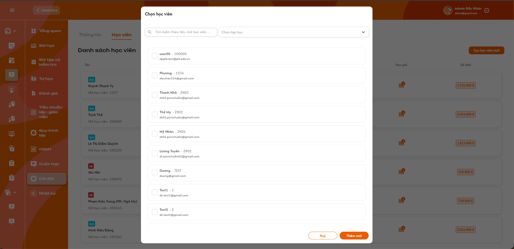</a><br>
  <em>Chọn một hoặc nhiều học viên đã có — nhấn để xem ảnh gốc</em>
</p>

**Mô tả:** Cho phép tìm và chọn một hoặc nhiều học viên đã tồn tại để thêm vào lớp hiện tại.

**Giải thích field/thành phần:**

| Thành phần | Yêu cầu |
|---|---|
| Tìm kiếm | Tìm theo tên hoặc mã học viên như placeholder UI; không tìm bằng dữ liệu ngoài phạm vi người dùng. |
| Chọn lớp học | Lọc học viên theo lớp khi cần. Đây không phải filter trạng thái học viên. |
| Danh sách | Mỗi dòng hiển thị tối thiểu tên, mã và email; checkbox hỗ trợ multi-select. |
| Hủy | Đóng popup, không thêm các lựa chọn chưa xác nhận. |
| Thêm mới | Xác nhận thêm toàn bộ học viên đang được chọn vào lớp hiện tại. Trong popup này, `Thêm mới` có nghĩa là thêm quan hệ vào lớp, không tạo tài khoản mới. |

**Điểm cần lưu ý:**

- Không hiển thị học viên đã có trong lớp như một lựa chọn có thể thêm; nếu vẫn hiển thị thì phải disabled và nêu rõ đã thuộc lớp.
- Thao tác thêm nhiều học viên phải nguyên tử theo danh sách đã chọn: nếu có phần tử không hợp lệ tại thời điểm lưu, không thêm một phần và trả rõ phần tử cần chọn lại.
- `Lớp 1-1` hỗ trợ multi-select và thêm nhiều học viên trong một lần giống `Lớp chung`.
- Search/filter chỉ tác động danh sách lựa chọn, không làm mất checkbox đã chọn nếu người dùng đổi từ khóa; UI phải hiển thị được tổng số đang chọn.

#### Testcase — Popup Chọn học viên có sẵn

| Tên testcase | Priority | Loại test | Scenario | Role | Pre-condition | Given / When / Then | Expected Result |
|---|---| --- |---|---|---|---|---|
| Case 13: Tìm kiếm theo tên hoặc mã | Medium |  | Flow 2 / REQ06 | Admin / Class Handler / Support | Có nhiều học viên hợp lệ | **Given** popup đang mở<br>**When** nhập tên hoặc mã học viên<br>**Then** lọc danh sách phù hợp | - Kết quả đúng phạm vi<br>- Không dùng filter trạng thái<br>- Không tự thêm khi chọn kết quả |
| Case 14: Chọn và thêm nhiều học viên vào lớp chung | High | Smoke | Flow 2 / REQ06 | Admin / Class Handler / Support | Lớp chung; các học viên chưa thuộc lớp | **Given** chọn từ hai học viên trở lên<br>**When** bấm `Thêm mới`<br>**Then** backend tạo các quan hệ học viên–lớp | - Mỗi học viên xuất hiện đúng một lần<br>- Hiển thị Toast `Thành Công` sau khi backend xác nhận<br>- Danh sách và sĩ số được cập nhật |
| Case 15: Hủy lựa chọn nhiều học viên | Medium |  | Flow 2 / REQ06 | Admin / Class Handler / Support | Đã tick một số học viên | **Given** lựa chọn chưa được xác nhận<br>**When** bấm `Hủy`<br>**Then** đóng popup mà không thêm | - Không tạo quan hệ mới<br>- Không hiển thị Toast thành công<br>- Mở lại không tự lưu lựa chọn cũ |
| Case 16: Chặn học viên trùng hoặc không còn hợp lệ | High |  | EX06 / REQ06 | Admin / Class Handler / Support | Một người đã được thêm hoặc bị vô hiệu hóa bởi thao tác khác | **Given** popup còn giữ snapshot cũ<br>**When** xác nhận danh sách có học viên không hợp lệ<br>**Then** backend từ chối nguyên tử | - Không thêm một phần danh sách<br>- Nêu đúng học viên cần chọn lại<br>- Không tạo dòng trùng |
| Case 17: Lớp 1-1 chọn và thêm nhiều học viên | High |  | Flow 2 / REQ06 | Admin / Class Handler / Support | Lớp 1-1 còn các học viên chưa được thêm | **Given** popup đang mở<br>**When** chọn từ hai học viên trở lên và xác nhận<br>**Then** hệ thống thêm toàn bộ lựa chọn hợp lệ | - Multi-select hoạt động như lớp chung<br>- Không giới hạn sĩ số bằng 1<br>- Không thêm trùng học viên đã thuộc lớp |

### Form Tạo học viên mới

<p align="center">
  <a href="./images/15-class-detail-student-create.png">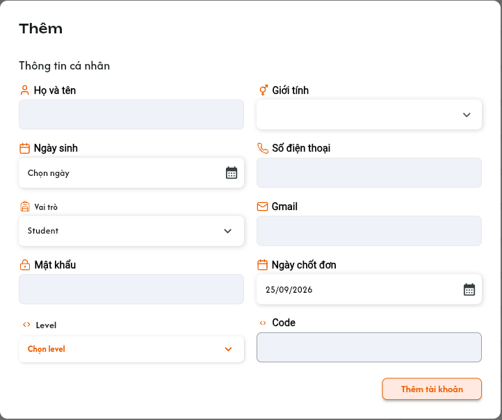</a><br>
  <em>Tạo tài khoản học viên và thêm vào lớp — nhấn để xem ảnh gốc</em>
</p>

**Mô tả:** Tạo tài khoản học viên mới từ ngữ cảnh lớp và thêm tài khoản vừa tạo vào lớp hiện tại trong cùng flow.

**Giải thích field/thành phần:**

| Field/thành phần | Yêu cầu |
|---|---|
| Họ và tên, Giới tính, Ngày sinh, Số điện thoại | Thông tin cá nhân của học viên; validate theo requirement Tài khoản/Học viên dùng chung. |
| Vai trò | Cố định là `Student`; người dùng không được tạo role khác từ flow này. |
| Gmail, Mật khẩu | Dữ liệu đăng nhập; validation, kiểm tra trùng và bảo mật theo requirement Đăng nhập/Tài khoản. Mật khẩu phải được che trên UI và không ghi log. |
| Ngày chốt đơn, Level, Code | Thuộc dữ liệu học viên; danh sách/validation dùng cấu hình hiện hành của hệ thống. |
| Thêm tài khoản | Tạo tài khoản và gắn vào lớp trong một giao dịch nghiệp vụ. |

**Điểm cần lưu ý:**

- Không tự suy đoán field bắt buộc hoặc giới hạn ký tự ngoài requirement Tài khoản/Học viên; các điểm chưa có nguồn được liệt kê tại mục 3.
- Nếu tạo tài khoản thành công nhưng không thể thêm vào lớp, hệ thống phải trả kết quả rõ ràng và không tạo quan hệ nửa chừng. Hướng rollback tài khoản hay giữ tài khoản chờ thêm lại cần dùng quy tắc chung của module Tài khoản.
- Với cả hai Loại lớp, backend chỉ cần kiểm tra quyền, dữ liệu tài khoản và quan hệ trùng; không chặn dựa trên sĩ số của `Lớp 1-1`.

#### Testcase — Form Tạo học viên mới

| Tên testcase | Priority | Loại test | Scenario | Role | Pre-condition | Given / When / Then | Expected Result |
|---|---| --- |---|---|---|---|---|
| Case 18: Tạo học viên mới và thêm vào lớp | High | Smoke | Flow 3 / REQ07 | Admin / Class Handler / Support | Dữ liệu tài khoản hợp lệ; lớp còn khả năng thêm | **Given** form Tạo mới đang mở<br>**When** nhập hợp lệ và bấm `Thêm tài khoản`<br>**Then** tạo Student và gắn vào lớp | - Role luôn là Student<br>- Dòng mới xuất hiện trong lớp<br>- Không tạo hai tài khoản/quan hệ khi bấm lặp<br>- Hiển thị Toast thành công |
| Case 19: Chặn tạo role khác Student | High |  | EX07 / REQ07 | Admin / Class Handler / Support | Form đang mở | **Given** client sửa request thành role khác<br>**When** gửi tạo tài khoản<br>**Then** backend từ chối | - Không tạo tài khoản sai role<br>- Không thêm vào lớp<br>- Không lộ permission nội bộ |
| Case 20: Validation tài khoản và dữ liệu trùng | High |  | EX08 / REQ07 | Admin / Class Handler / Support | Form chứa dữ liệu thiếu/sai/trùng theo rule Tài khoản | **Given** dữ liệu không hợp lệ<br>**When** bấm `Thêm tài khoản`<br>**Then** hiển thị lỗi tại field tương ứng | - Không tạo tài khoản hoặc quan hệ lớp<br>- Không hiện Toast thành công<br>- Mật khẩu không xuất hiện trong log/thông báo |
| Case 21: Gửi lặp hoặc có thao tác thêm đồng thời | High |  | EX09 / REQ07 | Admin / Class Handler / Support | Request đang xử lý hoặc có thao tác đồng thời | **Given** người dùng bấm lặp hoặc cùng học viên được thêm bởi người khác trước khi lưu<br>**When** backend xử lý<br>**Then** chỉ có tối đa một tài khoản và một quan hệ hợp lệ | - Không tạo tài khoản trùng<br>- Không tạo quan hệ học viên–lớp trùng<br>- Sĩ số lớp 1-1 không phải điều kiện từ chối |

### Ghi chú trong lớp và Lịch sử ghi chú

<p align="center">
  <a href="./images/16-class-detail-student-note.png">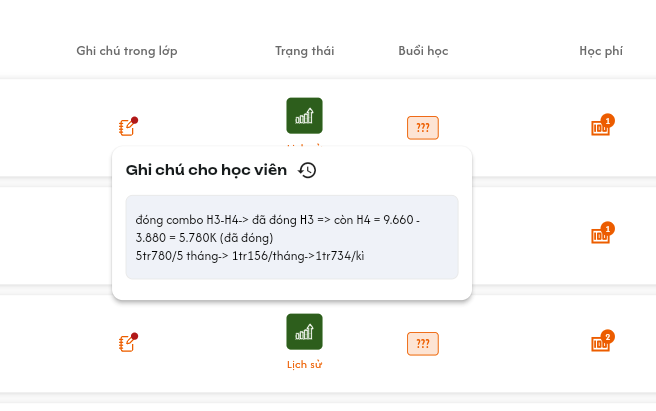</a><br>
  <em>Ghi chú của học viên trong lớp — nhấn để xem ảnh gốc</em>
</p>

<p align="center">
  <a href="./images/19-class-detail-student-note-history.png">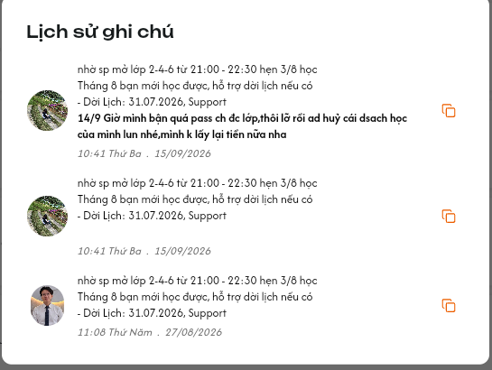</a><br>
  <em>Lịch sử ghi chú, người chỉnh sửa và thao tác sao chép — nhấn để xem ảnh gốc</em>
</p>

**Mô tả:** Bấm icon ghi chú của một dòng để xem/chỉnh ghi chú riêng cho học viên tại lớp này; bấm icon lịch sử để xem các phiên bản đã lưu.

**Giải thích field/thành phần:**

| Thành phần | Yêu cầu |
|---|---|
| Nội dung ghi chú | Hiển thị và cho `Admin`, `Class Handler`, `Support` chỉnh nội dung hiện tại theo quyền. |
| Icon lịch sử | Mở danh sách lịch sử ghi chú của đúng học viên và lớp. |
| Mỗi bản ghi lịch sử | Hiển thị nội dung, người tạo/người chỉnh sửa và thời điểm. Không ghi đè bản ghi cũ khi sửa ghi chú mới. |
| Copy | Sao chép nguyên nội dung của đúng bản ghi vào clipboard; không chỉnh sửa dữ liệu. |

**Điểm cần lưu ý:**

- Ghi chú phải lưu theo cặp `class_id + student_id`; không thay đổi ghi chú của học viên ở lớp khác.
- Mỗi lần lưu nội dung mới tạo một bản ghi lịch sử bất biến, gồm nội dung, người thao tác và thời điểm máy chủ.
- Nội dung hiển thị dưới dạng text an toàn; không thực thi HTML/script.
- Copy thành công có phản hồi nhẹ tại UI nhưng không dùng Toast CRUD vì không thay đổi dữ liệu.

#### Testcase — Ghi chú trong lớp và Lịch sử ghi chú

| Tên testcase | Priority | Loại test | Scenario | Role | Pre-condition | Given / When / Then | Expected Result |
|---|---| --- |---|---|---|---|---|
| Case 22: Mở đúng ghi chú của học viên | High |  | Flow 4 / REQ08 | Admin / Class Handler / Support | Có nhiều học viên/ghi chú | **Given** danh sách đang hiển thị<br>**When** bấm icon ghi chú tại một dòng<br>**Then** mở ghi chú của đúng học viên trong lớp | - Không hiển thị ghi chú lớp khác/người khác<br>- Nội dung hiện tại đầy đủ<br>- Control lưu hiển thị đúng cho Admin/Class Handler/Support |
| Case 23: Chỉnh sửa và lưu ghi chú | High |  | Flow 4 / REQ08 | `Admin`, `Class Handler` hoặc `Support` | Popup ghi chú đang mở | **Given** người dùng sửa nội dung<br>**When** xác nhận lưu<br>**Then** cập nhật ghi chú hiện tại và tạo lịch sử | - Danh sách hiển thị nội dung mới<br>- Lịch sử có người thao tác/thời điểm máy chủ<br>- Bản ghi cũ vẫn còn<br>- Hiển thị Toast thành công |
| Case 24: Xem lịch sử ghi chú | High |  | Flow 4 / REQ08 | Admin / Class Handler / Support | Có nhiều phiên bản ghi chú | **Given** popup ghi chú đang mở<br>**When** bấm icon lịch sử<br>**Then** hiển thị các bản ghi của đúng học viên/lớp | - Có nội dung, người tạo/chỉnh và thời điểm<br>- Sắp xếp mới nhất trước<br>- Không cho sửa trực tiếp bản ghi lịch sử |
| Case 25: Sao chép một bản ghi ghi chú | Medium |  | REQ08 | Admin / Class Handler / Support | Lịch sử đang mở | **Given** có nhiều bản ghi<br>**When** bấm Copy tại một bản ghi<br>**Then** sao chép đúng nội dung bản ghi đó | - Không nối lẫn metadata/nội dung khác<br>- Không tạo lịch sử mới<br>- Không hiển thị Toast CRUD |
| Case 26: Xung đột khi hai người cùng sửa ghi chú | High |  | EX10 / REQ08 | Admin / Class Handler / Support | Hai người mở cùng phiên bản | **Given** người A lưu trước người B<br>**When** người B lưu từ dữ liệu cũ<br>**Then** hệ thống không âm thầm ghi đè | - Cảnh báo dữ liệu đã thay đổi và yêu cầu tải lại/xác nhận theo cơ chế hệ thống<br>- Mọi phiên bản đã lưu vẫn có audit<br>- Không mất nội dung không báo trước |

### Trạng thái học viên và Lịch sử thay đổi trạng thái

<p align="center">
  <a href="./images/17-class-detail-student-status-menu.png">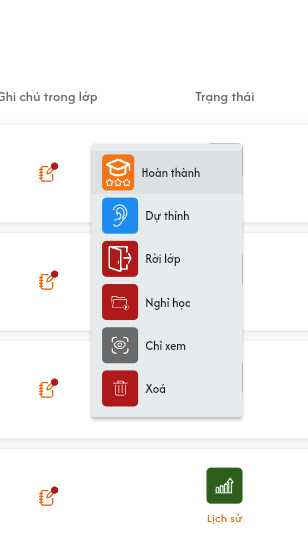</a><br>
  <em>Menu đổi trạng thái học viên — nhấn để xem ảnh gốc</em>
</p>

<p align="center">
  <a href="./images/18-class-detail-student-status-history.png">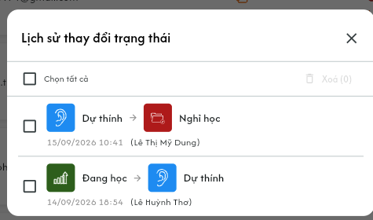</a><br>
  <em>Lịch sử trạng thái, người thao tác và thời điểm — nhấn để xem ảnh gốc</em>
</p>

**Mô tả:** Icon trạng thái thể hiện trạng thái hiện tại; role CRUD bấm icon để đổi. Link `Lịch sử` mở audit các lần thay đổi của đúng học viên trong lớp.

**Giải thích field/thành phần:**

| Thành phần | Yêu cầu |
|---|---|
| Trạng thái hiện tại | `Đang học` dùng icon bút trắng trên nền cam theo mẫu chuẩn. Màu/icon phải nhất quán trên danh sách, menu và lịch sử. |
| Trạng thái hợp lệ | `Đang học`, `Hoàn thành`, `Dự thính`, `Rời lớp`, `Nghỉ học`, `Chỉ xem`, `Xóa`. Menu không cần hiển thị lại trạng thái hiện tại như một đích chuyển. |
| Đổi trạng thái | Bấm trạng thái đích để cập nhật quan hệ học viên–lớp. Chuyển sang `Đang học` chỉ hợp lệ khi học viên đã có học phí trong lớp. |
| Lịch sử | Mỗi bản ghi hiển thị trạng thái cũ → mới, người thay đổi và thời điểm máy chủ; mới nhất trước. |

**Bộ trạng thái và icon chính thức:**

| Trạng thái | Icon chính thức | Quy tắc hiển thị |
|---|:---:|---|
| Chỉ xem |  | Bong bóng hội thoại có mắt trắng trên nền xám. |
| Dự thính |  | Tai trắng trên nền xanh dương. |
| Đang học |  | Bút trắng trên nền cam. |
| Hoàn thành |  | Bục có ngôi sao trắng trên nền xanh lá. |
| Nghỉ học |  | Lịch có dấu X trắng trên nền cam. |
| Rời lớp |  | Cửa và mũi tên trắng trên nền đỏ đậm. |
| Xóa |  | Túi có dấu X trắng trên nền đỏ tươi. |

**Điểm cần lưu ý:**

- Dùng đúng 7 PNG chuẩn do user cung cấp (mỗi ảnh gốc `60 × 60 px`), giữ nguyên tỷ lệ, nền màu, icon trắng, viền trắng, góc bo và bóng đổ của mẫu; không kéo giãn hoặc dựng icon thay thế.
- Hiển thị nhất quán trên danh sách học viên trong lớp, menu đổi trạng thái và lịch sử trạng thái/lớp khi có hiển thị trạng thái. Menu và lịch sử có tên trạng thái đi kèm; icon trên danh sách có tooltip khi hover/focus và tên truy cập được cho trình đọc màn hình.
- `Đang học` và `Nghỉ học` cùng có nền cam nhưng khác biểu tượng (bút / lịch có dấu X); `Rời lớp` dùng đỏ đậm, `Xóa` dùng đỏ tươi. Không nhận diện trạng thái chỉ bằng màu.
- Ảnh chụp danh sách/menu cũ chỉ minh họa bố cục và thao tác; nếu icon trong ảnh khác bảng chuẩn này thì dùng 7 asset chuẩn ở bảng trên.
- `Xóa` là trạng thái xóa mềm của học viên trong lớp, không xóa tài khoản học viên và không xóa lịch sử/học phí đã có.
- Đây là bộ **7 trạng thái chính thức của quan hệ học viên trong lớp**. Không bổ sung `Đặt cọc`, `Chuyển lớp`, `Bảo lưu`, `Học thử` hoặc trạng thái khác vào menu/API nếu chưa có requirement mới được xác nhận.
- Icon, tên tiếng Việt và giá trị nghiệp vụ phải ánh xạ 1–1. Không suy luận trạng thái chỉ theo màu; hover/focus phải có tên trạng thái để hỗ trợ accessibility.
- Status học viên thuộc từng quan hệ học viên–lớp và độc lập với status của lớp học. Học viên có 3 lớp có 3 status riêng. Danh sách học viên tổng chỉ xem status theo từng lớp; chỉ đổi tại Cài đặt lớp → Học viên → Chọn trạng thái bằng dropdown 7 status này. Đổi status ở lớp A không thay đổi status của cùng học viên ở lớp B/C; trạng thái tài khoản Chính thức là dữ liệu riêng theo requirement Chi tiết học viên. Filter logic học viên [0] chưa vào lớp / [1] đang học / [2] đã ở trong lớp là nhóm do BE xử lý, độc lập với 7 status này; FE không tự ánh xạ từ status trong lớp.
- Điều kiện “đã có học phí” chỉ dẫn chiếu sang requirement nghiệp vụ Học phí/Hóa đơn; requirement này không tự định nghĩa thế nào là đóng đủ.
- Với lớp không chính thức, role CRUD được đổi trạng thái không cần điều kiện học phí; vẫn phải kiểm tra quyền và lưu lịch sử.
- Backend kiểm tra điều kiện học phí tại thời điểm chuyển sang `Đang học`, không tin badge/tổng tiền đang hiển thị trên client.
- UI ảnh có checkbox và thao tác xóa lịch sử; quyền và quy tắc xóa bản ghi lịch sử chưa được xác nhận nên chưa thuộc phạm vi triển khai.

#### Testcase — Trạng thái học viên và Lịch sử thay đổi trạng thái

| Tên testcase | Priority | Loại test | Scenario | Role | Pre-condition | Given / When / Then | Expected Result |
|---|---| --- |---|---|---|---|---|
| Case 27: Mở menu và đổi trạng thái hợp lệ | High | Smoke | Flow 5 / REQ09 | Admin / Class Handler / Support | Học viên thuộc lớp | **Given** icon trạng thái đang hiển thị<br>**When** chọn một trạng thái đích hợp lệ<br>**Then** backend cập nhật đúng quan hệ | - Menu chỉ dùng 7 trạng thái chính thức<br>- Icon/tên hiển thị đúng bảng mapping sau khi backend xác nhận<br>- Tạo bản ghi lịch sử cũ → mới<br>- Không đổi học viên khác<br>- Hiển thị Toast thành công |
| Case 28: Chuyển sang Đang học khi đã có học phí | High |  | Flow 5 / REQ09 | Admin / Class Handler / Support | Lớp chính thức; học viên đáp ứng điều kiện học phí | **Given** học viên ở trạng thái khác<br>**When** chọn `Đang học`<br>**Then** backend kiểm tra học phí và cho chuyển | - Trạng thái thành Đang học<br>- Icon bút trắng trên nền cam hiển thị<br>- Lịch sử ghi người/thời điểm |
| Case 29: Chặn chuyển sang Đang học khi chưa có học phí | High |  | EX11 / REQ09 | Admin / Class Handler / Support | Lớp chính thức; học viên chưa có học phí | **Given** chọn `Đang học`<br>**When** backend kiểm tra điều kiện<br>**Then** từ chối chuyển | - Giữ nguyên trạng thái<br>- Không tạo lịch sử thay đổi thành công<br>- Hiển thị `Học viên cần có học phí trước khi chuyển sang trạng thái Đang học.` |
| Case 30: Lớp không chính thức bỏ qua điều kiện học phí | High |  | REQ09 / Ràng buộc lớp test | Admin / Class Handler / Support | Lớp được Admin đánh dấu không chính thức | **Given** học viên chưa có học phí<br>**When** chuyển sang `Đang học`<br>**Then** cho phép theo rule lớp test | - Vẫn kiểm tra quyền CRUD<br>- Tạo lịch sử đầy đủ<br>- Không làm thay đổi học phí |
| Case 31: Chuyển học viên sang Xóa | High |  | Flow 5 / REQ09 | Admin / Class Handler / Support | Học viên đang thuộc lớp | **Given** chọn trạng thái `Xóa`<br>**When** xác nhận theo UI<br>**Then** xóa mềm quan hệ khỏi danh sách hoạt động | - Không xóa tài khoản học viên<br>- Không xóa lịch sử/học phí<br>- Có thể audit người/thời điểm<br>- Sĩ số lớp cập nhật |
| Case 32: Xem lịch sử trạng thái | High |  | Flow 5 / REQ10 | Admin / Class Handler / Support | Có ít nhất một lần đổi trạng thái | **Given** người dùng bấm `Lịch sử`<br>**When** popup mở<br>**Then** tải lịch sử đúng học viên/lớp | - Hiển thị cũ → mới, người và thời điểm<br>- Mới nhất trước<br>- Không trộn lịch sử lớp khác |
| Case 33: Từ chối trạng thái ngoài danh sách | High |  | EX12 / REQ09 | Admin / Class Handler / Support | Có ID học viên/lớp hợp lệ | **Given** client gửi trạng thái giả hoặc request cũ<br>**When** cập nhật<br>**Then** backend từ chối | - Trạng thái không đổi<br>- Không tạo audit thành công giả<br>- Không lộ lỗi kỹ thuật |
| Case 48: Hiển thị đúng bộ icon trạng thái chính thức | High |  | REQ09 | Admin / Class Handler / Support | Có dữ liệu học viên thuộc đủ 7 trạng thái | **Given** danh sách/menu/lịch sử trạng thái được render<br>**When** đối chiếu từng trạng thái<br>**Then** tên và icon khớp bảng chính thức | - Không tráo icon Dự thính/Chỉ xem<br>- Hoàn thành, Nghỉ học, Rời lớp và Xóa dùng đúng asset được duyệt<br>- Đang học dùng bút trắng trên nền cam; Nghỉ học dùng lịch có dấu X trắng trên nền cam<br>- Rời lớp nền đỏ đậm, Xóa nền đỏ tươi<br>- Giữ đúng tỷ lệ, viền, góc bo và bóng đổ của 7 PNG chuẩn<br>- Có text/tooltip, không chỉ dựa vào màu |

### Popup Thêm học phí

<p align="center">
  <a href="./images/19-class-detail-student-tuition.png">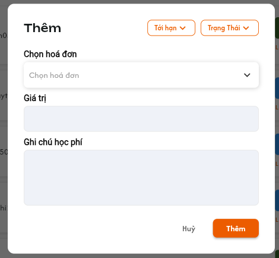</a><br>
  <em>Ảnh tham chiếu popup cũ; UI áp dụng phải bổ sung field Số buổi học bắt buộc theo rule mới.</em>
</p>

<p align="center">
  <a href="./images/20-class-detail-student-tuition-filter.png">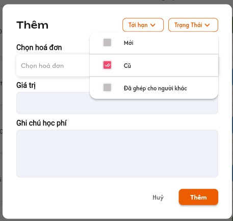</a><br>
  <em>Filter `Trạng Thái` trong ảnh là UI cũ và phải được loại bỏ — nhấn để xem ảnh gốc</em>
</p>

**Mô tả:** Admin/Class Handler/Support bấm thêm tại cột Học phí của học viên, chọn hóa đơn, nhập giá trị và bắt buộc chọn Số buổi học cho lần thêm này. Số buổi không còn được chỉnh ở cột Buổi học.

**Giải thích field/thành phần:**

| Field/thành phần | Yêu cầu |
|---|---|
| Tới hạn | Filter hóa đơn theo quy tắc tới hạn hiện hành. Danh sách lựa chọn cụ thể cần dùng cấu hình của module Hóa đơn. |
| Trạng Thái | **Loại bỏ khỏi popup**, không hiển thị và không dùng làm filter. |
| Chọn hóa đơn | Bắt buộc chọn một hóa đơn hợp lệ của đúng học viên. Không hiển thị/cho chọn hóa đơn của người khác. |
| Giá trị | Số tiền học phí muốn ghi nhận; phải là số tiền dương hợp lệ. |
| Số buổi học | Bắt buộc chọn trong popup Thêm học phí; số nguyên thuộc `1..N`, N là tổng số buổi của lớp theo giới hạn đã chốt trước đó. Không nhập tự do; lưu số buổi cùng lần ghi nhận học phí. Không tự suy ra số buổi từ số tiền. |
| Ghi chú học phí | Nội dung bổ sung cho lần đóng học phí; hiển thị/lưu an toàn. |
| Thêm | Validate hóa đơn/tiền/Số buổi học, ghi nhận học phí kèm số buổi và trừ giá trị vào số dư hóa đơn trong cùng giao dịch. |

**Điểm cần lưu ý:**

- Ví dụ hóa đơn còn `1.000.000đ`, thêm học phí `100.000đ` thì số dư hóa đơn còn `900.000đ`.
- Sau khi thêm thành công: badge Học phí tăng một lần và `Số tiền` tăng đúng giá trị vừa thêm.
- Số buổi được chọn lưu theo đúng giao dịch học phí và quan hệ học viên–lớp. Chỉ cập nhật cột Buổi học/cảnh báo sau backend thành công; chọn trong draft hoặc Hủy không thay số buổi.
- Khi đóng thêm lần sau, chưa chốt số buổi cộng dồn với lần trước hay thay thế giới hạn; không tự áp công thức cho trường hợp nhiều lần học phí.
- Badge là **số lần đóng học phí**, không phải số hóa đơn. `Số tiền` là tổng học phí đã đóng của học viên trong chính lớp này.
- Cập nhật học phí, số buổi, số dư hóa đơn, badge và tổng tiền phải nguyên tử; lỗi ở bất kỳ bước nào phải rollback toàn bộ.
- Backend phải khóa/kiểm tra lại số dư hóa đơn để ngăn hai người cùng phân bổ vượt số dư.
- Không được thêm giá trị lớn hơn số dư còn lại của hóa đơn, trừ khi requirement Hóa đơn sau này quy định rõ cơ chế trả thừa.

#### Testcase — Popup Thêm học phí

| Tên testcase | Priority | Loại test | Scenario | Role | Pre-condition | Given / When / Then | Expected Result |
|---|---| --- |---|---|---|---|---|
| Case 34: Popup có số buổi bắt buộc | High |  | Flow 6 / REQ11 | Admin / Class Handler / Support | Học viên có hóa đơn hợp lệ | **Given** danh sách đang hiển thị<br>**When** bấm thêm học phí tại một dòng<br>**Then** popup đúng học viên có Số buổi học | - Có Chọn hóa đơn, Giá trị, Số buổi học, Ghi chú, Tới hạn<br>- Không có filter Trạng Thái<br>- Không hiển thị hóa đơn của học viên khác |
| Case 35: Thêm học phí kèm số buổi | High | Smoke | Flow 6 / REQ11 | Admin / Class Handler / Support | Lần học phí đầu; hóa đơn còn 1.000.000đ, lớp có ít nhất 3 buổi | **Given** chọn hóa đơn, nhập 100.000đ và chọn 3 buổi<br>**When** bấm Thêm<br>**Then** ghi nhận một lần học phí kèm 3 buổi | - Số dư còn 900.000đ<br>- Badge tăng 1, Số tiền tăng 100.000đ<br>- Giao dịch lưu 3 buổi, cột chỉ xem cập nhật theo backend<br>- Tính lại cảnh báo, Toast thành công |
| Case 36: Hủy popup không thay học phí hoặc số buổi | Medium |  | Flow 6 / REQ11 | Admin / Class Handler / Support | Popup có draft hóa đơn/tiền/số buổi | **Given** chọn số buổi nhưng chưa lưu<br>**When** bấm Hủy<br>**Then** đóng và bỏ draft | - Số buổi, số dư, badge và tiền cũ giữ nguyên<br>- Không tạo giao dịch/lịch sử<br>- Không Toast thành công |
| Case 37: Từ chối hóa đơn sai học viên hoặc giá trị không hợp lệ | High |  | EX13 / REQ11 | Admin / Class Handler / Support | Có ID hóa đơn không thuộc học viên hoặc số tiền ≤ 0/> số dư | **Given** client gửi dữ liệu không hợp lệ<br>**When** thêm học phí<br>**Then** backend từ chối | - Không đổi hóa đơn, badge hoặc tổng tiền<br>- Báo đúng nguyên nhân<br>- Không cập nhật một phần |
| Case 38: Xử lý đồng thời trên cùng hóa đơn | High |  | EX14 / REQ11 | Admin / Class Handler / Support (hai tài khoản đồng thời) | Cùng mở hóa đơn còn số dư giới hạn | **Given** hai request cùng phân bổ<br>**When** backend xử lý đồng thời<br>**Then** kiểm tra số dư tại thời điểm commit | - Không để số dư âm<br>- Chỉ request hợp lệ được ghi nhận<br>- Request còn lại nhận dữ liệu mới nhất để thử lại |
| Case 39: Tính badge và tổng tiền theo đúng lớp | High |  | REQ12 | Admin / Class Handler / Support | Học viên có học phí ở nhiều lớp | **Given** mở tab Học viên của lớp A<br>**When** hiển thị cột Học phí/Số tiền<br>**Then** chỉ tổng hợp các lần đóng thuộc lớp A | - Badge bằng số lần đóng hợp lệ ở lớp A<br>- Số tiền bằng tổng giá trị các lần đó<br>- Không cộng lớp B hoặc giao dịch thất bại |
| Case 49: Thiếu hoặc sai Số buổi học | High |  | EX04 / REQ11 | Admin / Class Handler / Support | Popup thêm học phí, lớp N buổi | **Given** chưa chọn hoặc gửi 0/âm/phần lẻ/lớn hơn N/sai kiểu<br>**When** bấm Thêm hoặc gọi API<br>**Then** từ chối và báo lỗi field | - Bắt buộc chọn số nguyên 1..N<br>- Không ghi học phí, số buổi, trừ hóa đơn hay tăng badge/tiền |
| Case 50: Lỗi lưu số buổi rollback học phí | High |  | EX13 / REQ11 | Admin / Class Handler / Support | Dữ liệu hợp lệ nhưng một bước ghi giao dịch lỗi | **Given** thêm học phí kèm số buổi<br>**When** ghi số buổi/học phí/số dư thất bại<br>**Then** rollback toàn bộ | - Không học phí thành công nhưng số buổi cũ<br>- Không cập nhật cột hoặc cảnh báo sớm<br>- Giữ draft để thử lại |
| Case 51: Thêm học phí lặp không nhân dữ liệu | High |  | REQ11 / Ràng buộc idempotency | Admin / Class Handler / Support | Cùng request bị gửi lại | **Given** học phí có số buổi được gửi lặp<br>**When** backend xử lý<br>**Then** ghi một giao dịch | - Một lần trừ hóa đơn/tăng badge/tiền<br>- Số buổi của giao dịch không bị ghi nhận lặp<br>- Không tác động học viên/lớp khác |

### Menu thao tác từ tên học viên

<p align="center">
  <a href="./images/21-class-detail-student-name-actions.png">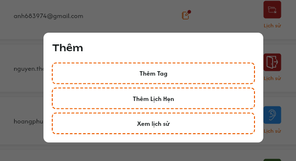</a><br>
  <em>Thêm Tag, Thêm Lịch Hẹn và Xem lịch sử — nhấn để xem ảnh gốc</em>
</p>

**Mô tả:** Bấm trực tiếp vào tên học viên mở menu thao tác nhanh, không điều hướng sang Chi tiết học viên.

**Giải thích field/thành phần:**

| Thành phần | Yêu cầu |
|---|---|
| Thêm Tag | Mở flow gắn tag cho đúng học viên. Tag sau khi thêm hiển thị tại cột Tên. Chi tiết quản lý tag dùng requirement riêng. |
| Thêm Lịch Hẹn | Mở flow tạo lịch hẹn cho đúng học viên. Chi tiết field/validation lịch hẹn dùng requirement riêng. |
| Xem lịch sử | Mở lịch sử học viên gồm ba tab: `Lịch sử hóa đơn`, `Lịch sử lớp`, `Ghi chú`. Nội dung chi tiết ba tab nằm ở function/requirement riêng. |

**Điểm cần lưu ý:**

- `Support` được xem lịch sử, Thêm Tag và Thêm Lịch Hẹn theo quyền CRUD đã quy định cho tab.
- Menu phải giữ đúng `student_id`; không dùng tên đang hiển thị để định danh.
- Requirement này chỉ đặc tả điểm vào và tên ba tab, không lặp lại nghiệp vụ chi tiết của từng function.

#### Testcase — Menu thao tác từ tên học viên

| Tên testcase | Priority | Loại test | Scenario | Role | Pre-condition | Given / When / Then | Expected Result |
|---|---| --- |---|---|---|---|---|
| Case 40: Mở menu bằng tên học viên | Medium |  | Flow 7 / REQ13 | Admin / Class Handler / Support | Học viên tồn tại | **Given** con trỏ nằm trực tiếp trên tên<br>**When** bấm tên<br>**Then** mở menu của đúng học viên | - Có ba lựa chọn theo quyền<br>- Không điều hướng sang Chi tiết<br>- Vùng trắng vẫn có hành vi mở Chi tiết |
| Case 41: Thêm Tag và cập nhật badge | Medium |  | Flow 7 / REQ13 | `Admin`, `Class Handler` hoặc `Support` | Có tag hợp lệ | **Given** chọn `Thêm Tag`<br>**When** hoàn tất flow riêng<br>**Then** danh sách phản ánh tag mới | - Tag gắn đúng học viên<br>- Không thay đổi trạng thái<br>- Hiển thị Toast theo flow CRUD Tag |
| Case 42: Mở flow Thêm Lịch Hẹn | Medium |  | Flow 7 / REQ13 | `Admin`, `Class Handler` hoặc `Support` | Có quyền tạo lịch hẹn | **Given** chọn `Thêm Lịch Hẹn`<br>**When** popup/flow mở<br>**Then** học viên được điền đúng | - Không tạo lịch trước khi xác nhận<br>- Chi tiết validation theo requirement Lịch hẹn<br>- Không chọn nhầm người |
| Case 43: Mở Xem lịch sử với ba tab | High |  | Flow 7 / REQ13 | Admin / Class Handler / Support | Học viên có dữ liệu lịch sử | **Given** chọn `Xem lịch sử`<br>**When** màn lịch sử mở<br>**Then** có đúng ba tab được quy định | - `Lịch sử hóa đơn`, `Lịch sử lớp`, `Ghi chú`<br>- Dữ liệu thuộc đúng học viên<br>- Chi tiết từng tab dẫn chiếu requirement riêng |

### Toast phản hồi CRUD

<p align="center">
  <a href="../../images/01-toast-crud.png"></a><br>
  <em>Toast phản hồi Create, Update, Delete và đổi trạng thái — nhấn để xem ảnh gốc</em>
</p>

**Mô tả:** Toast phản hồi thêm học viên, tạo học viên, chỉnh ghi chú, đổi trạng thái và thêm học phí kèm số buổi. Không có CRUD chỉnh số buổi trực tiếp tại cột Buổi học.

**Giải thích thành phần:**

| Loại | Tiêu đề | Khi sử dụng |
|---|---|---|
| Thành công | `Thành Công` | Backend xác nhận thao tác thành công. |
| Thông tin | `Thông Báo` | Thao tác đã tiếp nhận nhưng danh sách/tổng tiền cần thời gian đồng bộ. |
| Cảnh báo | `Cảnh Báo` | Dữ liệu hoặc điều kiện cần người dùng kiểm tra. |
| Lỗi | `Có Lỗi Xảy Ra` | Backend/network không hoàn tất thao tác. |

**Điểm cần lưu ý:**

- Dòng nội dung phải nêu đúng đối tượng/thao tác, ví dụ `Đã thêm học viên vào lớp.`, `Đã cập nhật trạng thái học viên.`, `Đã thêm học phí.`
- Chỉ hiển thị sau khi backend xác nhận; mỗi thao tác logic chỉ có một Toast.
- Hủy, xem lịch sử, mở Chi tiết hoặc Copy không có Toast CRUD.
- Nút `×` chỉ đóng Toast, không hoàn tác dữ liệu.

#### Testcase — Toast phản hồi CRUD

| Tên testcase | Priority | Loại test | Scenario | Role | Pre-condition | Given / When / Then | Expected Result |
|---|---| --- |---|---|---|---|---|
| Toast Case 1: Thành công | High |  | Ràng buộc Toast CRUD | Admin / Class Handler / Support | Dữ liệu hợp lệ | **Given** người dùng xác nhận thao tác<br>**When** backend thành công<br>**Then** hiển thị Toast `Thành Công` | - Nội dung đúng nghiệp vụ<br>- Đúng một Toast<br>- Chỉ hiện sau backend |
| Toast Case 2: Cảnh báo | High |  | Ràng buộc Toast CRUD | Admin / Class Handler / Support | Dữ liệu/điều kiện chưa hợp lệ | **Given** thao tác vi phạm điều kiện học phí, dữ liệu trùng hoặc validation<br>**When** xác nhận<br>**Then** hiển thị Toast `Cảnh Báo` nếu flow dùng Toast validation | - Không lưu dữ liệu sai<br>- Giữ lỗi cụ thể tại popup/field<br>- Không hiện thành công |
| Toast Case 3: Lỗi | High |  | Ràng buộc Toast CRUD | Admin / Class Handler / Support | Backend/network lỗi | **Given** request hợp lệ đã gửi<br>**When** xử lý thất bại<br>**Then** hiển thị Toast `Có Lỗi Xảy Ra` | - Không cập nhật một phần<br>- Cho phép thử lại<br>- Không lộ lỗi kỹ thuật |
| Toast Case 4: Thông tin, đóng và chống lặp | Medium |  | Ràng buộc Toast CRUD | Admin / Class Handler / Support | Đang đồng bộ hoặc callback lặp | **Given** danh sách chưa đồng bộ hoặc người dùng bấm lặp<br>**When** UI nhận trạng thái/bấm `×`<br>**Then** tối đa một Toast `Thông Báo` và cho đóng | - Không báo thành công sớm<br>- Không nhân đôi Toast<br>- Đóng không hoàn tác dữ liệu |

## 2. Yêu cầu

### 2.1. Flow chính

**Flow 1 / REQ01–REQ04: Xem danh sách và tải thêm**

```text
Người dùng có quyền mở Chi tiết lớp → tab Học viên
      → Backend kiểm tra role và phạm vi lớp
      → Tải lượt đầu của danh sách theo ID lớp
      → Với từng học viên, so sánh số buổi thực tế A với số buổi được phép N
      → Nếu A > N và role là Admin/Class Handler/Support: hover Buổi học hiển thị Quá buổi học
      → Nếu A ≤ N: không hiển thị cảnh báo vượt buổi
      → Kéo xuống gần cuối: tải lượt tiếp theo bằng cursor ổn định
      → Hợp nhất theo ID quan hệ học viên–lớp, không lặp/bỏ sót
      → Bấm vùng trắng cột Tên: mở Chi tiết học viên
      → Bấm tên: mở menu thao tác nhanh
```

**Flow 2 / REQ05–REQ06: Thêm học viên đã có**

```text
Role CRUD bấm Tạo học viên mới
      → Chọn Chọn học viên
      → Tìm theo tên/mã hoặc lọc theo lớp
      → Chọn một/nhiều học viên cho cả Lớp chung và Lớp 1-1
      → Bấm Thêm mới
      → Backend kiểm tra quyền, học viên tồn tại và chưa thuộc lớp; không giới hạn sĩ số Lớp 1-1
      → Hợp lệ: thêm nguyên tử, cập nhật danh sách/sĩ số, hiển thị Toast thành công
      → Không hợp lệ: không thêm một phần, trả phần tử cần chọn lại
```

**Flow 3 / REQ07: Tạo học viên mới từ lớp**

```text
Role CRUD chọn Tạo học viên mới
      → Nhập dữ liệu tài khoản; Vai trò cố định Student
      → Backend dùng validation chung của Tài khoản/Học viên
      → Kiểm tra lại quyền và sức chứa lớp
      → Tạo tài khoản và gắn vào lớp theo cơ chế nhất quán
      → Thành công: hiển thị dòng mới và Toast
      → Thất bại: không để quan hệ lớp nửa chừng hoặc tài khoản trùng
```

**Flow 4 / REQ08: Sửa và xem lịch sử ghi chú**

```text
Bấm icon Ghi chú của một học viên
      → Tải ghi chú theo class_id + student_id
      → Role CRUD sửa và lưu
      → Backend lưu nội dung mới + bản ghi lịch sử người/thời điểm
      → Icon lịch sử mở các phiên bản mới nhất trước
      → Copy chỉ sao chép nội dung, không thay đổi dữ liệu
```

**Flow 5 / REQ09–REQ10: Đổi và xem lịch sử trạng thái**

```text
Role CRUD bấm icon trạng thái
      → Chọn trạng thái đích hợp lệ
      → Nếu đích là Đang học và lớp chính thức: backend kiểm tra học phí
      → Đủ điều kiện/lớp test: cập nhật trạng thái và tạo audit cũ → mới
      → Thiếu điều kiện: giữ nguyên và cảnh báo
      → Bấm Lịch sử: xem trạng thái cũ/mới, người và thời điểm
```

**Flow 6 / REQ11–REQ12: Thêm học phí**

```text
Admin/Class Handler/Support bấm thêm học phí tại đúng dòng
      → Popup tải hóa đơn của đúng học viên, không có filter Trạng Thái
      → Chọn hóa đơn, nhập Giá trị, bắt buộc chọn Số buổi học và nhập Ghi chú nếu có
      → Backend kiểm tra quyền, quan hệ hóa đơn–học viên và số dư mới nhất
      → Validate số buổi nguyên 1..N, không cho thiếu
      → Ghi nhận học phí kèm số buổi + trừ số dư hóa đơn + cập nhật badge/tổng tiền nguyên tử
      → Cột Buổi học chỉ xem cập nhật theo dữ liệu mới, tính lại cảnh báo vượt buổi
      → Thành công: đóng popup, cập nhật dòng, Toast thành công
      → Thất bại: rollback toàn bộ
```

**Flow 7 / REQ13: Menu thao tác theo tên học viên**

```text
Bấm trực tiếp vào tên học viên
      → Mở menu gắn đúng student_id
      → Thêm Tag: chuyển flow Tag riêng
      → Thêm Lịch Hẹn: chuyển flow Lịch hẹn riêng
      → Xem lịch sử: mở ba tab Lịch sử hóa đơn / Lịch sử lớp / Ghi chú
```

### 2.2. Ngoại lệ

- **EX01:** Role ngoài `Admin`, `Class Handler`, `Support` hoặc người dùng ngoài phạm vi gửi request CRUD → backend từ chối, không thay đổi dữ liệu.
- **EX02:** Danh sách rỗng hoặc load-more lỗi → giữ dữ liệu đã tải, hiển thị empty/error state và cho thử lại.
- **EX03:** Dữ liệu một dòng thay đổi trong lúc load-more → hợp nhất theo ID/phiên bản mới nhất, không để snapshot cũ ghi đè.
- **EX04:** Thêm học phí thiếu số buổi hoặc số buổi không nguyên/sai kiểu/ngoài 1..N → từ chối toàn giao dịch. Request chỉnh số buổi độc lập như thao tác cột cũ cũng không được phép.
- **EX06:** Học viên đã thuộc lớp, bị vô hiệu hóa, ngoài phạm vi hoặc thay đổi trong lúc popup đang mở → từ chối thêm; không tạo dữ liệu trùng/một phần.
- **EX07:** Client đổi Vai trò khỏi `Student` trong flow tạo từ lớp → backend từ chối.
- **EX08:** Dữ liệu tài khoản thiếu/sai/trùng → áp dụng validation module Tài khoản/Học viên; không tạo tài khoản hoặc quan hệ lớp.
- **EX09:** Gửi lặp hoặc cùng học viên được thêm đồng thời → xử lý idempotent, không tạo tài khoản/quan hệ trùng; không dùng sĩ số lớp 1-1 làm lý do từ chối.
- **EX10:** Hai người cùng chỉnh ghi chú → không âm thầm ghi đè phiên bản mới hơn; giữ audit và yêu cầu xử lý xung đột.
- **EX11:** Lớp chính thức chuyển học viên chưa có học phí sang `Đang học` → từ chối và trả điều kiện còn thiếu.
- **EX12:** Trạng thái đích không thuộc danh sách hợp lệ → backend từ chối và không tạo lịch sử thành công giả.
- **EX13:** Hóa đơn không thuộc học viên, giá trị không phải số dương hoặc vượt số dư → không ghi nhận học phí và không đổi badge/tổng tiền.
- **EX14:** Hai request cùng phân bổ một hóa đơn → kiểm tra/khóa số dư tại commit, không để số dư âm.
- **EX15:** Điểm danh hoặc giới hạn Buổi học đã thay đổi nhưng client còn dữ liệu cũ → backend/tầng đồng bộ phải tính lại từ dữ liệu mới nhất; không giữ cảnh báo sai hoặc bỏ sót cảnh báo vượt buổi.

### 2.3. Yêu cầu khác

- **REQ01 – Quyền xem và CRUD:** `Admin`, `Class Handler`, `Support` được xem và CRUD tab trong phạm vi. Không có role Assistant Teacher riêng; Trợ giảng dùng role Support. Backend là nguồn quyết định cuối cùng.
- **REQ02 – Điều hướng theo vùng bấm:** Vùng trắng cột Tên mở Chi tiết học viên; tên học viên mở menu thao tác nhanh; không nhập nhằng hai hành vi.
- **REQ03 – Danh sách và load-more:** Không có search/pagination trên main list; dùng load-more khi cuộn với cursor ổn định, trạng thái loading, chống trùng và giữ vị trí cuộn.
- **REQ04 – Buổi học và cảnh báo vượt buổi:** Cột Buổi học chỉ xem, không dropdown/control sửa. Admin/Class Handler/Support chọn số buổi bắt buộc trong popup Thêm học phí, lưu cùng giao dịch. Vẫn đếm buổi thực tế từ điểm danh hợp lệ; hover cảnh báo Quá buổi học khi thực tế lớn hơn số được phép, bằng nhau chưa quá. Không tự chặn học/đổi trạng thái; tính lại sau thay đổi điểm danh hoặc giao dịch học phí/số buổi hiệu lực.
- **REQ05 – Điểm vào thêm học viên:** Popup lựa chọn đúng hai flow Chọn học viên hoặc Tạo học viên mới. Cả `Lớp chung` và `Lớp 1-1` đều được thêm nhiều học viên, không phụ thuộc sĩ số hiện tại.
- **REQ06 – Chọn học viên có sẵn:** Hỗ trợ tìm tên/mã, lọc theo lớp và multi-select; chặn trùng; Lớp 1-1 áp dụng multi-select giống Lớp chung; thêm nguyên tử.
- **REQ07 – Tạo học viên:** Tạo role Student và gắn vào lớp; validation/bảo mật dùng requirement Tài khoản/Học viên/Đăng nhập.
- **REQ08 – Ghi chú:** Lưu theo học viên–lớp; có lịch sử bất biến gồm nội dung, người, thời điểm và Copy từng bản ghi.
- **REQ09 – Trạng thái:** Bộ 7 trạng thái quan hệ học viên trong lớp gồm `Đang học`, `Dự thính`, `Hoàn thành`, `Nghỉ học`, `Rời lớp`, `Chỉ xem`, `Xóa`, dùng đúng icon chính thức đã gắn trong bảng UI. Không có Đặt cọc/Chuyển lớp/Bảo lưu/Học thử trong enum này. Học viên lớp chính thức phải có học phí mới chuyển sang Đang học; lớp test bỏ qua điều kiện này.
- **REQ10 – Lịch sử trạng thái:** Lưu cũ → mới, người và thời điểm máy chủ; không trộn giữa các lớp.
- **REQ11 – Thêm học phí:** Admin/Class Handler/Support chọn hóa đơn đúng học viên, nhập tiền dương, bắt buộc chọn số buổi nguyên 1..N; bỏ filter Trạng Thái; ghi học phí kèm số buổi, trừ số dư, cập nhật badge/tiền/cột chỉ xem nguyên tử. Thiếu số buổi không được lưu.
- **REQ12 – Badge và tổng tiền:** Badge là số lần đóng học phí; Số tiền là tổng học phí đã đóng của học viên trong lớp hiện tại.
- **REQ13 – Menu tên học viên:** Có Thêm Tag, Thêm Lịch Hẹn, Xem lịch sử; lịch sử gồm ba tab được đặc tả riêng.
- **REQ14 – Audit và hiển thị an toàn:** Thao tác CRUD lưu người/thời điểm; text không thực thi HTML/script; lỗi không lộ stack trace, token hay dữ liệu nhạy cảm.

### 2.4. Ràng buộc

#### Quyền

| Role | Xem danh sách/Chi tiết/lịch sử | Thêm/chọn/tạo học viên | Sửa ghi chú (không sửa cột Buổi học) | Đổi trạng thái | Thêm học phí kèm số buổi bắt buộc | Thêm Tag/Lịch hẹn |
|---|:---:|:---:|:---:|:---:|:---:|:---:|
| Admin | ✅ | ✅ | ✅ | ✅ | ✅ | ✅ |
| Class Handler | ✅ | ✅ | ✅ | ✅ | ✅ | ✅ |
| Support | ✅ | ✅ | ✅ | ✅ | ✅ | ✅ |
| Role khác | Theo permission hiện hành | ❌ | ❌ | ❌ | ❌ | ❌ |

- Mọi quyền chỉ áp dụng trong phạm vi lớp/học viên người dùng được phân công.
- Backend phải kiểm tra lại quyền cho từng endpoint; việc ẩn/disable control không thay thế phân quyền.

#### Dữ liệu và tính toàn vẹn

- Dùng ID bất biến của lớp, học viên, quan hệ học viên–lớp, hóa đơn và giao dịch; không dùng tên/email/tag làm khóa cập nhật.
- Một học viên chỉ có một quan hệ hoạt động trong cùng lớp. Cả Lớp chung và Lớp 1-1 đều có thể có nhiều học viên hoạt động.
- Ghi chú, trạng thái, Buổi học, học phí và lịch sử phải gắn với đúng quan hệ học viên–lớp.
- Cập nhật học phí phải nguyên tử giữa giao dịch học phí kèm số buổi, số dư hóa đơn, badge và tổng tiền. Mọi role không được chỉnh riêng ở cột Buổi học.
- Thao tác gửi lặp phải idempotent, không tạo trùng học viên, quan hệ, lịch sử hoặc lần đóng học phí.
- Dữ liệu audit sử dụng thời điểm máy chủ và định danh người thao tác; không nhận người/thời điểm do client tự khai.
- Mật khẩu không được trả lại sau khi tạo, không xuất hiện trong log, Toast, lịch sử hay response lỗi.

---

## 3. Cần xác nhận

- **Nhiều lần học phí:** Lần đầu chọn 3 buổi, lần sau chọn 5 buổi thì số buổi được phép/cột Buổi học là 8 (cộng dồn) hay 5 (thay giới hạn)? Số buổi từng lần học phí đã chốt bắt buộc và lưu cùng giao dịch, chưa tự chọn rule tổng hợp.
- **Form Tạo học viên:** Các field bắt buộc, email ngoài Gmail, cấp độ 1..9 và Code 6 chữ số tăng dần theo cấp độ đã được chốt tại [Thêm học viên](../student_management/student_management_requirements.md#popup-thêm-học-viên); dùng cùng quy tắc khi tạo học viên từ lớp. Các điểm còn chờ xác nhận dẫn chiếu mục 4 của requirement đó.
- **Lịch sử trạng thái:** Checkbox `Chọn tất cả` và nút `Xóa` trên ảnh có được triển khai không; nếu có thì role nào được xóa, xóa mềm hay xóa vật lý và có được phép xóa audit không?
- **Tới hạn hóa đơn:** Các lựa chọn cụ thể của filter `Tới hạn` và phạm vi hóa đơn được hiển thị cần dùng rule nào của module Hóa đơn?
- **Hoàn/hủy học phí:** Khi một lần đóng học phí bị hoàn/hủy ở function khác, badge số lần và tổng tiền tại tab này có giảm theo giao dịch hiệu lực hay vẫn giữ số liệu lịch sử?
