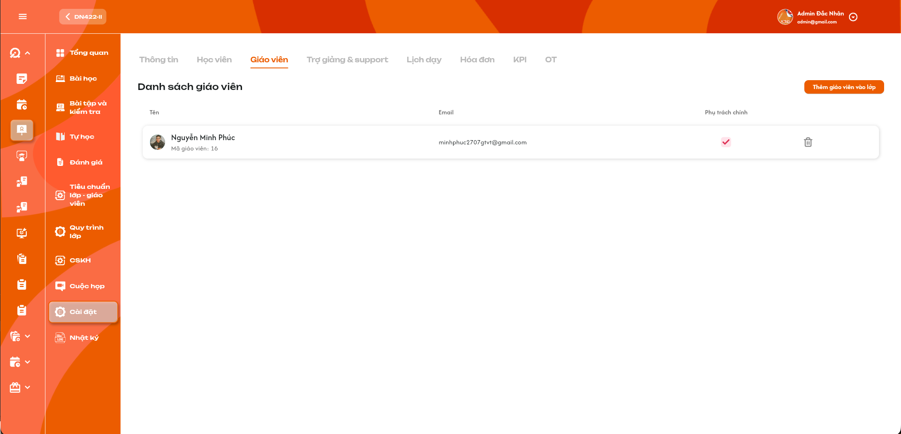
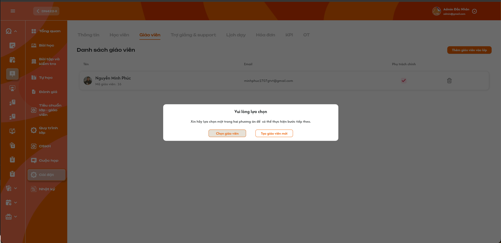
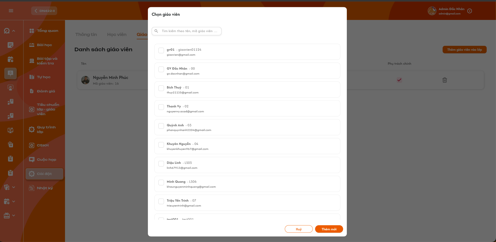
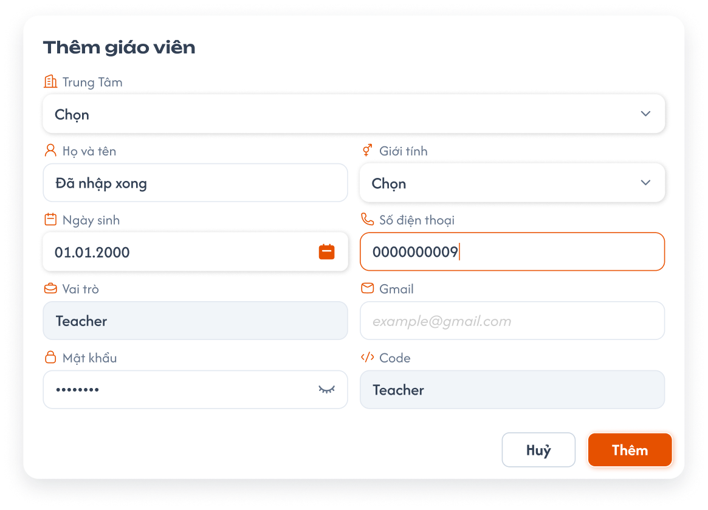

# Chi tiết lớp học — Tab Giáo viên

> Requirement này đặc tả màn **Chi tiết lớp học → Tab Giáo viên**. Hồ sơ, popup tạo mới và các tab Chi tiết giáo viên dùng lại nghiệp vụ tại [Quản lý danh sách giáo viên](../teacher_management/teacher_management_requirements.md) và [Chi tiết giáo viên](../teacher_management/teacher_detail_requirements.md). Trợ giảng/Phụ trách lớp được đặc tả tại [Tab Trợ giảng & Phụ trách lớp](./class_detail_support_handlers_requirements.md); lịch và thời điểm phát sinh lương được đặc tả tại [Tab Lịch dạy](./class_detail_schedule_requirements.md). `Giáo viên phụ trách chính` trong tài liệu này là giáo viên được quyền chấm điểm BTVN và bài kiểm tra, khác với `Phụ trách chính` có role `Class Handler` của lớp.

## 1. UI

### Tab Giáo viên — Danh sách giáo viên trong lớp

<p align="center">
  <a href="./images/22-class-detail-teachers.png"></a><br>
  <em>Danh sách giáo viên đã được thêm vào lớp — nhấn để xem ảnh gốc</em>
</p>

**Mô tả:**

- Hiển thị danh sách giáo viên đang được gắn với lớp hiện tại.
- `Admin`, `Class Handler` và `Support` được xem, thêm giáo viên có sẵn, tạo giáo viên mới, đổi Giáo viên phụ trách chính và xóa giáo viên khỏi lớp trong phạm vi được phân quyền.
- Mỗi lớp được có nhiều giáo viên nhưng tại một thời điểm chỉ có tối đa một `Giáo viên phụ trách chính`.
- Chỉ giáo viên đang là `Giáo viên phụ trách chính` của lớp mới được nhập/cập nhật điểm BTVN và bài kiểm tra cho học viên trong lớp đó.

**Giải thích field/thành phần:**

| Field/thành phần | Yêu cầu |
|---|---|
| Tên | Hiển thị avatar, họ tên và mã giáo viên. Bấm vào giáo viên mở đúng màn Chi tiết giáo viên theo quyền của người dùng. |
| Email | Hiển thị email hiện tại của giáo viên; không dùng email làm khóa quan hệ giáo viên–lớp. |
| Phụ trách chính | Checkbox thể hiện giáo viên có quyền chấm điểm BTVN và bài kiểm tra của lớp hay không. Mỗi lớp tối đa một checkbox được chọn. |
| Xóa | Icon thùng rác mở popup xác nhận xóa giáo viên khỏi lớp. Không xóa tài khoản giáo viên. |
| Thêm giáo viên vào lớp | Mở popup lựa chọn giữa `Chọn giáo viên` hiện có và `Tạo giáo viên mới`. |

**Điểm cần lưu ý:**

- `Giáo viên phụ trách chính` không phải `Class Handler/Phụ trách chính` của lớp. Hai quan hệ có role và quyền khác nhau.
- Danh sách có thể có 0, 1 hoặc nhiều giáo viên. Không nhân đôi cùng một giáo viên trong một lớp.
- Quan hệ giáo viên–lớp phải là nguồn chung cho `Số lớp`, `Đang dạy` và `Lịch dạy` tại module Giáo viên.
- Thao tác thêm/xóa/đổi phụ trách phải cập nhật danh sách sau khi backend xác nhận, không cập nhật thành công giả ở client.
- Thêm giáo viên đầu tiên không tự động đánh dấu Phụ trách chính; người có quyền phải tick thủ công.
- Lớp được phép tạm thời không có Giáo viên phụ trách chính. Khi đó không giáo viên nào được nhập/cập nhật điểm BTVN hoặc bài kiểm tra của lớp.
- Giáo viên thường và Giáo viên phụ trách chính đều không được xem tab quản lý này; quyền chấm điểm được thực hiện tại màn BTVN/Bài kiểm tra tương ứng.

#### Testcase — Tab Giáo viên — Danh sách giáo viên

| Tên testcase | Priority | Loại test | Scenario | Role | Pre-condition | Given / When / Then | Expected Result |
|---|---| --- |---|---|---|---|---|
| Case 1: Mở tab và hiển thị danh sách giáo viên | High | Smoke | Flow 1 / REQ01 | `Admin`, `Class Handler` hoặc `Support` | Lớp có giáo viên | **Given** người dùng được xem lớp<br>**When** mở tab `Giáo viên`<br>**Then** hệ thống tải quan hệ giáo viên–lớp mới nhất | - Hiển thị đúng Tên, Mã, Email, checkbox Phụ trách chính và icon Xóa<br>- Không trộn giáo viên lớp khác<br>- Không thay đổi dữ liệu |
| Case 2: Danh sách rỗng | Medium |  | REQ01 | Role có quyền | Lớp chưa có giáo viên | **Given** tab được mở<br>**When** backend trả danh sách rỗng<br>**Then** hiển thị empty state và nút thêm | - Không tạo dòng giả<br>- Có thể mở flow thêm giáo viên<br>- Không tự gán giáo viên phụ trách chính |
| Case 3: Chỉ ba role quản lý được CRUD | High |  | Ràng buộc quyền / EX01 | Kiểm thử nhiều role | Có ID lớp hợp lệ | **Given** role không phải Admin/Class Handler/Support<br>**When** xem control hoặc gửi request CRUD trực tiếp<br>**Then** hệ thống từ chối | - Không hiển thị/disable control thay đổi<br>- Backend không thêm, đổi phụ trách hoặc xóa<br>- Không lộ dữ liệu ngoài phạm vi |
| Case 4: Không hiển thị trùng giáo viên | High |  | EX02 / REQ01 | Role có quyền | Cùng giáo viên được gửi thêm lặp/đồng thời | **Given** quan hệ giáo viên–lớp đã tồn tại<br>**When** tải lại danh sách<br>**Then** mỗi giáo viên chỉ có một dòng | - Không nhân đôi quan hệ<br>- Không làm sai số lớp của giáo viên<br>- Có thể cảnh báo đã thuộc lớp |

### Popup chọn cách thêm giáo viên

<p align="center">
  <a href="./images/24-class-detail-teacher-add-choice.png"></a><br>
  <em>Chọn giáo viên hiện có hoặc tạo giáo viên mới — nhấn để xem ảnh gốc</em>
</p>

**Mô tả:** Bấm `Thêm giáo viên vào lớp` để chọn một trong hai flow: thêm giáo viên đã có hoặc tạo tài khoản giáo viên mới rồi thêm vào lớp.

**Giải thích field/thành phần:**

| Thành phần | Yêu cầu |
|---|---|
| Chọn giáo viên | Mở popup tìm và chọn một hoặc nhiều giáo viên hiện có. |
| Tạo giáo viên mới | Mở popup tạo giáo viên dùng chung của module Giáo viên. |
| Đóng popup | Đóng mà không tạo hoặc thêm quan hệ giáo viên–lớp. |

**Điểm cần lưu ý:**

- Chỉ `Admin`, `Class Handler`, `Support` được mở và thực hiện hai flow.
- Việc mở popup không tự chọn hoặc tự thêm giáo viên.
- ID lớp phải được giữ xuyên suốt hai flow để sau khi xác nhận giáo viên được thêm đúng lớp.

#### Testcase — Popup chọn cách thêm giáo viên

| Tên testcase | Priority | Loại test | Scenario | Role | Pre-condition | Given / When / Then | Expected Result |
|---|---| --- |---|---|---|---|---|
| Case 5: Mở và đóng popup lựa chọn | Medium |  | Flow 2 / REQ02 | Role có quyền CRUD | Tab Giáo viên đang mở | **Given** người dùng bấm `Thêm giáo viên vào lớp`<br>**When** popup hiển thị rồi được đóng<br>**Then** không thay đổi dữ liệu | - Có đúng hai lựa chọn<br>- Không tạo giáo viên/quan hệ<br>- Danh sách giữ nguyên |
| Case 6: Điều hướng đúng hai flow | High |  | Flow 2 / REQ02 | Role có quyền CRUD | Popup lựa chọn đang mở | **Given** người dùng chọn một phương án<br>**When** bấm nút tương ứng<br>**Then** mở đúng popup Chọn giáo viên hoặc Tạo giáo viên mới | - Không mở hai popup đồng thời<br>- Giữ đúng ID lớp<br>- Chưa thêm dữ liệu trước khi xác nhận flow con |

### Popup Chọn giáo viên hiện có

<p align="center">
  <a href="./images/23-class-detail-teacher-picker.png"></a><br>
  <em>Tìm và chọn một hoặc nhiều giáo viên hiện có — nhấn để xem ảnh gốc</em>
</p>

**Mô tả:** Cho phép tìm theo tên hoặc mã giáo viên và chọn một hoặc nhiều giáo viên để thêm vào lớp.

**Giải thích field/thành phần:**

| Thành phần | Yêu cầu |
|---|---|
| Tìm kiếm | Tìm theo tên hoặc mã giáo viên như placeholder UI; áp dụng trong phạm vi dữ liệu người dùng. |
| Danh sách | Mỗi dòng hiển thị tối thiểu tên, mã và email; checkbox hỗ trợ multi-select. |
| Hủy | Đóng popup và bỏ các lựa chọn chưa xác nhận. |
| Thêm mới | Thêm toàn bộ giáo viên đang chọn vào lớp; trong popup này không có nghĩa là tạo tài khoản mới. |

**Điểm cần lưu ý:**

- Không cho chọn giáo viên đã thuộc lớp; nếu vẫn hiển thị thì phải disabled và nêu rõ `Đã thuộc lớp`.
- Hệ thống có bốn trạng thái giáo viên: `Training`, `Chính thức`, `Thử việc`, `Nghỉ việc`. Không có trạng thái giáo viên `Testing`.
- Popup chọn để thêm vào lớp chỉ hiển thị giáo viên có hồ sơ/tài khoản còn hiệu lực thuộc một trong ba trạng thái `Training`, `Chính thức`, `Thử việc`.
- Giáo viên `Nghỉ việc` **không hiển thị trong danh sách chọn**, kể cả khi từ khóa tìm kiếm khớp chính xác tên hoặc mã giáo viên. Backend vẫn phải từ chối nếu client gửi trực tiếp ID giáo viên đã nghỉ việc.
- Thêm nhiều giáo viên phải nguyên tử. Nếu có phần tử không còn hợp lệ tại thời điểm xác nhận, không thêm một phần và trả rõ phần tử cần chọn lại.
- Thêm giáo viên, kể cả giáo viên đầu tiên, không tự động đánh dấu Phụ trách chính.

#### Testcase — Popup Chọn giáo viên hiện có

| Tên testcase | Priority | Loại test | Scenario | Role | Pre-condition | Given / When / Then | Expected Result |
|---|---| --- |---|---|---|---|---|
| Case 7: Tìm theo tên hoặc mã giáo viên | Medium |  | Flow 2 / REQ03 | Role có quyền CRUD | Có nhiều giáo viên hợp lệ | **Given** popup đang mở<br>**When** nhập tên hoặc mã<br>**Then** lọc danh sách đúng phạm vi | - Tên/mã khớp được hiển thị<br>- Không tự thêm khi tìm<br>- Không lộ giáo viên ngoài phạm vi |
| Case 8: Chọn và thêm nhiều giáo viên | High | Smoke | Flow 2 / REQ03 | Role có quyền CRUD | Các giáo viên chưa thuộc lớp | **Given** chọn từ hai giáo viên trở lên<br>**When** bấm `Thêm mới`<br>**Then** backend tạo các quan hệ giáo viên–lớp | - Mỗi giáo viên xuất hiện một lần<br>- Chưa ai tự thành Phụ trách chính<br>- Cập nhật số lớp/lịch liên quan<br>- Hiển thị Toast thành công |
| Case 9: Hủy lựa chọn | Medium |  | Flow 2 / REQ03 | Role có quyền CRUD | Đã tick giáo viên | **Given** lựa chọn chưa xác nhận<br>**When** bấm `Hủy`<br>**Then** đóng popup mà không thêm | - Không tạo quan hệ<br>- Không có Toast thành công<br>- Mở lại không tự giữ lựa chọn cũ |
| Case 10: Không hiển thị và chặn giáo viên Nghỉ việc | High |  | EX03 / REQ03 | Role có quyền CRUD | Có giáo viên trạng thái `Nghỉ việc` trong hệ thống | **Given** popup Chọn giáo viên đang mở<br>**When** xem danh sách hoặc tìm chính xác theo tên/mã giáo viên đã nghỉ việc<br>**Then** giáo viên đó không xuất hiện trong kết quả | - API danh sách loại giáo viên Nghỉ việc ở backend<br>- Client gửi trực tiếp teacher_id Nghỉ việc vẫn bị từ chối<br>- Không tạo quan hệ giáo viên–lớp<br>- Không làm lộ dữ liệu ngoài phạm vi |
| Case 11: Chỉ hiển thị ba trạng thái giáo viên có thể thêm | High |  | REQ03 | Role có quyền CRUD | Có giáo viên thuộc nhiều trạng thái | **Given** popup Chọn giáo viên đang mở<br>**When** tải hoặc tìm danh sách<br>**Then** chỉ trả giáo viên `Training`, `Chính thức`, `Thử việc` còn hiệu lực | - Không có trạng thái `Testing`<br>- Không hiển thị `Nghỉ việc`<br>- Kết quả vẫn đúng phạm vi và chưa thuộc lớp |
| Case 28: Giáo viên chuyển Nghỉ việc khi popup đang mở | High |  | EX03 / REQ03 | Role có quyền CRUD | Giáo viên đang hiển thị hợp lệ rồi được chuyển sang Nghỉ việc bởi thao tác khác | **Given** popup còn giữ dữ liệu cũ và giáo viên đang được tick<br>**When** người dùng xác nhận thêm<br>**Then** backend kiểm tra trạng thái mới nhất và từ chối | - Không thêm giáo viên Nghỉ việc<br>- Không thêm một phần danh sách multi-select<br>- Yêu cầu tải lại/chọn lại danh sách<br>- Sau khi tải lại giáo viên không còn xuất hiện |

### Popup Tạo giáo viên mới dùng chung

<p align="center">
  <a href="../teacher_management/images/teacher-create-modal.png"></a><br>
  <em>Popup tạo giáo viên dùng chung từ requirement Quản lý giáo viên — nhấn để xem ảnh gốc</em>
</p>

**Mô tả:** Tạo giáo viên mới ngay trong ngữ cảnh lớp bằng popup dùng chung của module Giáo viên; sau khi tạo thành công, tự thêm giáo viên mới vào lớp hiện tại.

**Giải thích field/thành phần:**

| Field/thành phần | Yêu cầu |
|---|---|
| Họ và tên | Thông tin giáo viên; validation dùng requirement Quản lý giáo viên. |
| Mã giáo viên/Code | Do backend tự sinh duy nhất theo quy tắc module Giáo viên; người dùng không tự nhập/ghi đè. |
| Email, Số điện thoại | Dùng validation và kiểm tra trùng của module Giáo viên. |
| Trạng thái | Hệ thống hỗ trợ `Training`, `Chính thức`, `Thử việc`, `Nghỉ việc`. Trong flow tạo từ lớp, chỉ cho chọn ba trạng thái có thể được thêm vào lớp; không cho chọn `Nghỉ việc`. Không có trạng thái `Testing`. |
| Ghi chú | Cho nhập ghi chú ban đầu; hiển thị/lưu an toàn và dùng chung với hồ sơ giáo viên. |
| Các field khác | Giới tính, Ngày sinh, Vai trò `Teacher`, Mật khẩu và các field hiện có tiếp tục theo popup tạo giáo viên dùng chung. |
| Xác Nhận | Tạo giáo viên và thêm vào lớp trong một flow nhất quán. |

**Điểm cần lưu ý:**

- `Admin`, `Class Handler`, `Support` được dùng popup này từ tab Giáo viên của lớp. Quyền tạo từ màn Danh sách giáo viên độc lập vẫn theo requirement module Giáo viên.
- Tạo giáo viên mới không tự đánh dấu Phụ trách chính.
- Nếu tạo tài khoản thành công nhưng thêm vào lớp thất bại, hệ thống phải trả kết quả rõ ràng và không hiển thị quan hệ lớp chưa được tạo; cách rollback tài khoản dùng quy tắc chung module Giáo viên.
- Không lưu hoặc hiển thị mật khẩu trong Toast, log, lịch sử hay response sau tạo.

#### Testcase — Popup Tạo giáo viên mới dùng chung

| Tên testcase | Priority | Loại test | Scenario | Role | Pre-condition | Given / When / Then | Expected Result |
|---|---| --- |---|---|---|---|---|
| Case 12: Mở đúng popup tạo giáo viên dùng chung | High |  | Flow 3 / REQ04 | Role có quyền CRUD | Popup lựa chọn đang mở | **Given** người dùng chọn `Tạo giáo viên mới`<br>**When** popup tạo mở<br>**Then** dùng đúng component/rule module Giáo viên | - Có các field hiện hành và bổ sung Trạng thái/Ghi chú<br>- Code chỉ đọc/tự sinh<br>- Vai trò cố định Teacher |
| Case 13: Tạo giáo viên và tự thêm vào lớp | High |  | Flow 3 / REQ04 | Role có quyền CRUD | Dữ liệu hợp lệ | **Given** người dùng nhập hợp lệ<br>**When** xác nhận tạo<br>**Then** tạo giáo viên rồi gắn vào lớp | - Danh sách xuất hiện giáo viên mới<br>- Không tự tick Phụ trách chính<br>- Không tạo trùng khi bấm lặp<br>- Hiển thị Toast thành công |
| Case 14: Tạo giáo viên theo ba trạng thái được phân công | High |  | Flow 3 / REQ04 | Role có quyền CRUD | Dữ liệu hợp lệ | **Given** lần lượt chọn `Training`, `Chính thức`, `Thử việc`<br>**When** xác nhận tạo<br>**Then** tạo Teacher đúng trạng thái và thêm vào lớp | - Code vẫn duy nhất<br>- Không có lựa chọn Testing/Nghỉ việc trong flow từ lớp<br>- Không bỏ qua validation email/quyền/audit |
| Case 15: Chặn trạng thái hoặc dữ liệu tạo không hợp lệ | High |  | EX04 / REQ04 | Role có quyền CRUD | Form chứa dữ liệu sai/trùng hoặc trạng thái `Nghỉ việc` | **Given** người dùng/client gửi dữ liệu không hợp lệ<br>**When** xác nhận<br>**Then** backend từ chối | - Không tạo giáo viên/quan hệ lớp<br>- Báo đúng field<br>- Không lộ mật khẩu/thông tin kỹ thuật |
| Case 16: Xử lý lỗi ở bước thêm vào lớp | High |  | EX05 / REQ04 | Role có quyền CRUD | Giáo viên tạo hợp lệ nhưng gắn lớp thất bại | **Given** flow đang xử lý<br>**When** bước tạo tài khoản thành công nhưng bước liên kết lỗi<br>**Then** trả trạng thái rõ và không hiển thị liên kết giả | - Không có dòng giáo viên trong lớp nếu quan hệ chưa tạo<br>- Không gửi lặp làm trùng tài khoản<br>- Cho phép xử lý lại theo ID giáo viên đã tạo nếu module giữ tài khoản |

### Checkbox Giáo viên phụ trách chính và quyền chấm điểm

**Mô tả:** Cho phép Admin/Class Handler/Support chỉ định tối đa một giáo viên trong lớp làm Giáo viên phụ trách chính. Đây là giáo viên duy nhất được nhập/cập nhật điểm BTVN và bài kiểm tra của lớp.

**Giải thích field/thành phần:**

| Thành phần | Yêu cầu |
|---|---|
| Checkbox chưa chọn | Bấm để gán giáo viên của dòng thành Phụ trách chính. |
| Checkbox đã chọn | Thể hiện giáo viên hiện tại có quyền chấm điểm BTVN và bài kiểm tra. Cho phép bỏ chọn để lớp tạm thời không có Phụ trách chính. |
| Chuyển từ A sang B | Tick B phải đồng thời bỏ tick A trong cùng giao dịch; không tồn tại trạng thái có hai giáo viên chính. |
| Kiểm tra quyền chấm điểm | Mọi API nhập/cập nhật điểm BTVN và bài kiểm tra phải kiểm tra giáo viên đăng nhập là Phụ trách chính hiện tại của đúng lớp. |

**Điểm cần lưu ý:**

- Ràng buộc duy nhất phải nằm ở backend/database, không chỉ ở checkbox UI.
- Hai request đồng thời chọn hai giáo viên khác nhau phải kết thúc với đúng một người chính; request còn lại nhận dữ liệu mới nhất/cảnh báo xung đột.
- Khi chuyển A → B, A mất quyền nhập/cập nhật điểm BTVN và bài kiểm tra ngay sau khi giao dịch thành công; B có quyền. Điểm đã chấm vẫn giữ người chấm và lịch sử cũ.
- `Admin`, `Class Handler`, `Support` được quản lý checkbox nhưng không vì vậy mà được chấm điểm thay giáo viên. Chỉ tài khoản Teacher đang là Phụ trách chính có quyền nhập/cập nhật điểm BTVN và bài kiểm tra.
- Quyền này áp dụng cả lớp chính thức và lớp không chính thức.
- Giáo viên không được xem tab Giáo viên. Backend phân quyền chấm điểm trực tiếp tại function BTVN/Bài kiểm tra, không yêu cầu giáo viên truy cập tab này.

#### Testcase — Checkbox Giáo viên phụ trách chính và quyền chấm điểm

| Tên testcase | Priority | Loại test | Scenario | Role | Pre-condition | Given / When / Then | Expected Result |
|---|---| --- |---|---|---|---|---|
| Case 17: Giáo viên đầu tiên không tự thành Phụ trách chính | High |  | REQ04 / REQ05 | Role có quyền CRUD | Lớp chưa có giáo viên | **Given** thêm giáo viên đầu tiên thành công<br>**When** danh sách tải lại<br>**Then** checkbox Phụ trách chính vẫn chưa được tick | - Lớp tạm thời không có người chính<br>- Giáo viên chưa được chấm điểm BTVN/bài kiểm tra<br>- Chỉ có quyền sau khi Admin/Class Handler/Support tick thủ công |
| Case 18: Chuyển Phụ trách chính từ A sang B | High | Smoke | Flow 4 / REQ05 | Role có quyền CRUD | A đang chính; B thuộc lớp | **Given** A đang được tick<br>**When** tick B<br>**Then** backend đổi nguyên tử A → B | - A tự bỏ tick<br>- B được tick<br>- Không có thời điểm lưu chính thức với hai người chính<br>- Quyền chấm chuyển sang B |
| Case 19: Chặn hai Phụ trách chính do request đồng thời | High |  | EX06 / REQ05 | Hai role có quyền CRUD | A và B cùng thuộc lớp | **Given** hai request gán A/B đồng thời<br>**When** backend commit<br>**Then** chỉ một quan hệ được đánh dấu chính | - Tối đa một giáo viên chính<br>- UI tải lại người thắng cuối cùng theo cơ chế version<br>- Không cấp quyền chấm cho cả hai |
| Case 20: Chỉ Phụ trách chính được chấm điểm BTVN và bài kiểm tra | High |  | Flow 4 / REQ06 | Kiểm thử Teacher chính, Teacher thường và role quản lý | Lớp có một giáo viên chính | **Given** các tài khoản lần lượt gửi yêu cầu nhập/cập nhật điểm BTVN và bài kiểm tra<br>**When** backend kiểm tra quan hệ hiện tại<br>**Then** chỉ Teacher chính được phép | - Teacher thường bị từ chối<br>- Admin/Class Handler/Support không chấm thay<br>- Không ghi điểm trái quyền<br>- Ghi nhận người chấm hợp lệ |
| Case 21: Đổi người chính không làm mất điểm cũ | High |  | REQ05 / REQ06 | Role có quyền CRUD | A đã chấm BTVN/bài kiểm tra; sau đó đổi chính sang B | **Given** điểm cũ có người chấm A<br>**When** chuyển Phụ trách chính sang B<br>**Then** giữ nguyên điểm và audit cũ | - A không được nhập/cập nhật điểm mới sau khi mất quyền<br>- B được chấm BTVN/bài kiểm tra theo quyền mới<br>- Không đổi người chấm của dữ liệu lịch sử |

### Popup xác nhận xóa giáo viên khỏi lớp

**Mô tả:** Bấm icon thùng rác tại một dòng để xác nhận gỡ giáo viên khỏi lớp; không xóa tài khoản/hồ sơ giáo viên.

**Giải thích thành phần:**

| Thành phần | Yêu cầu |
|---|---|
| Tiêu đề | `Xóa giáo viên khỏi lớp?` |
| Nội dung thường | `Bạn có chắc chắn muốn xóa giáo viên {Tên giáo viên} khỏi lớp {Mã lớp}?` |
| Cảnh báo giáo viên chính | Nếu đang là Phụ trách chính, bổ sung `Sau khi xóa, lớp sẽ không có giáo viên được quyền chấm điểm BTVN và bài kiểm tra cho đến khi gán phụ trách chính mới.` |
| Hủy | Đóng popup, không thay đổi quan hệ. |
| Xóa | Xóa mềm quan hệ giáo viên–lớp sau khi backend kiểm tra lại quyền và trạng thái hiện tại. |

**Điểm cần lưu ý:**

- Không xóa tài khoản giáo viên, điểm đã chấm, lương đã phát sinh, lịch sử hoặc dữ liệu buổi học đã hoàn thành.
- Sau khi xóa, giáo viên không còn được phân vào lịch/buổi mới của lớp; dữ liệu lịch sử vẫn giữ định danh giáo viên.
- Cho phép xóa giáo viên chính mà không cần chọn người thay thế. Sau khi xóa, lớp tạm thời không có giáo viên được chấm điểm BTVN/bài kiểm tra cho đến khi gán người mới.
- Request xóa lặp chỉ tạo một kết quả; không phát sinh lỗi vì quan hệ đã được xóa.

#### Testcase — Popup xác nhận xóa giáo viên khỏi lớp

| Tên testcase | Priority | Loại test | Scenario | Role | Pre-condition | Given / When / Then | Expected Result |
|---|---| --- |---|---|---|---|---|
| Case 22: Hủy xóa giáo viên | Medium |  | Flow 5 / REQ07 | Role có quyền CRUD | Popup xác nhận đang mở | **Given** đúng giáo viên/lớp đang hiển thị<br>**When** bấm `Hủy`<br>**Then** đóng popup | - Không xóa quan hệ<br>- Checkbox/quyền giữ nguyên<br>- Không có Toast thành công |
| Case 23: Xóa giáo viên thường khỏi lớp | High | Smoke | Flow 5 / REQ07 | Role có quyền CRUD | Giáo viên thuộc lớp và không phải chính | **Given** người dùng xác nhận xóa<br>**When** backend xử lý thành công<br>**Then** gỡ quan hệ khỏi lớp | - Dòng biến mất khỏi danh sách hoạt động<br>- Tài khoản và lịch sử vẫn còn<br>- Không ảnh hưởng giáo viên chính<br>- Hiển thị Toast thành công |
| Case 24: Xóa giáo viên phụ trách chính không cần người thay thế | High |  | Flow 5 / REQ07 | Role có quyền CRUD | Giáo viên đang là chính | **Given** popup hiển thị cảnh báo mất quyền chấm điểm<br>**When** xác nhận xóa mà không chọn người thay thế<br>**Then** gỡ quan hệ và quyền chính | - Lớp được phép không có giáo viên chính<br>- Không giáo viên nào chấm BTVN/bài kiểm tra được<br>- Điểm/lịch sử cũ không bị xóa<br>- Danh sách phản ánh trạng thái mới |
| Case 25: Từ chối xóa khi quan hệ đã đổi | High |  | EX07 / REQ07 | Role có quyền CRUD | Giáo viên đã bị xóa/chuyển bởi thao tác khác | **Given** popup đang giữ dữ liệu cũ<br>**When** xác nhận<br>**Then** backend xử lý idempotent hoặc yêu cầu tải lại | - Không xóa nhầm giáo viên khác<br>- Không xóa tài khoản<br>- Không làm mất Phụ trách chính mới |

### Điều hướng đến Chi tiết giáo viên

**Mô tả:** Bấm vào vùng giáo viên tại cột Tên mở đúng màn Chi tiết giáo viên.

**Giải thích field/thành phần:**

| Thành phần | Yêu cầu |
|---|---|
| Vùng bấm | Tên/avatar/mã giáo viên; không bao gồm checkbox Phụ trách chính hoặc icon Xóa. |
| Đích đến | Màn Chi tiết giáo viên của đúng `teacher_id`; tab được xem/chỉnh theo quyền tại requirement Chi tiết giáo viên. |

**Điểm cần lưu ý:**

- Không dùng tên/email/code làm định danh điều hướng.
- Bấm checkbox hoặc thùng rác không được điều hướng ngoài ý muốn.
- Nếu giáo viên không còn tồn tại/ngoài phạm vi, không mở hồ sơ khác thay thế.

#### Testcase — Điều hướng đến Chi tiết giáo viên

| Tên testcase | Priority | Loại test | Scenario | Role | Pre-condition | Given / When / Then | Expected Result |
|---|---| --- |---|---|---|---|---|
| Case 26: Mở đúng Chi tiết giáo viên | High |  | Flow 1 / REQ08 | Role có quyền xem | Danh sách có nhiều giáo viên | **Given** người dùng bấm giáo viên A<br>**When** điều hướng<br>**Then** mở Chi tiết của A | - Dùng teacher_id của A<br>- Không mở B<br>- Tab/quyền theo requirement Chi tiết giáo viên |
| Case 27: Checkbox và Xóa không kích hoạt điều hướng | Medium |  | REQ08 | Role có quyền CRUD | Một dòng đang hiển thị | **Given** người dùng bấm checkbox hoặc thùng rác<br>**When** control nhận sự kiện<br>**Then** chỉ mở flow tương ứng | - Không mở Chi tiết<br>- Không thực hiện hai hành động đồng thời<br>- Đúng giáo viên được chọn |

### Toast phản hồi CRUD

<p align="center">
  <a href="../../images/01-toast-crud.png"></a><br>
  <em>Toast phản hồi thêm, tạo, đổi phụ trách và xóa giáo viên — nhấn để xem ảnh gốc</em>
</p>

**Mô tả:** Phản hồi kết quả các thao tác thay đổi dữ liệu tại tab Giáo viên.

**Giải thích thành phần:**

| Loại | Tiêu đề | Ví dụ nội dung |
|---|---|---|
| Thành công | `Thành Công` | `Đã thêm giáo viên vào lớp.`, `Đã cập nhật giáo viên phụ trách chính.`, `Đã xóa giáo viên khỏi lớp.` |
| Thông tin | `Thông Báo` | Dữ liệu quan hệ/lịch cần thời gian đồng bộ. |
| Cảnh báo | `Cảnh Báo` | Giáo viên đã thuộc lớp, không còn hợp lệ hoặc có xung đột. |
| Lỗi | `Có Lỗi Xảy Ra` | Backend/network không hoàn tất thao tác. |

**Điểm cần lưu ý:**

- Chỉ hiển thị sau khi backend xác nhận; mỗi thao tác logic có tối đa một Toast.
- Hủy, xem danh sách hoặc điều hướng Chi tiết không có Toast CRUD.
- Nội dung không hiển thị mật khẩu, token, stack trace hoặc dữ liệu kỹ thuật nhạy cảm.

#### Testcase — Toast phản hồi CRUD

| Tên testcase | Priority | Loại test | Scenario | Role | Pre-condition | Given / When / Then | Expected Result |
|---|---| --- |---|---|---|---|---|
| Toast Case 1: Thành công | High |  | Ràng buộc Toast CRUD | Role có quyền CRUD | Thao tác hợp lệ | **Given** người dùng xác nhận thay đổi<br>**When** backend thành công<br>**Then** hiển thị Toast `Thành Công` | - Đúng nội dung nghiệp vụ<br>- Đúng một Toast<br>- Dữ liệu đã được lưu |
| Toast Case 2: Cảnh báo | High |  | Ràng buộc Toast CRUD | Role có quyền CRUD | Dữ liệu/điều kiện chưa hợp lệ | **Given** giáo viên trùng/hết hiệu lực/xung đột<br>**When** xác nhận<br>**Then** hiển thị `Cảnh Báo` khi flow dùng Toast validation | - Không lưu sai<br>- Nêu nguyên nhân người dùng xử lý được<br>- Không hiện thành công |
| Toast Case 3: Lỗi | High |  | Ràng buộc Toast CRUD | Role có quyền CRUD | Backend/network lỗi | **Given** request hợp lệ đã gửi<br>**When** xử lý thất bại<br>**Then** hiển thị `Có Lỗi Xảy Ra` | - Không cập nhật một phần<br>- Cho thử lại<br>- Không lộ lỗi kỹ thuật |
| Toast Case 4: Thông tin, đóng và chống lặp | Medium |  | Ràng buộc Toast CRUD | Role có quyền CRUD | Đang đồng bộ hoặc callback lặp | **Given** dữ liệu chưa đồng bộ xong hoặc bấm lặp<br>**When** UI nhận trạng thái/bấm `×`<br>**Then** tối đa một Toast `Thông Báo` và cho đóng | - Không báo thành công sớm<br>- Không nhân đôi Toast<br>- Đóng không hoàn tác dữ liệu |

## 2. Yêu cầu

### 2.1. Flow chính

**Flow 1 / REQ01, REQ08: Xem danh sách và mở Chi tiết**

```text
Admin/Class Handler/Support mở Chi tiết lớp → tab Giáo viên
      → Backend kiểm tra quyền/phạm vi và tải quan hệ giáo viên–lớp
      → Hiển thị Tên, Mã, Email, Phụ trách chính, Xóa
      → Bấm giáo viên: mở đúng Chi tiết giáo viên theo teacher_id
```

**Flow 2 / REQ02–REQ03: Thêm giáo viên hiện có**

```text
Bấm Thêm giáo viên vào lớp → Chọn giáo viên
      → Tìm theo tên/mã → chọn một/nhiều giáo viên hợp lệ
      → Bấm Thêm mới
      → Backend kiểm tra quyền, trạng thái, phạm vi và quan hệ trùng
      → Hợp lệ: thêm nguyên tử, cập nhật danh sách và Toast
      → Không hợp lệ: không thêm một phần, trả phần tử cần chọn lại
```

**Flow 3 / REQ04: Tạo giáo viên mới và thêm vào lớp**

```text
Bấm Thêm giáo viên vào lớp → Tạo giáo viên mới
      → Mở popup dùng chung module Giáo viên
      → Nhập thông tin, chọn Training/Chính thức/Thử việc, nhập Ghi chú
      → Backend sinh Code, tạo role Teacher và audit
      → Tạo thành công: gắn teacher_id mới vào lớp
      → Chỉ khi quan hệ lớp thành công mới hiển thị dòng trong tab
```

**Flow 4 / REQ05–REQ06: Đổi Giáo viên phụ trách chính**

```text
Role CRUD tick giáo viên B
      → Backend kiểm tra B đang thuộc lớp/còn hiệu lực
      → Trong một giao dịch: bỏ cờ chính ở A (nếu có) và gán B
      → Sau commit: chỉ B được chấm điểm BTVN/bài kiểm tra; A mất quyền
      → Điểm/lịch sử cũ giữ nguyên người chấm
```

**Flow 5 / REQ07: Xóa giáo viên khỏi lớp**

```text
Bấm icon Xóa → mở popup đúng giáo viên/lớp
      → Nếu là người chính: cảnh báo mất quyền chấm BTVN/bài kiểm tra; không bắt chọn người thay thế
      → Hủy: không thay đổi
      → Xóa: backend xóa mềm quan hệ, giữ tài khoản và lịch sử
      → Nếu xóa người chính: lớp không có quyền chấm cho đến khi gán người mới
```

### 2.2. Ngoại lệ

- **EX01:** Role ngoài `Admin`, `Class Handler`, `Support` hoặc người dùng ngoài phạm vi gửi request CRUD → backend từ chối và không thay đổi dữ liệu.
- **EX02:** Cùng giáo viên được thêm lặp/đồng thời → chỉ tồn tại một quan hệ hoạt động trong lớp.
- **EX03:** Giáo viên đã thuộc lớp, `Nghỉ việc`, tài khoản/hồ sơ không còn hiệu lực hoặc ngoài phạm vi → không hiển thị như lựa chọn hợp lệ và không được thêm. Nếu trạng thái thay đổi sau khi popup tải, backend từ chối toàn bộ multi-select để không tạo dữ liệu một phần.
- **EX04:** Dữ liệu tạo giáo viên sai/trùng, trạng thái không thuộc `Training`/`Chính thức`/`Thử việc` hoặc client gửi `Nghỉ việc`/`Testing` → từ chối tạo.
- **EX05:** Tạo hồ sơ thành công nhưng liên kết lớp thất bại → không hiển thị quan hệ giả, không tạo lại tài khoản trùng và trả hướng xử lý rõ ràng.
- **EX06:** Hai request cùng gán Phụ trách chính → backend/database bảo đảm tối đa một người chính và trả dữ liệu mới nhất cho request xung đột.
- **EX07:** Giáo viên bị xóa/chuyển quan hệ trong lúc popup đang mở → không xóa nhầm tài khoản/giáo viên khác hoặc làm mất người chính mới.
- **EX08:** Giáo viên không phải Phụ trách chính hoặc role quản lý gửi request nhập/cập nhật điểm BTVN hay bài kiểm tra → backend từ chối và không ghi dữ liệu điểm.

### 2.3. Yêu cầu khác

- **REQ01 – Danh sách giáo viên lớp:** Hiển thị Tên, Mã, Email, Phụ trách chính và Xóa từ quan hệ giáo viên–lớp; cho phép 0, 1 hoặc nhiều giáo viên nhưng không trùng.
- **REQ02 – Điểm vào thêm:** `Thêm giáo viên vào lớp` mở đúng hai flow `Chọn giáo viên` và `Tạo giáo viên mới`; chỉ Admin/Class Handler/Support được thao tác.
- **REQ03 – Chọn giáo viên hiện có:** Tìm theo tên/mã và hỗ trợ multi-select. Danh sách chỉ trả giáo viên `Training`, `Chính thức`, `Thử việc` còn hiệu lực và chưa thuộc lớp. Không có trạng thái Testing. Giáo viên `Nghỉ việc` không xuất hiện ngay cả khi tìm đúng tên/mã; backend từ chối teacher_id Nghỉ việc gửi trực tiếp.
- **REQ04 – Tạo giáo viên:** Dùng chung popup/rule module Giáo viên, bổ sung Trạng thái và Ghi chú; Code do backend sinh; role cố định Teacher; tạo xong tự gắn lớp, không tự làm Phụ trách chính.
- **REQ05 – Duy nhất Phụ trách chính:** Mỗi lớp có tối đa một Giáo viên phụ trách chính. Giáo viên đầu tiên không tự thành người chính; phải được tick thủ công. Chuyển người chính phải bỏ người cũ và gán người mới trong một giao dịch. Cho phép lớp tạm thời không có người chính.
- **REQ06 – Quyền chấm điểm:** Chỉ tài khoản Teacher đang là Phụ trách chính hiện tại của lớp được nhập/cập nhật điểm BTVN và bài kiểm tra. Role quản lý không được chấm thay. Giáo viên không được xem tab quản lý này. Điểm và audit cũ không đổi khi chuyển người chính.
- **REQ07 – Xóa khỏi lớp:** Xóa mềm quan hệ, không xóa tài khoản, điểm, lương, lịch sử hoặc dữ liệu buổi đã hoàn thành. Cho phép xóa người chính không cần người thay thế; lớp không có quyền chấm BTVN/bài kiểm tra cho đến khi gán mới.
- **REQ08 – Điều hướng:** Bấm giáo viên mở đúng Chi tiết theo teacher_id và quyền module Giáo viên; checkbox/Xóa không kích hoạt điều hướng.
- **REQ09 – Audit và an toàn:** Lưu người/thời điểm cho thêm, tạo, đổi phụ trách, xóa; không tin role/trạng thái/ID do client tự khai; không lộ mật khẩu hoặc lỗi kỹ thuật.

### 2.4. Ràng buộc

#### Quyền

| Role | Xem tab | Chọn/thêm giáo viên | Tạo giáo viên từ lớp | Đổi Phụ trách chính | Xóa khỏi lớp | Chấm điểm BTVN/kiểm tra |
|---|:---:|:---:|:---:|:---:|:---:|:---:|
| Admin | ✅ | ✅ | ✅ | ✅ | ✅ | ❌ |
| Class Handler | ✅ | ✅ | ✅ | ✅ | ✅ | ❌ |
| Support | ✅ | ✅ | ✅ | ✅ | ✅ | ❌ |
| Teacher đang là Phụ trách chính | ❌ | ❌ | ❌ | ❌ | ❌ | ✅ (chỉ BTVN/kiểm tra) |
| Teacher khác/role khác | ❌ | ❌ | ❌ | ❌ | ❌ | ❌ |

#### Tính toàn vẹn dữ liệu

- Dùng `class_id`, `teacher_id` và ID quan hệ bất biến; không dùng tên/email/code làm khóa cập nhật.
- Có unique constraint cho một quan hệ giáo viên–lớp hoạt động và ràng buộc tối đa một giáo viên chính trên mỗi lớp.
- Thêm nhiều giáo viên và chuyển người chính phải nguyên tử; thao tác gửi lặp phải idempotent.
- Xóa quan hệ không được cascade xóa tài khoản, điểm, lịch sử, lương hoặc lịch dạy đã hoàn thành.
- Mọi endpoint nhập/cập nhật điểm BTVN và bài kiểm tra kiểm tra quyền từ dữ liệu quan hệ mới nhất tại backend, không tin cờ `is_primary` do client gửi.

---

## 3. Cần xác nhận

- Không còn nội dung nghiệp vụ cần xác nhận cho phạm vi Tab Giáo viên tại thời điểm cập nhật requirement này.
