# Quản lý học viên

> Requirement sáu tab Chi tiết học viên được tách riêng tại [Chi tiết học viên](./student_detail_requirements.md). Danh sách lớp/Học phí/Ghi chú dùng chung nghiệp vụ ba tab lịch sử; cách phân trang và quyền Quy trình/Log đặc tả tại màn chi tiết.

## 1. UI

### Trang 1: Danh sách học viên

<p align="center">
  <a href="./images/01-student-list.png">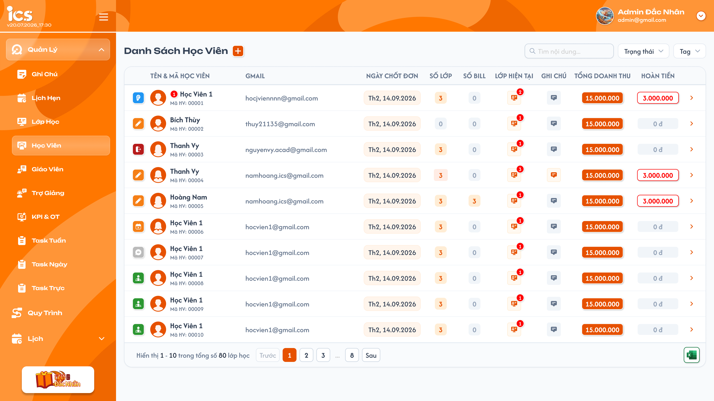</a><br>
  <em>Danh sách học viên — nhấn để xem ảnh gốc</em>
</p>

**Mô tả:**

- Administrator, Sale, Support và Class Handler xem và thao tác trên danh sách học viên theo phạm vi dữ liệu được cấp.

**Điểm cần lưu ý:**

- Ảnh danh sách chuẩn mới nhất là `01-student-list.png` được người dùng cập nhật. Ảnh hover/menu bên dưới chỉ tham chiếu thao tác; bố cục hàng/cột lấy theo ảnh chuẩn này.
- Bảng gồm các cột theo thứ tự: `Tên & mã học viên`, `Gmail`, `Ngày chốt đơn`, `Số lớp`, `Số bill`, `Lớp hiện tại`, `Ghi chú`, `Tổng doanh thu`, `Hoàn tiền`; cuối dòng có mũi tên mở Chi tiết học viên.
- Ô Tên & mã học viên theo ảnh chuẩn mới: icon trạng thái bên trái, avatar, tên học viên và `Mã HV` ở dòng dưới; badge lịch hẹn cạnh tên khi có dữ liệu. Không thêm hàng nhãn tag phía trên tên trong bố cục danh sách này. Bộ lọc Tag vẫn dùng dữ liệu tag do user định nghĩa. Badge cạnh tên là số lịch hẹn hiện có của học viên.
- Có ô tìm kiếm, bộ lọc `Trạng thái`, bộ lọc `Tag` và nút `+` tạo tài khoản cạnh tiêu đề. Nút Excel xuất danh sách nằm ở góc dưới bên phải bảng, cùng hàng với phần phân trang.
- Search chỉ áp dụng trên `Tên học viên`, khớp chứa từ khóa; sau 2 giây kể từ lần nhập cuối tự tìm kiếm. Giữ thao tác Enter tìm ngay theo requirement hiện có.
- Danh sách sắp xếp theo **ngày tạo học viên giảm dần, mới nhất trước**; áp dụng cả khi tìm kiếm, lọc và phân trang.
- Có hai lớp trạng thái khác nhau. **Status trong lớp** thuộc từng quan hệ học viên–lớp (bộ 7 giá trị, chỉnh tại Cài đặt lớp); học viên có 3 lớp có 3 status riêng, có thể khác nhau. **Trạng thái hồ sơ** (`Mới` / `Đang học` / `Đợi lớp`) là giá trị **tính** từ tập lớp của học viên theo công thức ở khu Bộ lọc Trạng thái, **không nhập tay**, không có field riêng để sửa; hồ sơ không dùng các trạng thái `Bảo lưu`, `Drop dời`, `Drop`.
- Danh sách tổng chỉ hiển thị status theo lớp; chỉ được chỉnh tại `Cài đặt lớp → Học viên → Chọn trạng thái`, mở dropdown 7 trạng thái đã duyệt. Bấm icon status trên danh sách tổng không được đổi trạng thái.
- Lịch sử lớp hiển thị icon trạng thái của từng lớp theo [Trạng thái lớp](../class_management/class_management_requirements.md#trạng-thái-lớp). Khi chưa có lớp hiện tại, cột đó hiển thị `Chưa có`. Bộ lọc Trạng thái có ba checkbox `Mới [0] / Đang học [1] / Đợi lớp [2]`, chọn nhiều; logic phân loại do BE xử lý, độc lập với status học viên trong lớp.
- Các tên, số tiền, tag và mã trong ảnh là dữ liệu minh họa. `Mã HV: 00001` và Code `173201` trong popup không thay thế quy tắc Code 6 chữ số theo cấp độ đã xác nhận bên dưới.

**Ý nghĩa cột và thao tác:**

| Thành phần | Dữ liệu / hành vi |
|---|---|
| Tên học viên | Bấm tên mở menu `Thêm lịch hẹn` / `Xem lịch sử`. |
| Mũi tên cuối dòng | Mở Chi tiết của đúng học viên trên dòng theo [Requirement Chi tiết học viên](./student_detail_requirements.md). |
| Gmail | Hiển thị email học viên; nhãn Gmail không giới hạn domain `@gmail.com`. |
| Ngày chốt đơn | Hiển thị ngày chốt đơn của học viên theo định dạng trong UI; không dùng Ngày chốt đơn để sắp xếp danh sách; thứ tự lấy theo ngày tạo học viên. |
| Số lớp | Tổng tất cả lớp học viên đã được thêm vào, không chỉ lớp hiện tại. Hover/bấm badge để xem mã các lớp tương ứng. Giá trị 0 dùng badge xám, không mở danh sách rỗng. |
| Số bill | Số hóa đơn được thêm/liên kết với học viên. Chỉ hiển thị số; bấm hoặc hover không mở danh sách, popup hay điều hướng. Giá trị 0 dùng badge xám. |
| Lớp hiện tại | Chỉ gồm lớp mà **đồng thời** status học viên trong lớp là `Đang học` và trạng thái của lớp cũng là `Đang học`. Badge đỏ là số lớp đáp ứng cả hai điều kiện; hover icon chỉ hiển thị mã lớp, ví dụ `DN1-122`, không hiển thị tên lớp. Không có lớp đáp ứng thì hiển thị text `Chưa có`. |
| Ghi chú | Hover/bấm icon mở nội dung ghi chú của đúng học viên theo popup `Ghi Chú Chi Tiết` trong ảnh. Màu cam khi có ghi chú, xám khi không có; không dùng màu cam để biểu thị chưa xử lý. Không hiển thị ghi chú ngoài quyền truy cập. |
| Tổng doanh thu | Tổng số tiền các hóa đơn của học viên trừ tổng số tiền hóa đơn có trạng thái `Hoàn tiền`; hiển thị badge cam như UI. |
| Hoàn tiền | Tổng số tiền của các bill có trạng thái `Hoàn tiền`, xác định theo trạng thái bill. Khi có giá trị hiển thị số đỏ/viền đỏ; không có hoàn tiền hiển thị `0 đ` nền xám. |

<p align="center">
  <a href="./images/19-student-list-hover-actions.png">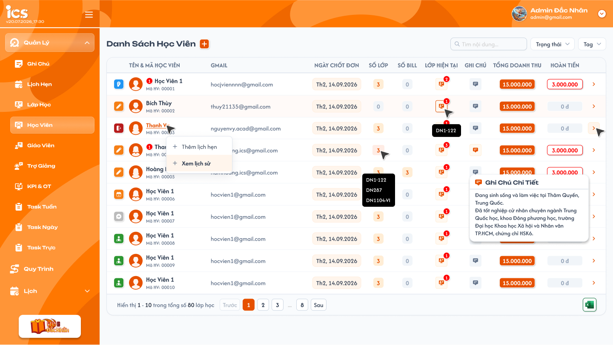</a><br>
  <em>UI mới — menu thao tác, mã các lớp và ghi chú của học viên</em>
</p>

**Công thức doanh thu và hoàn tiền:**

- `Hoàn tiền = Σ số tiền bill có trạng thái Hoàn tiền`.
- `Tổng doanh thu = Σ số tiền tất cả bill của học viên − Hoàn tiền`. Không lấy tổng các lần thực thu làm cơ sở cho cột này và không trừ cùng một bill hoàn tiền hai lần.
- Ví dụ học viên có 3 bill `1.000.000`, `2.000.000`, `3.000.000 đ`: ban đầu doanh thu `6.000.000 đ`. Khi bill `3.000.000 đ` có trạng thái `Hoàn tiền`, cột Hoàn tiền là `3.000.000 đ`, cột Tổng doanh thu còn `3.000.000 đ`; Số bill vẫn là 3 vì vẫn có 3 hóa đơn liên kết.
- Sau khi thêm/liên kết, chỉnh sửa số tiền hoặc đổi trạng thái bill thành công, tải lại các số liệu của đúng học viên từ dữ liệu hóa đơn đã lưu; không dùng số tiền mẫu trong ảnh.

#### Testcase — Danh sách học viên, thao tác dòng và phạm vi dữ liệu

| Tên testcase | Priority | Loại test | Scenario | Role | Pre-condition | Given / When / Then | Expected Result |
|---|---| --- |---|---|---|---|---|
| Case 1: Hiển thị danh sách học viên | High | Smoke | Flow 1 / REQ30 | Administrator | Có dữ liệu học viên | **Given** Administrator đã đăng nhập<br>**When** Mở Quản lý → Học viên<br>**Then** Hệ thống hiển thị danh sách theo UI mới | - Đúng thứ tự Tên & mã học viên, Gmail, Ngày chốt đơn, Số lớp, Số bill, Lớp hiện tại, Ghi chú, Tổng doanh thu, Hoàn tiền và mũi tên chi tiết<br>- Có avatar, tên/Mã HV hai dòng, badge lịch hẹn và status theo lớp; không thêm hàng tag phía trên tên<br>- Sắp ngày tạo học viên mới nhất trước<br>- Excel góc dưới bên phải bảng |
| Case 20: Mở menu thao tác học viên | High |  | REQ11 | Administrator | Học viên có lịch hẹn | **Given** Danh sách học viên đang mở<br>**When** Click tên học viên<br>**Then** Hệ thống mở menu thao tác | - Badge bằng tổng số lịch hẹn<br>- Có `Thêm Lịch Hẹn` và `Xem Lịch sử` |
| Case 25: Phạm vi học viên theo người được gán | High |  | REQ15 / REQ16 | Sale, Support, Class Handler | User được gán vào một số học viên | **Given** User đăng nhập và mở danh sách học viên<br>**When** Hệ thống tải dữ liệu<br>**Then** Chỉ hiển thị học viên user được gán phụ trách hoặc theo dõi | - Không hiển thị học viên chưa được gán<br>- Một học viên chỉ xuất hiện một lần dù user được gán cả hai vai trò |
| Case 31: Sale, Support và Class Handler có đầy đủ quyền thao tác | High |  | REQ01 / Ràng buộc quyền | Sale, Support, Class Handler | User có ít nhất một học viên được gán | **Given** User đăng nhập bằng từng role và mở một học viên thuộc phạm vi được gán<br>**When** Lần lượt thực hiện các chức năng trong màn hình Quản lý học viên<br>**Then** Hệ thống cho phép thao tác như Administrator | - Được search, filter, phân trang, xuất Excel, tạo tài khoản, thêm lịch hẹn, xem lịch sử, thao tác hóa đơn và thêm/lọc ghi chú<br>- Dữ liệu ngoài phạm vi được gán không hiển thị và không thể thao tác trực tiếp |
| Case 50: Sắp xếp ngày tạo học viên mới nhất trước | High |  | REQ30 | Administrator | Có hơn 50 học viên với ngày tạo khác nhau; Ngày chốt đơn có thể trùng hoặc khác thứ tự ngày tạo | **Given** User mở danh sách<br>**When** Xem nhiều trang, search/filter và tải lại sau khi tạo<br>**Then** Danh sách luôn sắp ngày tạo giảm dần | - Học viên tạo gần nhất đứng trước học viên tạo cũ hơn<br>- Không lấy Ngày chốt đơn làm khóa sắp xếp, kể cả khi hai học viên trùng ngày này<br>- Học viên vừa tạo đứng theo ngày tạo trong tập kết quả đang lọc<br>- Search/filter/phân trang giữ thứ tự, footer dùng đơn vị học viên |
| Case 52: Số bill chỉ hiển thị | Medium |  | REQ12 | Administrator | Học viên có số bill 0 hoặc lớn hơn 0 | **Given** User quan sát cột Số bill<br>**When** Hover/bấm badge<br>**Then** Không mở nội dung | - Số đúng số hóa đơn được thêm/liên kết<br>- Không mở popup danh sách, tooltip bill hoặc điều hướng |
| Case 53: Màu và nội dung Ghi chú | High |  | REQ32 | Administrator, Sale, Support, Class Handler | Có học viên có và chưa có ghi chú trong phạm vi user | **Given** Danh sách đang mở<br>**When** Hover/bấm icon Ghi chú<br>**Then** Mở nội dung đúng học viên | - Có ghi chú: icon cam, nội dung khớp dữ liệu<br>- Chưa có: icon xám<br>- Không dùng màu cam để chỉ ghi chú chưa xử lý<br>- Không lộ ghi chú ngoài quyền truy cập |
| Case 54: Menu tên và mũi tên chi tiết | High |  | REQ32 | Administrator | Có nhiều học viên | **Given** User thao tác dòng học viên A<br>**When** Lần lượt bấm tên và mũi tên cuối dòng<br>**Then** Mở đúng đích | - Tên mở menu Thêm lịch hẹn/Xem lịch sử<br>- Mũi tên mở Chi tiết học viên A<br>- Không lẫn học viên hoặc đích thao tác |
| Case 55: Doanh thu trừ bill Hoàn tiền | High |  | REQ31 | Administrator | Học viên có 3 bill 1, 2 và 3 triệu | **Given** Doanh thu ban đầu là 6 triệu, hoàn tiền 0<br>**When** Bill 3 triệu được lưu trạng thái Hoàn tiền<br>**Then** Tải lại số liệu | - Doanh thu 3 triệu, Hoàn tiền 3 triệu, Số bill 3<br>- Hoàn tiền hiển thị đỏ/viền đỏ<br>- Tải lại trang không trừ thêm lần nữa<br>- Không đổi số liệu học viên khác |
| Case 94: Lọc danh sách theo trung tâm | High |  | REQ39 | Administrator | Có học viên ở trung tâm A và trung tâm B | **Given** bộ lọc `Trung tâm` chưa chọn giá trị nào<br>**When** chọn trung tâm B ở bộ lọc `Trung tâm`, sau đó bỏ chọn<br>**Then** danh sách chỉ hiển thị học viên của trung tâm B | - Không lẫn dữ liệu của trung tâm A<br>- Tổng số và phân trang cập nhật theo trung tâm B<br>- Bỏ chọn thì hiển thị lại dữ liệu của mọi trung tâm |

#### Tìm kiếm theo tên và kết hợp điều kiện

- Tìm theo Tên học viên, khớp chứa từ khóa; tự tìm sau 2 giây từ lần nhập cuối, Enter tìm ngay và hủy lượt đang chờ.
- Search, Trạng thái và Tag kết hợp bằng AND; thay đổi điều kiện về trang 1, giữ thứ tự ngày tạo học viên giảm dần (mới nhất trước).

##### Testcase — Tìm kiếm theo tên và kết hợp điều kiện

| Tên testcase | Priority | Loại test | Scenario | Role | Pre-condition | Given / When / Then | Expected Result |
|---|---| --- |---|---|---|---|---|
| Case 3: Thay đổi điều kiện khi đang ở trang sau | Medium |  | REQ04 | Administrator | User đang ở trang lớn hơn 1 | **Given** Danh sách đang có search hoặc filter<br>**When** User thay đổi một điều kiện<br>**Then** Hệ thống tải kết quả mới từ trang 1 | - Trang 1 active<br>- Kết quả đúng điều kiện mới |
| Case 14: Search tương đối theo tên sau 2 giây | High | Smoke | Flow 2 / REQ03 | Administrator | Có học viên tên `Quỳnh Nhi` và các field khác chứa từ khóa | **Given** User nhập `Nhi` và dừng nhập<br>**When** Đủ 2 giây từ ký tự cuối<br>**Then** Hệ thống tìm một lần theo Tên học viên bằng khớp chứa | - Hiển thị `Quỳnh Nhi` dù từ khóa không phải toàn bộ tên<br>- Không search theo code, email hoặc số điện thoại<br>- Không tìm kiếm trước 2 giây |
| Case 15: Nhập tiếp trước thời gian auto search | Medium |  | EX06 | Administrator | Bộ đếm 2 giây đang chạy | **Given** User vừa nhập một phần từ khóa<br>**When** Nhập thêm trước khi đủ 2 giây<br>**Then** Hệ thống hủy bộ đếm cũ và tính lại từ ký tự mới nhất | - Chỉ tìm kiếm sau 2 giây kể từ lần nhập cuối |
| Case 16: Search ngay bằng Enter | High |  | Flow 2 / EX07 | Administrator | Ô search có từ khóa và đang chờ auto search | **Given** Chưa đủ 2 giây<br>**When** User nhấn Enter<br>**Then** Hệ thống tìm kiếm ngay một lần | - Hủy lượt auto search đang chờ<br>- Không gửi request tìm kiếm lặp |
| Case 17: Xóa từ khóa tìm kiếm | Medium |  | Flow 2 | Administrator | Danh sách đang có kết quả search | **Given** Ô search có từ khóa<br>**When** User xóa hết từ khóa và chờ 2 giây hoặc nhấn Enter<br>**Then** Hệ thống hiển thị lại danh sách theo filter còn lại từ trang 1 | - Không còn áp dụng điều kiện từ khóa |

#### Bộ lọc Trạng thái — logic học viên do BE xử lý

<p align="center">
  <a href="./images/21-student-status-filter.png">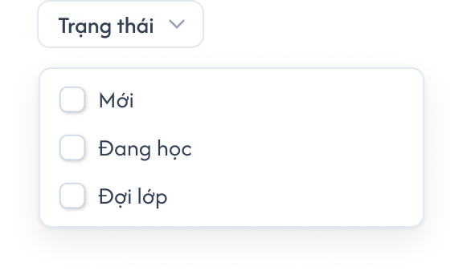</a><br>
  <em>UI mới — dropdown Trạng thái chọn nhiều bằng checkbox</em>
</p>

| Giá trị logic gửi BE | Nhãn checkbox trên UI | Công thức BE tính (xét theo thứ tự ưu tiên, mỗi học viên đúng 1 nhóm) |
|---|---|---|
| `[1]` | Đang học | Có ít nhất 1 lớp mà status trong lớp là `Đang học` hoặc `Dự thính` **và** lớp đó đang ở trạng thái lớp `Đang học`. |
| `[2]` | Đợi lớp | Không thoả `Đang học` nhưng đã từng được thêm vào ít nhất 1 lớp (bản ghi học viên–lớp chưa `Xóa`): lớp `Khai giảng` chưa bắt đầu, hoặc mọi lớp đã `Hoàn thành` / `Rời lớp` / `Nghỉ học` / `Chỉ xem`. |
| `[0]` | Mới | Chưa từng được thêm vào lớp nào (hoặc mọi bản ghi học viên–lớp đã `Xóa`). |

Ví dụ: học viên có lớp A (`Hoàn thành`, lớp đã `Hoàn thành`) và lớp B (`Đang học`, lớp còn `Khai giảng`) → `Đợi lớp`; khi lớp B chuyển `Đang học` → `Đang học`; học viên chỉ có lớp C với status `Dự thính` ở lớp `Đang học` → `Đang học`.

- Bấm nút `Trạng thái` mở dropdown ba checkbox theo đúng thứ tự `Mới`, `Đang học`, `Đợi lớp`. Cho chọn nhiều giá trị; mỗi checkbox có thể chọn/bỏ chọn độc lập, không dùng radio hoặc dropdown chỉ chọn một.
- Khi chọn nhiều trạng thái, dùng OR giữa các nhóm logic được chọn: học viên thuộc ít nhất một nhóm theo BE là phù hợp. Học viên thuộc nhiều nhóm vẫn chỉ xuất hiện một lần. Bỏ chọn toàn bộ thì không áp dụng điều kiện Trạng thái, vẫn giữ keyword/Tag và phạm vi quyền.
- FE gửi tập giá trị `0/1/2` đã chọn theo hợp đồng API để BE phân loại/lọc và trả danh sách cùng tổng số kết quả. Không tự suy ra nhóm từ icon/status học viên từng lớp hoặc lọc lại riêng trên các dòng của trang hiện tại.
- Nhãn `Đợi lớp` là nhãn hiển thị của giá trị logic `[2]` theo công thức trên; không diễn giải lại thành chỉ học viên thuộc lớp `Khai giảng` theo requirement cũ. Trạng thái hồ sơ được tính lại ngay khi status trong lớp hoặc trạng thái lớp đổi; BE không lưu giá trị nhập tay.
- Filter này độc lập với 7 status quan hệ học viên–lớp, status lớp học và status tài khoản. Nhãn `Đang học` trùng chữ nhưng không dùng chung enum hoặc tự ánh xạ nghiệp vụ.
- Checkbox cập nhật điều kiện lọc khi chọn/bỏ chọn, kết hợp với keyword tên và Tag bằng AND; tải lại từ trang 1, giữ thứ tự ngày tạo học viên giảm dần (mới nhất trước) và dùng tổng kết quả do BE trả để phân trang.

##### Testcase — Bộ lọc Trạng thái

| Tên testcase | Priority | Loại test | Scenario | Role | Pre-condition | Given / When / Then | Expected Result |
|---|---| --- |---|---|---|---|---|
| Case 11a: Công thức ưu tiên Đang học | High |  | Flow 3 / REQ05 | Administrator | Học viên X: lớp A Hoàn thành (lớp Hoàn thành), lớp B Dự thính (lớp Đang học) | **Given** tick `Đang học`<br>**When** BE lọc<br>**Then** X xuất hiện | - Tick riêng `Đợi lớp` thì X không xuất hiện (mỗi học viên đúng 1 nhóm) |
| Case 11b: Nhóm đổi theo status trong lớp | High |  | Flow 3 / REQ05 / REQ29 | Administrator | Học viên Y chỉ có lớp C Đang học (lớp Đang học) | **Given** tại Cài đặt lớp C đổi Y sang `Rời lớp`<br>**When** mở lại danh sách, tick `Đợi lớp`<br>**Then** Y xuất hiện ở `Đợi lớp`, không còn ở `Đang học` | - Xoá Y khỏi lớp C (status `Xóa`) thì Y về `Mới`<br>- Không có field sửa trạng thái hồ sơ ở Chi tiết học viên |
| Case 11: Nhãn UI và mapping filter logic 0/1/2 | High |  | Flow 3 / REQ05 | Administrator | BE có dữ liệu cho ba nhóm filter học viên | **Given** User mở dropdown Trạng thái<br>**When** Lần lượt tick Mới, Đang học, Đợi lớp<br>**Then** FE gửi đúng giá trị 0, 1, 2 và render kết quả BE trả | - Ba checkbox đúng thứ tự và nhãn UI mới<br>- Mới=[0] chưa vào lớp; Đang học=[1] đang học; Đợi lớp=[2] đã ở trong lớp gồm đang học và các trạng thái khác<br>- Không diễn giải Đợi lớp theo trạng thái lớp Khai giảng<br>- Không tự lọc lại theo 7 status trong lớp |
| Case 59: Filter logic độc lập với status học viên trong lớp | High |  | REQ05 | Administrator | BE trả kết quả nhóm [2] gồm học viên Đang học và học viên có status khác trong lớp | **Given** User chọn filter [2]<br>**When** BE trả danh sách và tổng kết quả<br>**Then** FE render đầy đủ dữ liệu đúng response | - Không loại học viên theo icon 7 status<br>- Không tự thay [2] bằng enum lớp hoặc enum học viên trong lớp<br>- Phân trang theo tổng kết quả BE trả |
| Case 60: Chọn nhiều trạng thái theo OR | High |  | REQ05 | Administrator | BE có nhóm [1]/[2] và học viên thuộc cả hai nhóm | **Given** User tick Đang học và Đợi lớp<br>**When** FE gửi tập [1,2] theo hợp đồng API<br>**Then** BE trả hợp kết quả và FE hiển thị đúng | - Học viên thuộc ít nhất một nhóm được chọn xuất hiện<br>- Không nhân đôi học viên khớp cả hai nhóm<br>- Giữ keyword/Tag và sắp ngày tạo học viên giảm dần (mới nhất trước)<br>- Quay về trang 1 |

#### Phân trang

<p align="center">
  <a href="./images/14-student-pagination.png">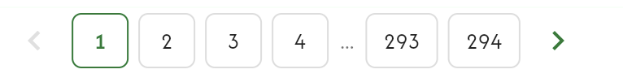</a><br>
  <em>Phân trang danh sách học viên — nhấn để xem ảnh gốc</em>
</p>

- Phân trang nằm cuối danh sách, gồm nút Trang trước, các số trang, dấu `...`, các trang cuối và nút Trang sau như hình.
- Mỗi trang hiển thị tối đa 50 học viên.
- Trang hiện tại được đánh dấu; nút Trang trước bị vô hiệu hóa tại trang đầu và nút Trang sau bị vô hiệu hóa tại trang cuối.
- Khi chuyển trang, hệ thống giữ nguyên điều kiện search/filter đang áp dụng và thứ tự ngày tạo học viên giảm dần (mới nhất trước).
- Footer hiển thị `Hiển thị a - b trong tổng số N học viên`; chữ `lớp học` trong ảnh là nhãn cần sửa thành `học viên`.

##### Testcase — Phân trang danh sách học viên

| Tên testcase | Priority | Loại test | Scenario | Role | Pre-condition | Given / When / Then | Expected Result |
|---|---| --- |---|---|---|---|---|
| Case 2: Phân trang bằng số | High |  | Flow 1 / REQ02 | Administrator | Danh sách có nhiều hơn 50 học viên | **Given** Trang đầu đang được chọn và danh sách có search/filter<br>**When** User chọn số trang hoặc Trang trước/Trang sau<br>**Then** Hệ thống tải trang được chọn | - Mỗi trang có tối đa 50 học viên<br>- Hiển thị số trang, dấu `...`, các trang cuối và hai nút điều hướng như UI<br>- Chỉ trang hiện tại active<br>- Vô hiệu hóa đúng nút tại trang đầu/trang cuối<br>- Giữ nguyên search/filter<br>- Không lặp/mất dữ liệu giữa các trang |

#### Xuất Excel

- Nút Excel ở góc dưới bên phải bảng theo ảnh danh sách; xuất toàn bộ kết quả thuộc phạm vi quyền và search/filter, gồm tất cả trang.
- Cột file theo thứ tự Tên học viên, Số điện thoại, Email, Ngày tạo; phản hồi thành công/lỗi theo Flow 4 và REQ07.

##### Testcase — Xuất Excel

| Tên testcase | Priority | Loại test | Scenario | Role | Pre-condition | Given / When / Then | Expected Result |
|---|---| --- |---|---|---|---|---|
| Case 4: Xuất Excel thành công | High | Smoke | Flow 4 / REQ07 | Administrator | Có dữ liệu học viên trên nhiều trang | **Given** Danh sách đang mở, lần lượt không có và có search/filter<br>**When** User bấm nút Excel<br>**Then** Hệ thống tạo và tải file theo điều kiện hiện tại | - Hiển thị `Xuất danh sách học viên thành công.`<br>- Không có search/filter: xuất toàn bộ danh sách trên tất cả trang<br>- Có search/filter: xuất toàn bộ kết quả thỏa điều kiện trên tất cả trang<br>- Không giới hạn ở trang đang xem<br>- Có đúng thứ tự cột Tên học viên, Số điện thoại, Email, Ngày tạo |
| Case 5: Xuất Excel thất bại | Medium |  | Flow 4 / EX05 | Administrator | Xử lý export gặp lỗi | **Given** Danh sách học viên đang mở<br>**When** User bấm nút Excel<br>**Then** Hệ thống không hoàn thành export | - Hiển thị `Không thể xuất danh sách học viên. Vui lòng thử lại.`<br>- Không tải file lỗi/rỗng |

### Popup Thêm học viên

<p align="center">
  <a href="./images/02-create-student-account.png">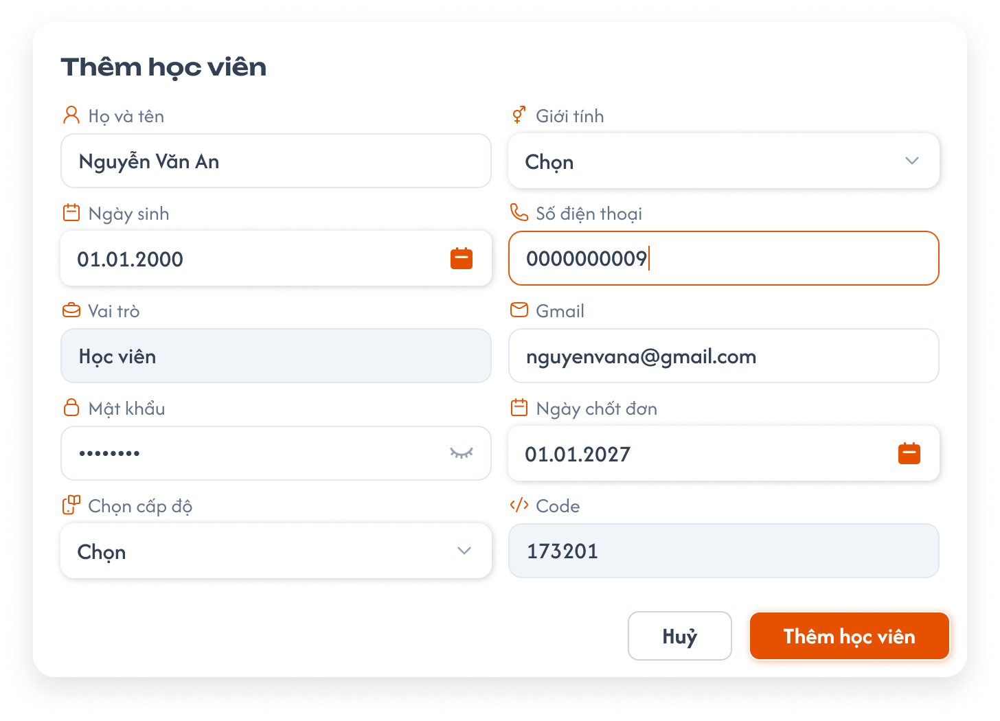</a><br>
  <em>Popup Thêm học viên — UI mới</em>
</p>

- Mở bằng nút `+` cạnh tiêu đề Danh sách học viên; tiêu đề popup và nút submit là `Thêm học viên`, nút đóng là `Hủy`.
- Form hai cột: bên trái Họ và tên / Ngày sinh / Vai trò / Mật khẩu / Chọn cấp độ; bên phải Giới tính / Số điện thoại / Gmail / Ngày chốt đơn / Code.
- Tất cả field đều bắt buộc, kể cả Vai trò và Code do hệ thống điền. Mật khẩu mặc định được che và có nút hiện/ẩn; Hủy đóng popup mà không tạo tài khoản.

**Field:**

| Field | Yêu cầu |
|---|---|
| Trung tâm | Bắt buộc chọn một trung tâm từ danh sách trung tâm; học viên được tạo thuộc trung tâm đã chọn. Email và Code kiểm tra trùng theo trung tâm đã chọn. |
| Họ và tên | Bắt buộc, không được để trống hoặc chỉ có khoảng trắng. |
| Giới tính | Bắt buộc chọn giá trị; placeholder `Chọn` không phải dữ liệu hợp lệ. |
| Ngày sinh | Bắt buộc; nhập/chọn ngày bằng date picker theo UI. |
| Số điện thoại | Bắt buộc, đúng định dạng số điện thoại; được phép trùng với học viên khác. |
| Vai trò | Bắt buộc, hệ thống điền `Student`, nhãn UI là `Học viên`. |
| Gmail/Email | Bắt buộc, đúng định dạng email; nhận cả email ngoài `@gmail.com`; không được trùng trong cùng trung tâm, được phép trùng giữa các trung tâm khác nhau. |
| Mật khẩu | Bắt buộc, tối thiểu **8 ký tự**; hiển thị che ký tự và cho bật/tắt hiện mật khẩu. |
| Ngày chốt đơn | Bắt buộc, mặc định ngày hiện tại; cho phép chọn ngày quá khứ, hiện tại hoặc tương lai. |
| Chọn cấp độ (Level) | Bắt buộc, chỉ chọn một trong `Cấp độ 1` đến `Cấp độ 9`; placeholder `Chọn` không hợp lệ. |
| Code | Bắt buộc, hệ thống tự tìm mã và hiển thị sau khi chọn cấp độ, chỉ đọc; đúng 6 chữ số, tăng dần theo cấp độ và duy nhất trong cùng center. Được trùng giữa các center khác nhau; kiểm tra lại khi lưu. |

#### Testcase — Popup Thêm học viên

| Tên testcase | Priority | Loại test | Scenario | Role | Pre-condition | Given / When / Then | Expected Result |
|---|---| --- |---|---|---|---|---|
| Case 6: Mở popup tạo tài khoản | High |  | Flow 5 / REQ10 | Administrator | Danh sách học viên đang mở | **Given** User có quyền tạo học viên<br>**When** Bấm `+` cạnh tiêu đề Danh sách học viên<br>**Then** Hệ thống mở popup tạo tài khoản | - Có đủ field bắt buộc<br>- Vai trò mặc định là Student<br>- Ngày chốt đơn mặc định là ngày hiện tại và cho sửa<br>- Level gồm 1 đến 9<br>- Code không cho nhập tay |
| Case 7: Chặn tạo tài khoản khi thiếu field | High |  | EX01 / REQ10 | Administrator | Popup tạo tài khoản đang mở | **Given** Ít nhất một field bắt buộc chưa có giá trị<br>**When** Bấm `Thêm học viên`<br>**Then** Hệ thống chặn submit | - Hiển thị `Vui lòng nhập đầy đủ thông tin bắt buộc.`<br>- Không tạo học viên<br>- Giữ popup và dữ liệu đã nhập |
| Case 10: Tạo tài khoản học viên thành công | High | Smoke | Flow 5 | Administrator | Tất cả field hợp lệ | **Given** Popup có đầy đủ dữ liệu và Level hợp lệ<br>**When** Bấm `Thêm học viên`<br>**Then** Hệ thống tạo học viên | - Hiển thị `Tạo tài khoản học viên thành công.`<br>- Đóng popup<br>- Học viên xuất hiện trong danh sách với đúng thông tin và Code đã sinh |
| Case 32: Chặn email trùng trong cùng trung tâm | High |  | Flow 5 / EX10 / REQ21 | Administrator | Email `student@example.com` đã thuộc một học viên trong trung tâm A | **Given** User mở popup tạo học viên tại trung tâm A<br>**When** Nhập lại email đó và bấm `Thêm học viên`<br>**Then** Hệ thống từ chối tạo | - Hiển thị `Email đã được sử dụng.`<br>- Không tạo thêm học viên |
| Case 33: Cho phép email trùng ở trung tâm khác | High |  | REQ21 | Administrator | Email `student@example.com` đã tồn tại tại trung tâm A | **Given** User mở popup tạo học viên tại trung tâm B<br>**When** Nhập cùng email và đầy đủ dữ liệu hợp lệ rồi bấm `Thêm học viên`<br>**Then** Hệ thống tạo học viên tại trung tâm B | - Tạo thành công<br>- Hai học viên thuộc đúng hai trung tâm khác nhau |
| Case 41: Cho phép trùng số điện thoại | High |  | REQ24 | Administrator | Học viên A trong cùng trung tâm đã dùng một số điện thoại | **Given** User mở popup tạo học viên B<br>**When** Nhập cùng số điện thoại với A, email khác và đầy đủ dữ liệu hợp lệ<br>**Then** Hệ thống tạo học viên B | - Tạo thành công<br>- A và B có cùng số điện thoại<br>- Chỉ email bị kiểm tra trùng trong cùng trung tâm |
| Case 56: Gmail nhận email ngoài Gmail | High |  | REQ10 / REQ21 | Administrator | Có địa chỉ student@example.com chưa trùng trong trung tâm | **Given** Các field còn lại hợp lệ<br>**When** Nhập email ngoài @gmail.com và bấm Thêm học viên<br>**Then** Chấp nhận tạo | - Không chặn theo domain Gmail<br>- Vẫn kiểm tra email duy nhất trong cùng trung tâm |
| Case 88: Ngày chốt đơn quá khứ và tương lai | High |  | REQ10 | Administrator | Popup Thêm học viên có đủ dữ liệu hợp lệ | **Given** Ngày chốt đơn mặc định hôm nay<br>**When** Lần lượt tạo học viên với ngày quá khứ và ngày tương lai<br>**Then** Cả hai được tạo thành công | - Lưu đúng ngày đã chọn<br>- Không chặn vì ngày trước/sau hôm nay<br>- Thứ tự danh sách vẫn theo ngày tạo mới nhất trước |
| Case 89: Email/SĐT đúng định dạng và mật khẩu tối thiểu 8 ký tự | High |  | REQ10 | Administrator | Popup Thêm học viên có các field bắt buộc | **Given** User nhập email sai định dạng hoặc SĐT chứa chữ; lần khác nhập mật khẩu 7 ký tự<br>**When** Bấm Thêm học viên<br>**Then** Chặn từng dữ liệu không hợp lệ và giữ form | - Không tạo tài khoản với email/SĐT sai định dạng hoặc mật khẩu dưới 8 ký tự<br>- Email hợp lệ ngoài Gmail, SĐT hợp lệ và mật khẩu đúng 8 hoặc hơn 8 ký tự được chấp nhận khi các field khác hợp lệ<br>- Không tự yêu cầu chữ hoa/ký tự đặc biệt nếu chưa có quy tắc đó |
| Case 95: Bắt buộc chọn trung tâm khi tạo | High |  | REQ39 | Administrator | Popup/dòng tạo học viên đang mở | **Given** các field bắt buộc khác hợp lệ<br>**When** bỏ trống `Trung tâm` rồi xác nhận; sau đó chọn trung tâm A và xác nhận<br>**Then** thiếu Trung tâm thì không tạo; chọn A thì tạo thành công | - Báo lỗi tại field Trung tâm khi bỏ trống<br>- Học viên mới thuộc trung tâm A; lọc trung tâm A thì thấy, lọc trung tâm B thì không thấy |

#### Dropdown chọn cấp độ và Code học viên

<p align="center">
  <a href="./images/20-student-level-dropdown.png">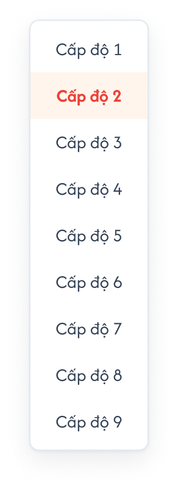</a><br>
  <em>Dropdown chọn cấp độ — giá trị đang chọn được đánh dấu theo UI</em>
</p>

| Cấp độ | Dải Code 6 chữ số |
|---|---|
| 1 | `100000` → `199999` |
| 2 | `200000` → `299999` |
| 3 | `300000` → `399999` |
| 4 | `400000` → `499999` |
| 5 | `500000` → `599999` |
| 6 | `600000` → `699999` |
| 7 | `700000` → `799999` |
| 8 | `800000` → `899999` |
| 9 | `900000` → `999999` |

- Với cấp độ `L`, mã đầu tiên là `L × 100000`, các mã tiếp theo tăng dần trong đúng dải của cấp độ đó. Ví dụ cấp độ 1: `100000`, `100001`, …; cấp độ 2: `200000`, `200001`, ….
- Sau khi chọn cấp độ, hệ thống tìm Code tiếp theo chưa dùng **trong center đang tạo** rồi hiển thị trên form trước khi lưu; chọn cấp độ khác thì tìm lại mã trong dải mới. Backend kiểm tra lại tính duy nhất khi lưu, kể cả request đồng thời. Nếu mã xem trước bị chiếm, cấp mã tiếp theo hợp lệ trong cùng center/cấp độ và trả Code cuối cùng đã lưu.
- Không cho nhập/sửa Code bằng tay; không cấp mã 5/7 chữ số hoặc vượt sang dải của cấp độ khác. Nếu không còn mã hợp lệ, không tạo tài khoản và phản hồi theo ngoại lệ sinh Code.
- Code chỉ cần duy nhất trong cùng center; các center khác nhau được dùng cùng Code. Bộ đếm/tìm mã theo center và cấp độ, không lấy mã đã dùng ở center khác để chặn hoặc tăng mã của center hiện tại.

##### Testcase — Cấp độ và Code học viên

| Tên testcase | Priority | Loại test | Scenario | Role | Pre-condition | Given / When / Then | Expected Result |
|---|---| --- |---|---|---|---|---|
| Case 8: Danh sách Level | High |  | REQ08 | Administrator | Popup tạo tài khoản đang mở | **Given** User mở field Level<br>**When** Quan sát và lần lượt chọn Level<br>**Then** Hệ thống chỉ cho chọn Level hợp lệ | - Có Level 1 đến Level 9<br>- Không có Level ngoài khoảng này |
| Case 9: Code 6 chữ số theo cấp độ và duy nhất khi tạo đồng thời | High |  | EX02 / REQ09 | Administrator | Hai request tạo học viên cùng center/cấp độ diễn ra đồng thời | **Given** Hai học viên cùng chọn Cấp độ 1 và mã gần nhất là 100000<br>**When** Hai request được lưu đồng thời<br>**Then** Backend cấp mã tăng dần không trùng trong đúng dải cấp độ | - Mã 6 chữ số, đầu là 1; hai mã kế tiếp là 100001 và 100002, không quy định request nào nhận trước<br>- Chỉ lưu một tài khoản trên mỗi mã trong cùng center<br>- User không sửa được Code |
| Case 57: Dải mã từng cấp độ | High |  | REQ08 / REQ09 | Administrator | Có thể tạo học viên Cấp độ 1..9 | **Given** Từng cấp độ chưa có mã<br>**When** Tạo lần lượt hai học viên mỗi cấp độ<br>**Then** Mã bắt đầu và tăng theo đúng dải | - Cấp độ 1: 100000, 100001; cấp độ 2: 200000, 200001; tương tự tới cấp độ 9: 900000, 900001<br>- Mỗi mã đúng 6 chữ số và đúng chữ số cấp độ<br>- Không cấp mã vượt dải nếu đã hết mã |
| Case 90: Code hiển thị ngay sau chọn cấp độ | High |  | REQ09 | Administrator | Center A có Level 1 đã dùng 100000/100001; Level 2 chưa có mã | **Given** Popup chưa chọn cấp độ<br>**When** Chọn Level 1 rồi đổi Level 2 trước khi lưu<br>**Then** Code lần lượt 100002 và 200000 | - Hệ thống tìm mã trong đúng center/cấp độ, hiển thị trước khi submit<br>- Code chỉ đọc<br>- Nếu mã bị request khác chiếm trước khi lưu, backend cấp mã hợp lệ tiếp theo và trả mã cuối cùng |
| Case 91: Cho phép Code trùng giữa center | High |  | REQ09 | Administrator | Center A đã có Code 100000; center B chưa có Code Level 1 | **Given** User tạo học viên Level 1 ở center B<br>**When** Chọn cấp độ và lưu dữ liệu hợp lệ<br>**Then** Center B được dùng Code 100000 | - Không bị chặn do Code 100000 của center A<br>- Trong center B, học viên tiếp theo dùng 100001<br>- Mã duy nhất theo center, không duy nhất toàn hệ thống |

### Bộ lọc Tag

<p align="center">
  <a href="./images/03-tag-filter.png">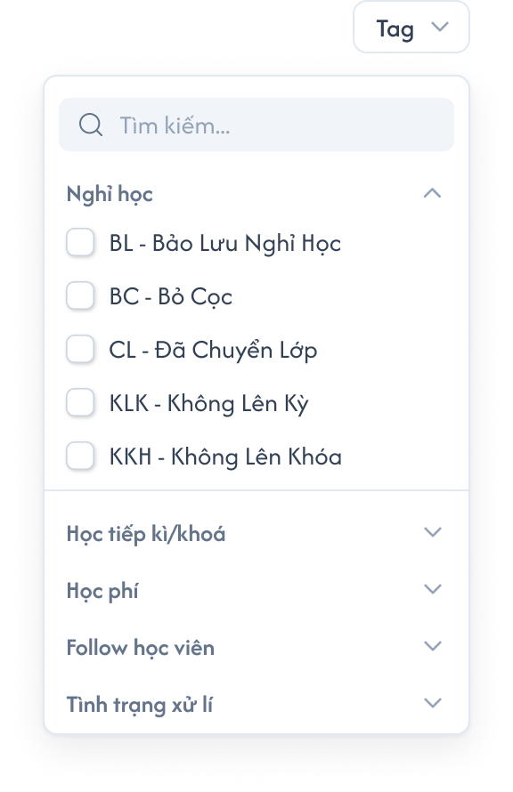</a><br>
  <em>UI mới — tìm kiếm tag và các nhóm thu gọn/mở rộng</em>
</p>

- Bấm nút `Tag` mở popup. Ô tìm kiếm nằm đầu popup, có icon kính lúp và placeholder `Tìm kiếm...`.
- Nhóm và tag lấy động từ dữ liệu do user định nghĩa. Nhóm trong ảnh (`Nghỉ học`, `Học tiếp kì/khoá`, `Học phí`, `Follow học viên`, `Tình trạng xử lí`) và các tag BL/BC/CL/KLK/KKH chỉ minh họa bố cục, không hard-code danh sách này.
- Mỗi nhóm có tiêu đề và chevron để thu gọn/mở rộng. Nhóm mở hiển thị tag với checkbox; nhãn tag theo dữ liệu thực tế, dạng mã và tên như `BL - Bảo Lưu Nghỉ Học` trong ảnh. Nhóm đóng chỉ hiển thị tiêu đề và chevron.
- Tìm kiếm theo nhãn tag (mã/tên) trong popup; đây là tìm tag để chọn, không thay thế keyword tìm tên học viên trên danh sách.
- Hỗ trợ chọn nhiều tag trong cùng nhóm hoặc khác nhóm. Dùng OR giữa các tag đã chọn: học viên có ít nhất một tag được chọn thì thỏa filter Tag.
- Thu gọn nhóm hoặc đổi keyword tìm tag không làm mất các tag đã chọn; không bỏ chọn tag chỉ vì tag đó tạm không xuất hiện trong kết quả tìm kiếm. Mở lại nhóm/popup phản ánh các checkbox đang chọn của điều kiện lọc hiện tại.
- Chọn/bỏ chọn checkbox cập nhật bộ lọc danh sách; Tag kết hợp bằng AND với filter logic Trạng thái và keyword tên học viên. Bỏ chọn hết tag thì không áp dụng điều kiện Tag, vẫn giữ các điều kiện còn lại.

#### Testcase — Bộ lọc Tag

| Tên testcase | Priority | Loại test | Scenario | Role | Pre-condition | Given / When / Then | Expected Result |
|---|---| --- |---|---|---|---|---|
| Case 12: Tìm tag theo mã/tên trong popup nhóm | High |  | REQ06 | Administrator | Hệ thống có tag/nhóm do user định nghĩa | **Given** User mở bộ lọc Tag<br>**When** Nhập mã hoặc tên tag vào ô Tìm kiếm...<br>**Then** Popup hiển thị tag phù hợp từ dữ liệu thực tế | - Search nằm đầu popup<br>- Nhóm có chevron mở/đóng và tag có checkbox<br>- Không hard-code nhóm/tag trong ảnh<br>- Không đổi keyword tên học viên của main list |
| Case 13: Chọn nhiều Tag và kết hợp điều kiện | High |  | Flow 3 / REQ04 / REQ06 | Administrator | Học viên A có Tag X; học viên B có Tag Y; học viên C có cả X và Y | **Given** User đã nhập từ khóa và chọn Trạng thái<br>**When** Chọn đồng thời Tag X và Tag Y<br>**Then** Hệ thống áp dụng điều kiện OR giữa các Tag và kết hợp với các điều kiện khác | - A, B và C đều xuất hiện nếu thỏa từ khóa và Trạng thái<br>- Học viên không có X hoặc Y không xuất hiện<br>- Trở về trang 1 |
| Case 61: Bỏ chọn toàn bộ checkbox filter | Medium |  | REQ05 / REQ06 | Administrator | Danh sách đang có keyword, Trạng thái và Tag | **Given** User lần lượt bỏ hết checkbox Trạng thái rồi bỏ hết checkbox Tag<br>**When** Điều kiện được cập nhật<br>**Then** Chỉ bỏ loại điều kiện vừa được xóa hết | - Bỏ hết Trạng thái vẫn giữ Tag/keyword<br>- Bỏ hết Tag vẫn giữ Trạng thái/keyword nếu còn chọn<br>- Không vượt phạm vi dữ liệu user<br>- Kết quả/tổng số theo BE |
| Case 62: Giữ checkbox Tag khi tìm kiếm và thu gọn nhóm | High |  | REQ06 | Administrator | Có tag ở nhiều nhóm | **Given** User chọn tag X/Y thuộc hai nhóm<br>**When** Thu gọn nhóm, tìm tag khác, xóa search rồi mở lại nhóm/popup<br>**Then** X/Y vẫn được chọn | - Không mất lựa chọn khi tag bị ẩn khỏi UI<br>- Checkbox khớp điều kiện lọc hiện tại<br>- Không tự gán hoặc bỏ tag trên hồ sơ học viên<br>- OR giữa tag khác nhóm, AND với status/keyword |

### Số lớp và Lớp hiện tại

- `Số lớp` đếm tất cả lớp học viên đã được thêm; hover/bấm badge hiển thị mã các lớp này theo ảnh hover mới phía trên.
- `Lớp hiện tại` chỉ gồm các lớp đồng thời có status học viên trong lớp `Đang học` **và** status lớp `Đang học`. Hover icon chỉ hiển thị mã lớp; badge là số lớp thỏa cả hai điều kiện, không lấy toàn bộ Số lớp.
- Học viên không có lớp hiện tại hiển thị `Chưa có` theo requirement hiện có, không mở tooltip/popup danh sách lớp rỗng.
- `Số bill` chỉ hiển thị số hóa đơn, không có thao tác mở danh sách khi hover/bấm.

#### Testcase — Số lớp và Lớp hiện tại

| Tên testcase | Priority | Loại test | Scenario | Role | Pre-condition | Given / When / Then | Expected Result |
|---|---| --- |---|---|---|---|---|
| Case 18: Hover mã lớp hiện tại | High |  | Flow 6 / REQ12 | Administrator | Học viên có nhiều lớp đồng thời có status học viên Đang học và status lớp Đang học | **Given** Badge hiển thị số lớp hiện tại<br>**When** User hover icon Lớp hiện tại<br>**Then** Hiển thị mã các lớp thỏa cả hai điều kiện | - Badge bằng số lớp đủ điều kiện<br>- Tooltip chỉ có mã lớp, ví dụ DN1-122, không thêm tên lớp<br>- Không chứa lớp mà học viên đã Nghỉ học/Rời lớp hoặc lớp đã Hoàn thành/Tạm dừng |
| Case 19: Học viên chưa có lớp hiện tại | Medium |  | EX09 | Administrator | Học viên không có lớp hiện tại | **Given** Dòng học viên đang hiển thị<br>**When** User quan sát/hover cột Lớp hiện tại<br>**Then** Hệ thống hiển thị trạng thái không có lớp | - Hiển thị `Chưa có`<br>- Không mở popup lớp rỗng |
| Case 51: Số lớp và Lớp hiện tại hiển thị mã lớp | High |  | REQ12 | Administrator | Học viên được thêm vào 3 lớp; chỉ một lớp có cả status học viên Đang học và status lớp Đang học | **Given** Dòng học viên đang hiển thị<br>**When** Hover/bấm Số lớp và hover Lớp hiện tại<br>**Then** Hiển thị hai tập mã lớp tương ứng | - Số lớp 3, tooltip chỉ hiển thị đủ 3 mã lớp<br>- Badge Lớp hiện tại 1, tooltip chỉ hiển thị mã lớp thỏa cả hai điều kiện<br>- Không hiển thị tên lớp |
| Case 58: Cả status học viên và status lớp phải Đang học | High |  | REQ12 | Administrator | Lớp A: học viên Đang học/lớp Hoàn thành; B: học viên Nghỉ học/lớp Đang học; C: cả hai Đang học | **Given** Học viên đã được thêm vào A/B/C<br>**When** Xem cột Lớp hiện tại<br>**Then** Chỉ C đủ điều kiện | - Badge bằng 1<br>- Tooltip chỉ có mã C<br>- Số lớp vẫn là 3<br>- A/B không xuất hiện trong Lớp hiện tại |

### Thêm lịch hẹn

<p align="center">
  <a href="./images/05-add-appointment.png">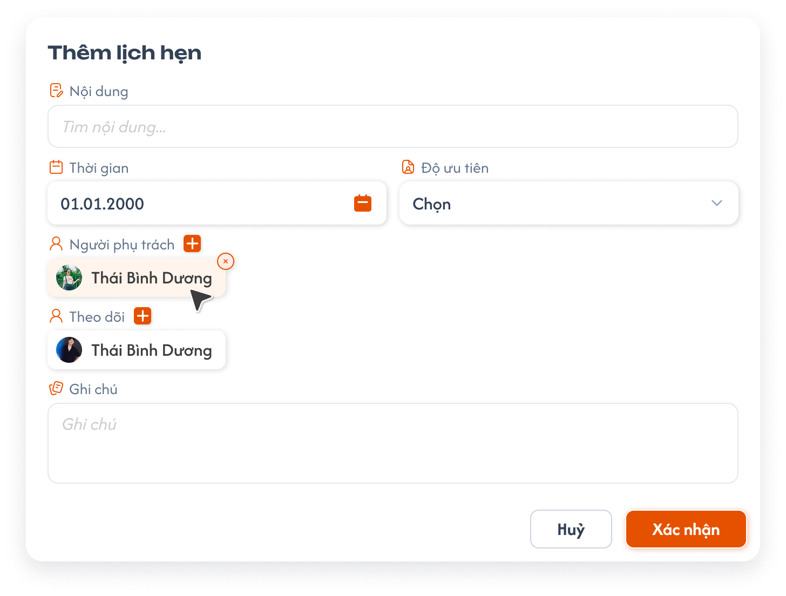</a><br>
  <em>Popup Thêm lịch hẹn — UI chuẩn mới</em>
</p>

- Bấm tên học viên mở menu `Thêm lịch hẹn` / `Xem lịch sử`; mũi tên cuối dòng mở Chi tiết học viên theo ảnh hover chuẩn ở phần danh sách.
- Tiêu đề popup là `Thêm lịch hẹn`. Nội dung nằm toàn chiều rộng; hàng kế tiếp gồm Thời gian bên trái và Độ ưu tiên bên phải. Bên dưới là Người phụ trách, Theo dõi và ô Ghi chú nhiều dòng. Cuối popup có `Hủy` và `Xác nhận`.

| Thành phần trên ảnh chuẩn | Yêu cầu UI và quy tắc đã có |
|---|---|
| Nội dung | Ô nhập tự do toàn chiều rộng, placeholder `Tìm nội dung...`; không suy ra là dropdown tìm nội dung cố định. Bắt buộc theo requirement Lịch Hẹn. |
| Thời gian | Bắt buộc chọn ngày, **không chọn giờ**; có icon lịch và định dạng `dd.MM.yyyy` trên ảnh. Không giới hạn mốc quá khứ/tương lai theo requirement hiện có; `01.01.2000` là dữ liệu mẫu. |
| Độ ưu tiên | Dropdown bắt buộc, mặc định placeholder `Chọn`, không chọn sẵn mức ưu tiên; người dùng phải tự chọn trước khi lưu. Bộ bốn mức `Ưu tiên thấp`, `Bình thường`, `Quan trọng`, `Ưu tiên cao` theo requirement Lịch Hẹn. Placeholder không phải lựa chọn hợp lệ. |
| Người phụ trách | Nút `+` bên cạnh nhãn mở bộ chọn; người đã chọn hiển thị chip avatar + họ tên. Chip có nút `×` để gỡ. Cho nhiều người; trước khi lưu phải còn ít nhất một người phụ trách. |
| Theo dõi | Nút `+` và chip avatar + tên theo cùng cách chọn người; không bắt buộc, cho nhiều người. Cùng user được phép có ở cả Người phụ trách và Theo dõi. |
| Ghi chú | Textarea nhiều dòng, placeholder `Ghi chú`; bắt buộc, không giới hạn độ dài theo requirement Lịch Hẹn hiện có. |
| Hủy | Đóng popup mà không tạo lịch hẹn và không tăng badge lịch hẹn. |
| Xác nhận | Submit lịch hẹn của đúng học viên; validation và phản hồi theo requirement Lịch Hẹn. |

#### Testcase — Popup Thêm lịch hẹn

| Tên testcase | Priority | Loại test | Scenario | Role | Pre-condition | Given / When / Then | Expected Result |
|---|---| --- |---|---|---|---|---|
| Case 21: UI chuẩn popup lịch hẹn từ học viên | High |  | Flow 7 / REQ13 / REQ14 | Administrator | Menu thao tác học viên đang mở | **Given** User chọn Thêm lịch hẹn<br>**When** Popup mở<br>**Then** Hiển thị đúng bố cục ảnh chuẩn | - Nội dung; ngày hẹn không có giờ/Độ ưu tiên; Người phụ trách/Theo dõi; Ghi chú nhiều dòng<br>- Hủy/Xác nhận; + và chip avatar+tên/nút gỡ<br>- Đối tượng đúng học viên, Trạng thái tự Mới, không có control cho hai field<br>- Picker chỉ có Trợ giảng/Support/Nhân viên kinh doanh<br>- Độ ưu tiên hiển thị Chọn, chưa có giá trị mặc định |
| Case 22: Chặn lịch hẹn thiếu field | High |  | EX04 / REQ13 | Administrator | Popup lịch hẹn đang mở | **Given** Thiếu một field bắt buộc trừ Theo dõi; thử riêng trường hợp Độ ưu tiên vẫn là Chọn<br>**When** Bấm `Xác nhận`<br>**Then** Hệ thống chặn tạo lịch hẹn | - Hiển thị `Vui lòng nhập đầy đủ thông tin bắt buộc.`<br>- Giữ popup và dữ liệu đã nhập |
| Case 24: Thêm lịch hẹn thành công | High | Smoke | Flow 7 / REQ11 | Administrator | Tất cả field lịch hẹn hợp lệ | **Given** Popup có đầy đủ dữ liệu<br>**When** Bấm `Xác nhận`<br>**Then** Hệ thống tạo lịch hẹn | - Hiển thị `Thêm lịch hẹn thành công.`<br>- Đóng popup<br>- Badge lịch hẹn của học viên tăng 1 |
| Case 35: Cho phép thời gian lịch hẹn trong quá khứ | High |  | Flow 7 / REQ13 | Administrator | Popup thêm lịch hẹn đang mở | **Given** Các field bắt buộc khác hợp lệ<br>**When** User chọn thời gian trong quá khứ và bấm `Thêm`<br>**Then** Hệ thống tạo lịch hẹn | - Không chặn chỉ vì mốc thời gian<br>- Đúng học viên/người phụ trách |

#### Bộ chọn Người phụ trách / Theo dõi — trạng thái đang mở

<p align="center">
  <a href="./images/24-appointment-user-picker.png">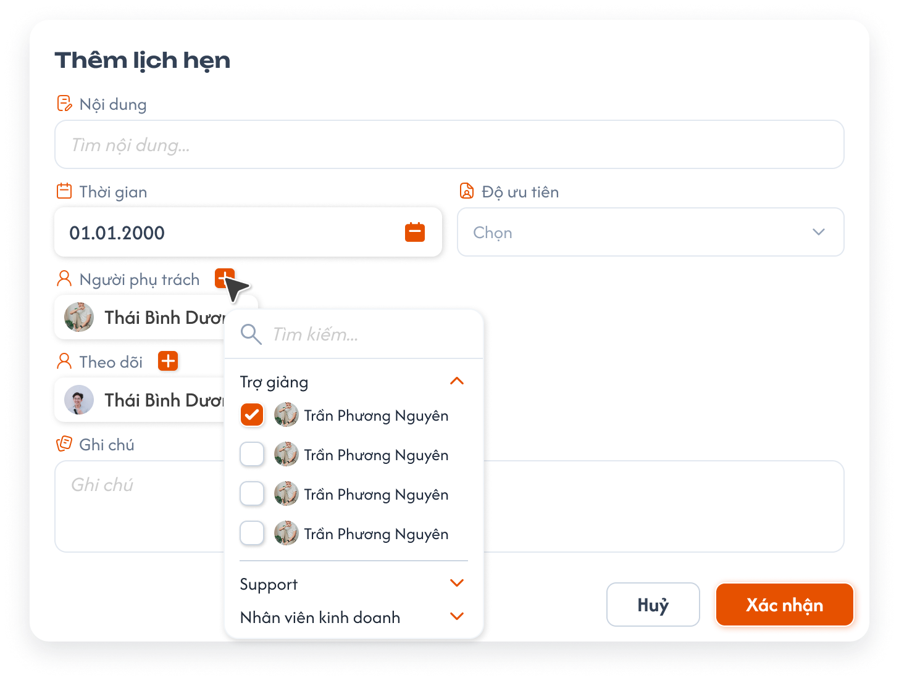</a><br>
  <em>Nút + mở bộ chọn người; tìm kiếm, nhóm thu gọn và checkbox nhiều lựa chọn</em>
</p>

- Bộ chọn có ô `Tìm kiếm...` ở đầu, các nhóm role thu gọn/mở rộng bằng chevron; mỗi user có checkbox, avatar và họ tên. Checkbox chọn có nền cam/dấu tick trắng.
- Lưu lựa chọn theo user ID, không theo họ tên: các tên trùng nhau trên ảnh chỉ là minh họa. Trong một field không thêm trùng một user; search/thu gọn nhóm không tự xóa lựa chọn đã chọn. Chip và checkbox phản ánh cùng tập lựa chọn của field đang thao tác.
- Người tạo có role hợp lệ được chọn sẵn ở Người phụ trách; có thể gỡ mình/thêm người khác, khi lưu vẫn cần ít nhất một người. Tên/avatar `Thái Bình Dương`, `Trần Phương Nguyên` là dữ liệu mẫu, không phải mặc định.
- **Role đã chốt theo ảnh chuẩn:** Người phụ trách và Theo dõi chỉ chọn `Trợ giảng` (Teaching Assistant), `Support`, `Nhân viên kinh doanh` (Sale); áp dụng cùng ba nhóm cho cả hai field. Người không thuộc các role này không được gán, kể cả bằng request trực tiếp. Bộ Admin/Class Handler/Support của form lịch hẹn chung không áp dụng cho flow tạo lịch hẹn từ học viên này.
- **Field tự điền theo flow:** Đối tượng tự gắn đúng học viên đang chọn; Trạng thái tự mặc định `Mới`. Popup không có control Đối tượng/Trạng thái, user không phải chọn hai field này để tạo. Trạng thái nghiệp vụ sau khi tạo vẫn theo bộ bốn trạng thái của requirement Lịch Hẹn.
- Độ ưu tiên mặc định `Chọn`, user tự chọn một mức hợp lệ trước khi lưu; không tự điền Bình thường. Trạng thái mặc định Mới và Thời gian chỉ ngày. Không thêm control giờ; không dùng dữ liệu mẫu trong ảnh làm ngày/ưu tiên mặc định. SOS vẫn theo nghiệp vụ lịch hẹn hiện có.

##### Testcase — Bộ chọn Người phụ trách / Theo dõi

| Tên testcase | Priority | Loại test | Scenario | Role | Pre-condition | Given / When / Then | Expected Result |
|---|---| --- |---|---|---|---|---|
| Case 23: Role picker lịch hẹn học viên theo UI chuẩn | High |  | EX08 / REQ14 | Administrator | Có user thuộc các role khác nhau | **Given** Mở + Người phụ trách hoặc Theo dõi<br>**When** Xem/chọn người và thử gán trực tiếp role không hợp lệ<br>**Then** Chỉ gán user thuộc Trợ giảng/Support/Nhân viên kinh doanh | - Đúng ba nhóm ở cả hai field<br>- Admin/Class Handler không xuất hiện chỉ vì thuộc role của form chung<br>- Request gán role ngoài ba nhóm bị từ chối<br>- Không lẫn quyền tạo với quyền được gán |
| Case 34: Chọn nhiều user và trùng giữa hai field lịch hẹn | High |  | REQ14 | Administrator | Có các user hợp lệ A, B, C | **Given** Popup thêm lịch hẹn đang mở<br>**When** Chọn A và B làm Người phụ trách; chọn A và C làm Người theo dõi<br>**Then** Hệ thống chấp nhận các lựa chọn | - Mỗi field lưu được nhiều user<br>- User A xuất hiện được ở cả hai field<br>- Không tự động xóa hoặc gộp sai dữ liệu |
| Case 68: Bộ chọn người bằng user ID và chip | High |  | REQ14 | Người tạo lịch hẹn | Có user hợp lệ trùng tên; user thuộc ba nhóm role đã chốt | **Given** User mở + Người phụ trách/Theo dõi<br>**When** Chọn nhiều người, đổi search, thu gọn nhóm và gỡ chip<br>**Then** Checkbox/chip phản ánh đúng lựa chọn | - Có search/nhóm/checkbox/avatar/tên theo ảnh<br>- Phân biệt user ID dù cùng tên, không lặp trong cùng field<br>- Search/thu gọn không xóa người đã chọn<br>- Một user được ở cả hai field<br>- Trước lưu có ít nhất một người phụ trách |

### Lịch sử học viên

- Từ menu tên học viên, chọn `Xem lịch sử` mở popup `Lịch sử học viên` của đúng học viên.
- Popup có ba tab theo thứ tự: `Học phí`, `Lịch sử lớp`, `Ghi chú`. Mặc định mở `Học phí` (nghiệp vụ hóa đơn), thay nhãn UI cũ `Lịch sử hóa đơn`.
- Tab active có chữ cam, nền cam nhạt, thanh chỉ báo cam bên trái theo ảnh; chuyển tab giữ ngữ cảnh học viên đang xem.
- UI chuẩn cho từng tab được gắn bên dưới; tên, số tiền, mã lớp, ngày giờ, người và các tỷ lệ trong ảnh chỉ là dữ liệu minh họa.

#### Testcase — Mở popup Lịch sử học viên

| Tên testcase | Priority | Loại test | Scenario | Role | Pre-condition | Given / When / Then | Expected Result |
|---|---| --- |---|---|---|---|---|
| Case 26: Mở lịch sử đúng học viên | High |  | Flow 8 / REQ17 | Administrator | Danh sách có nhiều học viên | **Given** User mở menu của học viên A<br>**When** Chọn `Xem Lịch sử`<br>**Then** Hệ thống mở lịch sử của A | - Mặc định ở Học phí<br>- Có đủ 3 tab<br>- Không lẫn dữ liệu học viên khác |

### Học phí — danh sách hóa đơn

<p align="center">
  <a href="./images/08-invoice-history-expanded.png">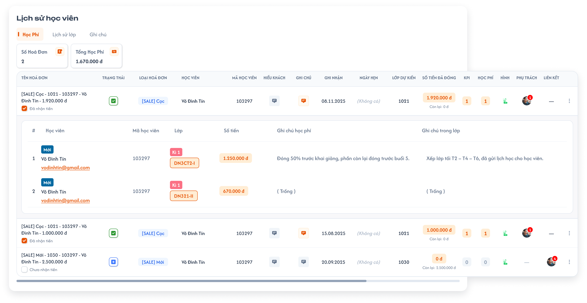</a><br>
  <em>UI chuẩn tab Học phí — thẻ tổng hợp, bảng hóa đơn và chi tiết phân bổ</em>
</p>

[Tham chiếu Học phí bổ sung do user gửi](./images/25-tuition-history-reference.png).

| Thành phần | Mô tả theo UI chuẩn |
|---|---|
| Thẻ Số Hoá Đơn | Nằm đầu tab, có nhãn và icon; đếm số hóa đơn được tạo cho học viên đang xem. Mỗi hóa đơn tính một lần, dù có nhiều dòng sử dụng/phân bổ trong hóa đơn. |
| Thẻ Tổng Học Phí | Nằm cạnh Số Hoá Đơn, có icon tiền và giá trị tiền Việt Nam; bằng tổng số tiền **đã dùng** trong các hóa đơn của học viên đang xem. Cộng đúng phần tiền đã dùng của học viên, không lấy toàn bộ giá trị hóa đơn hoặc Số tiền đã đóng; đây là chỉ số riêng với Tổng doanh thu ở danh sách. |
| Bảng hóa đơn | Thứ tự cột: Tên hoá đơn, Trạng thái, Loại hoá đơn, Học viên, Mã học viên, Hiếu khách, Ghi chú, Ghi nhận, Ngày hẹn, Lớp dự kiến, Số tiền đã đóng, KPI, Học phí, Hình, Phụ trách, Liên kết; cuối dòng có menu `⋮`. |
| Tên hóa đơn | Tên tự sinh theo Hóa đơn REQ01; dưới tên có checkbox Đã nhận tiền/Chưa nhận tiền dùng chung dữ liệu với form chỉnh sửa. Bấm dòng mở/thu gọn học phí, không mở Chỉnh sửa. |
| Trạng thái / Loại | Trạng thái dùng icon trong ô riêng; Loại dùng badge text, ví dụ `[SALE] Cọc`. Giá trị lấy từ đúng hóa đơn theo nghiệp vụ đã có. |
| Hiếu khách / Ghi chú | Hai icon nội dung riêng của hóa đơn (nguồn gọi Hiểu khách); hover xem nội dung, cam khi có nội dung và xám khi trống theo Hóa đơn. |
| Ghi nhận / Ngày hẹn | Hiển thị ngày; khi không có Ngày hẹn hiển thị `(Không có)` như UI. Không lấy ngày mẫu làm mặc định. |
| Lớp dự kiến | Hiển thị mã lớp dự kiến của hóa đơn. |
| Số tiền đã đóng | Theo Hóa đơn: số tiền làm hóa đơn bên CG; bên dưới Còn lại = Số tiền đã đóng − tổng Giá trị học phí đã thêm của toàn hóa đơn. Giá trị học phí mới không vượt Còn lại. |
| KPI / Học phí | KPI là tổng KPI các người phụ trách hóa đơn; Học phí là số lượng khoản học phí, phải khớp số dòng trong chi tiết xổ xuống của hóa đơn. Không nhầm số lượng này với tiền ở thẻ Tổng Học Phí. |
| Hình | Tệp đính kèm hóa đơn, dùng hành vi xem/tải chung của màn Hóa đơn. Hỗ trợ PDF/DOC/DOCX/PPT/PPTX, tối đa 20MB mỗi file. |
| Phụ trách / Liên kết | Phụ trách là avatar/số lượng người phụ trách, hover danh sách tên. Liên kết là học viên đã liên kết hóa đơn, kèm số lượng và hover Tên/Email/SĐT có icon copy theo Hóa đơn. Thiếu dữ liệu hiển thị — như ảnh chuẩn. |
| Cuộn ngang | Bảng rộng có thanh cuộn ngang trong vùng nội dung popup. Giữ bảng/chi tiết trong vùng cuộn của popup, không cho tràn ra ngoài cửa sổ như phần ghép ảnh minh họa. |

**Chi tiết phân bổ dưới một hóa đơn mở rộng:**

- Hiển thị khối bảng con gắn với đúng hóa đơn, gồm `#`, `Học viên`, `Mã học viên`, `Lớp`, `Số tiền`, `Ghi chú học phí`, `Ghi chú trong lớp`.
- Ô Học viên có tag theo dữ liệu của item học phí, tên và email có kiểu link. Nhãn `Mới` cạnh tên học viên trong chi tiết hóa đơn là **tag**, hiển thị theo quy tắc tag của item học phí đã có.
- Ô Lớp hiển thị badge kỳ như `Kì 1` và badge mã lớp như `DN3CT2-I`. Số tiền dùng badge cam nhạt; ghi chú học phí và ghi chú trong lớp hiển thị ở hai cột riêng, rỗng hiển thị `(Trống)`.
- Có thể có nhiều dòng phân bổ của cùng học viên cho nhiều lớp; phân biệt bằng bản ghi phân bổ, không gộp chỉ vì cùng tên/email/mã học viên.
- Công thức đã chốt: `Số Hoá Đơn = số hóa đơn tạo cho học viên`; `Tổng Học Phí = tổng số tiền đã dùng trong các hóa đơn của học viên`. Các con số trên ảnh chỉ minh họa bố cục; dùng dữ liệu thực tế theo hai công thức này.

#### Testcase — Tab Học phí — bảng, phân bổ và thẻ tổng hợp

| Tên testcase | Priority | Loại test | Scenario | Role | Pre-condition | Given / When / Then | Expected Result |
|---|---| --- |---|---|---|---|---|
| Case 27: Xem và thao tác tab Học phí | High | Smoke | Flow 9 / REQ17 / REQ33 | Administrator | Học viên có hóa đơn và phân bổ | **Given** Tab Học phí đang mở<br>**When** Xem bảng, mở rộng hóa đơn hoặc chọn thao tác đã có<br>**Then** Hiển thị đúng hóa đơn/học viên | - Số Hoá Đơn đếm hóa đơn tạo cho học viên; Tổng Học Phí cộng tiền đã dùng trong các hóa đơn của học viên<br>- Đủ 16 cột, cuộn ngang nằm trong popup<br>- Bảng con gắn đúng hóa đơn, không gộp các phân bổ cùng học viên<br>- Thao tác hóa đơn theo rule đã có; xóa luôn yêu cầu xác nhận |
| Case 63: Phân bổ hóa đơn mở rộng và cuộn ngang | High |  | REQ33 | Administrator | Một hóa đơn có hai phân bổ cùng học viên cho hai lớp | **Given** Học phí mở rộng hóa đơn<br>**When** Xem chi tiết và cuộn ngang<br>**Then** Giữ đúng hai bản ghi phân bổ | - Hai mã lớp/kỳ, số tiền và hai loại ghi chú ở đúng dòng<br>- Nhãn Mới là tag của item học phí; hiển thị theo dữ liệu tag, không theo status học viên trong lớp hoặc filter logic<br>- Không gộp theo tên/email học viên<br>- Không tràn bảng khỏi popup, không lẫn hóa đơn |
| Case 69: Số hóa đơn và tổng tiền đã dùng của học viên | High |  | REQ33 | Administrator | Học viên A có 3 hóa đơn, số tiền đã dùng tương ứng 1.000.000 đ, 500.000 đ và 0 đ; có thêm hóa đơn của học viên B | **Given** User mở Học phí của A<br>**When** Dữ liệu được tải<br>**Then** Số Hoá Đơn là 3, Tổng Học Phí là 1.500.000 đ | - Không cộng hóa đơn hoặc tiền của B<br>- Một hóa đơn có nhiều dòng sử dụng/phân bổ vẫn chỉ tăng Số Hoá Đơn một lần<br>- Cộng tiền đã dùng của A, không thay bằng toàn bộ giá trị hóa đơn hay tiền đã đóng |

#### Thao tác học phí và hóa đơn hiện có

Nghiệp vụ dùng chung với [Hóa đơn](../../receipt_management/receipt/receipt.md), nhất là Trang 1–4, Flow 4–8 và REQ01–REQ17; thao tác trên từng item học phí theo [Chi tiết học phí](../../receipt_management/tuition_detail/tuition_detail.md). UI popup lịch sử dùng ảnh chuẩn mới phía trên.

- Tab Học phí cho phép đầy đủ các thao tác đã được đặc tả đối với học phí và hóa đơn hiện có. **Không có nút + tạo hóa đơn, không mở popup Thêm hóa đơn hoặc gửi thao tác tạo hóa đơn mới từ tab này.** Thêm học phí là thêm khoản sử dụng vào hóa đơn đã có, không tạo hóa đơn khác.
- Menu `⋮` gồm `Thêm học phí`, `Chỉnh sửa`, `Copy`, `Lịch sử hành động`, `Xuất hóa đơn`, `Xóa hóa đơn`. Giai đoạn hiện tại, bốn mục Thêm học phí/Chỉnh sửa/Copy/Xóa hóa đơn hoạt động; Lịch sử hành động và Xuất hóa đơn hiển thị nhưng disable theo REQ05 của Hóa đơn.
- `Copy` **chỉ sao chép tên hóa đơn vào clipboard**, thông báo kết quả copy; không tạo bản sao hóa đơn, không tăng Số Hoá Đơn/Số bill và không thay đổi tiền.
- Bấm dòng hóa đơn mở/thu gọn bảng học phí; popup Chỉnh sửa chỉ mở từ menu `⋮`. Chi tiết xổ xuống dùng cùng dữ liệu của hóa đơn ở màn Hóa đơn, có thể có nhiều khoản và nhiều học viên; không coi việc hiển thị các khoản thuộc cùng invoice_id là trộn hóa đơn khác. Hai thẻ thống kê vẫn tính riêng học viên đang xem.
- Dropdown status, checkbox Đã nhận tiền, Ghi chú/Hiểu khách, tệp đính kèm, Phụ trách và Liên kết dùng cùng dữ liệu/hành vi như màn Hóa đơn. Không tạo bản ghi hoặc trạng thái tài chính riêng cho lịch sử học viên.
- Hover học viên trong item học phí có Tên/SĐT/Email và icon copy; hover Lớp có tooltip Thông tin lớp (Sĩ số, Buổi học, Khai giảng, Lịch học, SP, CSKH, Giáo viên). Menu tên học viên trong **item học phí** có Thêm tag/Thêm lịch hẹn/Xem lịch sử; tag thuộc riêng item học phí, không thay tag của hồ sơ học viên. Menu tên học viên ở **danh sách tổng** vẫn chỉ có hai mục đã chốt.

##### Testcase — Menu hóa đơn và thao tác item học phí

| Tên testcase | Priority | Loại test | Scenario | Role | Pre-condition | Given / When / Then | Expected Result |
|---|---| --- |---|---|---|---|---|
| Case 70: Lịch sử không tạo hóa đơn và menu đúng giai đoạn | High |  | REQ36 / REQ25 | Administrator, Sale, Support, Class Handler | Có hóa đơn thuộc phạm vi thao tác | **Given** Mở tab Học phí<br>**When** Kiểm tra control/menu và chọn Copy<br>**Then** Chỉ thao tác hóa đơn hiện có | - Không có nút +/form tạo hóa đơn<br>- Menu hoạt động Thêm học phí/Chỉnh sửa/Copy/Xóa hóa đơn<br>- Lịch sử hành động/Xuất hóa đơn disable<br>- Copy chỉ đưa tên vào clipboard, không request tạo hoặc tăng số liệu |
| Case 72: Hành vi cột và item học phí dùng chung | Medium |  | REQ33 / REQ36 | Administrator | Hóa đơn có ghi chú, tệp, người phụ trách, học viên liên kết và khoản học phí | **Given** Mở Học phí và xổ một hóa đơn<br>**When** Hover các cột/Học viên/Lớp, mở menu tên học viên của item<br>**Then** Dùng nội dung và thao tác theo nguồn | - Học phí bằng số dòng, KPI bằng tổng KPI phụ trách<br>- Hiểu khách/Ghi chú hover đúng nội dung, cam/xám đúng trạng thái có/rỗng<br>- Tooltip phụ trách/liên kết và icon copy đúng dữ liệu<br>- Tag thêm cho riêng item học phí; menu danh sách tổng vẫn hai mục |

#### Popup Thêm học phí — hai bước theo Hóa đơn

<p align="center">
  <a href="../../receipt_management/receipt/image-5.png">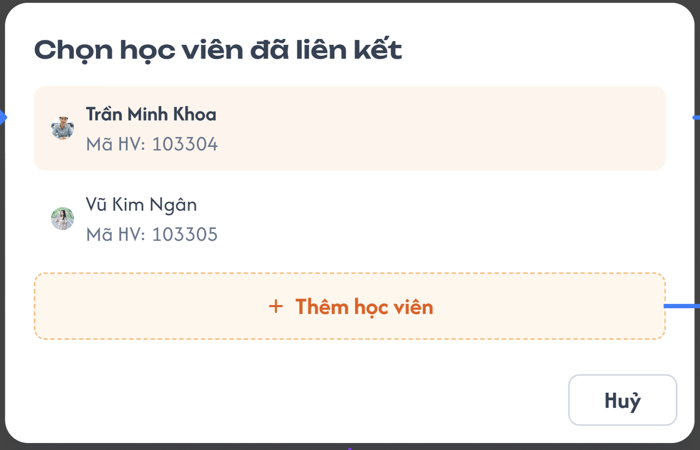</a><br>
  <em>Bước 1: chọn học viên đã liên kết; nút Thêm học viên đi tới form học phí cho học viên mới</em>
</p>
<p align="center">
  <a href="../../receipt_management/receipt/image-6.png">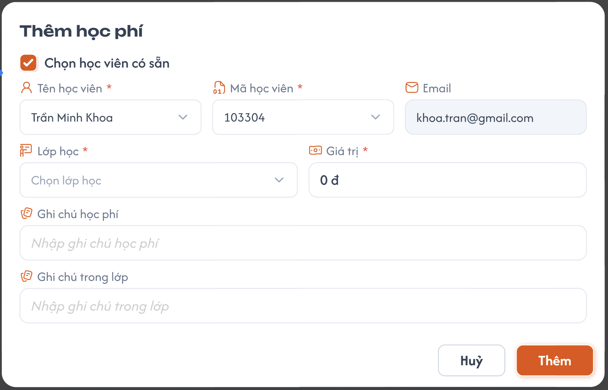</a><br>
  <a href="../../receipt_management/receipt/image-7.png">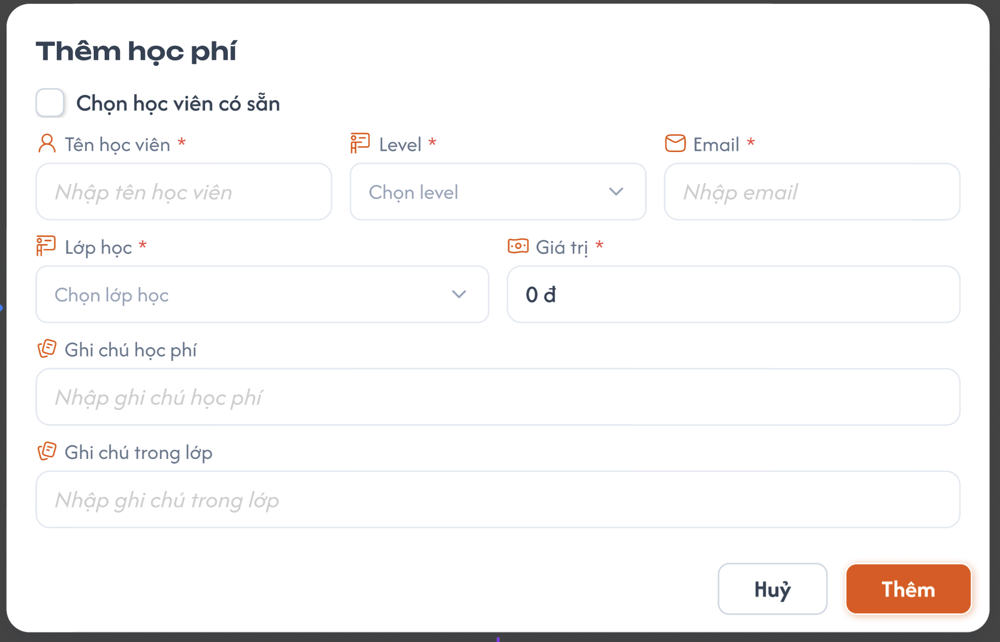</a><br>
  <em>Bước 2: thêm học phí vào hóa đơn hiện có</em>
</p>

| Thành phần | Quy tắc theo Hóa đơn |
|---|---|
| Chọn học viên liên kết | Menu Thêm học phí mở danh sách học viên đã liên kết đúng hóa đơn; chọn một người để mở form. Danh sách rỗng vẫn có nút Thêm học viên. |
| Chọn học viên có sẵn | Khi tick: Tên và Mã học viên là dropdown tìm kiếm, đồng bộ hai chiều; Email tự điền, chỉ đọc. Tên/Mã bắt buộc. |
| Học viên mới | Nút Thêm học viên hoặc bỏ tick mở chế độ nhập Tên/Email, chọn Level 1..9; ẩn field Mã học viên. Tên và Level bắt buộc, Email phải đúng định dạng theo ngoại lệ Hóa đơn. Hệ thống sinh Code 6 số theo Level, kiểm tra trùng và tăng tới mã hợp lệ; học viên mới được liên kết hóa đơn hiện có. Đây là flow học phí, không phải popup Thêm học viên của danh sách tổng. |
| Lớp học | Dropdown bắt buộc chọn lớp để ghi nhận khoản học phí. |
| Giá trị | Bắt buộc, mặc định 0 đ; **không được lớn hơn Còn lại** của hóa đơn. Còn lại = Số tiền đã đóng − tổng Giá trị các học phí đã thêm của toàn hóa đơn, không chỉ của học viên đang xem. |
| Ghi chú học phí / Ghi chú trong lớp | Hai field không bắt buộc; hiển thị đúng hai cột trong chi tiết xổ xuống. |
| Thêm / Hủy | Thêm validate rồi lưu khoản học phí vào invoice_id đang thao tác; Hủy không lưu. Lưu thành công cập nhật chi tiết, số lượng Học phí, Còn lại và thẻ tổng hợp theo dữ liệu đã lưu. |

##### Testcase — Popup Thêm học phí

| Tên testcase | Priority | Loại test | Scenario | Role | Pre-condition | Given / When / Then | Expected Result |
|---|---| --- |---|---|---|---|---|
| Case 43: Học phí trên nhiều hóa đơn hiện có | High |  | REQ24 / REQ28 / REQ37 | Administrator | Học viên liên kết 2 hóa đơn có số dư và đủ quyền | **Given** Mở lần lượt hai hóa đơn trong Học phí<br>**When** Thêm khoản học phí hợp lệ, thử Giá trị 0 và Giá trị vượt Còn lại<br>**Then** Lưu đúng hóa đơn theo validation | - Giá trị 0 có giá trị nhập, không bị coi là bỏ trống<br>- Giá trị vượt Còn lại bị chặn<br>- Một học viên liên kết nhiều hóa đơn được<br>- Không tạo hóa đơn khác |
| Case 46: Thêm học phí cho học viên có sẵn | High |  | Flow 9 / REQ28 | Administrator | Hóa đơn đã liên kết học viên | **Given** Menu ⋮ → Thêm học phí<br>**When** Chọn học viên liên kết rồi chọn Tên/Mã trong form<br>**Then** Đồng bộ dữ liệu và thêm khoản học phí | - Có đủ hai bước<br>- Tên/Mã dropdown đồng bộ hai chiều, Email tự điền chỉ đọc<br>- Bắt buộc Lớp/Giá trị, hai ghi chú không bắt buộc<br>- Thành công cập nhật số lượng học phí và Còn lại của hóa đơn hiện có |
| Case 47: Tạo học viên qua học phí của hóa đơn hiện có | High |  | Flow 9 / REQ28 | Administrator | Hóa đơn có số dư; popup chọn học viên đang mở | **Given** Chọn Thêm học viên hoặc bỏ tick Chọn học viên có sẵn<br>**When** Nhập Tên/Email, chọn Level 1..9, Lớp và Giá trị hợp lệ rồi Thêm<br>**Then** Tạo học viên/liên kết/khoản học phí theo Hóa đơn | - Không có field Mã nhập tay; hệ thống sinh Code 6 số không trùng theo Level<br>- Email sai/thiếu field bắt buộc chặn lưu<br>- Không tạo hóa đơn mới<br>- Không ép các field của popup Thêm học viên danh sách tổng vào form học phí |
| Case 71: Giới hạn Còn lại và cập nhật số học phí | High |  | REQ28 / REQ37 | Administrator | Số tiền đã đóng 1.000.000 đ; toàn hóa đơn đã dùng 400.000 đ cho A và 300.000 đ cho B | **Given** Mở lịch sử A và thêm học phí từ hóa đơn này<br>**When** Thử Giá trị 300.001 đ rồi 300.000 đ<br>**Then** Chặn vượt số dư, cho lưu giá trị bằng số dư | - Còn lại ban đầu 300.000 đ, tính cả học phí B<br>- Lần vượt không tạo khoản<br>- Lần hợp lệ Còn lại 0, số lượng học phí tăng 1<br>- Tổng Học Phí A cập nhật theo khoản đúng A, số hóa đơn không tăng |

#### Popup Chỉnh sửa hóa đơn hiện có

- Form điền sẵn dữ liệu, tiêu đề Chỉnh sửa hóa đơn, nút Cập nhật; dùng field/validation từ Trang 2 của Hóa đơn. **Tên hóa đơn chỉ đọc**, tự tạo lại theo REQ01; không phải mọi field đều nhập tay.
- Bắt buộc Trạng thái, Ngày ghi nhận, Tên học viên, Mã học viên, Loại hóa đơn, Số tiền, Tài khoản nhận; bắt buộc nhập tay Quy đổi VND khi đơn vị khác VND. Khi tick Chọn học viên có sẵn, Tên/Mã đồng bộ hai chiều; bỏ tick nhập tay Tên/Mã của thông tin hóa đơn theo form chung.
- Loại hóa đơn dùng đúng 22 lựa chọn ở Hóa đơn, không dùng danh sách loại cũ trong ảnh học viên. Trạng thái gồm Mới/Xác nhận/Đợi lớp/Học trước/Dời lịch/Hoàn tiền/Hủy đơn/Hỗ trợ sau chốt. Tài khoản nhận gồm Tài khoản cá nhân/Tài khoản công ty/Tiền mặt/Khác.
- Tiền tệ gồm VND/USD/EUR/JPY/CNY/KRW/GBP. VND tự điền Quy đổi bằng Số tiền và vẫn cho sửa; ngoại tệ không tự quy đổi. KPI cạnh từng người phụ trách cho sửa từ −5 đến 5, bước 0.05; cột KPI bằng tổng KPI các người phụ trách, trạng thái người phụ trách chỉ để ghi nhận.
- Tệp đính kèm hỗ trợ PDF/DOC/DOCX/PPT/PPTX, tối đa 20MB mỗi file. Ghi chú/Email/SĐT/Lớp dự kiến/Thông tin/Hiểu khách/Ngày hẹn/Giờ ghi nhận là thông tin thêm, không bắt buộc theo form nguồn.
- Đồng bộ ICS/CG theo Hóa đơn: bên lưu trước được ưu tiên; bên lưu sau không ghi đè và nhận `đã có dữ liệu mới, vui lòng reload trang`. Quyền thao tác từ màn học viên vẫn theo bảng quyền/phạm vi học viên của tài liệu này; không lấy quyền Admin-only của menu Hóa đơn để thay thế quyền đã chốt cho màn học viên.

##### Testcase — Popup Chỉnh sửa hóa đơn

| Tên testcase | Priority | Loại test | Scenario | Role | Pre-condition | Given / When / Then | Expected Result |
|---|---| --- |---|---|---|---|---|
| Case 42: Dropdown chỉnh sửa theo Hóa đơn | High |  | REQ27 | Administrator | Popup Chỉnh sửa hóa đơn hiện có đang mở | **Given** User có quyền<br>**When** Mở Loại/Trạng thái/Tài khoản nhận/Tiền tệ<br>**Then** Dùng lựa chọn nguồn | - Đủ 22 loại theo Hóa đơn<br>- Đủ trạng thái và tài khoản nhận nguồn<br>- VND tự điền Quy đổi và cho sửa; ngoại tệ bắt buộc nhập tay Quy đổi |
| Case 44: Chỉnh sửa và Copy tên hóa đơn | High |  | Flow 9 / REQ24 / REQ25 | Administrator | Có hóa đơn và KPI người phụ trách | **Given** Mở menu ⋮<br>**When** Chỉnh sửa dữ liệu/KPI rồi Cập nhật; chọn Copy và dán clipboard<br>**Then** Lưu hóa đơn hiện có và copy đúng tên | - Tên hóa đơn chỉ đọc, tự cập nhật theo rule nguồn<br>- KPI nhận −5..5 bước 0.05<br>- Clipboard đúng tên hiện tại<br>- Copy không tạo bản sao, không tăng Số Hoá Đơn/Số bill/tiền |
| Case 73: Xung đột chỉnh sửa ICS/CG | High |  | REQ38 | Administrator | Cùng hóa đơn bị sửa ở hai bên | **Given** Bên thứ nhất đã lưu dữ liệu mới<br>**When** Bên còn lại lưu bản cũ từ popup Chỉnh sửa<br>**Then** Không ghi đè bản mới | - Giữ bản lưu trước<br>- Thông báo đã có dữ liệu mới, vui lòng reload trang<br>- Reload đọc lại đúng hóa đơn và thẻ thống kê |

#### Popup xác nhận Xóa hóa đơn

- Xóa hóa đơn phải qua xác nhận, là **xóa mềm**. Hóa đơn và học phí dùng chung dữ liệu, nên xóa hóa đơn phải đồng bộ các khoản học phí, số dư của **tất cả học viên liên kết hóa đơn**, kể cả khi thao tác từ lịch sử của một học viên.
- Sau xóa thành công, các khoản học phí của hóa đơn đã xóa không còn đóng góp vào học phí sử dụng và số dư khả dụng của học viên liên kết; dữ liệu học phí theo lớp liên quan cũng cập nhật tương ứng. Backend tính lại theo các hóa đơn và khoản học phí còn hiệu lực; không chỉ ẩn dòng hóa đơn ở giao diện rồi giữ số liệu cũ.
- Tải lại bảng lịch sử, Số Hoá Đơn/Tổng Học Phí, số dư học viên và các số liệu Số bill/Hoàn tiền/Tổng doanh thu liên quan theo dữ liệu đã đồng bộ. Khoản học phí từ hóa đơn khác giữ đúng đóng góp của nó.
- Hủy hoặc lỗi giữ nguyên cả hóa đơn, học phí và số dư. Chỉ báo thành công khi cập nhật đồng bộ hoàn tất; không để trạng thái hóa đơn đã xóa nhưng học phí/số dư vẫn còn hiệu lực. Xóa mềm giữ lịch sử, không tự tạo giao dịch hoàn tiền.

##### Testcase — Xóa hóa đơn và lỗi thao tác học phí

| Tên testcase | Priority | Loại test | Scenario | Role | Pre-condition | Given / When / Then | Expected Result |
|---|---| --- |---|---|---|---|---|
| Case 36: Xác nhận xóa mềm hóa đơn | High |  | Flow 9 / EX12 / REQ22 | Administrator | Học viên có hóa đơn | **Given** Tab Học phí đang mở<br>**When** Chọn Xóa hóa đơn, thử Hủy rồi Xác nhận<br>**Then** Chỉ xóa mềm khi xác nhận thành công | - Có popup xác nhận<br>- Hủy giữ nguyên hóa đơn, học phí và số dư<br>- Thành công đồng bộ học phí/số dư của mọi học viên liên kết, tải lại bảng/các số liệu<br>- Giữ lịch sử xóa mềm; không tự tạo giao dịch hoàn tiền |
| Case 37: Xóa hóa đơn thất bại | High |  | Flow 9 / EX13 / REQ22 | Administrator | Popup xác nhận xóa đang mở và xử lý xóa gặp lỗi | **Given** User đã chọn đúng hóa đơn<br>**When** Xác nhận xóa<br>**Then** Hệ thống không hoàn thành thao tác | - Giữ nguyên hóa đơn, các khoản học phí và số dư của học viên liên kết; không cập nhật dở dang<br>- Hiển thị `Không thể xóa hóa đơn. Vui lòng thử lại.` |
| Case 40: Lỗi thao tác học phí và hóa đơn hiện có | High |  | Flow 9 / EX16 / REQ23 | Administrator | Thao tác thêm học phí/cập nhật gặp lỗi, clipboard copy không thành công | **Given** User thực hiện từng thao tác<br>**When** Xử lý lỗi<br>**Then** Không báo thành công hoặc lưu dở dang | - Giữ dữ liệu đã lưu trước<br>- Phản hồi lỗi theo Hóa đơn/Toast chung<br>- Copy tên không gửi request tạo hóa đơn |
| Case 76: Xóa hóa đơn đồng bộ mọi học viên liên kết | High |  | Flow 9 / REQ22 / REQ33 | Administrator | Hóa đơn X có học phí 400.000 đ của A và 300.000 đ của B; các hóa đơn khác còn hiệu lực có học phí A 200.000 đ, B 100.000 đ; cả A/B có số dư từ X | **Given** Mở lịch sử A và chọn xóa X<br>**When** Xác nhận và xử lý đồng bộ thành công<br>**Then** Xóa mềm X, cập nhật học phí và số dư của cả A/B | - Tổng Học Phí A còn 200.000 đ, B còn 100.000 đ<br>- Số hóa đơn/Số bill tính lại, không tính X đã xóa<br>- Số dư A/B tính lại từ dữ liệu còn hiệu lực, không giữ đóng góp từ X<br>- Khoản học phí liên kết X không còn hiệu lực cả ở lịch sử học viên và học phí trong lớp<br>- Mở lại/tải lại các màn đều thấy cùng dữ liệu<br>- Không xóa khoản học phí thuộc hóa đơn khác hoặc tự tạo hoàn tiền |

### Lịch sử lớp

<p align="center">
  <a href="./images/22-student-class-history.png">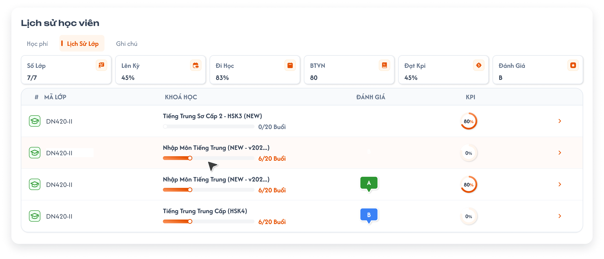</a><br>
  <em>Tab Lịch sử lớp — 6 thẻ tổng hợp, tiến độ khóa học, đánh giá và KPI</em>
</p>

- Hiển thị tất cả lớp học viên đã từng được thêm, không chỉ Lớp hiện tại.
- Đầu tab có 6 thẻ theo thứ tự `Số Lớp`, `Lên Kỳ`, `Đi Học`, `BTVN`, `Đạt Kpi`, `Đánh Giá`. Các số trên ảnh là dữ liệu mẫu; quy tắc hiện tại như sau.

| Thẻ tổng hợp | Quy tắc hiện tại |
|---|---|
| Số Lớp | `Số lớp chính thức / tổng số lớp trong lịch sử học viên`. Ví dụ có 1 lớp chính thức trong 6 lớp thì hiển thị `1/6`. Lớp chính thức là lớp không tick Lớp không chính thức, theo [Tạo lớp học](../class_management/class_creation_requirements.md#lớp-không-chính-thức). Mỗi class_id được đếm một lần. |
| Lên Kỳ | Trung bình `getUpTerm()` của các lớp **chính thức đã Hoàn thành** trong lịch sử học viên. Mỗi lớp có trọng số bằng nhau. |
| Đi Học | Tính tỷ lệ Đi học của học viên trong từng lớp trên **các buổi đã được điểm danh**, rồi lấy trung bình cộng các tỷ lệ có dữ liệu. Mỗi lớp có trọng số bằng nhau. |
| BTVN | Tính tỷ lệ nộp BTVN của học viên trong từng lớp trên **các bài đã nộp hoặc đã chuyển qua bài mới mà chưa nộp**, rồi lấy trung bình cộng các tỷ lệ có dữ liệu. Mỗi lớp có trọng số bằng nhau. |
| Đạt Kpi | Trung bình `getUpTerm()` của **tất cả lớp chính thức** trong lịch sử học viên, gồm cả chưa Hoàn thành. Không phải số/tỷ lệ lớp đạt ngưỡng 80%. |
| Đánh Giá | Trung bình **điểm số** `scoreEvaluateClass()` của các lớp chính thức, rồi đổi điểm trung bình sang A–F. Không đổi các chữ A–F thành điểm để lấy trung bình. |

- **Quy tắc tổng hợp:** tính chỉ số ở từng lớp trước rồi lấy trung bình cộng, mỗi lớp trọng số bằng nhau. Lên Kỳ chỉ lấy lớp chính thức đã Hoàn thành; Đạt Kpi và Đánh Giá lấy tất cả lớp chính thức. Đi Học/BTVN giữ phạm vi lớp và điều kiện buổi/bài đã chốt bên dưới.
- Đi Học/BTVN lấy trên các lớp trong lịch sử, không giới hạn riêng lớp chính thức hoặc lớp hiện tại. Đây là chỉ số của **học viên qua các lớp**, không lấy tỷ lệ chung của cả lớp thay thế.
- **Đi học từng lớp:** `số buổi được tính đi học / số buổi đã có điểm danh × 100`. Có mặt, Vào trễ, Ra sớm, Vào trễ & Ra sớm tính đi học; Nghỉ CP/KP vẫn có trong mẫu số nhưng không tính đi học. Chưa điểm danh loại khỏi cả tử số và mẫu số, theo [quy tắc điểm danh](../class_management/class_detail_lessons_requirements.md#chỉ-số--btvn-và-đi-học-theo-bài).
- **BTVN từng lớp:** `số bài đã nộp / số bài đủ điều kiện tính × 100`. Đã nộp chưa chấm và đã chấm 0 đều tính đã nộp; nộp nhiều lần một bài chỉ tính một lần. Bài chưa nộp chỉ vào mẫu số khi lớp đã chuyển qua bài mới, khi đó đóng góp 0 vào tử số. Bài hiện tại chưa nộp và bài tương lai chưa nộp chưa tính; không đợi điểm chấm để ghi nhận bài đã nộp.
- **Trung bình:** `tổng tỷ lệ từng lớp đủ dữ liệu / số lớp đủ dữ liệu`. Tập lớp đủ dữ liệu xác định riêng cho Đi Học và BTVN. Lớp chưa có buổi/bài đủ điều kiện không tính vào trung bình của chỉ số đó; tỷ lệ 0% với mẫu số lớn hơn 0 vẫn phải tính.
- Đi Học/BTVN chỉ làm tròn kết quả cuối đến **1 chữ số thập phân**, hiển thị dạng `70.0%`, `58.3%`; không làm tròn tỷ lệ từng lớp trước khi lấy trung bình. Ví dụ Đi học 80% và 60% → 70.0%; BTVN 90% và 50% → 70.0%.
- Không có lớp thì Số Lớp hiển thị `0/0`; Đi Học/BTVN trống, Lên Kỳ/Đạt Kpi `0%`, Đánh Giá trống. Đi Học/BTVN chưa có lớp đủ dữ liệu thì trống; hai thẻ dùng `getUpTerm()` có tập lớp tính rỗng thì `0%` theo source. Dữ liệu chưa tải không hiển thị 0% giả.

| Thành phần dòng lớp | Mô tả UI |
|---|---|
| # / Mã lớp | Cột đầu có icon **trạng thái lớp** và mã lớp; dùng đầy đủ mapping icon/tên theo [Trạng thái lớp](../class_management/class_management_requirements.md#trạng-thái-lớp). Mũ tốt nghiệp xanh là lớp **Hoàn thành** theo UI chuẩn; tooltip ghi Hoàn thành. Không dùng trạng thái học viên trong lớp để chọn icon này. |
| Khoá học | Tên khóa học, thanh tiến độ và số `x/N Buổi` là **tiến độ của cả lớp**. Ví dụ lớp đã học 6/20 buổi thì mọi học viên xem lớp này đều thấy 6/20, dù số buổi đi học của từng người khác nhau. Không dùng số buổi học viên đã điểm danh làm x. |
| Đánh giá | Badge chữ A–F của lớp, lấy `ClassInfoModel.getEvaluate` từ điểm `scoreEvaluateClass()` và bảng ngưỡng bên dưới. Màu A xanh lá, B xanh dương, C cam, D vàng, E đỏ, F đỏ đậm theo nguồn và UI chuẩn. |
| KPI | Vòng tròn % cuối dòng lấy **getUpTerm() của cả lớp**, theo nhánh Hoàn thành/chưa Hoàn thành bên dưới. Vẫn tính và hiển thị ở dòng lớp không chính thức, nhưng lớp đó không tham gia ba thẻ Lên Kỳ/Đạt Kpi/Đánh Giá. |
| Mũi tên cuối dòng | Mở Chi tiết lớp của dòng đang chọn ở trang phía dưới popup; tắt popup sẽ thấy lớp đó, theo [Hồ sơ học viên — Lịch sử lớp](../../receipt_management/tuition_detail/tuition_detail.md#trang-6-popup-hồ-sơ-học-viên---tab-lịch-sử-lớp). |

- Tên khóa dài được rút gọn theo bố cục ảnh; không làm thay đổi nội dung đã lưu. Các mã lớp trùng nhau trong ảnh là dữ liệu mẫu, không dùng mã/tên hiển thị để gộp các bản ghi lớp khác nhau.
- Tiến độ/KPI/Đánh giá trên tab này không tạo thêm trạng thái học viên. Chỉ đổi status học viên trong Cài đặt lớp như quy tắc đã chốt bên dưới.
- Đã đối chiếu cả frontend ICS cũ do người dùng cung cấp. Công thức dưới đây dùng các mã trạng thái trong dữ liệu thống kê lớp; không tự thêm các mã cũ vào dropdown 7 trạng thái học viên đã chốt. Nguồn hàm, cách lọc và định dạng tại [Đối chiếu source ICS cũ](./legacy_source_review.md).

#### Công thức Lên kỳ và Đạt KPI

Gọi `r_lớp = getUpTerm() × 100%`. Đây là tỷ lệ tính trên **danh sách học viên của cả lớp**, không chỉ học viên đang mở popup. Một lớp xuất hiện trong lịch sử của hai học viên có cùng r_lớp.

| Trạng thái lớp | Tử số | Mẫu số |
|---|---|---|
| Hoàn thành | Số HV có mã `UpSale`, `Force`, `SuperUpSale`, `Completed` (Lên kỳ, Bắt buộc lên kỳ, Lên khóa, Hoàn thành). | Tổng HV sau khi loại `Remove`, `Moved`, `Audit`, `Testing`, `Viewer`. Nghỉ học/Bảo lưu/Bỏ cọc/Rời lớp vẫn trong mẫu số. |
| Chưa Hoàn thành | Số HV sau khi loại `Dropped`, `Exit`, `Viewer`, `Remove`, `Deposit`, `Moved`, `Retained` (Nghỉ học, Rời lớp, Chỉ xem, Xóa, Bỏ cọc, Chuyển lớp, Bảo lưu). `Audit`/`Testing` không bị loại ở nhánh này. | Tổng HV trừ số HV `Moved` (Chuyển lớp); các nhóm còn lại vẫn trong mẫu số. |

- **Lên Kỳ:** `tổng r_lớp chính thức đã Hoàn thành / số lớp chính thức đã Hoàn thành`.
- **Đạt Kpi:** `tổng r_lớp chính thức / số lớp chính thức`, gồm cả lớp chưa Hoàn thành. Biến đếm lớp đạt ngưỡng ≥ 80% trong source không dùng để hiển thị thẻ này.
- Loại giá trị chưa sẵn sàng/không hợp lệ khỏi phép trung bình; 0% hợp lệ vẫn tính. Không có lớp trong tập tính thì hiển thị 0%. Với mẫu số HV bằng 0, r_lớp trả 0%, không chia 0 hoặc hiển thị NaN/vô cực.
- Giữ tỷ lệ gốc khi lấy trung bình. Hai thẻ và vòng % từng dòng định dạng theo `convertProgressLoading` → `convertDouble(pre: 2)` của ICS cũ: **2 chữ số có nghĩa**, không phải cố định 2 chữ số thập phân. Ví dụ 44.6% → 45%, 1.234% → 1.2%. Quy tắc 1 chữ số thập phân đã chốt riêng cho Đi Học/BTVN vẫn áp dụng.
- Ví dụ 4 lớp chính thức đã Hoàn thành có r_lớp 0%, 77%, 75%, 12% và 1 lớp chính thức chưa Hoàn thành có 59%: Lên Kỳ = 41%; Đạt Kpi = 44.6%, hiển thị 45%.

#### Công thức Đánh giá theo ICS cũ

Áp dụng `scoreEvaluateClass()` cho từng lớp, rồi lấy trung bình điểm của các lớp chính thức. Dữ liệu tính điểm là dữ liệu **cả lớp**, không chỉ học viên đang mở popup.

1. Đếm `D` = số HV có mã `Dropped`, `Deposit`, `Retained`, `Moved`; `N` = tổng HV của lớp. Điểm trừ `P = D/N × 10` (N = 0 thì P = 0).
2. Tập HV tính điểm loại `Remove`, `Dropped`, `Deposit`, `Retained`, `Moved`, `Viewer`.
3. Với mỗi HV trong tập, lấy dữ liệu hợp lệ theo các helper ICS cũ: `X = tỷ lệ Đi học × 10`, `Y = tỷ lệ nộp BTVN × 10`; `z1 = điểm BTVN trung bình`, `z2 = điểm kiểm tra trung bình`, `z3/z4 = điểm Năng lực/Thái độ`. Các helper X/Y/z1/z2 trả số âm thì dùng 0 trong công thức lớp. Năng lực/Thái độ đổi A→10, B→8, C→6, D→4, E→2 theo `convertToPoint()`; giá trị khác dùng 10 theo nhánh mặc định của source.
4. `Z = (z1 + z2 + z3 + z4)/4`; `R = (X + Y + Z)/3`. Khi `R − min(X,Y,Z) > 2`, trừ R đi 1 và kiểm tra lại cho đến khi điều kiện không còn đúng.
5. Điểm lớp `Q = trung bình R của tập HV − P`; tập HV rỗng thì trung bình R = 0. Badge từng lớp = `getEvaluate(Q)`.
6. Thẻ Đánh Giá = `getEvaluate(trung bình Q của các lớp chính thức)`. Trung bình theo `getAverage()` chỉ lấy Q ≥ 0; không lấy chữ đánh giá từng lớp rồi quy đổi lại. Không có lớp chính thức thì thẻ trống. Dữ liệu chưa tải đủ thì chưa tính/không hiển thị điểm giả.

| Điểm dùng đổi hạng | Hạng |
|---|---|
| ≥ 8.5 | A |
| ≥ 7 và < 8.5 | B |
| ≥ 5.5 và < 7 | C |
| ≥ 4 và < 5.5 | D |
| ≥ 2 và < 4 | E |
| < 2 | F |

- Điểm lớp Q = -1 thì badge dòng trống theo `getEvaluate()`. Thẻ tổng hợp trống khi đang tải hoặc không có lớp chính thức; có lớp chính thức nhưng không còn Q ≥ 0 sau lọc thì `getAverage()` trả 0, thẻ là F theo source.
- Các helper dữ liệu hợp lệ/điểm BTVN/điểm kiểm tra của công thức Đánh giá theo source ICS cũ được ghi trong file đối chiếu. Việc áp dụng công thức Đánh giá không thay phạm vi hoặc độ chính xác của hai thẻ Đi Học/BTVN đã chốt.

#### Testcase — Tab Lịch sử lớp

| Tên testcase | Priority | Loại test | Scenario | Role | Pre-condition | Given / When / Then | Expected Result |
|---|---| --- |---|---|---|---|---|
| Case 28: UI chuẩn Lịch sử lớp | High |  | REQ18 / REQ34 | Administrator | Học viên đã từng thuộc nhiều lớp | **Given** Popup lịch sử đang mở<br>**When** Chọn Lịch sử lớp<br>**Then** Hiển thị đúng dữ liệu và cấu trúc đã chốt | - Đủ 6 thẻ đúng thứ tự<br>- Mũ tốt nghiệp xanh là lớp Hoàn thành, không lấy status học viên<br>- Lên Kỳ/Đạt Kpi lấy getUpTerm theo đúng hai tập lớp; Đánh Giá lấy trung bình điểm lớp chính thức rồi đổi A–F<br>- Có mã lớp, khóa học, tiến độ cả lớp x/N Buổi, đánh giá, KPI của từng lớp theo dữ liệu nguồn<br>- Mũi tên mở Chi tiết lớp phía dưới popup<br>- Gồm cả lớp không còn hiện tại; không lấy số mẫu làm mặc định |
| Case 64: Công thức thẻ tổng hợp Lịch sử lớp | High |  | REQ34 | Administrator | Có 6 lớp: 1 chính thức, 5 không chính thức; Đi học lần lượt 80%, 60%, 70%, 90%, 50%, 70%; BTVN 100%, 80%, 60%, 40%, 20%, 0%; mọi tỷ lệ đều có mẫu số hợp lệ; lớp chính thức đã Hoàn thành có getUpTerm 60% và Q = 7.2 | **Given** User mở Lịch sử lớp<br>**When** Tải dữ liệu các lớp<br>**Then** Hiển thị Số Lớp 1/6, Đi Học 70.0%, BTVN 50.0% | - Trung bình cộng đủ 6 lớp, mỗi lớp trọng số bằng nhau<br>- BTVN 0% có mẫu số hợp lệ vẫn tính vào trung bình<br>- Lên Kỳ 60%, Đạt Kpi 60%, Đánh Giá B; 5 lớp không chính thức không tham gia ba thẻ này<br>- Không có lớp: Số Lớp 0/0, Đi Học/BTVN trống, Lên Kỳ/Đạt Kpi 0%, Đánh Giá trống, không NaN/vô cực |
| Case 74: Chỉ tính buổi đủ điều kiện và làm tròn trung bình | High |  | REQ34 | Administrator | Lớp A: đi học 2/3 buổi đã điểm danh, thêm 2 buổi chưa điểm danh; B: đi học 1/2; C: chưa điểm danh. BTVN A: 2 bài đã nộp (1 chưa chấm, 1 chấm 0), 1 bài chưa nộp đã qua bài mới, 1 bài hiện tại và 1 bài tương lai chưa nộp; B: 1 bài đã nộp, 1 bài chưa nộp đã qua bài mới; C: chưa có bài đủ điều kiện | **Given** User mở Lịch sử lớp<br>**When** Tính riêng hai chỉ số<br>**Then** Đi Học và BTVN đều là ((2/3 × 100) + (1/2 × 100))/2 = 58.3% | - C không vào mẫu số trung bình của hai chỉ số<br>- Chưa điểm danh không tính vắng<br>- Đã nộp chưa chấm/điểm 0 vẫn tính đã nộp<br>- Chưa nộp chỉ tính khi đã qua bài mới<br>- Nộp lại một bài không tăng số bài<br>- Chỉ làm tròn kết quả cuối; nếu bài hiện tại của A vẫn chưa nộp khi chuyển sang bài mới, BTVN A thành 2/4 và thẻ BTVN thành 50.0%<br>- Nếu C có điểm danh nhưng chưa có BTVN đủ điều kiện, C chỉ tham gia trung bình Đi Học |
| Case 75: Tiến độ buổi là của cả lớp | High |  | REQ34 | Administrator | Cùng lớp có tiến độ 6/20; học viên A đi học 2 buổi, B đi học 5 buổi | **Given** Lần lượt mở Lịch sử lớp của A và B<br>**When** Xem dòng lớp này<br>**Then** Cả hai đều thấy 6/20 Buổi và thanh tiến độ 30% | - Không thay x bằng 2 hoặc 5<br>- Tiến độ cập nhật theo dữ liệu cả lớp<br>- Đi học/BTVN vẫn tính theo dữ liệu của từng học viên |
| Case 77: getUpTerm của lớp Hoàn thành | High |  | REQ34 | Administrator | Lớp Hoàn thành có 13 HV: 4 mã UpSale/Force/SuperUpSale/Completed; 4 mã Dropped/Retained/Deposit/Exit; 5 mã Remove/Moved/Audit/Testing/Viewer | **Given** Xem dòng lớp trong Lịch sử lớp<br>**When** Tính getUpTerm<br>**Then** 4/(13−5) = 50% | - Vòng % là 50%, icon mũ xanh/tooltip Hoàn thành<br>- 4 nhóm Nghỉ học/Bảo lưu/Bỏ cọc/Rời lớp vẫn ở mẫu số<br>- Không chỉ đếm status Đang học hoặc dùng số lớp đạt ≥ 80% |
| Case 78: getUpTerm của lớp chưa Hoàn thành | High |  | REQ34 | Administrator | Lớp chưa Hoàn thành có 15 HV, mỗi mã một người: Completed/InProgress/Moved/Retained/UpSale/SuperUpSale/ReNew/Dropped/Remove/Viewer/Deposit/Force/Audit/Exit/Testing | **Given** Xem dòng lớp<br>**When** Lọc tập HV theo nhánh chưa Hoàn thành<br>**Then** Tử số 8, mẫu số 14, r_lớp = 57.142857…%, hiển thị 57% | - Chỉ Moved bị loại khỏi mẫu số<br>- Audit/Testing vẫn có trong tử số nhánh này<br>- Không dùng nhánh lớp Hoàn thành |
| Case 79: Phạm vi và trung bình Lên kỳ/Đạt KPI | High |  | REQ34 | Administrator | 4 lớp chính thức Hoàn thành có r_lớp 0/77/75/12%; 1 lớp chính thức chưa Hoàn thành 59%; thêm 1 lớp không chính thức 100% | **Given** Học viên có cả 6 lớp trong lịch sử<br>**When** Tính hai thẻ<br>**Then** Lên Kỳ 41%, Đạt Kpi 45% (giá trị gốc 44.6%) | - Lên Kỳ chỉ trung bình 4 lớp chính thức Hoàn thành<br>- Đạt Kpi trung bình đủ 5 lớp chính thức<br>- Lớp không chính thức vẫn ở bảng nhưng không vào hai thẻ<br>- 0% hợp lệ vẫn tính; không lấy số lớp đạt ngưỡng ≥ 80%<br>- Không làm tròn từng lớp trước khi lấy trung bình; 1.234% hiển thị 1.2% theo source |
| Case 80: Tính điểm lớp trước khi đổi Đánh giá | High |  | REQ34 | Administrator | Lớp có 3 HV: 2 trong tập tính điểm, 1 Dropped. HV1: X=8, Y=6, z1=7, z2=9, Năng lực B, Thái độ C. HV2: X=10, Y=2, z1=z2=10, Năng lực/Thái độ A | **Given** Dữ liệu helper hợp lệ<br>**When** Tính scoreEvaluateClass<br>**Then** Z1=7.5, R1=43/6; Z2=10, R2 từ 22/3 trừ 1 bốn lần còn 10/3; Q=(R1+R2)/2−10/3=23/12 | - Q ≈ 1.9167, badge lớp F<br>- Người Dropped không vào trung bình R nhưng góp điểm trừ 1/3×10<br>- Điều kiện trừ R được lặp, không chỉ trừ một lần<br>- Không lấy rate của UserClassModel thay Q |
| Case 81: Trung bình điểm Đánh giá rồi đổi chữ | High |  | REQ34 | Administrator | 2 lớp chính thức có Q=8.5 (A), Q=7 (B); thêm lớp chính thức Q=-1 chưa đủ dữ liệu và lớp không chính thức Q=10 | **Given** Dữ liệu hợp lệ được tổng hợp<br>**When** Lấy trung bình Q theo source<br>**Then** Trung bình 7.75, thẻ Đánh Giá B | - Không trung bình điểm quy đổi từ chữ A/B thành 9 rồi hiển thị A<br>- Q âm không tham gia trung bình<br>- Lớp không chính thức không tham gia thẻ<br>- Badge từng dòng vẫn theo Q riêng |
| Case 82: Ngưỡng Đánh giá A–F | High |  | REQ34 | Administrator | Có các điểm Q ở hai phía của ngưỡng | **Given** Q lần lượt 8.5/8.499/7/6.999/5.5/5.499/4/3.999/2/1.999 và -1<br>**When** Đổi hạng không làm tròn Q trước<br>**Then** A/B/B/C/C/D/D/E/E/F và trống | - Ngưỡng dưới lấy dấu ≥ đúng source<br>- Không làm tròn 8.499 thành 8.5 rồi đổi A<br>- -1 chưa sẵn sàng khác điểm 0 đã tính (F) |
| Case 83: Tập lớp rỗng và mẫu số HV bằng 0 | High |  | REQ34 | Administrator | Học viên A không có lớp chính thức; B chỉ có lớp chính thức chưa Hoàn thành; C có lớp không có HV hoặc toàn Moved | **Given** Dữ liệu đã tải xong<br>**When** Tính chỉ số<br>**Then** Không chia 0/NaN/vô cực | - A: Lên Kỳ/Đạt Kpi 0%, Đánh Giá trống<br>- B: Lên Kỳ 0%, Đạt Kpi vẫn lấy lớp chính thức chưa Hoàn thành<br>- C: r_lớp 0% khi mẫu số HV 0<br>- Không có lớp nào: Số Lớp 0/0, Đi Học/BTVN và Đánh Giá trống, Lên Kỳ/Đạt Kpi 0%<br>- Đang tải không hiển thị số 0 giả |


#### UI chuẩn trạng thái học viên trong lớp

Bộ 7 icon dưới đây là UI chuẩn cho trạng thái của **quan hệ học viên–lớp**, áp dụng khi hiển thị trạng thái theo từng lớp ở Danh sách học viên và tab Học viên trong Chi tiết lớp. Lịch sử lớp lấy icon **trạng thái lớp** theo [requirement Trạng thái lớp](../class_management/class_management_requirements.md#trạng-thái-lớp). Mỗi quan hệ có status riêng; ví dụ học viên có 3 lớp có 3 status độc lập. Trạng thái của lớp là dữ liệu khác. Chỉ được đổi status học viên tại `Cài đặt lớp → Học viên → Chọn trạng thái`; danh sách tổng chỉ hiển thị. Lịch sử lớp không dùng 7 icon status học viên làm trạng thái dòng lớp.

| Trạng thái | Icon chính thức | Quy tắc hiển thị |
|---|:---:|---|
| Chỉ xem |  | Bong bóng hội thoại có mắt trắng trên nền xám. |
| Dự thính |  | Tai trắng trên nền xanh dương. |
| Đang học |  | Bút trắng trên nền cam. |
| Hoàn thành |  | Bục có ngôi sao trắng trên nền xanh lá. |
| Nghỉ học |  | Lịch có dấu X trắng trên nền cam. |
| Rời lớp |  | Cửa và mũi tên trắng trên nền đỏ đậm. |
| Xóa |  | Túi có dấu X trắng trên nền đỏ tươi. |

- Dùng đúng 7 PNG chuẩn do user cung cấp (mỗi ảnh gốc `60 × 60 px`), giữ nguyên tỷ lệ, nền màu, icon trắng, viền trắng, góc bo và bóng đổ của mẫu; không kéo giãn hoặc dựng icon thay thế.
- Hiển thị nhất quán trên danh sách học viên trong lớp, menu đổi trạng thái và lịch sử trạng thái/lớp khi có hiển thị trạng thái. Menu và lịch sử có tên trạng thái đi kèm; icon trên danh sách có tooltip khi hover/focus và tên truy cập được cho trình đọc màn hình.
- `Đang học` và `Nghỉ học` cùng có nền cam nhưng khác biểu tượng (bút / lịch có dấu X); `Rời lớp` dùng đỏ đậm, `Xóa` dùng đỏ tươi. Không nhận diện trạng thái chỉ bằng màu.
- Ảnh chụp danh sách/menu cũ chỉ minh họa bố cục và thao tác; nếu icon trong ảnh khác bảng chuẩn này thì dùng 7 asset chuẩn ở bảng trên.
- Status học viên theo lớp dùng bộ 7 icon này; status lớp, status tài khoản `Chính thức` và bộ lọc logic `[0] / [1] / [2]` của học viên là các phạm vi độc lập. Bộ lọc logic do BE xác định và lọc; FE chỉ gửi giá trị đã chọn, không ánh xạ từ 7 status trong lớp hoặc trạng thái lớp.
- Quyền đổi trạng thái, điều kiện học phí, xóa mềm và lịch sử thay đổi tuân theo [Trạng thái học viên trong lớp](../class_management/class_detail_students_requirements.md#trạng-thái-học-viên-và-lịch-sử-thay-đổi-trạng-thái).

##### Testcase — Status học viên theo lớp

| Tên testcase | Priority | Loại test | Scenario | Role | Pre-condition | Given / When / Then | Expected Result |
|---|---| --- |---|---|---|---|---|
| Case 48: Hiển thị UI chuẩn trạng thái học viên trong lớp | High |  | REQ29 | Administrator, Sale, Support, Class Handler | Lớp có học viên thuộc đủ 7 trạng thái trong phạm vi được xem | **Given** User mở danh sách Học viên trong lớp<br>**When** Đối chiếu các status học viên<br>**Then** Tên và icon khớp 7 mẫu đã duyệt | - Mapping đúng asset, giữ tỷ lệ/viền/góc bo/bóng đổ<br>- Đang học bút/cam, Nghỉ học lịch X/cam; Rời lớp đỏ đậm, Xóa đỏ tươi<br>- Có tooltip/tên khi hover/focus<br>- Dòng Lịch sử lớp lấy trạng thái lớp theo requirement lớp |
| Case 49: Phân biệt status học viên và status lớp | High |  | REQ29 / REQ34 | Administrator, Sale, Support, Class Handler | Học viên thuộc 3 lớp có status học viên khác nhau và status lớp khác nhau | **Given** User xem quan hệ học viên–lớp và Lịch sử lớp<br>**When** Đối chiếu icon từng dòng lớp, rồi đổi status học viên trong lớp A với quyền hợp lệ<br>**Then** Icon Lịch sử lớp luôn theo trạng thái của lớp | - Status học viên chỉ đổi tại Cài đặt lớp → Học viên → Chọn trạng thái<br>- Đổi status học viên lớp A không đổi status của quan hệ B/C hoặc status lớp A<br>- Mỗi dòng Lịch sử lớp theo icon/tên trạng thái lớp tương ứng<br>- Field tài khoản Chính thức vẫn chỉ đọc |

### Ghi chú — danh sách, bình luận và popup thêm

<p align="center">
  <a href="./images/23-student-notes-history.png">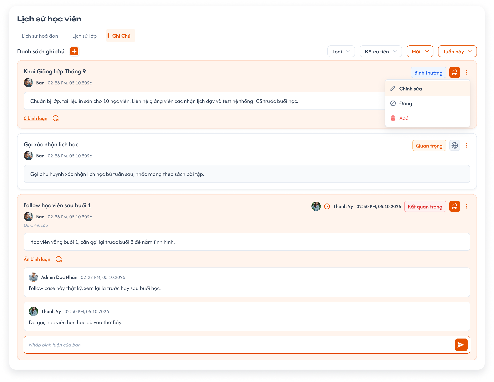</a><br>
  <em>UI Ghi chú mới — metadata người tạo/bình luận, menu và ô nhập bình luận</em>
</p>

- Đầu tab là `Danh sách ghi chú` và nút `+`; bên phải có bốn dropdown theo thứ tự `Loại`, `Độ ưu tiên`, `Trạng thái`, `Thời gian`. Khi mở tab, mặc định Trạng thái = `Mới`, Thời gian = `Tuần này`; Loại và Độ ưu tiên không chọn giá trị, không giới hạn kết quả theo hai bộ lọc này.
- Mỗi card có tiêu đề; dưới tiêu đề là **avatar người tạo ghi chú, tên và ngày giờ tạo**. Nếu người tạo là tài khoản đang đăng nhập thì hiển thị `Bạn`. Khi ghi chú đã sửa thành công, thêm nhãn `Đã chỉnh sửa` dưới thông tin người tạo; không dùng thời gian sửa thay thời gian tạo tại đây. Nội dung nằm trong khung riêng bên dưới. Góc phải là thông tin bình luận gần nhất (khi có), badge Độ ưu tiên, icon Loại và menu `⋮`.
- Thông tin góc phải lấy **avatar, tên và ngày giờ tạo bình luận gần nhất**, kèm icon đồng hồ cam. Chưa có bình luận thì ẩn cả cụm này; avatar/ngày giờ người tạo ghi chú bên trái vẫn hiển thị. Không thay metadata bình luận bằng ngày tạo/sửa ghi chú.
- Độ ưu tiên hiển thị **badge**: Bình thường xanh dương, Quan trọng cam, Rất quan trọng đỏ. Loại Riêng tư dùng icon ẩn danh trên nền cam; Công khai dùng icon địa cầu nền nhạt theo ảnh. Card Riêng tư có nền/viền cam nhạt, card Công khai nền trắng theo mẫu; quyền xem vẫn theo rule owner.
- Menu `⋮` của owner có **Chỉnh sửa / Đóng / Xóa** theo ảnh. Chỉnh sửa mở lại form ghi chú với dữ liệu hiện có, cho owner sửa Loại/Độ ưu tiên theo rule đã chốt; badge trên card không còn là dropdown chọn trực tiếp. Đóng/Xóa vẫn tuân quyền và xác nhận đã có; ghi chú đã Đóng chỉ owner thấy, có thể Mở lại theo rule hiện có.
- Nội dung/ghi chú trong tab lịch sử là các bản ghi ghi chú có Tiêu đề/Loại/Độ ưu tiên/Trạng thái; không tự thay thế field ghi chú cá nhân ở Chi tiết học viên hoặc ghi chú học phí/ghi chú trong lớp.

| Thành phần bình luận | Mô tả UI chuẩn |
|---|---|
| Editor | Ô văn bản thuần đặt dưới danh sách bình luận khi mở, placeholder `Nhập bình luận của bạn`, nút gửi cam/mũi tên trắng ở bên phải. UI mới không có toolbar rich text. |
| Gửi | Nút cam/mũi tên trắng ở bên phải ô nhập. User được xem ghi chú gửi bình luận không rỗng vào đúng note; không giới hạn độ dài. |
| Số bình luận | Link `n bình luận` bên dưới nội dung mở danh sách của đúng ghi chú, gồm cả `0 bình luận`; khi mở hiển thị `Ẩn bình luận` để thu gọn. Ô nhập ở cuối danh sách khi mở. |
| Card bình luận | Mỗi khung có avatar, tên người viết, ngày giờ và nội dung. UI mới không có nút Trả lời hoặc icon xóa riêng trên card như ảnh cũ; quyền owner sửa/xóa bình luận vẫn giữ, không tự cấp quyền theo bố cục ảnh. |
| Bình luận ghi chú | Trả lời ghi chú là nhập/gửi tại ô bình luận của cùng ghi chú, không tạo thread dưới bình luận gốc hoặc yêu cầu nút Trả lời riêng. Áp dụng cùng quyền xem/gửi. |
| Làm mới bình luận | Icon mũi tên vòng cạnh link bình luận tải lại danh sách/số bình luận và metadata gần nhất của đúng note. Không tạo/sửa note hoặc gửi nội dung đang nhập. Giữ bản nháp khi làm mới; lỗi không xóa dữ liệu đang có. |

- **Owner ghi chú** là người tạo ghi chú: chỉ owner được đổi Loại/Độ ưu tiên, đóng, mở lại, chỉnh sửa và xóa ghi chú theo quy tắc hồ sơ học viên. Quyền sửa/xóa bình luận thuộc người tạo bình luận. Quyền role trên học viên vẫn là điều kiện truy cập, không thay thế quyền owner.

#### Quy tắc ghi chú đã có

<p align="center">
  <a href="./images/13-note-time-filter.png">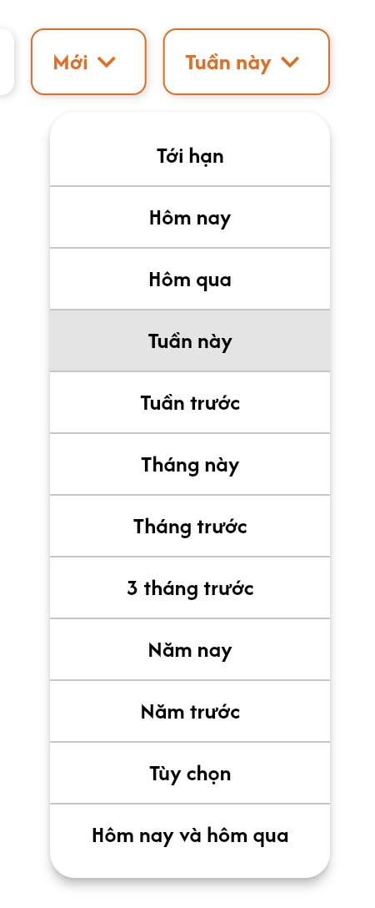</a><br>
  <em>Tham chiếu các lựa chọn thời gian hiện có; UI chính dùng ảnh tab Ghi chú phía trên</em>
</p>

- Ghi chú gồm `Tiêu đề`, `Nội dung`, `Loại`, `Độ ưu tiên`.
- Loại gồm `Công khai`, `Riêng tư`.
- Độ ưu tiên gồm `Bình thường`, `Quan trọng`, `Rất quan trọng`.
- Trạng thái ghi chú gồm `Mới`, `Đóng`.
- Bộ lọc kết hợp đồng thời Loại, Độ ưu tiên, Trạng thái và Thời gian; danh sách/card/bình luận phải thuộc đúng học viên và ghi chú được phép xem.
- Thời gian gồm: `Tới hạn`, `Hôm nay`, `Hôm qua`, `Tuần này`, `Tuần trước`, `Tháng này`, `Tháng trước`, `3 tháng trước`, `Năm nay`, `Năm trước`, `Tùy chọn`, `Hôm nay và hôm qua`.
- Ghi chú `Riêng tư` chỉ user tạo ghi chú được xem; bình luận của ghi chú cũng không được lộ cho người không có quyền xem ghi chú.
- Chỉ owner ghi chú được chuyển `Mới` sang `Đóng`. Khi đã Đóng, chỉ owner còn được xem ghi chú và bình luận, kể cả ghi chú Công khai; user khác không nhận dữ liệu ghi chú/bình luận qua danh sách hoặc truy cập trực tiếp. Owner xem lại bằng bộ lọc Đóng và có thể mở lại theo quy tắc hồ sơ học viên.
- Loại/Độ ưu tiên trên card chỉ owner ghi chú được đổi. Sửa/xóa bình luận chỉ người tạo bình luận được làm; không cấp quyền cho người khác chỉ vì là Administrator hoặc owner ghi chú.
- Tiêu đề, nội dung ghi chú và bình luận không giới hạn độ dài ở tầng nghiệp vụ. Nội dung trong popup Thêm ghi chú là văn bản thuần, không có toolbar hoặc định dạng chữ; ô bình luận cũng dùng văn bản thuần theo UI mới, không có toolbar định dạng.
- Chọn `Tùy chọn` hiển thị khoảng `Từ ngày` và `Đến ngày` để user chọn ngày/tháng/năm.


#### Testcase — Tab Ghi chú — bộ lọc, quyền và bình luận

| Tên testcase | Priority | Loại test | Scenario | Role | Pre-condition | Given / When / Then | Expected Result |
|---|---| --- |---|---|---|---|---|
| Case 30: Lọc ghi chú kết hợp | High |  | Flow 10 / REQ20 | Administrator | Có ghi chú thuộc nhiều điều kiện và ngày tạo khác nhau | **Given** Tab Ghi chú đang mở<br>**When** Chọn Loại, Độ ưu tiên, Trạng thái và Thời gian; với Tùy chọn nhập Từ ngày/Đến ngày<br>**Then** Hệ thống lọc đồng thời | - Chỉ hiển thị ghi chú thỏa tất cả điều kiện<br>- Có đủ các lựa chọn thời gian theo UI<br>- Tùy chọn lấy đúng dữ liệu trong khoảng ngày được chọn |
| Case 38: Chỉ người tạo xem được ghi chú Riêng tư | High |  | EX14 / REQ19 | Administrator, Sale, Support, Class Handler | User A tạo ghi chú Riêng tư; User B cùng có quyền trên học viên | **Given** Ghi chú Riêng tư đã được tạo<br>**When** User A và User B lần lượt mở tab Ghi chú<br>**Then** Chỉ User A nhìn thấy ghi chú | - User A xem được đầy đủ nội dung<br>- User B không thấy ghi chú trong danh sách và không thể mở trực tiếp |
| Case 39: Chặn khoảng ngày Tùy chọn không hợp lệ | Medium |  | EX15 / REQ20 | Administrator | Bộ lọc thời gian đang chọn Tùy chọn | **Given** User chọn Từ ngày sau Đến ngày<br>**When** Áp dụng bộ lọc<br>**Then** Hệ thống chặn lọc | - Không áp dụng khoảng ngày không hợp lệ<br>- Giữ form để user chỉnh lại |
| Case 45: Chỉ owner đóng ghi chú và xem ghi chú đã đóng | High |  | REQ26 / REQ19 | Owner ghi chú, user khác cùng quyền trên học viên | A tạo ghi chú Công khai Mới; B có quyền xem cùng học viên | **Given** A và B đều xem được ghi chú Mới<br>**When** B thử đóng ghi chú, sau đó A đóng<br>**Then** B bị chặn; A đóng thành công | - Sau khi đóng, B không thấy ghi chú/bình luận dù chọn Đóng hoặc truy cập trực tiếp<br>- A xem được khi lọc Đóng và đúng thời gian<br>- A mở lại thì trạng thái Mới và áp dụng lại quyền xem theo Loại<br>- Quyền role không thay quyền owner |
| Case 66: Mở và ẩn bình luận đúng ghi chú | High |  | REQ35 | User được xem ghi chú | Hai ghi chú có các bình luận khác nhau | **Given** User xem tab Ghi chú<br>**When** Bấm n bình luận rồi Ẩn bình luận trên note A<br>**Then** Mở/ẩn danh sách bình luận của A | - Card đúng tác giả, ngày giờ, nội dung<br>- Không lẫn bình luận note B/học viên khác<br>- Không lộ bình luận của ghi chú không được phép xem |
| Case 67: Bình luận văn bản thuần và quyền owner | High |  | REQ35 | User được xem ghi chú, owner bình luận | A và B cùng được xem ghi chú; A đã tạo bình luận | **Given** Mở danh sách bình luận<br>**When** Gửi tại ô Nhập bình luận của bạn; A sửa/xóa bình luận mình, B thử sửa/xóa bình luận A<br>**Then** Lưu bình luận vào đúng ghi chú và áp dụng quyền owner | - Ô nhập dưới danh sách, nút gửi cam; không có toolbar hoặc nút Trả lời riêng<br>- Nội dung văn bản thuần, không tạo thread riêng<br>- Chỉ A sửa/xóa bình luận A; B bị chặn request<br>- Bình luận rỗng không gửi, số bình luận/metadata gần nhất cập nhật |
| Case 84: Bộ lọc mặc định khi mở tab Ghi chú | High |  | REQ20 | User được xem ghi chú | Có ghi chú Mới/Đóng ở tuần này/tuần trước, nhiều Loại và Độ ưu tiên | **Given** User mở tab Ghi chú<br>**When** Quan sát bộ lọc và kết quả<br>**Then** Trạng thái Mới, Thời gian Tuần này; Loại/Độ ưu tiên chưa chọn | - Hiển thị ghi chú Mới trong Tuần này thuộc quyền xem<br>- Không giới hạn Loại hoặc Độ ưu tiên khi chưa chọn<br>- Không hiện ghi chú Đóng/ngoài tuần này trong kết quả mặc định |
| Case 85: Thông tin bình luận gần nhất trên card | High |  | REQ35 | User được xem ghi chú | Note A chưa có bình luận; note B có bình luận của X lúc t1 và Y lúc t2 > t1 | **Given** User xem hai card<br>**When** Quan sát avatar/timestamp cam, rồi X gửi bình luận lúc t3 > t2<br>**Then** A không có avatar/timestamp cam; B ban đầu hiện Y/t2, sau đó X/t3 | - Thời gian cam lấy lúc tạo bình luận gần nhất<br>- Không dùng tác giả/ngày tạo hoặc cập nhật ghi chú thay thế<br>- Avatar/tên/ngày tạo ghi chú dưới tiêu đề vẫn hiện khi chưa có bình luận; nếu owner là tài khoản hiện tại tên hiển thị Bạn |
| Case 86: Chỉ owner đổi Loại và Độ ưu tiên | High |  | REQ19 / REQ35 | Owner ghi chú, user khác cùng quyền trên học viên | A tạo ghi chú Công khai; B được xem học viên | **Given** A và B xem cùng ghi chú<br>**When** A mở Chỉnh sửa từ menu để đổi Loại/Độ ưu tiên; B thử đổi trên UI hoặc request<br>**Then** A được lưu, B bị chặn | - Không cho B sửa dữ liệu dù cùng role hoặc là Administrator<br>- Chuyển Riêng tư thì chỉ A thấy ghi chú và bình luận<br>- Tải lại giữ giá trị owner đã lưu |
| Case 92: Bố cục card và menu Ghi chú mới | High |  | REQ35 | Owner và user được xem note | Có note Riêng tư/Công khai, đã sửa/chưa sửa, có/chưa có bình luận | **Given** Mở Ghi chú<br>**When** Đối chiếu card và mở menu owner<br>**Then** Đúng ảnh mới | - Metadata người tạo dưới tiêu đề; tên Bạn cho tài khoản hiện tại<br>- Đã chỉnh sửa chỉ ở note đã sửa; nội dung trong khung riêng<br>- Badge Bình thường/Quan trọng/Rất quan trọng đúng màu; Riêng tư icon ẩn danh/cam, Công khai địa cầu<br>- Menu Chỉnh sửa/Đóng/Xóa; ưu tiên không là dropdown trực tiếp<br>- Cụm bình luận gần nhất có avatar/tên/ngày giờ, chưa có thì ẩn |
| Case 93: Mở 0 bình luận và làm mới đúng note | High |  | REQ35 | User được xem note | Note A chưa có bình luận, note B có dữ liệu khác | **Given** Mở 0 bình luận của A và nhập bản nháp<br>**When** User khác gửi bình luận vào A, rồi bấm icon làm mới A<br>**Then** Tải lại A, cập nhật số/metadata, giữ bản nháp | - Không tải/gắn dữ liệu B<br>- Không tự gửi bản nháp hoặc tạo note mới<br>- Ẩn bình luận thu gọn danh sách<br>- Lỗi làm mới giữ dữ liệu/bản nháp, cho thử lại<br>- Chỉ dữ liệu còn trong quyền xem được trả về |

#### Popup Thêm ghi chú

<p align="center">
  <a href="./images/12-add-note.png">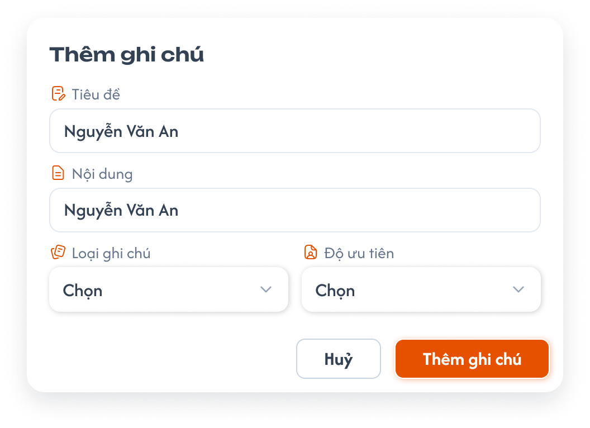</a><br>
  <em>Popup Thêm ghi chú — Tiêu đề, Nội dung, Loại ghi chú, Độ ưu tiên</em>
</p>

- Nút `+` ở Danh sách ghi chú mở popup `Thêm ghi chú` cho đúng học viên.
- Tiêu đề và Nội dung mỗi field chiếm một hàng toàn chiều rộng; bên dưới là `Loại ghi chú` bên trái và `Độ ưu tiên` bên phải, mỗi dropdown có placeholder `Chọn`.
- Cuối popup có nút `Hủy` và `Thêm ghi chú`. Hủy đóng popup, không lưu hoặc tạo ghi chú; submit thành công theo flow đã có.
- Tên `Nguyễn Văn An` trong các ô Tiêu đề/Nội dung là dữ liệu mẫu, không tự điền họ tên học viên vào ghi chú mới. Tiêu đề/Nội dung bắt buộc theo quy tắc hồ sơ học viên; không giới hạn độ dài. Ô Nội dung là văn bản thuần, không hỗ trợ định dạng chữ. Loại/Độ ưu tiên của form theo quy tắc tạo ghi chú hiện có; không dùng trạng thái bộ lọc làm giá trị form.

##### Testcase — Popup Thêm ghi chú

| Tên testcase | Priority | Loại test | Scenario | Role | Pre-condition | Given / When / Then | Expected Result |
|---|---| --- |---|---|---|---|---|
| Case 29: Thêm ghi chú | High | Smoke | Flow 10 / REQ19 | Administrator | Tab Ghi chú đang mở | **Given** User mở form thêm ghi chú<br>**When** Nhập Tiêu đề, Nội dung, Loại, Độ ưu tiên và bấm `Thêm ghi chú`<br>**Then** Hệ thống tạo ghi chú | - Hiển thị `Thêm ghi chú thành công.`<br>- Ghi chú xuất hiện đúng học viên với giá trị đã chọn |
| Case 65: Popup Thêm ghi chú chuẩn và Hủy | Medium |  | REQ35 | Administrator | Tab Ghi chú của học viên A đang mở | **Given** User bấm +<br>**When** Nhập dữ liệu rồi bấm Hủy hoặc submit theo rule đã chốt<br>**Then** Thao tác đúng học viên | - Hai hàng Tiêu đề/Nội dung và hàng Loại ghi chú/Độ ưu tiên<br>- Nút Hủy/Thêm ghi chú<br>- Không tự điền Nguyễn Văn An theo ảnh<br>- Hủy không tạo note/Toast CRUD |
| Case 87: Nội dung thêm ghi chú là văn bản thuần và không giới hạn độ dài | Medium |  | REQ19 / REQ35 | User có quyền thêm ghi chú | Popup Thêm ghi chú đang mở | **Given** User nhập Tiêu đề/Nội dung dài và nội dung nhiều dòng<br>**When** Lưu rồi xem lại; gửi bình luận dài vào ghi chú<br>**Then** Lưu đầy đủ các nội dung | - Không có giới hạn ký tự nghiệp vụ, không tự cắt nội dung<br>- Ô Nội dung Thêm ghi chú không có toolbar định dạng chữ<br>- Văn bản có ký tự giống markup được hiển thị như văn bản thuần<br>- Giữ quy tắc Tiêu đề/Nội dung bắt buộc và không gửi bình luận rỗng |

---

### Toast phản hồi CRUD

<p align="center">
  <a href="../../images/01-toast-crud.png"></a><br>
  <em>Toast phản hồi Create, Update, Delete và đổi trạng thái — nhấn để xem ảnh gốc</em>
</p>

**Mô tả:** Toast phản hồi kết quả các thao tác thay đổi dữ liệu trong requirement này.

**Giải thích thành phần:**

| Loại | Tiêu đề | Khi sử dụng |
|---|---|---|
| Thành công | `Thành Công` | Backend xác nhận thao tác thành công. |
| Thông tin | `Thông Báo` | Thao tác đã tiếp nhận nhưng dữ liệu cần thời gian đồng bộ. |
| Cảnh báo | `Cảnh Báo` | Dữ liệu/điều kiện cần người dùng kiểm tra. |
| Lỗi | `Có Lỗi Xảy Ra` | Backend/network không hoàn tất thao tác. |

**Điểm cần lưu ý:** Nội dung dòng hai lấy từ flow CRUD tương ứng; mỗi thao tác chỉ có một Toast; Hủy/chỉ đọc không có Toast CRUD; nút `×` đóng thủ công; không hiển thị dữ liệu nhạy cảm.

#### Testcase — Toast phản hồi CRUD

| Tên testcase | Priority | Loại test | Scenario | Role | Pre-condition | Given / When / Then | Expected Result |
|---|---| --- |---|---|---|---|---|
| Toast Case 1: Thành công | High |  | Ràng buộc Toast CRUD | Role có quyền CRUD | Dữ liệu hợp lệ | **Given** người dùng xác nhận thay đổi<br>**When** backend thành công<br>**Then** hiển thị Toast `Thành Công` | - Đúng nội dung nghiệp vụ<br>- Đúng một Toast<br>- Chỉ hiện sau khi backend xác nhận |
| Toast Case 2: Cảnh báo | High |  | Ràng buộc Toast CRUD | Role có quyền CRUD | Dữ liệu/điều kiện chưa hợp lệ | **Given** thao tác chưa đủ điều kiện<br>**When** người dùng xác nhận<br>**Then** hiển thị Toast `Cảnh Báo` nếu flow có Toast validation | - Không lưu dữ liệu sai<br>- Vẫn đánh dấu field lỗi<br>- Không hiện thành công |
| Toast Case 3: Lỗi | High |  | Ràng buộc Toast CRUD | Role có quyền CRUD | Backend/network lỗi | **Given** request hợp lệ đã gửi<br>**When** xử lý thất bại<br>**Then** hiển thị Toast `Có Lỗi Xảy Ra` | - Không cập nhật một phần<br>- Cho phép thử lại<br>- Không lộ lỗi kỹ thuật |
| Toast Case 4: Thông tin, đóng và chống lặp | Medium |  | Ràng buộc Toast CRUD | Role có quyền CRUD | Đang đồng bộ hoặc Toast đang hiển thị | **Given** thao tác xử lý bất đồng bộ hoặc callback lặp<br>**When** UI nhận trạng thái hoặc người dùng bấm `×`<br>**Then** hiển thị tối đa một Toast `Thông Báo` và cho đóng thủ công | - Không báo thành công sớm<br>- Không nhân đôi Toast<br>- Đóng không hoàn tác dữ liệu |

## 2. Yêu cầu

### 2.1. Flow chính

**Flow 1: Xem danh sách và phân trang**

```text
User có quyền mở Quản lý → Học viên
      → Hệ thống tải danh sách học viên trong phạm vi user, sắp ngày tạo học viên giảm dần (mới nhất trước)
      → Hiển thị dữ liệu các cột, số liệu hóa đơn, status riêng theo từng lớp và tổng số trang
      → Hiển thị Trang trước + số trang + dấu "..." + các trang cuối + Trang sau như UI
      → User chọn số trang hoặc Trang trước/Trang sau
      → Hệ thống giữ search/filter, tải đúng dữ liệu và đánh dấu trang hiện tại
```

**Flow 2: Tìm kiếm học viên**

```text
User nhập từ khóa vào ô tìm kiếm
      → Không nhập thêm trong 2 giây: hệ thống tự tìm kiếm
      → Hoặc user nhấn Enter: hệ thống tìm kiếm ngay, không chờ đủ 2 giây
      → Hệ thống tìm theo Tên học viên bằng cách khớp chứa từ khóa, không yêu cầu khớp toàn bộ tên
      → Kết quả phù hợp được hiển thị từ trang 1
```

**Flow 3: Lọc học viên**

```text
User mở Trạng thái và tick/bỏ tick một hoặc nhiều checkbox Mới [0] / Đang học [1] / Đợi lớp [2]
      → Nhiều trạng thái: OR giữa các nhóm logic BE; không chọn trạng thái: bỏ điều kiện Trạng thái
      → User mở Tag, tìm theo mã/tên tag, mở nhóm và chọn một hoặc nhiều tag
      → Nhiều Tag: OR giữa các tag; thu gọn/tìm lại tag không làm mất lựa chọn
      → FE gửi tập giá trị filter logic 0/1/2 + Tag + keyword tên tới BE, kết hợp ba loại điều kiện bằng AND
      → BE lọc theo logic học viên riêng và trả dữ liệu cùng tổng kết quả; FE không tự suy ra từ status trong lớp
      → Hiển thị kết quả từ trang 1 theo ngày tạo học viên giảm dần (mới nhất trước)
```

**Flow 4: Xuất Excel**

```text
User bấm nút Excel
      → Không có search/filter: xuất toàn bộ danh sách thuộc phạm vi dữ liệu của user trên tất cả trang
      → Có search/filter: xuất toàn bộ kết quả thỏa điều kiện trên tất cả trang, không chỉ trang đang xem
      → File gồm đúng 4 cột: Tên học viên, Số điện thoại, Email, Ngày tạo
      → Thành công: tải file và hiển thị "Xuất danh sách học viên thành công."
      → Thất bại: không tải file và hiển thị "Không thể xuất danh sách học viên. Vui lòng thử lại."
```

**Flow 5: Tạo tài khoản học viên**

```text
User có quyền bấm "+" tại Danh sách học viên
      → Hệ thống mở popup; Vai trò mặc định là Student; Ngày chốt đơn mặc định là ngày hiện tại và cho sửa
      → User nhập/chọn đầy đủ field bắt buộc và chọn Cấp độ 1 đến Cấp độ 9
      → Sau khi chọn cấp độ, hệ thống hiển thị Code 6 chữ số tiếp theo chưa dùng trong center/cấp độ; user không được sửa Code
      → Kiểm tra email/SĐT đúng định dạng, mật khẩu tối thiểu 8 ký tự; ngày chốt đơn được ở quá khứ hoặc tương lai
      → Backend kiểm tra trùng và cấp mã hợp lệ cùng cấp độ ngay cả khi nhiều request đồng thời
      → Bấm "Thêm học viên"
      → Thiếu field: hiển thị "Vui lòng nhập đầy đủ thông tin bắt buộc."
      → Email đã tồn tại trong cùng trung tâm: hiển thị "Email đã được sử dụng."
      → Thành công: tạo tài khoản, đóng popup, tải lại danh sách theo ngày tạo học viên giảm dần (mới nhất trước) và các điều kiện hiện tại; hiển thị "Tạo tài khoản học viên thành công."
      → Không thể sinh Code duy nhất: giữ popup và hiển thị "Không thể tạo mã học viên. Vui lòng thử lại."
```

**Flow 6: Xem mã lớp và ghi chú, mở Chi tiết học viên**

```text
User hover/bấm Số lớp của học viên
      → Hiển thị mã tất cả lớp học viên đã được thêm
User hover/bấm icon Lớp hiện tại
      → Chỉ hiển thị mã các lớp có status học viên Đang học và status lớp Đang học
      → Không có lớp đáp ứng: hiển thị text Chưa có, không mở tooltip/popup lớp rỗng
User hover/bấm Số bill
      → Chỉ giữ số đang hiển thị, không mở popup hoặc điều hướng
User hover/bấm icon Ghi chú
      → Mở nội dung ghi chú của đúng học viên; icon cam nghĩa là có ghi chú
User bấm mũi tên cuối dòng
      → Mở Chi tiết học viên đúng dòng theo requirement chi tiết
```

**Flow 7: Thêm lịch hẹn**

```text
User click tên học viên
      → Chọn "Thêm Lịch Hẹn"
      → Đối tượng tự gắn học viên đang chọn, Trạng thái tự mặc định Mới
      → Người tạo có role Trợ giảng/Support/Nhân viên kinh doanh được chọn sẵn làm Người phụ trách; role khác phải chọn người hợp lệ
      → Độ ưu tiên ban đầu là Chọn; user phải tự chọn mức hợp lệ
      → Nhập Nội dung, ngày hẹn (không có giờ), Độ ưu tiên, Ghi chú và chỉnh Người phụ trách/Theo dõi qua nút +/chip nếu cần
      → Người phụ trách/Người theo dõi chỉ gồm Trợ giảng, Support, Nhân viên kinh doanh
      → Mỗi field cho phép chọn nhiều user; cùng một user có thể nằm ở cả hai field
      → Bấm "Xác nhận"
      → Thiếu field bắt buộc (trừ Theo dõi): hiển thị "Vui lòng nhập đầy đủ thông tin bắt buộc."
      → Thời gian trong quá khứ vẫn hợp lệ nếu các field bắt buộc khác hợp lệ
      → Thành công: đóng popup, tăng số lịch hẹn cạnh tên học viên và hiển thị "Thêm lịch hẹn thành công."
```

**Flow 8: Xem lịch sử học viên**

```text
User click tên học viên
      → Chọn "Xem Lịch sử"
      → Hệ thống mở popup tại tab Học phí
      → User chuyển giữa Học phí / Lịch sử lớp / Ghi chú
      → Hiển thị dữ liệu đúng học viên đang chọn
```

**Flow 9: Học phí trên hóa đơn hiện có trong lịch sử học viên**

```text
User mở tab Học phí của học viên
      → Xem hóa đơn hiện có, bấm dòng để xổ/thu gọn chi tiết học phí
      → Không có flow tạo hóa đơn mới
      → Mở menu ⋮ trên hóa đơn
          ├─ Thêm học phí → chọn học viên đã liên kết hóa đơn
          │     ├─ Chọn học viên có sẵn → Tên/Mã đồng bộ hai chiều, Email chỉ đọc
          │     └─ Thêm học viên/bỏ tick → nhập Tên/Email, chọn Level; ẩn Mã, hệ thống sinh Code
          │     → Chọn lớp, nhập Giá trị và ghi chú
          │     → Validate field bắt buộc và Giá trị ≤ Còn lại của toàn hóa đơn
          │     → Thêm thành công: cập nhật chi tiết, số lượng Học phí và Còn lại
          ├─ Chỉnh sửa → form điền sẵn, Tên hóa đơn chỉ đọc, sửa dữ liệu/KPI → Cập nhật
          ├─ Copy → copy tên vào clipboard; không tạo hóa đơn
          ├─ Xóa hóa đơn → popup xác nhận
          │     ├─ Hủy bỏ → không thay đổi
          │     └─ Xác nhận → xóa mềm và đồng bộ học phí/số dư của mọi học viên liên kết; lỗi giữ nguyên toàn bộ
          └─ Lịch sử hành động / Xuất hóa đơn → hiển thị disable theo Hóa đơn hiện tại
      → Sau lưu/xóa thành công: tải lại hai thẻ Học phí và Số bill/Hoàn tiền/Tổng doanh thu
      → Bill có trạng thái Hoàn tiền: áp dụng công thức danh sách tổng đã chốt, không trừ lặp
      → Lưu đồng thời ICS/CG: không ghi đè bản đã lưu trước; yêu cầu reload theo Hóa đơn
      → Thiếu field / học phí vượt Còn lại / email sai / file sai: báo lỗi, không lưu
      → Thành công/lỗi của Thêm học phí, Cập nhật, Xóa dùng thông báo tương ứng đã có
```

**Flow 10: Thêm và lọc ghi chú**

```text
User mở tab Ghi chú
      → Mặc định Mới + Tuần này; Loại/Độ ưu tiên chưa chọn
      → Bấm "+" và nhập Tiêu đề, Nội dung, Loại, Độ ưu tiên
      → Bấm "Thêm ghi chú"
      → Thành công: thêm ghi chú vào danh sách và hiển thị "Thêm ghi chú thành công."
      → Ghi chú Riêng tư chỉ hiển thị với đúng user đã tạo
      → Chỉ owner ghi chú đổi Loại/Độ ưu tiên hoặc đóng ghi chú
      → Đã Đóng: chỉ owner xem được ghi chú và bình luận; owner có thể mở lại
      → User lọc theo Loại + Độ ưu tiên + Trạng thái + Thời gian
      → Nếu chọn Tùy chọn: user chọn Từ ngày và Đến ngày
      → Hệ thống hiển thị các ghi chú thỏa tất cả điều kiện
```

### 2.2. Ngoại lệ

- **EX01:** Tạo tài khoản thiếu bất kỳ field bắt buộc nào → hiển thị `Vui lòng nhập đầy đủ thông tin bắt buộc.`, không tạo tài khoản.
- **EX02:** Code vừa sinh bị trùng do nhiều request đồng thời → hệ thống phải sinh lại Code trước khi lưu; không được tạo hai học viên cùng Code trong cùng center; center khác được trùng Code.
- **EX03:** Không thể tạo Code duy nhất trong center hiện tại → hiển thị `Không thể tạo mã học viên. Vui lòng thử lại.`, không tạo tài khoản.
- **EX04:** Thêm lịch hẹn thiếu bất kỳ field bắt buộc nào → hiển thị `Vui lòng nhập đầy đủ thông tin bắt buộc.`, không tạo lịch hẹn.
- **EX05:** Export lỗi → hiển thị `Không thể xuất danh sách học viên. Vui lòng thử lại.`, không tải file lỗi/rỗng xuống thiết bị.
- **EX06:** Search nhận thêm ký tự trước khi đủ 2 giây → hủy thời gian chờ cũ và tính lại 2 giây từ ký tự mới nhất.
- **EX07:** Search đang chờ nhưng user nhấn Enter → tìm kiếm ngay một lần và hủy lượt tự tìm kiếm đang chờ.
- **EX08:** User không thuộc role được phép xuất hiện trong Người phụ trách/Người theo dõi → không hiển thị trong danh sách chọn và không thể gán bằng request trực tiếp.
- **EX09:** Học viên không có lớp hiện tại → hiển thị `Chưa có`, không hiển thị popup lớp khi hover.
- **EX10:** Email đã tồn tại trong cùng trung tâm → hiển thị `Email đã được sử dụng.`, không tạo tài khoản; email giống nhau ở hai trung tâm khác nhau vẫn được phép.
- **EX11:** Người phụ trách rỗng sau khi người tạo tự gỡ mình → chặn tạo và yêu cầu chọn ít nhất một người phụ trách; Theo dõi được để trống.
- **EX12:** User hủy popup xác nhận xóa hóa đơn → đóng popup, không xóa và không thay đổi dữ liệu.
- **EX13:** Xóa hóa đơn thất bại → giữ nguyên hóa đơn, học phí và số dư liên kết, không cập nhật dở dang; hiển thị `Không thể xóa hóa đơn. Vui lòng thử lại.`
- **EX14:** User không phải người tạo cố xem ghi chú Riêng tư → không trả về và không hiển thị nội dung ghi chú.
- **EX15:** Khoảng thời gian Tùy chọn có Từ ngày sau Đến ngày → chặn áp dụng bộ lọc.
- **EX16:** Thêm học phí, copy tên hoặc chỉnh sửa hóa đơn thất bại → không báo thành công, không lưu dữ liệu dở dang; copy tên không gọi tạo hóa đơn. Lỗi lưu/đồng bộ theo Hóa đơn và Toast chung.

- **EX17:** Không còn Code hợp lệ trong dải cấp độ đã chọn → không cấp mã vượt dải/khác 6 chữ số, không tạo tài khoản, giữ popup và hiển thị `Không thể tạo mã học viên. Vui lòng thử lại.`
- **EX18:** Email/SĐT sai định dạng hoặc mật khẩu dưới 8 ký tự → chặn tạo tài khoản, hiển thị lỗi ở field tương ứng và giữ dữ liệu trên form để chỉnh sửa; không lưu tài khoản dở dang.

### 2.3. Yêu cầu khác

- **REQ01:** Chức năng Quản lý học viên đầy đủ thuộc các role `Administrator`, `Sale`, `Support`, `Class Handler`.
- **REQ02:** Mỗi trang hiển thị tối đa 50 học viên. Phân trang hiển thị Trang trước, các số trang, dấu `...`, các trang cuối và Trang sau như UI; chỉ một trang được đánh dấu đang chọn. Trang trước bị vô hiệu hóa tại trang đầu, Trang sau bị vô hiệu hóa tại trang cuối; chuyển trang giữ nguyên search/filter.
- **REQ03:** Search chỉ áp dụng trên `Tên học viên` theo kiểu khớp chứa từ khóa, không yêu cầu khớp chính xác toàn bộ tên; tự chạy sau 2 giây kể từ lần nhập cuối hoặc chạy ngay khi nhấn Enter.
- **REQ04:** Search, Trạng thái và Tag được kết hợp đồng thời; thay đổi điều kiện đưa danh sách về trang 1.
- **REQ05:** Dropdown Trạng thái dùng checkbox chọn nhiều với mapping nhãn UI `Mới → [0]`, `Đang học → [1]`, `Đợi lớp → [2]`. Trạng thái hồ sơ là giá trị BE **tính** theo thứ tự ưu tiên: `Đang học` = có ≥ 1 lớp với status trong lớp `Đang học` / `Dự thính` và lớp đó `Đang học`; `Đợi lớp` = không thoả trên nhưng đã từng vào lớp (bản ghi chưa `Xóa`); `Mới` = chưa từng vào lớp. Không nhập tay, không lưu field riêng, tính lại ngay khi status trong lớp hoặc trạng thái lớp đổi; hồ sơ không dùng `Bảo lưu` / `Drop dời` / `Drop`. Nhiều trạng thái dùng OR, không trùng dòng học viên; không chọn trạng thái thì bỏ điều kiện này. FE gửi tập giá trị đã chọn theo hợp đồng API để BE lọc, không tự ánh xạ từ 7 status trong lớp. Kết hợp keyword tên/Tag bằng AND và dùng tổng kết quả BE trả để phân trang.
- **REQ06:** Filter Tag có search ở đầu popup, nhóm thu gọn/mở rộng bằng chevron và checkbox tag chọn nhiều. Nhóm/tag lấy động từ dữ liệu user định nghĩa; tìm theo mã/tên tag, giữ checkbox đang chọn khi tìm kiếm, thu gọn hoặc mở lại. Nhiều tag dùng OR kể cả khác nhóm; không chọn tag thì bỏ điều kiện Tag. Kết hợp bằng AND với Trạng thái/keyword tên, đổi lựa chọn đưa danh sách về trang 1.
- **REQ07:** Nút Excel nằm ở góc dưới bên phải bảng, cùng hàng với phần phân trang theo UI chuẩn. File Excel có đúng thứ tự cột: `Tên học viên`, `Số điện thoại`, `Email`, `Ngày tạo`. Không có search/filter thì xuất toàn bộ danh sách thuộc phạm vi dữ liệu của user; có search/filter thì xuất toàn bộ kết quả thỏa điều kiện. Luôn xuất tất cả trang, không chỉ trang đang xem.
- **REQ08:** Dropdown `Chọn cấp độ` có đúng 9 lựa chọn từ `Cấp độ 1` đến `Cấp độ 9`, chọn một giá trị; placeholder `Chọn` không được tính là lựa chọn hợp lệ.
- **REQ09:** Code do backend tự sinh, đúng 6 chữ số và chỉ đọc. Với cấp độ L từ 1 đến 9, mã bắt đầu ở `L × 100000`, tăng dần trong dải `L00000..L99999` và phải duy nhất trong cùng center kể cả khi tạo đồng thời; các center khác nhau được trùng Code. Mã hiển thị sau khi chọn cấp độ; backend tìm mã chưa dùng và kiểm tra lại khi lưu. Ví dụ cấp độ 1: 100000, 100001, …; cấp độ 2: 200000, 200001, …. Không cấp mã vượt dải cấp độ.
- **REQ10:** Mọi field trong popup `Thêm học viên` đều bắt buộc, kể cả field hệ thống điền. Vai trò là `Student` (nhãn Học viên); Ngày chốt đơn mặc định ngày hiện tại và cho chọn ngày quá khứ/hiện tại/tương lai; Email/SĐT phải đúng định dạng, mật khẩu tối thiểu 8 ký tự; Gmail nhận email ở các domain khác; cấp độ bắt buộc chọn 1..9; Code tuân REQ09. Nút Hủy không tạo tài khoản; mật khẩu có nút hiện/ẩn.
- **REQ11:** Badge cạnh tên học viên bằng số lịch hẹn hiện có của học viên đó; xóa thành công cập nhật lại số này.
- **REQ12:** Số lớp tính tất cả lớp đã được thêm cho học viên và hover/bấm chỉ hiển thị mã các lớp. Lớp hiện tại gồm những lớp đồng thời có status học viên trong lớp `Đang học` và trạng thái lớp `Đang học`; badge bằng số lớp thỏa cả hai điều kiện, hover chỉ hiển thị mã lớp. Không có lớp hiện tại thì hiển thị text `Chưa có`, không mở danh sách rỗng. Số bill là số hóa đơn được thêm/liên kết với học viên, chỉ hiển thị số và không mở nội dung khi hover/bấm.
- **REQ13:** Popup lịch hẹn học viên có Nội dung, Thời gian chỉ ngày (không giờ), Độ ưu tiên, Người phụ trách, Theo dõi, Ghi chú và Hủy/Xác nhận. Đối tượng tự gắn học viên đang chọn, Trạng thái tự mặc định Mới; không render control Đối tượng/Trạng thái. Nội dung/Ghi chú/ngày hẹn/Độ ưu tiên và ít nhất một Người phụ trách bắt buộc; Theo dõi được để trống. Bộ bốn mức ưu tiên và trạng thái nghiệp vụ theo requirement Lịch Hẹn; Độ ưu tiên mặc định `Chọn`, bắt buộc user tự chọn, không tự điền Bình thường.
- **REQ14:** Cả Người phụ trách và Theo dõi chỉ chọn Trợ giảng (Teaching Assistant), Support, Nhân viên kinh doanh (Sale) theo UI chuẩn. Chọn nhiều qua +, search/nhóm/checkbox và chip avatar+tên; cùng user được ở cả hai field, không trùng trong cùng field. Người tạo chỉ được chọn sẵn làm Người phụ trách nếu có role hợp lệ; trước lưu cần ít nhất một người. Không gán role ngoài ba nhóm, kể cả request trực tiếp.
- **REQ15:** Danh sách học viên của Sale, Support và Class Handler chỉ hiển thị học viên mà user đó được gán làm Người phụ trách hoặc Người theo dõi.
- **REQ16:** Một học viên được gán cho cùng user ở cả hai vai trò chỉ xuất hiện một lần trong danh sách của user đó.
- **REQ17:** Popup Lịch sử học viên tải đúng học viên, có ba tab Học phí / Lịch sử lớp / Ghi chú; mặc định Học phí. Tab active theo màu/chỉ báo cam của ảnh chuẩn. Giữ ngữ cảnh khi đổi tab, không trộn hóa đơn, lớp, ghi chú hoặc bình luận của học viên khác.
- **REQ18:** Lịch sử lớp gồm tất cả lớp học viên đã từng được thêm, không chỉ lớp hiện tại. Mỗi lớp hiển thị status riêng của học viên trong lớp đó; không đổi status học viên ở popup lịch sử.
- **REQ19:** Ghi chú có Loại `Công khai`/`Riêng tư`, Độ ưu tiên `Bình thường`/`Quan trọng`/`Rất quan trọng`, Trạng thái `Mới`/`Đóng`. Owner là người tạo ghi chú; chỉ owner đổi Loại/Độ ưu tiên. Ghi chú Riêng tư hoặc đã Đóng chỉ owner xem được, gồm cả bình luận. Tiêu đề/Nội dung bắt buộc và không giới hạn độ dài; Nội dung trong form thêm là văn bản thuần.
- **REQ20:** Filter ghi chú kết hợp đồng thời Loại, Độ ưu tiên, Trạng thái và Thời gian. Mở tab mặc định Mới + Tuần này; Loại/Độ ưu tiên chưa chọn và không giới hạn kết quả theo hai bộ lọc đó. `Tùy chọn` cho phép chọn `Từ ngày`/`Đến ngày`, Từ ngày không được sau Đến ngày. Mọi kết quả phải tuân quyền xem ghi chú.
- **REQ21:** Email học viên phải duy nhất trong từng trung tâm. Trùng email trong cùng trung tâm bị từ chối; trùng email giữa các trung tâm khác nhau được phép.
- **REQ22:** Xóa hóa đơn hiện có bắt buộc xác nhận và là xóa mềm theo Hóa đơn. Đồng bộ các khoản học phí, số dư của tất cả học viên liên kết hóa đơn; khoản học phí thuộc hóa đơn đã xóa không còn hiệu lực trong thống kê học viên/lớp liên kết. Tính lại từ hóa đơn/học phí còn hiệu lực và tải lại các màn liên quan; chỉ báo thành công khi đồng bộ hoàn tất. Hủy/lỗi giữ nguyên toàn bộ, không cập nhật dở dang hoặc tự tạo hoàn tiền.
- **REQ23:** Thêm học phí, cập nhật hoặc xóa hóa đơn thất bại không lưu thay đổi dở dang; lỗi validation/đồng bộ dùng rule Hóa đơn và Toast chung. Copy chỉ thao tác clipboard và thông báo kết quả, không ghi dữ liệu tài chính.
- **REQ24:** Không kiểm tra trùng số điện thoại học viên; một học viên được liên kết nhiều hóa đơn. Form chỉnh sửa hóa đơn theo Hóa đơn Trang 2; Tên hóa đơn chỉ đọc, các field còn lại theo validation nguồn, KPI sửa được. Không tạo hóa đơn mới tại tab Học phí.
- **REQ25:** Copy sao chép chính xác tên hóa đơn hiện có vào clipboard theo Hóa đơn REQ06, không tạo bản sao hóa đơn và không tăng Số Hoá Đơn/Số bill hoặc số tiền.
- **REQ26:** Chỉ owner ghi chú được đóng/mở lại ghi chú trong phạm vi học viên được truy cập. Đã Đóng chỉ owner thấy ghi chú/bình luận; user khác không được xem cả qua request trực tiếp. Quyền role không thay quyền owner.
- **REQ27:** Loại hóa đơn gồm đúng 22 lựa chọn theo Hóa đơn; Trạng thái/Tài khoản nhận/Tiền tệ và rule Quy đổi VND theo form nguồn. Không lấy danh sách loại cũ từ ảnh học viên thay cho Hóa đơn.
- **REQ28:** Thêm học phí dùng hai bước theo Hóa đơn: chọn học viên liên kết rồi mở form. Tick Chọn học viên có sẵn đồng bộ Tên/Mã hai chiều, Email chỉ đọc; bỏ tick/Thêm học viên nhập Tên/Email/Level 1..9, ẩn Mã và sinh Code không trùng. Lớp học/Giá trị bắt buộc; Giá trị mặc định 0, không vượt Còn lại; hai ghi chú không bắt buộc. Không tạo hóa đơn mới trong flow này.
- **REQ29:** Status học viên gắn với từng quan hệ học viên–lớp và độc lập với status lớp; học viên có 3 lớp có 3 status riêng. Dùng đúng 7 PNG chuẩn trong bảng UI. Chỉ chỉnh tại `Cài đặt lớp → Học viên → Chọn trạng thái` bằng dropdown 7 status, không chỉnh tại Danh sách học viên. Lịch sử lớp dùng icon/tên trạng thái lớp theo requirement lớp; không dùng bộ 7 icon học viên làm status dòng lớp. Status tài khoản Chính thức vẫn chỉ đọc theo requirement chi tiết.

- **REQ30:** Danh sách, kết quả search/filter và mọi trang sắp theo ngày tạo học viên giảm dần, mới nhất trước. Ngày chốt đơn chỉ là dữ liệu hiển thị/nhập, không dùng để sắp xếp; trùng Ngày chốt đơn vẫn theo ngày tạo học viên.
- **REQ31:** Tổng doanh thu bằng tổng số tiền hóa đơn học viên trừ số tiền bill có trạng thái Hoàn tiền. Hoàn tiền bằng tổng số tiền bill có trạng thái Hoàn tiền; không yêu cầu thêm trạng thái xử lý hoàn thành riêng. Ví dụ bill 1/2/3 triệu, bill 3 triệu Hoàn tiền: doanh thu 3 triệu, hoàn tiền 3 triệu, Số bill 3.
- **REQ32:** Tên học viên mở menu Thêm lịch hẹn/Xem lịch sử; mũi tên cuối dòng mở Chi tiết học viên. Ghi chú mở nội dung đúng học viên, màu cam nghĩa là có ghi chú, xám là chưa có; không trộn với status ghi chú Mới/Đóng.

- **REQ33:** Tab Học phí có hai thẻ Số Hoá Đơn/Tổng Học Phí và bảng 16 cột, cuộn ngang theo ảnh chuẩn. Số Hoá Đơn đếm hóa đơn tạo cho học viên mỗi hóa đơn một lần; Tổng Học Phí cộng tiền đã dùng của đúng học viên. Bảng con hiển thị các khoản học phí thuộc invoice_id đang mở, gồm Học viên/Mã/Lớp-kỳ/Số tiền/hai ghi chú; không gộp các khoản chỉ vì cùng học viên. Nhãn Mới cạnh tên học viên trong bảng con là tag của item học phí. Hành vi các cột/menu theo Hóa đơn.
- **REQ34:** Lịch sử lớp có 6 thẻ và bảng theo UI chuẩn. Số Lớp = lớp chính thức/tổng lớp lịch sử, mỗi class_id một lần. Đi Học/BTVN giữ công thức từng học viên/lớp đủ dữ liệu và làm tròn kết quả cuối 1 chữ số thập phân. getUpTerm tính trên cả lớp theo hai nhánh Hoàn thành/chưa Hoàn thành; vòng % dòng lớp dùng giá trị này. Lên Kỳ trung bình lớp chính thức đã Hoàn thành; Đạt Kpi trung bình tất cả lớp chính thức, không đếm lớp đạt ≥ 80%. Hai thẻ/vòng % định dạng 2 chữ số có nghĩa theo source. Đánh Giá lấy trung bình Q=scoreEvaluateClass của lớp chính thức rồi đổi A–F theo ngưỡng nguồn, không trung bình chữ. Tập tính rỗng: Lên Kỳ/Đạt Kpi 0%, Đánh Giá trống nếu không có lớp chính thức; Đi Học/BTVN chưa có dữ liệu hợp lệ thì trống. Mẫu số HV bằng 0 trả r_lớp 0%. Mũ xanh = trạng thái lớp Hoàn thành; x/N Buổi là tiến độ cả lớp; mũi tên mở Chi tiết lớp phía dưới popup.
- **REQ35:** Tab Ghi chú có card, bốn bộ lọc, nút +, popup Thêm ghi chú văn bản thuần và ô bình luận văn bản thuần theo ảnh mới. Metadata góc phải gồm avatar/tên/ngày giờ tạo bình luận gần nhất và icon đồng hồ cam; chưa có bình luận thì ẩn cụm này. Avatar/tên/ngày tạo ghi chú nằm dưới tiêu đề, tên Bạn nếu tài khoản hiện tại là người tạo; Đã chỉnh sửa khi note đã sửa. Badge ưu tiên và icon loại theo ảnh; menu owner Chỉnh sửa/Đóng/Xóa. Nhập/gửi bình luận ở cuối danh sách, không có toolbar/nút Trả lời riêng; không tạo thread. Làm mới chỉ tải lại bình luận và metadata của note hiện tại. Người tạo bình luận được sửa/xóa bình luận của mình; user có quyền xem ghi chú được gửi bình luận không rỗng. Tiêu đề/nội dung/bình luận không giới hạn độ dài nghiệp vụ; dữ liệu gắn đúng học viên và note.

- **REQ36:** Lịch sử hóa đơn (tab Học phí) cho đầy đủ thao tác học phí và hóa đơn hiện có theo Hóa đơn/Chi tiết học phí; không có nút/form/request tạo hóa đơn mới. Menu hoạt động: Thêm học phí, Chỉnh sửa, Copy tên, Xóa mềm; Lịch sử hành động/Xuất hóa đơn hiển thị disable theo giai đoạn của nguồn.
- **REQ37:** Giá trị khoản học phí không vượt Còn lại của toàn hóa đơn; Còn lại bằng Số tiền đã đóng trừ tổng học phí đã thêm, không âm. Thêm thành công cập nhật phần xổ xuống/số lượng học phí/Còn lại và số liệu học viên từ dữ liệu đã lưu.
- **REQ38:** Chỉnh sửa dùng cùng hóa đơn với ICS/CG và màn Hóa đơn, không tạo bản dữ liệu riêng; giữ bản lưu trước và yêu cầu reload khi xung đột. Role/phạm vi thao tác tại màn học viên theo REQ01/REQ15, không kế thừa giới hạn chỉ Admin của menu Hóa đơn.
- **REQ39:** Danh sách có bộ lọc `Trung tâm` nằm cùng hàng với các bộ lọc khác, cho chọn một hoặc nhiều trung tâm; khi chọn thì danh sách, tổng số và phân trang chỉ tính dữ liệu của các trung tâm đã chọn, kết hợp `AND` với các bộ lọc khác. Không chọn thì hiển thị dữ liệu của mọi trung tâm. Role Admin không dùng ô chọn trung tâm trên header. Khi tạo mới bắt buộc chọn `Trung tâm`; bản ghi được lưu thuộc trung tâm đã chọn. Backend kiểm tra lại trung tâm khi lưu, không chỉ dựa vào UI.

### 2.4. Ràng buộc

#### Quyền

| Role | Xem danh sách | Search / Filter / Phân trang | Xuất Excel | Tạo tài khoản | Thêm lịch hẹn | Xem lịch sử | Học phí / hóa đơn hiện có | Thêm / lọc / đóng ghi chú |
|---|:---:|:---:|:---:|:---:|:---:|:---:|:---:|:---:|
| Administrator | ✅ | ✅ | ✅ | ✅ | ✅ | ✅ | ✅ | ✅ |
| Sale | ✅ | ✅ | ✅ | ✅ | ✅ | ✅ | ✅ | ✅ |
| Support | ✅ | ✅ | ✅ | ✅ | ✅ | ✅ | ✅ | ✅ |
| Class Handler | ✅ | ✅ | ✅ | ✅ | ✅ | ✅ | ✅ | ✅ |
| Các role khác | ❌ | ❌ | ❌ | ❌ | ❌ | ❌ | ❌ | ❌ |

#### Phạm vi dữ liệu

- Administrator xem và thao tác trên toàn bộ học viên; lọc theo trung tâm bằng bộ lọc `Trung tâm`.
- Danh sách có bộ lọc `Trung tâm` nằm cùng hàng với các bộ lọc khác, cho chọn một hoặc nhiều trung tâm; khi chọn thì danh sách, tổng số và phân trang chỉ tính dữ liệu của các trung tâm đã chọn, kết hợp `AND` với các bộ lọc khác. Không chọn thì hiển thị dữ liệu của mọi trung tâm. Role Admin không dùng ô chọn trung tâm trên header.
- Sale, Support và Class Handler có đầy đủ quyền thao tác giống Administrator, nhưng chỉ trên học viên mà chính user đó được gán làm Người phụ trách hoặc Người theo dõi.
- Nếu cùng một user được gán ở cả Người phụ trách và Người theo dõi của một học viên, học viên chỉ xuất hiện một lần.
- Mọi quyền của Sale, Support và Class Handler chỉ áp dụng trong phạm vi học viên được gán.
- Quyền Thêm/lọc ghi chú trong bảng không cấp quyền đóng hoặc sửa ghi chú của người khác. Các thao tác trên ghi chú/bình luận còn phải tuân quyền owner; ghi chú đã Đóng chỉ owner xem được.
- Quyền Học phí/hóa đơn hiện có không bao gồm tạo hóa đơn mới tại lịch sử học viên. Chọn invoice_id/student_id/lớp phải tuân phạm vi dữ liệu được cấp; menu/form dùng lại không mở rộng quyền.
- Không cho phép truy cập hoặc thực hiện hành động bị đánh dấu `❌`, kể cả khi gọi trực tiếp bằng URL hoặc request.

---

## 3. Cần xác nhận

Không còn câu hỏi cần xác nhận trong requirement này.
