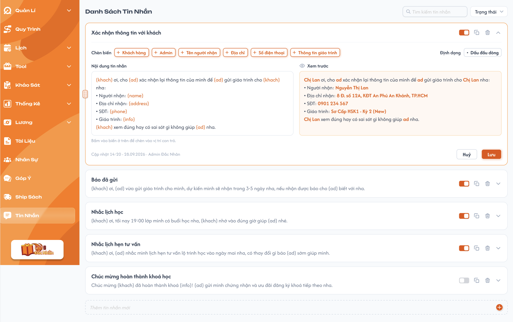

# Template Tin Nhắn

## 1. UI

### Trang 1: Danh Sách Tin Nhắn



**Mô tả:**
- Quản lý các template tin nhắn dùng để gửi cho khách (vd: xác nhận thông tin, báo đã gửi, nhắc lịch học...). Các template **đang bật** sẽ được chọn ở popup Xác nhận gửi tin nhắn của màn Ship Sách.

**Điểm cần lưu ý:**
- Mỗi template là 1 card, có 2 trạng thái:
  - **Thu gọn:** hiển thị tên + nội dung (1 dòng, chưa thay biến, giữ nguyên dạng `{khach}`, `{ad}`...).
  - **Mở rộng** (bấm chevron / bấm vào card): hiển thị khu vực chỉnh sửa, gồm Chèn biến, Định dạng, Nội dung tin nhắn, Xem trước, thông tin cập nhật, nút Huỷ / Lưu. **Cho phép mở rộng nhiều card cùng lúc.**
  - Nút **Lưu** chỉ "sáng" (bấm được) khi tên / nội dung khác với bản đã lưu; nếu giống bản đã lưu thì nút Lưu không sáng.
- Trên header mỗi card:
  - **Toggle** bật / tắt template. Template tắt hiển thị toggle xám. Template chưa có nội dung không bật được.
  - **Icon copy**: copy nội dung tin nhắn của template vào clipboard (không tạo template mới).
  - **Icon thùng rác**: xoá template.
  - **Chevron**: mở rộng / thu gọn.
- **Chèn biến** (cố định, không thêm / sửa / xoá được): bấm nút để chèn biến vào **vị trí con trỏ** trong ô Nội dung tin nhắn.

  | Nút | Biến chèn |
  |---|---|
  | Khách hàng | `{khach}` |
  | Admin | `{ad}` |
  | Tên người nhận | `{name}` |
  | Địa chỉ | `{address}` |
  | Số điện thoại | `{phone}` |
  | Thông tin giáo trình | `{info}` |

- **Định dạng** (cố định): nút "Dấu đầu dòng" chèn ký tự `•` đầu dòng tại vị trí con trỏ.
- Biến trong ô nội dung được hiển thị **màu cam** để phân biệt với text thường.
- **Xem trước:** hiển thị nội dung sau khi thay biến bằng **dữ liệu ví dụ cố định trong code** (không lấy dữ liệu thật). Cập nhật theo nội dung đang gõ. Dữ liệu ví dụ:

  | Biến | Giá trị ví dụ |
  |---|---|
  | `{khach}` | Chị Lan |
  | `{ad}` | ad |
  | `{name}` | Nguyễn Thị Lan |
  | `{address}` | 8 Đ. số 12A, KĐT An Phú An Khánh, TP.HCM |
  | `{phone}` | 0901 234 567 |
  | `{info}` | Sơ Cấp HSK1 - Kỳ 2 (New) |

- Dòng **"Cập nhật HH:mm - dd.MM.yyyy · [Tên Admin]"** ở cuối khu vực chỉnh sửa: thời điểm và người lưu gần nhất.
- Cuối danh sách có ô **"Thêm tin nhắn mới"** (thêm nhanh): nhập tên rồi nhấn Enter hoặc bấm nút **+** để tạo.
- **Sắp xếp vị trí:** kéo thả card bằng **icon 6 chấm** (handle) ở cạnh trái card để đổi vị trí template trong danh sách. Vị trí mới được lưu lại, reload trang vẫn giữ. Vị trí **dùng chung cho mọi Admin** và **không áp dụng** cho thứ tự template trong dropdown "Chọn mẫu tin nhắn" ở Ship Sách. **Vẫn kéo thả được khi đang tìm kiếm / lọc Trạng thái.**
- Thanh công cụ: ô tìm kiếm tin nhắn, filter Trạng thái (bật / tắt). Không có filter Loại tin nhắn.
- Danh sách có bộ lọc `Trung tâm` nằm cùng hàng với các bộ lọc khác, cho chọn một hoặc nhiều trung tâm; khi chọn thì danh sách, tổng số và phân trang chỉ tính dữ liệu của các trung tâm đã chọn, kết hợp `AND` với các bộ lọc khác. Không chọn thì hiển thị dữ liệu của mọi trung tâm. Role Admin không dùng ô chọn trung tâm trên header.

> Chỉ ghi những điểm Dev không thể tự hiểu rõ khi nhìn vào giao diện.
> Không ghi lại các thành phần UI hiển nhiên.

---

## 2. Yêu cầu

### 2.1. Flow chính

**Flow 1: Thêm nhanh template**

```
Nhập tên vào ô "Thêm tin nhắn mới" → Enter / bấm nút "+"
        → FE validate tên → BE tạo template (trạng thái Tắt, nội dung trống) → FE thêm card mới vào **cuối danh sách**
        → Mở rộng card mới để nhập nội dung → Lưu → (có nội dung) mới bật được toggle
```

**Flow 2: Sửa tên / nội dung template**

```
Mở rộng card → Sửa tên / nội dung (chèn biến, dấu đầu dòng nếu cần)
        → Xem trước cập nhật theo nội dung
        → Nội dung khác bản đã lưu → nút "Lưu" sáng (giống bản đã lưu → không sáng)
        ├─ Bấm "Lưu" → FE validate → BE lưu → Thu gọn card, cập nhật dòng "Cập nhật"
        ├─ Bấm "Huỷ" → Bỏ thay đổi, quay về nội dung đã lưu
        └─ Thu gọn card / mở card khác khi chưa lưu → Giữ lại nội dung đang sửa (mất khi reload trang)
```

**Flow 3: Chèn biến / định dạng**

```
Đặt con trỏ trong ô Nội dung → Bấm nút biến / "Dấu đầu dòng"
        → Chèn vào vị trí con trỏ → Xem trước cập nhật
```

**Flow 4: Bật / tắt template**

```
Bấm toggle → FE kiểm tra nội dung template
        ├─ Nội dung trống → Không bật (EX05)
        └─ Có nội dung → BE cập nhật trạng thái → FE đổi trạng thái toggle
        → Template bật: xuất hiện trong popup chọn mẫu tin nhắn (Ship Sách)
        → Template tắt: không xuất hiện
```

**Flow 5: Copy nội dung template**

```
Bấm icon copy → FE copy nội dung tin nhắn vào clipboard → Hiển thị thông báo đã copy
```

**Flow 6: Xoá template**

```
Bấm icon thùng rác → Popup xác nhận xoá
        ├─ Xác nhận → BE xoá mềm → Card biến mất khỏi danh sách
        │      (template không còn xuất hiện trong dropdown chọn mẫu ở popup gửi tin mới; tin đã gửi trước đó vẫn hiển thị bình thường)
        └─ Huỷ → Đóng popup, không thay đổi
```

**Flow 7: Sắp xếp vị trí template**

```
Kéo icon 6 chấm của card → Thả vào vị trí mới trong danh sách
        → FE cập nhật thứ tự hiển thị → BE lưu vị trí mới
        → Reload trang vẫn giữ thứ tự mới
```

### 2.2. Ngoại lệ

- **EX01:** Nhập tên rỗng (hoặc chỉ có khoảng trắng) rồi Enter / bấm "+" → Không tạo template.
- **EX02:** Bấm "Lưu" khi tên hoặc nội dung rỗng → Báo lỗi bắt buộc nhập, không lưu.
- **EX03:** Bấm "Chèn biến" / "Dấu đầu dòng" khi con trỏ chưa đặt trong ô nội dung → Chèn vào cuối nội dung.
- **EX04:** Thêm / sửa / xoá / bật tắt / sắp xếp thất bại (lỗi hệ thống) → Báo lỗi, giữ nguyên trạng thái trước đó (toggle trả về vị trí cũ, card giữ nguyên, card kéo thả trả về vị trí cũ).
- **EX05:** Bấm toggle bật khi template chưa có nội dung → Không bật, báo cần nhập nội dung trước.

### 2.3. Yêu cầu khác

| Mã | Tên yêu cầu | Mô tả |
|---|---|---|
| REQ01 | Chèn biến / định dạng cố định | Danh sách nút Chèn biến và Định dạng là cố định (cấu hình trong code), người dùng không thêm / sửa / xoá được. Chỉ được sửa **tên** và **nội dung** template. |
| REQ02 | Xem trước dùng dữ liệu cố định | Xem trước thay biến bằng bộ dữ liệu ví dụ cố định trong code. Biến không thuộc danh sách (người dùng gõ tay sai tên) giữ nguyên text, không thay. |
| REQ03 | Chèn tại vị trí con trỏ | Biến và dấu đầu dòng chèn tại vị trí con trỏ hiện tại, sau khi chèn con trỏ nằm ngay sau nội dung vừa chèn. |
| REQ04 | Thêm nhanh | Nhập tên + Enter hoặc bấm "+" để tạo. Template mới có trạng thái mặc định **Tắt**, nội dung trống, nằm ở **cuối danh sách**. Sau khi tạo, ô nhập được xoá trống. |
| REQ05 | Copy nội dung | Icon copy chỉ copy nội dung tin nhắn vào clipboard, không tạo template mới. |
| REQ06 | Xoá mềm có xác nhận | Xoá template phải qua popup xác nhận và là xoá mềm. Tin đã gửi từ template đó vẫn hiển thị bình thường (thời gian + nội dung đã gửi). Sau khi xoá, template không còn để chọn khi gửi tin mới. |
| REQ07 | Liên kết Ship Sách | Chỉ template **đang bật** mới xuất hiện trong dropdown "Chọn mẫu tin nhắn" ở popup Xác nhận gửi tin nhắn (Ship Sách). Thứ tự trong dropdown không phụ thuộc vị trí template ở màn này. |
| REQ08 | Thông tin cập nhật | Mỗi lần lưu ghi lại thời điểm và Admin lưu, hiển thị ở dòng "Cập nhật ..." cuối khu vực chỉnh sửa. |
| REQ09 | Nút Lưu và nội dung nháp | Nút Lưu chỉ sáng khi nội dung khác bản đã lưu. Nội dung đang sửa chưa lưu được giữ lại khi thu gọn / mở card khác, mất khi reload trang. Cho phép nhiều card mở rộng cùng lúc. |
| REQ10 | Điều kiện bật | Template chỉ bật được khi đã có nội dung. Template mới mặc định Tắt. |
| REQ11 | Sắp xếp vị trí | Kéo thả card bằng icon 6 chấm để đổi vị trí. Vị trí được lưu lại (reload vẫn giữ), dùng chung cho mọi Admin. Kéo thả được cả khi đang tìm kiếm / lọc. Không làm thay đổi nội dung, trạng thái bật / tắt của template và không áp dụng cho thứ tự trong dropdown ở Ship Sách. |
| REQ12 | Trung tâm | Danh sách có bộ lọc `Trung tâm` nằm cùng hàng với các bộ lọc khác, cho chọn một hoặc nhiều trung tâm; khi chọn thì danh sách, tổng số và phân trang chỉ tính dữ liệu của các trung tâm đã chọn, kết hợp `AND` với các bộ lọc khác. Không chọn thì hiển thị dữ liệu của mọi trung tâm. Role Admin không dùng ô chọn trung tâm trên header. Khi tạo mới bắt buộc chọn `Trung tâm`; bản ghi được lưu thuộc trung tâm đã chọn. Backend kiểm tra lại trung tâm khi lưu, không chỉ dựa vào UI. |

### 2.4. Ràng buộc

#### Quyền

| Role | Xem | Thêm / Sửa | Bật / tắt | Copy | Xoá | Sắp xếp |
|---|:---:|:---:|:---:|:---:|:---:|:---:|
| Admin | ✅ | ✅ | ✅ | ✅ | ✅ | ✅ |

> Màn Template tin nhắn thuộc role Admin.

#### Ràng buộc khác

- Chỉ sửa được tên và nội dung; Chèn biến, Định dạng, dữ liệu Xem trước là cố định.
- Trung tâm, tên và nội dung template là bắt buộc.
- Tên template không bắt buộc duy nhất.
- Xoá là xoá mềm; không có filter Loại tin nhắn.
- Vị trí template được đổi bằng kéo thả, lưu lại và dùng chung cho mọi Admin; không áp dụng cho thứ tự dropdown ở Ship Sách.

---

## 3. Testcase

### Feature: Template Tin Nhắn

| Tên testcase | Priority | Loại test | Scenario | Role | Pre-condition | Given/When/Then | Expected Result |
|---|---| --- |---|---|---|---|---|
| Case 1: Thêm nhanh bằng Enter / nút + | High | Smoke | Flow 1, REQ04 | Admin | Đang ở màn Danh Sách Tin Nhắn | **Given:** Nhập tên vào ô "Thêm tin nhắn mới"<br>**When:** Nhấn Enter (hoặc bấm "+")<br>**Then:** Hệ thống tạo template | - Card mới xuất hiện ở cuối danh sách<br>- Ô nhập được xoá trống<br>- Cho phép trùng tên với template khác |
| Case 2: Template mới mặc định Tắt, chỉ bật khi có nội dung | High |  | REQ10, EX05 | Admin | Vừa thêm nhanh 1 template | **Given:** Template mới (Tắt, nội dung trống)<br>**When:** Bấm toggle bật; sau đó nhập nội dung, Lưu rồi bấm bật<br>**Then:** Hệ thống kiểm tra nội dung | - Lần 1: không bật, báo cần nhập nội dung<br>- Lần 2: bật thành công |
| Case 3: Thêm nhanh với tên rỗng | Medium |  | EX01 | Admin | Ô "Thêm tin nhắn mới" đang trống / chỉ có khoảng trắng | **Given:** Ô nhập rỗng<br>**When:** Nhấn Enter hoặc bấm "+"<br>**Then:** Hệ thống kiểm tra | - Không tạo template, danh sách không đổi |
| Case 4: Sửa tên / nội dung và lưu | High | Smoke | Flow 2, REQ08 | Admin | Có ít nhất 1 template | **Given:** Mở rộng card<br>**When:** Sửa tên + nội dung, bấm "Lưu"<br>**Then:** Hệ thống lưu | - Tên và nội dung mới hiển thị ở card thu gọn<br>- Dòng "Cập nhật" hiển thị thời điểm + Admin vừa lưu |
| Case 5: Nút Lưu sáng và giữ nội dung nháp | High |  | Flow 2, REQ09 | Admin | Có ít nhất 2 template | **Given:** Mở rộng 2 card cùng lúc<br>**When:** Sửa nội dung card A, thu gọn A, mở card B, quay lại A; sửa lại giống bản đã lưu; bấm Huỷ ở lần khác<br>**Then:** Quan sát nút Lưu và nội dung | - Mở được nhiều card cùng lúc<br>- Khác bản đã lưu: nút Lưu sáng; giống bản đã lưu: không sáng<br>- Nội dung nháp được giữ khi thu gọn / mở card khác, mất khi reload<br>- Huỷ: quay về nội dung đã lưu |
| Case 6: Lưu khi thiếu tên / nội dung | High |  | EX02 | Admin | Card đang mở rộng | **Given:** Xoá trống tên hoặc nội dung<br>**When:** Bấm "Lưu"<br>**Then:** Hệ thống kiểm tra | - Báo lỗi bắt buộc nhập<br>- Không lưu |
| Case 7: Chèn biến, dấu đầu dòng và xem trước | High |  | Flow 3, REQ01-03 | Admin | Card đang mở rộng | **Given:** Đặt con trỏ giữa nội dung<br>**When:** Bấm các nút biến và "Dấu đầu dòng"<br>**Then:** Quan sát ô nội dung và Xem trước | - Biến / `•` chèn đúng vị trí con trỏ, biến hiển thị màu cam<br>- Xem trước thay biến bằng dữ liệu ví dụ cố định<br>- Không thêm / sửa được nút Chèn biến, Định dạng |
| Case 8: Bật / tắt template và liên kết Ship Sách | High |  | Flow 4, REQ07 | Admin | Có template bật và tắt | **Given:** Tắt 1 template đang bật<br>**When:** Mở popup Xác nhận gửi tin nhắn ở màn Ship Sách<br>**Then:** Mở dropdown mẫu tin nhắn | - Template vừa tắt không có trong dropdown<br>- Bật lại thì xuất hiện lại |
| Case 9: Copy nội dung template | Medium |  | Flow 5, REQ05 | Admin | Có ít nhất 1 template | **Given:** Bấm icon copy trên 1 card<br>**When:** Dán vào nơi khác<br>**Then:** Quan sát clipboard và danh sách | - Nội dung tin nhắn được copy vào clipboard<br>- Không tạo template mới |
| Case 10: Xoá mềm template đã dùng gửi tin | High | Smoke | Flow 6, REQ06 | Admin | Template đã được dùng để gửi tin ở Ship Sách | **Given:** Bấm icon thùng rác<br>**When:** Bấm Huỷ rồi thử lại và bấm Xác nhận<br>**Then:** Hệ thống xử lý theo lựa chọn | - Huỷ: template giữ nguyên<br>- Xác nhận: template biến mất khỏi danh sách và dropdown chọn mẫu khi gửi tin mới<br>- Tin đã gửi trước đó vẫn hiển thị thời gian + nội dung ở Ship Sách |
| Case 11: Sắp xếp vị trí template | High |  | Flow 7, REQ11, EX04 | Admin (2 user) | Có ít nhất 3 template | **Given:** Danh sách có 3 template theo thứ tự A, B, C<br>**When:** Kéo icon 6 chấm của C lên trên A (thử cả khi đang tìm kiếm / lọc Trạng thái), reload trang, đăng nhập Admin khác; mở dropdown mẫu tin nhắn ở Ship Sách<br>**Then:** Hệ thống lưu vị trí | - Thứ tự hiển thị là C, A, B, reload vẫn giữ<br>- Admin khác thấy cùng thứ tự (dùng chung)<br>- Kéo thả được khi đang tìm kiếm / lọc<br>- Thứ tự trong dropdown Ship Sách không đổi theo<br>- Nội dung và trạng thái bật / tắt không đổi<br>- Lỗi lưu: card trả về vị trí cũ, báo lỗi |
| Case 12: Lọc danh sách theo trung tâm | High |  | REQ12 | Admin | Có template ở trung tâm A và trung tâm B | **Given:** bộ lọc `Trung tâm` chưa chọn giá trị nào<br>**When:** chọn trung tâm B ở bộ lọc `Trung tâm`, sau đó bỏ chọn<br>**Then:** danh sách chỉ hiển thị template của trung tâm B | - Không lẫn dữ liệu của trung tâm A<br>- Tổng số và phân trang cập nhật theo trung tâm B<br>- Bỏ chọn thì hiển thị lại dữ liệu của mọi trung tâm |
| Case 13: Bắt buộc chọn trung tâm khi tạo | High |  | REQ12 | Admin | Popup/dòng tạo template đang mở | **Given:** các field bắt buộc khác hợp lệ<br>**When:** bỏ trống `Trung tâm` rồi xác nhận; sau đó chọn trung tâm A và xác nhận<br>**Then:** thiếu Trung tâm thì không tạo; chọn A thì tạo thành công | - Báo lỗi tại field Trung tâm khi bỏ trống<br>- Template mới thuộc trung tâm A; lọc trung tâm A thì thấy, lọc trung tâm B thì không thấy |