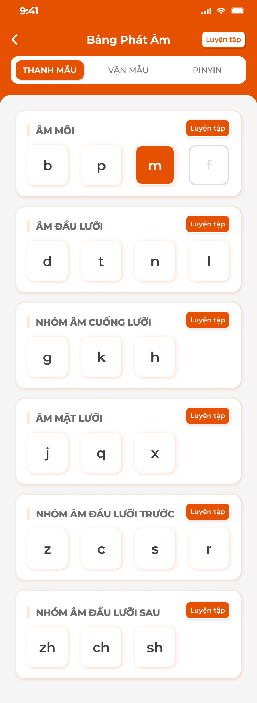
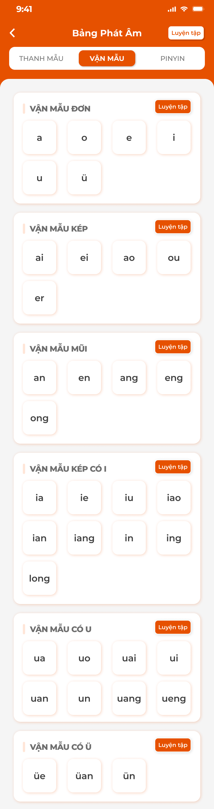
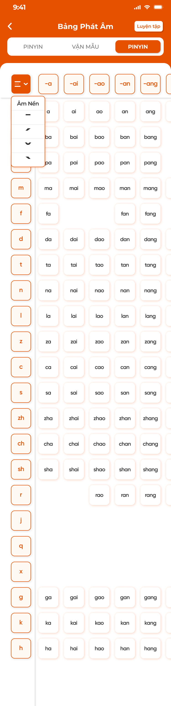
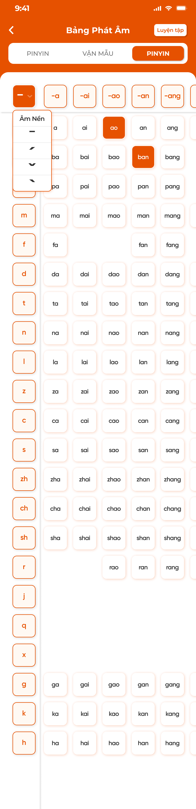
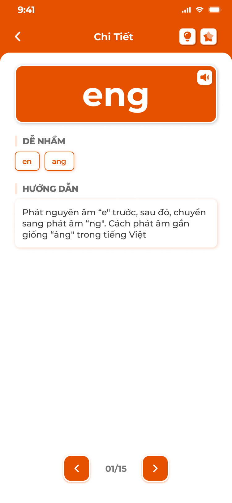

# [Học viên] Bảng chữ

> Mục **Bảng chữ** của app học viên khác theo trung tâm: **Đắc Nhân** là Bảng phát âm Pinyin (Thanh mẫu, Vận mẫu, bảng Pinyin), **Sakumi** là bảng chữ Hiragana / Katakana, **Saechang** là bảng chữ Hangul; Betreux, Creative English, Créatis không có mục này. Mở từ thẻ `Bảng chữ` trong [Chi tiết bài học](../lesson/lesson.md), từ khối `BẢNG PHÁT ÂM` / `BẢNG CHỮ` ở màn chính 247, hoặc từ [Thư viện học tập](../library/library.md). Dữ liệu từ tab Phát âm / Bảng chữ của [Kiến thức (S1)](../../course_management/knowledge-s1/knowledge-s1.md); app chỉ đọc.
>
> Ảnh có cho Bảng phát âm Pinyin; bảng Kana và Hangul chưa có ảnh, đặc tả theo spec và cấu trúc dữ liệu S1 (Phụ lục A.7).

## 1. UI

### Bảng phát âm Pinyin (Đắc Nhân)

<p align="center">
  <a href="./images/01-thanh-mau.png"></a>
  <a href="./images/02-van-mau.png"></a>
  <a href="./images/03-bang-pinyin.png"></a><br>
  <em>Ba tab: Thanh mẫu theo nhóm, Vận mẫu theo nhóm, bảng Pinyin thanh mẫu × vận mẫu — nhấn để xem ảnh gốc</em>
</p>

<p align="center">
  <a href="./images/04-bang-pinyin-thanh-dieu.png"></a>
  <a href="./images/05-chi-tiet-am.png"></a>
  <a href="./images/06-o-pinyin.png"></a><br>
  <em>Chọn thanh điệu (Âm nền, 4 thanh); chi tiết âm: Dễ nhầm, Hướng dẫn; ba kiểu ô: thanh mẫu / vận mẫu, chữ + âm, âm tiết — nhấn để xem ảnh gốc</em>
</p>

**Mô tả:**

- Màn `Bảng Phát Âm` gồm 3 tab `THANH MẪU`, `VẬN MẪU`, `PINYIN`; mỗi nhóm có nút `Luyện tập`; bấm ô mở chi tiết âm. Dữ liệu là bảng pinyin của S1 (Loại `Thanh mẫu` / `Vận mẫu` / `Âm tiết`, 12 nhóm, 4 thanh, audio theo thanh).

**Giải thích thành phần:**

| Thành phần | Yêu cầu |
|---|---|
| Header | Back, `Bảng Phát Âm`, nút `Luyện tập` (toàn bảng). |
| Tab `THANH MẪU` | 6 khối theo Nhóm của S1 (`ÂM MÔI` b p m f, `ÂM ĐẦU LƯỠI` d t n l, `NHÓM ÂM CUỐNG LƯỠI` g k h, `ÂM MẶT LƯỠI` j q x, `NHÓM ÂM ĐẦU LƯỠI TRƯỚC` z c s r, `NHÓM ÂM ĐẦU LƯỠI SAU` zh ch sh); mỗi khối tên nhóm + nút `Luyện tập` + ô âm. Ô Đã thuộc nền cam; ô đang chọn viền cam; âm chưa có dữ liệu mờ (vd `f`). |
| Tab `VẬN MẪU` | 6 khối: `VẬN MẪU ĐƠN`, `VẬN MẪU KÉP`, `VẬN MẪU MŨI`, `VẬN MẪU KÉP CÓ I`, `VẬN MẪU CÓ U`, `VẬN MẪU CÓ Ü`; cùng cách hiển thị. |
| Tab `PINYIN` | Lưới âm tiết: cột trái thanh mẫu (ô viền cam), hàng trên vận mẫu (`-a`, `-ai`, `-ao`…), ô giao là âm tiết có trong bảng; ô trống = tổ hợp không tồn tại. Cuộn ngang / dọc, header hàng và cột ghim. |
| Dropdown thanh điệu | Góc trái trên lưới: `Âm Nền` (không thanh), thanh 1 `ˉ`, 2 `ˊ`, 3 `ˇ`, 4 `ˋ`; chọn thanh thì ô hiện âm tiết kèm dấu thanh và loa phát audio theo thanh. |
| Bấm ô | Mở Chi tiết âm: âm lớn + loa; `DỄ NHẦM` (chip các âm dễ nhầm, bấm chuyển sang âm đó); `HƯỚNG DẪN` (Hướng dẫn phát âm); với âm tiết thêm `Thanh mẫu`, `Vận mẫu` thành phần và 4 nút thanh để nghe; `Cách đọc`, video hướng dẫn nếu có; 💡 Đã thuộc, ⭐ lưu thư viện; `<` `>` `n/N` trong nhóm. |
| `Luyện tập` | Popup chế độ: `Duyệt`, `Flashcard`, `Trắc nghiệm`, `Thử thách` trên phạm vi nhóm (hoặc toàn bảng); nội dung như Luyện tập ở [Kiến thức](../knowledge/knowledge.md): Trắc nghiệm nghe audio chọn âm / xem âm chọn audio; Thử thách 16 ô, 3 tim. |
| Tiến độ | Khối `BẢNG PHÁT ÂM` ở màn chính và thẻ `Bảng chữ` trong bài học hiện % = số âm Đã thuộc / tổng âm của phạm vi. |

**Điểm cần lưu ý:**

- Từ bài học: chỉ hiện nhóm và âm gắn với bài; từ 247: toàn bảng.
- Audio: thanh mẫu 1 file; vận mẫu và âm tiết theo thanh (file `pinyin_<thanh>.mp3` của S1); không có file thì TTS.
- Ô mờ là âm có trong bảng chuẩn nhưng S1 chưa có dữ liệu; bấm không mở.

#### Testcase — Bảng phát âm Pinyin

| Tên testcase | Priority | Loại test | Scenario | Role | Pre-condition | Given / When / Then | Expected Result |
|---|---| --- |---|---|---|---|---|
| Case 1: Mở bảng từ 247 | High | Smoke | Flow 1 / REQ01 | Học viên Đắc Nhân | Bảng pinyin đầy đủ | **Given** bấm khối `BẢNG PHÁT ÂM`<br>**When** màn tải<br>**Then** 3 tab, Thanh mẫu 6 nhóm đúng S1 | - Ô Đã thuộc nền cam |
| Case 2: Lưới Pinyin + thanh điệu | High |  | REQ02 | Học viên Đắc Nhân | Tab PINYIN | **Given** chọn thanh `ˇ`<br>**When** bấm ô `ban`<br>**Then** mở chi tiết `bǎn`, loa phát audio thanh 3 | - Tổ hợp không có là ô trống |
| Case 3: Dễ nhầm | Medium |  | REQ02 | Học viên Đắc Nhân | Chi tiết `eng` | **Given** bấm chip `en`<br>**When** chuyển<br>**Then** chi tiết `en` | - |
| Case 4: Luyện tập nhóm | Medium |  | Flow 2 / REQ03 | Học viên Đắc Nhân | Nhóm Âm môi | **Given** bấm `Luyện tập` của khối<br>**When** chọn `Trắc nghiệm`<br>**Then** câu hỏi chỉ trong b p m f | - Kết quả % đúng |
| Case 5: Từ bài học | Medium |  | REQ01 | Học viên Đắc Nhân | Bài gắn 5 âm | **Given** mở `Bảng chữ` từ Chi tiết bài<br>**When** render<br>**Then** chỉ nhóm chứa 5 âm, ô khác mờ | - Thẻ bài hiện % trên 5 âm |

### Bảng chữ Kana (Sakumi)

**Mô tả:**

- Màn `Bảng Chữ` cho tiếng Nhật: chuyển `Hiragana` / `Katakana`; 3 tab theo Loại của S1: `Cơ bản` (Âm cơ bản 46), `Biến âm` (Âm đục 20 + Âm bán đục 5), `Kết hợp` (Âm ghép 33); lưới 5 cột nguyên âm `a i u e o` × hàng phụ âm; chữ Đã thuộc nền cam.

**Giải thích thành phần:**

| Thành phần | Yêu cầu |
|---|---|
| Header | Back, `Bảng Chữ`, nút `Luyện tập`, icon ⭐+ (chọn nhiều vào thư viện). |
| Nút bộ chữ | `Hiragana` / `Katakana`; một mục S1 là cặp chữ nên trạng thái thuộc và lưu dùng chung cho cả hai bộ. |
| Lưới | Hàng trên: nguyên âm; cột trái: hàng (`あ行`…); ô = chữ + romaji; vị trí không có chữ là ô xám. Bấm tên hàng / cột hoặc tiêu đề tab mở popup Luyện tập cho phạm vi đó. |
| Chi tiết chữ | Chữ lớn (cả Hiragana và Katakana) + romaji + loa; `MẸO NHỚ` (hình + ghi chú); `DỄ NHẦM` (chip chữ dễ nhầm); `TỪ VỰNG` (từ ví dụ: kana, romaji, nghĩa, loa); nét viết nếu có; 💡, ⭐; `<` `>`. |
| ⭐+ | Popup `Cập nhật danh sách yêu thích`: lọc Loại (Âm cơ bản / Âm đục / Âm bán đục / Âm ghép) và Phạm vi (hàng hoặc cột); ô ba trạng thái: đã có trong thư viện (nền cam đậm, bỏ chọn = gỡ), đang thêm (viền trắng nền cam nhạt), chưa chọn (trắng); `Đồng ý` lưu, Toast `Đã cập nhật thư viện!`. |
| `Luyện tập` | Popup chế độ: `Duyệt bài`, `Học`, `Chi tiết`, `Luyện viết`, `Flashcard`, `Trắc nghiệm`, `Thử thách 1`, `Thử thách 2` trên phạm vi đã chọn (bảng / hàng / cột). |

**Chế độ luyện tập:**

| Chế độ | Nội dung |
|---|---|
| `Duyệt bài` | Flashcard một mặt từng chữ; `Đã nhớ` (= Đã thuộc) / bỏ qua; `Quay lại` từ thẻ 2; tổng kết số đã nhớ. |
| `Học` | Chuỗi card chữ (chữ, romaji, nghĩa, `Hoàn thành`) và flashcard (mặt trước chữ + ⭐ 💡, `Tiếp theo` lật, `Hoàn thành`); sau một số nội dung chèn bài kiểm tra chặn (Nối chữ kéo thả, Trắc nghiệm, Sắp xếp); đúng mới đi tiếp; popup hoàn thành. |
| `Chi tiết` | Mở Chi tiết chữ, `<` `>` qua phạm vi. |
| `Luyện viết` | Nét mẫu động có số thứ tự, khung viết tay, loa, `Hoàn tác`, `Xoá`, `Ẩn / Hiện hướng dẫn`, `<` `>`. |
| `Flashcard` | 3 loại: 1 hướng viết chữ; 2 chữ + romaji + audio + câu gợi nhớ; 3 hình minh hoạ + nét viết + câu gợi nhớ; lật, 💡, ⭐, `<` `>`; mọi thẻ Đã thuộc → popup `Chúc mừng`. |
| `Trắc nghiệm` | Câu hỏi là audio hoặc chữ, 4 đáp án; phản hồi xanh / đỏ, tự chuyển; thanh tiến độ; kết quả % đúng, danh sách chữ, `Làm lại`. |
| `Thử thách 1` | 16 câu: hiện romaji → chọn trong 16 ô chữ; 5–7 giây / câu; 3 tim; thông báo `Làm tốt lắm, tiếp tục nào` / `Sai rồi bạn ơi, ‘さ’ mới đúng` / `Hết giờ cho câu này`; kết quả `Thành công rồi!` / `Hãy luyện tập thật tốt nhé!`; đúng → Đã thuộc. |
| `Thử thách 2` | Như Thử thách 1 nhưng hiện chữ → chọn romaji. |

**Điểm cần lưu ý:**

- Âm ngắt `っ` và trường âm không là ô riêng (quyết định S1), hiển thị trong ví dụ.
- Từ bài học chỉ hiện chữ gắn với bài (ô khác mờ); từ 247 toàn bảng.

#### Testcase — Bảng chữ Kana

| Tên testcase | Priority | Loại test | Scenario | Role | Pre-condition | Given / When / Then | Expected Result |
|---|---| --- |---|---|---|---|---|
| Case 6: Lưới Hiragana | High | Smoke | Flow 1 / REQ01 | Học viên Sakumi | 104 mục | **Given** mở Bảng chữ<br>**When** tab `Cơ bản`<br>**Then** lưới 5 × 11, 46 chữ, ô xám ở vị trí trống (vd `や行` cột i) | - `Katakana` đổi toàn lưới |
| Case 7: Chọn nhiều vào thư viện | High |  | Flow 3 / REQ04 | Học viên Sakumi | 2 chữ đã lưu | **Given** ⭐+ → lọc hàng `k`, tick 3 chữ, bỏ 1 đã lưu<br>**When** `Đồng ý`<br>**Then** thư viện +3 −1, Toast | - Ô đã lưu nền cam đậm |
| Case 8: Thử thách 1 | Medium |  | REQ03 | Học viên Sakumi | Phạm vi hàng `s` | **Given** `Luyện tập` → `Thử thách 1`<br>**When** chọn sai `し` cho `sa`<br>**Then** `Sai rồi bạn ơi, ‘さ’ mới đúng`, mất 1 tim | - Hết 3 tim: `Hãy luyện tập thật tốt nhé!` |
| Case 9: Trạng thái chung 2 bộ | Medium |  | REQ02 | Học viên Sakumi | `あ` Đã thuộc | **Given** chuyển `Katakana`<br>**When** render<br>**Then** `ア` cũng nền cam | - |

### Bảng chữ Hangul (Saechang)

**Mô tả:**

- Màn `Bảng Chữ` cho tiếng Hàn: tab `Phụ âm` (Phụ âm thường 9, bật hơi 5, căng 5), `Nguyên âm` (đơn 10, ghép 11), `Bảng ghép` (lưới 14 phụ âm × 10 nguyên âm = 140 âm tiết, nhóm `Bảng ghép cơ bản` / `Phụ âm căng` / `Nguyên âm ghép` / `Patchim`); cùng bộ thao tác với Kana.

**Giải thích thành phần:**

| Thành phần | Yêu cầu |
|---|---|
| Tab `Phụ âm`, `Nguyên âm` | Khối theo Loại của S1; ô = chữ + tên gọi (phụ âm) hoặc chữ + romaja; Đã thuộc nền cam; mỗi khối nút `Luyện tập`. |
| Tab `Bảng ghép` | Lưới phụ âm (hàng) × nguyên âm (cột), ô = âm tiết + romaja; bấm ô mở Chi tiết: âm tiết lớn + phân tích `ㄱ + ㅏ`, phiên âm, Phụ âm (chữ · tên gọi · romaja), Nguyên âm, ví dụ, loa. Âm tiết không là mục riêng: Đã thuộc / lưu tính theo **phụ âm**. |
| Chi tiết jamo | Chữ lớn + tên gọi + romaja (đầu / cuối) + loa; `Loại`; `TỪ VỰNG` (ví dụ: từ · nghĩa); nét viết nếu có; 💡, ⭐; `<` `>`. |
| `Luyện tập` | Cùng bộ chế độ Kana: `Duyệt bài`, `Học`, `Chi tiết`, `Luyện viết`, `Flashcard`, `Trắc nghiệm`, `Thử thách 1` (romaja → chữ), `Thử thách 2` (chữ → romaja). |

**Điểm cần lưu ý:**

- Chưa có sheet dữ liệu Hangul; field theo Figma Thư viện CD (S1 Phụ lục A.7.2). Từ ví dụ, audio cần dữ liệu CD nhập.

#### Testcase — Bảng chữ Hangul

| Tên testcase | Priority | Loại test | Scenario | Role | Pre-condition | Given / When / Then | Expected Result |
|---|---| --- |---|---|---|---|---|
| Case 10: Lưới ghép | High | Smoke | Flow 1 / REQ01 | Học viên Saechang | 40 jamo | **Given** tab `Bảng ghép`<br>**When** bấm `가`<br>**Then** chi tiết `ㄱ + ㅏ`, Phụ âm `ㄱ (기역) · g / k` | - 14 × 10 ô |
| Case 11: Đã thuộc theo phụ âm | Medium |  | REQ02 | Học viên Saechang | `ㄱ` Đã thuộc | **Given** xem lưới ghép<br>**When** render hàng `ㄱ`<br>**Then** cả hàng nền cam | - |

### Trung tâm không có Bảng chữ

**Mô tả:**

- Betreux, Creative English, Créatis: không có thẻ `Bảng chữ` ở Chi tiết bài học và khối `BẢNG CHỮ` ở màn chính; vị trí thẻ thay bằng `Mẫu câu` (xem [Kiến thức](../knowledge/knowledge.md)).

#### Testcase — Trung tâm không có Bảng chữ

| Tên testcase | Priority | Loại test | Scenario | Role | Pre-condition | Given / When / Then | Expected Result |
|---|---| --- |---|---|---|---|---|
| Case 12: Creative English | Medium |  | REQ01 / EX01 | Học viên Creative English | Bài có mẫu câu | **Given** mở Chi tiết bài<br>**When** xem hàng Kiến thức<br>**Then** thẻ đầu là `Mẫu câu`, không có `Bảng chữ` | - Gọi API bảng chữ trả rỗng |

### Toast phản hồi CRUD

<p align="center">
  <a href="../../images/01-toast-crud.png"></a><br>
  <em>Toast Thành Công, Thông Báo, Cảnh Báo và Có Lỗi Xảy Ra — nhấn để xem ảnh gốc</em>
</p>

**Mô tả:**

- Phản hồi khi lưu / gỡ thư viện (⭐, ⭐+ Đồng ý).

**Giải thích thành phần:**

| Loại Toast | Tiêu đề cố định | Khi sử dụng |
|---|---|---|
| Thành công | `Thành Công` | `Đã cập nhật thư viện!` |
| Lỗi | `Có Lỗi Xảy Ra` | `Cập nhật thư viện thất bại` |

**Điểm cần lưu ý:**

- Đổi Đã thuộc không Toast.

#### Testcase — Toast phản hồi CRUD

| Tên testcase | Priority | Loại test | Scenario | Role | Pre-condition | Given / When / Then | Expected Result |
|---|---| --- |---|---|---|---|---|
| Toast Case 1: Thành công | High |  | Ràng buộc Toast CRUD | Học viên | Mạng ổn | **Given** `Đồng ý` ở popup ⭐+<br>**When** lưu xong<br>**Then** Toast `Thành Công` | - Một Toast |

---

## 2. Yêu cầu

### 2.1. Flow chính

**Flow 1 / REQ01 / REQ02: Xem bảng chữ**

```text
Mở Bảng chữ (bài học / 247 / Thư viện) → màn theo trung tâm (Pinyin / Kana / Hangul)
      → Tab / bộ chữ / nhóm → ô (Đã thuộc nền cam) → Chi tiết: loa, dễ nhầm, hướng dẫn, ví dụ, 💡, ⭐
```

**Flow 2 / REQ03: Luyện tập**

```text
Luyện tập (toàn bảng / nhóm / hàng / cột) → popup chế độ → chạy trên phạm vi
      → Duyệt / Học / Flashcard / Thử thách đúng: cập nhật Đã thuộc → kết quả, Làm lại
```

**Flow 3 / REQ04: Lưu vào thư viện**

```text
⭐ ở chi tiết → lưu / gỡ → Toast
⭐+ → popup lọc Loại / Phạm vi → tick / bỏ tick → Đồng ý → Toast
```

### 2.2. Ngoại lệ

- **EX01:** Trung tâm không có hệ chữ riêng → không có mục Bảng chữ; API trả rỗng.
- **EX02:** Âm / chữ chưa có dữ liệu ở S1 → ô mờ, không bấm được.
- **EX03:** Thử thách sai hoặc hết giờ 3 lần → popup thua, không ghi Đã thuộc.
- **EX04:** Không cấp quyền hoặc không có audio → loa dùng TTS; không có TTS cho ký tự thì loa mờ.

### 2.3. Yêu cầu khác

- **REQ01 – Theo trung tâm:** Đắc Nhân Bảng phát âm Pinyin (3 tab, 12 nhóm, 4 thanh); Sakumi Kana (Hiragana / Katakana, 3 tab theo Loại, lưới 5 × 11); Saechang Hangul (Phụ âm, Nguyên âm, Bảng ghép 14 × 10); trung tâm khác không có. Phạm vi theo nơi mở (bài / 247 / Thư viện).
- **REQ02 – Trạng thái thuộc:** Theo mục S1 (âm, cặp kana, jamo); Đã thuộc nền cam; dùng chung mọi màn; Hangul âm tiết ghép tính theo phụ âm; Kana cặp chữ dùng chung cho 2 bộ.
- **REQ03 – Luyện tập:** Pinyin: Duyệt, Flashcard, Trắc nghiệm, Thử thách; Kana / Hangul: 8 chế độ như bảng; thời gian và tim theo spec (5–7 giây / câu, 3 tim, 16 câu).
- **REQ04 – Thư viện:** ⭐ từng mục; ⭐+ chọn nhiều có lọc Loại / Phạm vi; mục đã lưu bỏ tick = gỡ.
- **REQ05 – Audio:** Pinyin theo thanh; Kana / Hangul một file; không có thì TTS.

### 2.4. Ràng buộc

#### Quyền

| Role | Xem | Đã thuộc / lưu | Luyện tập |
|---|:---:|:---:|:---:|
| Học viên | ✅ | ✅ | ✅ |
| Người dùng trải nghiệm | ✅ | ✅ (trên máy) | ✅ |

#### Phạm vi dữ liệu

- Backend trả bảng theo trung tâm của tài khoản (hoặc trung tâm / cấp độ đang chọn ở 247); trung tâm không có hệ chữ trả rỗng.

---

## 3. Cần xác nhận

- Bảng Kana và Hangul chưa có ảnh thiết kế app; cấu trúc theo spec Sakumi 3.22 và S1 A.7.
- Hangul: chưa có sheet dữ liệu (từ ví dụ, audio, nét viết); `Patchim` trong lưới ghép cần quy tắc sinh.
- Pinyin: nhóm hiển thị ô mờ (`f` trong ảnh) là do thiếu dữ liệu hay thiết kế cố ý.
