# [Học viên] Bài học

> Tab **Bài học** trong chi tiết lớp của app học viên: danh sách buổi học theo thứ tự, chi tiết bài học gồm **Phần bắt buộc** (Duyệt kiến thức, Flashcard, Luyện nhớ chuyên sâu, Bài tập củng cố), **Kiến thức** và **Kỹ năng** của bài. Nội dung bài lấy từ bài học CD đã định nghĩa (kiến thức gắn từ [Kiến thức (S1)](../../course_management/knowledge-s1/knowledge-s1.md), kỹ năng từ Kỹ năng (S6)); trạng thái điểm danh và bài tập đồng bộ từ luồng dạy của giáo viên ([Giáo viên — Giảng dạy](../../teacher_role/class/class_teaching_requirements.md)).
>
> App dùng chung cho mọi trung tâm; ví dụ trong ảnh là tiếng Trung (Đắc Nhân). Ảnh là màn app người dùng gửi; màn chưa có ảnh vẫn đặc tả đầy đủ, chỗ ảnh để trống. Các mục Kiến thức, Kỹ năng, Bảng chữ đặc tả ở [Kiến thức](../knowledge/knowledge.md), [Kỹ năng](../skill/skill.md), [Bảng chữ](../alphabet/alphabet.md).

## 1. UI

### Danh sách bài học

<p align="center">
  <a href="./images/01-danh-sach-bai-hoc.png">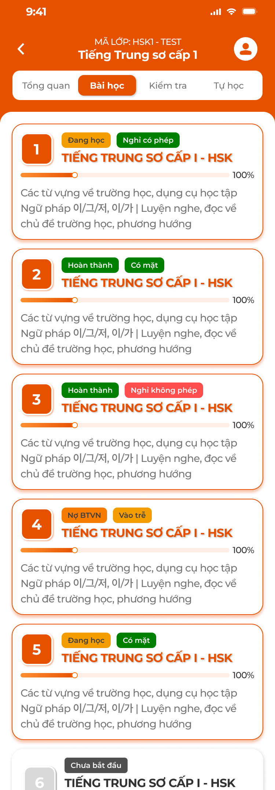</a><br>
  <em>Tab Bài học: thẻ buổi học với trạng thái học, điểm danh, tiến độ — nhấn để xem ảnh gốc</em>
</p>

**Mô tả:**

- Học viên vào lớp → tab `Bài học` để xem toàn bộ buổi học của lớp theo thứ tự; bấm thẻ để mở chi tiết bài học.

**Giải thích thành phần:**

| Thành phần | Yêu cầu |
|---|---|
| Header | Nút back, `MÃ LỚP: <mã>`, tên khoá học, icon tài khoản (mở Hồ sơ). |
| Thanh tab | `Tổng quan`, `Bài học`, `Kiểm tra`, `Tự học` (xem [Lớp học](../course/course.md)). |
| Thẻ buổi học | Số thứ tự buổi (ô cam), tag trạng thái học, tag điểm danh, tên bài (in hoa, cam), thanh tiến độ `%`, mô tả bài. |
| Tag trạng thái học | `Chưa bắt đầu` (xám, thẻ mờ): giáo viên chưa mở bài; `Đang học` (cam): bài đã mở, buổi chưa hoàn thành; `Hoàn thành` (xanh lá): buổi đã hoàn thành; `Nợ BTVN` (đỏ nhạt): buổi hoàn thành nhưng học viên chưa nộp BTVN. |
| Tag điểm danh | Theo điểm danh của giáo viên: `Có mặt` (xanh lá), `Vào trễ`, `Ra sớm`, `Vào trễ & Ra sớm` (cam), `Nghỉ có phép` (xanh lá đậm), `Nghỉ không phép` (đỏ); chưa điểm danh thì không có tag. |
| Thanh tiến độ | % hoàn thành bài của học viên = trung bình % của 4 mục Phần bắt buộc (mỗi mục hoàn thành = 100%). |
| Thứ tự | Theo số thứ tự bài trong khoá; bài `Chưa bắt đầu` vẫn hiện, mờ, bấm vào vẫn xem được nội dung (REQ02). |

**Điểm cần lưu ý:**

- Chỉ hiện buổi của lớp học viên đang tham gia; dữ liệu trạng thái do giáo viên cập nhật, app chỉ đọc.
- `Nợ BTVN` ưu tiên hiển thị thay `Hoàn thành` khi học viên chưa nộp bài tập củng cố của buổi đã hoàn thành.
- Lớp chưa có buổi học: hiển thị `Chưa có buổi học nào được tạo cho lớp này`.

#### Testcase — Danh sách bài học

| Tên testcase | Priority | Loại test | Scenario | Role | Pre-condition | Given / When / Then | Expected Result |
|---|---| --- |---|---|---|---|---|
| Case 1: Mở tab Bài học | High | Smoke | Flow 1 / REQ01 | Học viên | Lớp có 6 buổi, buổi 1–5 đã mở | **Given** vào lớp<br>**When** bấm tab `Bài học`<br>**Then** 6 thẻ đúng thứ tự | - Buổi 6 mờ `Chưa bắt đầu`<br>- Tag điểm danh đúng dữ liệu giáo viên |
| Case 2: Tag Nợ BTVN | High |  | REQ01 | Học viên | Buổi 4 Hoàn thành, học viên chưa nộp BTVN | **Given** xem thẻ buổi 4<br>**When** render<br>**Then** tag `Nợ BTVN` thay cho `Hoàn thành` | - Nộp bài xong thì tag về `Hoàn thành` |
| Case 3: Tiến độ bài | Medium |  | REQ03 | Học viên | Hoàn thành Duyệt kiến thức và Flashcard, 2 mục còn lại chưa | **Given** xem thẻ<br>**When** render thanh tiến độ<br>**Then** `50%` | - |
| Case 4: Lớp chưa có buổi | Low |  | EX01 | Học viên | Lớp mới | **Given** mở tab<br>**When** không có buổi<br>**Then** hiện `Chưa có buổi học nào được tạo cho lớp này` | - Không lỗi |

### Chi tiết bài học

<p align="center">
  <a href="./images/02-chi-tiet-bai-hoc.png">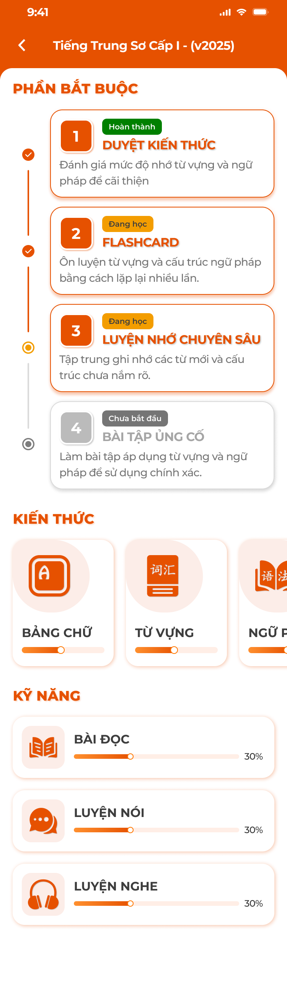</a>
  <a href="./images/03-chi-tiet-bai-hoc-trang-thai.png">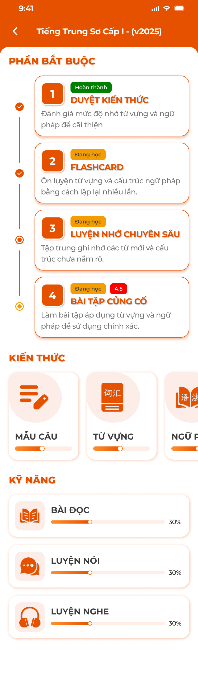</a><br>
  <em>Chi tiết bài học: Phần bắt buộc dạng timeline, Kiến thức, Kỹ năng; thẻ Bài tập củng cố có badge điểm — nhấn để xem ảnh gốc</em>
</p>

**Mô tả:**

- Màn tổng hợp mọi hoạt động của một bài học: timeline 4 bước bắt buộc, hàng thẻ Kiến thức, danh sách Kỹ năng với tiến độ.

**Giải thích thành phần:**

| Thành phần | Yêu cầu |
|---|---|
| Header | Nút back, tên bài học. |
| `PHẦN BẮT BUỘC` | Timeline 4 bước theo thứ tự: `1 Duyệt kiến thức`, `2 Flashcard`, `3 Luyện nhớ chuyên sâu`, `4 Bài tập củng cố`. Mỗi thẻ: số bước, tag trạng thái (`Chưa bắt đầu` xám, `Đang học` cam, `Hoàn thành` xanh lá), tên, mô tả ngắn. Bước đang làm viền cam, chấm timeline tô theo trạng thái. |
| Badge điểm (bước 4) | Khi BTVN đã chấm: badge đỏ hiện điểm (vd `4.5`) cạnh tag trạng thái; thang 10 (xem Bài tập củng cố). |
| `KIẾN THỨC` | Hàng thẻ cuộn ngang: `Bảng chữ` / `Mẫu câu` (theo trung tâm, REQ04), `Từ vựng`, `Ngữ pháp`, `Hanzi` / `Kanji`; mỗi thẻ icon, tên, thanh tiến độ % đã thuộc. Chỉ hiện loại có dữ liệu trong bài. |
| `KỸ NĂNG` | Danh sách `Bài đọc`, `Luyện nói`, `Luyện nghe` với thanh tiến độ %; chỉ hiện kỹ năng có bài trong bài học. |
| Bấm thẻ | Mở màn tương ứng; các bước bắt buộc không khoá theo thứ tự (làm bước nào cũng được, REQ03). |

**Điểm cần lưu ý:**

- Bài `Chưa bắt đầu` (giáo viên chưa mở): xem được Kiến thức, Kỹ năng và 3 bước đầu; `Bài tập củng cố` hiện `Chưa bắt đầu` và không làm được vì BTVN chỉ được giao khi giáo viên mở bài (REQ02).
- Bài không có nội dung ở một mục thì ẩn mục đó; toàn bộ trống hiện `Chưa có nội dung học tập cho buổi học này`.
- Tiến độ của thẻ Kiến thức / Kỹ năng tính trên số mục `Đã thuộc` / tổng mục của loại đó trong bài.

#### Testcase — Chi tiết bài học

| Tên testcase | Priority | Loại test | Scenario | Role | Pre-condition | Given / When / Then | Expected Result |
|---|---| --- |---|---|---|---|---|
| Case 5: Mở chi tiết bài | High | Smoke | Flow 1 / REQ02 | Học viên | Bài có đủ 4 bước, 3 loại kiến thức, 3 kỹ năng | **Given** bấm thẻ buổi 2<br>**When** màn tải<br>**Then** timeline 4 bước, 3 thẻ Kiến thức, 3 Kỹ năng | - Trạng thái từng bước đúng |
| Case 6: Thẻ theo trung tâm | High |  | REQ04 | Học viên | Học viên Đắc Nhân và học viên Creative English | **Given** mở cùng cấu trúc bài<br>**When** xem hàng Kiến thức<br>**Then** Đắc Nhân có `Bảng chữ` (Pinyin) và `Hanzi`; Creative English có `Mẫu câu`, không có Hanzi | - |
| Case 7: Bài chưa mở | High |  | REQ02 / EX02 | Học viên | Buổi 6 `Chưa bắt đầu` | **Given** mở chi tiết<br>**When** bấm `Bài tập củng cố`<br>**Then** Toast `Thông Báo` `Bài tập sẽ có sau khi giáo viên mở bài` | - Duyệt kiến thức, Flashcard vẫn vào được |
| Case 8: Badge điểm | Medium |  | REQ06 | Học viên | BTVN bài 3 đã chấm 7.5 | **Given** mở chi tiết bài 3<br>**When** render bước 4<br>**Then** badge `7.5`, tag `Hoàn thành` | - |

### Duyệt kiến thức

<p align="center">
  <a href="./images/04-duyet-da-thuoc.png">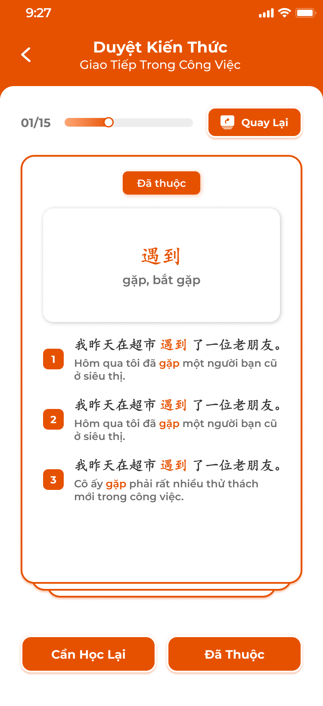</a>
  <a href="./images/05-duyet-chua-thuoc.png">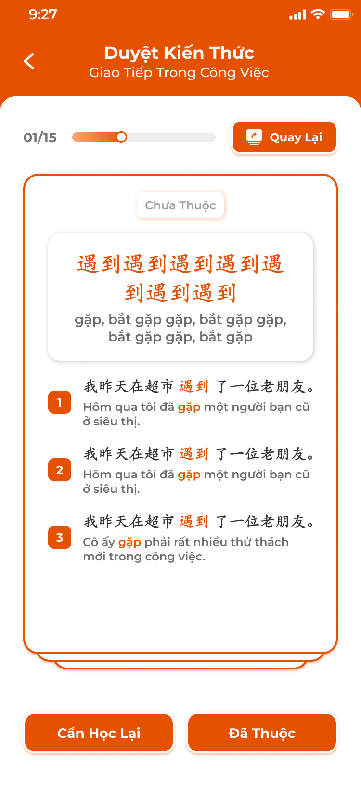</a>
  <a href="./images/06-duyet-han-tu.png">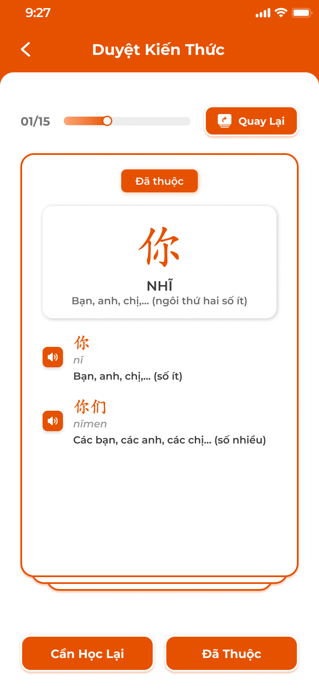</a><br>
  <em>Thẻ duyệt: từ trọng tâm, nghĩa, ví dụ highlight; thẻ Hanzi có từ liên quan và loa — nhấn để xem ảnh gốc</em>
</p>

<p align="center">
  <a href="./images/07-duyet-hoan-thanh.png">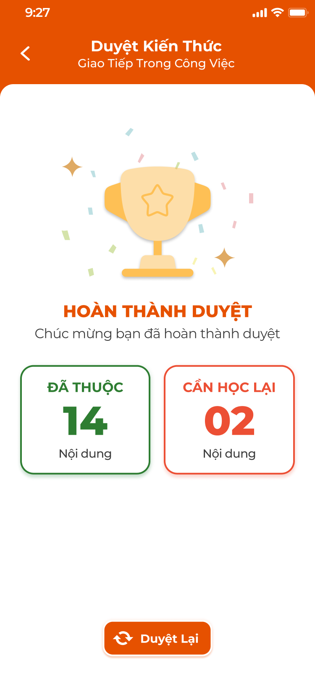</a><br>
  <em>Màn tổng kết: Đã thuộc / Cần học lại, nút Duyệt lại — nhấn để xem ảnh gốc</em>
</p>

**Mô tả:**

- Bước 1 Phần bắt buộc: lần lượt xem các thẻ kiến thức của bài (từ vựng, ngữ pháp, chữ, mẫu câu), tự đánh giá `Đã thuộc` / `Cần học lại`; thẻ không lật.

**Giải thích thành phần:**

| Thành phần | Yêu cầu |
|---|---|
| Header | Back, `Duyệt Kiến Thức`, dòng phụ tên cụm / tên bài. |
| Thanh tiến độ | `n/N` thẻ và thanh ngang; nút `Quay Lại` (từ thẻ 2) về thẻ trước, giữ đánh giá đã chọn. |
| Thẻ | Tag trạng thái hiện tại `Đã thuộc` (cam) / `Chưa thuộc` (xám); khung chính: từ / cấu trúc / chữ, nghĩa (chữ có thêm phiên âm, Hán Việt); danh sách ví dụ đánh số có highlight từ trọng tâm, kèm dịch; chữ có danh sách từ liên quan với nút loa. |
| Nút | `Cần Học Lại` (trái), `Đã Thuộc` (phải): lưu đánh giá, sang thẻ kế. |
| Tổng kết | Icon cúp, `HOÀN THÀNH DUYỆT`, hai ô `ĐÃ THUỘC` (xanh lá) / `CẦN HỌC LẠI` (đỏ) với số lượng; nút `Duyệt Lại` làm lại từ đầu. |

**Điểm cần lưu ý:**

- Thứ tự thẻ: theo loại Từ vựng → Ngữ pháp → Chữ → Mẫu câu, trong loại theo thứ tự cụm của S1.
- `Đã thuộc` ghi trạng thái thuộc của mục (dùng chung với mọi màn: Kiến thức, Thư viện, Flashcard); `Cần học lại` đưa mục về `Chưa thuộc` nếu trước đó đã thuộc (REQ05).
- Bước hoàn thành khi đi hết thẻ cuối, bất kể số `Cần học lại`; thoát giữa chừng giữ vị trí thẻ để lần sau tiếp tục.
- Bài không có kiến thức: `Không có nội dung để duyệt`, bước tự tính hoàn thành.

#### Testcase — Duyệt kiến thức

| Tên testcase | Priority | Loại test | Scenario | Role | Pre-condition | Given / When / Then | Expected Result |
|---|---| --- |---|---|---|---|---|
| Case 9: Duyệt hết | High | Smoke | Flow 2 / REQ05 | Học viên | Bài có 16 mục | **Given** mở Duyệt kiến thức<br>**When** đánh giá 14 Đã thuộc, 2 Cần học lại tới thẻ cuối<br>**Then** màn tổng kết `14` / `02` | - Bước 1 `Hoàn thành`<br>- 14 mục thành Đã thuộc |
| Case 10: Quay lại thẻ trước | Medium |  | REQ05 | Học viên | Đang ở thẻ 3 | **Given** bấm `Quay Lại`<br>**When** về thẻ 2<br>**Then** tag thẻ 2 giữ đánh giá đã chọn | - Đánh giá lại thì ghi đè |
| Case 11: Cần học lại mục đã thuộc | Medium |  | REQ05 | Học viên | Mục `你` đang Đã thuộc | **Given** bấm `Cần Học Lại`<br>**When** lưu<br>**Then** `你` về Chưa thuộc ở Kiến thức và Thư viện | - % thẻ Từ vựng giảm |
| Case 12: Thoát giữa chừng | Medium |  | REQ03 | Học viên | Đang ở thẻ 7/16 | **Given** back<br>**When** mở lại Duyệt<br>**Then** tiếp tục từ thẻ 7 | - Bước 1 tag `Đang học` |

### Học qua Flashcard

<p align="center">
  <a href="./images/08-flashcard-mat-truoc.png">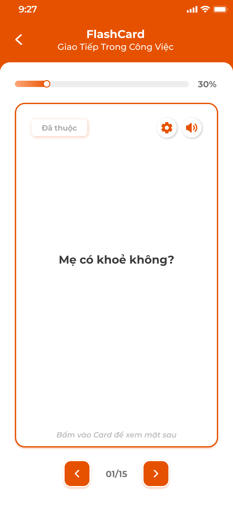</a>
  <a href="./images/09-flashcard-mat-truoc-loai-2.png">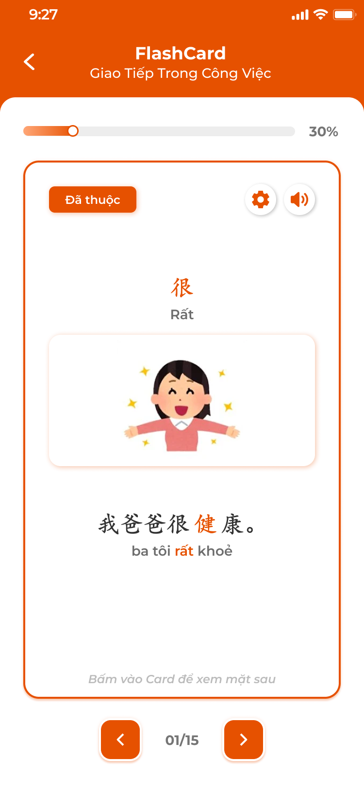</a>
  <a href="./images/10-flashcard-mat-sau.png">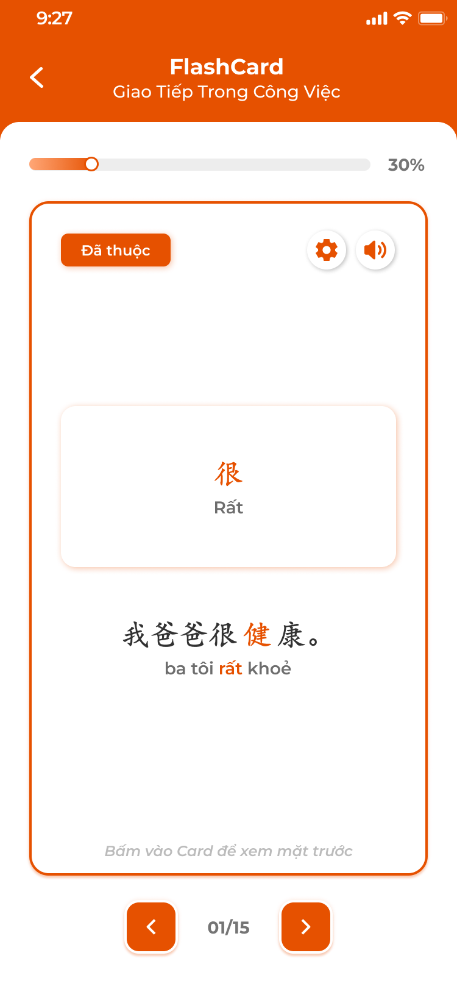</a><br>
  <em>Flashcard: mặt trước nghĩa (loại 3), mặt có hình + từ + ví dụ (loại 2), mặt sau — nhấn để xem ảnh gốc</em>
</p>

<p align="center">
  <a href="./images/11-flashcard-mat-sau-cau.png">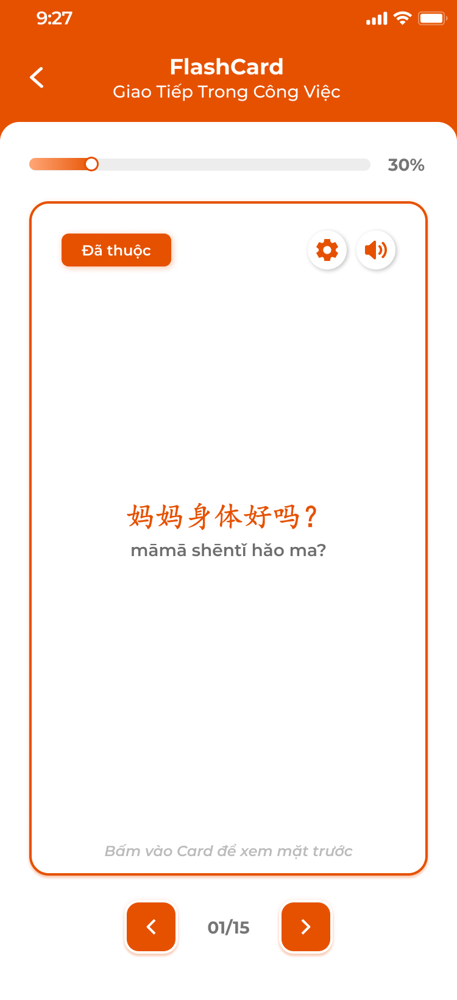</a>
  <a href="./images/12-flashcard-tuy-chinh.png">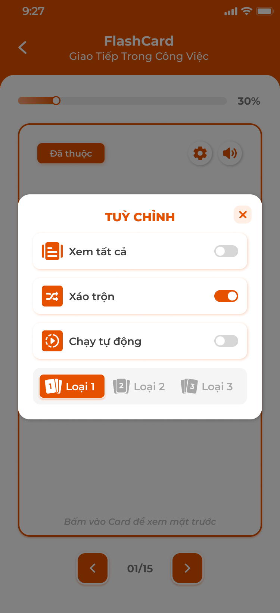</a>
  <a href="./images/13-flashcard-tuy-chinh-toc-do.png">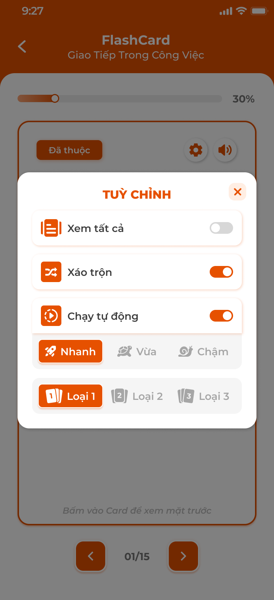</a><br>
  <em>Mặt sau câu + phiên âm; popup Tuỳ chỉnh: Xem tất cả, Xáo trộn, Chạy tự động (Nhanh / Vừa / Chậm), Loại 1–3 — nhấn để xem ảnh gốc</em>
</p>

<p align="center">
  <a href="./images/14-flashcard-hoan-thanh.png"></a><br>
  <em>Màn hoàn thành Flashcard, nút Học lại — nhấn để xem ảnh gốc</em>
</p>

**Mô tả:**

- Bước 2 Phần bắt buộc: ôn kiến thức của bài bằng thẻ hai mặt, có phát âm, 3 loại thẻ và tuỳ chỉnh cách chạy.

**Giải thích thành phần:**

| Thành phần | Yêu cầu |
|---|---|
| Thanh tiến độ | % thẻ đã xem trong bộ; `n/N` dưới cùng với nút `<` `>`; vuốt ngang cũng chuyển thẻ. |
| Thẻ | Nút tag `Đã thuộc` / `Chưa thuộc` (bấm để đổi trạng thái thuộc của mục), nút ⚙ Tuỳ chỉnh, nút loa; bấm thân thẻ để lật; dòng gợi ý `Bấm vào Card để xem mặt sau / mặt trước`. |
| Loại 1 | Mặt trước: từ, phiên âm, nghĩa, ví dụ; mặt sau: dịch nghĩa ví dụ. |
| Loại 2 | Mặt trước: hình minh hoạ + nghĩa; mặt sau: từ, phiên âm, ví dụ. |
| Loại 3 | Mặt trước: câu ví dụ gốc (có phiên âm); mặt sau: nghĩa, từ trọng tâm, hình, phiên âm. |
| Popup `TUỲ CHỈNH` | `Xem tất cả` (bật: cả thẻ đã thuộc và chưa thuộc; tắt: chỉ thẻ chưa thuộc), `Xáo trộn`, `Chạy tự động` (bật thì hiện `Nhanh` / `Vừa` / `Chậm`), chọn `Loại 1` / `Loại 2` / `Loại 3`. |
| Loa | Phát audio của mục; không có file thì đọc bằng TTS. |
| Hoàn thành | Khi xem hết thẻ cuối: màn `HOÀN THÀNH FLASHCARD` + nút `Học Lại`; bước 2 chuyển `Hoàn thành`. |

**Điểm cần lưu ý:**

- Mục của Ngữ pháp dùng thẻ theo cấu trúc: loại 1 tiêu đề → ví dụ, loại 2 tiêu đề + ví dụ → ví dụ dịch, loại 3 ví dụ → tiêu đề + dịch nghĩa.
- Chạy tự động: Nhanh 3 giây, Vừa 5 giây, Chậm 8 giây mỗi mặt; đang chạy mà người dùng chạm thẻ thì tạm dừng.
- Tuỳ chỉnh được nhớ cho lần sau trong cùng thiết bị.
- Không còn thẻ chưa thuộc và `Xem tất cả` tắt: hiện màn hoàn thành ngay kèm gợi ý bật `Xem tất cả`.

#### Testcase — Học qua Flashcard

| Tên testcase | Priority | Loại test | Scenario | Role | Pre-condition | Given / When / Then | Expected Result |
|---|---| --- |---|---|---|---|---|
| Case 13: Lật và chuyển thẻ | High | Smoke | Flow 3 / REQ05 | Học viên | Bộ 15 thẻ | **Given** mở Flashcard<br>**When** chạm thẻ, bấm `>` tới thẻ 15 rồi `>`<br>**Then** thẻ lật, màn hoàn thành | - Bước 2 `Hoàn thành` |
| Case 14: Đổi loại thẻ | Medium |  | REQ05 | Học viên | Đang Loại 1 | **Given** mở ⚙ → `Loại 2`<br>**When** đóng popup<br>**Then** mặt trước hình + nghĩa | - Giữ vị trí thẻ hiện tại |
| Case 15: Xem tất cả tắt | Medium |  | REQ05 | Học viên | 15 thẻ, 10 đã thuộc | **Given** tắt `Xem tất cả`<br>**When** bộ tải lại<br>**Then** `n/5` chỉ thẻ chưa thuộc | - Bật lại về 15 |
| Case 16: Đánh dấu thuộc | High |  | REQ05 | Học viên | Thẻ `很` đang Chưa thuộc | **Given** bấm tag `Chưa thuộc`<br>**When** đổi<br>**Then** tag `Đã thuộc`, % Từ vựng tăng | - Đồng bộ sang Kiến thức, Thư viện |
| Case 17: Chạy tự động | Low |  | REQ05 | Học viên | Bật Chạy tự động `Nhanh` | **Given** không chạm<br>**When** 3 giây<br>**Then** thẻ tự lật rồi tự chuyển | - Chạm thẻ thì dừng |

### Luyện nhớ chuyên sâu

<p align="center">
  <a href="./images/15-luyen-nho-flashcard.png">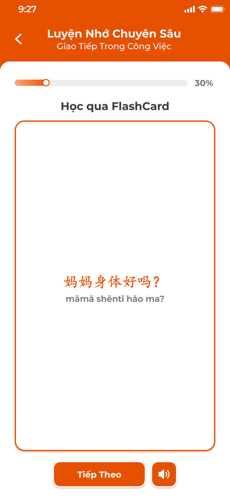</a>
  <a href="./images/16-luyen-nho-flashcard-nghia.png">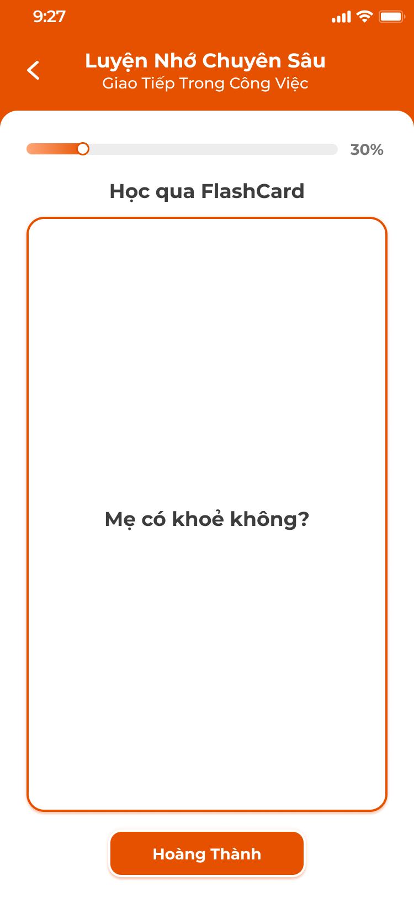</a>
  <a href="./images/17-luyen-nho-noi-tu.png">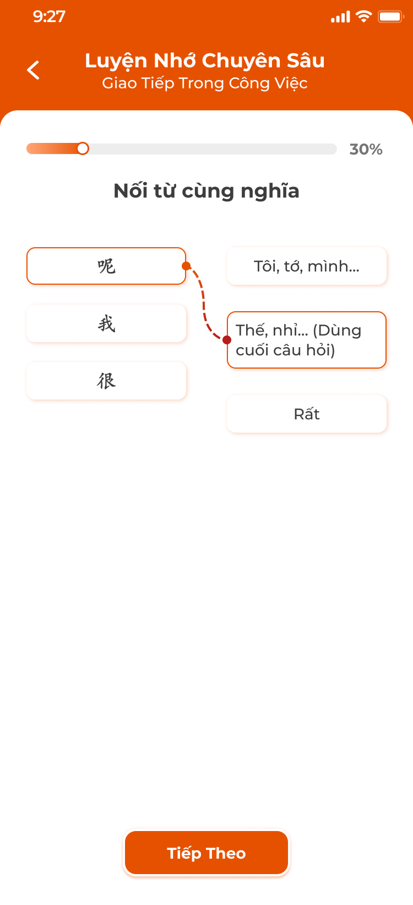</a><br>
  <em>Bước Học qua FlashCard (Tiếp theo → Hoàn thành) và Nối từ cùng nghĩa — nhấn để xem ảnh gốc</em>
</p>

<p align="center">
  <a href="./images/18-luyen-nho-noi-tu-ket-qua.png">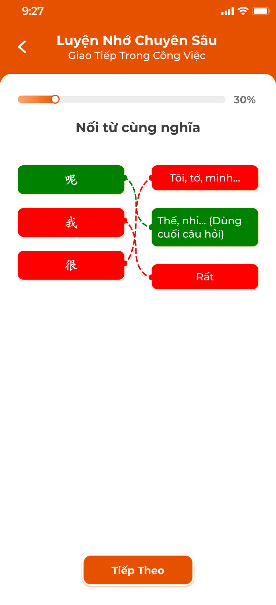</a>
  <a href="./images/19-luyen-nho-trac-nghiem.png">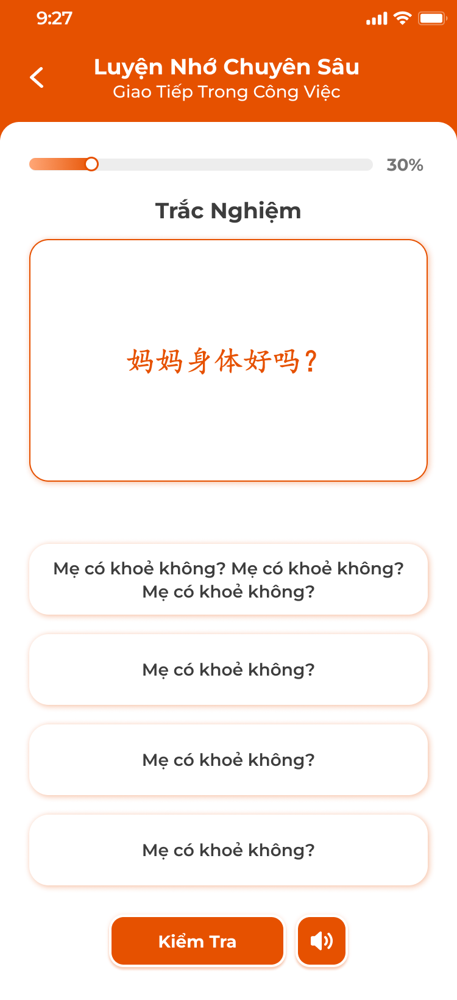</a>
  <a href="./images/20-luyen-nho-trac-nghiem-nghia.png">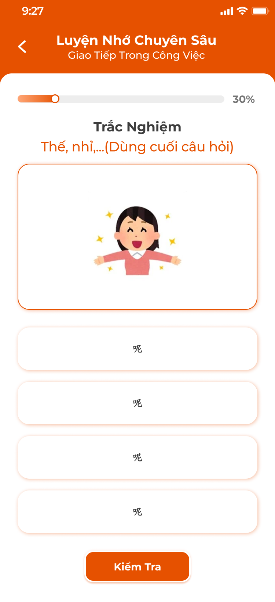</a><br>
  <em>Kết quả nối (xanh đúng, đỏ sai); trắc nghiệm hai chiều — nhấn để xem ảnh gốc</em>
</p>

<p align="center">
  <a href="./images/21-luyen-nho-sap-xep.png">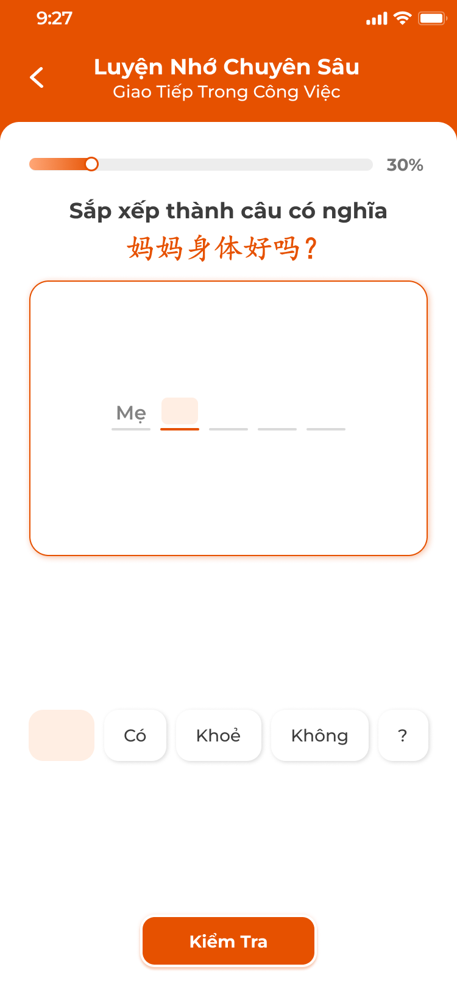</a>
  <a href="./images/22-luyen-nho-hoan-thanh.png">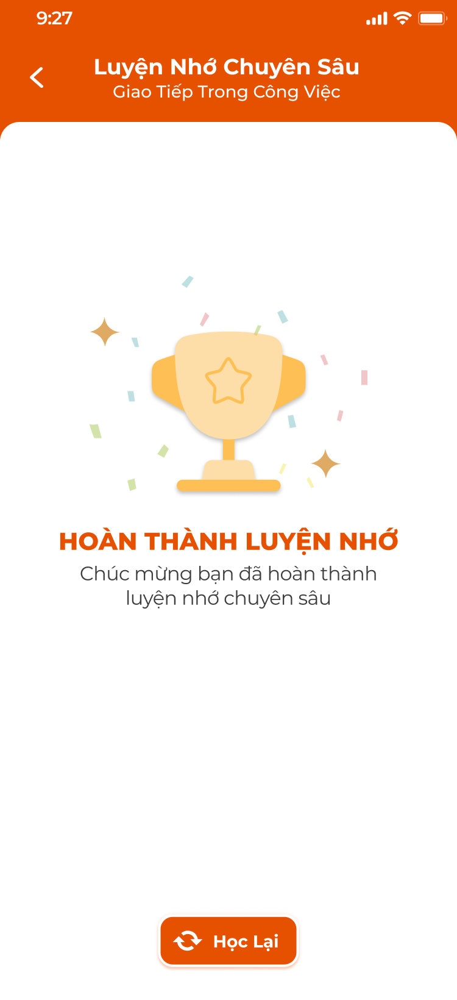</a><br>
  <em>Sắp xếp thành câu có nghĩa; màn hoàn thành — nhấn để xem ảnh gốc</em>
</p>

**Mô tả:**

- Bước 3 Phần bắt buộc: học theo chuỗi nội dung xen kẽ kiểm tra; trả lời đúng mới được đi tiếp.

**Giải thích thành phần:**

| Thành phần | Yêu cầu |
|---|---|
| Thanh tiến độ | % nội dung đã qua của phiên. |
| Học qua FlashCard | Mặt trước câu gốc + phiên âm, nút `Tiếp Theo` và loa; lật sang nghĩa, nút `Hoàn Thành` để sang nội dung kế. |
| Card nội dung | Từ, nghĩa, ví dụ highlight (không lật), nút `Tiếp tục`. |
| Nối từ cùng nghĩa | Hai cột (từ gốc, nghĩa) 3–4 cặp xáo trộn; kéo nối; bấm `Tiếp Theo` để chấm: cặp đúng xanh lá, sai đỏ kèm đường nối; sai thì phải nối lại cặp sai. |
| Trắc nghiệm | Chiều 1: câu / từ gốc → 4 đáp án nghĩa; chiều 2: nghĩa (+ hình) → 4 đáp án từ gốc; nút `Kiểm Tra` + loa; đúng xanh, sai đỏ và hiện đáp án đúng, chọn lại. |
| Sắp xếp thành câu | Hiện câu gốc, các từ nghĩa xáo trộn ở dưới; chạm từ để đẩy lên ô trống theo thứ tự, chạm ô để bỏ xuống; `Kiểm Tra`. |
| Hoàn thành | `HOÀN THÀNH LUYỆN NHỚ` + nút `Học Lại`; bước 3 chuyển `Hoàn thành`. |

**Điểm cần lưu ý:**

- Chuỗi do hệ thống sinh từ kiến thức của bài: cứ 3–5 nội dung học thì chèn 1 câu kiểm tra; loại câu lấy ngẫu nhiên trong 3 loại.
- Trả lời sai không trừ điểm, chỉ phải làm lại câu đó cho đúng; không có `Đã thuộc` / lưu thư viện trong bước này.
- Thoát giữa chừng giữ tiến độ phiên để tiếp tục.

#### Testcase — Luyện nhớ chuyên sâu

| Tên testcase | Priority | Loại test | Scenario | Role | Pre-condition | Given / When / Then | Expected Result |
|---|---| --- |---|---|---|---|---|
| Case 18: Hoàn thành chuỗi | High | Smoke | Flow 4 / REQ05 | Học viên | Bài có 12 mục | **Given** mở Luyện nhớ<br>**When** đi hết chuỗi, trả lời đúng mọi câu<br>**Then** màn hoàn thành | - Bước 3 `Hoàn thành` |
| Case 19: Nối sai | High |  | EX03 / REQ05 | Học viên | Câu nối 3 cặp | **Given** nối sai 2 cặp<br>**When** `Tiếp Theo`<br>**Then** 1 cặp xanh, 2 cặp đỏ, chưa sang câu kế | - Nối lại đúng mới đi tiếp |
| Case 20: Trắc nghiệm sai | Medium |  | EX03 | Học viên | Câu chọn nghĩa | **Given** chọn sai<br>**When** `Kiểm Tra`<br>**Then** đáp án sai đỏ, đúng xanh, cho chọn lại | - Không trừ tiến độ |
| Case 21: Sắp xếp câu | Medium |  | REQ05 | Học viên | Câu 5 từ | **Given** chạm từ theo thứ tự đúng<br>**When** `Kiểm Tra`<br>**Then** đúng, chuyển tiếp | - Chạm ô đã xếp để bỏ xuống |

### Bài tập củng cố

**Mô tả:**

- Bước 4 Phần bắt buộc: bài tập về nhà (BTVN) của bài, được giao tự động khi giáo viên mở bài; học viên làm liên tiếp các câu, nộp, chờ giáo viên chấm phần tự luận và xem kết quả. Bộ câu hỏi do CD soạn ở [Bài tập về nhà và Kiểm tra](../../course_management/homework-test/homework-test.md); chấm theo [Giáo viên — Giảng dạy](../../teacher_role/class/class_teaching_requirements.md).

**Giải thích thành phần:**

| Thành phần | Yêu cầu |
|---|---|
| Màn làm bài | Số câu `n/N`, nút `<` `>` chuyển câu tự do, nút `Xem hướng dẫn` (nếu câu có hướng dẫn), nút `Nộp bài` ở câu cuối; câu chưa trả lời được phép bỏ qua. |
| Loại câu | Theo 8 loại của CD: `Trắc nghiệm` (chọn 1 trong 4), `Sắp xếp` (kéo thả thẻ từ thành câu), `Nối từ` (nối 2 cột), `Nói` (nhấn giữ mic ghi âm, nghe lại, ghi lại), `Đọc` (đọc đoạn văn, trả lời), `Viết` (ô nhập văn bản), `Hình ảnh` (xem hình, trả lời / ghi âm), `Câu hỏi con` (câu cha có nhiều câu con, mỗi câu con một loại). |
| Nộp bài | Popup xác nhận `Nộp bài?` nêu số câu chưa làm; `Nộp` gửi toàn bộ; mỗi BTVN nộp một lần. |
| Màn kết quả — chưa chấm | Icon đồng hồ, `Kết quả đang được chấm. Bạn đợi một tí nhé!`; các câu app tự chấm (Trắc nghiệm, Sắp xếp, Nối từ) hiện đúng / sai ngay; câu giáo viên chấm hiện `Chờ chấm`. |
| Màn kết quả — đã chấm | `Điểm số: x` (thang 10, trung bình điểm các câu), danh sách câu: đúng viền xanh + tick, sai viền đỏ + ×, bỏ qua `Bạn đã bỏ qua câu này!`; câu Nói / Hình ảnh phát lại ghi âm; câu Sắp xếp / Nối hiện `Đáp án của bạn` và `Đáp án đúng`; nhận xét của giáo viên (chữ, ảnh, ghi âm) dưới từng câu nếu có. |
| Trạng thái bước 4 | `Chưa bắt đầu` (chưa giao hoặc chưa vào), `Đang học` (đã vào, chưa nộp hoặc chờ chấm), `Hoàn thành` + badge điểm (đã chấm). |

**Điểm cần lưu ý:**

- Khác spec cũ: spec liệt kê 11 loại câu; requirement dùng 8 loại đã chốt với CD. Ánh xạ: viết chữ từ phiên âm và nghĩa → `Viết`; nối từ → `Nối từ`; sắp xếp câu → `Sắp xếp`; điền chỗ trống, chọn đáp án, chọn câu đúng nghĩa → `Trắc nghiệm`; nghe chọn đáp án → `Trắc nghiệm` có audio; đọc to từ, nói đoạn văn → `Nói`; đặt câu với từ / cấu trúc → `Viết`. Không thêm loại mới.
- Đáp án đang làm lưu nháp trên server; thoát rồi vào lại vẫn còn.
- Support có thể `Thiết lập lại nộp bài`; khi đó bài về trạng thái chưa nộp, đáp án cũ bị xoá, học viên làm lại (requirement ICS).
- Học viên không thuộc diện làm BTVN của bài (Nghỉ học, Rời lớp, Xóa tại thời điểm mở bài) không thấy bài tập.

#### Testcase — Bài tập củng cố

| Tên testcase | Priority | Loại test | Scenario | Role | Pre-condition | Given / When / Then | Expected Result |
|---|---| --- |---|---|---|---|---|
| Case 22: Làm và nộp bài | High | Smoke | Flow 5 / REQ06 | Học viên | Bài đã mở, BTVN 10 câu | **Given** mở Bài tập củng cố<br>**When** trả lời 10 câu, `Nộp bài` → `Nộp`<br>**Then** màn `Kết quả đang được chấm` | - Toast `Thành Công` `Nộp bài thành công`<br>- Giáo viên thấy bài đã nộp |
| Case 23: Câu tự chấm hiện ngay | High |  | REQ06 | Học viên | Vừa nộp, có 4 câu Trắc nghiệm | **Given** màn chờ chấm<br>**When** xem 4 câu<br>**Then** đúng / sai hiện ngay; câu Viết `Chờ chấm` | - |
| Case 24: Xem kết quả đã chấm | High |  | Flow 5 / REQ06 | Học viên | Giáo viên chấm xong, điểm 7.5 | **Given** mở lại bước 4<br>**When** màn kết quả<br>**Then** `Điểm số: 7.5`, từng câu đúng / sai, nhận xét giáo viên | - Thẻ bước 4 badge `7.5` |
| Case 25: Nộp khi còn câu trống | Medium |  | EX04 | Học viên | 3 câu chưa làm | **Given** `Nộp bài`<br>**When** popup<br>**Then** nêu `Còn 3 câu chưa làm`; `Nộp` vẫn cho nộp | - Câu trống hiện `Bạn đã bỏ qua câu này!` |
| Case 26: Nộp lặp | High |  | EX05 | Học viên | Đã nộp | **Given** mở bước 4<br>**When** vào<br>**Then** chỉ xem kết quả, không có nút Nộp | - Request nộp lại bị từ chối |
| Case 27: Ghi âm câu Nói | Medium |  | REQ06 | Học viên | Câu Nói | **Given** nhấn giữ mic 5 giây<br>**When** thả<br>**Then** có bản ghi, nút nghe lại và `Ghi lại` | - Không cấp quyền mic: Toast `Cảnh Báo` `Cần quyền micro để ghi âm` |
| Case 28: Bị thiết lập lại | Medium |  | EX06 | Học viên | Support reset bài đã chấm | **Given** mở bước 4<br>**When** tải<br>**Then** về màn làm bài trống, Toast `Thông Báo` `Bài tập đã được mở lại, bạn làm lại nhé` | - Badge điểm cũ mất |

### Toast phản hồi CRUD

<p align="center">
  <a href="../../images/01-toast-crud.png"></a><br>
  <em>Toast Thành Công, Thông Báo, Cảnh Báo và Có Lỗi Xảy Ra — nhấn để xem ảnh gốc</em>
</p>

**Mô tả:**

- Phản hồi sau khi nộp bài tập, đổi trạng thái thuộc, hoặc thao tác bị chặn.

**Giải thích thành phần:**

| Loại Toast | Tiêu đề cố định | Khi sử dụng |
|---|---|---|
| Thành công | `Thành Công` | `Nộp bài thành công` |
| Thông tin | `Thông Báo` | `Bài tập sẽ có sau khi giáo viên mở bài`; `Bài tập đã được mở lại, bạn làm lại nhé` |
| Cảnh báo | `Cảnh Báo` | `Cần quyền micro để ghi âm`; `Không có kết nối, vui lòng thử lại` |
| Lỗi | `Có Lỗi Xảy Ra` | `Nộp bài thất bại, vui lòng thử lại` |

**Điểm cần lưu ý:**

- Đổi trạng thái `Đã thuộc` không hiện Toast, chỉ đổi tag; lưu nền.
- Mỗi thao tác một Toast; thao tác chỉ đọc không có Toast.

#### Testcase — Toast phản hồi CRUD

| Tên testcase | Priority | Loại test | Scenario | Role | Pre-condition | Given / When / Then | Expected Result |
|---|---| --- |---|---|---|---|---|
| Toast Case 1: Thành công | High |  | Ràng buộc Toast CRUD | Học viên | Nộp bài hợp lệ | **Given** bấm `Nộp`<br>**When** backend xác nhận<br>**Then** Toast `Thành Công` | - Một Toast |
| Toast Case 2: Lỗi | High |  | Ràng buộc Toast CRUD | Học viên | Mất mạng | **Given** bấm `Nộp`<br>**When** thất bại<br>**Then** Toast `Có Lỗi Xảy Ra`, đáp án giữ nguyên | - Cho nộp lại |

---

## 2. Yêu cầu

### 2.1. Flow chính

**Flow 1 / REQ01 / REQ02: Xem danh sách và chi tiết bài học**

```text
Học viên vào lớp → tab Bài học
      → Hệ thống tải buổi học của lớp theo thứ tự, trạng thái học + điểm danh từ ICS
      → Bấm thẻ → Chi tiết bài học: Phần bắt buộc, Kiến thức (theo trung tâm), Kỹ năng
      → Bấm mục → màn tương ứng
```

**Flow 2 / REQ05: Duyệt kiến thức**

```text
Bấm Duyệt kiến thức → thẻ 1/N
      → Đã Thuộc / Cần Học Lại → lưu trạng thái thuộc của mục → thẻ kế (Quay Lại để sửa)
      → Hết thẻ → tổng kết Đã thuộc / Cần học lại → bước 1 Hoàn thành; Duyệt Lại để làm lại
```

**Flow 3 / REQ05: Học qua Flashcard**

```text
Bấm Flashcard → thẻ theo loại và tuỳ chỉnh đã lưu
      → Chạm lật, loa phát âm, tag Đã thuộc / Chưa thuộc, < > hoặc vuốt
      → Qua thẻ cuối → màn hoàn thành → bước 2 Hoàn thành
```

**Flow 4 / REQ05: Luyện nhớ chuyên sâu**

```text
Bấm Luyện nhớ → chuỗi: FlashCard / Card nội dung ... → câu kiểm tra (Nối từ / Trắc nghiệm / Sắp xếp)
      → Đúng: tiếp; Sai: hiện đáp án, làm lại câu đó
      → Hết chuỗi → màn hoàn thành → bước 3 Hoàn thành
```

**Flow 5 / REQ06: Bài tập củng cố**

```text
Giáo viên mở bài → BTVN được giao → bước 4 hiện bài
      → Học viên làm các câu (nháp lưu server) → Nộp bài → popup xác nhận → Nộp
      → App chấm câu tự động; câu khác Chờ chấm → "Kết quả đang được chấm"
      → Giáo viên chấm xong → màn kết quả điểm thang 10 + nhận xét → bước 4 Hoàn thành + badge điểm
```

### 2.2. Ngoại lệ

- **EX01:** Lớp chưa có buổi học → `Chưa có buổi học nào được tạo cho lớp này`.
- **EX02:** Bài chưa được giáo viên mở → bước 4 không vào được, Toast `Thông Báo` `Bài tập sẽ có sau khi giáo viên mở bài`; 3 bước còn lại và Kiến thức / Kỹ năng vẫn dùng được.
- **EX03:** Trả lời sai ở Luyện nhớ → hiện đáp án đúng, bắt làm lại câu đó, không ghi điểm.
- **EX04:** Nộp bài khi còn câu trống → popup nêu số câu chưa làm; vẫn cho nộp, câu trống tính bỏ qua.
- **EX05:** Nộp lặp hoặc request nộp sau khi đã nộp → backend từ chối; app chỉ hiện kết quả.
- **EX06:** Support thiết lập lại nộp bài → đáp án và điểm cũ xoá, bài về chưa nộp; app Toast `Thông Báo` khi mở lại.
- **EX07:** Mất mạng khi lưu nháp / nộp → giữ dữ liệu trên máy, Toast `Cảnh Báo`, thử lại khi có mạng.
- **EX08:** Học viên không thuộc diện làm BTVN (Nghỉ học, Rời lớp, Xóa tại thời điểm mở bài) → không thấy bước 4 của bài đó.

### 2.3. Yêu cầu khác

- **REQ01 – Danh sách bài học:** Mọi buổi của lớp theo thứ tự bài; tag trạng thái học (Chưa bắt đầu / Đang học / Hoàn thành / Nợ BTVN) và tag điểm danh lấy từ ICS, app chỉ đọc.
- **REQ02 – Nội dung bài:** Kiến thức, kỹ năng của bài lấy từ bài học CD đã gắn (S1, S6); xem được cả khi bài chưa mở; BTVN chỉ có sau khi giáo viên mở bài.
- **REQ03 – Tiến độ:** % bài = trung bình 4 bước bắt buộc; 4 bước không khoá thứ tự; thoát giữa chừng giữ vị trí.
- **REQ04 – Thẻ Kiến thức theo trung tâm:** `Bảng chữ` ở Đắc Nhân (Pinyin), Sakumi (Kana), Saechang (Hangul); trung tâm Anh / Đức / Pháp thay bằng `Mẫu câu`; `Hanzi` chỉ Đắc Nhân, `Kanji` chỉ Sakumi.
- **REQ05 – Trạng thái thuộc:** Mỗi mục kiến thức có một trạng thái `Đã thuộc` / `Chưa thuộc` theo học viên, dùng chung ở Duyệt, Flashcard, Kiến thức, Thư viện; `Cần học lại` đưa về Chưa thuộc; Luyện nhớ không đổi trạng thái thuộc.
- **REQ06 – Bài tập củng cố:** 8 loại câu của CD; nháp lưu server; nộp một lần; app tự chấm Trắc nghiệm, Sắp xếp, Nối từ; điểm bài thang 10 = trung bình điểm các câu, chỉ hiện khi giáo viên chấm xong; nhận xét giáo viên hiện dưới câu.
- **REQ07 – Audio:** Mục không có file audio đọc bằng TTS theo ngôn ngữ trung tâm.

### 2.4. Ràng buộc

#### Quyền

| Role | Xem bài học | Làm 3 bước ôn tập | Làm BTVN | Xem kết quả BTVN |
|---|:---:|:---:|:---:|:---:|
| Học viên của lớp | ✅ | ✅ | ✅ (bài đã mở, thuộc diện) | ✅ |
| Học viên lớp khác / chưa đăng nhập | ❌ | ❌ | ❌ | ❌ |

#### Phạm vi dữ liệu

- Chỉ dữ liệu lớp học viên đang tham gia; backend kiểm tra học viên thuộc lớp và diện làm BTVN.
- Trạng thái thuộc, tiến độ bước, nháp bài tập lưu theo học viên trên server, dùng được trên nhiều thiết bị.

---

## 3. Cần xác nhận

- Số nội dung giữa hai câu kiểm tra của Luyện nhớ chuyên sâu (tạm 3–5) và thời gian Chạy tự động của Flashcard (tạm 3 / 5 / 8 giây).
- Màn Bài tập củng cố, popup Nộp bài, màn kết quả chưa có ảnh thiết kế.
