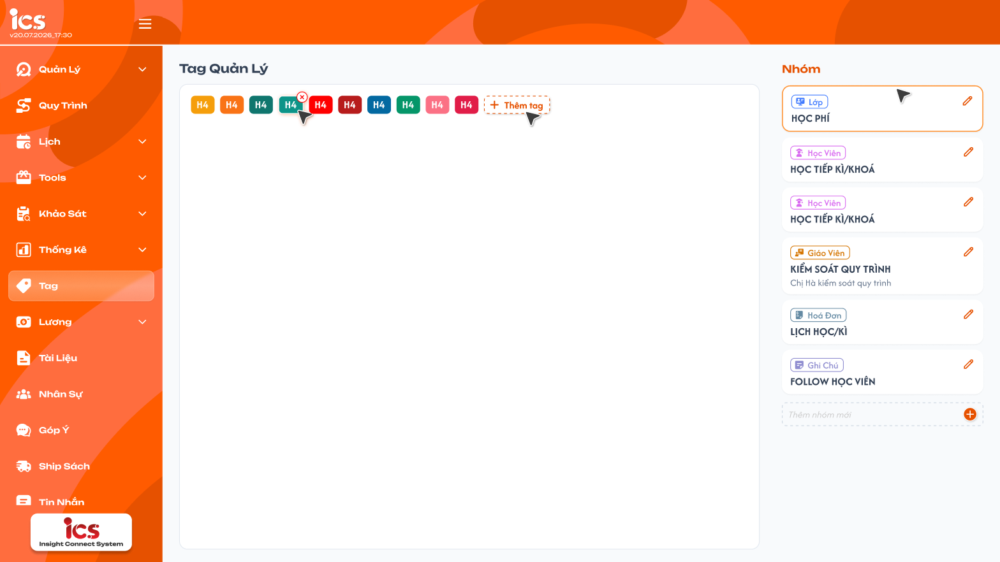
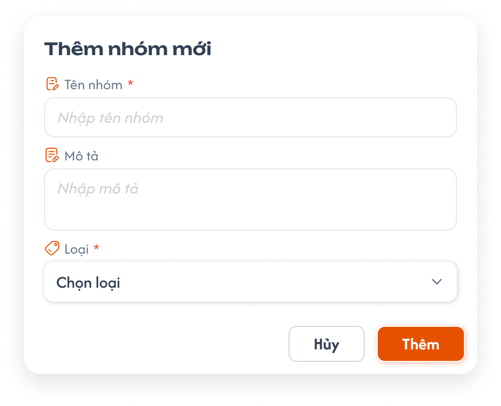
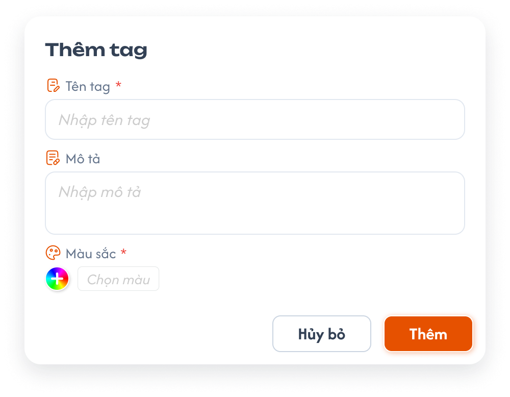
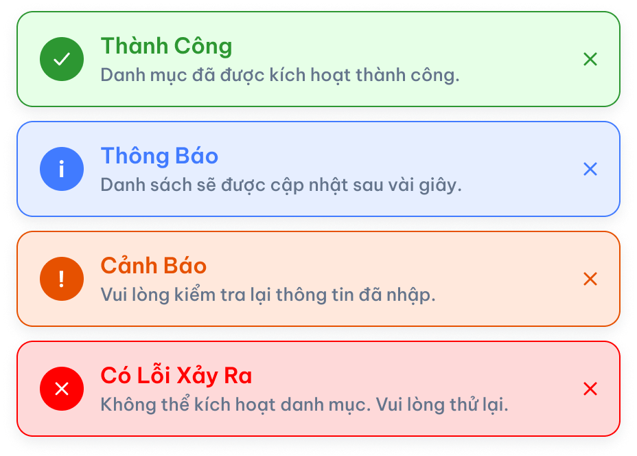

# Define Tag — Quản lý nhóm và tag

> Màn hình Define Tag quản lý tag theo nhóm. **Loại** dùng chung một bộ giá trị: `Học viên`, `Giáo viên`, `Lớp`, `Hoá đơn`, `Ghi chú`. Tag dùng chung bản ghi với ComGao; nhóm và tag dùng chung cho toàn hệ thống, không phân theo center. Ảnh popup Thêm nhóm còn các giá trị cũ; áp dụng bộ năm loại này theo yêu cầu mới.

> Pre-coding/Definition of Done: [Tag Management — Pre-Coding](../../pre_coding/features/tag_management/tag-management-generic.md). Kết quả đối chiếu code: [Tag Management — Code audit](./tag_definition_code_audit.md).

## 1. UI

### Trang 1: Tag quản lý và Nhóm

<p align="center">
  <a href="./images/01-tag-groups.png"></a><br>
  <em>Tag quản lý bên trái, Nhóm bên phải — nhấn để xem ảnh gốc</em>
</p>

**Mô tả:**

- Admin, Class Handler và Support được xem, thêm, sửa, xóa nhóm và tag. Nhóm và tag dùng chung cho mọi center.

**Giải thích thành phần:**

| Thành phần | Yêu cầu |
|---|---|
| Tag quản lý | Hiển thị các tag đã tạo; nút `Thêm tag` mở popup tạo tag trong nhóm đang chọn. Phải có nhóm rồi mới thêm được tag. |
| Nhóm | Hiển thị tên nhóm, mô tả nếu có và nhãn Loại. Chọn một nhóm để xem/thêm tag trong nhóm đó. |
| Thêm nhóm mới | Nút `+` mở popup Thêm nhóm. |
| Chỉnh sửa / Xóa | Sửa thông tin nhóm/tag hoặc xóa bản ghi theo quyền CRUD. Sửa tag được đổi nhóm của tag. Xóa nhóm không xóa các tag thuộc nhóm. |

**Điểm cần lưu ý:**

- Loại hiển thị trên nhóm là loại đã chọn khi tạo nhóm; tag thêm trong nhóm dùng cùng loại đó.
- Các tên nhóm/tag trong ảnh chỉ là dữ liệu mẫu, không phải danh sách cố định.
- Khi thêm tag, `Tên tag` và `Màu sắc` là bắt buộc; `Mô tả` không bắt buộc. Không kiểm tra trùng Tên nhóm/Tên tag; cho phép trùng tên.

#### Testcase — Tag quản lý và Nhóm

| Tên testcase | Priority | Loại test | Scenario | Role | Pre-condition | Given / When / Then | Expected Result |
|---|---| --- |---|---|---|---|---|
| Case 1: Xem nhóm và tag | High | Smoke | Flow 1 / REQ01 | Admin, Class Handler, Support | Có nhóm và tag đã tạo | **Given** mở Define Tag<br>**When** chọn một nhóm<br>**Then** hiển thị tag của nhóm và nhãn Loại đã lưu | - Chỉ hiển thị tag thuộc nhóm đã chọn<br>- Danh sách nhóm/tag giống nhau khi đổi center<br>- Loại nhóm không đổi khi chỉ xem |

### Popup Thêm nhóm mới

<p align="center">
  <a href="./images/02-add-tag-group.png"></a><br>
  <em>Loại nhóm dùng đúng năm giá trị mới — nhấn để xem ảnh gốc</em>
</p>

**Mô tả:**

- Nhấn `Thêm nhóm mới` để nhập thông tin và chọn loại áp dụng cho cả nhóm.

**Giải thích field/thành phần:**

| Field | Yêu cầu |
|---|---|
| Tên nhóm | Nhập tên nhóm. |
| Mô tả | Nhập mô tả nhóm nếu có. |
| Loại | Chọn một trong đúng năm giá trị: `Học viên`, `Giáo viên`, `Lớp`, `Hoá đơn`, `Ghi chú`. |
| Thêm / Hủy | Thêm lưu nhóm cùng loại đã chọn; Hủy đóng popup và không lưu. |

**Điểm cần lưu ý:**

- Loại được lưu ở cấp nhóm để tag tạo bên trong kế thừa; không lặp lại bước chọn Loại khi thêm tag trong nhóm.
- Không dùng các mục `CSKH`, `Sale`, `Quản lý` còn thấy trong ảnh popup cũ.
- Không áp đặt giá trị mặc định hoặc giới hạn nhập liệu cho các field; dữ liệu mẫu trong ảnh không phải mặc định bắt buộc.

#### Testcase — Popup Thêm nhóm mới

| Tên testcase | Priority | Loại test | Scenario | Role | Pre-condition | Given / When / Then | Expected Result |
|---|---| --- |---|---|---|---|---|
| Case 2: Danh sách Loại nhóm | High |  | Flow 2 / REQ02 | Admin, Class Handler, Support | Popup Thêm nhóm đang mở | **Given** người dùng mở trường Loại<br>**When** xem các lựa chọn<br>**Then** thấy đúng năm loại được chốt | - Có Học viên/Giáo viên/Lớp/Hoá đơn/Ghi chú<br>- Không có CSKH/Sale/Quản lý |
| Case 3: Tạo nhóm | High | Smoke | Flow 2 / REQ02 | Admin, Class Handler, Support | Đã nhập thông tin nhóm và chọn Loại | **Given** nhóm mới thuộc loại Lớp<br>**When** bấm Thêm và lưu thành công<br>**Then** nhóm xuất hiện với nhãn Lớp | - Loại nhóm được lưu để các tag trong nhóm kế thừa<br>- Hủy không tạo nhóm |

### Popup Thêm tag

<p align="center">
  <a href="./images/03-add-tag.png"></a><br>
  <em>Popup Thêm tag; tag luôn thuộc một nhóm và kế thừa Loại của nhóm, không áp dụng trường Loại trong ảnh — nhấn để xem ảnh gốc</em>
</p>

**Mô tả:**

- Tag bắt buộc thuộc một nhóm; phải có nhóm rồi mới thêm được tag, không có tag nằm ngoài nhóm.
- Form thêm tag không hiển thị trường Loại; tag kế thừa Loại của nhóm.

**Giải thích field/thành phần:**

| Field | Yêu cầu |
|---|---|
| Tên tag, Mô tả | Nhập thông tin tag theo form. |
| Nhóm | **Bắt buộc.** Tag được tạo trong nhóm đang chọn. |
| Loại | Không có trường này trên form; tag tự nhận Loại của nhóm. |
| Màu sắc | Hiển thị theo UI để người dùng chọn/cập nhật thông tin tag. |
| Thêm / Hủy bỏ | Thêm lưu tag vào nhóm với Loại của nhóm; Hủy bỏ không lưu. |

**Điểm cần lưu ý:**

- Backend cũng dùng Loại của nhóm cho tag tạo trong nhóm; request tự gửi Loại khác với nhóm không được ghi đè Loại nhóm.
- Việc chọn Loại ở popup Thêm nhóm chỉ thực hiện một lần ở cấp nhóm, không yêu cầu người dùng chọn lại cho từng tag của nhóm.
- `Tên tag` và `Màu sắc` là bắt buộc khi thêm tag; thiếu thì không lưu và báo lỗi tại field thiếu. `Mô tả` không bắt buộc, được để trống. Không có giới hạn nghiệp vụ bổ sung.
- Tag không có field `Ngày thống kê` và `Riêng tư`; nếu ảnh popup còn các field này thì không áp dụng.

#### Testcase — Popup Thêm tag

| Tên testcase | Priority | Loại test | Scenario | Role | Pre-condition | Given / When / Then | Expected Result |
|---|---| --- |---|---|---|---|---|
| Case 4: Không thêm được tag khi không có nhóm | High |  | Flow 3 / EX04 / REQ03 | Admin, Class Handler, Support | Chưa có nhóm nào, hoặc request tạo tag không gửi nhóm | **Given** không có nhóm để chứa tag<br>**When** thêm tag trên UI hoặc gửi request tạo tag không có nhóm<br>**Then** hệ thống không tạo tag | - UI không cho thêm tag khi chưa có nhóm<br>- Request không có nhóm hoặc nhóm không tồn tại bị từ chối<br>- Không tồn tại tag nằm ngoài nhóm<br>- Form thêm tag không có trường Loại |
| Case 5: Thêm tag trong nhóm | High | Smoke | Flow 3 / REQ03 | Admin, Class Handler, Support | Nhóm A đã lưu loại Giáo viên | **Given** đang thêm tag trong nhóm A<br>**When** mở form và lưu tag<br>**Then** không cần chọn Loại, tag nhận loại Giáo viên | - Form không có trường Loại<br>- Tag thuộc đúng nhóm A và loại Giáo viên |
| Case 6: Không ghi đè Loại nhóm | High |  | EX01 / REQ03 | Admin, Class Handler, Support | Nhóm A có loại Giáo viên | **Given** request tạo tag trong nhóm A gửi thêm loại Lớp<br>**When** hệ thống kiểm tra dữ liệu<br>**Then** từ chối request sai Loại | - Không tạo tag loại Lớp trong nhóm A<br>- Loại nhóm không đổi |

#### Testcase — CRUD và ComGao

| Tên testcase | Priority | Loại test | Scenario | Role | Pre-condition | Given / When / Then | Expected Result |
|---|---| --- |---|---|---|---|---|
| Case 7: Field bắt buộc và trùng tên | High |  | REQ05 | Admin, Class Handler, Support | Có nhóm/tag đã tạo | **Given** popup Thêm tag đang mở<br>**When** bỏ trống Tên tag rồi lưu; sau đó nhập Tên tag đã tồn tại, để trống Mô tả và lưu<br>**Then** thiếu Tên tag thì bị chặn; trống Mô tả và trùng tên vẫn lưu được | - Thiếu Tên tag: không tạo tag, báo lỗi tại field<br>- Mô tả trống: vẫn tạo tag thành công<br>- Luôn có một Màu sắc được chọn<br>- Trùng tên vẫn tạo được<br>- Không áp đặt giá trị mặc định từ ảnh mẫu |
| Case 8: Quyền CRUD | High |  | Flow 4 / REQ06 | Admin, Class Handler, Support; role khác | Có nhóm/tag đã tạo | **Given** người dùng thao tác thêm/sửa/xóa<br>**When** kiểm tra quyền<br>**Then** ba role được thực hiện; role khác không được quản lý | - Kiểm tra quyền cả UI và API<br>- Sửa/xóa cập nhật đúng bản ghi |
| Case 9: Dùng chung bản ghi với ComGao, không theo center | High |  | REQ07 | Admin, Class Handler, Support | ComGao có sẵn nhóm/tag; hệ thống có ít nhất 2 center | **Given** mở ICS ở center A<br>**When** xem, chỉnh sửa tag rồi chuyển sang center B<br>**Then** cập nhật cùng bản ghi ComGao và center B thấy cùng dữ liệu | - Không sao chép thành bản ghi riêng cho ICS<br>- Nhóm/tag hiển thị giống nhau ở center A và B<br>- Thay đổi ở center A có hiệu lực ở center B |
| Case 10: Xóa nhóm không xóa tag con | High |  | Flow 4 / REQ06 | Admin, Class Handler, Support | Nhóm A có ít nhất 1 tag; tag đó đang gắn vào một đối tượng | **Given** mở Define Tag<br>**When** xóa nhóm A<br>**Then** chỉ nhóm A bị xóa | - Các tag thuộc nhóm A không bị xóa<br>- Đối tượng đang gắn tag vẫn giữ tag<br>- Một Toast Thành Công |
| Case 11: Đổi nhóm của tag | High |  | Flow 4 / REQ06 | Admin, Class Handler, Support | Có nhóm A và nhóm B; tag T thuộc nhóm A | **Given** mở sửa tag T<br>**When** đổi nhóm sang B và lưu<br>**Then** tag T thuộc nhóm B | - Tag T hiển thị trong nhóm B, không còn trong nhóm A<br>- Cập nhật đúng bản ghi, không tạo tag mới<br>- Đối tượng đang gắn tag T vẫn giữ tag |

### Toast phản hồi CRUD

<p align="center">
  <a href="../images/01-toast-crud.png"></a><br>
  <em>Toast dùng chung sau thao tác thay đổi dữ liệu — nhấn để xem ảnh gốc</em>
</p>

**Mô tả:**

- Thêm/sửa/xóa nhóm và tag phản hồi sau khi dữ liệu được xử lý; Hủy và chỉ xem không có Toast CRUD.

**Giải thích thành phần:**

| Loại Toast | Khi sử dụng |
|---|---|
| `Thành Công` | Thêm/sửa/xóa nhóm hoặc tag thành công. |
| `Cảnh Báo` | Thao tác không đúng quyền hoặc Loại của nhóm. |
| `Có Lỗi Xảy Ra` | Không thể hoàn tất thao tác lưu. |
| `Thông Báo` | Chỉ dùng nếu hệ thống tiếp nhận thao tác nhưng còn chờ đồng bộ. |

**Điểm cần lưu ý:**

- Mỗi thao tác chỉ có một Toast kết quả; không báo thành công trước khi lưu xong.

#### Testcase — Toast phản hồi CRUD

| Tên testcase | Priority | Loại test | Scenario | Role | Pre-condition | Given / When / Then | Expected Result |
|---|---| --- |---|---|---|---|---|
| Toast Case 1: Thành công | High |  | REQ04 | Admin, Class Handler, Support | Dữ liệu hợp lệ | **Given** đã bấm Thêm<br>**When** hệ thống lưu thành công<br>**Then** hiển thị Thành Công | - Chỉ một Toast sau khi lưu |
| Toast Case 2: Cảnh báo | High |  | REQ04 | Admin, Class Handler, Support | Request không đúng quyền hoặc Loại nhóm | **Given** request không hợp lệ<br>**When** lưu<br>**Then** báo Cảnh Báo và không lưu sai dữ liệu | - Không cảnh báo chỉ vì trùng tên |
| Toast Case 3: Lỗi xử lý | High |  | REQ04 | Admin, Class Handler, Support | Hệ thống không lưu được | **Given** dữ liệu hợp lệ<br>**When** lưu thất bại<br>**Then** hiển thị Có Lỗi Xảy Ra | - Không báo thành công giả |
| Toast Case 4: Hủy và chờ đồng bộ | Medium |  | REQ04 | Admin, Class Handler, Support | Popup đang mở | **Given** người dùng bấm Hủy hoặc hệ thống đang đồng bộ<br>**When** xử lý thao tác<br>**Then** Hủy không có Toast; chờ đồng bộ chỉ hiện Thông Báo nếu thực sự có | - Không nhân đôi Toast |

---

## 2. Yêu cầu

### 2.1. Flow chính

**Flow 1 / REQ01: Xem nhóm và tag**

```text
Mở Define Tag → Xem danh sách nhóm và tag
      → Chọn nhóm → Hiển thị tag thuộc nhóm và Loại đã lưu
```

**Flow 2 / REQ02: Tạo nhóm**

```text
Nhấn Thêm nhóm mới → Nhập Tên nhóm, Mô tả và chọn một trong năm Loại
      → Nhấn Thêm → Lưu nhóm cùng Loại đã chọn
      → Tag thêm về sau trong nhóm tự nhận Loại đó
```

**Flow 3 / REQ03: Tạo tag**

```text
Chưa có nhóm → Không thêm được tag
Thêm tag trong nhóm → Không hiển thị trường Loại → Lưu tag với Loại của nhóm
```

**Flow 4 / REQ06: Sửa và xóa**

```text
Admin/Class Handler/Support chọn nhóm hoặc tag
      → Sửa và lưu / Xóa → Cập nhật cùng bản ghi dùng chung với ComGao
      → Sửa tag: được đổi nhóm của tag
      → Xóa nhóm: chỉ xóa nhóm, các tag thuộc nhóm được giữ lại
```

### 2.2. Ngoại lệ

- **EX01:** Tag tạo trong nhóm có Loại khác Loại nhóm → không tạo tag sai loại, không thay đổi nhóm.
- **EX02:** Hủy hoặc lưu lỗi → không tạo nhóm/tag dở dang.
- **EX03:** Không có quyền CRUD → từ chối thao tác.
- **EX04:** Tạo tag không có nhóm hoặc nhóm không tồn tại → không tạo tag.

### 2.3. Yêu cầu khác

- **REQ01 – Hiển thị:** Define Tag hiển thị nhóm và tag cùng tên, mô tả, Loại đã lưu; chọn nhóm chỉ xem tag thuộc nhóm đó.
- **REQ02 – Loại nhóm:** Popup Thêm nhóm có Tên nhóm, Mô tả, Loại; Loại chỉ gồm Học viên/Giáo viên/Lớp/Hoá đơn/Ghi chú và được lưu ở cấp nhóm.
- **REQ03 – Nhóm và Loại của tag:** Tag bắt buộc thuộc một nhóm; phải có nhóm rồi mới thêm được tag. Form thêm tag không có trường Loại và tag kế thừa Loại của nhóm; không cho lưu tag khác loại với nhóm.
- **REQ04 – Phản hồi:** Thêm/sửa/xóa chỉ báo thành công sau khi xử lý xong; Hủy hoặc lỗi xử lý không làm thay đổi dữ liệu.
- **REQ05 – Nhập liệu:** Khi thêm tag, Tên tag và Màu sắc là bắt buộc; Mô tả không bắt buộc. Không kiểm tra trùng tên và không có giới hạn nghiệp vụ khác cho Tên nhóm, Tên tag, Mô tả, Màu sắc. Tag không có field Ngày thống kê và Riêng tư. Không áp đặt mặc định từ dữ liệu mẫu UI.
- **REQ06 – CRUD:** Admin, Class Handler và Support được xem, thêm, sửa, xóa nhóm và tag. Sửa tag được đổi nhóm của tag. Xóa nhóm không xóa các tag thuộc nhóm.
- **REQ07 – ComGao:** Tag ICS dùng chung bảng và bản ghi với ComGao; thao tác không tạo bản sao riêng. Nhóm/tag dùng chung cho toàn hệ thống, không phân theo center.

### 2.4. Ràng buộc

#### Quyền

| Role | Xem Define Tag | Thêm | Sửa | Xóa |
|---|:---:|:---:|:---:|:---:|
| Admin | ✅ | ✅ | ✅ | ✅ |
| Class Handler | ✅ | ✅ | ✅ | ✅ |
| Support | ✅ | ✅ | ✅ | ✅ |
| Role khác | ❌ | ❌ | ❌ | ❌ |

#### Phạm vi dữ liệu

- Nhóm/tag không gắn với center; mọi center dùng chung một bộ nhóm/tag. Quyền xem/sửa/xóa kiểm tra cả UI và API.
- Nhóm và tag lưu bằng định danh nội bộ; việc ẩn trường Loại trên UI không thay thế kiểm tra Loại nhóm khi lưu.
- Tag dùng ở các màn Học viên/Giáo viên/Lớp/Hoá đơn/Ghi chú phải khớp Loại đã định nghĩa.

---

## 3. Cần xác nhận

Không còn nội dung cần xác nhận trong phạm vi requirement này.
