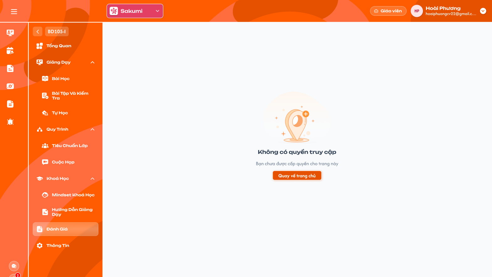

# [Giáo viên] Chi tiết lớp — Đánh giá

> Tài liệu đặc tả menu **Đánh giá** trong Chi tiết lớp của role Giáo viên. Giáo viên không có quyền xem đánh giá lớp; menu vẫn hiển thị và dẫn tới màn `Không có quyền truy cập`. UI tham chiếu: Figma `GV-LOP-100100`.

## 1. UI

### Màn Không có quyền truy cập

<p align="center">
  <a href="./images/evaluation-no-access.png"></a><br>
  <em>Menu Đánh giá của Giáo viên luôn hiển thị màn Không có quyền truy cập (Figma GV-LOP-100100) — nhấn để xem ảnh gốc</em>
</p>

**Mô tả:**

- Giáo viên bấm menu `Đánh giá` trong Chi tiết lớp thì vùng nội dung hiển thị màn `Không có quyền truy cập`.

**Giải thích thành phần:**

| Thành phần | Yêu cầu |
|---|---|
| Menu `Đánh giá` | Vẫn hiển thị trong menu trái của Chi tiết lớp, bấm được. |
| Hình minh hoạ | Hình chung của hệ thống cho màn không có quyền. |
| Tiêu đề | `Không có quyền truy cập`. |
| Mô tả | `Bạn chưa được cấp quyền cho trang này`. |
| Nút `Quay về trang chủ` | Về menu Lớp (Thống kê tổng quan) của role Giáo viên. |

**Điểm cần lưu ý:**

- Không tải dữ liệu đánh giá; backend từ chối request đánh giá từ role Giáo viên kể cả gọi trực tiếp.
- Mở bằng URL của menu Đánh giá cũng hiển thị màn này.

#### Testcase — Màn Không có quyền truy cập

| Tên testcase | Priority | Loại test | Scenario | Role | Pre-condition | Given / When / Then | Expected Result |
|---|---| --- |---|---|---|---|---|
| Case 1: Bấm menu Đánh giá | High | Smoke | Flow 1 / REQ01 | Giáo viên | Đang ở Chi tiết lớp | **Given** bấm menu `Đánh giá`<br>**When** màn tải<br>**Then** hiện `Không có quyền truy cập` với mô tả và nút | - Không gọi API đánh giá |
| Case 2: Quay về trang chủ | Medium |  | Flow 1 / REQ01 | Giáo viên | Đang ở màn Không có quyền | **Given** bấm `Quay về trang chủ`<br>**When** điều hướng<br>**Then** về menu Lớp — Thống kê tổng quan | - Không về Chi tiết lớp |
| Case 3: Truy cập bằng URL / request | High |  | EX01 / REQ01 | Giáo viên | Biết URL hoặc API đánh giá | **Given** mở URL hoặc gọi API<br>**When** backend kiểm tra<br>**Then** màn Không có quyền; API từ chối | - Không lộ dữ liệu đánh giá |

---

## 2. Yêu cầu

### 2.1. Flow chính

**Flow 1 / REQ01: Bấm menu Đánh giá**

```text
Giáo viên ở Chi tiết lớp → bấm "Đánh giá"
      → Hiển thị màn "Không có quyền truy cập" (không tải dữ liệu)
      → Bấm "Quay về trang chủ" → menu Lớp — Thống kê tổng quan
```

### 2.2. Ngoại lệ

- **EX01:** Mở URL menu Đánh giá hoặc gọi API đánh giá bằng role Giáo viên → màn `Không có quyền truy cập`; API trả lỗi quyền, không trả dữ liệu.

### 2.3. Yêu cầu khác

- **REQ01 – Không có quyền:** Role Giáo viên luôn thấy màn `Không có quyền truy cập` ở menu Đánh giá; menu vẫn hiển thị; nút `Quay về trang chủ` về menu Lớp. Backend chặn mọi request đánh giá của role này.

### 2.4. Ràng buộc

#### Quyền

| Role | Thấy menu Đánh giá | Xem nội dung đánh giá |
|---|:---:|:---:|
| Giáo viên | ✅ (màn Không có quyền) | ❌ |
| Các role khác | Theo requirement Admin Chi tiết lớp | — |

---

## 3. Cần xác nhận

- Có cần ẩn hẳn menu Đánh giá với Giáo viên thay vì hiển thị màn Không có quyền không (hiện giữ theo Figma).
- Khi Giáo viên được cấp quyền đánh giá trong tương lai thì màn hiển thị ra sao; chưa có thiết kế.
