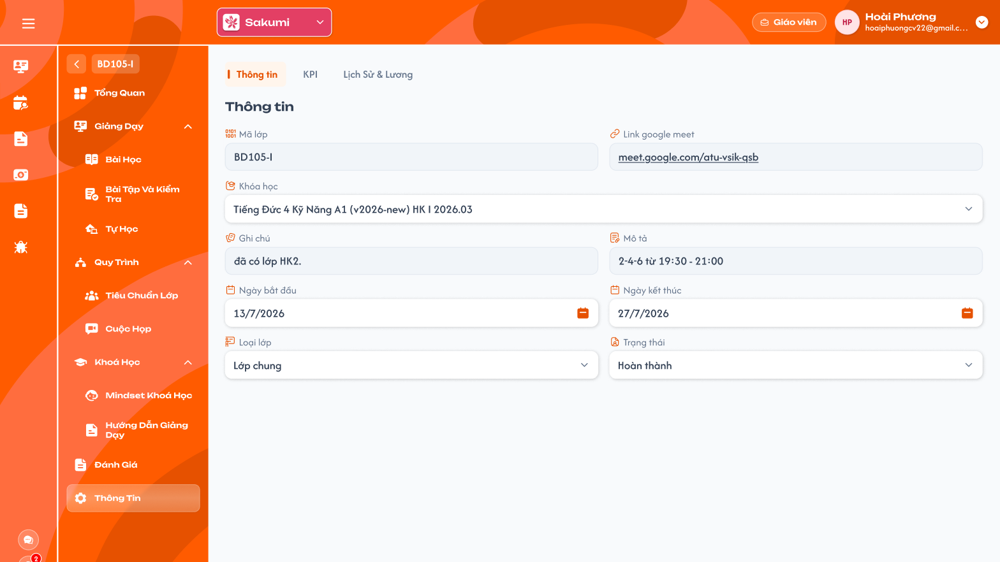
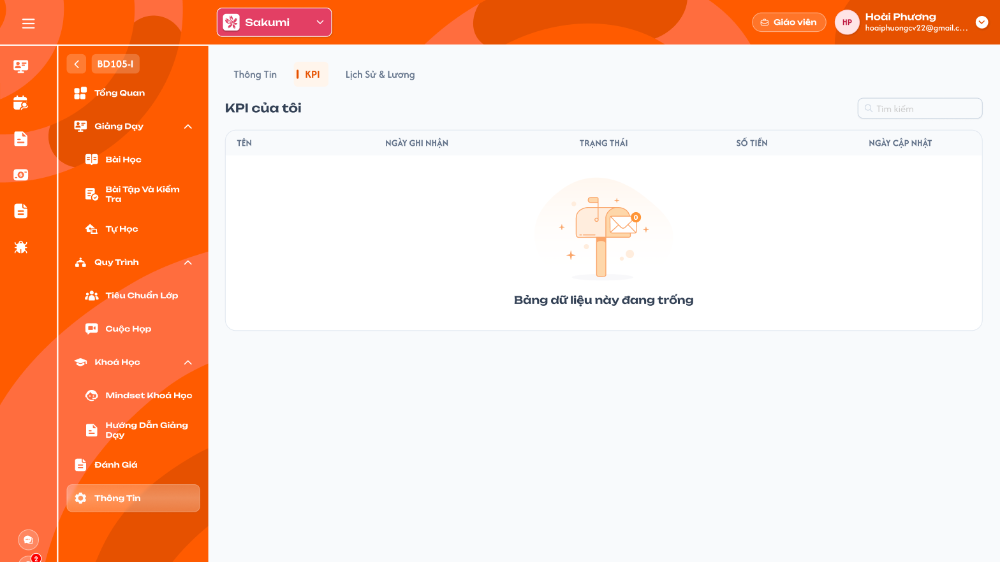
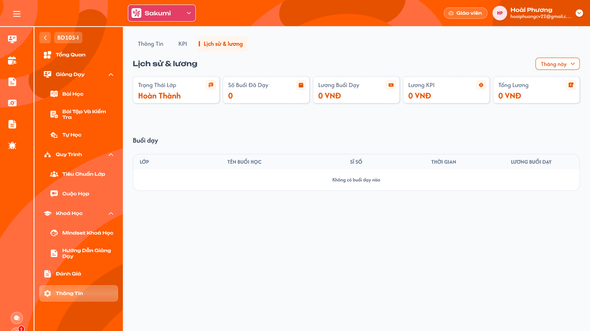

# [Giáo viên] Chi tiết lớp — Thông tin

> Tài liệu đặc tả menu **Thông tin** trong Chi tiết lớp của role Giáo viên, gồm 3 tab: `Thông tin`, `KPI`, `Lịch sử & lương`. UI tham chiếu: Figma `GV-LOP-110100`, `GV-LOP-110200`, `GV-LOP-110300`; hành vi đối chiếu với ICS cũ (`roles/teacher/class/information`, `roles/teacher/class/history_and_salary`). Số liệu trong ảnh là dữ liệu mẫu. Nghiệp vụ dùng chung với requirement Admin [Tab Thông tin](../../management_requirement/class_management/class_detail_information_requirements.md), [Tab KPI](../../management_requirement/class_management/class_detail_kpi_requirements.md) và [Tab Lịch dạy](../../management_requirement/class_management/class_detail_schedule_requirements.md).

## 1. UI

### Tab Thông tin

<p align="center">
  <a href="./images/info-information.png"></a><br>
  <em>Tab Thông tin của Giáo viên: toàn bộ field chỉ đọc (Figma GV-LOP-110100) — nhấn để xem ảnh gốc</em>
</p>

**Mô tả:**

- Giáo viên của lớp xem thông tin chung của lớp. Mọi field chỉ đọc; không có nút Lưu, Xóa lớp hay checkbox Lớp không chính thức.

**Giải thích field/thành phần:**

| Field | Yêu cầu |
|---|---|
| `Mã lớp` | Mã lớp hiện tại, chỉ đọc. |
| `Link google meet` | Hiển thị dạng liên kết; bấm mở tab mới. Trống thì để trống. |
| `Khóa học` | Tên khóa học gắn với lớp, hiển thị ô xám chỉ đọc giống `Mã lớp`; không có mũi tên dropdown. |
| `Ghi chú` | Ghi chú của lớp, chỉ đọc; trống thì để trống. |
| `Mô tả` | Mô tả lớp, chỉ đọc. |
| `Ngày bắt đầu` / `Ngày kết thúc` | `d/M/yyyy`, ô xám chỉ đọc; không có icon lịch, không mở picker. |
| `Loại lớp` | `Lớp chung` / `Lớp 1-1` / `Lớp demo`, ô xám chỉ đọc; không có mũi tên dropdown. |
| `Trạng thái` | Tên trạng thái lớp hiện tại, ô xám chỉ đọc; không có mũi tên dropdown. |

**Điểm cần lưu ý:**

- Mọi field hiển thị cùng một kiểu ô xám chỉ đọc như `Mã lớp`, `Ghi chú`, `Mô tả`. Khác Figma GV-LOP-110100: Figma còn vẽ mũi tên dropdown ở Khóa học, Loại lớp, Trạng thái và icon lịch ở Ngày bắt đầu/kết thúc; cần sửa Figma bỏ các control này.
- Dữ liệu tải mới từ backend khi mở tab; cùng nguồn với Admin Tab Thông tin.
- Backend từ chối mọi request cập nhật thông tin lớp từ role Giáo viên.

#### Testcase — Tab Thông tin

| Tên testcase | Priority | Loại test | Scenario | Role | Pre-condition | Given / When / Then | Expected Result |
|---|---| --- |---|---|---|---|---|
| Case 1: Xem thông tin lớp | High | Smoke | Flow 1 / REQ01 | Giáo viên | Lớp có đủ dữ liệu | **Given** mở Thông tin → tab Thông tin<br>**When** tải xong<br>**Then** hiển thị đủ 9 field đúng dữ liệu lớp | - Không có nút Lưu, Xóa lớp<br>- Không có mũi tên dropdown, icon lịch; mọi ô cùng kiểu xám chỉ đọc |
| Case 2: Mở link Meet | Medium |  | REQ01 | Giáo viên | Lớp có link Meet | **Given** bấm link<br>**When** mở<br>**Then** mở tab mới đúng URL | - Không đổi dữ liệu |
| Case 3: Chặn sửa bằng request | High |  | EX01 | Giáo viên | Có class_id | **Given** gửi request cập nhật thông tin lớp<br>**When** backend kiểm tra<br>**Then** từ chối | - Dữ liệu giữ nguyên |

### Tab KPI — KPI của tôi

<p align="center">
  <a href="./images/info-kpi.png"></a><br>
  <em>Tab KPI: bảng KPI của tôi, trạng thái trống (Figma GV-LOP-110200) — nhấn để xem ảnh gốc</em>
</p>

**Mô tả:**

- Giáo viên xem các khoản KPI của **chính mình tại lớp đang mở**, chỉ đọc. Khoản KPI do Admin/Class Handler tạo ở function KPI; giáo viên không thêm, sửa, xác nhận hay xoá.

**Giải thích thành phần:**

| Thành phần | Yêu cầu |
|---|---|
| Tiêu đề | `KPI của tôi`. |
| `Tìm kiếm` | Tìm theo giá trị cột `TÊN` (tên người nhận), giống Admin Tab KPI; tìm trên toàn bộ khoản của giáo viên tại lớp. |
| `TÊN` | Tên hiển thị của **người nhận khoản KPI** (chính giáo viên đang đăng nhập), giống cột `Tên` của Admin Tab KPI. Theo ICS cũ (`teacher_kpi_view.dart`, ô `owner.nameDisplay`); ICS cũ chỉ hiện tên ở dòng đầu, các dòng sau để trống — requirement hiển thị ở mọi dòng. Không hiển thị tên cấu hình KPI ở cột này. |
| `NGÀY GHI NHẬN` | `dd.MM.yyyy` theo thời gian thực hiện của khoản. |
| `TRẠNG THÁI` | `Mới`, `Đã xác nhận`, `Đã hủy`; khoản `Đã xóa` không hiển thị. Chip màu theo trạng thái, hover hiện tên. |
| `SỐ TIỀN` | Tiền thực tế đã lưu, định dạng `1.000.000 đ`. |
| `NGÀY CẬP NHẬT` | Lần cập nhật gần nhất do máy chủ ghi, `dd.MM.yyyy`. |
| Sắp xếp | Ngày ghi nhận giảm dần (mới nhất trước). |
| Không có khoản | `Bảng dữ liệu này đang trống`. |

**Điểm cần lưu ý:**

- Khác ICS cũ: ICS cũ liệt kê mọi KPI của giáo viên ở tất cả lớp; requirement mới chỉ KPI tại lớp đang mở.
- Chỉ loại `KPI` của giáo viên (không gồm khoản OT, không gồm KPI của Class Handler).
- Nguồn dữ liệu đối chiếu từ package ICS cũ `pls_repository_api`: `KpiResultModel.typeKpi` tham chiếu `ClassKpiModel.id`; tên và mô tả nằm ở `ClassKpiModel.title` / `description` trong collection `class_kpi`. Trường `type` (`kpi` / `ot`) chỉ phân loại khoản, không phải tên hiển thị. `sp_note` là ghi chú của khoản, không thay cho tên cấu hình KPI.
- Không có nút `+`, `Cài đặt KPI`, `X`, ghi chú/lịch sử; backend từ chối request ghi từ role Giáo viên.

#### Testcase — Tab KPI

| Tên testcase | Priority | Loại test | Scenario | Role | Pre-condition | Given / When / Then | Expected Result |
|---|---| --- |---|---|---|---|---|
| Case 4: Xem KPI tại lớp | High | Smoke | Flow 2 / REQ02 | Giáo viên | G có 2 KPI ở lớp A (1 Mới, 1 Đã xác nhận), 1 KPI ở lớp B, 1 KPI Đã xóa ở A | **Given** mở tab KPI của lớp A<br>**When** tải xong<br>**Then** bảng có đúng 2 dòng | - Không hiện KPI lớp B, không hiện Đã xóa<br>- Mới nhất trước |
| Case 5: Tìm theo cột Tên | Medium |  | REQ02 | Giáo viên | Có nhiều khoản | **Given** nhập một phần tên giáo viên<br>**When** tìm<br>**Then** các khoản khớp hiển thị; nhập tên khác thì rỗng | - Không tìm theo số tiền |
| Case 6: Không có KPI | Medium |  | EX02 | Giáo viên | G chưa có KPI ở lớp | **Given** mở tab<br>**When** tải xong<br>**Then** `Bảng dữ liệu này đang trống` | - Không lỗi |
| Case 7: Chỉ đọc | High |  | EX01 / REQ02 | Giáo viên | Có khoản Mới | **Given** gửi request sửa/xác nhận/xoá KPI<br>**When** backend kiểm tra<br>**Then** từ chối | - Không có control ghi trên UI |

### Tab Lịch sử & lương

<p align="center">
  <a href="./images/info-salary.png"></a><br>
  <em>Tab Lịch sử & lương: bộ lọc thời gian, 5 thẻ, bảng Buổi dạy (Figma GV-LOP-110300) — nhấn để xem ảnh gốc</em>
</p>

**Mô tả:**

- Giáo viên xem số buổi đã dạy và lương của mình **tại lớp đang mở** trong khoảng thời gian đã chọn. Cùng quy tắc với menu Lịch sử & lương (toàn bộ lớp), chỉ khác lọc theo lớp này.

**Giải thích thành phần:**

| Thành phần | Yêu cầu |
|---|---|
| Dropdown thời gian | 10 lựa chọn: `Tuần này`, `Tuần trước`, `Tháng này`, `Tháng trước`, `Tháng trước nữa`, `3 tháng gần đây`, `6 tháng gần đây`, `Năm nay`, `Năm trước`, `Tùy chọn` (chọn từ ngày – đến ngày). Mặc định `Tháng này`. Áp dụng cho cả 5 thẻ và bảng. |
| `Trạng Thái Lớp` | Tên trạng thái lớp hiện tại; không phụ thuộc bộ lọc. |
| `Số Buổi Đã Dạy` | Số buổi học của lớp có trạng thái `Hoàn thành` do giáo viên đang đăng nhập dạy (giáo viên của buổi), có **ngày tính lương** nằm trong khoảng lọc. Buổi không gắn lịch dùng ngày hoàn thành để lọc và vẫn được đếm. |
| `Lương Buổi Dạy` | Tổng lương các buổi `Hoàn thành` **có lịch gắn** của giáo viên tại lớp trong khoảng lọc; mỗi buổi = `Lương/giờ` của buổi (mức chỉnh riêng tại popup lịch nếu có, nếu không là `Lương/giờ` trong hồ sơ giáo viên) × thời lượng buổi (giờ), chốt tại thời điểm hoàn thành và lưu cho buổi đó; đổi `Lương/giờ` về sau không tính lại buổi đã hoàn thành. Buổi không gắn lịch = 0. Định dạng `1.000.000 VNĐ`. |
| `Lương KPI` | Tổng `SỐ TIỀN` các khoản KPI `Đã xác nhận` của giáo viên tại lớp có `Ngày ghi nhận` trong khoảng lọc. Mới, Đã hủy, Đã xóa không tính. |
| `Tổng Lương` | `Lương Buổi Dạy + Lương KPI`. |
| Bảng `Buổi dạy` | Mỗi dòng một buổi `Hoàn thành` của giáo viên tại lớp trong khoảng lọc; sắp theo thời gian giảm dần. |
| Cột `LỚP` | Icon trạng thái lớp (hover hiện tên) và mã lớp. |
| Cột `TÊN BUỔI HỌC` | Tên bài học của buổi, tối đa 2 dòng. |
| Cột `SĨ SỐ` | `x/y`: x = học viên được điểm danh đi học ở buổi (Có mặt, Vào trễ, Ra sớm, Vào trễ & Ra sớm); y = tổng học viên hợp lệ của lớp (loại Nghỉ học, Rời lớp, Chỉ xem, Xóa). |
| Cột `THỜI GIAN` | Ngày tính lương của buổi: ngày của lịch đã gắn; buổi không gắn lịch dùng thời điểm hoàn thành. Dạng `d/M/yyyy` và `HH:mm` hai dòng. |
| Cột `LƯƠNG BUỔI DẠY` | Lương của buổi, định dạng `240.000 VNĐ`. Buổi không gắn lịch: `0 VNĐ` kèm icon `i`, hover `Buổi dạy hoàn thành nhưng chưa có lịch thanh toán`. |
| Không có buổi | `Không có buổi dạy nào`. |

**Điểm cần lưu ý:**

- Khoảng lọc tính theo **ngày tính lương** (ngày của lịch), không phải ngày bấm Hoàn thành: chọn lịch ngày 15, hoàn thành ngày 20 thì buổi thuộc tháng của ngày 15.
- Khác ICS cũ: ICS cũ tính lương mọi buổi Hoàn thành (buổi không lịch chỉ có icon cảnh báo) và thẻ Lương KPI lấy số tiền của khoản KPI đầu tiên; requirement mới theo bảng trên.
- Buổi do giáo viên khác của lớp dạy không hiển thị, không tính.
- Đã chốt: buổi đã hoàn thành giữ nguyên lương đã ghi nhận. Thay lương/buổi không cập nhật ngược dòng buổi cũ hoặc tổng lương lịch sử; các buổi hoàn thành sau thời điểm thay đổi dùng mức mới. Việc lọc theo ngày tính lương không thay đổi nguyên tắc giữ lương này.
- Đã chốt: tab Lịch sử & lương trong Thông tin lớp không có OT; không hiển thị tab/thẻ/dòng OT và không cộng OT vào Tổng Lương. OT chỉ có ở menu Lịch sử & lương riêng của Giáo viên.
- Lớp Đang học không ảnh hưởng: thẻ `Trạng Thái Lớp` chỉ hiển thị.

#### Testcase — Tab Lịch sử & lương

| Tên testcase | Priority | Loại test | Scenario | Role | Pre-condition | Given / When / Then | Expected Result |
|---|---| --- |---|---|---|---|---|
| Case 8: Xem lương tháng này | High | Smoke | Flow 3 / REQ03 / REQ04 | Giáo viên | Tháng này G có 3 buổi Hoàn thành có lịch (lương 240.000/buổi), 1 KPI Đã xác nhận 500.000, 1 KPI Mới 300.000 | **Given** mở tab Lịch sử & lương<br>**When** tải xong (Tháng này)<br>**Then** Số buổi 3, Lương buổi 720.000, Lương KPI 500.000, Tổng 1.220.000 | - Bảng 3 dòng, mới nhất trước<br>- KPI Mới không tính |
| Case 9: Buổi không gắn lịch | High |  | REQ03 / REQ04 | Giáo viên | 1 buổi Hoàn thành không chọn lịch | **Given** xem tab<br>**When** tính<br>**Then** Số buổi +1, Lương buổi +0; dòng hiện `0 VNĐ` và icon `i` | - Hover icon hiện `Buổi dạy hoàn thành nhưng chưa có lịch thanh toán` |
| Case 10: Lọc theo ngày tính lương | High |  | REQ03 | Giáo viên | Buổi chọn lịch 30/9, hoàn thành 2/10 | **Given** chọn `Tháng trước` (tháng 9)<br>**When** lọc<br>**Then** buổi nằm trong tháng 9 | - Chọn Tháng này (10) thì không có buổi này |
| Case 11: Chỉ buổi của mình tại lớp | High |  | REQ03 | Giáo viên | Lớp có buổi do G và H dạy; G còn dạy lớp khác | **Given** G mở tab của lớp A<br>**When** tải<br>**Then** chỉ buổi của G tại A | - Không có buổi của H, không có lớp khác |
| Case 12: Sĩ số buổi | Medium |  | REQ04 | Giáo viên | Buổi có 8 đi học, 2 Nghỉ CP, lớp có 12 học viên hợp lệ | **Given** xem cột Sĩ số<br>**When** tính<br>**Then** `8/12` | - Học viên Rời lớp không vào mẫu |
| Case 13: Tùy chọn khoảng ngày | Medium |  | REQ03 | Giáo viên | Có buổi nhiều tháng | **Given** chọn `Tùy chọn`, 1/8 – 31/8<br>**When** áp dụng<br>**Then** thẻ và bảng theo khoảng đó | - Đổi lựa chọn khác tính lại |
| Case 14: Không có buổi | Medium |  | EX02 | Giáo viên | Khoảng lọc không có buổi | **Given** lọc<br>**When** rỗng<br>**Then** thẻ 0, bảng `Không có buổi dạy nào` | - Trạng Thái Lớp vẫn hiển thị |
| Case 15: Giữ lương buổi cũ khi đổi mức lương | High |  | REQ06 | Giáo viên | Buổi A đã hoàn thành và có lịch, ghi nhận 240.000 VNĐ; sau đó đổi lương/buổi thành 280.000 VNĐ; buổi B có lịch hoàn thành sau thay đổi | **Given** tải lại lịch sử có cả A và B<br>**When** tính lương<br>**Then** A giữ 240.000, B là 280.000 | - Tổng lương buổi là 520.000 VNĐ<br>- Xem lại khoảng chỉ có A vẫn là 240.000 VNĐ |
| Case 16: OT không thuộc Thông tin lớp | High |  | REQ07 | Giáo viên | Trong khoảng có 1 buổi có lịch 240.000 VNĐ, KPI Đã xác nhận 500.000 VNĐ và OT Đã xác nhận 180.000 VNĐ | **Given** mở tab Lịch sử & lương trong Thông tin lớp<br>**When** tải xong<br>**Then** Tổng Lương là 740.000 VNĐ | - Không có thẻ/tab/dòng OT<br>- Không cộng 180.000 VNĐ OT vào tổng |

---

## 2. Yêu cầu

### 2.1. Flow chính

**Flow 1 / REQ01: Xem Thông tin lớp**

```text
Giáo viên vào Chi tiết lớp → Thông tin → tab Thông tin
      → Hệ thống tải thông tin lớp mới nhất, hiển thị 9 field chỉ đọc
```

**Flow 2 / REQ02: Xem KPI của tôi**

```text
Giáo viên chọn tab KPI
      → Hệ thống tải khoản KPI của giáo viên tại lớp (trừ Đã xóa), sắp Ngày ghi nhận giảm dần
      → Giáo viên tìm theo cột Tên; không có khoản: "Bảng dữ liệu này đang trống"
```

**Flow 3 / REQ03 / REQ04: Xem Lịch sử & lương của lớp**

```text
Giáo viên chọn tab Lịch sử & lương (mặc định Tháng này)
      → Hệ thống lấy buổi Hoàn thành của giáo viên tại lớp có ngày tính lương trong khoảng, KPI Đã xác nhận trong khoảng
      → Tính 5 thẻ; hiển thị bảng Buổi dạy sắp giảm dần
      → Giáo viên đổi khoảng thời gian → tính lại thẻ và bảng
```

### 2.2. Ngoại lệ

- **EX01:** Giáo viên gửi request cập nhật thông tin lớp, thêm/sửa/xác nhận/xoá KPI → backend từ chối; dữ liệu giữ nguyên.
- **EX02:** Không có KPI / không có buổi dạy trong khoảng → trạng thái trống tương ứng, thẻ hiển thị 0; không lỗi.
- **EX03:** Tải dữ liệu thất bại → vùng lỗi có `Thử lại`; không hiển thị số 0 giả.

### 2.3. Yêu cầu khác

- **REQ01 – Thông tin chỉ đọc:** 9 field theo nguồn Admin Tab Thông tin; không có control ghi; link Meet mở tab mới.
- **REQ02 – KPI của tôi:** Chỉ khoản loại KPI của giáo viên đang đăng nhập tại lớp đang mở; trạng thái Mới / Đã xác nhận / Đã hủy, ẩn Đã xóa; cột Tên, Ngày ghi nhận, Trạng thái, Số tiền, Ngày cập nhật; tên lấy từ `title` của cấu hình KPI được khoản tham chiếu, mô tả từ `description` nếu có; tìm theo tên; sắp Ngày ghi nhận giảm dần; chỉ đọc.
- **REQ03 – Phạm vi và bộ lọc lương:** Dữ liệu của giáo viên đang đăng nhập tại lớp đang mở. 10 lựa chọn thời gian, mặc định Tháng này; buổi lọc theo ngày tính lương (ngày của lịch gắn; không lịch thì thời điểm hoàn thành), KPI lọc theo Ngày ghi nhận.
- **REQ04 – Công thức:** Số buổi đã dạy = buổi Hoàn thành của giáo viên trong khoảng (kể cả không lịch). Lương buổi dạy = tổng lương các buổi Hoàn thành có lịch gắn (lương/buổi của giáo viên tại lớp); buổi không lịch = 0 kèm cảnh báo. Lương KPI = tổng KPI Đã xác nhận trong khoảng. Tổng lương = Lương buổi dạy + Lương KPI. Sĩ số buổi = đi học / học viên hợp lệ.
- **REQ05 – Đồng bộ:** Cùng nguồn với menu Lịch sử & lương của Giáo viên và Tab KPI/Lịch dạy của Admin; hoàn thành buổi, xác nhận KPI, Mở lại lịch (đảo lương) phải phản ánh khi tải lại.
- **REQ06 – Giữ lương buổi đã hoàn thành:** Lưu mức lương của buổi khi hoàn thành. Thay đổi lương/buổi chỉ áp dụng cho các buổi hoàn thành sau thời điểm thay đổi; không tính lại dòng cũ hoặc tổng lương lịch sử theo mức mới. Bộ lọc vẫn dùng ngày tính lương đã chốt, độc lập với thời điểm ghi nhận mức lương.
- **REQ07 – Phạm vi OT:** Không có OT ở tab Lịch sử & lương trong Thông tin lớp; Tổng Lương tại đây chỉ gồm lương buổi dạy và KPI. OT được xem ở menu Lịch sử & lương riêng của Giáo viên.

### 2.4. Ràng buộc

#### Quyền

| Role | Xem Thông tin, KPI của tôi, Lịch sử & lương của mình tại lớp | Sửa thông tin lớp, KPI, lương |
|---|:---:|:---:|
| Giáo viên của lớp | ✅ | ❌ |
| Các role khác | Theo requirement Admin Chi tiết lớp | — |

#### Phạm vi dữ liệu

- Chỉ dữ liệu của giáo viên đang đăng nhập tại lớp mà mình được thêm vào; backend kiểm tra, không trả KPI/buổi của giáo viên khác hoặc lớp khác.
- Không cho phép truy cập hoặc thực hiện hành động bị đánh dấu `❌`, kể cả khi gọi trực tiếp bằng URL hoặc request.

---

## 3. Cần xác nhận

- Không còn mục cần xác nhận.

## 4. Nguồn đối chiếu và quyết định đã chốt

- **Kiểu hiển thị field tab Thông tin:** người dùng chốt 2026-10-20 bỏ mũi tên dropdown và icon lịch, mọi field là ô xám chỉ đọc; Figma GV-LOP-110100 cần sửa theo.

- **Cột TÊN:** người dùng chốt lấy theo ICS cũ. Widget ICS cũ `roles/teacher/class/history_and_salary/views/teacher_kpi_view.dart` → `cellBuilder` hiển thị `owner.nameDisplay` (tên giáo viên nhận khoản), chỉ ở dòng đầu (`showOwner`); cột này không hiển thị `title` của cấu hình KPI. Tên cấu hình KPI (`typeKpi` → `class_kpi_model.title`) chỉ dùng ở cột `Loại KPI` của menu Lịch sử & lương.
- **Lương buổi đã hoàn thành:** người dùng chốt giữ lương cũ; mức mới chỉ áp dụng cho các buổi hoàn thành sau thời điểm thay đổi. Testcase 15 kiểm tra không tính hồi tố.
- **OT:** người dùng chốt chỉ có ở menu Lịch sử & lương riêng; không có ở tab Thông tin lớp. Testcase 16 kiểm tra phạm vi và tổng lương.
