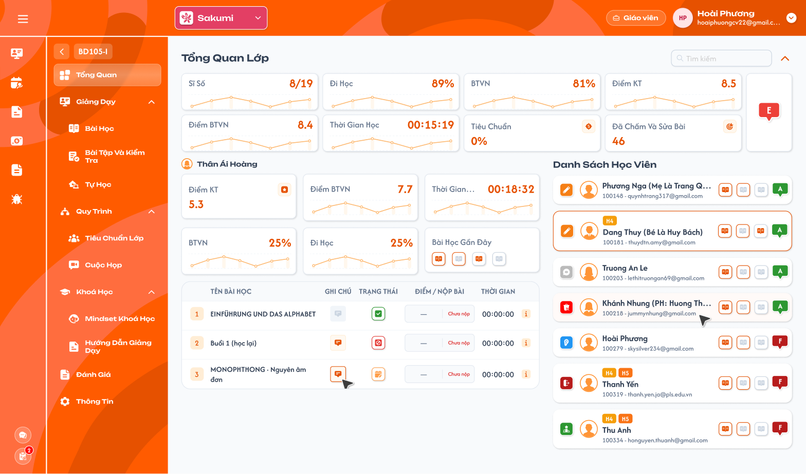
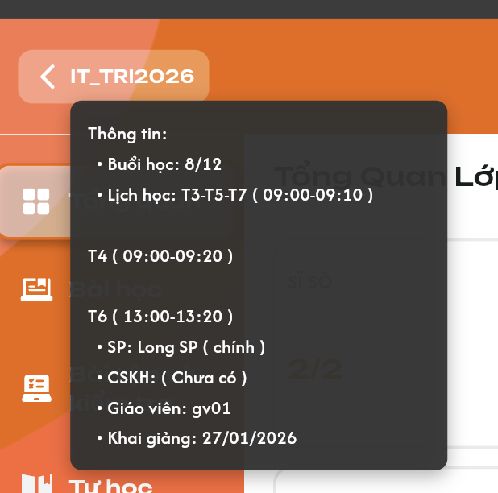
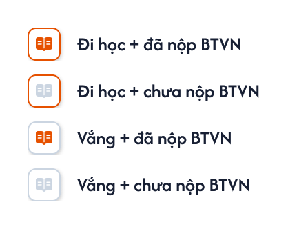
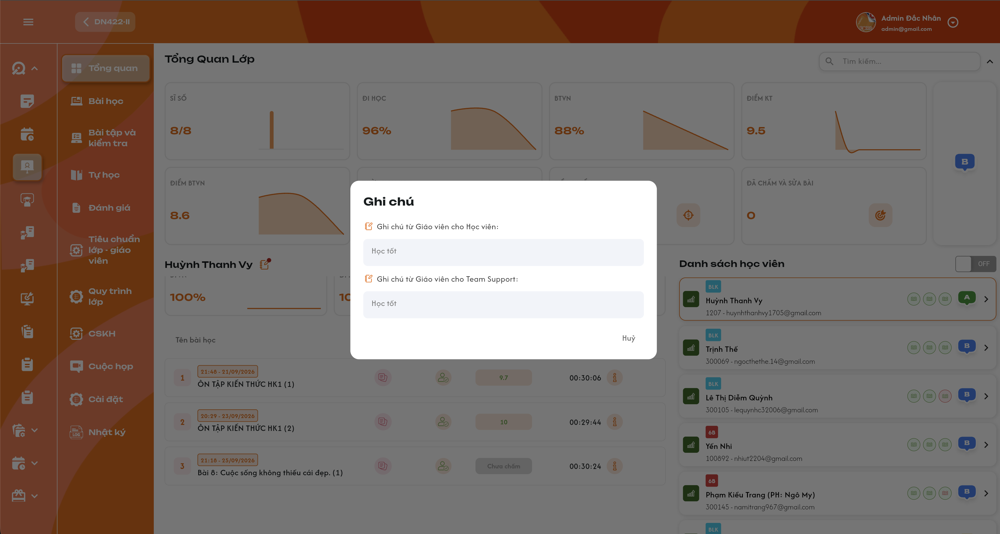
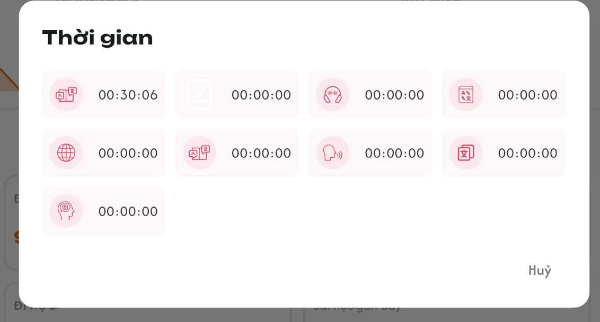

# [Giáo viên] Chi tiết lớp — Tổng quan

> Tài liệu đặc tả menu **Tổng quan** trong Chi tiết lớp của role Giáo viên (màn có tiêu đề `Tổng Quan Lớp`). Màn dùng cùng dữ liệu và công thức với requirement Admin [Chi tiết lớp học — Menu Tổng quan](../../management_requirement/class_management/class_detail_overview_requirements.md); tài liệu này chép lại đầy đủ để đọc độc lập và chỉ khác ở phần dành riêng cho Giáo viên: không có công tắc ON/OFF, học phí, ghi chú cài đặt, nút `Hiện ghi chú`, dấu `>` vào chi tiết học viên và chấm đỏ lịch hẹn. Ảnh màn lấy từ Figma (GV-LOP-020000); ảnh tooltip, popup ghi chú và popup Thời gian dùng ảnh của requirement Admin. Tên học viên, điểm và số liệu trong ảnh là dữ liệu mẫu.

## 1. UI

### Tổng quan — Khung màn và phân quyền

<p align="center">
  <a href="./images/class-overview.png"></a><br>
  <em>Menu Tổng quan: thống kê lớp phía trên, học viên đang chọn bên trái, danh sách học viên bên phải (Figma GV-LOP-020000) — nhấn để xem ảnh gốc</em>
</p>

**Mô tả:**

- Menu đầu tiên trong Chi tiết lớp. Mọi giáo viên của lớp xem tình hình học tập của lớp và từng học viên. Màn chỉ để xem; không chấm điểm, không điểm danh, không sửa ghi chú.

**Giải thích thành phần:**

| Thành phần | Yêu cầu |
|---|---|
| Tiêu đề `Tổng Quan Lớp` | Dữ liệu của đúng lớp đang mở. |
| Nút Back / mã lớp | Hover hiển thị tooltip Thông tin lớp; click quay về menu Lớp. Chi tiết ở khu vực Nút Back và tooltip thông tin lớp. |
| Thống kê phía trên | 8 thẻ chỉ số toàn lớp và badge đánh giá lớp; không đổi theo học viên đang chọn. |
| Vùng bên trái | Tên, chỉ số, Bài học gần đây và bảng bài học của học viên đang chọn. |
| `Danh Sách Học Viên` bên phải | Toàn bộ học viên của lớp: icon trạng thái quan hệ lớp, tag, tên, mã, email, 3 bài gần nhất, badge đánh giá. |
| Ô `Tìm kiếm` | Tìm theo tên học viên trong toàn bộ học viên của lớp. |
| Icon `⌃` cạnh ô tìm kiếm | Thu gọn / mở lại vùng thống kê toàn lớp phía trên; không thu gọn danh sách hay vùng trái. |

**Điểm cần lưu ý:**

- Giáo viên không có công tắc ON/OFF; API Tổng quan không trả học phí, ghi chú cài đặt lớp và ghi chú cài đặt học viên cho Giáo viên, không chỉ ẩn trên giao diện.
- Không có nút `Hiện ghi chú` ở `Danh Sách Học Viên`, dấu `>` trên thẻ học viên, icon ghi chú cạnh tên học viên đang chọn (Giáo viên không có ghi chú cài đặt học viên) và chấm đỏ lịch hẹn.
- Trong Chi tiết lớp chỉ có một menu `Tổng Quan`; không có menu `Tổng Quan Lớp` riêng.
- Khác Figma GV-LOP-020000: khối `Bài Học Gần Đây` ở vùng trái đang vẽ 4 icon, requirement là 6 bài; bảng bài học chưa có tag thời điểm mở bài phía trên tên bài.
- Mọi thao tác trên màn là thao tác đọc; không có Toast CRUD.

#### Testcase — Khung màn và phân quyền

| Tên testcase | Priority | Loại test | Scenario | Role | Pre-condition | Given / When / Then | Expected Result |
|---|---| --- |---|---|---|---|---|
| Case 1: Mở Tổng quan | High | Smoke | Flow 1 / REQ01 | Giáo viên | Giáo viên thuộc lớp A, lớp có học viên | **Given** vào Chi tiết lớp A<br>**When** chọn menu Tổng Quan<br>**Then** hiển thị thống kê, vùng trái và danh sách học viên của A | - Chọn sẵn học viên đầu tiên<br>- Không trộn dữ liệu lớp khác<br>- Menu không có mục `Tổng Quan Lớp` riêng |
| Case 2: Không có ON/OFF, học phí, ghi chú cài đặt | High |  | REQ01 / REQ06 | Giáo viên | Lớp có học phí và ghi chú cài đặt | **Given** mở Tổng quan<br>**When** render hoặc sửa request để yêu cầu dữ liệu ON<br>**Then** không có công tắc, API không trả học phí/ghi chú cài đặt | - Không có nút `Hiện ghi chú`<br>- Không có icon ghi chú cạnh tên học viên đang chọn<br>- Vẫn xem chỉ số học tập |
| Case 3: Chặn giáo viên ngoài lớp | High |  | EX01 / REQ01 | Giáo viên | Giáo viên không thuộc lớp B | **Given** truy cập URL/API Tổng quan của lớp B<br>**When** backend kiểm tra<br>**Then** từ chối | - Không lộ học tập hoặc ghi chú của B |
| Case 4: Thu gọn và mở thống kê | Medium |  | Flow 3 / REQ11 | Giáo viên | Thống kê đang mở, đã chọn học viên | **Given** bấm `⌃`<br>**When** thu gọn rồi mở lại<br>**Then** chỉ vùng thống kê lớp ẩn/hiện | - Danh sách, vùng trái và ô tìm kiếm giữ nguyên |

### Nút Back và tooltip thông tin lớp

<p align="center">
  <a href="../../management_requirement/class_management/images/61-class-overview-back-tooltip.png"></a><br>
  <em>Tooltip thông tin lớp khi hover nút Back (ảnh requirement Admin) — nhấn để xem ảnh gốc</em>
</p>

**Mô tả:**

- Nút Back ở đầu menu Chi tiết lớp gồm mũi tên và mã lớp. Hover hiển thị tooltip `Thông tin:` của lớp; click quay về menu Lớp (Thống kê tổng quan).

**Giải thích thành phần:**

| Thành phần | Yêu cầu |
|---|---|
| Nút Back / mã lớp | Hover vùng mũi tên và mã lớp để xem tooltip; hover không điều hướng. Click quay về menu `Lớp` của Giáo viên (GV-LOP-010000). |
| Tooltip | Nền tối, chữ sáng, hiển thị ngay dưới nút. Tiêu đề `Thông tin:`; thứ tự Buổi học, Lịch học, SP, CSKH, Giáo viên, Khai giảng. |
| Buổi học | `đã thực hiện/tổng số buổi`, cùng nguồn tiến độ của lớp ở Danh sách lớp (vd `8/12`); không lấy sĩ số thay số buổi. |
| Lịch học | Đầy đủ lịch học theo thứ và giờ `HH:mm-HH:mm`; nhóm các thứ cùng khung giờ (vd `T3-T5-T7 (09:00-09:10)`), lịch khác xuống dòng; không cắt còn lịch đầu tiên. |
| SP | Tên Support được gán cho lớp; người phụ trách chính có nhãn `(chính)`; nhiều Support thì hiển thị đủ. |
| CSKH | Nhân sự CSKH của lớp; chưa gán thì `(Chưa có)`. |
| Giáo viên | Tên các giáo viên được gán cho lớp, hiển thị đủ danh sách. |
| Khai giảng | Ngày khai giảng `DD/MM/YYYY`; không dùng ngày tạo lớp. |

**Điểm cần lưu ý:**

- Tooltip chỉ đọc; rời vùng nút/tooltip thì ẩn; click Back đóng tooltip.
- Dữ liệu tải lỗi không hiển thị thành `(Chưa có)`.
- Đổi lớp thì tooltip theo lớp mới; response của lớp cũ không ghi đè.

#### Testcase — Nút Back và tooltip

| Tên testcase | Priority | Loại test | Scenario | Role | Pre-condition | Given / When / Then | Expected Result |
|---|---| --- |---|---|---|---|---|
| Case 5: Hover hiển thị đúng lớp | High |  | Flow 6 / REQ12 | Giáo viên | Đang xem Tổng quan A | **Given** hover mũi tên hoặc mã lớp<br>**When** tooltip hiển thị<br>**Then** đủ sáu nhóm thông tin của A | - Hover không điều hướng<br>- Không phụ thuộc học viên đang chọn |
| Case 6: Nhiều lịch và nhân sự | High |  | REQ12 | Giáo viên | Lớp có tiến độ 8/12, lịch T3-T5-T7 và hai lịch T4/T6, nhiều Support/giáo viên | **Given** mở tooltip<br>**When** render<br>**Then** đủ lịch và nhân sự, Support chính có `(chính)` | - Các khung giờ khác xuống dòng<br>- Không chỉ hiển thị phần tử đầu |
| Case 7: Chưa phân công và ngày khai giảng | Medium |  | REQ12 / EX05 | Giáo viên | CSKH chưa gán; ngày tạo khác ngày khai giảng 27/01/2026 | **Given** dữ liệu tải thành công<br>**When** hover nút Back<br>**Then** CSKH `(Chưa có)`, Khai giảng 27/01/2026 | - Lỗi tải không hiển thị thành `(Chưa có)` |
| Case 8: Click Back về menu Lớp | High |  | Flow 6 / REQ12 | Giáo viên | Tooltip đang hiển thị | **Given** click nút Back<br>**When** điều hướng<br>**Then** về menu Lớp (Thống kê tổng quan) | - Tooltip đóng<br>- Không Toast |

### Thống kê học tập trung bình của lớp

**Mô tả:**

- 8 thẻ chỉ số toàn lớp: `Sĩ Số`, `Đi Học`, `BTVN`, `Điểm KT`, `Điểm BTVN`, `Thời Gian Học`, `Tiêu Chuẩn`, `Đã Chấm Và Sửa Bài`; bên phải là badge đánh giá lớp.

**Giải thích thành phần:**

| Thẻ | Yêu cầu |
|---|---|
| Sĩ số | Tử số = số học viên `Đang học` + `Dự thính`; mẫu số = tất cả học viên của lớp thuộc đủ 7 trạng thái `Đang học`, `Dự thính`, `Hoàn thành`, `Nghỉ học`, `Rời lớp`, `Chỉ xem`, `Xóa`. Hiển thị `tử/mẫu`, không đổi sang %. |
| Đi học | Trung bình cộng tỷ lệ đi học của học viên có dữ liệu trong lớp, cùng công thức mức lớp của Danh sách lớp. Không có dữ liệu thì để trống. |
| BTVN | Trung bình cộng tỷ lệ làm BTVN của học viên có dữ liệu trong lớp, cùng công thức mức lớp của Danh sách lớp. Không có dữ liệu thì để trống. |
| Điểm KT | Cộng điểm các bài kiểm tra đã chấm của học viên trong lớp rồi chia số bài đã chấm; giữ bài của học viên đã `Rời lớp`/`Xóa`; làm tròn kết quả cuối 1 chữ số thập phân. |
| Điểm BTVN | Cộng điểm các BTVN đã chấm rồi chia số BTVN đã chấm, kể cả bài của học viên đã `Rời lớp`/`Xóa`; tính riêng với KT; làm tròn 1 chữ số thập phân. |
| Thời gian học | Trung bình tổng thời gian app của từng cặp học viên–bài: cộng các tổng thời gian học viên–bài rồi chia số bản ghi học viên–bài; hiển thị `HH:mm:ss`. Không lấy trung bình các trung bình học viên, không dùng giờ lịch dạy. |
| Tiêu chuẩn | % hoàn thành tiêu chuẩn lớp–giáo viên lấy từ function Tiêu chuẩn; một số chung của lớp, giống mọi role. Không tự suy từ Đi học/BTVN/điểm. Không điều hướng khi click. |
| Đã chấm và sửa bài | Số bài **BTVN và Kiểm tra** của lớp đã có ít nhất một lần bấm `Đã Chấm và Sửa Bài Trên Lớp` (xem requirement [Giảng dạy](./class_teaching_requirements.md)). Mỗi bài tính một lần; bấm lại không tăng. Không điều hướng khi click. |
| Đánh giá lớp | Badge theo giá trị nguồn cung cấp; chưa có công thức tự tính; không điều hướng. |

**Điểm cần lưu ý:**

- Tách tập học viên hiện tại (sĩ số, danh sách) với dữ liệu kết quả học tập lịch sử; học viên rời lớp/xóa không làm mất bài đã làm, điểm đã chấm.
- Chưa nộp/Chưa chấm không tham gia tử hoặc mẫu của điểm trung bình; bài đã chấm điểm 0 vẫn tính. Không có bài đã chấm thì để trống, không hiển thị 0 giả.
- Tính trung bình trực tiếp trên các bài đã chấm, không trung bình hai cấp qua từng học viên; chỉ làm tròn kết quả cuối.
- Thời gian app: bản ghi có tổng thời gian 0 là dữ liệu 0; bản ghi thiếu dữ liệu không tự thành 0.
- Tìm kiếm, chọn học viên không làm đổi thống kê toàn lớp.
- Thẻ `Đã chấm và sửa bài` đếm theo bài, không theo số lần bấm, vì hệ thống chỉ lưu lần bấm gần nhất của mỗi bài.

#### Testcase — Thống kê lớp

| Tên testcase | Priority | Loại test | Scenario | Role | Pre-condition | Given / When / Then | Expected Result |
|---|---| --- |---|---|---|---|---|
| Case 9: Sĩ số đủ mọi trạng thái kể cả Xóa | High |  | REQ02 | Giáo viên | Mỗi trạng thái trong bộ 7 có một học viên | **Given** tải thống kê<br>**When** tính Sĩ số<br>**Then** hiển thị 2/7 | - Hoàn thành không vào tử số<br>- Xóa và Chỉ xem vẫn vào mẫu số |
| Case 10: Đi học/BTVN trung bình | High |  | REQ02 | Giáo viên | Tỷ lệ hai học viên 80% và 100%, học viên khác không có dữ liệu | **Given** tải thống kê<br>**When** tổng hợp<br>**Then** (80 + 100) / 2 = 90% | - Bỏ học viên không có dữ liệu<br>- Cả lớp không có dữ liệu thì để trống |
| Case 11: Điểm chỉ tính bài đã chấm | High |  | REQ03 / EX02 | Giáo viên | Bài đã chấm 8 và 0, một Chưa nộp, một Chưa chấm | **Given** tính Điểm KT hoặc Điểm BTVN<br>**When** lọc bài đã chấm<br>**Then** (8 + 0) / 2 = 4.0 | - Điểm 0 đã chấm vẫn tính<br>- Không có bài đã chấm thì để trống |
| Case 12: Trung bình theo bài và giữ bài người rời lớp | High |  | REQ03 / EX06 | Giáo viên | A có bài đã chấm 8 và 9, B đã Rời lớp có bài đã chấm 9 | **Given** tính điểm trung bình<br>**When** cộng điểm và chia số bài<br>**Then** 26 / 3 làm tròn 8.7 | - Không trung bình các trung bình học viên<br>- Bài của B vẫn tính |
| Case 13: Thời gian học là trung bình học viên–bài | High |  | REQ02 | Giáo viên | A có hai bài 10 và 30 phút, B một bài 50 phút | **Given** tính Thời gian học<br>**When** cộng ba tổng và chia 3<br>**Then** 00:30:00 | - Không hiện tổng 01:30:00<br>- Không hiện 00:35:00 |
| Case 14: Tiêu chuẩn đúng nguồn | High |  | REQ02 | Giáo viên | Tiêu chuẩn lớp–giáo viên là 40%; lớp có hai giáo viên | **Given** hai giáo viên lần lượt mở Tổng quan<br>**When** render thẻ Tiêu chuẩn<br>**Then** cả hai thấy 40% | - Không tự tính từ Đi học/BTVN<br>- Click không điều hướng |
| Case 15: Đã chấm và sửa bài đếm theo bài BTVN + KT | High |  | REQ02 | Giáo viên | 3 BTVN và 2 bài kiểm tra đã được bấm nút; một BTVN được bấm 4 lần | **Given** tải thống kê<br>**When** tính thẻ Đã chấm và sửa bài<br>**Then** hiển thị 5 | - Không hiển thị 8 (số lần bấm)<br>- Không bỏ bài kiểm tra<br>- Bài chưa bấm không tính |

### Biểu đồ theo bài học

**Mô tả:**

- Các thẻ chỉ số có biểu đồ đường màu cam theo bài học: biểu đồ lớp ở thống kê phía trên, biểu đồ học viên ở vùng trái.

**Giải thích thành phần:**

| Thành phần | Yêu cầu |
|---|---|
| Trục bài học | Theo thứ tự bài học của lớp, không theo ngày/tuần. |
| Giá trị | Mỗi điểm là dữ liệu của bài tương ứng, không lũy kế qua các bài trước. |
| Giới hạn chart học viên | Chỉ tới bài học viên đang chọn đã học; không vẽ bài phía sau vì lớp đã mở hoặc học viên khác đã học. |
| Đường/vùng cam | Theo dữ liệu thực; không vẽ đường trang trí như ảnh khi dữ liệu khác. |
| Tooltip | Nội dung/khả năng hover chưa chốt (mục 3). |

**Điểm cần lưu ý:**

- Mỗi thẻ và mỗi học viên một chuỗi dữ liệu riêng.
- Bài học viên đã học xác định từ tiến độ học viên–bài, không dùng bài mới nhất giáo viên mở cho cả lớp.
- Thiếu dữ liệu không dựng thành đường 0.

#### Testcase — Biểu đồ

| Tên testcase | Priority | Loại test | Scenario | Role | Pre-condition | Given / When / Then | Expected Result |
|---|---| --- |---|---|---|---|---|
| Case 16: Theo thứ tự bài | High |  | REQ04 | Giáo viên | Các bài mở ở ngày khác nhau | **Given** tải biểu đồ<br>**When** sắp dữ liệu<br>**Then** theo thứ tự bài học | - Không chia theo ngày/tuần |
| Case 17: Chart dừng đúng tiến độ học viên | High |  | REQ04 | Giáo viên | Lớp 10 bài; A học tới bài 4, B tới bài 7 | **Given** chọn A rồi B<br>**When** render chart vùng trái<br>**Then** A tới bài 4, B tới bài 7 | - Không thêm điểm 0 cho bài chưa học<br>- Biểu đồ lớp không đổi |

### Danh sách, tìm kiếm và chọn học viên

**Mô tả:**

- `Danh Sách Học Viên` hiển thị toàn bộ học viên của lớp. Mặc định chọn học viên đầu tiên; bấm thẻ để đổi học viên ở vùng trái.

**Giải thích thành phần:**

| Thành phần | Yêu cầu |
|---|---|
| Thẻ học viên | Icon trạng thái quan hệ lớp, tag, tên, mã, email, 3 bài gần nhất, badge đánh giá. Không có dấu `>` và không có chấm đỏ số lịch hẹn (chấm đỏ chỉ Admin, Support, Class Handler thấy). |
| Thẻ đang chọn | Viền cam; chỉ một học viên được chọn. |
| Bấm thẻ | Chọn học viên theo học viên và lớp; tải chỉ số, Bài học gần đây, biểu đồ và bảng bài của học viên đó. Không mở chi tiết học viên. |
| Tìm kiếm | Theo tên học viên trên toàn bộ học viên của lớp, không chỉ phần đã tải. |
| Phạm vi danh sách | Đủ 7 trạng thái `Đang học`, `Dự thính`, `Hoàn thành`, `Nghỉ học`, `Rời lớp`, `Chỉ xem`, `Xóa`; không phân trang, không load-more. |
| Vùng trái | Điểm KT, Điểm BTVN, Thời gian học, BTVN, Đi học, Bài học gần đây và bảng bài học của học viên đang chọn. |

**Điểm cần lưu ý:**

- Tìm kiếm không lọc lại thống kê lớp phía trên.
- Học viên `Rời lớp`/`Xóa` vẫn có thẻ; bấm thẻ xem dữ liệu học tập lịch sử. Hiển thị ở Tổng quan không khôi phục quan hệ lớp.
- Giáo viên không vào chi tiết học viên từ màn này.
- API danh sách học viên không trả số lịch hẹn cho Giáo viên.

#### Testcase — Chọn và tìm học viên

| Tên testcase | Priority | Loại test | Scenario | Role | Pre-condition | Given / When / Then | Expected Result |
|---|---| --- |---|---|---|---|---|
| Case 18: Chọn học viên đầu tiên | High |  | Flow 1 / REQ05 | Giáo viên | Lớp có ít nhất một học viên | **Given** mở Tổng quan<br>**When** danh sách tải xong<br>**Then** học viên đầu tiên có viền cam | - Vùng trái đúng học viên đó |
| Case 19: Bấm thẻ cập nhật vùng trái | High | Smoke | Flow 2 / REQ05 | Giáo viên | Đang chọn A, có B | **Given** bấm thẻ B<br>**When** dữ liệu tải xong<br>**Then** tên, chỉ số, biểu đồ, bảng bài đổi sang B | - Thống kê lớp không đổi<br>- Không mở chi tiết học viên |
| Case 20: Không có dấu `>` | Medium |  | REQ05 | Giáo viên | Danh sách có học viên | **Given** xem thẻ học viên<br>**When** render<br>**Then** không có dấu `>` | - Bấm mọi vị trí trên thẻ chỉ chọn học viên |
| Case 21: Không hiển thị chấm đỏ lịch hẹn | High |  | REQ05 | Giáo viên | Học viên A có 2 lịch hẹn `Mới` | **Given** xem thẻ A<br>**When** render<br>**Then** không có chấm đỏ số lịch hẹn | - API không trả số lịch hẹn<br>- Không mở được popup lịch hẹn |
| Case 22: Tìm theo tên đủ mọi trạng thái | High |  | REQ05 | Giáo viên | Lớp có học viên ở đủ 7 trạng thái, gồm A trạng thái Xóa | **Given** nhập tên A<br>**When** tìm<br>**Then** có thẻ A | - Không loại Xóa/Rời lớp/Nghỉ học<br>- Thống kê lớp không đổi |
| Case 23: Không có kết quả | Medium |  | EX04 / REQ05 | Giáo viên | Tên tìm không khớp học viên nào | **Given** nhập tên<br>**When** tìm<br>**Then** hiển thị trạng thái rỗng | - Không dựng học viên giả |

### Đánh giá tổng và bài học gần đây

**Mô tả:**

- Mỗi thẻ học viên có badge đánh giá tổng và trạng thái 3 bài gần nhất; vùng trái có khối `Bài Học Gần Đây` gồm 6 bài gần nhất của học viên đang chọn.

<p align="center">
  <a href="../../management_requirement/class_management/images/recent-lesson-status-icons.png"></a><br>
  <em>Bộ icon `Class Session Status` cho Bài học gần đây (Figma component 2425:105717) — nhấn để xem ảnh gốc</em>
</p>

**Giải thích thành phần:**

| Thành phần | Yêu cầu |
|---|---|
| Badge đánh giá | `F` đỏ, `D` nâu, `E` cam; `A` xanh lá và `B` xanh dương theo UI tham chiếu. `C` chưa có quy tắc màu. Giá trị lấy từ nguồn, chưa có công thức tự tính. |
| Số bài hiển thị | Thẻ học viên ở `Danh Sách Học Viên`: 3 bài gần nhất. Khối `Bài Học Gần Đây` ở vùng trái khi chọn học viên: 6 bài gần nhất. Chỉ tính bài **đã được điểm danh** của học viên trong lớp; bài học viên còn `Chưa điểm danh` không tính. Ít hơn số bài quy định thì chỉ hiển thị số bài có dữ liệu. Sắp từ bài mới nhất. |
| Đi học / vắng | Đi học: `Có mặt`, `Vào trễ`, `Ra sớm`, `Vào trễ & Ra sớm`. Vắng: `Nghỉ CP`, `Nghỉ KP`. |
| Đã nộp BTVN | Học viên đã nộp BTVN của bài (nộp chưa chấm hoặc điểm 0 vẫn là đã nộp). |
| Icon bài | Viền cam = đi học, viền xám = vắng; sách cam = đã nộp BTVN, sách xám = chưa nộp. Bốn tổ hợp: `Đi học + đã nộp BTVN`, `Đi học + chưa nộp BTVN`, `Vắng + đã nộp BTVN`, `Vắng + chưa nộp BTVN`. |
| Hover icon bài | Hiển thị tên tổ hợp của bài. |

**Điểm cần lưu ý:**

- Badge và icon không điều hướng.
- Bộ icon bài gần đây khác bộ icon điểm danh của cột Trạng thái ở bảng bài học.

#### Testcase — Đánh giá và bài gần đây

| Tên testcase | Priority | Loại test | Scenario | Role | Pre-condition | Given / When / Then | Expected Result |
|---|---| --- |---|---|---|---|---|
| Case 24: Badge đúng màu theo nguồn | High |  | REQ07 | Giáo viên | Có học viên F, D, E | **Given** danh sách trả đánh giá<br>**When** render<br>**Then** F đỏ, D nâu, E cam | - Không tự tính lại đánh giá<br>- Có chữ, không chỉ dựa màu |
| Case 25: Thẻ học viên tối đa 3 bài | High |  | REQ07 | Giáo viên | A có 8 bài đã điểm danh, B có 2 bài | **Given** xem thẻ A và B ở Danh Sách Học Viên<br>**When** render<br>**Then** A có 3 icon, B có 2 icon | - Không dựng icon giả |
| Case 26: Vùng trái tối đa 6 bài | High |  | REQ07 | Giáo viên | A có 8 bài đã điểm danh, B có 4 bài | **Given** chọn A rồi chọn B<br>**When** khối Bài Học Gần Đây vùng trái render<br>**Then** A có 6 icon (bài 8 → 3), B có 4 icon | - Thẻ A ở danh sách vẫn chỉ 3 icon<br>- Không dựng icon giả |
| Case 27: Đủ bốn tổ hợp bài gần đây | High |  | REQ07 | Giáo viên | 4 bài gần nhất của A lần lượt: Vào trễ + đã nộp, Có mặt + chưa nộp, Nghỉ CP + đã nộp, Nghỉ KP + chưa nộp | **Given** xem khối Bài Học Gần Đây của A<br>**When** render và hover<br>**Then** 3 bài mới nhất hiển thị đúng icon và tên tổ hợp | - Vào trễ tính đi học<br>- Nghỉ CP/KP tính vắng<br>- Không điều hướng khi click |
| Case 28: Bỏ qua bài chưa điểm danh | Medium |  | REQ07 | Giáo viên | Bài 5 của A còn Chưa điểm danh; bài 2, 3, 4 đã điểm danh | **Given** xem thẻ A<br>**When** chọn 3 bài gần nhất<br>**Then** hiển thị bài 4, 3, 2 | - Không hiển thị icon cho bài 5 |

### Bảng bài học của học viên và điểm danh

**Mô tả:**

- Bảng ở vùng trái gồm `TÊN BÀI HỌC`, `GHI CHÚ`, `TRẠNG THÁI`, `ĐIỂM / NỘP BÀI`, `THỜI GIAN` của học viên đang chọn.

**Giải thích thành phần:**

| Cột | Yêu cầu |
|---|---|
| Tên bài học | Số thứ tự; tag thời điểm giáo viên mở bài dạng `HH:mm - dd/MM/yyyy` (ví dụ `19:18 - 13/07/2026`) đặt **phía trên** tên bài; tên bài. Cùng bài thì mốc giống nhau ở mọi học viên. Bài chưa mở không có tag. |
| Ghi chú | Ghi chú giáo viên theo học viên–bài. Có nội dung: icon đỏ, bấm mở popup Ghi chú. Không có nội dung: icon xám, không bấm được. |
| Trạng thái | Icon điểm danh của học viên ở bài theo bảng ghép ở [Giảng dạy — Icon trạng thái điểm danh](./class_teaching_requirements.md) (ảnh [bộ icon](../../management_requirement/class_management/images/attendance-status-icons.png)); hover hiển thị tên trạng thái. |
| Điểm / Nộp bài | Điểm BTVN của học viên ở bài: điểm cụ thể, `Chưa nộp` hoặc `Chưa chấm`. Không dùng điểm kiểm tra. |
| Thời gian | Thời gian học trên app của học viên cho bài, `HH:mm:ss`; icon `i` mở popup Thời gian. |

| Trạng thái điểm danh | Hiển thị |
|---|---|
| Có mặt | Có mặt |
| Vào trễ | Vào trễ |
| Ra sớm | Ra sớm |
| Vào trễ & ra sớm | Vào trễ & ra sớm |
| Nghỉ có phép | Nghỉ có phép (cp) |
| Nghỉ không phép | Nghỉ không phép (kp) |
| Chưa điểm danh | Chưa điểm danh |

**Điểm cần lưu ý:**

- Chỉ xem: không sửa điểm, điểm danh hoặc ghi chú tại bảng. Giáo viên điểm danh và ghi chú trong luồng buổi học của menu Bài học; chấm điểm ở màn chấm bài.
- Điểm 0 là điểm hợp lệ, khác `Chưa nộp`/`Chưa chấm`.
- Hiển thị toàn bộ bài, sắp theo số thứ tự tăng dần, không phân trang.

#### Testcase — Bảng bài và điểm danh

| Tên testcase | Priority | Loại test | Scenario | Role | Pre-condition | Given / When / Then | Expected Result |
|---|---| --- |---|---|---|---|---|
| Case 29: Bảng đúng học viên đang chọn | High |  | Flow 2 / REQ08 | Giáo viên | A và B có dữ liệu bài khác nhau | **Given** chọn B<br>**When** tải bảng<br>**Then** ghi chú, điểm danh, điểm, thời gian đúng B | - Không dùng dữ liệu A<br>- Đủ toàn bộ bài |
| Case 30: Đủ bảy trạng thái điểm danh | High |  | REQ08 | Giáo viên | Có đủ 7 trạng thái điểm danh | **Given** tải bảng<br>**When** hover cột Trạng thái<br>**Then** đúng icon và tên 7 trạng thái | - Icon theo bảng ghép<br>- Không nhầm với trạng thái quan hệ lớp |
| Case 31: Điểm BTVN và trạng thái chưa có điểm | High |  | REQ08 | Giáo viên | BTVN có 9.7, 0, Chưa nộp, Chưa chấm; KT có điểm khác | **Given** tải bảng<br>**When** render cột Điểm<br>**Then** đúng giá trị BTVN từng dòng | - Không dùng điểm KT<br>- 0 vẫn là điểm |
| Case 32: Tag thời gian phía trên tên bài | Medium |  | REQ08 | Giáo viên | Bài 1 mở lúc 19:18 ngày 13/07/2026; bài 4 chưa mở | **Given** xem bảng bài học vùng trái<br>**When** render cột Tên bài học<br>**Then** dòng bài 1 có tag `19:18 - 13/07/2026` phía trên tên bài | - Dòng bài 4 không có tag<br>- Không lấy giờ học/nộp của học viên |
| Case 33: Mốc mở bài giống nhau | Medium |  | REQ08 | Giáo viên | Bài 3 mở lúc 21:18 ngày 25/09 | **Given** chọn A rồi B<br>**When** xem dòng bài 3<br>**Then** cả hai cùng mốc 21:18 ngày 25/09 | - Không lấy giờ học/nộp của từng học viên |

### Popup ghi chú giáo viên theo bài học

<p align="center">
  <a href="../../management_requirement/class_management/images/41-class-overview-lesson-note.png"></a><br>
  <em>Popup Ghi chú theo bài học (ảnh requirement Admin) — nhấn để xem ảnh gốc</em>
</p>

**Mô tả:**

- Bấm icon ghi chú đỏ ở bảng bài mở popup `Ghi chú` gồm hai vùng chỉ đọc của học viên–bài đó.

**Giải thích thành phần:**

| Thành phần | Yêu cầu |
|---|---|
| `Ghi chú từ Giáo viên cho Học viên` | Ghi chú gửi học viên do giáo viên của buổi nhập ở Bước 2 của menu Bài học; chỉ đọc. |
| `Ghi chú từ Giáo viên cho Team Support` | Ghi chú gửi Support do giáo viên của buổi nhập ở Bước 2; chỉ đọc. |
| Phạm vi xem | Mọi giáo viên của lớp xem **cả hai vùng**, kể cả ghi chú do giáo viên khác của lớp viết. |
| `Hủy` | Đóng popup, không lưu, không đổi dữ liệu. |

**Điểm cần lưu ý:**

- Không sửa ghi chú tại Tổng quan; ghi chú được nhập trong luồng buổi học trước khi buổi `Hoàn thành`.
- Một vùng trống thì hiển thị trống riêng vùng đó; không nối hai vùng thành một.
- Dữ liệu theo lớp, học viên và bài; không chỉ theo học viên.

#### Testcase — Popup ghi chú

| Tên testcase | Priority | Loại test | Scenario | Role | Pre-condition | Given / When / Then | Expected Result |
|---|---| --- |---|---|---|---|---|
| Case 34: Xem đủ hai vùng ghi chú | High |  | Flow 4 / REQ09 | Giáo viên | Bài 2 của B có ghi chú gửi học viên và gửi Support | **Given** bấm icon ghi chú đỏ ở bài 2 của B<br>**When** popup mở<br>**Then** hiển thị cả hai vùng đúng B và bài 2 | - Chỉ đọc<br>- Không trộn ghi chú cài đặt |
| Case 35: Xem ghi chú của giáo viên khác | High |  | REQ09 | Giáo viên | Buổi bài 2 do giáo viên X dạy; Y là giáo viên khác của lớp | **Given** Y mở popup ghi chú bài 2<br>**When** popup tải<br>**Then** Y thấy cả hai vùng X đã viết | - Y không sửa được |
| Case 36: Icon xám không bấm được | Medium |  | REQ08 / REQ09 | Giáo viên | Bài không có ghi chú | **Given** bấm icon xám<br>**When** xử lý<br>**Then** không có thao tác | - Không mở popup rỗng<br>- Không gửi request |

### Popup Thời gian từng phần trên app

<p align="center">
  <a href="../../management_requirement/class_management/images/40-class-overview-learning-time.png"></a><br>
  <em>Popup Thời gian từng phần trên app (ảnh requirement Admin) — nhấn để xem ảnh gốc</em>
</p>

**Mô tả:**

- Bấm icon `i` ở cột Thời gian mở popup thời gian học của đúng học viên và bài, theo từng phần trên app.

**Giải thích thành phần:**

| Thành phần | Yêu cầu |
|---|---|
| Chín phần | BTVN, Từ vựng, Nghe, Học flashcard, Duyệt kiến thức, Ngữ pháp, Đọc, Lật flashcard, Luyện nhớ. |
| Mỗi ô | Icon đúng loại hoạt động, thời gian `HH:mm:ss`, có nhãn/tooltip phân biệt. |
| 00:00:00 | Thời gian ghi nhận thực tế bằng 0; không dùng để che lỗi tải. |
| `Hủy` | Đóng popup, không đổi dữ liệu. |

**Điểm cần lưu ý:**

- Học flashcard và Lật flashcard là hai phần riêng.
- Popup không hiển thị thời gian toàn lớp hoặc tổng nhiều bài.

#### Testcase — Popup Thời gian

| Tên testcase | Priority | Loại test | Scenario | Role | Pre-condition | Given / When / Then | Expected Result |
|---|---| --- |---|---|---|---|---|
| Case 37: `i` mở đúng học viên–bài | High |  | Flow 5 / REQ10 | Giáo viên | Có nhiều học viên và bài | **Given** bấm `i` ở bài 3 của B<br>**When** popup mở<br>**Then** đủ chín phần của B ở bài 3 | - Không gộp hai flashcard<br>- Chỉ đọc |
| Case 38: Giá trị 0 khác lỗi tải | Medium |  | EX05 / REQ10 | Giáo viên | Một phần bằng 0 hoặc API lỗi | **Given** mở popup<br>**When** nhận dữ liệu hoặc lỗi<br>**Then** 0 hiển thị `00:00:00`; lỗi có Thử lại | - Không dựng chín số 0 khi lỗi |

### Loading, rỗng, lỗi và an toàn dữ liệu

**Mô tả:**

- Phân biệt đang tải, không có dữ liệu và lỗi ở thống kê, danh sách, bảng bài và popup; chống response cũ ghi đè học viên đang chọn.

**Giải thích thành phần:**

| Thành phần | Yêu cầu |
|---|---|
| Loading | Hiển thị tại vùng đang tải; không giữ dữ liệu học viên cũ dưới tên học viên mới. |
| Rỗng | Chưa có học viên, Không tìm thấy học viên, Chưa có bài học tùy vùng. |
| Lỗi | Thông báo và `Thử lại` tại vùng lỗi; không biến lỗi thành chỉ số 0. |
| Toast | Xem, tìm, chọn học viên, mở/đóng popup không có Toast CRUD. |

**Điểm cần lưu ý:**

- Hiển thị nội dung ghi chú dạng text an toàn, không thực thi HTML/script.
- Request/response xác định đúng lớp, học viên, bài và quyền hiện tại.

#### Testcase — Trạng thái tải và ngoại lệ

| Tên testcase | Priority | Loại test | Scenario | Role | Pre-condition | Given / When / Then | Expected Result |
|---|---| --- |---|---|---|---|---|
| Case 39: Đổi học viên liên tục | High |  | EX03 / REQ11 | Giáo viên | Request của A trả về muộn | **Given** chọn A rồi B<br>**When** response của A về sau<br>**Then** bỏ qua response của A | - Vùng trái đúng B |
| Case 40: Lỗi tải từng vùng | High |  | EX05 / REQ11 | Giáo viên | API bảng bài lỗi | **Given** tải Tổng quan<br>**When** bảng bài lỗi<br>**Then** vùng bảng có lỗi và Thử lại | - Thống kê lớp và danh sách vẫn hiển thị<br>- Không hiển thị 0 giả |
| Case 41: Thao tác đọc không tạo thay đổi | Medium |  | REQ11 | Giáo viên | Có dữ liệu học tập | **Given** tìm, chọn học viên, hover, mở và đóng popup<br>**When** thao tác xong<br>**Then** dữ liệu không đổi | - Không Toast CRUD |

---

## 2. Yêu cầu

### 2.1. Flow chính

**Flow 1 / REQ01 / REQ02 / REQ05: Mở Tổng quan**

```text
Giáo viên vào Chi tiết lớp → Tổng Quan
      → Hệ thống kiểm tra giáo viên thuộc lớp
      → Tải 8 thẻ thống kê lớp, badge đánh giá lớp và toàn bộ danh sách học viên (đủ 7 trạng thái)
      → Chọn học viên đầu tiên → tải chỉ số, Bài học gần đây, biểu đồ và bảng bài của học viên
```

**Flow 2 / REQ05 / REQ08: Tìm và chọn học viên**

```text
Giáo viên nhập tên ở ô Tìm kiếm hoặc bấm thẻ học viên
      → Danh sách lọc theo tên (thống kê lớp giữ nguyên)
      → Bấm thẻ: viền cam, vùng trái tải dữ liệu của học viên được chọn
```

**Flow 3 / REQ11: Thu gọn thống kê**

```text
Giáo viên bấm icon ⌃ → vùng thống kê lớp thu gọn
      → Bấm lại → vùng thống kê mở lại; danh sách và vùng trái giữ nguyên
```

**Flow 4 / REQ09: Xem ghi chú theo bài**

```text
Giáo viên bấm icon ghi chú đỏ ở bảng bài
      → Hệ thống kiểm tra giáo viên thuộc lớp
      → Popup "Ghi chú" hai vùng: cho Học viên, cho Team Support (chỉ đọc)
      → Hủy: đóng popup
```

**Flow 5 / REQ10: Xem thời gian từng phần**

```text
Giáo viên bấm icon i ở cột Thời gian
      → Popup chín phần thời gian của học viên–bài
      → Hủy: đóng popup, giữ học viên đang chọn
```

**Flow 6 / REQ12: Nút Back và tooltip**

```text
Giáo viên hover mũi tên / mã lớp → tooltip "Thông tin:" của lớp
      → Rời hover: tooltip ẩn
      → Click: đóng tooltip, về menu Lớp (Thống kê tổng quan)
```

### 2.2. Ngoại lệ

- **EX01:** Giáo viên không thuộc lớp mở URL hoặc gọi API Tổng quan / popup → backend từ chối, không trả dữ liệu.
- **EX02:** Thiếu điểm hoặc enum khác giá trị đã chốt → không tự đổi thành 0, đánh giá hoặc điểm danh khác.
- **EX03:** Response của học viên, từ khoá tìm kiếm hoặc lớp cũ về muộn → bỏ qua, không ghi đè ngữ cảnh hiện tại.
- **EX04:** Danh sách, kết quả tìm kiếm hoặc bảng bài rỗng → trạng thái rỗng đúng vùng, không dữ liệu giả.
- **EX05:** Lỗi tải → giữ phần đã tải thành công, vùng lỗi có `Thử lại`; không coi là 0 hoặc `(Chưa có)`.
- **EX06:** Học viên `Rời lớp`/`Xóa` → giữ bài đã làm, điểm BTVN/KT trong thống kê lịch sử.

### 2.3. Yêu cầu khác

- **REQ01 – Quyền và phạm vi:** Trong Chi tiết lớp chỉ có một menu `Tổng Quan` (màn `Tổng Quan Lớp`). Mọi giáo viên của lớp được xem; chỉ đọc. Không có công tắc ON/OFF, nút `Hiện ghi chú`, dấu `>`, icon ghi chú cạnh tên học viên, chấm đỏ lịch hẹn; API không trả học phí, ghi chú cài đặt lớp/học viên cho Giáo viên.
- **REQ02 – Thẻ thống kê lớp:** Sĩ số = (`Đang học` + `Dự thính`) / tất cả 7 trạng thái kể cả `Xóa`; Đi học, BTVN = trung bình tỷ lệ của học viên có dữ liệu; Thời gian học = trung bình tổng thời gian học viên–bài; Tiêu chuẩn = số chung của lớp từ function Tiêu chuẩn; Đã chấm và sửa bài = số bài BTVN + Kiểm tra đã có ít nhất một lần bấm nút, mỗi bài tính một lần. Các thẻ không điều hướng.
- **REQ03 – Điểm trung bình:** Điểm KT, Điểm BTVN tính riêng, trung bình trực tiếp trên bài đã chấm (điểm 0 vẫn tính, Chưa nộp/Chưa chấm loại khỏi tử và mẫu), giữ bài của học viên rời lớp/xóa, làm tròn kết quả cuối 1 chữ số thập phân; không có bài đã chấm thì để trống.
- **REQ04 – Biểu đồ:** Mỗi điểm là dữ liệu của một bài theo thứ tự bài, không lũy kế; chart học viên chỉ tới bài học viên đã học.
- **REQ05 – Danh sách học viên:** Toàn bộ học viên đủ 7 trạng thái, không phân trang; mặc định chọn học viên đầu tiên; bấm thẻ chỉ đổi học viên ở vùng trái; không có chấm đỏ số lịch hẹn; tìm theo tên trên toàn bộ học viên của lớp, không lọc thống kê lớp.
- **REQ06 – Không có ghi chú cài đặt:** Giáo viên không xem ghi chú cài đặt lớp, ghi chú cài đặt học viên và lịch sử của chúng tại Tổng quan.
- **REQ07 – Đánh giá và bài gần đây:** Badge đánh giá theo giá trị nguồn (F đỏ, D nâu, E cam), không tự tính, không điều hướng; bài gần nhất đã được điểm danh (bỏ bài `Chưa điểm danh`): thẻ học viên tối đa 3 bài, khối Bài Học Gần Đây vùng trái tối đa 6 bài; bốn icon `Class Session Status` theo đi học (Có mặt, Vào trễ, Ra sớm, Vào trễ & Ra sớm) / vắng (Nghỉ CP, Nghỉ KP) và đã nộp / chưa nộp BTVN; hover hiện tên tổ hợp.
- **REQ08 – Bảng bài học:** Toàn bộ bài theo số thứ tự tăng dần; tag thời điểm mở bài `HH:mm - dd/MM/yyyy` phía trên tên bài, giống nhau ở mọi học viên, bài chưa mở không có tag; 7 trạng thái điểm danh hiển thị bằng bộ icon `Trạng thái đi học`; cột điểm là điểm BTVN; icon ghi chú đỏ mở popup, xám không bấm; thời gian `HH:mm:ss` có icon `i`; chỉ đọc.
- **REQ09 – Ghi chú theo bài:** Popup hai vùng `Cho Học viên` và `Cho Team Support`; mọi giáo viên của lớp xem cả hai vùng, kể cả ghi chú của giáo viên khác; chỉ đọc, không sửa tại Tổng quan.
- **REQ10 – Thời gian từng phần:** Icon `i` mở chín phần thời gian của học viên–bài, `HH:mm:ss`, không gộp hai flashcard, không dùng 0 thay lỗi.
- **REQ11 – Trạng thái và an toàn:** Loading/rỗng/lỗi rõ từng vùng; bỏ qua response cũ; text ghi chú an toàn; không Toast CRUD cho thao tác đọc; icon `⌃` chỉ thu gọn/mở vùng thống kê lớp.
- **REQ12 – Nút Back và tooltip:** Hover hiển thị Buổi học, Lịch học, SP (nhãn chính), CSKH, Giáo viên, Khai giảng `DD/MM/YYYY` của đúng lớp; chưa phân công hiển thị `(Chưa có)`; click về menu Lớp của Giáo viên.

### 2.4. Ràng buộc

#### Quyền

| Role | Xem Tổng quan | Xem popup ghi chú theo bài (2 vùng) | Xem popup Thời gian | Xem học phí / ghi chú cài đặt | Xem chấm đỏ lịch hẹn | Sửa điểm, điểm danh, ghi chú tại màn này |
|---|:---:|:---:|:---:|:---:|:---:|:---:|
| Giáo viên của lớp (mọi giáo viên) | ✅ | ✅ | ✅ | ❌ | ❌ | ❌ |
| Giáo viên không thuộc lớp | ❌ | ❌ | ❌ | ❌ | ❌ | ❌ |

- Các role quản lý xem Tổng quan theo requirement Admin [Chi tiết lớp học — Menu Tổng quan](../../management_requirement/class_management/class_detail_overview_requirements.md).

#### Phạm vi dữ liệu

- Dữ liệu xác định theo lớp, học viên và bài; không dùng tên, email hoặc vị trí dòng làm khoá.
- Tập dữ liệu tính trung bình không giới hạn ở số thẻ/bài đã tải trên giao diện; dữ liệu lịch sử giữ liên kết nguồn khi học viên rời lớp/xóa.
- Ghi chú cài đặt lớp, ghi chú cài đặt học viên, ghi chú giáo viên cho học viên và cho Team Support là bốn nguồn khác nhau; Giáo viên chỉ xem hai nguồn ghi chú giáo viên.
- Không cho phép truy cập hoặc thực hiện hành động bị đánh dấu `❌`, kể cả khi gọi trực tiếp bằng URL hoặc request.

---

## 3. Cần xác nhận

- Các mục còn chờ chung với Admin: tooltip của biểu đồ; thứ tự học viên và hành vi khi tìm kiếm không còn khớp học viên đang chọn; công thức và màu đánh giá `C`; chống trùng thời gian giữa chín hoạt động app.
