# [Giáo viên] Chi tiết lớp — Giảng dạy

> Tài liệu đặc tả nhóm menu **Giảng dạy** trong Chi tiết lớp của role Giáo viên: Bài học, Bài tập và Kiểm tra, Tự học. Gồm menu **Bài học** (dặn dò, bắt đầu buổi, điểm danh, hoàn thành buổi, các tab bài), menu **Bài tập và Kiểm tra** (danh sách, giao/kết thúc/thu hồi bài kiểm tra), **màn chấm bài** dùng chung cho BTVN và Kiểm tra, và menu **Tự học** (chỉ xem). Ảnh danh sách lấy từ Figma; ảnh trạng thái có dữ liệu của Tự học lấy từ requirement Admin; ảnh luồng dạy và màn chấm là UI ICS cũ, dùng làm tham chiếu bố cục và hành vi; tên học viên, điểm và nội dung câu hỏi trong ảnh là dữ liệu mẫu.

## 1. UI

### Bài học — Khung menu và Danh sách bài học

<p align="center">
  <a href="./images/lesson-session.png">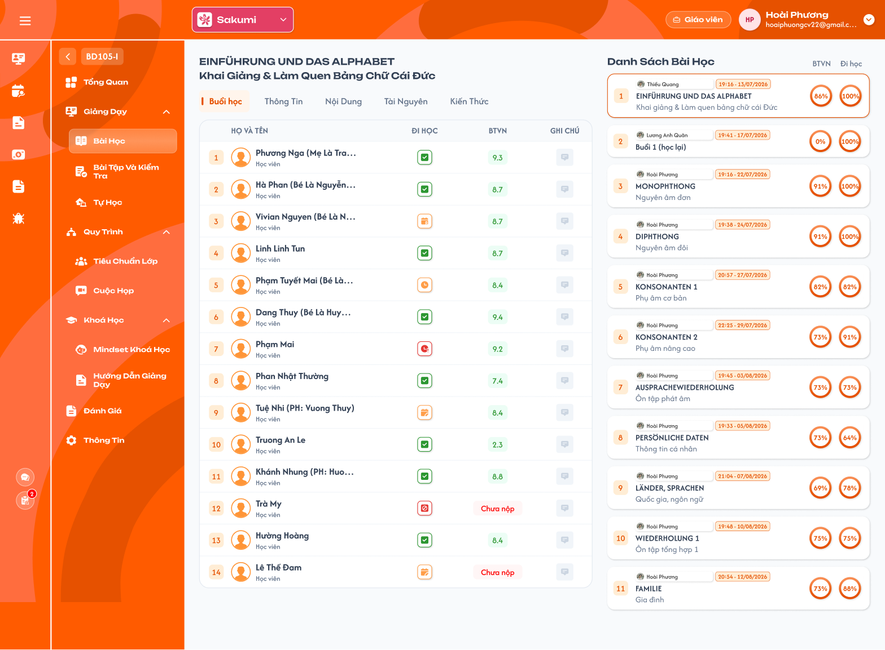</a><br>
  <em>Menu Bài học: tab Buổi học của bài đã hoàn thành và Danh sách bài học (Figma GV-LOP-030100) — nhấn để xem ảnh gốc</em>
</p>

**Mô tả:**

- Giáo viên của lớp dạy và xem từng bài học của lớp. Vùng trái là bài đang chọn với 5 tab `Buổi học`, `Thông tin`, `Nội dung`, `Tài nguyên`, `Kiến thức`; vùng phải là `Danh sách bài học`.

**Giải thích thành phần:**

| Thành phần | Yêu cầu |
|---|---|
| Tiêu đề bài | Tên bài và mô tả ngắn của bài đang chọn. |
| Card bài đã mở | Số thứ tự; avatar và tên **giáo viên của buổi** (người bấm Bắt đầu buổi học); mốc mở bài `HH:mm - dd/MM/yyyy`; tên và mô tả bài; vòng `BTVN` và `Đi học` theo khu vực Chỉ số % BTVN và Đi học. |
| Card bài chưa mở | Số thứ tự nền xám, tên bài và mô tả chi tiết (các dòng nội dung bài); không có giáo viên, mốc mở và vòng tỷ lệ. |
| Chọn bài | Bấm card để chọn: viền cam, tiêu đề và các tab đổi theo bài. Mặc định chọn bài đầu tiên. Chọn bài hoặc đổi tab không tự bắt đầu buổi. |
| Thứ tự | Theo thứ tự bài của lớp, gồm cả bài học bổ sung; tải toàn bộ, không phân trang. |

**Điểm cần lưu ý:**

- Trạng thái buổi của bài: `Chưa mở` (chưa ai bắt đầu), `Đang dạy` (đã bắt đầu, chưa kết thúc), `Chờ hoàn thành` (đã kết thúc buổi, chưa hoàn thành ghi chú), `Hoàn thành`.
- Giáo viên không có nút Thêm bài học, Sửa hoặc Xoá bài học.
- Figma đã có luồng bắt đầu buổi, điểm danh, ghi chú (GV-LOP-030110 → GV-LOP-030170) và 3 khối nhận xét ở bài đã hoàn thành (GV-LOP-030100); ảnh minh hoạ luồng ở các khu vực dưới vẫn là UI ICS cũ.

#### Testcase — Khung menu Bài học

| Tên testcase | Priority | Loại test | Scenario | Role | Pre-condition | Given / When / Then | Expected Result |
|---|---| --- |---|---|---|---|---|
| Case 1: Mở menu Bài học | High | Smoke | Flow 1 / REQ19 | Giáo viên | Lớp có bài đã mở và chưa mở | **Given** mở menu Bài học<br>**When** danh sách tải xong<br>**Then** chọn sẵn bài đầu tiên, tab Buổi học | - Card bài đã mở có giáo viên, mốc mở, vòng BTVN/Đi học<br>- Card bài chưa mở không có vòng tỷ lệ |
| Case 2: Chọn bài không bắt đầu buổi | Medium |  | REQ19 | Giáo viên | Bài chưa mở | **Given** bấm card và đổi các tab<br>**When** xem<br>**Then** bài vẫn Chưa mở | - Không tạo buổi, không tạo điểm danh |

### Tab Buổi học — Dặn dò trước buổi học

<p align="center">
  <a href="./images/lesson-advice-before.png">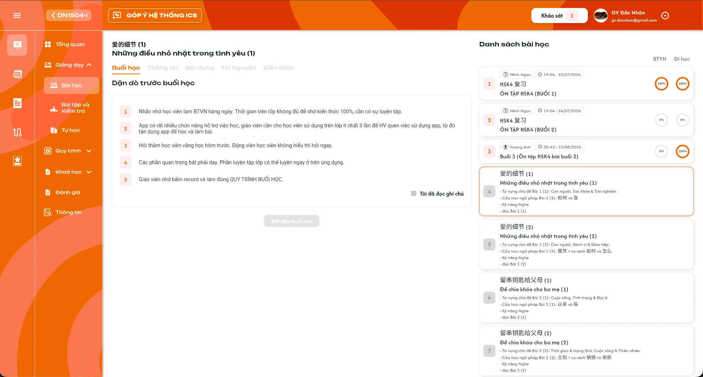</a><br>
  <em>Bài chưa mở: Dặn dò trước buổi học, checkbox Tôi đã đọc ghi chú và nút Bắt đầu buổi học (UI ICS cũ) — nhấn để xem ảnh gốc</em>
</p>

**Mô tả:**

- Chọn bài `Chưa mở`, tab `Buổi học` hiển thị `Dặn dò trước buổi học` và nút `Bắt đầu buổi học`. Giáo viên phải xác nhận đã đọc dặn dò mới bắt đầu được.

**Giải thích thành phần:**

| Thành phần | Yêu cầu |
|---|---|
| Dặn dò trước buổi học | 5 dòng đánh số cố định: (1) Nhắc nhở học viên làm BTVN hàng ngày. Thời gian trên lớp không đủ để nhớ kiến thức 100%, cần có sự luyện tập. (2) App có rất nhiều chức năng hỗ trợ việc học, giáo viên cần cho học viên sử dụng trên lớp ít nhất 3 lần để HV quen việc sử dụng app, từ đó tận dụng app để học và làm bài. (3) Hỏi thăm học viên vắng học hôm trước. Động viên học viên không hiểu thì hỏi ngay. (4) Các phần quan trọng bắt phải dạy. Phần luyện tập lớp có thể luyện ngay ở trên ứng dụng. (5) Giáo viên nhớ bấm record và làm đúng QUY TRÌNH BUỔI HỌC. |
| Checkbox `Tôi đã đọc ghi chú` | Bắt buộc tick. |
| Nút `Bắt đầu buổi học` | Bị khoá cho đến khi tick `Tôi đã đọc ghi chú`. Bấm thì chạy luồng Chọn lịch dạy và Bắt đầu. |

**Điểm cần lưu ý:**

- Mọi giáo viên của lớp được bắt đầu buổi; được bắt đầu **bất kỳ bài chưa mở**, không bắt buộc theo thứ tự.
- Chỉ bắt đầu khi lớp ở trạng thái `Đang học`, hoặc lớp không chính thức (Lớp demo); ngược lại hiển thị Toast `Cảnh Báo` `Lớp chưa bắt đầu!`.
- Trạng thái checkbox không lưu; rời tab rồi quay lại phải tick lại.
- Dặn dò không hiển thị ghi chú hay nhận xét của bài trước (`Giáo viên nhận xét lớp`, ghi chú gửi Support, ghi chú gửi giáo viên tiếp theo); các nội dung này chỉ xem ở tab Buổi học của bài đã hoàn thành.

#### Testcase — Dặn dò trước buổi học

| Tên testcase | Priority | Loại test | Scenario | Role | Pre-condition | Given / When / Then | Expected Result |
|---|---| --- |---|---|---|---|---|
| Case 3: Khoá nút khi chưa đọc | High |  | Flow 2 / REQ20 | Giáo viên | Bài chưa mở | **Given** chưa tick `Tôi đã đọc ghi chú`<br>**When** xem nút<br>**Then** nút Bắt đầu buổi học khoá | - Tick `Tôi đã đọc ghi chú` thì nút mở |
| Case 4: Không hiển thị ghi chú bài trước | Medium |  | REQ20 | Giáo viên | Bài trước đã hoàn thành, có ghi chú gửi giáo viên tiếp theo và gửi Support | **Given** chọn bài chưa mở kế tiếp<br>**When** xem Dặn dò trước buổi học<br>**Then** chỉ có 5 dòng dặn dò và checkbox `Tôi đã đọc ghi chú` | - Không có khối ghi chú của bài trước<br>- Tick một checkbox là nút mở |
| Case 5: Lớp chưa bắt đầu | High |  | EX12 / REQ20 | Giáo viên | Lớp chính thức ở trạng thái Khai giảng | **Given** bấm Bắt đầu buổi học<br>**When** hệ thống kiểm tra lớp<br>**Then** Toast `Lớp chưa bắt đầu!` | - Bài vẫn Chưa mở |
| Case 6: Bắt đầu bài không theo thứ tự | Medium |  | REQ20 | Giáo viên | Bài 3 đã hoàn thành, bài 4 và 5 chưa mở | **Given** chọn bài 5<br>**When** bắt đầu<br>**Then** bài 5 chuyển Đang dạy | - Không cần mở bài 4 trước |

### Popup Chọn lịch dạy và Bắt đầu buổi học

<p align="center">
  <a href="./images/lesson-start-popup.png">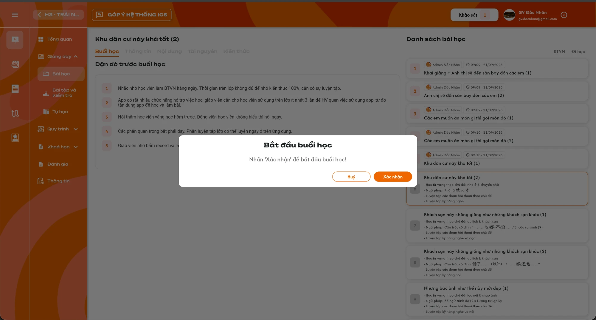</a><br>
  <em>Popup Bắt đầu buổi học sau khi chọn lịch (UI ICS cũ) — nhấn để xem ảnh gốc</em>
</p>

**Mô tả:**

- Khi bắt đầu, giáo viên chọn lịch dạy tuần này để gắn buổi với lịch và tính lương; có thể không chọn lịch, khi đó buổi không được tính lương.
- Chỉ **giáo viên của lớp** được bắt đầu buổi; người bấm Bắt đầu là **giáo viên của buổi**.
- Không bắt buộc bài trước đã Hoàn thành: lớp được có nhiều bài `Đang dạy` / `Chờ hoàn thành` cùng lúc.

**Giải thích thành phần:**

| Thành phần | Yêu cầu |
|---|---|
| Lớp không có lịch tuần này | Không hiện popup Chọn lịch dạy; hiện popup `Bắt đầu buổi học` (`Nhấn 'Xác nhận' để bắt đầu buổi học!`). Bắt đầu xong hiển thị Toast `Thông Báo` `Lớp không có lịch để tính lương buổi này`. |
| Popup `Chọn lịch dạy` | Liệt kê lịch tuần hiện tại của lớp do **chính giáo viên** dạy (lịch cố định và linh hoạt): thứ, ngày, giờ. Lịch đã hoàn thành hoặc đã gắn với buổi khác hiển thị nhưng không chọn được; lịch huỷ không hiển thị. Không có lịch của giáo viên thì hiện `Không có lịch dạy tuần này`. |
| Lựa chọn `Không chọn lịch` | Dòng phụ `Buổi học này sẽ không được tính lương`. |
| Nút `Huỷ` / `Bắt đầu` | `Huỷ` đóng popup, không bắt đầu. `Bắt đầu` cần đã chọn một lịch hoặc `Không chọn lịch`. |
| Popup `Bắt đầu buổi học` | Sau khi chọn lịch: nội dung `Nhấn 'Xác nhận' để bắt đầu buổi học!`, nút `Huỷ` / `Xác nhận`. |
| Kiểm tra khi Bắt đầu | Backend kiểm lại khi bấm `Xác nhận`: người bấm không phải giáo viên của lớp → từ chối, Toast `Có Lỗi Xảy Ra`; lịch đã chọn đã được gắn với buổi khác (vd giáo viên khác vừa chọn) → Toast `Có Lỗi Xảy Ra` `Lịch này đã được chọn để mở`, không tạo buổi, popup Chọn lịch tải lại. |
| Bắt đầu với lịch | Tạo buổi của bài (giáo viên của buổi, mốc mở = thời điểm máy chủ, trạng thái `Đang dạy`); **gắn** lịch được chọn với buổi và giáo viên, lịch **giữ trạng thái `Đang đợi`** (chưa Hoàn thành, chưa phát sinh lương). Lịch cố định chưa có bản ghi ngày đó thì tạo bản ghi lịch `Đang đợi` theo giờ của lịch cố định. Chuyển sang Bước 1 — Điểm danh. |
| Bắt đầu không chọn lịch | Tạo buổi như trên, không đổi lịch, không phát sinh lương; Toast `Thông Báo` `Bạn đã bỏ qua chọn lịch, buổi học này sẽ không được tính lương`. Chuyển sang Bước 1. |

**Điểm cần lưu ý:**

- Mỗi bài chỉ có một buổi; hai giáo viên bấm bắt đầu cùng lúc thì chỉ tạo một buổi, người bấm trước là giáo viên của buổi; người sau thấy bài đã mở ở chế độ chỉ xem.
- **Điều kiện có lương buổi dạy:** đã chọn lịch lúc bắt đầu **và** giáo viên của buổi bấm `Hoàn thành buổi học`. Không chọn lịch → không có lương; bài chưa Hoàn thành → chưa có lương. Lương ghi cho giáo viên của buổi (người mở và hoàn thành).
- Lịch đã gắn chỉ chuyển `Hoàn thành` và **phát sinh lương buổi dạy** khi giáo viên bấm `Hoàn thành buổi học` ở Bước 2 (khác ICS cũ chuyển ngay khi bắt đầu); lương buổi dạy tính theo lương/giờ của giáo viên ở lớp.
- **Ngày tính lương là ngày của lịch đã chọn**, không phải ngày bấm Hoàn thành: chọn lịch ngày 15 để bắt đầu, ngày 20 mới hoàn thành buổi thì lương thuộc ngày 15.

#### Testcase — Chọn lịch dạy và Bắt đầu

| Tên testcase | Priority | Loại test | Scenario | Role | Pre-condition | Given / When / Then | Expected Result |
|---|---| --- |---|---|---|---|---|
| Case 7: Bắt đầu với lịch | High | Smoke | Flow 2 / REQ21 | Giáo viên | Lớp Đang học; giáo viên có lịch Thứ 4 tuần này chưa hoàn thành | **Given** chọn lịch Thứ 4 rồi `Bắt đầu`<br>**When** bấm `Xác nhận`<br>**Then** bài chuyển Đang dạy, mở Bước 1 | - Lịch Thứ 4 được gắn buổi, vẫn Đang đợi<br>- Chưa phát sinh lương<br>- Card bài có tên giáo viên và mốc mở |
| Case 8: Không chọn lịch | High |  | Flow 2 / REQ21 | Giáo viên | Có lịch tuần này | **Given** chọn `Không chọn lịch`<br>**When** xác nhận bắt đầu<br>**Then** Toast `Bạn đã bỏ qua chọn lịch, buổi học này sẽ không được tính lương` | - Không đổi lịch nào<br>- Không phát sinh lương |
| Case 9: Lớp không có lịch tuần này | Medium |  | REQ21 | Giáo viên | Lớp không có lịch trong tuần | **Given** bấm Bắt đầu buổi học<br>**When** xác nhận<br>**Then** Toast `Lớp không có lịch để tính lương buổi này` | - Không hiện popup Chọn lịch dạy |
| Case 10: Lịch đã hoàn thành không chọn được | Medium |  | REQ21 | Giáo viên | Lịch Thứ 2 đã Hoàn thành, Thứ 6 chưa | **Given** mở popup Chọn lịch dạy<br>**When** xem danh sách<br>**Then** Thứ 2 không chọn được | - Lịch huỷ không hiển thị<br>- Chỉ lịch của chính giáo viên |
| Case 11a: Lịch đã được chọn để mở | High |  | Flow 2 / REQ21 / EX22 | Giáo viên | A và B cùng dạy lớp, cùng mở popup Chọn lịch; A đã bắt đầu bài 4 với lịch Thứ 4 | **Given** B chọn lịch Thứ 4 cho bài 5<br>**When** bấm `Xác nhận`<br>**Then** Toast `Lịch này đã được chọn để mở` | - Bài 5 vẫn Chưa mở<br>- Lịch Thứ 4 vẫn gắn bài 4 của A |
| Case 11b: Không phải giáo viên của lớp | High |  | REQ21 / EX23 | Giáo viên | C không thuộc lớp | **Given** C gửi request bắt đầu bài<br>**When** backend kiểm tra<br>**Then** bị từ chối | - Không tạo buổi, không đổi lịch |
| Case 11c: Mở bài khi bài trước chưa hoàn thành | Medium |  | REQ20 / REQ21 | Giáo viên | Bài 4 đang `Đang dạy` | **Given** chọn bài 5 và bắt đầu<br>**When** xác nhận<br>**Then** bài 5 chuyển Đang dạy | - Bài 4 giữ Đang dạy<br>- Lịch đã gắn bài 4 không chọn được cho bài 5 |
| Case 11: Huỷ không bắt đầu | Medium |  | Flow 2 | Giáo viên | Popup đang mở | **Given** bấm `Huỷ`<br>**When** popup đóng<br>**Then** bài vẫn Chưa mở | - Không đổi lịch |

### Bước 1 — Điểm danh và Ghi chú cho lớp học

<p align="center">
  <a href="./images/lesson-attendance-status.png">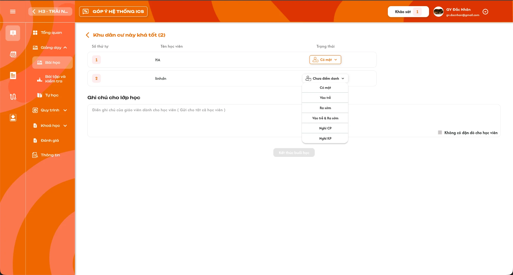</a><br>
  <em>Bước 1: chọn trạng thái điểm danh từng học viên, Ghi chú cho lớp học và nút Kết thúc buổi học (UI ICS cũ) — nhấn để xem ảnh gốc</em>
</p>

**Mô tả:**

- Sau khi bắt đầu, giáo viên điểm danh từng học viên và nhập ghi chú cho cả lớp, rồi `Kết thúc buổi học`.

**Giải thích thành phần:**

| Thành phần | Yêu cầu |
|---|---|
| Tiêu đề | Icon `<` và tên bài. Bấm `<` quay về menu Bài học; dữ liệu đã nhập vẫn giữ trong nháp. |
| Danh sách học viên | `Số thứ tự`, `Tên học viên`, `Trạng thái`. Gồm học viên trạng thái `Đang học`, `Dự thính`, `Hoàn thành` của lớp. |
| `Trạng thái` | Dropdown, mặc định `Chưa điểm danh`; chọn một trong `Có mặt`, `Vào trễ`, `Ra sớm`, `Vào trễ & Ra sớm`, `Nghỉ CP`, `Nghỉ KP`. Lựa chọn và giá trị đã chọn chỉ hiển thị chữ, không có icon. |
| `Ghi chú cho lớp học` | Ô nhiều dòng, placeholder `Điền ghi chú của giáo viên dành cho học viên ( Gửi cho tất cả học viên )`. Lưu thành `Giáo viên nhận xét lớp` của buổi. |
| Checkbox `Không có dặn dò cho học viên` | Tick khi không có ghi chú cho lớp. |
| Nút `Kết thúc buổi học` | Khoá cho đến khi **mọi học viên đã được điểm danh** (không còn `Chưa điểm danh`) **và** có `Ghi chú cho lớp học` hoặc đã tick `Không có dặn dò cho học viên`. |
| Popup `Kết thúc buổi học` | Nội dung `Giáo viên vui lòng tắt record Google Meet trước khi kết thúc buổi học`, nút `Huỷ` / `Xác nhận`. |
| Xác nhận | Lưu điểm danh của từng học viên và nhận xét lớp; buổi chuyển `Chờ hoàn thành`; cập nhật tỷ lệ Đi học; chuyển sang Bước 2. |

**Điểm cần lưu ý:**

- Mỗi thay đổi được lưu nháp lên server ngay; đổi máy tiếp tục sẽ thấy đúng phần đã nhập.
- Chỉ giáo viên của buổi được điểm danh và `Kết thúc buổi học`; giáo viên khác của lớp gửi request thì backend từ chối.
- Sau khi Kết thúc buổi học, giáo viên không sửa điểm danh nữa.

#### Testcase — Bước 1 Điểm danh

| Tên testcase | Priority | Loại test | Scenario | Role | Pre-condition | Given / When / Then | Expected Result |
|---|---| --- |---|---|---|---|---|
| Case 12: Kết thúc buổi học | High | Smoke | Flow 3 / REQ22 | Giáo viên | Buổi Đang dạy, 2 học viên | **Given** điểm danh `Có mặt`, `Nghỉ CP` và nhập ghi chú lớp<br>**When** bấm `Kết thúc buổi học` rồi `Xác nhận`<br>**Then** buổi chuyển Chờ hoàn thành, mở Bước 2 | - Điểm danh lưu đúng từng học viên<br>- Ghi chú lớp thành Giáo viên nhận xét lớp |
| Case 13: Khoá nút khi còn chưa điểm danh | High |  | REQ22 | Giáo viên | 1 học viên còn `Chưa điểm danh` | **Given** đã nhập ghi chú lớp<br>**When** xem nút<br>**Then** `Kết thúc buổi học` khoá | - Điểm danh đủ thì nút mở |
| Case 14: Không có dặn dò | Medium |  | REQ22 | Giáo viên | Đã điểm danh đủ, ghi chú lớp trống | **Given** tick `Không có dặn dò cho học viên`<br>**When** xem nút<br>**Then** nút mở | - Nhận xét lớp lưu rỗng |
| Case 15: Danh sách học viên điểm danh | High |  | REQ22 | Giáo viên | Lớp có học viên Đang học, Dự thính, Hoàn thành, Nghỉ học, Rời lớp, Chỉ xem, Xóa | **Given** mở Bước 1<br>**When** danh sách tải<br>**Then** chỉ có Đang học, Dự thính, Hoàn thành | - Không hiển thị Nghỉ học, Rời lớp, Chỉ xem, Xóa |
| Case 16: Nháp lưu trên server | High |  | REQ24 | Giáo viên | A đã điểm danh 1/2 học viên | **Given** A đổi máy, bấm `Vào điểm danh`<br>**When** Bước 1 tải<br>**Then** A thấy đúng 1 học viên đã điểm danh | - Giáo viên của buổi vẫn là A<br>- Giáo viên khác của lớp không vào được Bước 1 |

### Bước 2 — Ghi chú buổi học và Hoàn thành

<p align="center">
  <a href="./images/lesson-notes-complete.png">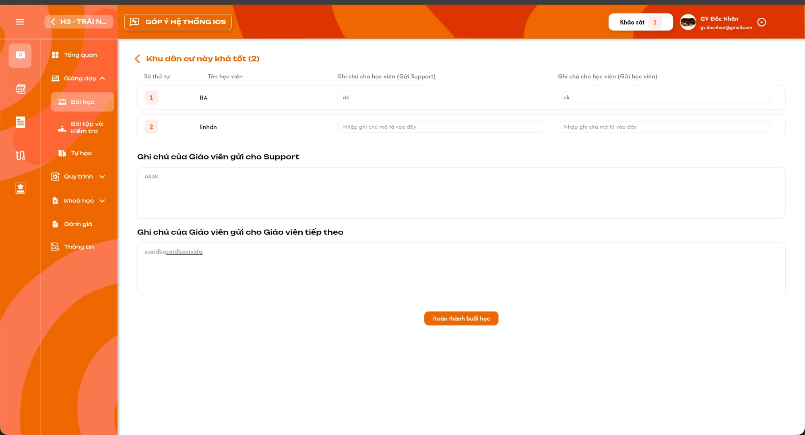</a><br>
  <em>Bước 2: ghi chú từng học viên, Ghi chú gửi Support, Ghi chú gửi Giáo viên tiếp theo và nút Hoàn thành buổi học (UI ICS cũ) — nhấn để xem ảnh gốc</em>
</p>

<p align="center">
  <a href="./images/lesson-complete-popup.png">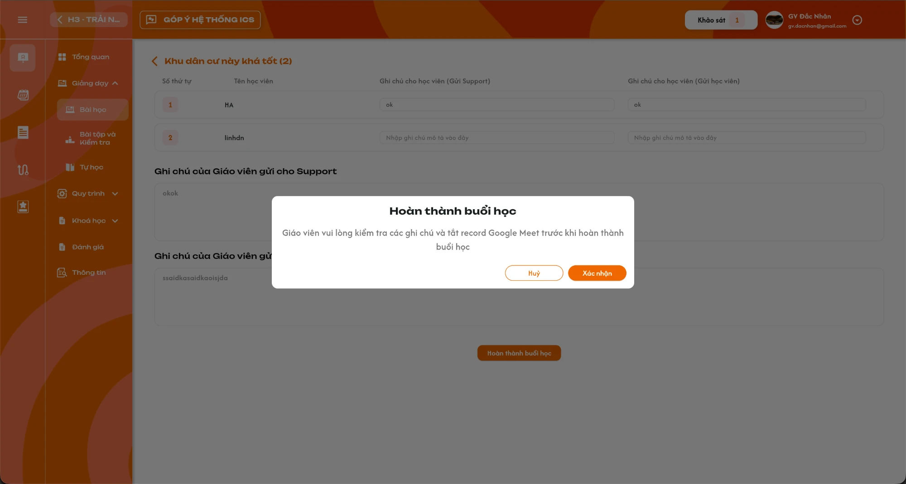</a><br>
  <em>Popup Hoàn thành buổi học (UI ICS cũ) — nhấn để xem ảnh gốc</em>
</p>

**Mô tả:**

- Giáo viên ghi chú cho từng học viên, cho Team Support và cho giáo viên tiếp theo, rồi `Hoàn thành buổi học`.

**Giải thích thành phần:**

| Thành phần | Yêu cầu |
|---|---|
| Bảng học viên | `Số thứ tự`, `Tên học viên`, `Ghi chú cho học viên (Gửi Support)`, `Ghi chú cho học viên (Gửi học viên)`. Hai ô nhập không bắt buộc, placeholder `Nhập ghi chú mô tả vào đây`. |
| `Ghi chú của Giáo viên gửi cho Support` | Ô nhiều dòng, placeholder `Điền ghi chú cho Team Support...`; checkbox `Không có dặn dò cho Team Support`. |
| `Ghi chú của Giáo viên gửi cho Giáo viên tiếp theo` | Ô nhiều dòng, placeholder `Điền ghi chú cho giáo viên tiếp theo...`; checkbox `Không có dặn dò cho giáo viên`. |
| Nút `Hoàn thành buổi học` | Khoá cho đến khi mỗi khối ghi chú Support và giáo viên tiếp theo có nội dung hoặc đã tick checkbox tương ứng. |
| Popup `Hoàn thành buổi học` | Nội dung `Giáo viên vui lòng kiểm tra các ghi chú và tắt record Google Meet trước khi hoàn thành buổi học`, nút `Huỷ` / `Xác nhận`. |
| Xác nhận | Lưu ghi chú từng học viên, ghi chú gửi Support, ghi chú gửi giáo viên tiếp theo; buổi chuyển `Hoàn thành`; **lịch đã gắn lúc bắt đầu (nếu có) chuyển `Hoàn thành` và phát sinh lương buổi dạy cho giáo viên của buổi, ngày tính lương là ngày của lịch**; xoá nháp; màn hiển thị `Buổi học đã kết thúc`. |

**Điểm cần lưu ý:**

- Ghi chú gửi giáo viên tiếp theo, gửi Support và nhận xét lớp hiển thị chỉ đọc ở tab Buổi học của chính bài này khi đã hoàn thành; không hiển thị ở Dặn dò trước buổi học của bài kế tiếp.
- Chỉ giáo viên của buổi được `Hoàn thành buổi học`; giáo viên khác của lớp gửi request thì backend từ chối, không phát sinh lương.
- Sau khi Hoàn thành, giáo viên chỉ xem; không sửa điểm danh, nhận xét hoặc ghi chú.
- Mỗi thay đổi lưu nháp lên server như Bước 1.

#### Testcase — Bước 2 Hoàn thành buổi học

| Tên testcase | Priority | Loại test | Scenario | Role | Pre-condition | Given / When / Then | Expected Result |
|---|---| --- |---|---|---|---|---|
| Case 17: Hoàn thành buổi học | High | Smoke | Flow 4 / REQ23 | Giáo viên | Buổi Chờ hoàn thành | **Given** nhập ghi chú Support, tick `Không có dặn dò cho giáo viên`<br>**When** bấm `Hoàn thành buổi học` rồi `Xác nhận`<br>**Then** buổi Hoàn thành, hiện `Buổi học đã kết thúc` | - Ghi chú từng học viên lưu đúng<br>- Nháp bị xoá<br>- Lịch đã gắn chuyển Hoàn thành, phát sinh lương một lần, ngày lương = ngày lịch (chọn lịch ngày 15, hoàn thành ngày 20 → lương ngày 15) |
| Case 18: Khoá nút khi thiếu ghi chú | High |  | REQ23 | Giáo viên | Chưa nhập và chưa tick khối giáo viên tiếp theo | **Given** đã nhập ghi chú Support<br>**When** xem nút<br>**Then** `Hoàn thành buổi học` khoá | - Ghi chú từng học viên không bắt buộc |
| Case 19: Ghi chú hiển thị ở bài đã hoàn thành | High |  | REQ20 / REQ23 / REQ25 | Giáo viên | Bài 4 hoàn thành có ghi chú gửi giáo viên tiếp theo và gửi Support | **Given** mở bài 4 rồi mở bài 5 chưa mở<br>**When** xem tab Buổi học<br>**Then** bài 4 hiện các khối ghi chú chỉ đọc; Dặn dò bài 5 không có ghi chú của bài 4 | - Không lấy ghi chú bài khác |

### Tab Buổi học — Bài đang dạy và chờ hoàn thành

**Mô tả:**

- Bài đã bắt đầu nhưng chưa hoàn thành: tab `Buổi học` hiển thị `Bài học đã mở` và nút tiếp tục.

**Giải thích thành phần:**

| Thành phần | Yêu cầu |
|---|---|
| Bài `Đang dạy` | Nút `Vào điểm danh`; bấm mở popup `Tiếp tục buổi học` (`Nhấn 'Xác nhận' để tiếp tục buổi học!`), xác nhận vào Bước 1 với nháp hiện có. |
| Bài `Chờ hoàn thành` | Nút `Hoàn thành buổi học`; bấm vào Bước 2 với nháp hiện có. |
| Người tiếp tục | Chỉ giáo viên của buổi (người đã bấm Bắt đầu). Giáo viên khác của lớp thấy `Bài học đã mở` và tên giáo viên của buổi, không có nút `Vào điểm danh` / `Hoàn thành buổi học`. |

#### Testcase — Tiếp tục buổi học

| Tên testcase | Priority | Loại test | Scenario | Role | Pre-condition | Given / When / Then | Expected Result |
|---|---| --- |---|---|---|---|---|
| Case 20: Tiếp tục buổi Đang dạy | High |  | Flow 3 / REQ24 | Giáo viên | Bài Đang dạy | **Given** bấm `Vào điểm danh`<br>**When** xác nhận popup Tiếp tục buổi học<br>**Then** mở Bước 1 với dữ liệu nháp | - Không tạo buổi mới<br>- Không chọn lịch lại |
| Case 20b: Giáo viên khác chỉ xem | High |  | REQ24 / EX24 | Giáo viên | A bắt đầu bài 4 (Đang dạy); B cùng dạy lớp | **Given** B mở bài 4<br>**When** xem tab Buổi học<br>**Then** không có nút `Vào điểm danh` | - Request điểm danh / Kết thúc / Hoàn thành của B bị từ chối<br>- Không phát sinh lương cho B |
| Case 21: Tiếp tục buổi Chờ hoàn thành | Medium |  | Flow 4 / REQ24 | Giáo viên | Bài Chờ hoàn thành | **Given** bấm `Hoàn thành buổi học`<br>**When** màn mở<br>**Then** vào Bước 2 | - Không sửa được điểm danh |

### Tab Buổi học — Bài đã hoàn thành

<p align="center">
  <a href="./images/lesson-session-completed.png">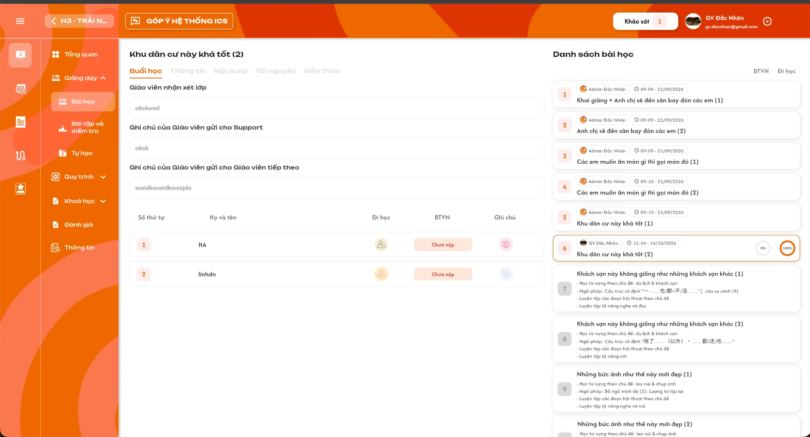</a><br>
  <em>Bài đã hoàn thành: Giáo viên nhận xét lớp, Ghi chú gửi Support, Ghi chú gửi Giáo viên tiếp theo và bảng học viên (UI ICS cũ) — nhấn để xem ảnh gốc</em>
</p>

**Mô tả:**

- Bài `Hoàn thành`: tab `Buổi học` hiển thị kết quả buổi, chỉ xem.

**Giải thích thành phần:**

| Thành phần | Yêu cầu |
|---|---|
| `Giáo viên nhận xét lớp` | Ghi chú cho lớp học đã nhập ở Bước 1, chỉ đọc. |
| `Ghi chú của Giáo viên gửi cho Support` | Chỉ đọc. |
| `Ghi chú của Giáo viên gửi cho Giáo viên tiếp theo` | Chỉ đọc. |
| Bảng học viên | `Số thứ tự`, `Họ và tên`, `Đi học` (icon trạng thái điểm danh theo khu vực Icon trạng thái điểm danh, hover hiện tên trạng thái), `BTVN` (`Chưa nộp` / `Chưa chấm` / điểm đã chấm), `Ghi chú` (icon). |
| Icon `Ghi chú` | Mở popup `Ghi chú` hai vùng chỉ đọc `Ghi chú từ Giáo viên cho Học viên` và `Ghi chú từ Giáo viên cho Team Support` của đúng học viên ở bài; icon mờ khi không có ghi chú. |

**Điểm cần lưu ý:**

- Giáo viên không sửa điểm danh, BTVN hoặc ghi chú tại đây; sửa điểm danh thuộc Admin, Class Handler, Support theo requirement Admin.
- Bấm BTVN hoặc điểm không mở màn chấm.

#### Testcase — Bài đã hoàn thành

| Tên testcase | Priority | Loại test | Scenario | Role | Pre-condition | Given / When / Then | Expected Result |
|---|---| --- |---|---|---|---|---|
| Case 22: Xem kết quả buổi | High |  | REQ25 | Giáo viên | Bài Hoàn thành có ghi chú và điểm danh | **Given** chọn bài<br>**When** tab Buổi học tải<br>**Then** hiện 3 khối ghi chú và bảng học viên | - Mọi phần chỉ đọc<br>- Popup Ghi chú đúng học viên |
| Case 23: Không sửa sau hoàn thành | High |  | EX13 / REQ25 | Giáo viên | Bài Hoàn thành | **Given** gửi request sửa điểm danh hoặc ghi chú<br>**When** backend kiểm tra<br>**Then** bị từ chối | - Dữ liệu giữ nguyên |

### Icon trạng thái điểm danh

<p align="center">
  <a href="../../management_requirement/class_management/images/attendance-status-icons.png">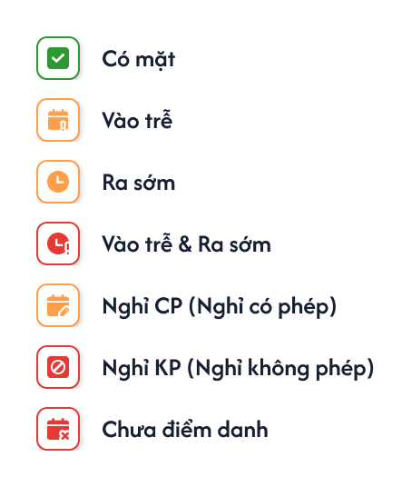</a><br>
  <em>Bộ icon `Trạng thái đi học` (Figma component 2456:110608) — nhấn để xem ảnh gốc</em>
</p>

**Mô tả:**

- Bộ icon dùng chung cho mọi bảng hiển thị điểm danh: cột `Đi học` của bảng học viên ở tab Buổi học (bài đã hoàn thành, Figma GV-LOP-030100) và cột `Trạng thái` ở bảng bài học của [Tổng quan](./class_overview_requirements.md).

**Giải thích thành phần:**

| Trạng thái | Icon |
|---|---|
| `Có mặt` | Ô viền xanh lá, dấu tick trắng nền xanh lá. |
| `Vào trễ` | Ô viền cam, lịch có dấu `!` màu cam. |
| `Ra sớm` | Ô viền cam, đồng hồ màu cam. |
| `Vào trễ & Ra sớm` | Ô viền đỏ, đồng hồ có dấu `!` màu đỏ. |
| `Nghỉ CP` (Nghỉ có phép) | Ô viền cam, lịch có bút màu cam. |
| `Nghỉ KP` (Nghỉ không phép) | Ô viền đỏ, biểu tượng cấm màu đỏ. |
| `Chưa điểm danh` | Ô viền đỏ, lịch có dấu `x` màu đỏ. |

**Điểm cần lưu ý:**

- Hover icon hiển thị tên trạng thái; mỗi học viên ở một bài chỉ có một icon.
- Dropdown điểm danh ở Bước 1 chỉ hiển thị chữ, không dùng icon.
- Icon chỉ để xem; bấm icon không mở menu sửa điểm danh với role Giáo viên.

#### Testcase — Icon trạng thái điểm danh

| Tên testcase | Priority | Loại test | Scenario | Role | Pre-condition | Given / When / Then | Expected Result |
|---|---| --- |---|---|---|---|---|
| Case 24: Icon đúng trạng thái | High |  | REQ30 | Giáo viên | Bài Hoàn thành có học viên ở đủ 7 trạng thái điểm danh | **Given** xem bảng học viên tab Buổi học<br>**When** render cột Đi học và hover<br>**Then** mỗi học viên đúng icon và tên trạng thái theo bảng | - Vào trễ khác Vào trễ & Ra sớm<br>- Chưa điểm danh dùng icon lịch dấu x |
| Case 25: Dropdown Bước 1 chỉ chữ | Medium |  | REQ22 / REQ30 | Giáo viên | Buổi Đang dạy | **Given** mở dropdown Trạng thái ở Bước 1<br>**When** xem các lựa chọn<br>**Then** chỉ có chữ, không có icon | - Giá trị đã chọn cũng chỉ hiển thị chữ |

### Tab Thông tin, Nội dung và Kiến thức

<p align="center">
  <a href="./images/lesson-information.png">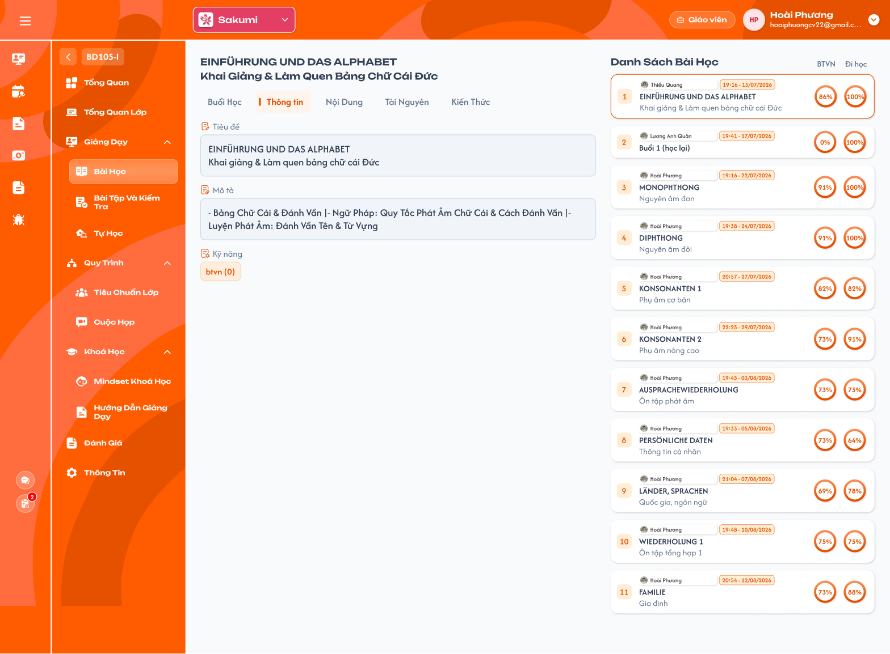</a><br>
  <em>Tab Thông tin chỉ đọc (Figma GV-LOP-030200) — nhấn để xem ảnh gốc</em>
</p>

**Mô tả:**

- Ba tab hiển thị dữ liệu định nghĩa bài học, chỉ đọc, giống Admin.

**Giải thích thành phần:**

| Tab | Yêu cầu |
|---|---|
| `Thông tin` | `Tiêu đề`, `Mô tả` (giữ xuống dòng), `Kỹ năng` (tag và số trong ngoặc do Curriculum Development Handler thiết lập). Ô xám chỉ đọc; không thêm/gỡ kỹ năng. Không có dữ liệu thì để trống theo dữ liệu thật. |
| `Nội dung` | Các khối nội dung/kế hoạch bài theo thứ tự đã lưu ở nguồn (vd 5p Sửa BTVN, Học từ mới, Ngữ pháp...), chỉ đọc. Không có dữ liệu thì hiện `Không có dữ liệu!` (ảnh Figma GV-LOP-030300 là trạng thái này). |
| `Kiến thức` | Để trống, hiện `Không có dữ liệu!` (Figma GV-LOP-030500). |

#### Testcase — Thông tin, Nội dung, Kiến thức

| Tên testcase | Priority | Loại test | Scenario | Role | Pre-condition | Given / When / Then | Expected Result |
|---|---| --- |---|---|---|---|---|
| Case 26: Thông tin đúng nguồn | Medium |  | REQ26 | Giáo viên | Bài có tiêu đề, mô tả, kỹ năng | **Given** chọn tab Thông tin<br>**When** tải<br>**Then** đúng dữ liệu bài nguồn | - Không chỉnh sửa được |
| Case 27: Nội dung theo thứ tự | Medium |  | REQ26 | Giáo viên | Bài có nhiều khối nội dung | **Given** chọn tab Nội dung<br>**When** tải<br>**Then** các khối đúng thứ tự | - Bài không có nội dung hiện `Không có dữ liệu!` |

### Tab Tài nguyên — Khoá tải theo bài

<p align="center">
  <a href="./images/lesson-resources.png">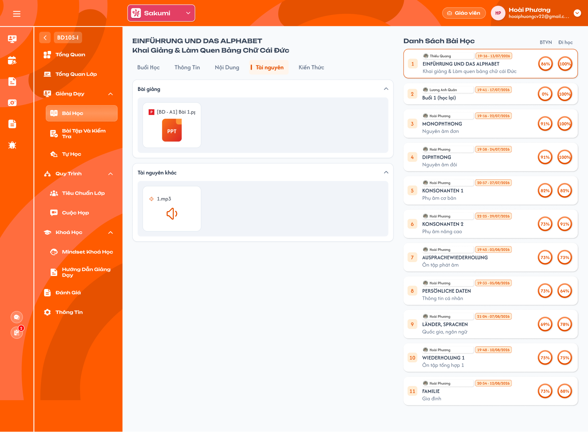</a><br>
  <em>Tab Tài nguyên: Bài giảng và Tài nguyên khác (Figma GV-LOP-030400) — nhấn để xem ảnh gốc</em>
</p>

**Mô tả:**

- Hai nhóm `Bài giảng` và `Tài nguyên khác`; bấm file để tải ngay. Giáo viên **chỉ tải được tài nguyên của 3 bài đã mở có số thứ tự lớn nhất**.

**Giải thích thành phần:**

| Thành phần | Yêu cầu |
|---|---|
| Nhóm `Bài giảng` / `Tài nguyên khác` | Header có icon `⌃` thu gọn/mở; card file có tên và icon theo loại (video, PPT, Docs, Excel, âm thanh). |
| Bài được tải | Trong các bài đã mở (Đang dạy, Chờ hoàn thành, Hoàn thành), lấy 3 bài có số thứ tự lớn nhất. Bấm card tải ngay file gốc, không mở xem trước. |
| Bài bị khoá | Bài đã mở trước 3 bài trên, hoặc bài chưa mở: vẫn thấy danh sách file, mỗi card có icon khoá; bấm không tải, hiện Toast `Thông Báo` `Chỉ tải được tài nguyên của 3 bài đã mở gần nhất`. Áp dụng cả hai nhóm. |

**Điểm cần lưu ý:**

- Ví dụ lớp đã mở bài 1–6: tải được bài 4, 5, 6; bài 1–3 và bài 7 trở đi bị khoá. Mở thêm bài 7 thì bài 4 bị khoá.
- Backend kiểm tra khoá khi tải bằng URL/request trực tiếp.

#### Testcase — Tài nguyên

| Tên testcase | Priority | Loại test | Scenario | Role | Pre-condition | Given / When / Then | Expected Result |
|---|---| --- |---|---|---|---|---|
| Case 28: Tải tài nguyên bài được phép | High |  | REQ27 | Giáo viên | Đã mở bài 1–6 | **Given** chọn bài 5, tab Tài nguyên<br>**When** bấm file PPT<br>**Then** tải ngay file gốc | - Không mở xem trước |
| Case 29: Bài bị khoá | High |  | EX14 / REQ27 | Giáo viên | Đã mở bài 1–6 | **Given** chọn bài 2 và bài 7<br>**When** bấm file<br>**Then** không tải, Toast `Chỉ tải được tài nguyên của 3 bài đã mở gần nhất` | - Card có icon khoá<br>- Request trực tiếp bị từ chối |
| Case 30: Khoá dịch theo bài mới mở | Medium |  | REQ27 | Giáo viên | Đã mở bài 1–6 | **Given** bắt đầu bài 7<br>**When** quay lại bài 4<br>**Then** bài 4 bị khoá | - Bài 5, 6, 7 tải được |

### Chỉ số % BTVN và Đi học theo bài

**Mô tả:**

- Hai vòng trên card bài đã mở, tính theo số học viên của đúng bài, giống Admin.

**Giải thích thành phần:**

| Thành phần | Yêu cầu |
|---|---|
| Tập tính | Học viên `Đang học` hoặc `Dự thính` tại thời điểm của bài; đổi trạng thái ở bài sau không loại học viên khỏi bài trước. |
| % BTVN | `Số học viên đã nộp BTVN của bài / Số học viên trong tập × 100`. Nộp chưa chấm hoặc điểm 0 vẫn tính đã nộp; một học viên nộp nhiều lần tính một người. |
| % Đi học | `Số học viên Có mặt, Vào trễ, Ra sớm, Vào trễ & Ra sớm / Số học viên trong tập đã được điểm danh × 100`. Nghỉ CP/KP vẫn ở mẫu số; Chưa điểm danh bị loại khỏi cả tử và mẫu. |
| Làm tròn | Chỉ làm tròn kết quả cuối; vòng hiển thị số nguyên `%`. |
| Mẫu số bằng 0 | Để trống, không chia 0; tử số 0 với mẫu số > 0 là `0%`. |

#### Testcase — Chỉ số % BTVN và Đi học

| Tên testcase | Priority | Loại test | Scenario | Role | Pre-condition | Given / When / Then | Expected Result |
|---|---| --- |---|---|---|---|---|
| Case 31: 7/10 nộp | High |  | REQ28 | Giáo viên | 10 học viên trong tập, 7 đã nộp | **Given** xem card bài<br>**When** tính BTVN<br>**Then** 70% | - Không đợi chấm |
| Case 32: Nghỉ CP/KP trong mẫu | High |  | REQ28 | Giáo viên | 10 học viên: 8 đi học, 1 Nghỉ CP, 1 Nghỉ KP | **Given** xem card bài<br>**When** tính Đi học<br>**Then** 80% | - Không bỏ CP/KP khỏi mẫu |

### Bài tập và Kiểm tra — Khung menu

<p align="center">
  <a href="./images/homework-list.png">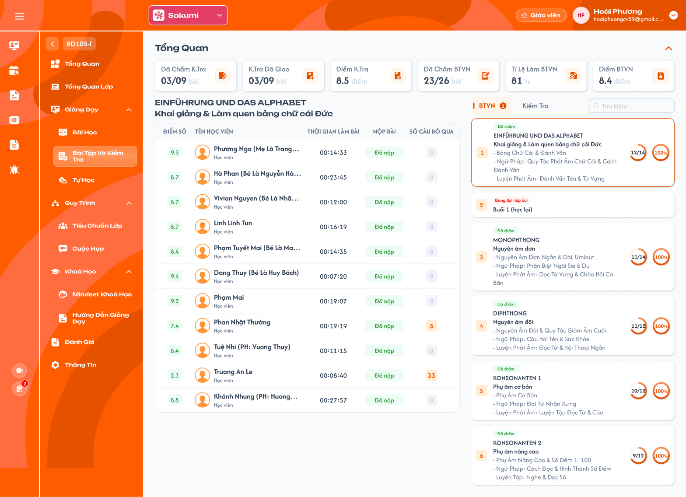</a><br>
  <em>Menu Bài tập và Kiểm tra — Tab BTVN (Figma GV-LOP-040100) — nhấn để xem ảnh gốc</em>
</p>

**Mô tả:**

- Giáo viên của lớp xem kết quả BTVN và Kiểm tra của học viên. `Giáo viên phụ trách chính` còn được giao/thu hồi bài kiểm tra và vào màn chấm bài.
- Phía trên là khối `Tổng Quan`; vùng trái là tên bài đang chọn và bảng kết quả học viên; vùng phải là tab `BTVN` / `Kiểm Tra`, ô `Tìm kiếm` và danh sách card bài.

**Giải thích thành phần:**

| Thành phần | Yêu cầu |
|---|---|
| Tab `BTVN` / `Kiểm Tra` | Hai danh sách riêng, mỗi tab có badge riêng. Chuyển tab hiển thị đúng loại bài, không trộn điểm hoặc bài nộp giữa hai loại. |
| Ô `Tìm kiếm` | Tìm theo tên bài trong danh sách card của tab đang mở; không tìm theo tên học viên; không đổi số liệu khối Tổng Quan. |
| Card bài | Bấm card để chọn bài: viền cam, tên bài ở vùng trái và bảng kết quả đổi theo bài. Bấm card không mở màn chấm. |
| Nút điều hướng chấm bài | Trên card bài đã giao có học viên nộp; chỉ hiển thị với `Giáo viên phụ trách chính`; mở màn chấm bài (xem khu vực Màn chấm bài). |
| Danh sách BTVN | Mỗi bài học của lớp có một BTVN (liên kết 1–1), gồm cả bài học bổ sung; không gồm bài Tự học. BTVN tự giao cho học viên khi bài học mở; **không có nút `Giao bài` / `Thu hồi`** ở tab BTVN. |
| Danh sách Kiểm tra | Bài kiểm tra của khoá học gắn với lớp và bài kiểm tra bổ sung do Admin thêm cho lớp. Giáo viên **không có** nút Thêm bài kiểm tra; `Giáo viên phụ trách chính` chỉ `Giao bài` và `Thu hồi` bài kiểm tra. Sắp theo ngày giao tăng dần; bài chưa giao xếp sau, theo thứ tự bài. |
| Tải dữ liệu | Tải toàn bộ bài và học viên hợp lệ, không phân trang. Loading/rỗng/lỗi hiển thị riêng từng vùng, lỗi có `Thử lại`. |

**Điểm cần lưu ý:**

- Giáo viên khác của lớp (không phải phụ trách chính) chỉ xem: không có nút điều hướng chấm, `Giao bài`, `Thu hồi`; bấm dòng học viên không điều hướng.
- Giáo viên không có nút reset bài làm của học viên (reset là thao tác của Admin, Class Handler, Support).
- Mặc định mở tab `BTVN` và chọn card đầu tiên của danh sách.
- Khác Figma GV-LOP-040100: Figma chưa có nút điều hướng chấm bài trên card; requirement bổ sung nút này cho `Giáo viên phụ trách chính`.

#### Testcase — Khung menu Bài tập và Kiểm tra

| Tên testcase | Priority | Loại test | Scenario | Role | Pre-condition | Given / When / Then | Expected Result |
|---|---| --- |---|---|---|---|---|
| Case 33: Mở menu và chọn bài | High | Smoke | Flow 12 / REQ13 | Giáo viên | Lớp có BTVN và Kiểm tra có kết quả | **Given** mở menu Bài tập và Kiểm tra<br>**When** chuyển tab và bấm card<br>**Then** tên bài và bảng kết quả đổi đúng bài | - Mặc định tab BTVN, card đầu tiên<br>- Bấm card không mở màn chấm |
| Case 34: Danh sách BTVN và Kiểm tra đúng nguồn | High |  | REQ13 | Giáo viên | Lớp có 8 bài học (1 bài bổ sung), 20 bài Tự học, khoá có 6 bài kiểm tra, Admin thêm 1 bài kiểm tra | **Given** mở hai tab<br>**When** danh sách tải xong<br>**Then** BTVN 8 card, Kiểm tra 7 card | - Không cộng bài Tự học<br>- Không có nút Thêm bài kiểm tra<br>- Tab BTVN không có nút Giao bài / Thu hồi |
| Case 35: Tìm theo tên bài | Medium |  | REQ13 | Giáo viên | Tab có nhiều bài | **Given** nhập tên bài<br>**When** tìm<br>**Then** chỉ còn card khớp tên | - Không tìm theo tên học viên<br>- Khối Tổng Quan không đổi |
| Case 36: Giáo viên không phải phụ trách chính chỉ xem | High |  | EX01 / Ràng buộc quyền | Giáo viên | Giáo viên thuộc lớp, không phải phụ trách chính | **Given** mở menu<br>**When** xem card và bảng<br>**Then** không có nút điều hướng chấm, Giao bài, Thu hồi | - Bấm dòng học viên không điều hướng<br>- Vẫn xem đủ kết quả |
| Case 37: Lỗi tải dữ liệu | Medium |  | REQ13 | Giáo viên | Mất kết nối khi mở menu | **Given** mở menu<br>**When** tải thất bại<br>**Then** vùng lỗi có `Thử lại` | - Không hiển thị Chưa nộp hoặc 0 giả |

### Khối Tổng Quan

**Mô tả:**

- Sáu thẻ thống kê toàn lớp: `Đã Chấm K.Tra`, `K.Tra Đã Giao`, `Điểm K.Tra`, `Đã Chấm BTVN`, `Tỉ Lệ Làm BTVN`, `Điểm BTVN`. Icon `⌃` thu gọn hoặc mở khối.

**Giải thích thành phần:**

| Thẻ | Yêu cầu |
|---|---|
| `Đã Chấm K.Tra` | Dạng `A/B bài`, số có 2 chữ số (vd `03/09`): A = số bài kiểm tra có trạng thái `Đã chấm`; B = tổng số bài kiểm tra của lớp. |
| `K.Tra Đã Giao` | Dạng `A/B bài`, số có 2 chữ số: A = số bài kiểm tra đã giao; B = tổng số bài kiểm tra của lớp. Trạng thái giao lấy theo việc giáo viên đã bấm Giao bài, không suy từ việc có người nộp. |
| `Điểm K.Tra` | Cộng điểm các bài kiểm tra học viên đã được chấm rồi chia số bài đã chấm; giữ kết quả của học viên đã Rời lớp/Xóa; làm tròn kết quả cuối 1 chữ số thập phân. Chưa nộp/chưa chấm không tham gia; điểm 0 đã chấm vẫn tính. Không có bài đã chấm thì để trống. |
| `Đã Chấm BTVN` | Dạng `A/B bài`, số có 2 chữ số: A = số BTVN có trạng thái `Đã chấm`; B = tổng số BTVN của lớp. Không cộng Tự học hoặc Kiểm tra. |
| `Tỉ Lệ Làm BTVN` | Chỉ tính trên các bài học đã mở (đang chờ hoặc đã hoàn thành). Trung bình cộng tỷ lệ nộp BTVN của các học viên hợp lệ có dữ liệu, hiển thị `%`; không có dữ liệu thì để trống. Không dùng tỷ lệ chấm của card thay thế. |
| `Điểm BTVN` | Chỉ tính trên các bài học đã mở. Cộng điểm các BTVN học viên đã được chấm rồi chia số bài đã chấm; làm tròn 1 chữ số thập phân; điểm 0 đã chấm vẫn tính; không có bài đã chấm thì để trống. |
| Icon `⌃` | Chỉ thu gọn/mở khối, không đổi dữ liệu. |

**Điểm cần lưu ý:**

- Sáu thẻ tính trên toàn lớp, không đổi theo card đang chọn hoặc ô tìm kiếm.
- Sau khi chấm, giao hoặc thu hồi bài, các thẻ liên quan cập nhật theo dữ liệu mới.

#### Testcase — Khối Tổng Quan

| Tên testcase | Priority | Loại test | Scenario | Role | Pre-condition | Given / When / Then | Expected Result |
|---|---| --- |---|---|---|---|---|
| Case 38: Đủ sáu thẻ phạm vi toàn lớp | High |  | REQ14 | Giáo viên | Lớp có nhiều bài khác nhau | **Given** chọn các card khác nhau<br>**When** xem khối Tổng Quan<br>**Then** sáu thẻ giữ nguyên số liệu toàn lớp | - Không đổi theo card hoặc tìm kiếm |
| Case 39: Điểm trung bình tính cả điểm 0 | High |  | REQ14 | Giáo viên | Kiểm tra đã chấm điểm 8 và 0; một Chưa nộp, một Chưa chấm | **Given** xem `Điểm K.Tra`<br>**When** tổng hợp<br>**Then** hiển thị 4.0 | - Chưa nộp/chưa chấm không vào mẫu<br>- Không trộn BTVN |
| Case 40: K.Tra Đã Giao theo thao tác giao | Medium |  | REQ14 / REQ17 | Giáo viên phụ trách chính | Lớp có 9 bài kiểm tra, đã giao 3 | **Given** giao thêm 1 bài<br>**When** khối Tổng Quan cập nhật<br>**Then** `K.Tra Đã Giao` là 04/09 | - Thu hồi 1 bài thì về 03/09<br>- `Đã Chấm K.Tra` vẫn chia cho tổng 09 bài |

### Tab, badge và card bài

<p align="center">
  <a href="./images/test-list.png">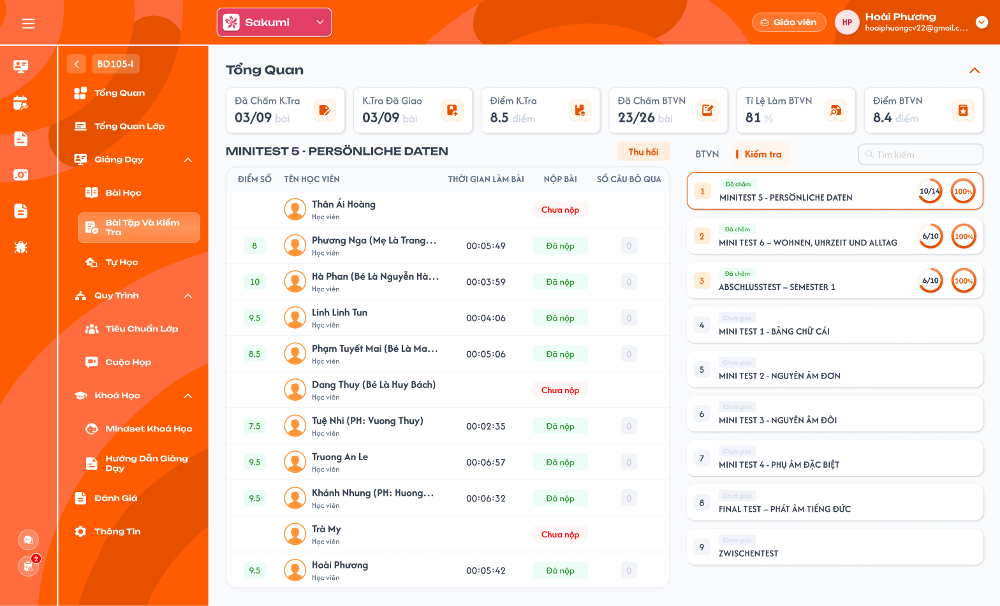</a><br>
  <em>Tab Kiểm tra: nút Thu hồi của bài đã giao, card Đã chấm và Chưa giao (Figma GV-LOP-040200) — nhấn để xem ảnh gốc</em>
</p>

**Mô tả:**

- Badge cạnh tab là số bài chưa chấm; mỗi card hiển thị số thứ tự, nhãn trạng thái, tên, mô tả, vòng số đã nộp và vòng tỷ lệ chấm.

**Giải thích thành phần:**

| Thành phần | Yêu cầu |
|---|---|
| Badge tab | Số bài của tab có trạng thái `Chưa chấm`; mỗi bài đếm một lần dù có nhiều bài nộp chưa chấm; bằng 0 thì ẩn. |
| Nhãn trạng thái BTVN | `Chưa giao`: bài học chưa mở. `Đang đợi nộp bài`: bài đã mở, chưa học viên hợp lệ nào nộp. `Chưa chấm`: còn bài nộp của học viên hợp lệ chưa có điểm. `Đã chấm`: mọi bài đã nộp đều có điểm. |
| Nhãn trạng thái Kiểm tra | `Chưa giao`: giáo viên chưa giao. `Đang đợi nộp bài`: đã giao, chưa có bài nộp. `Chưa chấm`: còn bài nộp chưa có điểm. `Đã chấm`: mọi bài đã nộp đều có điểm. Bài đã kết thúc có thêm badge `Đã kết thúc` cạnh nhãn chấm (`Chưa chấm` / `Đã chấm`; không ai nộp thì chỉ badge `Đã kết thúc`). |
| Vòng số đã nộp | Dạng `S/N`: S = số học viên hợp lệ đã nộp; N = tổng học viên hợp lệ của bài (REQ02). Vòng tô theo tỷ lệ S/N. Rê chuột hiện tooltip `Số bài đã nộp`. Bài chưa giao không hiển thị. |
| Vòng tỷ lệ chấm | `C / S × 100`, làm tròn số nguyên `%`: C = số bài đã nộp có điểm, S = số bài đã nộp. S = 0 hiển thị `0%`. Điểm 0 vẫn tính là đã chấm. Rê chuột hiện tooltip `Đã chấm`. |
| Mô tả | Mô tả bài nguồn (nhiều dòng), không thay bằng nội dung bài làm. |

**Điểm cần lưu ý:**

- Có học viên chưa nộp không ngăn trạng thái `Đã chấm` khi mọi bài đã nộp đều có điểm.
- Vòng tỷ lệ chấm 100% chỉ nghĩa là mọi bài đã nộp đã chấm, không nghĩa là mọi học viên đã nộp.
- Khác Figma GV-LOP-040200: Figma chưa có frame card `Chưa giao` đang chọn (xem trước đề) và nút `Giao bài`; hai thành phần này đặc tả theo ICS cũ.
- Vòng số đã nộp của role Giáo viên tính `đã nộp / tổng học viên hợp lệ` (theo ICS cũ), khác cách hiển thị `đã nộp / chưa nộp` của requirement Admin.

#### Testcase — Tab, badge và card

| Tên testcase | Priority | Loại test | Scenario | Role | Pre-condition | Given / When / Then | Expected Result |
|---|---| --- |---|---|---|---|---|
| Case 41: Badge đếm bài chưa chấm | High |  | REQ15 | Giáo viên | BTVN có 2 bài Chưa chấm, mỗi bài 5 bài nộp chưa chấm | **Given** xem tab BTVN<br>**When** tính badge<br>**Then** badge là 2 | - Không hiển thị 10<br>- Không cộng bài của tab Kiểm tra |
| Case 42: Đủ bốn nhãn trạng thái | High |  | REQ15 | Giáo viên | Có bài ở mỗi trạng thái | **Given** xem danh sách<br>**When** render card<br>**Then** đúng Chưa giao, Đang đợi nộp bài, Chưa chấm, Đã chấm | - BTVN Chưa giao là bài học chưa mở<br>- Kiểm tra đã kết thúc có thêm badge `Đã kết thúc` |
| Case 43: Vòng đã nộp trên tổng | High |  | REQ15 | Giáo viên | Bài có 14 học viên hợp lệ, 12 đã nộp | **Given** xem card<br>**When** tính vòng số đã nộp<br>**Then** hiển thị `12/14` | - Không hiển thị 12/2 |
| Case 44: Tỷ lệ chấm trên bài đã nộp | High |  | REQ15 | Giáo viên | 3 học viên đã nộp đều đã chấm, 15 chưa nộp | **Given** xem card<br>**When** tính tỷ lệ chấm<br>**Then** 100% | - Không chia cho tổng học viên<br>- S = 0 hiển thị 0% |

### Bảng kết quả học viên

**Mô tả:**

- Bảng vùng trái của bài đang chọn gồm `ĐIỂM SỐ`, `TÊN HỌC VIÊN`, `THỜI GIAN LÀM BÀI`, `NỘP BÀI`, `SỐ CÂU BỎ QUA`.

**Giải thích thành phần:**

| Cột | Yêu cầu |
|---|---|
| `ĐIỂM SỐ` | Điểm bài đã chấm (REQ07), hiển thị 1 chữ số thập phân; điểm 0 hiển thị `0`. Đã nộp chưa chấm hoặc chưa nộp thì để trống, không hiển thị 0. |
| `TÊN HỌC VIÊN` | Avatar, tên, dòng `Học viên`. Danh sách là tập học viên hợp lệ của bài (REQ02). |
| `THỜI GIAN LÀM BÀI` | Thời gian làm bài trên app dạng `HH:mm:ss`; vượt 24 giờ hiển thị tối đa `23:59:59`. Chưa nộp để trống. |
| `NỘP BÀI` | Badge `Đã nộp` (xanh) hoặc `Chưa nộp` (đỏ). |
| `SỐ CÂU BỎ QUA` | Số câu học viên bỏ qua trong bài nộp; 0 hiển thị xám, lớn hơn 0 hiển thị cam. Chưa nộp để trống. |
| Bấm dòng | Dòng `Đã nộp`: `Giáo viên phụ trách chính` mở màn chấm bài, lọc sẵn học viên đó. Dòng `Chưa nộp`: Toast `Thông Báo` `Học viên chưa nộp bài này!`, không điều hướng. Giáo viên khác: không điều hướng. |
| Thiết lập lại nộp bài | Không có icon làm mới trên dòng học viên; chỉ Admin, Class Handler, Support thiết lập lại bài nộp theo requirement Admin. |

**Điểm cần lưu ý:**

- `Đã nộp` và có điểm là hai mức khác nhau: đã nộp chưa chấm thì cột điểm trống.
- Kết quả của học viên đã Rời lớp/Xóa vẫn được giữ trong thống kê điểm; dòng của học viên chỉ hiển thị khi học viên thuộc tập hợp lệ của bài.
- Bài BTVN chưa mở hiển thị `Bài học chưa mở` thay cho bảng.
- Giáo viên không thiết lập lại bài nộp của học viên; cần làm lại thì báo Admin, Class Handler hoặc Support.

#### Testcase — Bảng kết quả học viên

| Tên testcase | Priority | Loại test | Scenario | Role | Pre-condition | Given / When / Then | Expected Result |
|---|---| --- |---|---|---|---|---|
| Case 45: Ba trạng thái dòng | High | Smoke | Flow 12 / REQ16 | Giáo viên | A chưa nộp, B nộp chưa chấm, C được chấm 0 | **Given** xem bảng<br>**When** render<br>**Then** A Chưa nộp, B Đã nộp không điểm, C Đã nộp điểm 0 | - Không hiển thị 0 cho B<br>- Không ẩn điểm 0 của C |
| Case 46: Thời gian vượt 24 giờ | Medium |  | REQ16 | Giáo viên | Bài nộp có thời gian 25:30:00 | **Given** xem cột thời gian<br>**When** định dạng<br>**Then** hiển thị 23:59:59 | - Dữ liệu gốc giữ nguyên |
| Case 47: BTVN bài chưa mở | Medium |  | REQ16 | Giáo viên | Bài học chưa mở | **Given** chọn card BTVN của bài<br>**When** vùng trái hiển thị<br>**Then** hiện `Bài học chưa mở` | - Không hiển thị bảng Chưa nộp giả |
| Case 47a: Bấm dòng Chưa nộp | Medium |  | EX19 / REQ16 | Giáo viên phụ trách chính | Học viên A chưa nộp | **Given** bấm dòng của A<br>**When** hệ thống kiểm tra bài nộp<br>**Then** Toast `Học viên chưa nộp bài này!`, ở lại bảng | - Không mở màn chấm |
| Case 47b: Không có Thiết lập lại nộp bài | High |  | EX20 / REQ16 | Giáo viên phụ trách chính | Học viên B đã nộp | **Given** xem dòng của B<br>**When** render<br>**Then** không có icon làm mới; request thiết lập lại bị từ chối | - Bài nộp của B giữ nguyên |

### Kiểm tra chưa giao — Xem trước đề và Giao bài

**Mô tả:**

- Chọn card Kiểm tra `Chưa giao`: vùng trái hiển thị **xem trước toàn bộ câu hỏi của đề** để giáo viên xem đề trước khi giao; `Giáo viên phụ trách chính` có nút `Giao bài` cạnh tên bài (vị trí nút `Thu hồi`).

**Giải thích thành phần:**

| Thành phần | Yêu cầu |
|---|---|
| Xem trước đề | Liệt kê lần lượt các câu: hướng dẫn, đề, đoạn văn, âm thanh (phát được), hình, đáp án `A`–`D`. Chỉ xem, không chọn đáp án. Đề không có câu thì hiển thị `Không có dữ liệu`. |
| Nút `Giao bài` | Chỉ `Giáo viên phụ trách chính`. Bấm mở popup `Giao bài` với nội dung `Nhấn 'Xác nhận' để giao bài kiểm tra này`, nút `Huỷ` / `Xác nhận`. |
| Điều kiện giao | Lớp ở trạng thái `Đang học`, hoặc lớp không chính thức (Lớp demo). Không đạt thì không giao, hiển thị Toast `Cảnh Báo` `Lớp chưa bắt đầu!`. |
| Giao thành công | Lưu lượt giao: lớp, bài kiểm tra, giáo viên giao, ngày giao. Card chuyển `Đang đợi nộp bài`; nút `Giao bài` đổi thành hai nút `Kết thúc bài` và `Thu hồi`; vùng trái chuyển sang bảng kết quả. Học viên hợp lệ thấy bài trên app. |

**Điểm cần lưu ý:**

- Tập học viên hợp lệ của bài kiểm tra xác định theo ngày giao (REQ02).
- Giáo viên khác của lớp vẫn xem trước đề nhưng không có nút `Giao bài`.

#### Testcase — Xem trước đề và Giao bài

| Tên testcase | Priority | Loại test | Scenario | Role | Pre-condition | Given / When / Then | Expected Result |
|---|---| --- |---|---|---|---|---|
| Case 48: Xem trước đề chưa giao | High |  | REQ17 | Giáo viên | Bài kiểm tra Chưa giao có 10 câu | **Given** chọn card<br>**When** vùng trái tải xong<br>**Then** hiển thị đủ 10 câu xem trước | - Phát được âm thanh câu<br>- Không có bảng học viên |
| Case 49: Giao bài thành công | High | Smoke | Flow 13 / REQ17 | Giáo viên phụ trách chính | Lớp Đang học, bài Chưa giao | **Given** bấm `Giao bài`<br>**When** bấm `Xác nhận`<br>**Then** bài chuyển Đang đợi nộp bài | - Nút đổi thành Thu hồi<br>- Toast `Giao bài kiểm tra thành công.`<br>- `K.Tra Đã Giao` tăng 1 |
| Case 50: Lớp chưa bắt đầu | High |  | EX10 / REQ17 | Giáo viên phụ trách chính | Lớp chính thức ở trạng thái Khai giảng | **Given** bấm `Giao bài` rồi `Xác nhận`<br>**When** hệ thống kiểm tra trạng thái lớp<br>**Then** Toast `Lớp chưa bắt đầu!` | - Bài vẫn Chưa giao |
| Case 51: Huỷ giao bài | Medium |  | Flow 13 / REQ17 | Giáo viên phụ trách chính | Popup Giao bài đang mở | **Given** bấm `Huỷ`<br>**When** popup đóng<br>**Then** bài vẫn Chưa giao | - Không Toast |

### Thu hồi bài kiểm tra

**Mô tả:**

- Bài kiểm tra đã giao (kể cả đã kết thúc) có nút `Thu hồi` cạnh tên bài, chỉ hiển thị với `Giáo viên phụ trách chính`.

**Giải thích thành phần:**

| Thành phần | Yêu cầu |
|---|---|
| Nút `Thu hồi` | Bấm mở popup `Thu hồi`, nội dung `Bạn muốn thu hồi bài kiểm tra này? Toàn bộ bài làm và điểm của học viên sẽ bị xoá.`, nút `Huỷ` / `Xác nhận`. |
| Thu hồi thành công | Xoá lượt giao và **toàn bộ bài làm, điểm, nhận xét chấm** của học viên ở bài này; bài về `Chưa giao`; nút đổi thành `Giao bài`; vùng trái về xem trước đề. Học viên không còn thấy bài trên app. |

**Điểm cần lưu ý:**

- Thu hồi không xoá đề và không ảnh hưởng bài kiểm tra khác.
- Sau khi thu hồi, các thẻ `Đã Chấm K.Tra`, `K.Tra Đã Giao`, `Điểm K.Tra` và badge tab cập nhật lại.
- Giao lại sau khi thu hồi là lượt giao mới, học viên làm lại từ đầu.

#### Testcase — Thu hồi bài kiểm tra

| Tên testcase | Priority | Loại test | Scenario | Role | Pre-condition | Given / When / Then | Expected Result |
|---|---| --- |---|---|---|---|---|
| Case 52: Thu hồi xoá bài làm và điểm | High |  | Flow 14 / REQ18 | Giáo viên phụ trách chính | Bài đã giao, 5 học viên đã nộp, 3 đã chấm | **Given** bấm `Thu hồi`<br>**When** bấm `Xác nhận`<br>**Then** bài về Chưa giao | - Không còn bài làm/điểm/nhận xét của 5 học viên<br>- Toast `Thu hồi bài kiểm tra thành công.`<br>- Khối Tổng Quan cập nhật |
| Case 53: Huỷ thu hồi | Medium |  | Flow 14 / REQ18 | Giáo viên phụ trách chính | Popup Thu hồi đang mở | **Given** bấm `Huỷ`<br>**When** popup đóng<br>**Then** dữ liệu giữ nguyên | - Không Toast |
| Case 54: Giao lại sau thu hồi | Medium |  | REQ17 / REQ18 | Giáo viên phụ trách chính | Bài vừa thu hồi | **Given** bấm `Giao bài` và xác nhận<br>**When** học viên mở app<br>**Then** học viên làm lại từ đầu | - Không khôi phục bài làm cũ |

### Kết thúc bài kiểm tra

**Mô tả:**

- Bài kiểm tra đang giao có nút `Kết thúc bài` cạnh nút `Thu hồi`, chỉ hiển thị với `Giáo viên phụ trách chính`. Kết thúc là thu bài: học viên không làm, không nộp thêm; bài làm, điểm và nhận xét giữ nguyên.

**Giải thích thành phần:**

| Thành phần | Yêu cầu |
|---|---|
| Nút `Kết thúc bài` | Chỉ ở bài kiểm tra đang giao (chưa kết thúc). Bấm mở popup `Kết thúc bài`, nội dung `Nhấn 'Xác nhận' để kết thúc bài kiểm tra này. Học viên sẽ không nộp được bài nữa.`, nút `Huỷ` / `Xác nhận`. |
| Kết thúc thành công | Lưu thời điểm kết thúc; card có thêm badge `Đã kết thúc`; nút `Kết thúc bài` ẩn, còn nút `Thu hồi`; vùng trái giữ bảng kết quả; Toast `Kết thúc bài kiểm tra thành công.` |
| Học viên sau khi kết thúc | Bài vẫn hiện trên app, chỉ xem kết quả (điểm, nhận xét khi đã chấm); không vào làm, không lưu câu trả lời, không nộp. Học viên chưa nộp giữ trạng thái `Chưa nộp`. |
| Chấm sau khi kết thúc | Giáo viên phụ trách chính vẫn chấm, sửa điểm, nhận xét bài đã nộp như khi đang giao (REQ06). |

**Điểm cần lưu ý:**

- Không có mở lại bài đã kết thúc. Muốn học viên làm lại thì `Thu hồi` (xoá bài làm, điểm) rồi `Giao bài` lượt mới.
- Học viên đang làm dở lúc kết thúc: câu trả lời chưa nộp không được nộp; app báo bài đã kết thúc. Bài đã nộp trước thời điểm kết thúc giữ nguyên.
- Bài đã kết thúc vẫn tính vào `K.Tra Đã Giao`; chỉ `Thu hồi` mới làm giảm.
- Tab BTVN không có `Kết thúc bài` (BTVN tự giao theo bài học).

#### Testcase — Kết thúc bài kiểm tra

| Tên testcase | Priority | Loại test | Scenario | Role | Pre-condition | Given / When / Then | Expected Result |
|---|---| --- |---|---|---|---|---|
| Case 101: Kết thúc bài thành công | High | Smoke | Flow 16 / REQ31 | Giáo viên phụ trách chính | Bài đang giao, 5/8 học viên đã nộp | **Given** bấm `Kết thúc bài`<br>**When** bấm `Xác nhận`<br>**Then** card có badge `Đã kết thúc` | - Toast `Kết thúc bài kiểm tra thành công.`<br>- Còn nút `Thu hồi`, không còn `Kết thúc bài`<br>- 5 bài nộp, điểm giữ nguyên; `K.Tra Đã Giao` không đổi |
| Case 102: Huỷ kết thúc | Medium |  | Flow 16 / REQ31 | Giáo viên phụ trách chính | Popup Kết thúc bài đang mở | **Given** bấm `Huỷ`<br>**When** popup đóng<br>**Then** bài vẫn đang giao | - Không Toast<br>- Học viên vẫn nộp được |
| Case 103: Chấm sau khi kết thúc | High |  | REQ31 / REQ06 | Giáo viên phụ trách chính | Bài đã kết thúc, 2 bài nộp chưa chấm | **Given** mở màn chấm<br>**When** chấm 2 bài<br>**Then** điểm lưu, card chuyển `Đã chấm` kèm `Đã kết thúc` | - Học viên thấy điểm trên app |
| Case 104: Học viên nộp sau khi kết thúc | High |  | EX21 / REQ31 | Học viên | Học viên A đang làm dở khi giáo viên kết thúc | **Given** A bấm `Nộp`<br>**When** backend kiểm tra<br>**Then** từ chối, app báo bài đã kết thúc | - A vẫn `Chưa nộp` ở bảng kết quả<br>- Request lưu câu trả lời cũng bị từ chối |
| Case 105: Thu hồi bài đã kết thúc | Medium |  | REQ18 / REQ31 | Giáo viên phụ trách chính | Bài đã kết thúc, có bài nộp và điểm | **Given** bấm `Thu hồi`<br>**When** bấm `Xác nhận`<br>**Then** bài về `Chưa giao` | - Bài làm, điểm, nhận xét bị xoá<br>- `K.Tra Đã Giao` giảm 1<br>- Giao lại là lượt mới |
| Case 106: Không phải phụ trách chính | High |  | EX01 / REQ31 | Giáo viên | Giáo viên thuộc lớp, không phải phụ trách chính; bài đang giao | **Given** xem card<br>**When** render<br>**Then** không có nút `Kết thúc bài` | - Gửi request kết thúc bị từ chối<br>- Bài vẫn đang giao |

### Màn chấm bài — Khung màn và điều hướng

<p align="center">
  <a href="./images/grading-record-reviewed.png">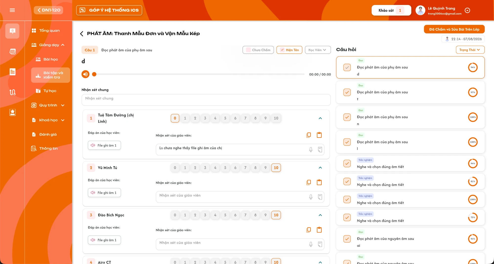</a><br>
  <em>Màn chấm bài: chi tiết câu bên trái, danh sách Câu hỏi bên phải, nút Đã Chấm và Sửa Bài Trên Lớp kèm avatar và thời điểm của người bấm (UI ICS cũ) — nhấn để xem ảnh gốc</em>
</p>

**Mô tả:**

- `Giáo viên phụ trách chính` của lớp dùng màn này để chấm điểm và nhận xét bài BTVN hoặc bài Kiểm tra mà học viên đã nộp.
- Màn chấm theo **một bài** (một BTVN hoặc một bài Kiểm tra) cho **mọi học viên hợp lệ**, chấm lần lượt **từng câu hỏi**.
- Vùng trái là chi tiết câu đang chọn và danh sách thẻ học viên; vùng phải là danh sách `Câu hỏi` của bài.

**Giải thích thành phần:**

| Thành phần | Yêu cầu |
|---|---|
| Điểm vào từ card bài | Card BTVN/Kiểm tra trong menu Bài tập và Kiểm tra có nút điều hướng sang màn chấm. Nút chỉ hiển thị với `Giáo viên phụ trách chính`. |
| Điểm vào từ dòng học viên | Bấm dòng học viên **đã nộp** trong bảng của bài đang chọn mở cùng màn chấm của bài, bộ lọc `Học Viên` được chọn sẵn học viên đó. Dòng học viên chưa nộp không điều hướng. |
| Bài bổ sung nhiều bài nguồn | BTVN của bài học bổ sung gồm nhiều bài nguồn: trước khi vào màn chấm hiển thị popup chọn một bài nguồn; màn chấm mở đúng bài nguồn được chọn. |
| Tiêu đề | Icon `<` và tên bài: BTVN dùng tên bài học, Kiểm tra dùng tên bài kiểm tra. Bấm `<` quay về menu Bài tập và Kiểm tra. |
| Đã Chấm và Sửa Bài Trên Lớp | Nút cam ở góc phải; chi tiết tại khu vực Nút Đã Chấm và Sửa Bài Trên Lớp. |
| Vùng trái | Chi tiết câu đang chọn, bộ lọc học viên, `Nhận xét chung` và danh sách thẻ học viên. |
| Vùng phải | Danh sách `Câu hỏi` của bài với trạng thái chấm, nhãn loại câu và tỷ lệ điểm. |

**Điểm cần lưu ý:**

- Khi mở màn, mặc định chọn câu đầu tiên của danh sách `Câu hỏi`.
- Quay về menu Bài tập và Kiểm tra sau khi có thay đổi điểm thì tải lại dữ liệu bài, bảng học viên, các thẻ Tổng Quan và badge liên quan.
- Giáo viên khác của lớp (không phải `Giáo viên phụ trách chính`) không thấy nút điều hướng và không mở được màn chấm, kể cả bằng URL.
- Ảnh UI Giáo viên trên Figma (GV-LOP-040100, GV-LOP-040200) chưa có nút điều hướng trên card và chưa có màn chấm; dùng ảnh UI ICS cũ làm tham chiếu.

#### Testcase — Khung màn và điều hướng

| Tên testcase | Priority | Loại test | Scenario | Role | Pre-condition | Given / When / Then | Expected Result |
|---|---| --- |---|---|---|---|---|
| Case 55: Mở màn chấm từ card bài | High | Smoke | Flow 5 / REQ01 | Giáo viên phụ trách chính | Bài BTVN có học viên đã nộp | **Given** đang ở menu Bài tập và Kiểm tra<br>**When** bấm nút điều hướng trên card bài<br>**Then** mở màn chấm của đúng bài | - Tiêu đề đúng tên bài<br>- Chọn sẵn câu đầu tiên<br>- Danh sách Câu hỏi đủ câu của bài |
| Case 56: Mở màn chấm từ dòng học viên đã nộp | High |  | Flow 5 / REQ01 / REQ04 | Giáo viên phụ trách chính | Học viên A đã nộp bài | **Given** đang xem bảng học viên của bài<br>**When** bấm dòng A<br>**Then** mở màn chấm của bài, lọc sẵn A | - Bộ lọc Học Viên chọn A<br>- Chỉ thẻ A hiển thị ở câu đang chọn<br>- Có thể bỏ lọc để xem mọi học viên |
| Case 57: Dòng học viên chưa nộp không điều hướng | Medium |  | REQ01 | Giáo viên phụ trách chính | Học viên B chưa nộp | **Given** đang xem bảng học viên<br>**When** bấm dòng B<br>**Then** không mở màn chấm | - Không lỗi<br>- Không tạo dữ liệu chấm |
| Case 58: Bài bổ sung chọn bài nguồn | High |  | Flow 5 / REQ01 | Giáo viên phụ trách chính | BTVN của bài bổ sung gồm 2 bài nguồn | **Given** bấm nút điều hướng<br>**When** popup chọn bài nguồn hiện và chọn bài thứ hai<br>**Then** mở màn chấm của bài nguồn thứ hai | - Câu hỏi thuộc đúng bài nguồn đã chọn<br>- Không trộn câu của bài nguồn khác |
| Case 59: Giáo viên không phải phụ trách chính | High |  | EX01 / Ràng buộc quyền | Giáo viên | Giáo viên thuộc lớp nhưng không phải phụ trách chính | **Given** mở menu Bài tập và Kiểm tra<br>**When** xem card bài và thử mở URL màn chấm<br>**Then** không có nút và bị chặn truy cập | - Không hiển thị nút điều hướng<br>- Request chấm bị từ chối ở backend |
| Case 60: Quay về sau khi chấm | Medium |  | Flow 6 / REQ12 | Giáo viên phụ trách chính | Đã chấm thêm điểm trong màn chấm | **Given** bấm `<`<br>**When** quay về menu Bài tập và Kiểm tra<br>**Then** dữ liệu bài được tải lại | - Điểm, trạng thái và các thẻ Tổng Quan cập nhật<br>- Không hiển thị số liệu cũ |

### Danh sách Câu hỏi và trạng thái chấm

<p align="center">
  <a href="./images/grading-multiple-choice.png">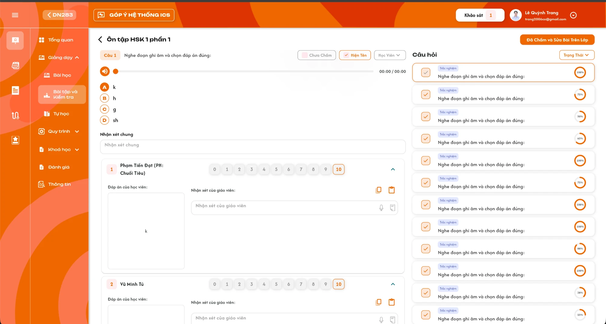</a><br>
  <em>Danh sách Câu hỏi bên phải: icon trạng thái chấm, nhãn loại câu, đề bài và vòng tỷ lệ điểm (UI ICS cũ) — nhấn để xem ảnh gốc</em>
</p>

**Mô tả:**

- Liệt kê toàn bộ câu hỏi của bài theo thứ tự đề; bấm một câu để chấm câu đó ở vùng trái.

**Giải thích thành phần:**

| Thành phần | Yêu cầu |
|---|---|
| Icon trạng thái | `Đã chấm`: ô tick nền cam nhạt, dấu tick cam. `Đang chấm`: câu đang chọn, viền cam. `Chưa chấm`: ô tick xám. Hover hiển thị tên trạng thái. |
| Nhãn loại câu | Một trong `Trắc nghiệm`, `Hình ảnh`, `Viết`, `Đọc`, `Sắp xếp`, `Nối từ`, `Nói`, `Câu hỏi con` theo bảng Loại câu ở REQ05. |
| Đề bài | Hướng dẫn của câu và nội dung câu hỏi, tối đa 2 dòng mỗi phần. |
| Vòng tỷ lệ điểm | `Tổng điểm các câu trả lời đã chấm / (số câu trả lời đã chấm × 10)`, hiển thị `%` làm tròn số nguyên. Chỉ hiển thị khi câu ở trạng thái `Đã chấm` hoặc đang được chọn. |
| Bộ lọc `Trạng Thái` | Chọn một hoặc nhiều giá trị `Chưa chấm`, `Đã chấm`; không chọn thì hiển thị mọi câu. |

**Điểm cần lưu ý:**

- Câu `Đã chấm` khi mọi câu trả lời của học viên đã nộp trong câu đó đều có điểm (0–10).
- Câu không có câu trả lời nào nhưng bài có học viên đã nộp được coi là `Đã chấm`, vòng tỷ lệ hiển thị `100%`, vùng trái hiển thị `Bạn không cần chấm câu hỏi này!`.
- Điểm 0 đã chấm vẫn tính vào tỷ lệ; câu trả lời chưa chấm không tham gia tỷ lệ.
- Trạng thái và tỷ lệ cập nhật ngay sau mỗi lần chấm điểm, không cần tải lại màn.

#### Testcase — Danh sách Câu hỏi

| Tên testcase | Priority | Loại test | Scenario | Role | Pre-condition | Given / When / Then | Expected Result |
|---|---| --- |---|---|---|---|---|
| Case 61: Hiển thị đủ câu và nhãn loại | High |  | REQ03 / REQ05 | Giáo viên phụ trách chính | Bài có câu Trắc nghiệm, Đọc, Nối từ, Câu hỏi con | **Given** mở màn chấm<br>**When** danh sách tải xong<br>**Then** hiển thị đủ câu theo thứ tự đề | - Nhãn loại đúng bảng REQ05<br>- Câu có câu con hiển thị nhãn Câu hỏi con |
| Case 62: Trạng thái Đã chấm và tỷ lệ điểm | High |  | REQ03 | Giáo viên phụ trách chính | Câu có 3 học viên đã nộp, điểm 10, 8, 0 | **Given** cả 3 câu trả lời đã có điểm<br>**When** xem câu trong danh sách<br>**Then** trạng thái Đã chấm, tỷ lệ 60% | - Tính `(10 + 8 + 0) / 30`<br>- Điểm 0 vẫn tính |
| Case 63: Câu còn câu trả lời chưa chấm | High |  | REQ03 | Giáo viên phụ trách chính | Câu có 1 câu trả lời chưa chấm | **Given** câu không ở trạng thái đang chọn<br>**When** xem danh sách<br>**Then** trạng thái Chưa chấm | - Không hiển thị vòng tỷ lệ<br>- Chấm xong câu trả lời cuối thì chuyển Đã chấm ngay |
| Case 64: Câu không cần chấm | Medium |  | REQ03 | Giáo viên phụ trách chính | Câu không có câu trả lời, bài có học viên đã nộp | **Given** chọn câu<br>**When** vùng trái hiển thị<br>**Then** hiện `Bạn không cần chấm câu hỏi này!` | - Câu tính Đã chấm, tỷ lệ 100%<br>- Không chặn nút Đã Chấm và Sửa Bài Trên Lớp |
| Case 65: Lọc theo Trạng Thái | Medium |  | REQ03 | Giáo viên phụ trách chính | Bài có câu Đã chấm và Chưa chấm | **Given** chọn `Chưa chấm` ở bộ lọc<br>**When** áp dụng<br>**Then** chỉ còn câu Chưa chấm | - Bỏ chọn hiển thị lại mọi câu<br>- Không đổi dữ liệu chấm |

### Chi tiết câu hỏi và bộ lọc học viên

**Mô tả:**

- Vùng trái hiển thị nội dung câu đang chọn và danh sách thẻ học viên có câu trả lời của câu đó.

**Giải thích thành phần:**

| Thành phần | Yêu cầu |
|---|---|
| `Câu N` | Chip số thứ tự câu trong bài, kèm hướng dẫn của câu. |
| Nội dung câu | Đề bài, đoạn văn (nếu có), trình phát âm thanh `00:00 / 00:00` (nếu có), hình ảnh (nếu có) và các đáp án `A`–`D` (chữ hoặc hình) theo dữ liệu câu. |
| `Chưa Chấm` | Checkbox. Bật thì chỉ hiển thị học viên chưa có điểm ở câu này; học viên vừa được chấm trong lúc lọc vẫn hiển thị đến khi đổi câu. Mặc định tắt. |
| `Hiện Tên` | Checkbox, mặc định bật. Tắt thì ẩn tên học viên trên thẻ, chỉ giữ số thứ tự, để chấm khách quan. |
| `Học Viên` | Dropdown chọn một hoặc nhiều học viên có câu trả lời ở câu này; không chọn thì hiển thị mọi học viên. |
| Thẻ học viên | Chi tiết tại khu vực Thẻ học viên. Thứ tự thẻ đánh số từ 1 theo danh sách sau lọc. |

**Điểm cần lưu ý:**

- Ba bộ lọc chỉ áp dụng cho thẻ học viên của câu đang chọn; đổi câu thì trạng thái `Chưa Chấm` và `Học Viên` được áp dụng lại cho câu mới.
- Tập học viên hiển thị theo REQ02; không hiển thị tài khoản không phải học viên.
- Không có học viên nộp bài: vùng thẻ hiển thị `Chưa có học sinh nộp bài`.

#### Testcase — Chi tiết câu và bộ lọc

| Tên testcase | Priority | Loại test | Scenario | Role | Pre-condition | Given / When / Then | Expected Result |
|---|---| --- |---|---|---|---|---|
| Case 66: Hiển thị nội dung câu | High |  | REQ03 | Giáo viên phụ trách chính | Câu có đề, âm thanh, hình và 4 đáp án | **Given** chọn câu<br>**When** vùng trái tải xong<br>**Then** hiển thị đủ đề, trình phát, hình và A–D | - Phát được âm thanh<br>- Đáp án hình hiển thị đúng ảnh |
| Case 67: Lọc Chưa Chấm | High |  | REQ04 | Giáo viên phụ trách chính | Câu có A đã chấm, B và C chưa chấm | **Given** bật `Chưa Chấm`<br>**When** chấm B<br>**Then** còn B và C; B vẫn hiển thị đến khi đổi câu | - Không hiển thị A<br>- Đổi câu rồi quay lại thì B không còn trong lọc |
| Case 68: Ẩn tên học viên | Medium |  | REQ04 | Giáo viên phụ trách chính | Câu có nhiều học viên | **Given** tắt `Hiện Tên`<br>**When** xem thẻ<br>**Then** thẻ chỉ còn số thứ tự | - Vẫn chấm và nhận xét được<br>- Bật lại hiển thị đúng tên từng thẻ |
| Case 69: Lọc Học Viên | Medium |  | REQ04 | Giáo viên phụ trách chính | Câu có A, B, C | **Given** chọn A và C ở `Học Viên`<br>**When** áp dụng<br>**Then** chỉ còn thẻ A và C | - Dropdown chỉ liệt kê học viên có câu trả lời<br>- Bỏ chọn hiển thị lại đủ |
| Case 70: Không có học viên nộp | Medium |  | EX08 | Giáo viên phụ trách chính | Bài chưa có học viên nộp | **Given** mở màn chấm<br>**When** chọn câu bất kỳ<br>**Then** hiển thị `Chưa có học sinh nộp bài` | - Không tạo thẻ giả<br>- Không lỗi |

### Thẻ học viên — điểm và đáp án

<p align="center">
  <a href="./images/grading-match-column.png">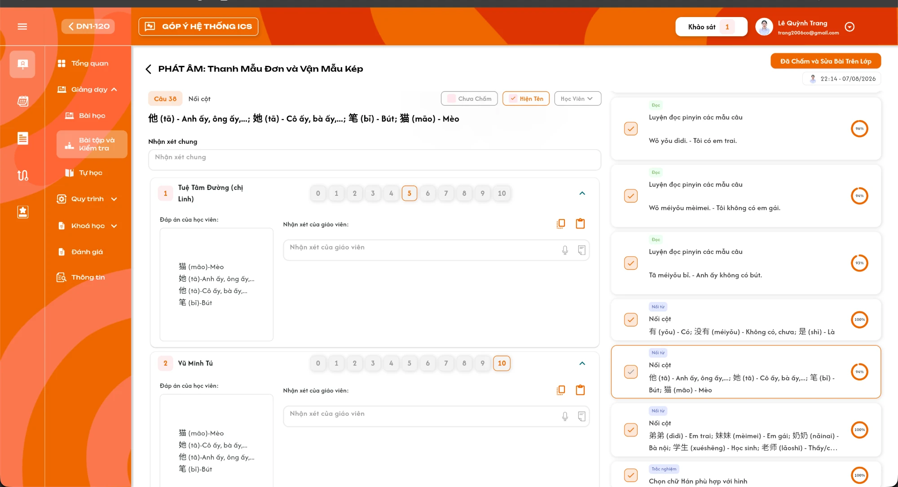</a><br>
  <em>Thẻ học viên câu Nối từ: số thứ tự, tên, dãy điểm 0–10, Đáp án của học viên và Nhận xét của giáo viên (UI ICS cũ) — nhấn để xem ảnh gốc</em>
</p>

**Mô tả:**

- Mỗi học viên có câu trả lời ở câu đang chọn có một thẻ để xem đáp án và chấm điểm.

**Giải thích thành phần:**

| Thành phần | Yêu cầu |
|---|---|
| Số thứ tự | Số thứ tự thẻ trong danh sách sau lọc. |
| Tên học viên | Hiển thị khi `Hiện Tên` bật, tối đa 2 dòng. |
| Nhãn `Chỉ xem` | Hiển thị trên thẻ của học viên có câu trả lời nhưng **chưa nộp bài**; thẻ không bấm điểm, không nhận xét được. |
| Dãy điểm `0`–`10` | 11 nút số nguyên; điểm đã lưu được viền và chữ cam. Câu trả lời chưa chấm không có nút nào được chọn. Bấm một số để lưu ngay điểm đó. Không hiển thị với câu có câu con (điểm chấm ở từng câu con). |
| Thu gọn / mở rộng | Icon `⌃` thu gọn hoặc mở thẻ; mặc định mở. |
| `Đáp án của học viên` | Hiển thị theo loại câu ở bảng dưới. |

**Hiển thị đáp án theo loại câu:**

| Loại câu (mã) | Hiển thị đáp án |
|---|---|
| Trắc nghiệm từ vựng (1), Trắc nghiệm câu (5), Văn bản (6) | Ô chữ chứa đáp án học viên chọn hoặc nhập. |
| Sắp xếp (7) | Ô chữ chứa các từ học viên sắp xếp, nối bằng dấu cách. |
| Nối cột (8) | Ô chữ, mỗi cặp nối một dòng dạng `vế trái-vế phải`. |
| Nói (22), Viết dạng chữ (44) | Ô chữ chứa nội dung học viên nói (nhận diện lời nói) hoặc viết. |
| Vẽ (4), Chọn ảnh (2), Trắc nghiệm hình ảnh (11) | Ảnh bài làm hoặc ảnh đáp án học viên chọn. |
| Ghi âm (3), Nhập vai (10) | Danh sách chip `File ghi âm N`; bấm chip để nghe. |
| Học viên bỏ qua câu | Ô chữ `Học viên đã bỏ qua câu này!`; vẫn chấm được. |

**Điểm cần lưu ý:**

- Câu do app tự chấm đã có điểm sẵn khi học viên nộp; giáo viên vẫn được bấm điểm khác để sửa đè (REQ05, REQ06).
- Mỗi lần bấm điểm chỉ cập nhật câu trả lời của đúng học viên–câu–bài–lớp; không đổi điểm câu khác.
- Khi mọi câu của học viên trong bài đã có điểm, hệ thống tính lại điểm bài theo REQ07.

#### Testcase — Thẻ học viên

| Tên testcase | Priority | Loại test | Scenario | Role | Pre-condition | Given / When / Then | Expected Result |
|---|---| --- |---|---|---|---|---|
| Case 71: Chấm điểm câu giáo viên chấm | High | Smoke | Flow 6 / REQ06 | Giáo viên phụ trách chính | Câu Đọc, học viên A đã nộp, chưa chấm | **Given** xem thẻ A<br>**When** bấm `8`<br>**Then** lưu điểm 8 cho A ở câu này | - Nút 8 được tô cam<br>- Trạng thái câu cập nhật ngay<br>- Không đổi điểm học viên khác |
| Case 72: Sửa đè điểm app chấm | High |  | Flow 6 / REQ05 / REQ06 | Giáo viên phụ trách chính | Câu Trắc nghiệm, app đã chấm A 10 điểm | **Given** thẻ A hiển thị điểm 10<br>**When** bấm `5`<br>**Then** điểm câu của A thành 5 | - Điểm bài tính lại theo điểm mới<br>- Tỷ lệ của câu cập nhật |
| Case 73: Đáp án đúng theo loại câu | High |  | REQ05 | Giáo viên phụ trách chính | Bài có câu Ghi âm, Nối cột, Vẽ, Sắp xếp | **Given** xem thẻ học viên ở từng câu<br>**When** đáp án hiển thị<br>**Then** đúng dạng theo bảng | - Ghi âm là chip nghe được<br>- Nối cột mỗi cặp một dòng<br>- Vẽ là ảnh |
| Case 74: Học viên bỏ qua câu | Medium |  | REQ05 | Giáo viên phụ trách chính | A nộp bài nhưng bỏ trống câu | **Given** xem thẻ A<br>**When** đáp án hiển thị<br>**Then** hiện `Học viên đã bỏ qua câu này!` | - Vẫn chấm được điểm 0–10<br>- Không lỗi hiển thị |
| Case 75: Học viên chưa nộp chỉ xem | High |  | EX07 / REQ02 | Giáo viên phụ trách chính | B có câu trả lời đã lưu nhưng chưa nộp bài | **Given** xem thẻ B<br>**When** thử bấm điểm hoặc nhận xét<br>**Then** không thao tác được | - Thẻ có nhãn `Chỉ xem`<br>- Backend từ chối request chấm cho B |
| Case 76: Lưu điểm lỗi | High |  | EX04 | Giáo viên phụ trách chính | Mất kết nối khi bấm điểm | **Given** bấm `7`<br>**When** lưu thất bại<br>**Then** hiển thị Toast `Có Lỗi Xảy Ra` | - Giữ điểm cũ sau khi tải lại<br>- Không tính lại điểm bài |
| Case 77: Loại học viên theo khoảng trạng thái | High |  | REQ02 | Giáo viên phụ trách chính | A chuyển `Nghỉ học` ngày 10, quay lại `Đang học` ngày 20; bài 5 mở ngày 15, bài 6 mở ngày 22; cả hai bài A đều được điểm danh | **Given** mở màn chấm BTVN bài 5 và bài 6<br>**When** xem danh sách học viên<br>**Then** A không có ở bài 5, có ở bài 6 | - Áp dụng tương tự `Rời lớp`, `Xóa`<br>- `Chỉ xem`, `Dự thính` không bị loại |

### Nhận xét của giáo viên

<p align="center">
  <a href="./images/grading-teacher-comment-audio.png">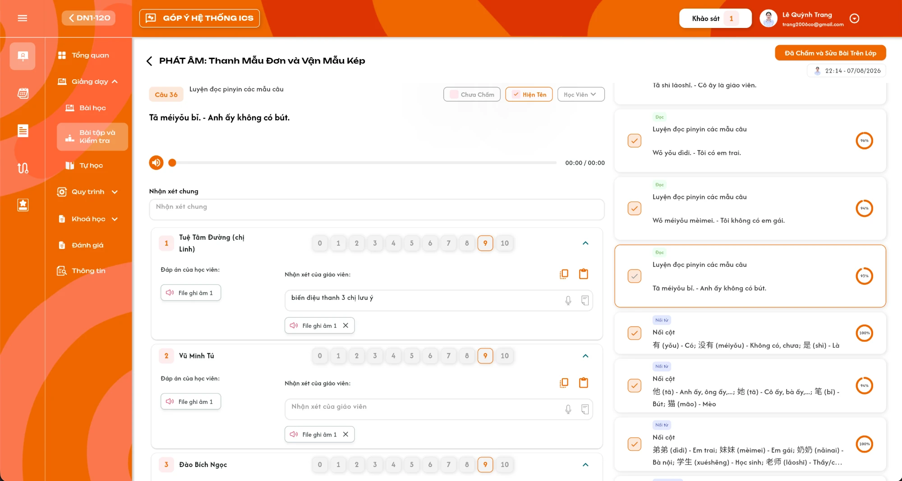</a><br>
  <em>Nhận xét của giáo viên: ô nhập, icon micro, icon tài liệu, chip File ghi âm có nút ×, icon sao chép và dán (UI ICS cũ) — nhấn để xem ảnh gốc</em>
</p>

**Mô tả:**

- Mỗi thẻ học viên có khu vực `Nhận xét của giáo viên` gồm nội dung chữ, file ghi âm và file ảnh dành cho đúng học viên ở câu đó.

**Giải thích thành phần:**

| Thành phần | Yêu cầu |
|---|---|
| Ô `Nhận xét của giáo viên` | Nhập nhiều dòng; lưu khi giáo viên xác nhận nhập (rời ô hoặc Enter theo component nhập chung). Rỗng là chưa có nhận xét. |
| Icon micro | Mở popup ghi âm. Ghi xong thì tải file lên (tối đa 25MB mỗi file), trong lúc tải hiển thị chip `Đang tải...`; tải xong thêm chip `File ghi âm N` vào nhận xét. |
| Icon tài liệu | Mở popup tải ảnh lên, chỉ nhận định dạng ảnh, tối đa 25MB mỗi file. Tải xong thêm chip `File ảnh N`. |
| Chip `File ghi âm N` / `File ảnh N` | Bấm để nghe hoặc xem ảnh; `×` xoá file khỏi nhận xét. Đánh số theo thứ tự thêm. |
| Icon sao chép | Sao chép nhận xét của thẻ (chữ, ảnh, ghi âm) vào bộ nhớ tạm; hiển thị Toast `Thông Báo` với nội dung `Đã sao chép`. |
| Icon dán | Dán nhận xét đã sao chép vào thẻ hiện tại, thay nội dung chữ, ảnh và ghi âm hiện có của thẻ. Dữ liệu bộ nhớ tạm không đúng định dạng thì hiển thị Toast `Thông Báo` với nội dung `Dữ liệu không hợp lệ`. |

**Điểm cần lưu ý:**

- Nhận xét gắn đúng học viên–câu–bài–lớp; sao chép/dán dùng để áp nhanh cùng nhận xét cho nhiều học viên.
- Thêm hoặc xoá file lưu ngay; lỗi tải file không thêm chip. File ghi âm hoặc ảnh vượt 25MB bị từ chối trước khi tải, hiển thị Toast `Cảnh Báo` `File vượt quá dung lượng cho phép (25MB).`
- Nhận xét độc lập với điểm: có thể nhận xét trước khi chấm và ngược lại.
- Nội dung chữ hiển thị dạng văn bản thuần, không thực thi HTML/script.

#### Testcase — Nhận xét của giáo viên

| Tên testcase | Priority | Loại test | Scenario | Role | Pre-condition | Given / When / Then | Expected Result |
|---|---| --- |---|---|---|---|---|
| Case 78: Nhập nhận xét chữ | High | Smoke | Flow 8 / REQ08 | Giáo viên phụ trách chính | Thẻ A đang mở | **Given** nhập `Biến điệu thanh 3 chị lưu ý`<br>**When** xác nhận nhập<br>**Then** lưu nhận xét cho A ở câu này | - Tải lại vẫn còn nội dung<br>- Không ghi vào học viên khác |
| Case 79: Ghi âm nhận xét | High |  | Flow 8 / REQ08 | Giáo viên phụ trách chính | Thiết bị có micro | **Given** bấm icon micro và ghi âm<br>**When** tải file xong<br>**Then** thêm chip `File ghi âm 1` | - Trong lúc tải hiện `Đang tải...`<br>- Bấm chip nghe được<br>- `×` xoá đúng file |
| Case 80: Tải ảnh nhận xét | Medium |  | Flow 8 / REQ08 | Giáo viên phụ trách chính | Có file ảnh hợp lệ | **Given** bấm icon tài liệu và chọn ảnh<br>**When** tải xong<br>**Then** thêm chip `File ảnh 1` | - Không nhận file không phải ảnh<br>- Bấm chip xem được ảnh |
| Case 81: Sao chép và dán nhận xét | Medium |  | Flow 8 / REQ08 | Giáo viên phụ trách chính | Thẻ A có chữ và 1 ghi âm; thẻ B trống | **Given** sao chép ở A<br>**When** dán ở B<br>**Then** B có cùng chữ và ghi âm | - Toast `Đã sao chép` khi sao chép<br>- Nhận xét A giữ nguyên |
| Case 82: Dán dữ liệu không hợp lệ | Low |  | EX03 | Giáo viên phụ trách chính | Bộ nhớ tạm chứa chữ thường | **Given** bấm icon dán ở B<br>**When** dữ liệu không đúng định dạng<br>**Then** Toast `Dữ liệu không hợp lệ` | - Không đổi nhận xét của B |
| Case 83: Tải file lỗi | Medium |  | EX05 | Giáo viên phụ trách chính | Mất kết nối khi tải ghi âm | **Given** ghi âm xong<br>**When** tải file thất bại<br>**Then** chip `Đang tải...` biến mất, không thêm file | - Toast `Có Lỗi Xảy Ra`<br>- Nhận xét giữ nguyên |
| Case 84: File vượt 25MB | Medium |  | EX09 / REQ08 | Giáo viên phụ trách chính | Có file ghi âm 30MB | **Given** chọn tải file ghi âm 30MB<br>**When** hệ thống kiểm tra dung lượng<br>**Then** Toast `Cảnh Báo` `File vượt quá dung lượng cho phép (25MB).` | - Không thêm chip<br>- File 25MB trở xuống tải bình thường |

### Nhận xét chung của câu

**Mô tả:**

- Ô `Nhận xét chung` phía trên danh sách thẻ dùng để áp **một nhận xét chữ cho mọi học viên** có câu trả lời ở câu đang chọn.

**Giải thích thành phần:**

| Thành phần | Yêu cầu |
|---|---|
| Ô `Nhận xét chung` | Nhập nhiều dòng; chỉ hiển thị khi câu có ít nhất một học viên có câu trả lời. Mặc định trống mỗi lần mở câu. |
| Xác nhận nhập | Mở popup xác nhận trước khi áp dụng. |
| Popup xác nhận | Tiêu đề `Áp dụng nhận xét chung`; nội dung `Nhận xét này sẽ thay thế nhận xét của giáo viên cho tất cả học viên trong câu này. Bạn có muốn tiếp tục?`; nút `Huỷ` / `Xác nhận`. |
| Xác nhận | Ghi đè nội dung chữ `Nhận xét của giáo viên` của mọi học viên có câu trả lời ở câu này; hiển thị tiến độ cập nhật cho đến khi xong. |

**Điểm cần lưu ý:**

- Chỉ ghi đè phần chữ; file ghi âm và file ảnh đã có của từng học viên giữ nguyên.
- Sau khi áp dụng, giáo viên vẫn sửa riêng nhận xét của từng học viên được.
- `Huỷ` đóng popup, không đổi nhận xét nào, không hiển thị Toast.
- Áp dụng cho mọi học viên có câu trả lời của câu, không phụ thuộc bộ lọc đang bật.

#### Testcase — Nhận xét chung

| Tên testcase | Priority | Loại test | Scenario | Role | Pre-condition | Given / When / Then | Expected Result |
|---|---| --- |---|---|---|---|---|
| Case 85: Áp dụng nhận xét chung | High |  | Flow 9 / REQ09 | Giáo viên phụ trách chính | Câu có A (đã có nhận xét riêng và 1 ghi âm), B (trống) | **Given** nhập nhận xét chung<br>**When** bấm `Xác nhận` trên popup<br>**Then** nhận xét chữ của A và B bằng nội dung chung | - Ghi âm của A giữ nguyên<br>- Một Toast `Thành Công` |
| Case 86: Huỷ áp dụng | Medium |  | Flow 9 / REQ09 | Giáo viên phụ trách chính | Popup xác nhận đang mở | **Given** bấm `Huỷ`<br>**When** popup đóng<br>**Then** không học viên nào bị đổi nhận xét | - Không Toast |
| Case 87: Áp dụng khi đang lọc | Medium |  | REQ09 | Giáo viên phụ trách chính | Bật lọc chỉ thấy A; câu có A, B | **Given** áp dụng nhận xét chung<br>**When** bỏ lọc<br>**Then** B cũng có nhận xét chung | - Popup nêu rõ áp dụng cho tất cả học viên trong câu |
| Case 88: Lỗi giữa chừng | Medium |  | EX04 / REQ09 | Giáo viên phụ trách chính | Mất kết nối khi đang cập nhật | **Given** đang áp dụng cho nhiều học viên<br>**When** một lần lưu lỗi<br>**Then** hiển thị Toast `Có Lỗi Xảy Ra` | - Tải lại thể hiện đúng nhận xét đã lưu thực tế của từng học viên |

### Câu hỏi con

**Mô tả:**

- Câu có nhiều câu nhỏ (`Câu hỏi con`) được chấm theo từng câu con trong thẻ học viên.

**Giải thích thành phần:**

| Thành phần | Yêu cầu |
|---|---|
| Tab `Câu hỏi N` | Mỗi câu con một tab trong thẻ học viên, đánh số từ 1. |
| Nội dung câu con | Đề, đáp án `A`–`D` (nếu có) và phần giải thích (nếu có) của câu con. |
| Đáp án của học viên | Theo bảng hiển thị đáp án ở khu vực Thẻ học viên, theo loại của câu con. |
| Dãy điểm `0`–`10` | Chấm từng câu con. Câu con thuộc loại app chấm đã có điểm sẵn, giáo viên được sửa đè. |

**Điểm cần lưu ý:**

- Điểm câu cha = trung bình cộng điểm các câu con, chỉ tính khi mọi câu con đã có điểm; trước đó câu cha giữ trạng thái chưa chấm.
- Thẻ học viên của câu cha không hiển thị dãy điểm chung.
- Câu con ghép đáp án theo mã câu con; dữ liệu cũ không có mã thì ghép theo thứ tự câu con.

#### Testcase — Câu hỏi con

| Tên testcase | Priority | Loại test | Scenario | Role | Pre-condition | Given / When / Then | Expected Result |
|---|---| --- |---|---|---|---|---|
| Case 89: Chấm đủ câu con | High |  | Flow 10 / REQ10 | Giáo viên phụ trách chính | Câu cha có 3 câu con, A chưa chấm | **Given** chấm câu con 10, 8, 6<br>**When** câu con cuối được lưu<br>**Then** điểm câu cha của A là 8 | - Câu cha chuyển Đã chấm nếu mọi học viên đã đủ<br>- Điểm bài tính lại |
| Case 90: Chưa đủ câu con | High |  | REQ10 | Giáo viên phụ trách chính | A mới chấm 2/3 câu con | **Given** xem câu cha<br>**When** kiểm tra trạng thái<br>**Then** câu cha của A vẫn chưa chấm | - Không tính điểm câu cha từ 2 câu con |

### Nút Đã Chấm và Sửa Bài Trên Lớp

**Mô tả:**

- Giáo viên bấm nút sau khi đã chấm xong và sửa bài cho học viên trên lớp. Hệ thống ghi nhận người bấm và thời điểm của **lần bấm gần nhất**; bài đã được ghi nhận (BTVN hoặc Kiểm tra) được tính một lần vào thẻ `Đã chấm và sửa bài` ở [Tổng quan lớp](./class_overview_requirements.md).

**Giải thích thành phần:**

| Thành phần | Yêu cầu |
|---|---|
| Nút `Đã Chấm và Sửa Bài Trên Lớp` | Luôn hiển thị khi bài tải xong. Chỉ ghi nhận khi **mọi câu** có **mọi câu trả lời của học viên đã nộp** đều có điểm. |
| Chưa chấm hết | Không ghi nhận; hiển thị Toast `Thông Báo` với nội dung `Vui lòng chấm hết bài cho học viên!`. |
| Ghi nhận | Mỗi lần bấm hợp lệ **ghi đè** bản ghi của bài bằng người bấm và thời điểm máy chủ của lần bấm đó. Chỉ lưu lần bấm gần nhất, không lưu danh sách các lần bấm trước. |
| Chip người bấm | Dưới nút: avatar, tên và thời điểm cập nhật dạng `HH:mm - dd/MM/yyyy` của giáo viên bấm gần nhất. Chưa ai bấm thì không hiển thị. |

**Điểm cần lưu ý:**

- Bấm bao nhiêu lần cũng được, bấm lại khi đã ghi nhận vẫn hợp lệ; chip đổi sang người bấm và thời điểm của lần bấm mới nhất.
- Bản ghi tách riêng BTVN và Kiểm tra, theo bài và lớp. Thẻ `Đã chấm và sửa bài` ở Tổng quan lớp đếm số bài BTVN + Kiểm tra đã có bản ghi; bấm lại cùng bài không tăng thẻ.
- Ghi nhận không khoá chấm: giáo viên vẫn sửa điểm và nhận xét sau khi bấm.

#### Testcase — Đã Chấm và Sửa Bài Trên Lớp

| Tên testcase | Priority | Loại test | Scenario | Role | Pre-condition | Given / When / Then | Expected Result |
|---|---| --- |---|---|---|---|---|
| Case 91: Ghi nhận khi đã chấm hết | High | Smoke | Flow 11 / REQ11 | Giáo viên phụ trách chính | Mọi câu trả lời của học viên đã nộp đã có điểm | **Given** bấm nút<br>**When** lưu thành công<br>**Then** hiện chip avatar và thời điểm | - Một Toast `Thành Công`<br>- Thẻ Đã chấm và sửa bài ở Tổng quan lớp tăng đúng 1 bài, kể cả khi là bài Kiểm tra |
| Case 92: Chưa chấm hết | High |  | EX02 / REQ11 | Giáo viên phụ trách chính | Còn 1 câu trả lời chưa chấm | **Given** bấm nút<br>**When** hệ thống kiểm tra<br>**Then** Toast `Vui lòng chấm hết bài cho học viên!` | - Không ghi nhận<br>- Chip giữ nguyên |
| Case 93: Giáo viên khác bấm lại | Medium |  | REQ11 | Giáo viên phụ trách chính | Bài đã được giáo viên X ghi nhận lúc 22:14; Y là Giáo viên phụ trách chính hiện tại | **Given** Y bấm nút lúc 22:30<br>**When** lưu thành công<br>**Then** chip hiện avatar, tên Y và `22:30` | - Không còn hiển thị X và 22:14<br>- Không tính thêm bài ở Tổng quan lớp |
| Case 94: Học viên chỉ xem không chặn ghi nhận | Medium |  | REQ02 / REQ11 | Giáo viên phụ trách chính | Học viên đã nộp đều đã chấm; B chưa nộp có câu trả lời chưa chấm | **Given** bấm nút<br>**When** hệ thống kiểm tra<br>**Then** ghi nhận thành công | - Câu trả lời của B không tính vào điều kiện |

### Tự học — Danh sách bài và bảng thời gian

<p align="center">
  <a href="./images/self-study-empty.png">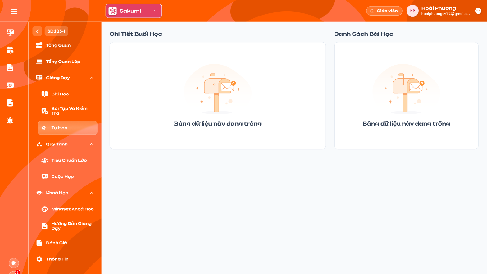</a><br>
  <em>Menu Tự học khi lớp chưa có khóa tự học (Figma GV-LOP-050100) — nhấn để xem ảnh gốc</em>
</p>

<p align="center">
  <a href="../../management_requirement/class_management/images/58-class-self-study-times.png">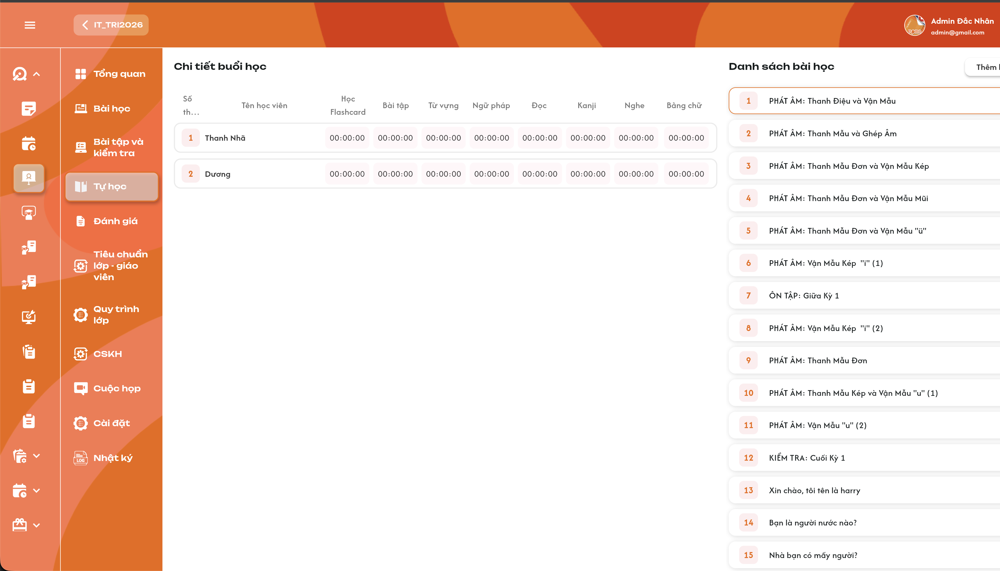</a><br>
  <em>Trạng thái có dữ liệu: Danh sách bài tự học và bảng thời gian (ảnh requirement Admin, Giáo viên không có nút thêm) — nhấn để xem ảnh gốc</em>
</p>

**Mô tả:**

- Mọi giáo viên của lớp xem khóa tự học của lớp do Admin, Class Handler hoặc Support gán theo requirement Admin [Chi tiết lớp học — Menu Tự học](../../management_requirement/class_management/class_detail_self_study_requirements.md). Vùng trái `Chi Tiết Buổi Học` là bảng thời gian học trên app của từng học viên ở bài đang chọn; vùng phải `Danh Sách Bài Học` là các bài tự học. Màn chỉ để xem.

**Giải thích thành phần:**

| Thành phần | Yêu cầu |
|---|---|
| Chưa có khóa tự học | Cả hai vùng hiển thị icon rỗng và `Bảng dữ liệu này đang trống`; không có nút `Thêm khóa tự học`. |
| Card bài | Số thứ tự và tên bài theo danh sách tự học của lớp (bài của khóa tự học và bài bổ sung), giữ thứ tự đã lưu. Bấm card để chọn: viền cam, bảng thời gian đổi theo bài. |
| Tải dữ liệu | Tải toàn bộ bài và học viên, không phân trang; có dữ liệu thì mặc định chọn bài 1. |
| Bảng thời gian | Cột `Số thứ tự`, `Tên học viên` và 8 cột `Học Flashcard`, `Bài tập`, `Từ vựng`, `Ngữ pháp`, `Đọc`, `Kanji`, `Nghe`, `Bảng chữ`. Mỗi ô là tổng thời gian app ghi nhận của đúng học viên–bài–phần, `HH:mm:ss`. |
| Học viên trong bảng | Toàn bộ học viên của lớp ở đủ 7 trạng thái `Đang học`, `Dự thính`, `Hoàn thành`, `Nghỉ học`, `Rời lớp`, `Chỉ xem`, `Xóa`; học viên rời lớp vẫn giữ thời gian cũ. |
| Vượt 24 giờ | Ô có tổng thời gian vượt 24 giờ hiển thị tối đa `23:59:59`; dữ liệu gốc giữ nguyên. |
| `00:00:00` | Chưa có thời gian học hoặc tổng bằng 0. Tải lỗi không hiển thị thành `00:00:00`; vùng lỗi có `Thử lại`. |

**Điểm cần lưu ý:**

- Giáo viên không có nút `Thêm khóa tự học`, `Thêm bài học mới`; không sửa thời gian; không bấm ô để mở popup.
- Giáo viên mở bảng hoặc bấm card không tạo thời gian học cho học viên.
- Tự học tách khỏi bài học chính: không có buổi học, điểm danh, BTVN; không đổi % BTVN/Đi học của menu Bài học và không vào danh sách BTVN.
- Khác Figma GV-LOP-050100: Figma chỉ có trạng thái chưa có khóa tự học; trạng thái có dữ liệu theo UI của requirement Admin, bỏ các nút thêm.

#### Testcase — Tự học

| Tên testcase | Priority | Loại test | Scenario | Role | Pre-condition | Given / When / Then | Expected Result |
|---|---| --- |---|---|---|---|---|
| Case 95: Lớp chưa có khóa tự học | Medium |  | Flow 15 / REQ29 | Giáo viên | Lớp chưa được gán khóa tự học | **Given** mở menu Tự học<br>**When** tải thành công<br>**Then** hai vùng hiển thị `Bảng dữ liệu này đang trống` | - Không có nút `Thêm khóa tự học`<br>- Không có bài hoặc thời gian giả |
| Case 96: Xem bảng thời gian bài tự học | High | Smoke | Flow 15 / REQ29 | Giáo viên | Lớp có khóa tự học 35 bài, 25 học viên | **Given** mở menu Tự học<br>**When** tải xong rồi bấm card bài 3<br>**Then** bài 1 được chọn mặc định; sau đó bảng đổi sang bài 3 | - Đủ 35 bài, 25 học viên, không phân trang<br>- Đủ 8 cột thời gian |
| Case 97: Đủ học viên mọi trạng thái | High |  | REQ29 | Giáo viên | Lớp có học viên ở đủ 7 trạng thái; A đã học 00:10:00 rồi Rời lớp | **Given** xem bảng thời gian<br>**When** render<br>**Then** có đủ học viên, A vẫn 00:10:00 | - Không lọc Rời lớp/Xóa/Chỉ xem |
| Case 98: Vượt 24 giờ và zero thật | Medium |  | REQ29 | Giáo viên | A có Nghe 25:30:00, Đọc 00:00:00 | **Given** xem dòng A<br>**When** định dạng ô<br>**Then** Nghe `23:59:59`, Đọc `00:00:00` | - Dữ liệu gốc giữ nguyên |
| Case 99: Không thêm khóa/bài | High |  | EX17 / REQ29 | Giáo viên | Lớp đã có hoặc chưa có khóa tự học | **Given** gửi request thêm khóa tự học hoặc thêm bài tự học<br>**When** backend kiểm tra quyền<br>**Then** từ chối | - Không có nút thêm trên giao diện<br>- Danh sách giữ nguyên |
| Case 100: Lỗi tải bảng thời gian | Medium |  | EX18 / REQ29 | Giáo viên | API bảng thời gian lỗi | **Given** bấm card bài<br>**When** tải thất bại<br>**Then** vùng trái có lỗi và `Thử lại` | - Không hiển thị `00:00:00` giả |

### Toast phản hồi CRUD

<p align="center">
  <a href="../../images/01-toast-crud.png"></a><br>
  <em>Toast Thành Công, Thông Báo, Cảnh Báo và Có Lỗi Xảy Ra — nhấn để xem ảnh gốc</em>
</p>

**Mô tả:**

- Phản hồi sau các thao tác thay đổi dữ liệu: bắt đầu, kết thúc, hoàn thành buổi học, giao bài, kết thúc bài, thu hồi bài kiểm tra, lưu điểm, lưu nhận xét, áp dụng nhận xét chung, ghi nhận Đã chấm và sửa bài.

**Giải thích thành phần:**

| Loại Toast | Tiêu đề cố định | Khi sử dụng trong màn chấm |
|---|---|---|
| Thành công | `Thành Công` | Giao bài: `Giao bài kiểm tra thành công.`; kết thúc bài: `Kết thúc bài kiểm tra thành công.`; thu hồi: `Thu hồi bài kiểm tra thành công.`; áp dụng nhận xét chung xong: `Đã cập nhật nhận xét chung.`; ghi nhận nút: `Đã ghi nhận chấm và sửa bài trên lớp.` |
| Thông tin | `Thông Báo` | `Lớp không có lịch để tính lương buổi này`; `Bạn đã bỏ qua chọn lịch, buổi học này sẽ không được tính lương`; `Chỉ tải được tài nguyên của 3 bài đã mở gần nhất`; `Đã sao chép`; `Dữ liệu không hợp lệ`; `Vui lòng chấm hết bài cho học viên!` |
| Cảnh báo | `Cảnh Báo` | `Lớp chưa bắt đầu!` khi bắt đầu buổi học hoặc giao bài kiểm tra lúc lớp chưa ở trạng thái Đang học; `File vượt quá dung lượng cho phép (25MB).` khi file ghi âm hoặc ảnh nhận xét lớn hơn 25MB. |
| Lỗi | `Có Lỗi Xảy Ra` | Bắt đầu, kết thúc, hoàn thành buổi học; giao, kết thúc, thu hồi bài kiểm tra; lưu điểm, nhận xét, tải file, nhận xét chung hoặc ghi nhận nút thất bại. |

**Điểm cần lưu ý:**

- Bấm điểm và lưu nhận xét từng thẻ lưu ngay, không hiển thị Toast thành công để tránh lặp Toast khi chấm nhiều học viên; thành công thể hiện bằng điểm/nhận xét được cập nhật trên thẻ.
- Bắt đầu, Kết thúc, Hoàn thành buổi học thành công không hiển thị Toast thành công; kết quả thể hiện bằng việc chuyển bước và màn `Buổi học đã kết thúc`.
- Mỗi thao tác logic chỉ hiển thị một Toast kết quả; `Huỷ` và thao tác chỉ đọc không hiển thị Toast CRUD.
- Toast không chứa thông tin kỹ thuật, token hoặc stack trace.

#### Testcase — Toast phản hồi CRUD

| Tên testcase | Priority | Loại test | Scenario | Role | Pre-condition | Given / When / Then | Expected Result |
|---|---| --- |---|---|---|---|---|
| Toast Case 1: Thành công | High |  | Ràng buộc Toast CRUD | Giáo viên phụ trách chính | Dữ liệu hợp lệ | **Given** áp dụng nhận xét chung hoặc bấm nút Đã Chấm và Sửa Bài Trên Lớp<br>**When** backend xử lý thành công<br>**Then** hiển thị Toast `Thành Công` | - Đúng nội dung theo bảng<br>- Chỉ hiển thị sau khi backend xác nhận<br>- Đúng một Toast |
| Toast Case 2: Thông báo | Medium |  | Ràng buộc Toast CRUD | Giáo viên phụ trách chính | Còn câu chưa chấm hoặc thao tác sao chép/dán | **Given** bấm nút Đã Chấm khi chưa chấm hết, hoặc sao chép/dán<br>**When** hệ thống xử lý<br>**Then** hiển thị Toast `Thông Báo` | - Đúng nội dung theo bảng<br>- Không lưu dữ liệu khi chưa chấm hết |
| Toast Case 3: Lỗi xử lý | High |  | Ràng buộc Toast CRUD | Giáo viên phụ trách chính | Backend/network lỗi | **Given** lưu điểm, nhận xét hoặc file<br>**When** thao tác không hoàn tất<br>**Then** hiển thị Toast `Có Lỗi Xảy Ra` | - Dữ liệu không cập nhật một phần cho cùng học viên–câu<br>- Không lộ thông tin kỹ thuật |
| Toast Case 4: Không lặp Toast khi chấm | Medium |  | Ràng buộc Toast CRUD | Giáo viên phụ trách chính | Chấm liên tiếp nhiều học viên | **Given** bấm điểm cho 10 học viên<br>**When** lưu thành công<br>**Then** không hiển thị Toast thành công | - Điểm cập nhật trên từng thẻ<br>- Không chồng nhiều Toast |

---

## 2. Yêu cầu

### 2.1. Flow chính

**Flow 1 / REQ19: Xem bài học**

```text
Giáo viên vào Chi tiết lớp → Giảng dạy → Bài học
      → Hệ thống tải Danh sách bài học (giáo viên của buổi, mốc mở, vòng BTVN/Đi học), chọn bài đầu tiên
      → Giáo viên chọn bài / tab: Buổi học, Thông tin, Nội dung, Tài nguyên, Kiến thức
      → Tab Buổi học hiển thị theo trạng thái buổi: Chưa mở (Dặn dò), Đang dạy / Chờ hoàn thành (tiếp tục), Hoàn thành (kết quả)
```

**Flow 2 / REQ20 / REQ21: Bắt đầu buổi học**

```text
Giáo viên chọn bài Chưa mở → tab Buổi học hiển thị Dặn dò trước buổi học
      → Tick "Tôi đã đọc ghi chú" → nút "Bắt đầu buổi học" mở
      → Lớp không Đang học và không phải lớp demo: Toast "Lớp chưa bắt đầu!", dừng
      → Lớp không có lịch tuần này: popup "Bắt đầu buổi học" → Xác nhận → tạo buổi Đang dạy; Toast "Lớp không có lịch để tính lương buổi này"
      → Có lịch: popup "Chọn lịch dạy" (lịch tuần này của chính giáo viên)
            → Chọn lịch → popup "Bắt đầu buổi học" → Xác nhận
                  → Không phải giáo viên của lớp: từ chối, dừng
                  → Lịch đã gắn buổi khác: Toast "Lịch này đã được chọn để mở", dừng
                  → Tạo buổi Đang dạy; gắn lịch (lịch vẫn Đang đợi)
            → "Không chọn lịch" → Xác nhận → tạo buổi Đang dạy; Toast "Bạn đã bỏ qua chọn lịch, buổi học này sẽ không được tính lương"
      → Chuyển sang Bước 1 — Điểm danh
```

**Flow 3 / REQ22: Điểm danh và Kết thúc buổi học**

```text
Giáo viên của buổi ở Bước 1 (hoặc bấm "Vào điểm danh" ở bài Đang dạy → popup Tiếp tục buổi học → Xác nhận)
      → Chọn trạng thái điểm danh cho từng học viên; nhập Ghi chú cho lớp học hoặc tick "Không có dặn dò cho học viên"
      → Mỗi thay đổi lưu nháp lên server
      → Đủ điều kiện: bấm "Kết thúc buổi học" → popup nhắc tắt record → Xác nhận
      → Lưu điểm danh và nhận xét lớp; buổi Chờ hoàn thành; chuyển Bước 2
```

**Flow 4 / REQ23: Ghi chú và Hoàn thành buổi học**

```text
Giáo viên của buổi ở Bước 2 (hoặc bấm "Hoàn thành buổi học" ở bài Chờ hoàn thành)
      → Nhập ghi chú từng học viên (không bắt buộc), ghi chú gửi Support và gửi giáo viên tiếp theo (hoặc tick "Không có dặn dò")
      → Bấm "Hoàn thành buổi học" → popup nhắc kiểm tra ghi chú và tắt record → Xác nhận
      → Lưu ghi chú; buổi Hoàn thành; lịch đã gắn chuyển Hoàn thành và phát sinh lương; xoá nháp; hiển thị "Buổi học đã kết thúc"
```

**Flow 5 / REQ01: Mở màn chấm bài**

```text
Giáo viên phụ trách chính vào Chi tiết lớp → Bài tập và Kiểm tra, chọn tab BTVN hoặc Kiểm tra
      → Bấm nút điều hướng trên card bài, hoặc bấm dòng học viên đã nộp trong bảng của bài
      → Bài bổ sung nhiều bài nguồn: hiển thị popup chọn bài nguồn
      → Hệ thống kiểm tra quyền chấm của giáo viên với lớp
      → Mở màn chấm của bài; chọn câu đầu tiên; nếu vào từ dòng học viên thì lọc sẵn học viên đó
```

**Flow 6 / REQ06: Chấm điểm một câu cho một học viên**

```text
Giáo viên chọn câu trong danh sách Câu hỏi
      → Hệ thống tải câu trả lời của học viên hợp lệ (REQ02) cho câu đó
      → Giáo viên bấm điểm 0–10 trên thẻ học viên đã nộp
      → Hệ thống lưu điểm cho đúng học viên–câu–bài–lớp
      → Thành công: thẻ, trạng thái và tỷ lệ của câu cập nhật; kiểm tra điều kiện tính điểm bài (Flow 7)
      → Thất bại: giữ điểm cũ; Toast "Có Lỗi Xảy Ra"
```

**Flow 7 / REQ07: Tính điểm bài của học viên**

```text
Sau mỗi lần lưu điểm câu của học viên A
      → Hệ thống lấy điểm mọi câu A có câu trả lời trong bài
      → Nếu mọi câu đó đã có điểm (0–10): điểm bài = trung bình cộng điểm các câu
      → Lưu điểm bài vào điểm BTVN (bài chính hoặc đúng bài nguồn của bài bổ sung) hoặc điểm Kiểm tra của A
      → Nếu còn câu chưa chấm: chưa tính điểm bài, bài của A giữ trạng thái chưa chấm
```

**Flow 8 / REQ08: Nhận xét học viên**

```text
Giáo viên nhập chữ, ghi âm (micro) hoặc tải ảnh (icon tài liệu) trên thẻ học viên
      → Hệ thống lưu nhận xét cho đúng học viên–câu–bài–lớp
      → Sao chép: lưu chữ + ảnh + ghi âm vào bộ nhớ tạm; Toast "Đã sao chép"
      → Dán: thay nhận xét của thẻ đích bằng dữ liệu đã sao chép; dữ liệu sai định dạng thì Toast "Dữ liệu không hợp lệ"
```

**Flow 9 / REQ09: Nhận xét chung**

```text
Giáo viên nhập Nhận xét chung của câu và xác nhận
      → Popup "Áp dụng nhận xét chung"
      → Huỷ: đóng popup, không đổi dữ liệu
      → Xác nhận: ghi đè phần chữ nhận xét của mọi học viên có câu trả lời ở câu, hiển thị tiến độ
      → Thành công: Toast "Đã cập nhật nhận xét chung."; thất bại: Toast "Có Lỗi Xảy Ra"
```

**Flow 10 / REQ10: Chấm câu hỏi con**

```text
Giáo viên mở tab Câu hỏi N trong thẻ học viên của câu cha
      → Bấm điểm 0–10 cho câu con
      → Khi mọi câu con đã có điểm: điểm câu cha = trung bình câu con, lưu cho câu cha
      → Tiếp tục Flow 7
```

**Flow 11 / REQ11: Ghi nhận Đã chấm và sửa bài trên lớp**

```text
Giáo viên bấm "Đã Chấm và Sửa Bài Trên Lớp"
      → Hệ thống kiểm tra mọi câu trả lời của học viên đã nộp đều có điểm
      → Chưa đủ: Toast "Vui lòng chấm hết bài cho học viên!", không lưu
      → Đủ: ghi đè bản ghi của bài bằng người bấm và thời điểm máy chủ của lần bấm này
      → Chip hiển thị avatar, tên và thời điểm của người bấm gần nhất; Toast "Đã ghi nhận chấm và sửa bài trên lớp."
```

**Flow 12 / REQ13: Xem kết quả Bài tập và Kiểm tra**

```text
Giáo viên vào Chi tiết lớp → Giảng dạy → Bài tập và Kiểm tra
      → Hệ thống tải khối Tổng Quan, danh sách BTVN, danh sách Kiểm tra và học viên hợp lệ
      → Mặc định tab BTVN, chọn card đầu tiên
      → Giáo viên đổi tab / tìm theo tên bài / bấm card
      → Vùng trái hiển thị bảng kết quả của bài (BTVN chưa mở: "Bài học chưa mở"; Kiểm tra chưa giao: xem trước đề)
      → Bấm dòng Đã nộp (Giáo viên phụ trách chính) → màn chấm bài lọc sẵn học viên
      → Bấm dòng Chưa nộp → Toast "Học viên chưa nộp bài này!"
```

**Flow 13 / REQ17: Giao bài kiểm tra**

```text
Giáo viên phụ trách chính chọn card Kiểm tra "Chưa giao" → xem trước đề
      → Bấm "Giao bài" → popup "Nhấn 'Xác nhận' để giao bài kiểm tra này"
      → Huỷ: đóng popup, không đổi dữ liệu
      → Xác nhận: kiểm tra lớp Đang học hoặc lớp không chính thức
      → Không đạt: Toast "Lớp chưa bắt đầu!", bài vẫn Chưa giao
      → Đạt: lưu lượt giao (lớp, bài, giáo viên, ngày giao); card "Đang đợi nộp bài"; nút đổi thành "Thu hồi"; Toast "Giao bài kiểm tra thành công."
```

**Flow 14 / REQ18: Thu hồi bài kiểm tra**

```text
Giáo viên phụ trách chính chọn card Kiểm tra đã giao → bấm "Thu hồi"
      → Popup "Bạn muốn thu hồi bài kiểm tra này? Toàn bộ bài làm và điểm của học viên sẽ bị xoá."
      → Huỷ: đóng popup, không đổi dữ liệu
      → Xác nhận: xoá lượt giao và toàn bộ bài làm, điểm, nhận xét chấm của bài
      → Bài về "Chưa giao", vùng trái về xem trước đề; Toast "Thu hồi bài kiểm tra thành công."
```

**Flow 16 / REQ31: Kết thúc bài kiểm tra**

```text
Giáo viên phụ trách chính chọn card Kiểm tra đang giao → bấm "Kết thúc bài"
      → Popup "Nhấn 'Xác nhận' để kết thúc bài kiểm tra này. Học viên sẽ không nộp được bài nữa."
      → Huỷ: đóng popup, không đổi dữ liệu
      → Xác nhận: lưu thời điểm kết thúc; giữ bài làm, điểm, nhận xét
      → Card thêm badge "Đã kết thúc"; ẩn "Kết thúc bài", còn "Thu hồi"; Toast "Kết thúc bài kiểm tra thành công."
      → Học viên: bài còn trên app, chỉ xem kết quả; lưu / nộp câu trả lời bị từ chối
      → Giáo viên vẫn chấm, sửa điểm, nhận xét; muốn làm lại thì Thu hồi (Flow 14) rồi Giao bài (Flow 13)
```

**Flow 15 / REQ29: Xem Tự học**

```text
Giáo viên vào Chi tiết lớp → Giảng dạy → Tự học
      → Hệ thống kiểm tra giáo viên thuộc lớp
      → Lớp chưa có khóa tự học: hai vùng "Bảng dữ liệu này đang trống", không có nút thêm
      → Có bài: tải toàn bộ bài và học viên (đủ 7 trạng thái), mặc định chọn bài 1
      → Bấm card bài: bảng thời gian 8 phần của bài đó (HH:mm:ss, tối đa hiển thị 23:59:59); chỉ đọc
```

### 2.2. Ngoại lệ

- **EX01:** Giáo viên không phải `Giáo viên phụ trách chính` của lớp → không có nút điều hướng chấm, `Giao bài`, `Kết thúc bài`, `Thu hồi`; mở URL hoặc gửi request chấm/giao/kết thúc/thu hồi bị backend từ chối, không lưu dữ liệu. Giáo viên không thuộc lớp không xem được menu.
- **EX02:** Bấm `Đã Chấm và Sửa Bài Trên Lớp` khi còn câu trả lời chưa chấm → Toast `Thông Báo` `Vui lòng chấm hết bài cho học viên!`; không ghi nhận, chip giữ nguyên.
- **EX03:** Dán nhận xét với dữ liệu bộ nhớ tạm sai định dạng → Toast `Thông Báo` `Dữ liệu không hợp lệ`; nhận xét giữ nguyên.
- **EX04:** Lưu điểm, nhận xét hoặc nhận xét chung thất bại → Toast `Có Lỗi Xảy Ra`; không tính lại điểm bài từ dữ liệu chưa lưu.
- **EX05:** Tải file ghi âm hoặc ảnh thất bại → bỏ chip `Đang tải...`, không thêm file; Toast `Có Lỗi Xảy Ra`.
- **EX06:** Bài Kiểm tra bị `Thu hồi` trong lúc đang chấm → request chấm tiếp theo bị từ chối vì bài làm đã bị xoá; giáo viên quay lại menu Bài tập và Kiểm tra để tải dữ liệu mới.
- **EX07:** Học viên có câu trả lời nhưng chưa nộp bài → thẻ `Chỉ xem`; backend từ chối request chấm/nhận xét cho học viên đó.
- **EX08:** Bài chưa có học viên nộp → vùng thẻ hiển thị `Chưa có học sinh nộp bài`; không có thẻ để chấm.
- **EX09:** File ghi âm hoặc ảnh nhận xét lớn hơn 25MB → không tải lên, không thêm chip; Toast `Cảnh Báo` `File vượt quá dung lượng cho phép (25MB).`
- **EX10:** Giao bài kiểm tra khi lớp chính thức chưa ở trạng thái `Đang học` → Toast `Cảnh Báo` `Lớp chưa bắt đầu!`; bài vẫn `Chưa giao`.
- **EX11:** Giao, kết thúc hoặc thu hồi thất bại do backend/network → Toast `Có Lỗi Xảy Ra`; trạng thái bài và dữ liệu bài làm giữ nguyên.
- **EX12:** Bắt đầu buổi học khi lớp chính thức chưa ở trạng thái `Đang học` → Toast `Cảnh Báo` `Lớp chưa bắt đầu!`; không tạo buổi, không đổi lịch.
- **EX13:** Sửa điểm danh hoặc ghi chú sau khi buổi đã `Hoàn thành`, hoặc sửa điểm danh khi buổi đã `Chờ hoàn thành` → backend từ chối; dữ liệu giữ nguyên.
- **EX14:** Tải tài nguyên của bài bị khoá → không tải; Toast `Thông Báo` `Chỉ tải được tài nguyên của 3 bài đã mở gần nhất`; request trực tiếp bị từ chối.
- **EX15:** Hai giáo viên cùng bắt đầu một bài → chỉ tạo một buổi, người bấm trước là giáo viên của buổi; người sau thấy bài đã mở ở chế độ chỉ xem, không chọn lịch lần hai; mỗi buổi phát sinh lương tối đa một lần khi Hoàn thành.
- **EX16:** Bắt đầu, Kết thúc hoặc Hoàn thành buổi thất bại do backend/network → Toast `Có Lỗi Xảy Ra`; trạng thái buổi giữ nguyên, nháp không mất.
- **EX17:** Giáo viên gửi request thêm khóa tự học hoặc thêm bài tự học → backend từ chối; danh sách Tự học giữ nguyên.
- **EX18:** Tải danh sách bài hoặc bảng thời gian Tự học lỗi → vùng lỗi có `Thử lại`; không hiển thị rỗng hoặc `00:00:00` giả.
- **EX19:** Bấm dòng học viên `Chưa nộp` ở bảng kết quả → Toast `Thông Báo` `Học viên chưa nộp bài này!`; không mở màn chấm.
- **EX20:** Giáo viên gửi request thiết lập lại bài nộp của học viên → backend từ chối; bài nộp giữ nguyên.
- **EX21:** Học viên lưu câu trả lời hoặc nộp bài kiểm tra đã kết thúc → backend từ chối; app báo bài đã kết thúc; bài đã nộp trước đó giữ nguyên. Kết thúc bài đã kết thúc → backend từ chối, dữ liệu giữ nguyên.
- **EX22:** Bắt đầu với lịch đã gắn buổi khác (giáo viên khác vừa chọn) → Toast `Có Lỗi Xảy Ra` `Lịch này đã được chọn để mở`; không tạo buổi, không đổi lịch; popup Chọn lịch tải lại.
- **EX23:** Người không phải giáo viên của lớp bắt đầu buổi → backend từ chối; không tạo buổi, không đổi lịch.
- **EX24:** Giáo viên khác giáo viên của buổi điểm danh, Kết thúc hoặc Hoàn thành buổi → backend từ chối; buổi, nháp và lịch giữ nguyên, không phát sinh lương.

### 2.3. Yêu cầu khác

- **REQ01 – Quyền và điểm vào:** Chỉ `Giáo viên phụ trách chính` của lớp được mở màn chấm và chấm điểm/nhận xét BTVN, Kiểm tra. Điểm vào là nút điều hướng trên card bài và dòng học viên đã nộp (lọc sẵn học viên). Bài bổ sung nhiều bài nguồn chọn bài nguồn qua popup trước khi vào.
- **REQ02 – Tập học viên hợp lệ:** Chỉ tài khoản role học viên của lớp. BTVN: học viên đã được điểm danh (khác `Chưa điểm danh`) ở buổi của bài đã mở, và **thời điểm mở bài không nằm trong khoảng học viên ở trạng thái `Nghỉ học`, `Rời lớp` hoặc `Xóa`**. Khoảng tính từ lúc học viên chuyển sang một trong ba trạng thái này đến lúc chuyển sang trạng thái khác (chưa chuyển thì đến hiện tại). Bài mở trước hoặc sau khoảng đó vẫn được chấm; `Chỉ xem`, `Dự thính`, `Đang học`, `Hoàn thành` không bị loại. Kiểm tra: học viên hợp lệ theo lượt giao bài kiểm tra. Trong tập này, học viên **đã nộp** được chấm; học viên có câu trả lời nhưng chưa nộp hiển thị `Chỉ xem`.
- **REQ03 – Danh sách câu và trạng thái:** Liệt kê mọi câu của bài theo thứ tự đề. Câu `Đã chấm` khi mọi câu trả lời của học viên đã nộp có điểm, hoặc câu không có câu trả lời nhưng bài có học viên đã nộp (`Bạn không cần chấm câu hỏi này!`, tỷ lệ 100%). Câu đang chọn là `Đang chấm`. Tỷ lệ điểm = tổng điểm câu trả lời đã chấm / (số câu trả lời đã chấm × 10), làm tròn số nguyên phần trăm. Bộ lọc `Trạng Thái` gồm `Chưa chấm`, `Đã chấm`.
- **REQ04 – Bộ lọc học viên:** `Chưa Chấm` (mặc định tắt) giữ lại học viên chưa có điểm ở câu và học viên vừa chấm trong lúc lọc cho đến khi đổi câu; `Hiện Tên` (mặc định bật) ẩn/hiện tên; `Học Viên` chọn nhiều học viên có câu trả lời. Bộ lọc chỉ áp dụng cho câu đang chọn.
- **REQ05 – Loại câu và người chấm:**

| Nhãn | Mã loại câu | Người chấm |
|---|---|---|
| Trắc nghiệm | 1 (từ vựng), 5 (câu), 11 (hình ảnh) | App tự chấm |
| Sắp xếp | 7 | App tự chấm |
| Nối từ | 8 (nối cột) | App tự chấm |
| Nói | 22 (nhận diện lời nói) | App tự chấm |
| Đọc | 3 (ghi âm), 10 (nhập vai) | Giáo viên chấm |
| Viết | 4, 44 (vẽ/viết), 6 (văn bản) | Giáo viên chấm |
| Hình ảnh | 2 (tải/chụp ảnh) | Giáo viên chấm |
| Câu hỏi con | Câu có danh sách câu con | Theo loại từng câu con |

  Câu app tự chấm có điểm sẵn khi học viên nộp; `Giáo viên phụ trách chính` được sửa đè. Câu giáo viên chấm ở trạng thái chưa chấm đến khi giáo viên bấm điểm.
- **REQ06 – Lưu điểm câu:** Điểm câu là số nguyên 0–10, lưu ngay khi bấm cho đúng học viên–câu–bài–lớp; được đổi điểm và nhận xét bất kỳ lúc nào, **không có mốc khoá** (kể cả sau khi đã ghi nhận `Đã Chấm và Sửa Bài Trên Lớp` hoặc lớp đã Hoàn thành).
- **REQ07 – Điểm bài:** Điểm BTVN/Kiểm tra của học viên = trung bình cộng điểm các câu học viên có câu trả lời trong bài, chỉ tính khi mọi câu đó đã có điểm; lưu giá trị gốc, hiển thị làm tròn 1 chữ số thập phân theo menu Bài tập và Kiểm tra. BTVN của bài bổ sung lưu điểm theo từng bài nguồn; điểm BTVN của bài = trung bình các bài nguồn, chỉ khi mọi bài nguồn đã chấm.
- **REQ08 – Nhận xét học viên:** Gồm chữ, danh sách file ghi âm, danh sách file ảnh (mỗi file tối đa 25MB), gắn đúng học viên–câu–bài–lớp; thêm/xoá file lưu ngay. Sao chép/dán chuyển cả ba phần; dán thay nội dung hiện có của thẻ đích.
- **REQ09 – Nhận xét chung:** Xác nhận qua popup; ghi đè phần chữ nhận xét của mọi học viên có câu trả lời ở câu, không phụ thuộc bộ lọc, giữ nguyên file ghi âm/ảnh.
- **REQ10 – Câu hỏi con:** Chấm từng câu con; điểm câu cha = trung bình câu con khi mọi câu con có điểm. Đáp án câu con ghép theo mã câu con, thiếu mã thì theo thứ tự.
- **REQ11 – Đã chấm và sửa bài trên lớp:** Chỉ ghi nhận khi mọi câu trả lời của học viên đã nộp có điểm. Bấm không giới hạn số lần; mỗi lần ghi đè người bấm và thời điểm máy chủ, chỉ lưu lần bấm gần nhất. Chip hiển thị avatar, tên và thời điểm của người bấm gần nhất. Bản ghi tách BTVN/Kiểm tra theo bài và lớp. Thẻ `Đã chấm và sửa bài` ở Tổng quan lớp = số bài BTVN + Kiểm tra đã có bản ghi, mỗi bài tính một lần dù bấm nhiều lần.
- **REQ12 – Đồng bộ dữ liệu:** Thay đổi điểm/nhận xét được phản ánh ở bảng học viên, card bài, khối Tổng Quan của menu Bài tập và Kiểm tra và các chỉ số Điểm BTVN, Điểm KT, Đã chấm và sửa bài ở Tổng quan lớp sau khi quay lại hoặc tải lại.

- **REQ13 – Danh sách bài:** Tab `BTVN` gồm một BTVN cho mỗi bài học của lớp (kể cả bài bổ sung, không gồm Tự học); tab `Kiểm Tra` gồm bài kiểm tra của khoá học và bài kiểm tra bổ sung do Admin thêm, sắp theo ngày giao tăng dần, bài chưa giao xếp sau. Giáo viên không thêm bài kiểm tra. BTVN tự giao khi bài học mở, giáo viên không giao/thu hồi BTVN; chỉ bài kiểm tra có Giao bài/Kết thúc bài/Thu hồi. Tìm theo tên bài; tải toàn bộ, không phân trang; mặc định tab BTVN và card đầu tiên.
- **REQ14 – Khối Tổng Quan:** `Đã Chấm K.Tra` = bài kiểm tra Đã chấm / tổng bài kiểm tra; `K.Tra Đã Giao` = bài đã giao (gồm cả đã kết thúc; bài thu hồi không tính) / tổng bài kiểm tra; `Đã Chấm BTVN` = BTVN Đã chấm / tổng BTVN; `Điểm K.Tra`, `Điểm BTVN` = trung bình điểm các bài đã chấm (điểm 0 vẫn tính), làm tròn 1 chữ số thập phân, không có thì trống; `Tỉ Lệ Làm BTVN` = trung bình tỷ lệ nộp BTVN của học viên hợp lệ trên các bài đã mở. Tính toàn lớp, không đổi theo card hoặc tìm kiếm.
- **REQ15 – Badge và card:** Badge = số bài Chưa chấm của tab. Bốn nhãn `Chưa giao`, `Đang đợi nộp bài`, `Chưa chấm`, `Đã chấm` theo dữ liệu giao/nộp/chấm (BTVN Chưa giao = bài học chưa mở); bài kiểm tra đã kết thúc có thêm badge `Đã kết thúc`. Vòng số đã nộp `S/N` = học viên hợp lệ đã nộp / tổng học viên hợp lệ. Vòng tỷ lệ chấm = C/S × 100, S = 0 là 0%.
- **REQ16 – Bảng kết quả học viên:** Gồm tập học viên hợp lệ (REQ02) với Điểm số (trống khi chưa chấm, 0 hợp lệ), tên, thời gian làm bài (tối đa hiển thị 23:59:59), trạng thái nộp và số câu bỏ qua. Bấm dòng Đã nộp mở màn chấm (chỉ Giáo viên phụ trách chính); bấm dòng Chưa nộp hiện Toast `Học viên chưa nộp bài này!`. Vòng trên card có tooltip `Số bài đã nộp` và `Đã chấm`. Giáo viên không có Thiết lập lại nộp bài.
- **REQ17 – Giao bài kiểm tra:** Chỉ `Giáo viên phụ trách chính`, qua popup xác nhận; lớp phải `Đang học` hoặc là lớp không chính thức. Thành công lưu lượt giao với ngày giao; bài chưa giao hiển thị xem trước đề.
- **REQ18 – Thu hồi bài kiểm tra:** Chỉ `Giáo viên phụ trách chính`, qua popup có cảnh báo xoá dữ liệu; áp dụng cho bài đang giao và bài đã kết thúc. Thành công xoá lượt giao và toàn bộ bài làm, điểm, nhận xét chấm của bài; bài về Chưa giao; giao lại là lượt mới.

- **REQ19 – Danh sách bài học:** Toàn bộ bài của lớp theo thứ tự (gồm bài bổ sung), mặc định chọn bài đầu. Card bài đã mở có giáo viên của buổi (người bắt đầu), mốc mở `HH:mm - dd/MM/yyyy`, vòng BTVN/Đi học; card chưa mở chỉ có số thứ tự xám, tên, mô tả. Giáo viên không thêm/sửa/xoá bài.
- **REQ20 – Dặn dò trước buổi học:** Bài Chưa mở hiển thị 5 dòng dặn dò cố định và checkbox `Tôi đã đọc ghi chú`; phải tick mới bắt đầu được. Không hiển thị ghi chú hay nhận xét của bài trước (chỉ xem ở bài đã hoàn thành). Mọi giáo viên của lớp được bắt đầu bất kỳ bài chưa mở; lớp phải `Đang học` hoặc là lớp không chính thức.
- **REQ21 – Chọn lịch và lương buổi:** Lớp có lịch tuần này thì hiện popup `Chọn lịch dạy` gồm lịch tuần này của chính giáo viên (lịch Hoàn thành không chọn được, lịch huỷ ẩn) và `Không chọn lịch`. Chọn lịch: gắn lịch với buổi và giáo viên, lịch giữ `Đang đợi` (lịch cố định chưa có bản ghi thì tạo bản ghi Đang đợi); lịch đã gắn không chọn được cho buổi khác. Lịch chỉ chuyển `Hoàn thành` và phát sinh lương buổi dạy (một lần) khi bấm `Hoàn thành buổi học`; ngày tính lương là ngày của lịch, không phải ngày hoàn thành. Không chọn lịch hoặc lớp không có lịch tuần này: không phát sinh lương, có Toast `Thông Báo` tương ứng. Lịch đã gắn buổi khác khi bấm Xác nhận → lỗi `Lịch này đã được chọn để mở`. Chỉ giáo viên của lớp được bắt đầu; không cần bài trước Hoàn thành. Lương ghi cho giáo viên của buổi. Mỗi bài một buổi.
- **REQ22 – Điểm danh:** Danh sách gồm học viên `Đang học`, `Dự thính`, `Hoàn thành`. Mỗi học viên một trạng thái trong `Có mặt`, `Vào trễ`, `Ra sớm`, `Vào trễ & Ra sớm`, `Nghỉ CP`, `Nghỉ KP` (mặc định `Chưa điểm danh`). Kết thúc buổi học khi điểm danh đủ và có ghi chú lớp hoặc tick `Không có dặn dò cho học viên`; lưu điểm danh và `Giáo viên nhận xét lớp`, buổi chuyển `Chờ hoàn thành`.
- **REQ23 – Hoàn thành buổi học:** Ghi chú từng học viên (gửi Support, gửi học viên) không bắt buộc. Ghi chú gửi Support và gửi giáo viên tiếp theo phải có nội dung hoặc tick checkbox `Không có dặn dò` tương ứng. Hoàn thành lưu ghi chú, buổi chuyển `Hoàn thành`, lịch đã gắn chuyển `Hoàn thành` và phát sinh lương, xoá nháp.
- **REQ24 – Nháp và tiếp tục:** Dữ liệu Bước 1/Bước 2 lưu nháp trên server sau mỗi thay đổi, theo lớp–bài. Chỉ giáo viên của buổi (người bắt đầu) tiếp tục được buổi `Đang dạy` (`Vào điểm danh`) hoặc `Chờ hoàn thành` (`Hoàn thành buổi học`) và thấy đúng nháp; giáo viên khác của lớp chỉ xem.
- **REQ25 – Bài đã hoàn thành:** Hiển thị `Giáo viên nhận xét lớp`, ghi chú gửi Support, ghi chú gửi giáo viên tiếp theo và bảng học viên (Đi học, BTVN, Ghi chú) chỉ đọc. Giáo viên không sửa sau khi hoàn thành.
- **REQ26 – Thông tin, Nội dung, Kiến thức:** Dữ liệu định nghĩa bài học chỉ đọc giống Admin; Kiến thức để trống.
- **REQ27 – Tài nguyên:** Bấm file tải ngay. Chỉ tải được tài nguyên của 3 bài đã mở có số thứ tự lớn nhất; bài khác (đã mở trước đó hoặc chưa mở) hiển thị file kèm icon khoá, bấm không tải; áp dụng cả Bài giảng và Tài nguyên khác; backend kiểm tra khi tải.
- **REQ28 – % BTVN và Đi học theo bài:** Tính theo số học viên `Đang học`/`Dự thính` của đúng bài: % BTVN = đã nộp / tập; % Đi học = đi học (Có mặt, Vào trễ, Ra sớm, Vào trễ & Ra sớm) / số đã điểm danh trong tập (Nghỉ CP/KP trong mẫu, Chưa điểm danh loại khỏi tử và mẫu). Mẫu số 0 để trống.
- **REQ29 – Tự học:** Mọi giáo viên của lớp xem danh sách bài tự học (giữ thứ tự đã lưu, tải toàn bộ, mặc định bài 1) và bảng thời gian app của toàn bộ học viên đủ 7 trạng thái theo 8 phần `Học Flashcard`, `Bài tập`, `Từ vựng`, `Ngữ pháp`, `Đọc`, `Kanji`, `Nghe`, `Bảng chữ`; `HH:mm:ss`, ô vượt 24 giờ hiển thị `23:59:59`. Chỉ đọc: không thêm khóa/bài, không sửa thời gian; xem bảng không tạo thời gian học; Tự học không ảnh hưởng điểm danh, BTVN của bài học chính.
- **REQ30 – Icon trạng thái điểm danh:** Bảng hiển thị điểm danh (cột Đi học ở tab Buổi học, cột Trạng thái ở Tổng quan) dùng bộ icon `Trạng thái đi học` theo bảng ghép 7 trạng thái; hover hiện tên trạng thái. Dropdown điểm danh ở Bước 1 chỉ hiển thị chữ.
- **REQ31 – Kết thúc bài kiểm tra:** Chỉ `Giáo viên phụ trách chính`, chỉ bài kiểm tra đang giao, qua popup xác nhận. Thành công lưu thời điểm kết thúc, giữ bài làm, điểm, nhận xét; card thêm badge `Đã kết thúc`, còn nút `Thu hồi`. Sau khi kết thúc: học viên chỉ xem kết quả, mọi request lưu câu trả lời / nộp bị từ chối; giáo viên vẫn chấm, sửa điểm, nhận xét; bài vẫn tính vào `K.Tra Đã Giao`. Không mở lại bài đã kết thúc; làm lại bằng Thu hồi rồi Giao bài lượt mới.

### 2.4. Ràng buộc

#### Quyền

**Bài học**

| Role | Xem bài, tab, kết quả buổi | Bắt đầu / tiếp tục buổi, điểm danh, ghi chú buổi | Tải tài nguyên 3 bài đã mở gần nhất | Sửa sau khi Hoàn thành |
|---|:---:|:---:|:---:|:---:|
| Giáo viên của lớp (mọi giáo viên) | ✅ | ✅ | ✅ | ❌ |
| Các role khác | ❌ | ❌ | ❌ | ❌ |

**Bài tập và Kiểm tra, màn chấm bài**

| Role | Xem danh sách, kết quả, xem trước đề | Giao / Kết thúc / Thu hồi bài kiểm tra | Mở màn chấm | Chấm điểm / sửa đè điểm app | Nhận xét / Nhận xét chung | Đã Chấm và Sửa Bài Trên Lớp |
|---|:---:|:---:|:---:|:---:|:---:|:---:|
| Giáo viên phụ trách chính của lớp | ✅ | ✅ | ✅ | ✅ | ✅ | ✅ |
| Giáo viên khác của lớp | ✅ | ❌ | ❌ | ❌ | ❌ | ❌ |
| Các role khác | ❌ | ❌ | ❌ | ❌ | ❌ | ❌ |

- Giáo viên khác của lớp xem kết quả chấm (điểm, trạng thái nộp) ở bảng học viên của menu Bài tập và Kiểm tra, không vào màn chấm, không giao/kết thúc/thu hồi.
- Thiết lập lại nộp bài (xoá bài làm để học viên làm lại) chỉ Admin, Class Handler, Support thực hiện theo requirement Admin; giáo viên không có.
- Không role nào có nút Thêm bài kiểm tra trong menu này; bài kiểm tra bổ sung do Admin thêm ở chức năng riêng.
- Các role quản lý (Admin, Class Handler, Support) thao tác BTVN/Kiểm tra theo requirement Admin [Chi tiết lớp học — Menu Bài tập và kiểm tra](../../management_requirement/class_management/class_detail_homework_tests_requirements.md); tài liệu này không cấp thêm quyền chấm cho các role đó.

**Tự học**

| Role | Xem danh sách bài và bảng thời gian | Thêm khóa tự học / Thêm bài | Sửa thời gian |
|---|:---:|:---:|:---:|
| Giáo viên của lớp (mọi giáo viên) | ✅ | ❌ | ❌ |
| Các role khác | ❌ | ❌ | ❌ |

- Admin, Class Handler, Support xem và thêm khóa/bài Tự học theo requirement Admin [Chi tiết lớp học — Menu Tự học](../../management_requirement/class_management/class_detail_self_study_requirements.md).

#### Phạm vi dữ liệu

- Giáo viên chỉ chấm bài của lớp mà mình là `Giáo viên phụ trách chính` tại thời điểm thao tác; đổi phụ trách chính thì giáo viên cũ mất quyền ngay.
- Mọi request chấm/nhận xét được backend kiểm tra quyền, lớp, bài, học viên và trạng thái nộp; không dựa vào việc ẩn nút trên giao diện.
- Không cho phép truy cập hoặc thực hiện hành động bị đánh dấu `❌`, kể cả khi gọi trực tiếp bằng URL hoặc request.

---

## 3. Cần xác nhận

- Giáo viên của buổi bị gỡ khỏi lớp khi buổi chưa Hoàn thành: buổi giữ `Đang dạy` / `Chờ hoàn thành`, chưa có ai được hoàn thành thay; cần chốt người xử lý (vd Support).
- Lịch đã gắn buổi bị huỷ trước khi Hoàn thành: tạm giữ luật cũ (không phát sinh lương cho lịch huỷ); cần chốt.
- BE hiện cho mọi giáo viên của lớp tiếp tục buổi; cần sửa API theo REQ24 / EX22–EX24.
