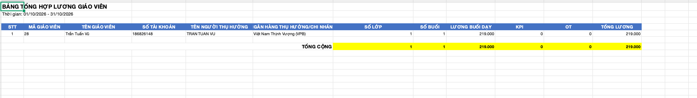

# Lương giáo viên — Admin

> Trạng thái: Bản nháp đối chiếu Figma và source cũ; các mục Cần xác nhận chưa phải quyết định nghiệp vụ.

## 1. Giao diện

### Tổng quan

- Menu: Lương → Lương Giáo Viên, thuộc Admin. Không phải menu Lịch sử & lương của Giáo viên.
- [Figma — ADM-LGV-010000](https://www.figma.com/design/rRVs5HX0kIHffbS0V40djG?node-id=4101-138376), page LƯƠNG GV `4101:128323`.
- Đã đọc trực tiếp Figma desktop ngày 17/10/2026 vì MCP báo hết lượt seat View. Chưa xuất ảnh frame cục bộ trong bản nháp này.
- Bố cục: bộ lọc toàn trang; sáu thẻ tổng hợp; chi tiết giáo viên bên trái; Danh sách giáo viên và Export bên phải.

| Thành phần | Yêu cầu / kết quả đối chiếu |
|---|---|
| Tìm kiếm | **Đã chốt:** placeholder `Tìm giáo viên...`; chỉ tìm theo tên, email hoặc mã giáo viên, không tìm mã lớp. Kết hợp với kỳ thống kê để xác định danh sách giáo viên hợp lệ; các phát sinh trong kỳ của giáo viên khớp được giữ đầy đủ. Không đổi nội dung file xuất thành tìm theo lớp. |
| Phạm vi thống kê | **Đã chốt:** đợt này chỉ xem thống kê và Export; bỏ bộ lọc trạng thái chốt/thanh toán đang vẽ trong Figma. Không có luồng chốt lương hoặc đánh dấu thanh toán tại màn này. Trạng thái KPI/OT vẫn dùng để xác định khoản hợp lệ. |
| Thời gian | Mặc định Tháng này theo Figma. Dropdown gồm Tới hạn, Hôm nay, Hôm qua, Tuần này, Tuần trước, Tuần sau, Tháng này, Tháng trước, 3 tháng trước, Tháng sau, Năm nay, Năm trước, Hôm nay & Hôm qua, Tùy chọn. Cách tính theo bộ lọc chung; không tự đổi nhãn 3 tháng trước thành 3 tháng gần đây. |
| Sáu thẻ toàn trang | Số lớp, Số buổi đã dạy, Lương buổi dạy, Lương KPI, Lương OT, Tổng lương. Chỉ giáo viên/lớp có buổi Hoàn thành hoặc KPI/OT Đã xác nhận trong kỳ. **Đã chốt:** Số lớp toàn trang đếm class_id không trùng trong tập phát sinh hợp lệ. G/H cùng có phát sinh tại A thì toàn trang là 1 lớp; số lớp cá nhân của G và H đều có A. Tổng tiền vẫn cộng khoản riêng của cả hai, không loại theo class_id. |
| Bốn thẻ giáo viên đang chọn | **Đã chốt:** Lương buổi dạy, Lương KPI, Lương OT, Tổng lương, kèm tên giáo viên; luôn là tổng cá nhân trên toàn bộ lớp phát sinh trong kỳ. Chọn lớp con chỉ lọc bảng chi tiết, không thay bốn thẻ này. Không trộn số của giáo viên khác. |
| Danh sách giáo viên | **Đã chốt:** chỉ liệt kê giáo viên có buổi Hoàn thành hoặc KPI/OT Đã xác nhận trong kỳ; các lớp con dùng cùng điều kiện phát sinh. Kể cả giáo viên/lớp chỉ có KPI/OT được xác nhận, hoặc buổi Hoàn thành không lịch tiền 0, vẫn thuộc danh sách. Avatar, họ tên, email, số lớp, tổng lương và checkbox. Bấm giáo viên chọn xem chi tiết bên trái và mở danh sách lớp con, không điều hướng sang trang khác. Giáo viên đang xem có nền/viền nhấn. **Đã chốt:** khi mở màn mặc định chọn giáo viên đầu tiên của danh sách hợp lệ; đổi giáo viên bỏ lựa chọn lớp cũ. Danh sách rỗng thì không chọn ngầm người ngoài kết quả và hiển thị trạng thái rỗng. |
| Lớp con của giáo viên | Icon trạng thái, mã lớp, số buổi và tiền của lớp. **Đã chốt:** bấm lớp con chọn class_id để lọc vùng chi tiết/các tab của giáo viên đang xem ngay tại trang; không mở Chi tiết lớp. Chọn xem không thay tập checkbox Export. |
| Checkbox và Export | Figma hiển thị checkbox từng giáo viên, checkbox đầu danh sách và Export (1). **Đã chốt:** checkbox chỉ dùng chọn giáo viên cho Export, độc lập với giáo viên/lớp đang xem; tick không đổi vùng chi tiết, bấm chọn xem không tự tick. Export chỉ đọc, không tạo/chuyển trạng thái chốt/thanh toán. **File Excel .xlsx theo mẫu Bảng tổng hợp lương giáo viên** ở mục dưới. **Đã chốt:** checkbox đầu danh sách chọn/bỏ chọn tất cả giáo viên trên trang hiện tại; giữ lựa chọn các trang khác. Chuyển trang giữ tập chọn theo teacher_id; đổi kỳ hoặc điều kiện tìm kiếm xóa toàn bộ tập chọn. Chưa chọn ai thì Export bị vô hiệu hóa; Export (n) là số giáo viên được chọn trên mọi trang. |
| Tooltip tổng lương giáo viên | Figma thể hiện KPI, OT và số buổi; giá trị theo đúng giáo viên/kỳ đang xem. |
| Tooltip tổng lương lớp | Figma thể hiện KPI và OT của lớp; không lấy dữ liệu lớp khác. |

### Tab Lớp học

| Cột | Nội dung |
|---|---|
| Lớp | Icon trạng thái và mã lớp. |
| Tiến độ | Buổi hoàn thành / tổng buổi, dùng công thức tiến độ lớp chung. |
| Sĩ số | Theo thành phần sĩ số lớp dùng chung; Figma có mẫu 7/14(2), không tự coi đây là sĩ số điểm danh một buổi. |
| Số buổi | Buổi đã dạy của giáo viên đang chọn tại lớp trong kỳ, theo quy tắc buổi Hoàn thành. |
| Lương buổi | Tổng tiền buổi dạy đã ghi nhận tại lớp trong kỳ; mỗi buổi = `Lương/giờ` của buổi × thời lượng (giờ), đã chốt khi hoàn thành. Không còn đơn giá theo lớp. |
| KPI / OT | Tổng khoản thực tế Đã xác nhận của đúng giáo viên/lớp/loại trong kỳ Ngày ghi nhận. |
| Tổng lương | Lương buổi + KPI + OT của lớp; khác bảng lớp bên phải màn Giáo viên đã chốt chỉ tiền buổi. Chỉ liệt kê lớp có buổi Hoàn thành hoặc KPI/OT Đã xác nhận trong kỳ; lớp không có phát sinh hợp lệ bị loại. |

### Các tab Buổi dạy / KPI / OT

**Đã chốt:** dùng cùng cấu trúc cột, định dạng và cách hiển thị với [Lịch sử & lương — Giáo viên](../../teacher_role/history_and_salary/history_and_salary_requirements.md). Đây là quyết định tái sử dụng cấu trúc đã chốt vì section Figma Admin đã đọc chưa có frame riêng cho ba tab; không coi ảnh giao diện Giáo viên là ảnh Admin.

| Tab | Cột và cách hiển thị |
|---|---|
| Buổi dạy | LỚP, TÊN BUỔI HỌC, SĨ SỐ, THỜI GIAN, LƯƠNG BUỔI DẠY. Icon trạng thái/mã lớp, tên bài/mô tả, sĩ số điểm danh của buổi theo quy tắc dùng chung. Thời gian `dd.MM.yyyy` và `HH:mm`, theo ngày tính lương; tiền buổi không lịch là 0 kèm cảnh báo. Thời gian giảm dần. |
| KPI | LỚP, LOẠI KPI, NGÀY GHI NHẬN, TRẠNG THÁI, TIỀN THƯỞNG. Tên từ title cấu hình tham chiếu; Ngày ghi nhận `dd.MM.yyyy`; tiền value thực tế. Giữ Mới/Đã xác nhận/Đã hủy trong bảng, ẩn Đã xóa; chỉ confirmed tham gia tổng. Ngày ghi nhận giảm dần. |
| OT | LỚP, LOẠI OT, NGÀY GHI NHẬN, TRẠNG THÁI, TIỀN THƯỞNG. Tên/mô tả từ cấu hình OT; khoản thực tế theo type=ot; giữ Mới/Đã xác nhận/Đã hủy, ẩn Đã xóa, chỉ confirmed tham gia tổng. Không nhân số phút trong tên. Ngày ghi nhận giảm dần. |

- Các tab chỉ đọc tại menu này. Role Admin không có thêm/sửa/xóa/xác nhận khoản hoặc thanh toán từ bảng chỉ vì có quyền quản lý ở chức năng khác.
- Scope là teacher_id Admin đang xem, kỳ đang lọc và class_id khi đã chọn lớp con; không dùng teacher_id của tài khoản Admin làm người nhận lương.
- Chuyển tab giữ giáo viên/kỳ/lớp đang chọn. Bấm lại giáo viên để xem toàn bộ lớp của người đó; đổi giáo viên xóa class_id cũ, không lọc theo lớp thuộc người trước.
- **Phân trang:** ba tab Buổi dạy/KPI/OT tối đa 50 dòng/trang, theo thành phần phân trang chung. Đổi kỳ/giáo viên/lớp đưa bảng về trang đầu; chuyển trang giữ phạm vi. Thẻ cá nhân tính tất cả phát sinh của giáo viên trong kỳ, không chỉ các dòng đang hiển thị hoặc lớp đang chọn.
- Khi không có dữ liệu, Buổi dạy hiển thị `Không có buổi dạy nào`; KPI/OT dùng trạng thái rỗng cùng màn Giáo viên. Lỗi có Thử lại, không giả thành bảng rỗng hoặc tổng 0.
- Điều kiện liệt kê giáo viên/lớp vẫn theo phát sinh hợp lệ đã chốt; có khoản Mới/Đã hủy trong bảng không tự làm giáo viên/lớp chưa có phát sinh hợp lệ xuất hiện trong danh sách.

### Chọn giáo viên để Export

- Tập chọn lưu bằng teacher_id, độc lập với giáo viên/lớp đang xem và thứ tự dòng.
- Checkbox đầu danh sách chỉ chọn/bỏ chọn trang hiện tại; không tác động lựa chọn ở trang khác. Khi một phần giáo viên trên trang được tick, hiển thị trạng thái chọn một phần.
- Chuyển trang giữ lựa chọn. Đổi khoảng thời gian hoặc điều kiện tìm kiếm có hiệu lực thì xóa tập chọn và đưa số lượng Export về 0; response cũ không khôi phục tập chọn.
- Export (n) đếm toàn bộ giáo viên đã chọn qua các trang, không chỉ trang hiện tại. Chưa chọn ai thì nút bị vô hiệu hóa; không tự xuất giáo viên đang xem.
- File xuất đầy đủ lớp/khoản hợp lệ trong kỳ của những giáo viên đã chọn, không giới hạn bởi lớp đang lọc xem tại chỗ. Backend kiểm tra quyền và phạm vi dữ liệu trước khi xuất.

### File Excel tổng hợp lương giáo viên



- **Đã chốt theo mẫu người dùng:** xuất `.xlsx`, bảng tổng hợp mỗi giáo viên một dòng, không chia theo lớp. Mẫu này thay phương án nhiều sheet chi tiết đã đề xuất; chưa yêu cầu thêm sheet Buổi dạy/KPI/OT.
- Tiêu đề: **BẢNG TỔNG HỢP LƯƠNG GIÁO VIÊN**, in đậm, nằm phía trên bảng.
- Dòng dưới: `Thời gian: dd/MM/yyyy - dd/MM/yyyy`, lấy đúng khoảng thống kê đang xuất. Khoảng 01/10/2026 - 31/10/2026 trong ảnh chỉ là dữ liệu minh họa.
- Đúng thứ tự 12 cột bên dưới; header nền xanh, chữ trắng đậm. Dòng Tổng cộng có nhãn đậm, các ô tổng từ Số lớp đến Tổng lương nền vàng như mẫu. Độ rộng cột đủ đọc tiêu đề và dữ liệu; không cắt số tài khoản hoặc tên ngân hàng.

| STT cột | Tên cột | Nguồn / cách tính |
|---|---|---|
| 1 | STT | Đánh số dòng giáo viên từ 1 trong file. |
| 2 | MÃ GIÁO VIÊN | `UserModel.code`; dùng mã hồ sơ, không tự thay bằng số thứ tự hoặc userId. |
| 3 | TÊN GIÁO VIÊN | Tên giáo viên trong hồ sơ đúng người được xuất. |
| 4 | SỐ TÀI KHOẢN | `bankAccountNumber`; ghi kiểu text để giữ số 0 đầu và tránh ký hiệu khoa học. |
| 5 | TÊN NGƯỜI THỤ HƯỞNG | `bankAccountName`; không tự lấy tên giáo viên thay khi trống. |
| 6 | NGÂN HÀNG THỤ HƯỞNG/CHI NHÁNH | `bankName` theo dữ liệu hồ sơ. Model cũ đã đọc chưa có field chi nhánh riêng; không tự tạo tên chi nhánh hoặc mặc định ngân hàng trong ảnh. |
| 7 | SỐ LỚP | Số class_id không trùng có phát sinh hợp lệ của giáo viên trong kỳ. |
| 8 | SỐ BUỔI | Số buổi Hoàn thành của giáo viên trong kỳ theo quy tắc ngày tính lương; kể cả buổi không lịch có tiền 0. |
| 9 | LƯƠNG BUỔI DẠY | Tổng tiền buổi đã ghi nhận của giáo viên trong kỳ; giữ lương lịch sử. |
| 10 | KPI | Tổng value KPI Đã xác nhận của giáo viên, theo Ngày ghi nhận trong kỳ. |
| 11 | OT | Tổng value OT Đã xác nhận của giáo viên, theo Ngày ghi nhận trong kỳ. |
| 12 | TỔNG LƯƠNG | Lương buổi dạy + KPI + OT của chính dòng giáo viên. |

- Các cột số lớp/số buổi/tiền là dữ liệu số, không chèn `đ` vào chuỗi giá trị. Tiền hiển thị phân cách hàng nghìn, không chữ số thập phân như mẫu; không dùng đơn giá hiện tại để tính lại tiền buổi cũ.
- Dòng **TỔNG CỘNG** cộng các cột số 7–12 của các dòng thực sự được xuất. Tổng Số lớp trong file là tổng số lớp cá nhân theo các dòng; lớp cùng có phát sinh ở hai giáo viên xuất hiện trong số lớp của cả hai. Cách đếm thẻ Số lớp toàn trang được chốt riêng, không lấy mặc định từ dòng cộng này.
- File chỉ chứa giáo viên được chọn Export và khoản trong kỳ hợp lệ; không bị thu hẹp chỉ còn một lớp do Admin đang bấm xem chi tiết lớp đó. Không dùng tập checkbox để đổi tổng đang xem trên màn hình.
- Thiếu thông tin tài khoản/người thụ hưởng/ngân hàng thì để ô trống, không loại dòng lương hoặc tự bịa thông tin. Xuất file không chuyển trạng thái lương hay phát sinh thanh toán.
- Tên, tài khoản và số tiền cụ thể trong ảnh là dữ liệu tham chiếu bố cục, không dùng làm mặc định hay dữ liệu testcase.

## 2. Quy tắc nghiệp vụ

### Quy tắc đã có từ các requirement liên quan

- **REQ01 — Phạm vi:** backend kiểm tra quyền Admin, xác định đúng teacher_id/class_id; giáo viên được chọn chỉ quyết định vùng chi tiết. Danh sách giáo viên/lớp chỉ gồm nơi có buổi Hoàn thành hoặc KPI/OT Đã xác nhận trong kỳ, không phụ thuộc có tiền buổi lớn hơn 0 hay không. Số lớp toàn trang đếm class_id không trùng; mỗi giáo viên đếm lớp riêng. Việc khử trùng lớp không loại buổi/khoản của giáo viên khác cùng lớp. Quyền role quản lý khác cần chốt riêng.
- **REQ02 — Ngày thống kê:** buổi có lịch theo ngày tính lương của lịch, không theo ngày bấm Hoàn thành. Buổi không lịch dùng thời điểm hoàn thành. KPI/OT theo Ngày ghi nhận, không dùng ngày cập nhật hoặc ngày xác nhận.
- **REQ03 — Buổi dạy:** chỉ buổi Hoàn thành của đúng giáo viên. Buổi không lịch vẫn đếm, tiền 0 và có cảnh báo; tiền buổi = `Lương/giờ` của buổi (mức chỉnh riêng tại popup lịch nếu có, nếu không là mức trong hồ sơ giáo viên) × thời lượng buổi (giờ), chốt khi hoàn thành; đổi `Lương/giờ` trong hồ sơ không hồi tố buổi đã hoàn thành.
- **REQ04 — KPI/OT:** tổng value thực tế của khoản Đã xác nhận. Khoản Mới/Đã hủy không cộng, Đã xóa loại khỏi bảng. Tách đúng type KPI và OT, đúng owner; tên khoản từ cấu hình được tham chiếu.
- **REQ05 — Tổng tiền:** tổng lương = lương buổi + KPI + OT. Các cấp toàn trang/giáo viên/lớp phải đối chiếu được trong cùng phạm vi; không cộng lại bảng chi tiết như nguồn tiền thứ hai. Export hoặc chọn checkbox không được mặc định là đã chi trả.
- **REQ06 — Lương/giờ:** không còn lương theo lớp. `Lương/giờ` lưu trong hồ sơ giáo viên và có thể chỉnh riêng từng buổi tại popup lịch của tab Lịch dạy. Duyệt đề xuất tăng lương không tự cập nhật `Lương/giờ` hoặc lương lịch sử.
- **REQ07 — Đồng bộ:** đổi kỳ/giáo viên phải bỏ response cũ, tách loading/rỗng/lỗi; lỗi không giả thành tổng 0. Không dùng số tiền mẫu Figma làm dữ liệu hoặc công thức.
- **REQ08 — Thống kê và Export:** chỉ thống kê/xuất dữ liệu, bỏ bộ lọc trạng thái chốt/thanh toán và không bổ sung luồng chuyển trạng thái. Checkbox chọn Export độc lập với chọn xem; không tự chọn giáo viên đang xem để xuất. File .xlsx dạng bảng tổng hợp theo đúng mẫu đã cung cấp, mỗi giáo viên một dòng và có Tổng cộng; không mặc định thêm các sheet chi tiết đã đề xuất trước đó. Checkbox đầu danh sách chỉ chọn/bỏ chọn trang hiện tại; chuyển trang giữ các teacher_id đã chọn, đổi kỳ/tìm kiếm xóa tập chọn; chưa chọn thì khóa Export. Export (n) đếm toàn bộ giáo viên được chọn qua các trang.
- **REQ09 — Chọn chi tiết:** mặc định giáo viên đầu tiên khi có kết quả; bấm giáo viên chọn xem bên trái và xóa class_id cũ. Bấm lớp con chỉ lọc bảng theo teacher_id + class_id tại chỗ; bốn thẻ cá nhân giữ tổng giáo viên trong kỳ. Không điều hướng sang Chi tiết lớp. Checkbox không thay đổi teacher_id/class_id đang xem.
- **REQ10 — Tìm kiếm và tab:** chỉ tên/email/mã giáo viên với placeholder Tìm giáo viên...; không tìm mã lớp. Ba tab Buổi dạy/KPI/OT dùng cấu trúc cột/định dạng của menu Giáo viên, dữ liệu theo lựa chọn Admin, chỉ đọc và tối đa 50 dòng/trang; chuyển tab giữ scope, đổi scope về trang đầu.

### Luồng xem dữ liệu

```text
Admin → Lương → Lương Giáo Viên → kiểm tra quyền
  → Tải tổng toàn trang và Danh sách giáo viên theo phạm vi được chốt
  → Có kết quả: mặc định giáo viên đầu tiên; không có: trạng thái rỗng
  → Chọn giáo viên → xóa lựa chọn lớp cũ, tải bốn thẻ cá nhân và các tab đúng giáo viên
  → Đổi kỳ → đồng bộ tổng / danh sách / chi tiết theo cùng kỳ
  → Chọn lớp con → chỉ lọc bảng chi tiết tại chỗ; giữ bốn thẻ tổng cá nhân
  → Tick checkbox giáo viên → cập nhật tập chọn Export, giữ nguyên chi tiết đang xem
  → Export → xuất dữ liệu theo đặc tả bổ sung; không chốt/thanh toán lương
  → Tìm tên/email/mã giáo viên → cập nhật kết quả theo kỳ, xóa tập chọn Export
```

### Sai lệch dữ liệu mẫu Figma

- Toàn trang: 29.520.000 + 7.200.000 + 0 không bằng Tổng lương 31.540.000 đang vẽ.
- Giáo viên mẫu: 1.050.000 + 500.000 + 0 không bằng 1.540.000.
- Lớp DN340: Lương buổi 210.000 nhưng Tổng lương 200.000 khi KPI/OT đều 0.
- Requirement dùng công thức nghiệp vụ, không sao chép các phép cộng sai của dữ liệu minh họa.

## 3. Testcase

| Tên testcase | Priority | Scenario | Given / When / Then | Expected Result |
|---|---|---|---|---|
| Case 1: Đúng giáo viên | High | REQ01 | **Given** G/H cùng dạy A<br>**When** chọn G<br>**Then** bốn thẻ và tab chỉ chứa dữ liệu của G | Không cộng buổi/khoản H vào G. |
| Case 2: Ngày lịch khác hoàn thành | High | REQ02 | **Given** lịch 30/9, hoàn thành 2/10<br>**When** chọn tháng 9<br>**Then** buổi có lịch thuộc tháng 9 | Không tính hai lần hoặc chuyển sang tháng 10 theo thao tác Hoàn thành. |
| Case 3: Buổi không lịch | High | REQ03 | **Given** buổi Hoàn thành không lịch<br>**When** xem kỳ chứa thời điểm hoàn thành<br>**Then** tăng số buổi, tiền 0 | Có cảnh báo, không lấy đơn giá hiện tại bù vào. |
| Case 4: Không hồi tố | High | REQ03 / REQ06 | **Given** buổi cũ đã chốt tiền, đơn giá lớp sau đó thay đổi<br>**When** xem lịch sử<br>**Then** tiền buổi cũ giữ nguyên | Không tính lại bằng rate hiện tại. |
| Case 5: KPI/OT xác nhận | High | REQ04 | **Given** khoản đủ Mới/Đã xác nhận/Đã hủy/Đã xóa, nhiều owner/type<br>**When** tổng hợp G<br>**Then** chỉ confirmed của G đúng loại trong kỳ được cộng | Không cộng nhầm KPI thành OT hoặc khoản người khác. |
| Case 6: Tổng theo công thức | High | REQ05 | **Given** tiền buổi 1050000, KPI 500000, OT 0<br>**When** xem tổng<br>**Then** Tổng lương 1550000 | Không sao chép 1540000 của Figma hoặc cộng lại các dòng chi tiết. |
| Case 7: Khoản không có buổi | High | REQ04–REQ05 | **Given** G có KPI/OT xác nhận trong kỳ nhưng không có buổi<br>**When** tổng hợp<br>**Then** vẫn giữ khoản hợp lệ trong tổng | G và lớp vẫn được liệt kê dù không có buổi; không suy ra tổng bằng 0 từ bảng buổi trống. |
| Case 8: Request trả sai thứ tự | High | REQ07 | **Given** đổi giáo viên/kỳ liên tiếp<br>**When** response cũ về sau<br>**Then** chỉ lựa chọn mới nhất hiển thị | Không trộn tên G với bảng H hoặc tổng kỳ cũ. |
| Case 9: Lỗi dữ liệu | High | REQ07 | **Given** tải tổng thất bại<br>**When** render<br>**Then** hiện lỗi và Thử lại | Không giả tổng 0 hoặc dùng số mẫu. |
| Case 10: Duyệt khác áp dụng lương | High | REQ06 | **Given** đề xuất đã được Admin duyệt, chưa chỉnh lương thủ công<br>**When** xem Lương GV<br>**Then** không tự thay đơn giá thực tế | Giữ tiền lịch sử; mức đề xuất không thành đơn giá tự động. |
| Case 11: Chỉ thống kê và Export | High | REQ08 | **Given** mở Lương GV<br>**When** xem bộ lọc và thực hiện Export<br>**Then** không có bộ lọc chốt/thanh toán hoặc thao tác chuyển trạng thái | Export không tạo kỳ lương đã chốt hoặc bản ghi đã thanh toán. |
| Case 12: Tập phát sinh trong kỳ | High | REQ01 | **Given** G có buổi Hoàn thành không lịch tiền 0; H chỉ có OT confirmed; I chỉ có KPI Mới; J không phát sinh<br>**When** tải danh sách<br>**Then** hiển thị G/H và lớp phát sinh tương ứng, loại I/J | Không yêu cầu tiền buổi lớn hơn 0; KPI/OT Mới không đủ điều kiện liệt kê. |
| Case 13: Chọn xem độc lập Export | High | REQ08–REQ09 | **Given** đang xem G/lớp A và đã tick H để Export<br>**When** chọn G/lớp B rồi tick thêm I<br>**Then** chi tiết vẫn G/B, tập Export là H/I | Chọn xem không tự tick G; tick I không đổi chi tiết sang I; không điều hướng Chi tiết lớp. |
| Case 14: Lọc lớp đúng giáo viên | High | REQ09 | **Given** G dạy A/B; H cũng dạy A<br>**When** chọn G rồi lớp A và đổi tab<br>**Then** bảng chi tiết chỉ dữ liệu của G/A trong kỳ | Không lấy H/A hoặc G/B; các tab giữ đúng phạm vi đang xem. |
| Case 15: Đúng mẫu Excel | High | REQ08 | **Given** đã tick giáo viên có dữ liệu trong kỳ<br>**When** Export<br>**Then** nhận .xlsx có đúng tiêu đề, khoảng thời gian, 12 cột đúng thứ tự và dòng Tổng cộng | Header xanh/chữ trắng, ô tổng vàng; mỗi giáo viên một dòng; không tự thêm sheet chi tiết. |
| Case 16: Bảo toàn thông tin tài khoản | High | REQ08 | **Given** số tài khoản dạng chuỗi có số 0 đầu và chuỗi dài, hoặc hồ sơ thiếu ngân hàng<br>**When** Export rồi mở file<br>**Then** tài khoản giữ nguyên dạng text, ô thiếu để trống | Không ký hiệu khoa học, không tự điền ngân hàng/người thụ hưởng từ ảnh mẫu. |
| Case 17: Tổng Excel đúng phạm vi | High | REQ05 / REQ08 | **Given** tick G/H, không tick I; đang xem riêng lớp A của G<br>**When** Export<br>**Then** chỉ dòng G/H với đầy đủ phát sinh từng người trong kỳ và Tổng cộng đúng các dòng xuất | Không xuất I, không chỉ lấy lớp A; các ô số/tiền là số; tổng lương bằng tiền buổi + KPI + OT. |
| Case 18: Checkbox qua nhiều trang | High | REQ08 | **Given** đã chọn G ở trang 1 và H ở trang 2<br>**When** chọn tất cả rồi bỏ chọn tất cả ở trang 2<br>**Then** chỉ thay tập chọn trang 2, G vẫn được giữ | Export (n) đếm toàn bộ tập chọn; chọn xem không làm mất tập chọn. |
| Case 19: Đổi lọc xóa tập chọn | High | REQ08 | **Given** đã chọn giáo viên qua nhiều trang<br>**When** đổi kỳ hoặc điều kiện tìm kiếm có hiệu lực<br>**Then** xóa toàn bộ tập chọn, Export (0) bị vô hiệu hóa | Không tự xuất người đang xem; response cũ không khôi phục lựa chọn. |
| Case 20: Số lớp toàn trang không trùng | High | REQ01 / REQ05 | **Given** G và H cùng có phát sinh tại A, không có lớp khác; G có tiền 200000, H có tiền 300000<br>**When** tính tổng<br>**Then** Số lớp toàn trang 1, cá nhân G/H mỗi người 1 lớp; Tổng lương 500000 | Excel xuất G/H có 2 dòng; Tổng cộng Số lớp trong file bằng 2 theo tổng các dòng, khác thẻ toàn trang khử trùng; tiền không bị loại theo class_id. |
| Case 21: Tìm đúng trường | High | REQ10 | **Given** có tên/email/mã giáo viên và mã lớp khác nhau<br>**When** tìm theo từng trường<br>**Then** tên/email/mã giáo viên cho kết quả khớp; không khớp chỉ vì mã lớp | Placeholder Tìm giáo viên...; giữ đầy đủ phát sinh trong kỳ của người khớp; đổi tìm kiếm xóa tập Export. |
| Case 22: Mặc định và đổi giáo viên | High | REQ09 | **Given** danh sách có G/H<br>**When** mở màn, chọn G/A rồi chuyển sang H<br>**Then** ban đầu chọn giáo viên đầu tiên; khi sang H thì không giữ lớp A của G | Rỗng không chọn ngầm; tên và bảng đúng người mới. |
| Case 23: Lọc lớp không đổi tổng cá nhân | High | REQ05 / REQ09 | **Given** G có tiền lớp A=200000, B=300000, không KPI/OT<br>**When** chọn lớp A và đổi tab<br>**Then** bảng chỉ G/A, bốn thẻ vẫn tổng G với Tổng lương 500000 | Không thay tổng cá nhân bằng 200000 hoặc chỉ tính trang hiện tại. |
| Case 24: Tab dùng cấu trúc chung và phân trang | High | REQ10 | **Given** G/A có hơn 50 dòng dữ liệu trong một tab<br>**When** xem từng tab và chuyển trang<br>**Then** đúng cột/định dạng đã chốt, tối đa 50 dòng/trang, giữ scope G/A/kỳ | Chỉ đọc, không nút sửa/xóa/xác nhận; chuyển scope về trang đầu; không lấy khoản của Admin đang đăng nhập. |

## 4. Quyết định và điểm cần xác nhận

### Đã chốt

- Chỉ thống kê và Export, bỏ bộ lọc trạng thái; không thực hiện chốt lương hoặc đánh dấu thanh toán.
- Chỉ giáo viên/lớp có buổi Hoàn thành hoặc KPI/OT Đã xác nhận trong kỳ; có KPI/OT nhưng không có buổi vẫn hiển thị.
- Chọn giáo viên để xem chi tiết bên trái; chọn lớp con để lọc chi tiết tại chỗ.
- Checkbox chỉ chọn Export, độc lập với chọn xem; Export không cập nhật dữ liệu lương.
- Excel theo ảnh mẫu người dùng: Bảng tổng hợp lương giáo viên, 12 cột bao gồm thông tin ngân hàng và dòng Tổng cộng; thay phương án nhiều sheet đã đề xuất.
- Checkbox chọn tất cả trang hiện tại, giữ chọn qua trang, đổi kỳ/tìm kiếm xóa tập chọn; Export khóa khi chưa tick, số lượng n tính mọi trang.
- Số lớp toàn trang đếm class_id không trùng; số lớp cá nhân đếm riêng từng giáo viên; không khử khoản tiền của các giáo viên cùng lớp.
- Tìm tên/email/mã giáo viên, placeholder Tìm giáo viên...; không tìm mã lớp.
- Mặc định giáo viên đầu tiên; bốn thẻ là tổng cá nhân, chọn lớp chỉ lọc bảng; đổi giáo viên bỏ lớp cũ.
- Ba tab chi tiết dùng cấu trúc của Giáo viên, dữ liệu theo giáo viên/lớp đang xem ở Admin, chỉ đọc và 50 dòng/trang.
- Đây là yêu cầu mới đã chốt với người dùng; chưa chỉnh file thiết kế Figma trong lần cập nhật tài liệu này.

### Cần xác nhận

1. Công thức quy đổi lương theo giờ sang tiền buổi và nguồn tiền lịch sử là phụ thuộc nghiệp vụ còn chờ làm rõ chung; không tự nhân một đơn giá chung cho mọi lớp.
2. Thứ tự danh sách giáo viên/Lớp học, phân trang riêng của hai danh sách này và chi tiết tìm kiếm chưa có quy ước rõ thì dùng thành phần dùng chung khi triển khai; không coi đó là quyết định đã tìm được trong source cũ. Ba tab Buổi dạy/KPI/OT đã chốt 50 dòng/trang.

## 5. Nguồn đối chiếu

| Nguồn | Bằng chứng và giới hạn |
|---|---|
| Ảnh mẫu Excel người dùng cung cấp ngày 17/10/2026 | Tiêu đề, khoảng thời gian, 12 cột, header xanh/chữ trắng và dòng tổng vàng. Số liệu/tài khoản mẫu không phải giá trị mặc định. |
| `pls_repository_api/lib/model/user/user_model.dart:20`, `:39` | Có code, bankAccountNumber, bankAccountName, bankName; chưa có field chi nhánh riêng ở model đã đọc. |
| Figma page `4101:128323`, frame `4101:138376` | Đúng Admin, mã ADM-LGV-010000; sáu thẻ tổng, bốn thẻ cá nhân, bốn tab, danh sách giáo viên/checkbox/Export. |
| Figma dropdown `4101:140492` | Danh sách thời gian và ba trạng thái chốt/thanh toán đọc trực tiếp trên canvas; đây là thiết kế, không chứng minh đã có backend. |
| `pls_repository_api/lib/services/admin/admin_read.dart:538` | Service gọi getLessonResultCompletedFilterDate; chưa có tổng tiền màn hình. |
| `pls_repository_api/lib/repositories/firebase/lesson_repository.dart:170` | Query Completed và date_time hai biên, không owner filter; cần áp quy tắc ngày tính lương mới đã chốt. |
| `pls_repository_api/lib/repositories/firebase/class_kpi_result_repository.dart:209` | Query time hai biên; không tự lọc owner/type/status hoặc cộng tiền. |
| `pls_repository_api/lib/model/course/lesson_result_model.dart:7` | Có teacherId/classId/dateTime/status; chưa có snapshot lương ở model đã đọc. |
| `pls_repository_api/lib/model/user/user_class_model.dart:11` | rate theo quan hệ userId/classId. Không lấy UserModel.salary làm đơn giá mọi lớp. |
| Teacher detail / Teacher history & salary requirements | Ngày tính lương, buổi không lịch, giữ tiền lịch sử, confirmed KPI/OT; `Lương/giờ` trong hồ sơ + chỉnh riêng từng buổi, duyệt đề xuất và chỉnh lương thủ công tách nhau. |
