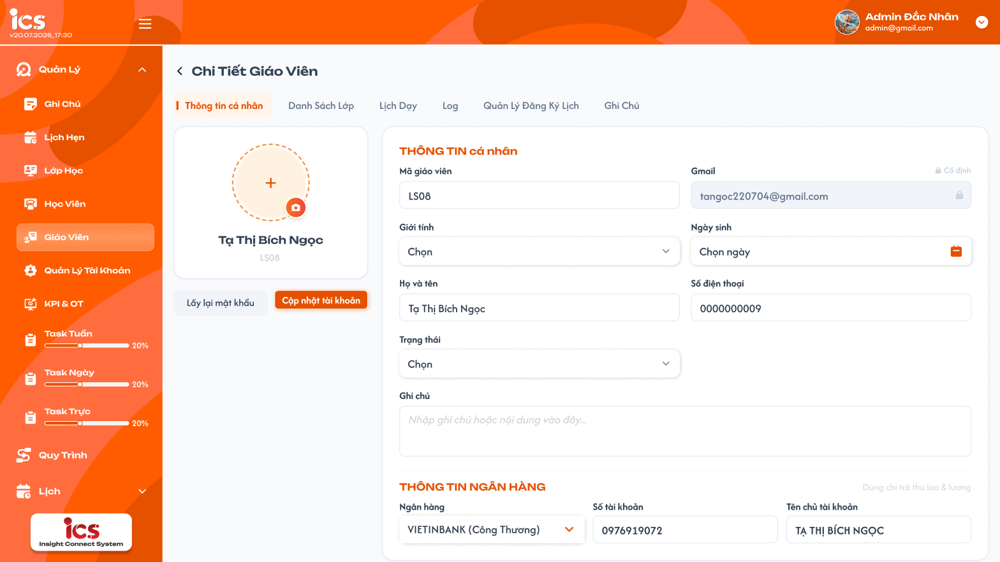
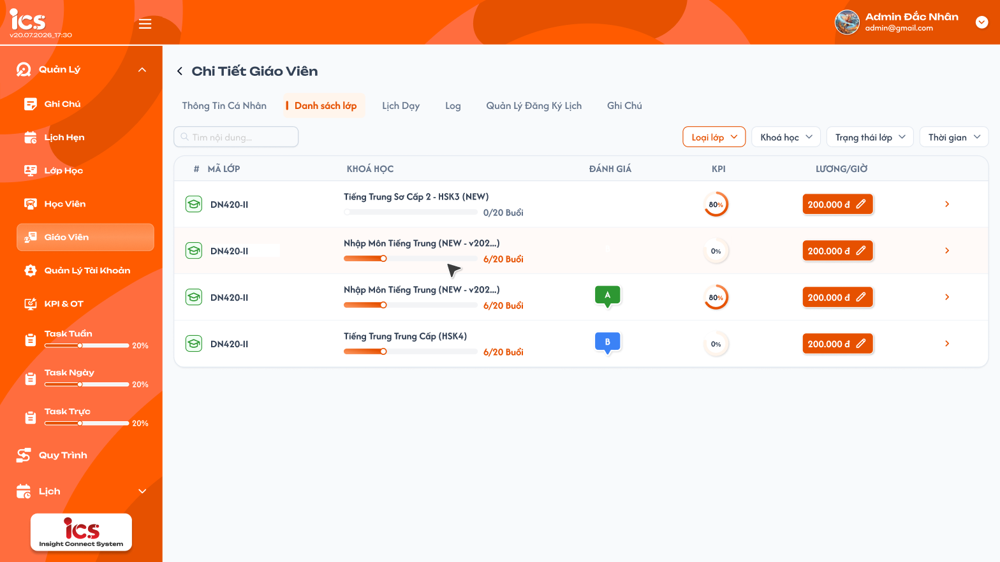
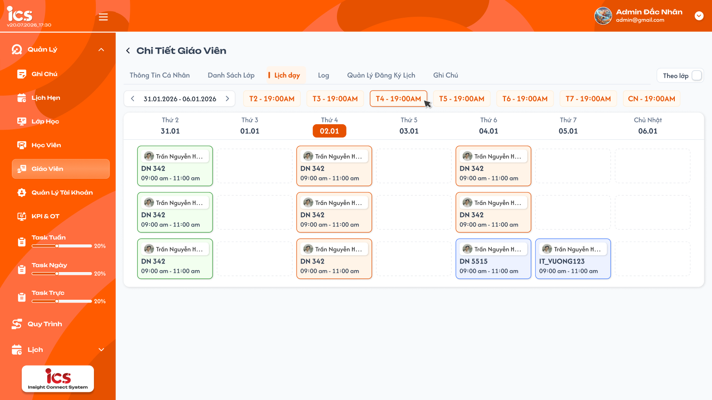
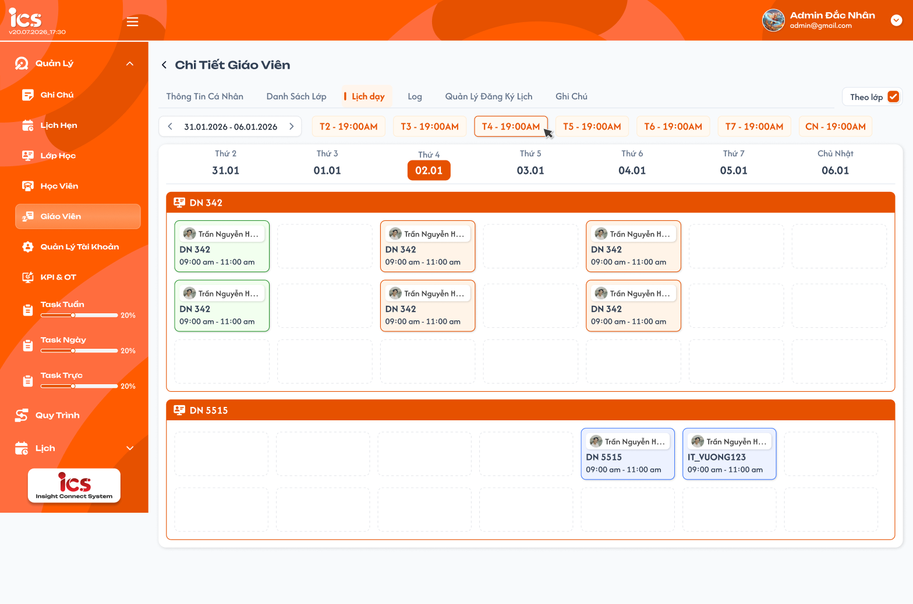
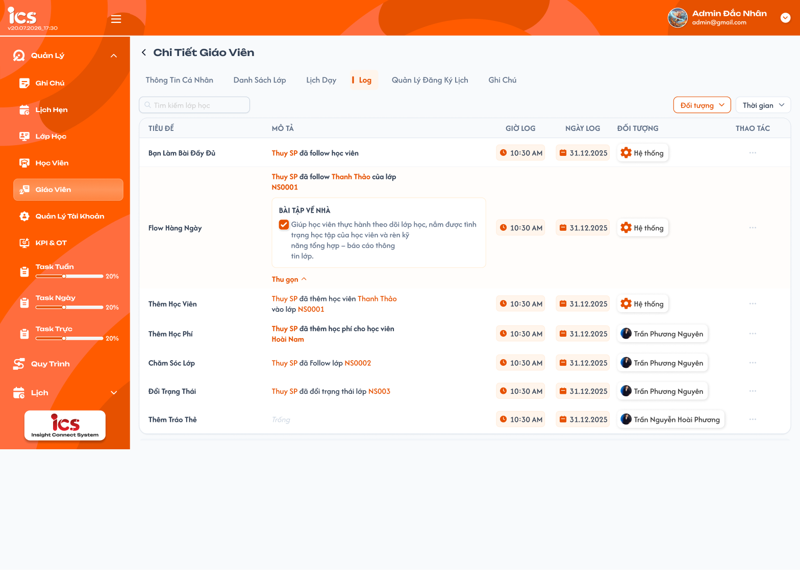
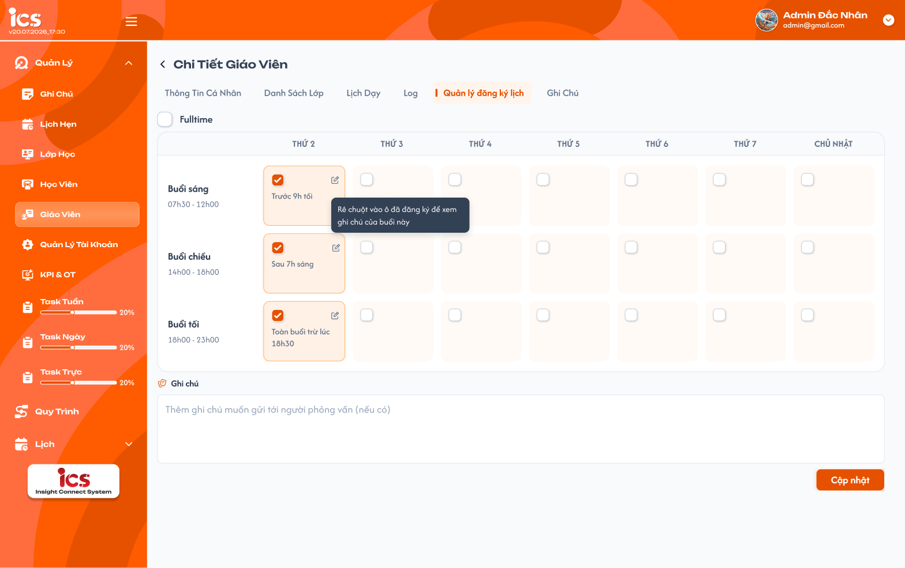
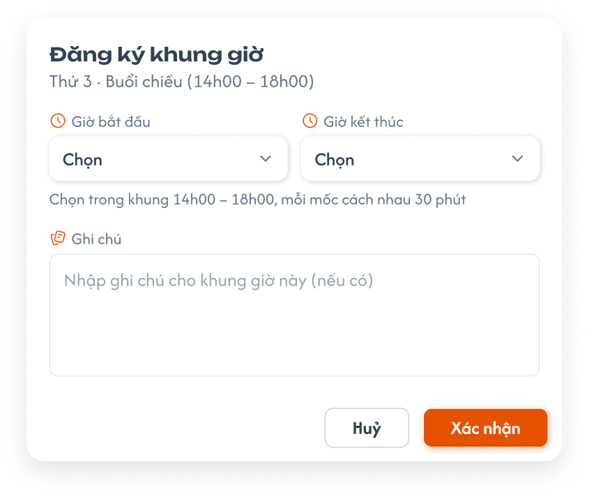
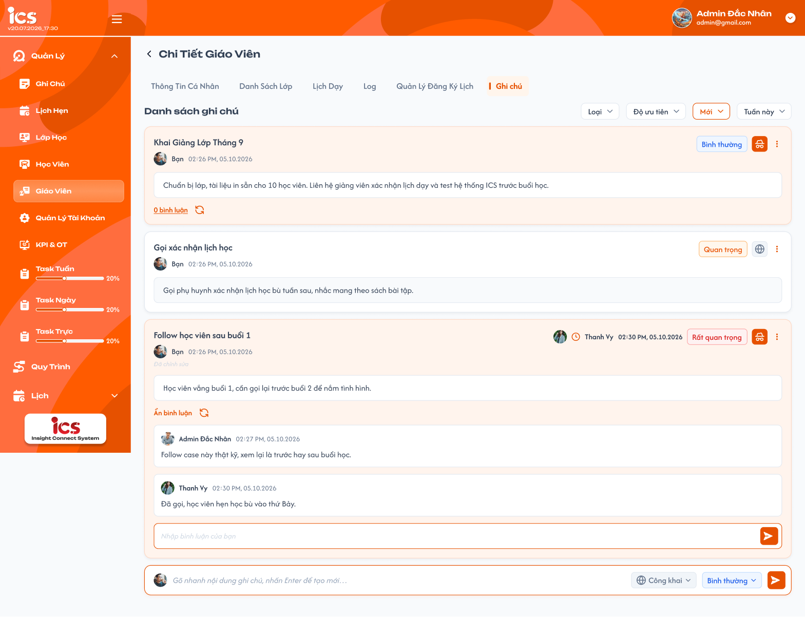

# [Admin] Chi tiết giáo viên

## 1. UI

### Màn hình Chi tiết giáo viên

**Mô tả:**

- Màn hình tập trung hồ sơ và toàn bộ dữ liệu vận hành của đúng giáo viên được chọn từ danh sách.

**Giải thích field/thành phần:**

- Màn hình được mở từ nút chi tiết của đúng giáo viên tại [teacher_management_requirements.md](./teacher_management_requirements.md).
- Tiêu đề hiển thị `Chi Tiết Giáo Viên` và có nút quay lại danh sách giáo viên.
- Các tab trên UI gồm `Thông tin cá nhân`, `Danh sách lớp`, `Lịch dạy`, `Log`, `Quản lý đăng ký lịch`, `Ghi chú`.
- Phạm vi tài liệu này gồm tab `Thông tin cá nhân`, tab `Danh sách lớp`, tab `Lịch dạy`, tab `Log`, tab `Quản lý đăng ký lịch`, tab `Ghi chú` và các hành động trực tiếp trên sáu tab này.

**Điểm cần lưu ý:**

- Khi đổi tab, hệ thống giữ đúng giáo viên đang xem; không được tải hoặc hiển thị dữ liệu của giáo viên khác.
- `Class Handler` và `Support` được truy cập tab `Danh sách lớp`, tab `Log` (chỉ xem), tab `Quản lý đăng ký lịch`, tab `Ghi chú` và tab `Thông tin cá nhân`; tại tab `Thông tin cá nhân` hai role này chỉ được cập nhật `Lương/giờ`, các field khác chỉ xem. Quyền này không đồng nghĩa được xem hoặc thao tác tại các tab khác.

#### Testcase — Khung màn hình Chi tiết giáo viên

| Tên testcase | Priority | Loại test | Scenario | Role | Pre-condition | Given / When / Then | Expected Result |
|---|---| --- |---|---|---|---|---|
| Case 1: Mở đúng chi tiết giáo viên | High | Smoke | Flow 1 / REQ01 | Admin | Giáo viên tồn tại và thuộc phạm vi của Admin | **Given** Admin chọn một giáo viên từ màn danh sách<br>**When** màn chi tiết tải thành công<br>**Then** hệ thống hiển thị chi tiết đúng giáo viên | - Tiêu đề và các tab được hiển thị<br>- Tab mặc định là `Thông tin cá nhân`<br>- Không hiển thị dữ liệu của giáo viên khác |
| Case 2: Từ chối giáo viên không còn hợp lệ | High |  | EX01 / REQ01 | Admin | Giáo viên không tồn tại hoặc không còn thuộc phạm vi | **Given** Admin mở URL chi tiết cũ hoặc không còn quyền với giáo viên<br>**When** hệ thống kiểm tra định danh và phạm vi<br>**Then** hệ thống từ chối hiển thị chi tiết | - Không thay bằng dữ liệu giáo viên khác<br>- Hiển thị lỗi phù hợp<br>- Không thay đổi dữ liệu |

#### Testcase — Quyền và notification của màn hình Chi tiết giáo viên

| Tên testcase | Priority | Loại test | Scenario | Role | Pre-condition | Given / When / Then | Expected Result |
|---|---| --- |---|---|---|---|---|
| Case 72: Từ chối role không có quyền | High |  | EX01 / Ràng buộc quyền | Các role khác | Người dùng đã đăng nhập nhưng không thuộc role được cấp quyền | **Given** người dùng không có quyền với màn hình hoặc tab được yêu cầu<br>**When** mở URL hoặc gửi request trực tiếp<br>**Then** hệ thống từ chối | - Không nhận dữ liệu ngoài quyền<br>- Không thực hiện được thao tác thay đổi<br>- Dữ liệu không thay đổi |
| Case 74: Notification khi thao tác thành công | High |  | REQ06 | Admin / Class Handler / Support | Có thao tác thay đổi hợp lệ trong phạm vi quyền | **Given** người dùng xác nhận thao tác thay đổi<br>**When** backend trả kết quả thành công<br>**Then** hệ thống hiển thị notification thành công | - Nội dung đúng thao tác và đúng giáo viên/đối tượng<br>- Chỉ hiển thị sau khi backend xác nhận<br>- Mỗi request chỉ có một notification |
| Case 75: Notification khi thao tác thất bại | High |  | REQ06 | Admin / Class Handler / Support | Thao tác bị validation, lỗi quyền, lỗi backend hoặc hết thời gian chờ | **Given** người dùng thực hiện thao tác thay đổi<br>**When** thao tác bị từ chối hoặc thất bại<br>**Then** hệ thống hiển thị notification thất bại | - Không hiển thị notification thành công<br>- Mỗi request chỉ có một notification thất bại<br>- Không hiển thị mật khẩu hoặc thông tin kỹ thuật nhạy cảm<br>- Không hiển thị dữ liệu như đã thay đổi khi backend chưa ghi nhận |

### Tab Thông tin cá nhân

<p align="center">
  <a href="./images/teacher-detail-personal-info.png"></a><br>
  <em>Tab Thông tin cá nhân của chi tiết giáo viên — nhấn để xem ảnh gốc</em>
</p>

**Mô tả:**

- Tab hiển thị hồ sơ, trạng thái, ghi chú và thông tin ngân hàng của đúng giáo viên đang xem.
- Tab gồm khối avatar (ảnh, tên, mã giáo viên, nút `Lấy lại mật khẩu`, `Cập nhật tài khoản`) bên trái và 2 khối `THÔNG TIN cá nhân`, `THÔNG TIN NGÂN HÀNG` (ghi chú `Dùng chi trả thù lao & lương`) bên phải.
- Tab có field `Lương/giờ` (VNĐ/giờ): mức lương theo giờ cố định của giáo viên, dùng làm mặc định cho mọi buổi dạy. Không còn lương theo từng lớp.
- `Mã giáo viên` và `Email` là thông tin cố định, bị khóa và không cho cập nhật.
- Không cung cấp thao tác xóa cứng giáo viên trên màn hình này.

**Giải thích field/thành phần:**

| Trường/Thành phần | Cho cập nhật | Yêu cầu |
|---|:---:|---|
| Ảnh đại diện | ✅ | Khung tròn có dấu `+` và icon máy ảnh; cho phép chọn/thay ảnh; dung lượng tệp tối đa 25 MB. |
| Mã giáo viên | ❌ | Hiển thị code đã tự sinh khi tạo (vd `LS08`); khóa, không cho phép chỉnh sửa. |
| Gmail | ❌ | Hiển thị email hiện tại kèm nhãn `Cố định` và icon khóa; không cho phép chỉnh sửa. |
| Họ và tên | ✅ | Cho phép cập nhật; không áp dụng validation bắt buộc khi cập nhật. |
| Giới tính | ✅ | Dropdown `Chọn`; không bắt buộc khi cập nhật. |
| Ngày sinh | ✅ | Date picker `Chọn ngày`; không bắt buộc khi cập nhật. |
| Số điện thoại | ✅ | Không bắt buộc; nếu có giá trị phải gồm đúng 10 chữ số và bắt đầu bằng `0`. |
| Trạng thái | ✅ | Dropdown `Training`, `Thử việc`, `Chính thức`, `Nghỉ việc`; giáo viên mới tạo mặc định `Training`; chuyển sang `Nghỉ việc` kích hoạt quy tắc nghỉ việc. |
| Ghi chú | ✅ | Không bắt buộc; đây là ghi chú tổng quan riêng của Thông tin cá nhân, dùng để hiển thị tại cột Ghi chú ở danh sách giáo viên và không dùng chung dữ liệu với tab `Ghi chú`. |
| Ngân hàng | ✅ | Không bắt buộc; chọn ngân hàng từ danh sách hỗ trợ. |
| Số tài khoản | ✅ | Không bắt buộc; cho phép người dùng nhập. |
| Tên chủ tài khoản | ✅ | Không bắt buộc; người dùng nhập và hệ thống tự động chuyển thành chữ in hoa. |
| Lương/giờ | ✅ | Số nguyên **lớn hơn 0**, đơn vị `VNĐ/giờ`; hiển thị phân tách hàng nghìn kèm `đ` (vd `200.000 đ`). Là mức mặc định cho các buổi dạy của giáo viên; xem quy tắc lương bên dưới. |
| `Lấy lại mật khẩu` | — | Reset mật khẩu của giáo viên về `abc12345`. |
| `Cập nhật tài khoản` | — | Lưu toàn bộ thay đổi của Thông tin cá nhân, ảnh, ghi chú và thông tin ngân hàng trong một lần. |

**Điểm cần lưu ý:**

- Khi cập nhật không có trường nhập liệu nào bắt buộc. Hệ thống chỉ validation định dạng, khoảng giá trị hoặc dung lượng đối với trường có giá trị/tệp được cung cấp.
- `Mã giáo viên` và `Email` luôn bị khóa trên UI; backend phải bỏ qua hoặc từ chối mọi giá trị ghi đè hai trường này.
- `Số điện thoại` được xử lý dạng chuỗi để giữ số `0` đầu tiên.
- Thông tin ngân hàng không bắt buộc. `Tên chủ tài khoản` do người dùng nhập và được chuyển thành chữ in hoa trước khi lưu.
- `Ghi chú` tại Thông tin cá nhân là dữ liệu riêng, không thuộc danh sách ghi chú tại tab `Ghi chú`. Khi cập nhật thành công, cột Ghi chú ở danh sách giáo viên phải hiển thị nội dung mới.
- `Cập nhật tài khoản` gửi toàn bộ thay đổi trong một thao tác logic. Thành công hoặc thất bại đều phải có đúng một notification kết quả theo REQ06.
- Nếu chuyển tab hoặc quay lại khi có thay đổi chưa lưu, hệ thống phải hiển thị cảnh báo xác nhận trước khi rời màn hình.

**Quy tắc Lương/giờ trong hồ sơ:**

- `Lương/giờ` là thuộc tính của giáo viên, không lưu theo lớp. Mọi buổi dạy của giáo viên lấy mức này làm mặc định khi buổi chưa được chỉnh lương riêng.
- Tiền một buổi = `Lương/giờ` của buổi × thời lượng buổi (giờ), ví dụ `200.000 đ/giờ × 90 phút = 300.000 đ`; tiền được chốt khi buổi chuyển `Hoàn thành` (xem [Tab Lịch dạy của lớp](../class_management/class_detail_schedule_requirements.md)).
- Đổi `Lương/giờ` chỉ áp dụng cho các buổi **chưa hoàn thành** và **chưa được chỉnh lương riêng**. Buổi đã hoàn thành giữ nguyên tiền đã chốt; không hồi tố.
- `Admin`, `Class Handler` và `Support` được cập nhật `Lương/giờ` tại tab này (Class Handler/Support chỉ sửa được field này, các field khác read-only); giá trị được lưu cùng thao tác `Cập nhật tài khoản` và ghi log (mức cũ → mức mới).
- Validation: chỉ chấp nhận số nguyên lớn hơn 0; từ chối `0`, số âm, số thập phân hoặc giá trị không phải số.

**Quy tắc tài khoản và nghỉ việc:**

- `Lấy lại mật khẩu` tự reset mật khẩu về đúng giá trị `abc12345`; mật khẩu phải được lưu an toàn và không ghi plain text vào log.
- Reset mật khẩu thành công hoặc thất bại phải có đúng một notification kết quả theo REQ06.
- Khi chuyển trạng thái sang `Nghỉ việc`, hệ thống khóa quyền đăng nhập của giáo viên, loại giáo viên khỏi lịch đăng ký và các lớp đang dạy.
- Dữ liệu hồ sơ, lịch sử và log đã phát sinh trước khi nghỉ việc phải được giữ lại; không xóa cứng giáo viên.

#### Testcase — Tab Thông tin cá nhân

| Tên testcase | Priority | Loại test | Scenario | Role | Pre-condition | Given / When / Then | Expected Result |
|---|---| --- |---|---|---|---|---|
| Case 3: Hiển thị Thông tin cá nhân | High |  | Flow 1 / REQ01 | Admin | Giáo viên tồn tại trong phạm vi | **Given** Admin mở chi tiết giáo viên<br>**When** dữ liệu tải thành công<br>**Then** tab `Thông tin cá nhân` được hiển thị | - Hiển thị đúng giáo viên<br>- Có trường Giới tính, Ngày sinh, Trạng thái, Ghi chú, Lương/giờ và khối thông tin ngân hàng<br>- Mã giáo viên và Gmail bị khóa<br>- Không hiển thị hành động xóa cứng |
| Case 4: Cập nhật khi không có trường bắt buộc | High | Smoke | Flow 2 / REQ02 / REQ06 | Admin | Tab Thông tin cá nhân đã tải | **Given** Admin chỉ thay đổi một hoặc nhiều trường tùy chọn<br>**When** chọn `Cập nhật tài khoản`<br>**Then** hệ thống không yêu cầu nhập lại các trường khác | - Chỉ validation trường có giá trị thay đổi/cung cấp<br>- Lưu toàn bộ thay đổi trong một thao tác logic<br>- Mã giáo viên và Email không thay đổi<br>- Hiển thị đúng một notification kết quả |
| Case 5: Validation số điện thoại khi cập nhật | High |  | EX03 / REQ02 | Admin | Tab Thông tin cá nhân đã tải | **Given** Admin cập nhật Số điện thoại hoặc để trống<br>**When** chọn `Cập nhật tài khoản`<br>**Then** hệ thống validation trường Số điện thoại | - Cho phép để trống<br>- Chấp nhận đúng 10 chữ số và bắt đầu bằng `0`<br>- Từ chối sai độ dài, không bắt đầu bằng `0`, có chữ hoặc ký tự phân cách<br>- Giữ số `0` đầu tiên |
| Case 6: Cập nhật thông tin ngân hàng và viết hoa tên chủ tài khoản | Medium |  | Flow 2 / REQ02 | Admin | Tab Thông tin cá nhân đã tải | **Given** các trường ngân hàng đang trống hoặc đã có dữ liệu<br>**When** Admin nhập/chỉnh sửa rồi cập nhật<br>**Then** hệ thống lưu thông tin đã nhập | - Không báo lỗi bắt buộc khi để trống<br>- Tên chủ tài khoản được chuyển thành chữ in hoa<br>- Giá trị do người dùng nhập, không tự thay bằng Họ và tên giáo viên |
| Case 7: Cập nhật ghi chú tổng quan | High |  | Flow 2 / REQ02 | Admin | Giáo viên có hoặc chưa có ghi chú tổng quan | **Given** Admin thay đổi Ghi chú tại Thông tin cá nhân và cập nhật thành công<br>**When** quay lại danh sách hoặc mở tab `Ghi chú`<br>**Then** hệ thống sử dụng đúng nguồn dữ liệu | - Danh sách giáo viên hiển thị nội dung ghi chú tổng quan mới<br>- Tab Ghi chú không tự tạo hoặc thay đổi bản ghi từ nội dung này<br>- Hai loại ghi chú được lưu độc lập |
| Case 8: Validation ảnh đại diện tối đa 25 MB | High |  | EX03 / REQ02 | Admin | Admin có tệp ảnh hợp lệ hoặc vượt giới hạn | **Given** Admin chọn ảnh đại diện<br>**When** tệp có dung lượng bằng/nhỏ hơn hoặc lớn hơn 25 MB<br>**Then** hệ thống validation dung lượng | - Chấp nhận tệp không vượt quá 25 MB nếu không có lỗi khác<br>- Từ chối tệp lớn hơn 25 MB<br>- Giữ ảnh cũ khi tệp mới không hợp lệ<br>- Hiển thị lỗi và notification phù hợp |
| Case 9: Lấy lại mật khẩu mặc định | High |  | Flow 3 / REQ03 / REQ06 | Admin | Giáo viên có tài khoản đang tồn tại | **Given** Admin chọn `Lấy lại mật khẩu`<br>**When** backend reset thành công<br>**Then** mật khẩu giáo viên được đặt thành `abc12345` | - Mật khẩu được lưu an toàn, không ghi plain text vào log<br>- Hiển thị đúng một notification thành công<br>- Nếu thất bại, mật khẩu cũ không đổi và hiển thị đúng một notification thất bại |
| Case 10: Chuyển giáo viên sang Nghỉ việc | High | Smoke | Flow 4 / REQ04 / REQ06 | Admin | Giáo viên đang hoạt động, có thể có lịch đăng ký hoặc lớp đang dạy | **Given** Admin chọn trạng thái `Nghỉ việc`<br>**When** cập nhật thành công<br>**Then** hệ thống áp dụng nghiệp vụ nghỉ việc | - Khóa đăng nhập của giáo viên<br>- Loại giáo viên khỏi lịch đăng ký và lớp đang dạy<br>- Không xóa cứng hồ sơ, lịch sử hoặc log<br>- Hiển thị đúng một notification thành công |
| Case 11: Cảnh báo khi rời màn hình có thay đổi chưa lưu | High |  | EX06 / REQ02 | Admin | Admin đã thay đổi dữ liệu nhưng chưa cập nhật | **Given** form đang ở trạng thái có thay đổi chưa lưu<br>**When** chuyển tab hoặc bấm quay lại<br>**Then** hệ thống hiển thị cảnh báo xác nhận | - Ở lại tiếp tục giữ dữ liệu đã nhập<br>- Xác nhận rời sẽ bỏ thay đổi chưa lưu và điều hướng<br>- Không gửi request cập nhật ngoài ý muốn |

### Tab Danh sách lớp

<p align="center">
  <a href="./images/teacher-detail-class-list.png"></a><br>
  <em>Tab Danh sách lớp (cột Lương/giờ trong ảnh đã bỏ) — nhấn để xem ảnh gốc</em>
</p>

**Mô tả:**

- Tab `Danh sách lớp` chỉ hiển thị những lớp mà giáo viên đang xem đã được thêm hoặc phân công; không hiển thị lớp chưa có quan hệ với giáo viên này.
- `Admin`, `Class Handler` và `Support` được xem danh sách lớp trong phạm vi dữ liệu được cấp.
- **Đã bỏ lương theo lớp:** tab không có cột `LƯƠNG/GIỜ` và popup `Chỉnh sửa lương`. Lương/giờ nằm trong hồ sơ giáo viên (tab `Thông tin cá nhân`) và có thể chỉnh riêng từng buổi tại tab Lịch dạy của lớp.
- Tab này chỉ để xem; không cung cấp thao tác thêm giáo viên vào lớp, gỡ giáo viên khỏi lớp hoặc cập nhật thông tin lớp.

**Giải thích field/thành phần:**

| Trường/Thành phần | Yêu cầu |
|---|---|
| Tìm kiếm lớp học | Ô tìm kiếm nằm phía trên bảng; tìm theo Mã lớp hoặc Tên khóa học. Tự tìm sau 2 giây kể từ lần nhập cuối hoặc tìm ngay khi nhấn `Enter`; điều kiện tìm kiếm kết hợp với các bộ lọc và đưa danh sách về trang đầu. |
| Trạng thái lớp | Cột `#`: icon trạng thái hiện tại của lớp có nội dung nhận biết được (tooltip tên trạng thái); hỗ trợ các trạng thái `Khai giảng`, `Mới tạo`, `Đang học`, `Tạm dừng`, `Hoàn thành`, `Hủy`, `Xóa`, `Trải nghiệm`. |
| Mã lớp | Hiển thị mã lớp của đúng bản ghi; không dùng mã lớp làm khóa phân quyền hoặc khóa liên kết. |
| Khóa học | Tên khóa học đã gắn với lớp, thanh tiến độ và số buổi dạng `đã học/tổng số buổi Buổi` (vd `6/20 Buổi`); dữ liệu phải thuộc đúng lớp và cùng khóa học đang hiển thị, cùng nguồn với `[đã học/tổng]` ở popover Chi tiết Lớp của danh sách giáo viên. |
| Đánh giá | Hiển thị đánh giá hiện hành của lớp theo nguồn dữ liệu đánh giá lớp; không tự suy diễn từ KPI hoặc lương. |
| KPI lớp | Hiển thị tỷ lệ lên kỳ của riêng lớp đó. Công thức mỗi học viên là trung bình cộng tỷ lệ đi học và tỷ lệ BTVN; KPI lớp là trung bình cộng kết quả của tất cả học viên thuộc lớp. |
| Mở chi tiết | Icon mũi tên ở cuối dòng được hiển thị theo UI; hành vi điều hướng khi click cần xác nhận tại mục 3. |

**Điểm cần lưu ý:**

- Tỷ lệ đi học của học viên tính các trạng thái được xem là có đi học: `Có mặt`, `Vào trễ`, `Ra sớm`, `Vào trễ & Ra sớm`.
- Tỷ lệ BTVN của học viên là tỷ lệ bài tập về nhà có trạng thái `Hoàn thành`.
- Tỷ lệ lên kỳ của mỗi học viên = `(Tỷ lệ đi học + Tỷ lệ BTVN) / 2`.
- KPI lớp = trung bình cộng tỷ lệ lên kỳ của tất cả học viên thuộc đúng lớp.
- Kết quả hiển thị theo tỷ lệ phần trăm. Khi không có mẫu số hợp lệ, UI phải hiển thị trạng thái không có dữ liệu hoặc giá trị quy ước đã được chốt; tuyệt đối không hiển thị `NaN`, `Infinity` hoặc tỷ lệ âm.
- Đánh giá lớp là dữ liệu độc lập với KPI lớp; requirement hiện tại chưa quy định công thức đánh giá.

**Bộ lọc:**

| Bộ lọc | Giá trị/Quy tắc |
|---|---|
| Loại lớp | `Lớp 1-1`, `Lớp chung`. |
| Khóa học | Lấy động từ danh sách khóa học được cấu hình/define trong hệ thống; kết quả chỉ gồm lớp thuộc khóa học đã chọn. |
| Trạng thái lớp | `Khai giảng`, `Mới tạo`, `Đang học`, `Tạm dừng`, `Hoàn thành`, `Hủy`, `Xóa`, `Trải nghiệm`. |
| Thời gian | Lọc theo thời gian tạo lớp (`class.created_at`), mặc định `Hôm nay`; danh sách gồm `Tới hạn`, `Hôm nay`, `Hôm qua`, `Hôm nay và hôm qua`, `Tuần này`, `Tuần trước`, `Tháng này`, `Tháng trước`, `3 tháng trước`, `Năm nay`, `Năm trước`, `Tùy chọn`. |

- `Tới hạn` lấy từ thời điểm bắt đầu có dữ liệu trong hệ thống đến hết ngày hôm nay theo múi giờ nghiệp vụ.
- `Tùy chọn` cho phép chọn ngày bắt đầu và kết thúc, bao gồm toàn bộ hai ngày biên; từ chối ngày bắt đầu sau ngày kết thúc.
- Các bộ lọc được áp dụng đồng thời theo phép giao. Mọi kết quả vẫn phải thuộc đúng giáo viên đang xem và phạm vi dữ liệu của người dùng.
- Từ khóa tìm kiếm được kết hợp `AND` với Loại lớp, Khóa học, Trạng thái và Thời gian; nhấn `Enter` phải hủy lần debounce đang chờ để không gửi request trùng.
- Mỗi trang hiển thị tối đa 50 lớp sau khi áp dụng quyền và toàn bộ bộ lọc.
- Phân trang hiển thị khoảng dữ liệu đang xem, tổng số kết quả, trang hiện tại, nút `Trước`, các số trang, dấu `...` khi cần và nút `Sau`; `Trước` bị vô hiệu hóa ở trang đầu, `Sau` bị vô hiệu hóa ở trang cuối.
- Chuyển trang giữ nguyên từ khóa và toàn bộ bộ lọc. Thay đổi từ khóa hoặc bất kỳ bộ lọc nào đưa danh sách về trang đầu.
- Khi đổi bộ lọc liên tục, chỉ response của tổ hợp điều kiện mới nhất được phép cập nhật danh sách.
- Trạng thái loading, rỗng và lỗi phải được phân biệt. Lỗi tải dữ liệu không được hiển thị như danh sách rỗng và phải cho phép thử lại.

#### Testcase — Tab Danh sách lớp

| Tên testcase | Priority | Loại test | Scenario | Role | Pre-condition | Given / When / Then | Expected Result |
|---|---| --- |---|---|---|---|---|
| Case 12: Chỉ hiển thị lớp đã thêm giáo viên | High | Smoke | Flow 10 / REQ11 | Admin / Class Handler / Support | Giáo viên được thêm vào một số lớp và chưa được thêm vào các lớp khác | **Given** người dùng mở tab Danh sách lớp<br>**When** dữ liệu tải thành công<br>**Then** hệ thống chỉ hiển thị lớp có quan hệ với giáo viên đang xem | - Không hiển thị lớp chưa thêm giáo viên<br>- Không trộn lớp của giáo viên khác<br>- Mỗi quan hệ hợp lệ chỉ tạo một dòng |
| Case 13: Hiển thị đủ thông tin của từng lớp | High |  | Flow 10 / REQ11 | Admin / Class Handler / Support | Giáo viên có lớp thuộc nhiều trạng thái và khóa học | **Given** danh sách lớp đã tải<br>**When** người dùng xem từng dòng<br>**Then** hệ thống hiển thị đúng Trạng thái, Mã lớp, Khóa học, Đánh giá và KPI | - Dữ liệu trên cùng dòng thuộc cùng một lớp<br>- Trạng thái có nội dung nhận biết được<br>- Tiến độ/số buổi nếu có thuộc đúng khóa học và lớp |
| Case 14: Đánh giá lớp độc lập với KPI | Medium |  | REQ11 | Admin / Class Handler / Support | Lớp có dữ liệu đánh giá và KPI khác nhau | **Given** hai nguồn dữ liệu có giá trị khác nhau<br>**When** dòng lớp hiển thị<br>**Then** hệ thống giữ đúng từng giá trị | - Không dùng KPI thay cho đánh giá<br>- Không tự tính đánh giá từ lương hoặc tiến độ<br>- Trạng thái chưa có đánh giá được hiển thị nhất quán |
| Case 15: Tính KPI lớp theo tỷ lệ lên kỳ | High |  | REQ11 | Admin / Class Handler / Support | Lớp có học viên với dữ liệu đi học và BTVN hợp lệ | **Given** mỗi học viên có tỷ lệ đi học và tỷ lệ BTVN<br>**When** hệ thống tính KPI lớp<br>**Then** tính tỷ lệ lên kỳ từng học viên rồi lấy trung bình cộng toàn lớp | - Công thức học viên là `(Đi học + BTVN) / 2`<br>- Chỉ dùng học viên thuộc đúng lớp<br>- Hiển thị phần trăm đúng quy tắc làm tròn được chốt |
| Case 16: KPI lớp không có mẫu số hợp lệ | High |  | REQ11 | Admin / Class Handler / Support | Lớp chưa có học viên hoặc dữ liệu chưa đủ để tính | **Given** hệ thống không có mẫu số hợp lệ<br>**When** hiển thị KPI<br>**Then** dùng trạng thái không có dữ liệu hoặc giá trị quy ước | - Không hiển thị `NaN`, `Infinity` hoặc số âm<br>- Không lấy KPI của lớp khác thay thế |
| Case 22: Tìm kiếm lớp học | High |  | Flow 10 / REQ11 | Admin / Class Handler / Support | Có lớp khớp và không khớp Mã lớp/Tên khóa học | **Given** người dùng nhập từ khóa tại ô Tìm kiếm lớp học<br>**When** ngừng gõ 2 giây hoặc nhấn `Enter`<br>**Then** hệ thống tìm theo Mã lớp hoặc Tên khóa học và trở về trang đầu | - Không gửi request trước đủ 2 giây nếu vẫn đang gõ<br>- Enter tìm ngay và hủy debounce đang chờ<br>- Kết hợp từ khóa theo AND với các filter hiện tại<br>- Không hiển thị lớp chưa thêm giáo viên<br>- Chuyển trang giữ nguyên từ khóa |
| Case 23: Lọc theo Loại lớp, Khóa học và Trạng thái | High |  | Flow 10 / REQ11 | Admin / Class Handler / Support | Có lớp thuộc nhiều loại, khóa học và tám trạng thái | **Given** người dùng chọn một hoặc nhiều điều kiện lọc<br>**When** danh sách tải lại<br>**Then** hệ thống áp dụng giao các điều kiện | - Loại lớp chỉ gồm Lớp 1-1/Lớp chung<br>- Khóa học lấy từ cấu hình hiện hành<br>- Trạng thái hỗ trợ đủ tám giá trị đã quy định<br>- Kết quả vẫn thuộc đúng giáo viên |
| Case 24: Filter thời gian mặc định Hôm nay | High |  | Flow 10 / REQ11 | Admin / Class Handler / Support | Có lớp tạo hôm nay và ngày khác | **Given** người dùng mở tab lần đầu<br>**When** danh sách tải<br>**Then** filter Thời gian mặc định là Hôm nay | - Lọc theo `class.created_at` từ đầu đến hết ngày hôm nay<br>- Dùng đúng múi giờ nghiệp vụ<br>- Không dùng thời gian cập nhật lương |
| Case 25: Filter Tới hạn và các khoảng định sẵn | High |  | Flow 10 / REQ11 | Admin / Class Handler / Support | Có lớp được tạo tại các mốc biên | **Given** người dùng lần lượt chọn các khoảng thời gian định sẵn<br>**When** danh sách tải<br>**Then** hệ thống lọc đúng theo `class.created_at` | - Tới hạn lấy từ đầu hệ thống đến hết hôm nay<br>- Hỗ trợ đủ Hôm qua, Hôm nay và hôm qua, tuần/tháng/năm hiện tại hoặc trước đó và 3 tháng trước<br>- Bao gồm đúng các mốc biên |
| Case 26: Filter thời gian Tùy chọn và kết hợp filter | High |  | Flow 10 / REQ11 | Admin / Class Handler / Support | Có lớp trong và ngoài khoảng chọn | **Given** người dùng chọn khoảng ngày hợp lệ cùng các filter khác<br>**When** áp dụng filter<br>**Then** hệ thống trả giao của toàn bộ điều kiện | - Bao gồm toàn bộ hai ngày biên<br>- Từ chối ngày bắt đầu sau ngày kết thúc<br>- Chỉ response mới nhất được hiển thị |
| Case 27: Phân trang Danh sách lớp | High |  | Flow 10 / REQ11 | Admin / Class Handler / Support | Có hơn 50 lớp thỏa từ khóa, quyền và bộ lọc hiện tại | **Given** danh sách lớp đang có nhiều trang<br>**When** người dùng chọn số trang, `Trước` hoặc `Sau`<br>**Then** hệ thống tải đúng tối đa 50 lớp của trang được chọn | - Hiển thị đúng khoảng dữ liệu, tổng kết quả và trang hiện tại<br>- Giữ nguyên từ khóa và toàn bộ bộ lọc khi chuyển trang<br>- `Trước`/`Sau` vô hiệu hóa đúng ở trang biên<br>- Thay đổi từ khóa/filter đưa danh sách về trang đầu<br>- Không lặp hoặc bỏ sót lớp giữa các trang |
| Case 28: Tải danh sách thất bại | High |  | EX25 / REQ11 | Admin / Class Handler / Support | API lỗi, hết thời gian chờ hoặc response sai thứ tự | **Given** người dùng tải/tìm/lọc danh sách<br>**When** xảy ra lỗi<br>**Then** hệ thống hiển thị trạng thái lỗi phù hợp | - Không coi lỗi tải là danh sách rỗng<br>- Response cũ không ghi đè điều kiện mới<br>- Cho phép thử lại |
| Case 17: Không còn lương theo lớp | High |  | REQ11 | Admin / Class Handler / Support | Giáo viên có nhiều lớp | **Given** mở tab Danh sách lớp<br>**When** dữ liệu tải xong<br>**Then** không có cột/popup lương | - Không có cột `LƯƠNG/GIỜ`<br>- Không có popup `Chỉnh sửa lương`<br>- Không có API cập nhật lương theo lớp |
| Case 18: Cập nhật Lương/giờ trong hồ sơ | High | Smoke | REQ02 / REQ06 | Admin | Giáo viên có buổi đã hoàn thành và buổi chưa hoàn thành | **Given** Admin đổi Lương/giờ từ `200.000` thành `250.000`<br>**When** chọn `Cập nhật tài khoản`<br>**Then** hệ thống lưu mức mới | - Buổi chưa hoàn thành, chưa chỉnh riêng dùng `250.000`<br>- Buổi đã hoàn thành giữ tiền đã chốt<br>- Buổi đã chỉnh lương riêng giữ mức riêng<br>- Ghi log mức cũ → mức mới, đúng một notification |
| Case 19: Validation Lương/giờ | High |  | EX23 / REQ02 | Admin | Đang sửa hồ sơ | **Given** nhập `0`, số dương, số âm, số thập phân, chữ<br>**When** cập nhật<br>**Then** chỉ chấp nhận số nguyên > 0 | - Từ chối `0`<br>- Từ chối giá trị còn lại, giữ giá trị đã lưu<br>- Lưu đúng số khi nhập có phân tách hàng nghìn |
| Case 20: Class Handler/Support sửa Lương/giờ trong hồ sơ | High |  | REQ01 / EX24 | Class Handler / Support / role khác | Giáo viên trong phạm vi | **Given** Class Handler/Support mở tab Thông tin cá nhân<br>**When** sửa Lương/giờ và cập nhật<br>**Then** lưu thành công | - Chỉ Lương/giờ sửa được, field khác read-only<br>- Request đổi field khác bị từ chối<br>- Role khác gửi request cập nhật Lương/giờ bị từ chối, giá trị không đổi |

### Tab Lịch dạy

<p align="center">
  <a href="./images/teacher-detail-schedule-by-day.png"></a><br>
  <em>Tab Lịch dạy khi tắt `Theo lớp`: thanh tuần, hàng chip tóm tắt lịch đăng ký, card 3 màu — nhấn để xem ảnh gốc</em>
</p>

<p align="center">
  <a href="./images/teacher-detail-schedule-by-class.png"></a><br>
  <em>Tab Lịch dạy khi bật `Theo lớp`: mỗi lớp một nhóm có thanh tiêu đề mã lớp — nhấn để xem ảnh gốc</em>
</p>

**Mô tả:**

- Tab `Lịch dạy` là màn hình chỉ đọc, chỉ hiển thị các buổi dạy đã được xếp cho đúng giáo viên đang xem.
- Không hiển thị lịch đăng ký làm việc, ca giáo viên có thể nhận, log, ghi chú hoặc dữ liệu của giáo viên khác trong tab này.
- Không cho phép thêm, sửa, xóa, đăng ký hoặc hủy lịch trực tiếp tại tab `Lịch dạy`.

**Giải thích field/thành phần:**

- Khi mở tab, hệ thống mặc định hiển thị tuần chứa ngày hiện tại, từ `Thứ 2` đến `Chủ Nhật`.
- Thanh chọn tuần hiển thị khoảng ngày bắt đầu–kết thúc theo định dạng `dd.MM.yyyy - dd.MM.yyyy`.
- Nút mũi tên trái/phải lần lượt chuyển sang tuần trước hoặc tuần sau.
- Click khoảng ngày mở danh sách tuần; chọn một tuần sẽ đóng danh sách và tải lịch của đúng tuần đó.
- Tiêu đề lịch gồm đủ bảy cột từ `Thứ 2` đến `Chủ Nhật`, kèm ngày dạng `dd.MM`; ngày hiện tại được đánh dấu nổi bật nếu thuộc tuần đang xem.
- Khi đổi tuần, hệ thống thay toàn bộ dữ liệu bằng lịch của tuần mới; không giữ hoặc trộn các buổi của tuần trước.
- Hàng chip `T2 - 19:00 … CN - 19:00` bên phải thanh tuần là **tóm tắt lịch đăng ký** của giáo viên: mỗi chip = thứ + giờ bắt đầu sớm nhất giáo viên đã đăng ký trong thứ đó (dữ liệu từ tab Quản lý đăng ký lịch); thứ chưa đăng ký không có chip; chip của thứ trùng ngày hiện tại được tô sáng. Chip chỉ đọc, không lọc lịch dạy.
- Mỗi card buổi dạy hiển thị avatar + tên giáo viên, mã lớp và khoảng giờ `hh:mm am - hh:mm am`.
- Màu viền card theo mốc thời gian của buổi so với hiện tại: **xanh lá** = buổi đã dạy (đã qua), **cam** = buổi trong ngày hôm nay, **xanh dương** = buổi sắp dạy (tương lai).

**Chế độ `Theo Lớp`:**

| Trạng thái | Cách hiển thị |
|---|---|
| Bật | Mỗi lớp là một nhóm riêng có thanh tiêu đề màu cam ghi mã lớp; bên dưới là lưới bảy cột ngày. Ngày có lịch hiển thị card buổi dạy; ngày không có lịch là ô trống viền nét đứt, không có chữ. |
| Tắt | Lịch được gom theo ngày, không chia thành nhóm lớp. Mỗi cột ngày hiển thị toàn bộ buổi dạy trong ngày, xếp tăng dần theo giờ bắt đầu; nhiều buổi được xếp dọc. Ngày không có buổi dạy là ô trống viền nét đứt. |

**Điểm cần lưu ý:**

- Chỉ lấy buổi dạy có giáo viên được phân công trùng với giáo viên đang xem và có ngày thuộc tuần được chọn.
- Mỗi card hiển thị tối thiểu `Mã lớp` và khoảng giờ `HH:mm - HH:mm`.
- Một buổi dạy chỉ xuất hiện một lần trong cùng chế độ hiển thị, kể cả khi dữ liệu quan hệ giáo viên–lớp bị trùng.
- Ở chế độ `Theo Lớp`, các lớp và lịch không được trộn với nhau; ở chế độ theo ngày, các buổi cùng ngày được sắp xếp theo giờ bắt đầu tăng dần.
- Trạng thái không có lịch (ô trống nét đứt) phản ánh đúng phạm vi: từng ô ngày trong chế độ `Theo lớp`, hoặc từng cột ngày trong chế độ theo ngày; tuần không có buổi nào thì toàn bộ lưới trống.
- Việc đổi chế độ chỉ thay cách trình bày, không làm thay đổi tập buổi dạy của giáo viên trong tuần đang chọn.
- Mọi lần đổi tuần hoặc đổi chế độ phải chỉ hiển thị kết quả của request mới nhất; dữ liệu cũ không được ghi đè kết quả hiện tại.

#### Testcase — Tab Lịch dạy

| Tên testcase | Priority | Loại test | Scenario | Role | Pre-condition | Given / When / Then | Expected Result |
|---|---| --- |---|---|---|---|---|
| Case 29: Mở tab Lịch dạy | High | Smoke | Flow 5 / REQ05 | Admin | Giáo viên tồn tại trong phạm vi | **Given** Admin đang ở chi tiết giáo viên<br>**When** chọn tab `Lịch dạy`<br>**Then** hệ thống tải lịch tuần hiện tại | - Chỉ hiển thị buổi dạy của đúng giáo viên<br>- Tuần bắt đầu từ Thứ 2 và kết thúc Chủ Nhật<br>- Không hiển thị lịch đăng ký làm việc<br>- Không có thao tác thêm, sửa hoặc xóa lịch |
| Case 30: Chuyển và chọn tuần | High |  | Flow 5 / REQ05 | Admin | Giáo viên có lịch ở nhiều tuần | **Given** tuần hiện tại đang hiển thị<br>**When** Admin dùng mũi tên hoặc chọn một tuần trong danh sách<br>**Then** hệ thống tải đúng tuần được chọn | - Khoảng ngày và bảy tiêu đề ngày cập nhật đúng<br>- Không trộn dữ liệu tuần cũ<br>- Ngày hiện tại chỉ được đánh dấu khi thuộc tuần đang xem |
| Case 31: Hiển thị lịch Theo Lớp | High |  | Flow 5 / REQ05 | Admin | Tuần được chọn có nhiều lớp và ngày trống | **Given** tùy chọn `Theo Lớp` đang bật<br>**When** lịch tải thành công<br>**Then** hệ thống nhóm lịch theo từng lớp | - Mỗi lớp có đúng một nhóm riêng với thanh tiêu đề mã lớp<br>- Mỗi nhóm có đủ bảy cột ngày<br>- Card hiển thị đúng tên giáo viên, mã lớp và giờ<br>- Ô không có buổi là ô trống nét đứt<br>- Không trộn buổi giữa các lớp |
| Case 32: Hiển thị lịch theo ngày | High |  | Flow 5 / REQ05 | Admin | Một ngày có nhiều buổi thuộc nhiều lớp | **Given** tùy chọn `Theo Lớp` đang tắt<br>**When** lịch tải thành công<br>**Then** hệ thống gom toàn bộ buổi theo ngày | - Không hiển thị hàng nhóm lớp<br>- Các buổi trong ngày xếp tăng dần theo giờ bắt đầu<br>- Mỗi card hiển thị đúng mã lớp và giờ<br>- Cột không có buổi là ô trống nét đứt |
| Case 33: Đổi chế độ không làm thay đổi dữ liệu | High |  | Flow 5 / REQ05 | Admin | Tuần đang xem có nhiều buổi dạy | **Given** lịch đã tải ở một chế độ<br>**When** Admin bật hoặc tắt `Theo Lớp`<br>**Then** hệ thống chỉ đổi cách trình bày | - Tập buổi dạy trước và sau giống nhau<br>- Tuần đang chọn được giữ nguyên<br>- Không nhân đôi hoặc làm mất buổi dạy |
| Case 34: Giáo viên không có lịch dạy trong tuần | Medium |  | EX07 / REQ05 | Admin | Giáo viên không có buổi dạy trong tuần được chọn | **Given** Admin mở hoặc chuyển tới tuần không có lịch<br>**When** hệ thống tải thành công<br>**Then** hiển thị trạng thái không có lịch | - Không hiển thị dữ liệu tuần trước hoặc giáo viên khác<br>- Không coi dữ liệu rỗng là lỗi hệ thống<br>- Vẫn cho phép chuyển tuần và đổi chế độ |
| Case 35: Tải lịch dạy thất bại | High |  | EX08 / REQ05 | Admin | API lịch dạy lỗi hoặc hết thời gian chờ | **Given** Admin mở tab hoặc đổi tuần<br>**When** request thất bại<br>**Then** hệ thống hiển thị trạng thái lỗi phù hợp | - Không hiển thị dữ liệu cũ như dữ liệu của tuần mới<br>- Không hiển thị lịch đăng ký thay thế<br>- Cho phép thử tải lại |
| Case 36a: Chip tóm tắt lịch đăng ký | Medium |  | Flow 5 / REQ05 | Admin | Giáo viên đăng ký buổi tối T2–T6 (sớm nhất 19:00) và không đăng ký T7, CN | **Given** mở tab Lịch dạy<br>**When** xem hàng chip cạnh thanh tuần<br>**Then** có chip `T2 - 19:00` … `T6 - 19:00`, không có chip T7, CN | - Chip của thứ trùng ngày hiện tại được tô sáng<br>- Bấm chip không lọc, không đổi lịch<br>- Đổi lịch đăng ký ở tab Quản lý đăng ký lịch thì chip cập nhật |
| Case 36b: Màu card theo mốc thời gian | Medium |  | REQ05 | Admin | Tuần đang xem có buổi đã qua, buổi hôm nay và buổi tương lai | **Given** lịch tuần đã tải<br>**When** xem màu viền card<br>**Then** buổi đã qua xanh lá, buổi hôm nay cam, buổi tương lai xanh dương | - Màu tính theo ngày giờ buổi so với hiện tại theo múi giờ nghiệp vụ<br>- Qua ngày thì màu card hôm nay chuyển xanh lá khi tải lại |
| Case 36: Chỉ nhận dữ liệu lịch của request mới nhất | High |  | EX09 / REQ05 | Admin | Hai request tuần/chế độ phản hồi không đúng thứ tự | **Given** request cũ đang xử lý<br>**When** Admin đổi tuần hoặc chế độ và request mới hoàn tất trước<br>**Then** hệ thống giữ kết quả mới nhất | - Response cũ không ghi đè dữ liệu hiện tại<br>- Tuần, chế độ và lịch hiển thị nhất quán |

#### Testcase — Giới hạn thao tác tại Tab Lịch dạy

| Tên testcase | Priority | Loại test | Scenario | Role | Pre-condition | Given / When / Then | Expected Result |
|---|---| --- |---|---|---|---|---|
| Case 73: Không cho CUD tại tab Lịch dạy | High |  | REQ05 / Ràng buộc quyền | Admin | Tab Lịch dạy đã tải | **Given** Admin đang xem lịch dạy<br>**When** kiểm tra UI hoặc gửi request CUD thông qua ngữ cảnh tab này<br>**Then** hệ thống không cung cấp/không chấp nhận thao tác CUD lịch | - Không có nút thêm, sửa, xóa, đăng ký hoặc hủy lịch<br>- Lịch dạy không thay đổi |

### Tab Log

<p align="center">
  <a href="./images/teacher-detail-log.png"></a><br>
  <em>Tab Log: log hệ thống tự ghi theo giáo viên, bộ lọc Đối tượng và Thời gian — nhấn để xem ảnh gốc</em>
</p>

**Mô tả:**

- Tab `Log` hiển thị **log hệ thống tự ghi** cho mọi thay đổi liên quan đến đúng giáo viên đang xem; tab **chỉ đọc**, không có thao tác tạo, sửa hoặc xóa log bằng tay.
- Các role `Admin`, `Class Handler`, `Support` được xem log trong phạm vi dữ liệu được cấp.
- Hệ thống ghi log khi có thao tác thành công liên quan tới giáo viên: cập nhật hồ sơ, đổi trạng thái, reset mật khẩu, thêm / gỡ giáo viên khỏi lớp, cập nhật Lương/giờ, cập nhật lịch đăng ký, gán tag, tạo lịch hẹn, cũng như thao tác của chính giáo viên với học viên / lớp (vd `Thuy SP đã thêm học viên Thanh Thảo vào lớp NS0001`).

**Giải thích field/thành phần:**

| Thành phần | Yêu cầu |
|---|---|
| Tìm kiếm | Ô `Tìm kiếm lớp học`: lọc log theo mã lớp hoặc tên lớp xuất hiện trong mô tả; tự tìm sau 2 giây hoặc nhấn `Enter`. |
| Tiêu đề | Tên loại log (vd `Thêm Học Viên`, `Đổi Trạng Thái`, `Chăm Sóc Lớp`). |
| Mô tả | Câu mô tả do hệ thống sinh; tên người, học viên, mã lớp được tô màu cam và dẫn tới đối tượng tương ứng. Mô tả dài có khối chi tiết thu gọn / mở rộng (`Thu gọn`). Không có mô tả hiển thị `Trống`. |
| Giờ log, Ngày log | Thời điểm ghi log dạng `hh:mm AM` và `dd.MM.yyyy` theo múi giờ nghiệp vụ. |
| Đối tượng | Người thực hiện thao tác (avatar + tên) hoặc `Hệ thống` với log do tiến trình tự động sinh. |
| Thao tác | Nút `⋯` mở `Xem chi tiết` (toàn bộ nội dung log); không có sửa / xóa. |
| Bộ lọc Đối tượng | Chọn `Hệ thống` hoặc một người dùng cụ thể; không chọn thì hiển thị tất cả. |
| Bộ lọc Thời gian | Lọc theo thời điểm ghi log; cùng danh sách khoảng thời gian của tab Ghi chú; giá trị mặc định cần xác nhận tại mục 3. |

**Điểm cần lưu ý:**

- Log sắp xếp theo thời gian mới nhất trước; mỗi trang tối đa 50 log, phân trang như các tab khác.
- Log là dữ liệu **bất biến**: không có API tạo, sửa hoặc xóa log từ client; mọi role đều không xóa được log.
- Mỗi thao tác thay đổi dữ liệu thành công trong requirement này (cập nhật tài khoản, reset mật khẩu, đổi trạng thái, cập nhật lương, cập nhật lịch đăng ký, gán tag, tạo lịch hẹn) phải sinh đúng một dòng log với `Đối tượng` là người thao tác thực tế.
- Log chỉ thuộc đúng giáo viên đang xem; không hiển thị log của giáo viên khác dù cùng người thao tác.
- Từ khóa, Đối tượng và Thời gian kết hợp theo `AND`; thay đổi điều kiện đưa danh sách về trang đầu; chỉ response của điều kiện mới nhất được phép cập nhật danh sách.

#### Testcase — Tab Log

| Tên testcase | Priority | Loại test | Scenario | Role | Pre-condition | Given / When / Then | Expected Result |
|---|---| --- |---|---|---|---|---|
| Case 37: Hiển thị log đúng giáo viên | High | Smoke | Flow 6 / REQ07 | Admin / Class Handler / Support | Giáo viên có log do nhiều người và hệ thống ghi | **Given** người dùng có quyền mở tab Log<br>**When** dữ liệu tải thành công<br>**Then** hệ thống hiển thị log của đúng giáo viên | - Có Tiêu đề, Mô tả, Giờ log, Ngày log, Đối tượng, Thao tác<br>- Sắp xếp mới nhất trước<br>- Không hiển thị log của giáo viên khác |
| Case 38: Tự ghi log khi thao tác thành công | High |  | Flow 6 / REQ07 | Admin / Class Handler / Support | Admin cập nhật Lương/giờ của giáo viên | **Given** cập nhật Lương/giờ thành công<br>**When** mở tab Log<br>**Then** có một dòng log mới ở đầu danh sách | - Đối tượng là người vừa thao tác<br>- Mô tả nêu mức lương cũ và mới<br>- Thao tác thất bại không sinh log |
| Case 39: Log của Hệ thống | Medium |  | Flow 6 / REQ07 | Admin / Class Handler / Support | Có tiến trình tự động tạo log cho giáo viên | **Given** tiến trình tự động chạy xong<br>**When** xem dòng log tương ứng<br>**Then** cột Đối tượng hiển thị `Hệ thống` | - Không gán cho người dùng nào<br>- Lọc Đối tượng = `Hệ thống` thấy dòng này |
| Case 40: Mở rộng mô tả dài và Xem chi tiết | Medium |  | REQ07 | Admin / Class Handler / Support | Có log mô tả dài kèm khối chi tiết | **Given** dòng log hiển thị khối chi tiết<br>**When** bấm `Thu gọn` rồi `⋯` → `Xem chi tiết`<br>**Then** khối chi tiết ẩn / hiện và popup chi tiết hiển thị toàn bộ nội dung | - Không có thao tác sửa / xóa trong menu `⋯`<br>- Dữ liệu log không đổi |
| Case 41: Không cho tạo, sửa, xóa log | High |  | EX10 / REQ07 | Admin / Class Handler / Support | Tab Log đã tải | **Given** người dùng kiểm tra UI hoặc gọi API tạo/sửa/xóa log trực tiếp<br>**When** hệ thống xử lý<br>**Then** UI không có thao tác và backend từ chối | - Log không thay đổi<br>- Không tiết lộ dữ liệu ngoài phạm vi |
| Case 42: Lọc theo Đối tượng | High |  | Flow 6 / REQ07 | Admin / Class Handler / Support | Có log của `Hệ thống` và của 2 người dùng | **Given** người dùng chọn một Đối tượng trong bộ lọc<br>**When** danh sách tải lại<br>**Then** chỉ hiển thị log của Đối tượng đã chọn | - Về trang đầu<br>- Bỏ chọn hiển thị lại tất cả |
| Case 43: Lọc theo Thời gian và tìm theo lớp | High |  | Flow 6 / REQ07 | Admin / Class Handler / Support | Có log ở nhiều ngày và nhiều lớp | **Given** người dùng chọn khoảng thời gian và nhập mã lớp `NS0001`<br>**When** ngừng gõ 2 giây hoặc nhấn `Enter`<br>**Then** chỉ hiển thị log trong khoảng thời gian có mô tả chứa `NS0001` | - Điều kiện kết hợp AND<br>- Chuyển trang giữ nguyên điều kiện |
| Case 44: Tải danh sách log thất bại | High |  | EX13 / REQ07 | Admin / Class Handler / Support | API log lỗi hoặc hết thời gian chờ | **Given** người dùng mở tab Log<br>**When** request tải thất bại<br>**Then** hệ thống hiển thị lỗi | - Không coi lỗi là danh sách rỗng<br>- Không hiển thị dữ liệu của giáo viên khác<br>- Cho phép thử tải lại |
| Case 45: Phân trang danh sách log | High |  | Flow 6 / REQ07 | Admin / Class Handler / Support | Giáo viên có hơn 50 log | **Given** danh sách Log đang có nhiều trang<br>**When** người dùng chọn số trang, `Trước` hoặc `Sau`<br>**Then** hệ thống tải đúng tối đa 50 log của trang được chọn | - Hiển thị đúng khoảng dữ liệu, tổng kết quả và trang hiện tại<br>- `Trước`/`Sau` vô hiệu hóa đúng ở trang biên<br>- Không lặp hoặc bỏ sót log giữa các trang<br>- Chỉ response của trang mới nhất được hiển thị |

### Tab Quản lý đăng ký lịch

<p align="center">
  <a href="./images/teacher-detail-registration-schedule.png"></a><br>
  <em>Lưới 3 buổi × 7 thứ, ô đã đăng ký có khung giờ và ghi chú, checkbox Fulltime — nhấn để xem ảnh gốc</em>
</p>

<p align="center">
  <a href="./images/teacher-detail-registration-slot.png"></a><br>
  <em>Popup Đăng ký khung giờ khi tick một ô buổi — nhấn để xem ảnh gốc</em>
</p>

**Mô tả:**

- Tab `Quản lý đăng ký lịch` hiển thị lịch làm việc đã đăng ký của đúng giáo viên đang xem dưới dạng lưới **3 buổi mỗi ngày** × 7 thứ: `Buổi sáng 07h30 - 12h00`, `Buổi chiều 14h00 - 18h00`, `Buổi tối 18h00 - 23h00`.
- Mỗi ô buổi đã đăng ký có thể kèm **khung giờ cụ thể** trong buổi (mốc 30 phút) và ghi chú riêng; một ô buổi đã đăng ký được tính là **1 ca** ở cột Lịch đăng ký của danh sách giáo viên (tối đa 21 ca).
- Các role `Admin`, `Class Handler`, `Support` được xem và cập nhật lịch đăng ký thay cho giáo viên trong phạm vi dữ liệu được cấp.
- Quy tắc buổi, khung giờ, validation và cách lưu phải giống chức năng đăng ký lịch phía giáo viên; không tạo một bộ quy tắc riêng cho màn quản lý.
- Việc cập nhật thay không đổi owner của lịch. Hệ thống phải lưu người thao tác thực tế là `Admin`, `Class Handler` hoặc `Support`, không ghi nhận giả là giáo viên tự cập nhật.

**Giải thích field/thành phần:**

| Thành phần | Yêu cầu |
|---|---|
| `Fulltime` | Checkbox phía trên lưới. Tick = chọn thêm các ô còn trống bằng khung giờ trọn buổi; giữ nguyên khung giờ và ghi chú của các ô đã đăng ký. Bỏ tick bất kỳ ô nào thì `Fulltime` tự bỏ tick. Khi tải tab, `Fulltime` được tick nếu đủ 21 ô đã chọn, kể cả có ô dùng khung giờ riêng. Chủ động bỏ tick Fulltime sẽ bỏ chọn toàn bộ ô đang chọn trong nháp; chỉ bấm Cập nhật mới lưu chính thức. Fulltime tự bỏ tick do gỡ một ô riêng chỉ gỡ ô đó, không gỡ các ô còn lại. |
| Cột ngày | `Thứ 2` … `Thứ 7`, `Chủ Nhật`. |
| Hàng buổi | `Buổi sáng 07h30 - 12h00`, `Buổi chiều 14h00 - 18h00`, `Buổi tối 18h00 - 23h00`. |
| Ô buổi chưa đăng ký | Checkbox trống; tick mở popup `Đăng ký khung giờ` của đúng thứ và buổi. |
| Ô buổi đã đăng ký | Checkbox đã tick, nền cam, hiển thị ghi chú ngắn của ô (vd `Trước 9h tối`, `Toàn buổi trừ lúc 18h30`) và icon bút để mở lại popup sửa khung giờ / ghi chú; hover hiển thị tooltip ghi chú đầy đủ (Figma: `Rê chuột vào ô đã đăng ký để xem ghi chú của buổi này`). Bỏ tick = gỡ đăng ký buổi đó. |
| Popup `Đăng ký khung giờ` | Dòng phụ `<Thứ> · <Buổi> (<khung buổi>)`; `Giờ bắt đầu`, `Giờ kết thúc` là dropdown các mốc cách nhau 30 phút trong khung buổi (gợi ý `Chọn trong khung 14h00 – 18h00, mỗi mốc cách nhau 30 phút`); `Ghi chú` không bắt buộc; `Huỷ` đóng không đổi ô; `Xác nhận` lưu tạm vào lưới. |
| `Ghi chú` (chung) | Ô văn bản dưới lưới, không bắt buộc, lưu cùng lịch đăng ký; placeholder `gửi tới người phỏng vấn` trên Figma là copy từ màn giáo viên, requirement đọc là ghi chú chung cho lịch đăng ký. |
| `Cập nhật` | Lưu toàn bộ lưới (các ô đã tick, khung giờ và ghi chú từng ô, ghi chú chung, cờ `Fulltime`) làm lịch đăng ký mới của giáo viên. |

**Điểm cần lưu ý:**

- Trong popup, `Giờ bắt đầu` và `Giờ kết thúc` bắt buộc chọn, đều nằm trong khung buổi và `Giờ kết thúc` phải lớn hơn `Giờ bắt đầu`; ô còn trống được `Fulltime` chọn mới nhận trọn khung buổi, ô đã đăng ký giữ nguyên giờ và ghi chú.
- Khi tải tab, mỗi ô phải phản ánh đúng cặp `thứ + buổi`, khung giờ và ghi chú thuộc lịch đăng ký hiện hành của giáo viên.
- Thay đổi trên lưới và trong popup chỉ là nháp cho tới khi bấm `Cập nhật`; rời tab khi có thay đổi chưa lưu phải hỏi xác nhận.
- Bỏ chọn khung giờ đăng ký vẫn cho Cập nhật bình thường dù trong khung đó đã có lịch dạy được phân công; không cảnh báo/chặn vì lý do này. Lịch dạy đã xếp giữ nguyên, không tự hủy/xóa/dời hoặc đổi giáo viên.
- Nút `Cập nhật` gửi toàn bộ lưới; backend ghi nhận atomically để không lưu lịch ở trạng thái một phần.
- Sau khi cập nhật thành công, cột `Lịch đăng ký` (`N ngày (M ca)`), popover `Chi tiết lịch đăng ký` ở danh sách giáo viên và hàng chip ở tab Lịch dạy dùng cùng dữ liệu mới. Số ngày = số thứ có ít nhất một ô đã tick; số ca = số ô đã tick.
- Trong khi request đang xử lý, vô hiệu hóa thao tác xác nhận lặp để không gửi nhiều bản cập nhật giống nhau.
- Nếu cập nhật thất bại, giữ lựa chọn người dùng đang chỉnh sửa để thử lại nhưng không hiển thị dữ liệu chưa lưu như dữ liệu chính thức ở màn khác.
- Mọi thao tác cập nhật thành công hoặc thất bại phải có đúng một notification kết quả theo REQ06 và sinh một dòng log ở tab Log khi thành công.
- Backend phải kiểm tra role, phạm vi giáo viên và trạng thái tài khoản tại thời điểm xử lý, kể cả khi gọi API trực tiếp.
- Khi giáo viên hoặc một role khác cập nhật đồng thời, hệ thống không được âm thầm ghi đè dữ liệu mới hơn; cơ chế xử lý xung đột phải thống nhất với chức năng phía giáo viên.

#### Testcase — Tab Quản lý đăng ký lịch

| Tên testcase | Priority | Loại test | Scenario | Role | Pre-condition | Given / When / Then | Expected Result |
|---|---| --- |---|---|---|---|---|
| Case 46: Hiển thị đúng lịch giáo viên đã đăng ký | High | Smoke | Flow 9 / REQ10 | Admin / Class Handler / Support | Giáo viên đăng ký Thứ 2 cả 3 buổi với khung giờ và ghi chú riêng | **Given** người dùng mở tab Quản lý đăng ký lịch<br>**When** dữ liệu tải thành công<br>**Then** hệ thống hiển thị lưới 3 buổi × 7 thứ của đúng giáo viên | - 3 ô Thứ 2 đã tick, hiện ghi chú ngắn và icon bút<br>- Hover ô hiện tooltip ghi chú đầy đủ<br>- Ô khác trống<br>- `Fulltime` không tick |
| Case 47: Đăng ký buổi mới qua popup | High |  | Flow 9 / REQ10 / REQ06 | Admin / Class Handler / Support | Ô `Thứ 3 · Buổi chiều` đang trống | **Given** người dùng tick ô<br>**When** popup `Đăng ký khung giờ` mở, chọn `14:30` – `17:00`, nhập ghi chú, `Xác nhận` rồi bấm `Cập nhật`<br>**Then** hệ thống lưu buổi mới | - Dòng phụ popup `Thứ 3 · Buổi chiều (14h00 – 18h00)`<br>- Ô hiển thị tick và ghi chú<br>- Danh sách giáo viên tăng số ca lên 1<br>- Hiển thị đúng một notification thành công |
| Case 48: Validation khung giờ trong popup | High |  | EX21 / REQ10 | Admin / Class Handler / Support | Popup `Đăng ký khung giờ` của Buổi chiều đang Mới | **Given** người dùng bỏ trống giờ, hoặc chọn giờ kết thúc không lớn hơn giờ bắt đầu<br>**When** bấm `Xác nhận`<br>**Then** hệ thống từ chối | - Chỉ chọn được mốc 30 phút trong `14h00 – 18h00`<br>- Báo lỗi tại trường giờ<br>- Ô vẫn chưa được tick |
| Case 49: Fulltime | High |  | Flow 9 / REQ10 | Admin / Class Handler / Support | Lưới có vài ô đã đăng ký | **Given** người dùng tick `Fulltime`<br>**When** xem lưới rồi bỏ tick một ô<br>**Then** tick Fulltime chọn đủ 21 ô, chỉ ô mới được thêm nhận trọn buổi; bỏ một ô thì `Fulltime` tự bỏ tick | - Ô đã có khung giờ và ghi chú riêng vẫn giữ nguyên cả hai<br>- `Cập nhật` lưu đúng tập ô đang tick |
| Case 49a: Chủ động bỏ tick Fulltime | High |  | Flow 9 / REQ10 | Admin / Class Handler / Support | Fulltime đang tick | **Given** người dùng trực tiếp bỏ tick Fulltime<br>**When** lưới cập nhật<br>**Then** toàn bộ ô đang chọn bị bỏ tick trong nháp | - Chưa ghi backend trước khi Cập nhật<br>- Bỏ một ô riêng chỉ gỡ ô đó, không gỡ cả lưới<br>- Không tự xóa/dời lịch dạy đã xếp |
| Case 50: Gỡ đăng ký và cập nhật | High |  | Flow 9 / REQ10 / REQ06 | Admin / Class Handler / Support | Thứ 2 có 3 ô đã đăng ký | **Given** người dùng bỏ tick ô `Thứ 2 · Buổi tối`<br>**When** bấm `Cập nhật`<br>**Then** hệ thống lưu lịch còn 2 ô | - Không lưu một phần<br>- Popover Chi tiết lịch đăng ký ở danh sách chỉ còn Sáng và Chiều<br>- Hiển thị đúng một notification thành công |
| Case 51: Ghi nhận đúng người thao tác thay | High |  | REQ10 | Admin / Class Handler / Support | Người dùng cập nhật lịch của giáo viên khác | **Given** request cập nhật thành công<br>**When** hệ thống lưu audit và log<br>**Then** ghi nhận đúng actor và giáo viên | - Owner lịch vẫn là giáo viên<br>- Actor là tài khoản đang đăng nhập<br>- Tab Log có dòng log với Đối tượng là actor |
| Case 52: Cập nhật thất bại hoặc xác nhận lặp | High |  | EX21 / REQ10 / REQ06 | Admin / Class Handler / Support | Request lỗi, hết thời gian chờ hoặc đang xử lý | **Given** người dùng chọn Cập nhật nhiều lần hoặc backend trả lỗi<br>**When** hệ thống xử lý<br>**Then** không tạo trạng thái lịch không nhất quán | - Vô hiệu hóa xác nhận lặp khi đang xử lý<br>- Giữ lựa chọn đang sửa để thử lại<br>- Dữ liệu chính thức không đổi<br>- Hiển thị đúng một notification thất bại |
| Case 52a: Xử lý cập nhật đồng thời | High |  | EX22 / REQ10 | Admin / Class Handler / Support | Giáo viên hoặc hai người quản lý cùng mở một phiên bản lịch | **Given** một bên đã lưu lịch mới trước<br>**When** bên còn lại gửi dữ liệu dựa trên phiên bản cũ<br>**Then** hệ thống không âm thầm ghi đè | - Phát hiện xung đột theo cơ chế dùng chung với màn giáo viên<br>- Yêu cầu tải lại/hợp nhất theo quy tắc được chốt<br>- Không làm mất thay đổi mới hơn |

### Tab Ghi chú

<p align="center">
  <a href="./images/teacher-detail-notes-list.png"></a><br>
  <em>Danh sách ghi chú, bộ lọc, bình luận và ô gõ nhanh tạo ghi chú — nhấn để xem ảnh gốc</em>
</p>

**Mô tả:**

- Tab `Ghi chú` quản lý danh sách ghi chú độc lập liên quan đến đúng giáo viên đang xem.
- Danh sách này không phải trường `Ghi chú` tổng quan tại tab `Thông tin cá nhân` và không cấp dữ liệu cho cột Ghi chú ở danh sách giáo viên.
- Các role `Admin`, `Class Handler`, `Support` được truy cập tab Ghi chú trong phạm vi dữ liệu được cấp.
- Owner của ghi chú là người tạo ghi chú, được xác định bằng định danh tài khoản đã xác thực và không thể bị giả mạo từ client.

**Giải thích field/thành phần:**

| Trường/Thành phần | Yêu cầu |
|---|---|
| Ô gõ nhanh | Thanh cố định cuối tab: `Gõ nhanh nội dung ghi chú, nhấn Enter để tạo mới…` kèm dropdown Loại (mặc định `Công khai`), Độ ưu tiên (mặc định `Bình thường`) và nút gửi. `Enter` hoặc nút gửi tạo ghi chú với Nội dung là text đã gõ, Tiêu đề trống. Không có nút `+` hay popup thêm riêng. |
| Tiêu đề | Không bắt buộc; nhập / sửa qua `Sửa` trong menu `⋮`; card không có tiêu đề hiển thị dòng đầu của nội dung làm tiêu đề. |
| Nội dung | Bắt buộc; hiển thị đầy đủ trong card ghi chú. |
| Loại | Gồm `Công khai` (icon quả địa cầu), `Riêng tư` (icon khóa); mặc định `Công khai`. |
| Độ ưu tiên | Gồm `Bình thường`, `Quan trọng`, `Rất quan trọng`; hiển thị badge màu trên card; mặc định `Bình thường`. |
| Trạng thái | Gồm `Mới`, `Đóng`; ghi chú mới mặc định là `Mới`. |
| Menu `⋮` | Chỉ owner thấy: `Sửa` (popup Tiêu đề, Nội dung, Loại, Độ ưu tiên), `Đóng` / `Mở lại`, `Xóa` (có xác nhận). Người khác không có menu. |
| Nhãn `Đã chỉnh sửa` | Ghi chú đã được sửa hiển thị nhãn `Đã chỉnh sửa` dưới owner. |
| Owner | Hiển thị avatar, tên người tạo và thời gian tạo đầy đủ ngày, tháng, năm, giờ, phút. |
| Bình luận | Hiển thị số lượng; cho phép mở/ẩn danh sách bình luận. |
| Hoạt động bình luận cuối | Nếu có bình luận, phía bên phải ghi chú hiển thị avatar người comment cuối cùng và đầy đủ ngày, tháng, năm, thời gian của comment cuối cùng. |

**Điểm cần lưu ý:**

| Điều kiện | Owner | Admin/Class Handler/Support khác |
|---|---|---|
| Ghi chú `Công khai` + `Mới` | Xem, sửa, xóa, đóng, comment | Xem và comment |
| Ghi chú `Riêng tư` + `Mới` | Xem, sửa, xóa, đóng, comment | Không nhìn thấy và không truy cập được |
| Ghi chú `Công khai` + `Đóng` | Xem, sửa, xóa, mở lại; không comment khi đang đóng | Không nhìn thấy và không truy cập được |
| Ghi chú `Riêng tư` + `Đóng` | Xem, sửa, xóa, mở lại; không comment khi đang đóng | Không nhìn thấy và không truy cập được |

- Chỉ owner được cập nhật tiêu đề, nội dung, loại, độ ưu tiên và trạng thái; chỉ owner được xóa ghi chú.
- Chỉ owner được đóng ghi chú và mở lại ghi chú đã đóng.
- Ghi chú đã đóng chỉ owner được xem; quy tắc này áp dụng cả khi Loại đang là `Công khai`.
- Người không phải owner chỉ được xem và comment ghi chú `Công khai` đang `Mới`.
- Backend phải áp dụng điều kiện quyền và tính riêng tư trước khi trả dữ liệu; không chỉ ẩn thao tác ở UI.

**Quy tắc bình luận:**

- Ghi chú đang `Mới` cho phép những người có quyền xem thêm bình luận.
- Ghi chú đang `Đóng` không cho bất kỳ người dùng nào thêm, sửa hoặc xóa bình luận; owner phải mở lại ghi chú trước khi thao tác với bình luận.
- Mỗi bình luận hiển thị avatar, tên người comment và thời gian tạo đầy đủ ngày, tháng, năm, giờ, phút.
- Chỉ người tạo bình luận được sửa hoặc xóa bình luận của mình.
- Owner ghi chú không được sửa hoặc xóa bình luận của người khác.
- Sửa bình luận không thay đổi người tạo; thời gian cập nhật và cách đánh dấu bình luận đã sửa cần xác nhận tại mục 3.
- Comment mới nhất được xác định theo thời gian tạo comment. Avatar và thời gian ở bên phải card phải cập nhật theo comment mới nhất còn tồn tại.
- Nếu comment mới nhất bị xóa, metadata bên phải phải quay về comment mới nhất còn lại; nếu không còn comment thì không hiển thị avatar/thời gian comment cuối.

**Bộ lọc:**

| Bộ lọc | Giá trị và quy tắc |
|---|---|
| Loại | `Công khai`, `Riêng tư`; trạng thái không chọn giá trị không giới hạn theo Loại. Kết quả vẫn phải tuân thủ quyền riêng tư. |
| Độ ưu tiên | `Bình thường`, `Quan trọng`, `Rất quan trọng`; trạng thái không chọn giá trị không giới hạn theo độ ưu tiên. |
| Trạng thái ghi chú | `Mới`, `Đóng`; trạng thái không chọn giá trị không giới hạn theo trạng thái. Ghi chú đóng vẫn chỉ owner được nhận trong kết quả. |
| Thời gian | Mặc định `Hôm nay`; lọc theo thời gian tạo ghi chú (`created_at`) trong múi giờ nghiệp vụ. |

**Khoảng thời gian:**

| Giá trị | Phạm vi bao gồm |
|---|---|
| `Tới hạn` | Từ thời điểm bắt đầu lưu dữ liệu của hệ thống đến hết ngày hôm nay. |
| `Hôm nay` | Từ đầu ngày đến hết ngày hôm nay; là giá trị mặc định. |
| `Hôm qua` | Toàn bộ ngày liền trước hôm nay. |
| `Hôm nay và hôm qua` | Hợp của toàn bộ ngày hôm qua và ngày hôm nay. |
| `Tuần này` | Từ đầu Thứ 2 đến hết Chủ Nhật của tuần hiện tại. |
| `Tuần trước` | Từ đầu Thứ 2 đến hết Chủ Nhật của tuần liền trước. |
| `Tháng này` | Từ ngày đầu đến ngày cuối của tháng hiện tại. |
| `Tháng trước` | Từ ngày đầu đến ngày cuối của tháng liền trước. |
| `3 tháng trước` | Từ đầu ngày cách ngày hiện tại ba tháng đến thời điểm hiện tại. |
| `Năm nay` | Từ ngày 01/01 đến ngày 31/12 của năm hiện tại. |
| `Năm trước` | Từ ngày 01/01 đến ngày 31/12 của năm liền trước. |
| `Tùy chọn` | Người dùng chọn ngày bắt đầu và ngày kết thúc; bao gồm toàn bộ hai ngày biên. |

- Các bộ lọc Loại, Độ ưu tiên, Trạng thái và Thời gian kết hợp theo AND.
- Thay đổi bất kỳ bộ lọc nào phải tải lại danh sách từ trang đầu và giữ nguyên các giá trị lọc còn lại.
- Điều kiện lọc không được làm lộ ghi chú riêng tư, ghi chú đóng hoặc dữ liệu ngoài phạm vi mà người dùng không có quyền xem.
- Chỉ response của tổ hợp bộ lọc mới nhất được phép cập nhật danh sách.
- Mỗi trang hiển thị tối đa 50 ghi chú sau khi áp dụng quyền riêng tư, trạng thái sở hữu và toàn bộ bộ lọc.
- Phân trang hiển thị khoảng dữ liệu đang xem, tổng số kết quả người dùng được phép xem, trang hiện tại, nút `Trước`, các số trang, dấu `...` khi cần và nút `Sau`; số lượng tổng không được làm lộ ghi chú Riêng tư/Đóng của người khác.
- `Trước` bị vô hiệu hóa ở trang đầu; `Sau` bị vô hiệu hóa ở trang cuối. Chuyển trang giữ nguyên toàn bộ bộ lọc đang áp dụng.
- Sau khi tạo ghi chú thành công, danh sách trở về trang đầu để hiển thị bản ghi mới. Cập nhật/đóng/mở giữ trang nếu bản ghi vẫn phù hợp bộ lọc; nếu thao tác làm trang hiện tại không còn hợp lệ, chuyển đến trang hợp lệ gần nhất.
- Khi chuyển trang hoặc đổi filter liên tục, chỉ response của trang và tổ hợp filter mới nhất được phép cập nhật danh sách; không lặp hoặc bỏ sót ghi chú giữa các trang.

**Thao tác dữ liệu:**

- Ô gõ nhanh ở cuối tab tạo ghi chú mới với Nội dung đã gõ, Loại và Độ ưu tiên đã chọn, Tiêu đề trống; ghi chú mới tự nhận trạng thái `Mới` và owner là người dùng hiện tại. Tiêu đề, Nội dung, Loại, Độ ưu tiên sửa sau qua `Sửa` trong menu `⋮`.
- Tạo, cập nhật, xóa, đóng/mở ghi chú và tạo, cập nhật, xóa bình luận thành công hoặc thất bại đều phải có đúng một notification kết quả theo REQ06.
- Xóa ghi chú phải có bước xác nhận và không được xóa dữ liệu giáo viên hoặc ghi chú khác.
- Request thay đổi phải chống gửi lặp; backend phải kiểm tra lại role, phạm vi, owner, trạng thái và quyền xem tại thời điểm xử lý.

#### Testcase — Tab Ghi chú

| Tên testcase | Priority | Loại test | Scenario | Role | Pre-condition | Given / When / Then | Expected Result |
|---|---| --- |---|---|---|---|---|
| Case 53: Xem ghi chú Công khai đang Mới | High | Smoke | Flow 7 / REQ08 | Admin / Class Handler / Support | Có ghi chú Công khai đang Mới do nhiều người tạo | **Given** người dùng có quyền với giáo viên<br>**When** mở tab Ghi chú<br>**Then** hệ thống hiển thị ghi chú công khai đang Mới | - Hiển thị tiêu đề, nội dung, loại, ưu tiên, trạng thái, owner và thời gian tạo<br>- Không trộn dữ liệu giáo viên khác |
| Case 54: Bảo vệ ghi chú Riêng tư | High |  | EX14 / REQ08 | Admin / Class Handler / Support | Có ghi chú Riêng tư của người dùng hiện tại và người khác | **Given** người dùng mở danh sách hoặc gọi API trực tiếp<br>**When** hệ thống xác định owner<br>**Then** chỉ trả ghi chú Riêng tư của chính người dùng | - Owner xem được ghi chú của mình<br>- Người khác không thấy và không truy cập được bằng ID<br>- Bộ lọc Riêng tư không làm lộ dữ liệu |
| Case 55: Ghi chú Đóng chỉ owner được xem và mở lại | High |  | Flow 7 / REQ08 | Admin / Class Handler / Support | Có ghi chú đã Đóng | **Given** owner và người khác cùng truy cập tab Ghi chú<br>**When** xem hoặc owner chọn mở lại<br>**Then** áp dụng đúng quyền trạng thái | - Chỉ owner xem được khi Đóng<br>- Không ai comment khi Đóng<br>- Chỉ owner mở lại được<br>- Sau khi mở lại, quyền xem/comment áp dụng theo Loại |
| Case 56: Tạo ghi chú bằng ô gõ nhanh | High |  | Flow 7 / REQ08 / REQ06 | Admin / Class Handler / Support | Tab Ghi chú đã tải | **Given** người dùng gõ nội dung vào ô gõ nhanh, chọn Loại/Độ ưu tiên<br>**When** nhấn `Enter` hoặc nút gửi<br>**Then** hệ thống tạo ghi chú cho đúng giáo viên | - Owner lấy từ tài khoản đăng nhập<br>- Tiêu đề trống, card hiện dòng đầu nội dung<br>- Trạng thái mặc định Mới<br>- Mặc định Loại Công khai và Độ ưu tiên Bình thường nếu không đổi<br>- Hiển thị đúng một notification thành công |
| Case 57: Validation nội dung ghi chú và comment | High |  | EX15 / REQ08 / REQ09 | Admin / Class Handler / Support | Form tạo/cập nhật ghi chú hoặc ô comment đang Mới | **Given** Nội dung ghi chú (ô gõ nhanh hoặc popup Sửa) hoặc Nội dung comment đang rỗng/chỉ có khoảng trắng<br>**When** xác nhận thao tác<br>**Then** hệ thống từ chối lưu | - Hiển thị lỗi tại trường liên quan và notification thất bại<br>- Không tạo/cập nhật bản ghi không hợp lệ<br>- Giữ dữ liệu để chỉnh sửa |
| Case 58: Owner cập nhật ghi chú | High |  | Flow 7 / REQ08 / REQ06 | Admin / Class Handler / Support | Người dùng hiện tại là owner | **Given** owner thay đổi tiêu đề, nội dung, loại hoặc độ ưu tiên<br>**When** xác nhận cập nhật<br>**Then** hệ thống lưu thay đổi | - Không thay đổi owner hoặc thời gian tạo<br>- Quyền xem mới có hiệu lực ngay theo Loại/Trạng thái<br>- Hiển thị đúng một notification thành công |
| Case 59: Owner xóa ghi chú | High |  | Flow 7 / REQ08 / REQ06 | Admin / Class Handler / Support | Người dùng hiện tại là owner | **Given** owner chọn xóa ghi chú<br>**When** xác nhận xóa<br>**Then** hệ thống xóa đúng ghi chú | - Không xóa ghi chú khác hoặc dữ liệu giáo viên<br>- Không còn truy cập được ghi chú đã xóa<br>- Hiển thị đúng một notification thành công |
| Case 60: Người khác không được quản lý ghi chú | High |  | EX16 / REQ08 | Admin / Class Handler / Support | Ghi chú Công khai đang Mới do người khác tạo | **Given** người dùng không phải owner<br>**When** xem UI hoặc gọi API sửa/xóa/đóng/mở<br>**Then** hệ thống chỉ cho xem và comment | - UI không hiển thị thao tác quản lý<br>- Backend từ chối request trái quyền<br>- Ghi chú không thay đổi |
| Case 61: Thêm comment vào ghi chú đang Mới | High |  | Flow 8 / REQ09 / REQ06 | Admin / Class Handler / Support | Người dùng được xem ghi chú đang Mới | **Given** người dùng nhập comment hợp lệ<br>**When** gửi comment<br>**Then** hệ thống thêm comment | - Hiển thị đúng người, ngày, tháng, năm và thời gian<br>- Số lượng comment tăng<br>- Metadata comment cuối bên phải cập nhật avatar và thời gian mới<br>- Hiển thị đúng một notification thành công |
| Case 62: Người comment sửa/xóa comment của mình | High |  | Flow 8 / REQ09 / REQ06 | Admin / Class Handler / Support | Người dùng là người tạo comment và ghi chú đang Mới | **Given** người dùng chọn sửa hoặc xóa comment của mình<br>**When** xác nhận thao tác<br>**Then** hệ thống cập nhật đúng comment | - Không thay đổi comment khác<br>- Metadata comment cuối được tính lại nếu cần<br>- Hiển thị đúng một notification kết quả |
| Case 63: Owner ghi chú không được xóa comment người khác | High |  | EX17 / REQ09 | Admin / Class Handler / Support | Owner ghi chú không phải người tạo comment | **Given** owner xem comment của người khác<br>**When** kiểm tra UI hoặc gọi API sửa/xóa comment<br>**Then** hệ thống từ chối | - Không hiển thị thao tác sửa/xóa comment đó<br>- Backend từ chối request<br>- Comment không thay đổi |
| Case 64: Ghi chú Đóng chặn mọi thao tác comment | High |  | EX18 / REQ09 | Admin / Class Handler / Support | Ghi chú đang Đóng và có comment cũ | **Given** owner đang xem ghi chú Đóng<br>**When** thử thêm/sửa/xóa comment<br>**Then** hệ thống từ chối cho đến khi ghi chú được mở lại | - Comment cũ chỉ đọc<br>- Không có dữ liệu comment bị thay đổi<br>- API trực tiếp cũng bị từ chối |
| Case 65: Hiển thị người và thời gian đầy đủ | High |  | REQ08 / REQ09 | Admin / Class Handler / Support | Ghi chú có nhiều comment | **Given** dữ liệu có owner, người comment và timestamp khác nhau<br>**When** card và danh sách comment hiển thị<br>**Then** hệ thống hiển thị đúng metadata | - Ghi chú có avatar/tên owner và ngày–tháng–năm–giờ–phút tạo<br>- Mỗi comment có avatar/tên người comment và timestamp<br>- Bên phải card dùng đúng avatar/timestamp comment mới nhất |
| Case 66: Lọc theo Loại, Độ ưu tiên và Trạng thái | High |  | Flow 7 / REQ08 | Admin / Class Handler / Support | Có dữ liệu thuộc nhiều loại, ưu tiên và trạng thái | **Given** người dùng chọn một hoặc nhiều điều kiện lọc<br>**When** hệ thống tải kết quả<br>**Then** áp dụng giao các điều kiện | - Chỉ trả dữ liệu phù hợp và người dùng có quyền xem<br>- Ghi chú đóng/riêng tư của người khác không xuất hiện<br>- Giữ các filter còn lại |
| Case 67: Filter thời gian mặc định Hôm nay | High |  | Flow 7 / REQ08 | Admin / Class Handler / Support | Có ghi chú tạo hôm nay và ngày khác | **Given** người dùng mở tab lần đầu<br>**When** danh sách tải<br>**Then** filter thời gian mặc định là Hôm nay | - Lọc theo `created_at` từ đầu ngày đến hết ngày hôm nay<br>- Không dùng thời gian update hoặc comment cuối<br>- Đúng múi giờ nghiệp vụ |
| Case 68: Filter Tới hạn và các khoảng thời gian định sẵn | High |  | Flow 7 / REQ08 | Admin / Class Handler / Support | Có ghi chú tại các mốc biên | **Given** người dùng lần lượt chọn Tới hạn, Hôm qua, Hôm nay và hôm qua, tuần/tháng/năm hiện tại hoặc trước đó, 3 tháng trước<br>**When** danh sách tải<br>**Then** hệ thống áp dụng đúng khoảng thời gian theo `created_at` | - Tới hạn lấy từ đầu hệ thống đến hết hôm nay<br>- Bao gồm đầy đủ các mốc biên<br>- Không dùng thời gian update/comment để lọc |
| Case 69: Filter thời gian Tùy chọn | High |  | Flow 7 / REQ08 | Admin / Class Handler / Support | Có dữ liệu trong và ngoài khoảng chọn | **Given** người dùng chọn ngày bắt đầu và kết thúc hợp lệ<br>**When** áp dụng filter Tùy chọn<br>**Then** hệ thống lọc theo `created_at` trong khoảng | - Bao gồm toàn bộ hai ngày biên<br>- Từ chối ngày bắt đầu sau ngày kết thúc<br>- Giữ các filter khác |
| Case 70: Tải hoặc thay đổi bộ lọc thất bại | High |  | EX19 / EX20 / REQ08 | Admin / Class Handler / Support | API lỗi, hết thời gian chờ hoặc response trả sai thứ tự | **Given** người dùng mở tab hoặc đổi filter liên tục<br>**When** request thất bại hoặc request cũ trả về sau<br>**Then** hệ thống giữ đúng ngữ cảnh mới nhất | - Không coi lỗi là danh sách rỗng<br>- Response cũ không ghi đè kết quả mới<br>- Không làm lộ ghi chú không có quyền<br>- Cho phép thử lại |
| Case 71: Phân trang danh sách ghi chú | High |  | Flow 7 / REQ08 | Admin / Class Handler / Support | Có hơn 50 ghi chú mà người dùng được phép xem và phù hợp bộ lọc | **Given** danh sách Ghi chú đang có nhiều trang<br>**When** người dùng chọn số trang, `Trước` hoặc `Sau`<br>**Then** hệ thống tải đúng tối đa 50 ghi chú của trang được chọn | - Hiển thị đúng khoảng dữ liệu, tổng kết quả được phép xem và trang hiện tại<br>- Giữ nguyên filter khi chuyển trang; đổi filter về trang đầu<br>- `Trước`/`Sau` vô hiệu hóa đúng ở trang biên<br>- Không lộ số lượng ghi chú Riêng tư/Đóng của người khác<br>- Tạo mới về trang đầu; thao tác làm trang không hợp lệ chuyển đến trang hợp lệ gần nhất<br>- Chỉ response mới nhất được hiển thị |

---

### Toast phản hồi CRUD

<p align="center">
  <a href="../../images/01-toast-crud.png"></a><br>
  <em>Toast phản hồi Create, Update, Delete và đổi trạng thái — nhấn để xem ảnh gốc</em>
</p>

**Mô tả:** Toast phản hồi kết quả các thao tác thay đổi dữ liệu trong requirement này.

**Giải thích thành phần:**

| Loại | Tiêu đề | Khi sử dụng |
|---|---|---|
| Thành công | `Thành Công` | Backend xác nhận thao tác thành công. |
| Thông tin | `Thông Báo` | Thao tác đã tiếp nhận nhưng dữ liệu cần thời gian đồng bộ. |
| Cảnh báo | `Cảnh Báo` | Dữ liệu/điều kiện cần người dùng kiểm tra. |
| Lỗi | `Có Lỗi Xảy Ra` | Backend/network không hoàn tất thao tác. |

**Điểm cần lưu ý:** Nội dung dòng hai lấy từ flow CRUD tương ứng; mỗi thao tác chỉ có một Toast; Hủy/chỉ đọc không có Toast CRUD; nút `×` đóng thủ công; không hiển thị dữ liệu nhạy cảm.

#### Testcase — Toast phản hồi CRUD

| Tên testcase | Priority | Loại test | Scenario | Role | Pre-condition | Given / When / Then | Expected Result |
|---|---| --- |---|---|---|---|---|
| Toast Case 1: Thành công | High |  | Ràng buộc Toast CRUD | Role có quyền CRUD | Dữ liệu hợp lệ | **Given** người dùng xác nhận thay đổi<br>**When** backend thành công<br>**Then** hiển thị Toast `Thành Công` | - Đúng nội dung nghiệp vụ<br>- Đúng một Toast<br>- Chỉ hiện sau khi backend xác nhận |
| Toast Case 2: Cảnh báo | High |  | Ràng buộc Toast CRUD | Role có quyền CRUD | Dữ liệu/điều kiện chưa hợp lệ | **Given** thao tác chưa đủ điều kiện<br>**When** người dùng xác nhận<br>**Then** hiển thị Toast `Cảnh Báo` nếu flow có Toast validation | - Không lưu dữ liệu sai<br>- Vẫn đánh dấu field lỗi<br>- Không hiện thành công |
| Toast Case 3: Lỗi | High |  | Ràng buộc Toast CRUD | Role có quyền CRUD | Backend/network lỗi | **Given** request hợp lệ đã gửi<br>**When** xử lý thất bại<br>**Then** hiển thị Toast `Có Lỗi Xảy Ra` | - Không cập nhật một phần<br>- Cho phép thử lại<br>- Không lộ lỗi kỹ thuật |
| Toast Case 4: Thông tin, đóng và chống lặp | Medium |  | Ràng buộc Toast CRUD | Role có quyền CRUD | Đang đồng bộ hoặc Toast đang hiển thị | **Given** thao tác xử lý bất đồng bộ hoặc callback lặp<br>**When** UI nhận trạng thái hoặc người dùng bấm `×`<br>**Then** hiển thị tối đa một Toast `Thông Báo` và cho đóng thủ công | - Không báo thành công sớm<br>- Không nhân đôi Toast<br>- Đóng không hoàn tác dữ liệu |

## 2. Yêu cầu

### 2.1. Flow chính

**Flow 1 / REQ01: Xem chi tiết giáo viên**

```text
Admin mở chi tiết của một giáo viên
      → Hệ thống kiểm tra quyền, định danh và phạm vi dữ liệu
      → Hệ thống tải đúng hồ sơ giáo viên
      → Thành công: mở tab Thông tin cá nhân; Mã giáo viên và Email bị khóa
      → Thất bại: hiển thị lỗi; không hiển thị dữ liệu của giáo viên khác
```

**Flow 2 / REQ02: Cập nhật Thông tin cá nhân**

```text
Admin cập nhật một hoặc nhiều trường cho phép chỉnh sửa
      → Không bắt buộc nhập lại bất kỳ trường nào khác
      → Hệ thống validation dữ liệu/tệp được cung cấp
      → Admin chọn Cập nhật tài khoản
      → Thành công: lưu toàn bộ thay đổi, cập nhật ghi chú tổng quan tại danh sách và hiển thị notification thành công
      → Thất bại: không hiển thị dữ liệu như đã lưu, giữ dữ liệu phù hợp để sửa và hiển thị notification thất bại
```

**Flow 3 / REQ03: Lấy lại mật khẩu giáo viên**

```text
Admin chọn Lấy lại mật khẩu
      → Backend xác định đúng tài khoản giáo viên
      → Reset mật khẩu về abc12345 và lưu theo cơ chế bảo mật
      → Thành công: hiển thị notification thành công
      → Thất bại: giữ mật khẩu cũ và hiển thị notification thất bại
```

**Flow 4 / REQ04: Chuyển giáo viên sang Nghỉ việc**

```text
Admin chọn Trạng thái = Nghỉ việc → Cập nhật tài khoản
      → Hệ thống cập nhật trạng thái giáo viên
      → Khóa quyền đăng nhập
      → Loại giáo viên khỏi lịch đăng ký và các lớp đang dạy
      → Giữ hồ sơ, dữ liệu lịch sử và log; không xóa cứng
      → Thành công/thất bại hiển thị notification tương ứng
```

**Flow 5 / REQ05: Xem lịch dạy theo tuần**

```text
Admin mở tab Lịch dạy
      → Hệ thống mặc định chọn tuần chứa ngày hiện tại và chỉ tải buổi dạy của đúng giáo viên
      → Admin có thể chuyển tuần bằng mũi tên hoặc chọn tuần từ danh sách
      → Hệ thống hiển thị bảy ngày từ Thứ 2 đến Chủ Nhật và đánh dấu ngày hiện tại nếu thuộc tuần đang xem
      → Nếu bật Theo Lớp: nhóm buổi dạy theo lớp, mỗi lớp có đủ bảy ô ngày
      → Nếu tắt Theo Lớp: gom buổi dạy theo ngày và sắp xếp tăng dần theo giờ bắt đầu
      → Ngày/ô không có buổi là ô trống nét đứt; màu card theo mốc thời gian (đã dạy / hôm nay / sắp dạy)
      → Hàng chip cạnh thanh tuần tóm tắt lịch đăng ký của giáo viên, chỉ đọc
      → Không có thao tác thêm, sửa hoặc xóa lịch
```

**Flow 6 / REQ07: Xem log hệ thống của giáo viên**

```text
Admin, Class Handler hoặc Support mở tab Log
      → Hệ thống tải log tự ghi của đúng giáo viên, sắp xếp mới nhất trước, tối đa 50 log/trang
      → Người dùng tìm theo mã lớp, lọc Đối tượng (Hệ thống / người dùng) và Thời gian; điều kiện kết hợp AND
      → Người dùng mở rộng / thu gọn mô tả dài, bấm ⋯ → Xem chi tiết
      → Không có thao tác tạo, sửa, xóa log; API thay đổi log bị từ chối
      → Mỗi thao tác thay đổi dữ liệu thành công ở các tab khác sinh đúng một dòng log với Đối tượng là người thao tác
```

**Flow 7 / REQ08: Xem, lọc và quản lý ghi chú**

```text
Admin, Class Handler hoặc Support mở tab Ghi chú
      → Hệ thống áp dụng quyền trước khi trả dữ liệu: Công khai + Mới cho các role được cấp; Riêng tư hoặc Đóng chỉ cho owner
      → Hệ thống mặc định lọc created_at theo Hôm nay
      → Người dùng có thể kết hợp Loại, Độ ưu tiên, Trạng thái và Thời gian
      → Mỗi trang tối đa 50 ghi chú được phép xem; chuyển trang giữ filter, đổi filter trở về trang đầu
      → Người dùng gõ nhanh nội dung ở ô cuối tab, chọn Loại / Độ ưu tiên, nhấn Enter để tạo; Tiêu đề sửa sau qua Sửa
      → Owner có thể sửa, xóa, đóng hoặc mở lại ghi chú của mình
      → Người không phải owner chỉ được xem và comment ghi chú Công khai đang Mới
      → Mọi request thay đổi được backend kiểm tra lại role, phạm vi, owner và trạng thái
```

**Flow 8 / REQ09: Bình luận ghi chú**

```text
Người dùng mở phần bình luận của ghi chú đang Mới mà mình có quyền xem
      → Hệ thống hiển thị từng comment kèm người tạo và thời gian đầy đủ
      → Người dùng thêm comment; metadata comment cuối trên card được cập nhật
      → Người tạo comment có thể sửa/xóa comment của mình khi ghi chú vẫn Mới
      → Owner ghi chú không được sửa/xóa comment của người khác
      → Khi ghi chú Đóng: toàn bộ comment chỉ đọc và chỉ owner ghi chú còn xem được
      → Khi xóa comment cuối: hệ thống tính lại avatar/thời gian comment mới nhất còn lại
```

**Flow 9 / REQ10: Cập nhật lịch đăng ký của giáo viên**

```text
Admin, Class Handler hoặc Support mở tab Quản lý đăng ký lịch
      → Hệ thống tải đúng lịch đăng ký hiện hành của giáo viên theo lưới 3 buổi × Thứ 2–Chủ Nhật (khung giờ, ghi chú từng ô, ghi chú chung, Fulltime)
      → Tick ô trống → popup Đăng ký khung giờ (mốc 30 phút trong khung buổi, ghi chú) → Xác nhận lưu tạm vào ô
      → Bỏ tick ô = gỡ buổi; tick Fulltime = giữ ô đã đăng ký, chọn thêm các ô trống bằng giờ trọn buổi; chủ động bỏ Fulltime = bỏ chọn toàn bộ ô trong nháp, chờ Cập nhật
      → Chọn Cập nhật
      → Backend kiểm tra role, phạm vi, phiên bản dữ liệu và cùng validation với chức năng phía giáo viên
      → Thành công: lưu atomically toàn bộ tập ca, ghi nhận actor thực tế, cập nhật dữ liệu danh sách và hiển thị notification thành công
      → Thất bại/xung đột: không ghi đè dữ liệu mới hơn, giữ lựa chọn phù hợp để thử lại và hiển thị notification thất bại
```

**Flow 10 / REQ11: Xem danh sách lớp của giáo viên**

```text
Admin, Class Handler hoặc Support mở tab Danh sách lớp
      → Hệ thống kiểm tra role, phạm vi giáo viên và chỉ tải các lớp đã thêm giáo viên này
      → Hệ thống hiển thị Trạng thái, Mã lớp, Khóa học, Đánh giá và KPI lớp (không có cột lương)
      → Người dùng có thể tìm theo Mã lớp/Tên khóa học và kết hợp filter Loại lớp, Khóa học, Trạng thái, Thời gian tạo lớp
      → Mỗi trang tối đa 50 lớp; chuyển trang giữ từ khóa/filter, đổi từ khóa/filter trở về trang đầu
```

### 2.2. Ngoại lệ

- **EX01:** Giáo viên không tồn tại hoặc không còn thuộc phạm vi của người dùng hiện tại → từ chối hiển thị, không dùng dữ liệu của giáo viên khác thay thế.
- **EX02:** Tải chi tiết thất bại hoặc hết thời gian chờ → hiển thị lỗi và cho phép thử lại; không hiển thị form với dữ liệu cũ như dữ liệu hiện tại.
- **EX03:** Số điện thoại sai định dạng hoặc ảnh đại diện lớn hơn 25 MB → không gửi/lưu dữ liệu không hợp lệ, hiển thị lỗi tại trường và notification thất bại.
- **EX04:** Cập nhật Thông tin cá nhân hoặc reset mật khẩu thất bại → không hiển thị thành công giả; dữ liệu đã lưu trước đó và mật khẩu cũ không bị thay đổi.
- **EX05:** Client gửi yêu cầu sửa Mã giáo viên hoặc Email → backend bỏ qua hoặc từ chối thay đổi và giữ nguyên hai giá trị đã khóa.
- **EX06:** Admin chuyển tab hoặc quay lại khi có thay đổi chưa lưu → hiển thị cảnh báo; chỉ rời màn hình sau khi Admin xác nhận bỏ thay đổi.
- **EX07:** Giáo viên không có buổi dạy trong tuần được chọn → hiển thị lưới trống (ô nét đứt) đúng theo chế độ; không tái sử dụng dữ liệu tuần hoặc giáo viên khác.
- **EX08:** Tải lịch dạy thất bại hoặc hết thời gian chờ → hiển thị lỗi và cho phép thử lại; không dùng lịch đăng ký hoặc dữ liệu cũ thay thế.
- **EX09:** Admin đổi tuần/chế độ khi request cũ chưa hoàn tất → chỉ response của điều kiện mới nhất được phép cập nhật lịch.
- **EX10:** Client gửi request tạo, sửa hoặc xóa log → backend từ chối; log là dữ liệu bất biến và không thay đổi.
- **EX11:** Không có log phù hợp với từ khóa, Đối tượng hoặc Thời gian đang chọn → hiển thị trạng thái không có dữ liệu và giữ điều kiện để chỉnh sửa.
- **EX12:** Ghi log thất bại sau một thao tác thành công → không làm thất bại thao tác chính; hệ thống ghi nhận lỗi để đồng bộ log sau, không hiển thị thành công giả cho log.
- **EX13:** Tải danh sách/trang log thất bại hoặc response của trang cũ trả về sau → hiển thị lỗi và cho phép thử lại, chỉ nhận response của trang mới nhất; không coi lỗi là danh sách rỗng và không hiển thị dữ liệu của giáo viên khác.
- **EX14:** Người dùng không phải owner truy cập ghi chú `Riêng tư` hoặc ghi chú `Đóng` bằng danh sách, filter hay ID trực tiếp → không trả nội dung hoặc metadata của ghi chú.
- **EX15:** Nội dung ghi chú hoặc Nội dung comment rỗng/chỉ có khoảng trắng → từ chối tạo/cập nhật, hiển thị lỗi validation và notification thất bại; Tiêu đề được phép trống.
- **EX16:** Người không phải owner gửi request cập nhật, xóa, đóng hoặc mở ghi chú → backend từ chối và giữ nguyên dữ liệu.
- **EX17:** Người dùng gửi request sửa/xóa comment do người khác tạo, kể cả khi là owner ghi chú → backend từ chối và giữ nguyên comment.
- **EX18:** Có request tạo/sửa/xóa comment khi ghi chú đang `Đóng` → backend từ chối; owner phải mở lại ghi chú trước.
- **EX19:** Tải danh sách/trang ghi chú thất bại → hiển thị lỗi và cho phép thử lại; không coi lỗi là danh sách rỗng và không dùng dữ liệu cũ/ngoài quyền thay thế.
- **EX20:** Người dùng thay đổi trang hoặc filter khi request cũ chưa hoàn tất → chỉ response của trang và tổ hợp filter mới nhất được phép cập nhật danh sách.
- **EX21:** Khung giờ trong popup trống, ngoài khung buổi hoặc giờ kết thúc không lớn hơn giờ bắt đầu → không lưu ô; tải/cập nhật lịch đăng ký thất bại, hết thời gian chờ hoặc người dùng xác nhận lặp → không lưu lịch một phần/trùng request, giữ dữ liệu chính thức cũ và hiển thị đúng một notification thất bại.
- **EX22:** Lịch đăng ký đã được giáo viên hoặc người quản lý khác cập nhật sau khi màn hình tải → không âm thầm ghi đè; xử lý xung đột theo cùng cơ chế của chức năng phía giáo viên.
- **EX23:** `Lương/giờ` trong hồ sơ là `0`, số âm, số thập phân hoặc không phải số → từ chối cập nhật, giữ giá trị đã lưu và hiển thị lỗi tại trường cùng notification thất bại.
- **EX24:** Role ngoài `Admin`/`Class Handler`/`Support`, người dùng ngoài phạm vi, hoặc Class Handler/Support sửa field khác ngoài `Lương/giờ` gửi request cập nhật `Lương/giờ` trong hồ sơ → backend từ chối và không thay đổi dữ liệu.
- **EX25:** Tải/tìm/lọc/chuyển trang Danh sách lớp thất bại, hết thời gian chờ hoặc request cũ trả về sau → hiển thị lỗi có thể thử lại và chỉ nhận response của trang, từ khóa và tổ hợp filter mới nhất; không coi lỗi là danh sách rỗng.

### 2.3. Yêu cầu khác

- **REQ01 – Xem chi tiết giáo viên:** `Admin` được xem hồ sơ giáo viên thuộc phạm vi dữ liệu; tab mặc định là `Thông tin cá nhân` với Giới tính, Ngày sinh, Trạng thái, Ghi chú và thông tin ngân hàng; Mã giáo viên và Gmail bị khóa; có field `Lương/giờ` (Admin, Class Handler, Support cập nhật). `Class Handler` và `Support` chỉ được truy cập tab `Thông tin cá nhân` (chỉ sửa `Lương/giờ`), tab `Danh sách lớp` theo REQ11, tab `Log` theo REQ07, tab `Quản lý đăng ký lịch` theo REQ10 và tab `Ghi chú` theo REQ08–REQ09, không được kế thừa quyền xem/cập nhật các tab khác.
- **REQ02 – Cập nhật Thông tin cá nhân:** Cho phép cập nhật ảnh, Họ tên, Giới tính, Ngày sinh, Số điện thoại, Trạng thái, Ghi chú tổng quan và thông tin ngân hàng. Không có trường cập nhật bắt buộc; dữ liệu có nhập phải đúng định dạng/ràng buộc. Ghi chú tổng quan là dữ liệu riêng, hiển thị tại danh sách giáo viên và không dùng chung với tab `Ghi chú`.
- **REQ03 – Lấy lại mật khẩu:** Nút `Lấy lại mật khẩu` reset mật khẩu đúng tài khoản giáo viên về `abc12345`, lưu theo cơ chế bảo mật, không ghi plain text vào log và hiển thị notification thành công/thất bại.
- **REQ04 – Nghỉ việc và không xóa cứng:** Khi cập nhật trạng thái `Nghỉ việc`, hệ thống khóa đăng nhập, loại giáo viên khỏi lịch đăng ký và lớp đang dạy nhưng giữ nguyên hồ sơ, dữ liệu lịch sử và log. Không cung cấp chức năng xóa cứng giáo viên.
- **REQ05 – Lịch dạy chỉ đọc:** Tab chỉ hiển thị các buổi dạy của đúng giáo viên trong tuần được chọn, không hiển thị lịch đăng ký làm việc và không cho CUD lịch. Hỗ trợ chuyển/chọn tuần (`dd.MM.yyyy`), bật `Theo lớp` để nhóm theo lớp hoặc tắt để gom theo ngày; cả hai chế độ biểu diễn cùng một tập buổi dạy. Hàng chip cạnh thanh tuần tóm tắt lịch đăng ký của giáo viên (chỉ đọc, chip của ngày hiện tại tô sáng); màu viền card theo mốc thời gian: xanh lá đã dạy, cam hôm nay, xanh dương sắp dạy.
- **REQ06 – Notification cho thao tác thay đổi:** Mọi thao tác cập nhật tài khoản, reset mật khẩu, đổi trạng thái, cập nhật Lương/giờ, cập nhật lịch đăng ký, CUD ghi chú, đóng/mở ghi chú hoặc CUD comment phải hiển thị đúng một notification thành công/thất bại. Chỉ hiển thị thành công sau khi backend xác nhận và không đưa mật khẩu, stack trace, token hoặc thông tin kỹ thuật nhạy cảm vào nội dung.
- **REQ07 – Log hệ thống của giáo viên:** Tab Log chỉ đọc, hiển thị log do hệ thống tự ghi cho giáo viên thuộc phạm vi; mỗi log có Tiêu đề, Mô tả (có thể mở rộng / xem chi tiết), Giờ log, Ngày log, Đối tượng (`Hệ thống` hoặc người thao tác). Hỗ trợ tìm theo lớp, lọc Đối tượng và Thời gian; sắp xếp mới nhất trước, tối đa 50 log/trang. Không có API tạo, sửa, xóa log từ client. Mọi thao tác thay đổi dữ liệu thành công liên quan giáo viên phải sinh đúng một dòng log với Đối tượng là người thao tác thực tế.
- **REQ08 – Ghi chú giáo viên:** `Admin`, `Class Handler`, `Support` được tạo ghi chú và xem ghi chú `Công khai` đang `Mới` trong phạm vi. Ghi chú `Riêng tư` và mọi ghi chú `Đóng` chỉ owner được xem. Owner được sửa, xóa, đóng/mở ghi chú của mình. Hỗ trợ các bộ lọc Loại, Độ ưu tiên, Trạng thái và Thời gian tạo; Thời gian mặc định là `Hôm nay`, `Tới hạn` lấy từ đầu hệ thống đến hết hôm nay. Danh sách phân trang tối đa 50 ghi chú người dùng được phép xem/trang và không được làm lộ số lượng dữ liệu ngoài quyền.
- **REQ09 – Bình luận ghi chú:** Người có quyền xem ghi chú đang `Mới` được comment. Ghi chú `Đóng` không cho bất kỳ thao tác comment nào. Chỉ người tạo comment được sửa/xóa comment của mình; owner ghi chú không được sửa/xóa comment của người khác. Ghi chú, comment và metadata comment cuối phải hiển thị đúng người cùng ngày, tháng, năm, thời gian.
- **REQ10 – Quản lý đăng ký lịch:** `Admin`, `Class Handler`, `Support` được xem và cập nhật lịch đăng ký của giáo viên thuộc phạm vi. Lưới gồm 3 buổi (`Sáng 07h30 - 12h00`, `Chiều 14h00 - 18h00`, `Tối 18h00 - 23h00`) × Thứ 2–Chủ Nhật; tick ô mở popup `Đăng ký khung giờ` (mốc 30 phút trong khung buổi, ghi chú ô); `Fulltime` chọn thêm ô trống bằng giờ trọn buổi, giữ giờ/ghi chú ô đã đăng ký; chủ động bỏ Fulltime bỏ chọn toàn bộ ô trong nháp, chỉ Cập nhật mới lưu; Fulltime tự bỏ tick do gỡ một ô riêng không gỡ các ô còn lại; có ghi chú chung. Bỏ ca đăng ký đang có lịch dạy vẫn cho lưu bình thường, không cảnh báo/chặn và không thay đổi lịch dạy đã xếp. 1 ô buổi đã tick = 1 ca ở danh sách giáo viên. Cập nhật lưu atomically toàn bộ lưới, áp dụng cùng validation/quy tắc với phía giáo viên, cập nhật dữ liệu danh sách và chip ở tab Lịch dạy, ghi nhận đúng actor thực tế và sinh log.
- **REQ11 – Danh sách lớp:** Tab chỉ hiển thị các lớp đã thêm giáo viên đang xem, gồm Trạng thái lớp, Mã lớp, Khóa học, Đánh giá lớp và KPI là tỷ lệ lên kỳ của lớp. Không có lương theo lớp; lương lấy từ `Lương/giờ` trong hồ sơ và có thể chỉnh riêng từng buổi tại tab Lịch dạy của lớp. Hỗ trợ tìm theo Mã lớp/Tên khóa học, filter Loại lớp, Khóa học cấu hình, đủ tám Trạng thái lớp và Thời gian tạo lớp với cùng danh sách khoảng thời gian của tab Ghi chú; danh sách phân trang tối đa 50 lớp/trang.

### 2.4. Ràng buộc

#### Quyền

| Role | Xem Thông tin cá nhân | Cập nhật Thông tin cá nhân | Reset mật khẩu | Chuyển Nghỉ việc | Xem Lịch dạy | CUD Lịch dạy | Xem Log | Tạo/Sửa/Xóa Log | Xem lịch đăng ký | Cập nhật lịch đăng ký |
|---|:---:|:---:|:---:|:---:|:---:|:---:|:---:|:---:|:---:|:---:|
| Admin | ✅ | ✅ | ✅ | ✅ | ✅ | ❌ | ✅ | ❌ | ✅ | ✅ |
| Class Handler | ❌ | ❌ | ❌ | ❌ | ❌ | ❌ | ✅ | ❌ | ✅ | ✅ |
| Support | ❌ | ❌ | ❌ | ❌ | ❌ | ❌ | ✅ | ❌ | ✅ | ✅ |
| Các role khác | ❌ | ❌ | ❌ | ❌ | ❌ | ❌ | ❌ | ❌ | ❌ | ❌ |

**Quyền tại tab Danh sách lớp:**

| Role | Xem danh sách lớp đã thêm giáo viên | Tìm kiếm/Lọc/Phân trang | Thêm/Gỡ giáo viên khỏi lớp | Cập nhật thông tin lớp |
|---|:---:|:---:|:---:|:---:|
| Admin | ✅ | ✅ | ❌ | ❌ |
| Class Handler | ✅ | ✅ | ❌ | ❌ |
| Support | ✅ | ✅ | ❌ | ❌ |
| Các role khác | ❌ | ❌ | ❌ | ❌ |

**Quyền tại tab Ghi chú:**

| Role | Xem Công khai + Mới | Xem Riêng tư/Đóng của mình | Xem Riêng tư/Đóng người khác | Tạo ghi chú | Quản lý ghi chú của mình | Quản lý ghi chú người khác | Comment ghi chú được xem + Mới | Sửa/Xóa comment của mình | Sửa/Xóa comment người khác |
|---|:---:|:---:|:---:|:---:|:---:|:---:|:---:|:---:|:---:|
| Admin | ✅ | ✅ | ❌ | ✅ | ✅ | ❌ | ✅ | ✅ | ❌ |
| Class Handler | ✅ | ✅ | ❌ | ✅ | ✅ | ❌ | ✅ | ✅ | ❌ |
| Support | ✅ | ✅ | ❌ | ✅ | ✅ | ❌ | ✅ | ✅ | ❌ |
| Các role khác | ❌ | ❌ | ❌ | ❌ | ❌ | ❌ | ❌ | ❌ | ❌ |

#### Phạm vi và bảo mật dữ liệu

- Giáo viên được nhận diện bằng định danh nội bộ, không dùng tên, email hoặc mã hiển thị làm khóa liên kết.
- `Admin` chỉ được xem và cập nhật giáo viên thuộc phạm vi được cấp.
- `Class Handler` và `Support` chỉ được truy cập tab `Thông tin cá nhân` (chỉ sửa `Lương/giờ`), tab `Danh sách lớp`, tab `Log`, tab `Quản lý đăng ký lịch` và tab `Ghi chú` trong phạm vi được cấp theo requirement này; quyền với các tab khác không được mở rộng.
- Mã giáo viên và Email phải được bảo vệ ở cả UI và backend.
- Mật khẩu mặc định sau reset không được trả về trong API đọc, log hoặc notification.
- Tab `Lịch dạy` chỉ đọc; dữ liệu lịch phải thuộc đúng giáo viên và đúng tuần đang chọn.
- Danh sách lớp chỉ được truy vấn từ quan hệ lớp có đúng định danh giáo viên đang xem và nằm trong phạm vi người dùng.
- Backend phải validation `Lương/giờ` là số nguyên > 0, chỉ cho `Admin`/`Class Handler`/`Support` cập nhật trong hồ sơ (Class Handler/Support không được ghi field khác) và ghi nhận actor; client không được tự gán `teacher_id` hoặc actor ngoài ngữ cảnh đã được cấp.
- Log phải thuộc đúng giáo viên và do hệ thống ghi; `Đối tượng` lấy từ danh tính đã xác thực của người thao tác hoặc `Hệ thống`; backend không nhận log do client gửi.
- Log là dữ liệu bất biến: không có API sửa/xóa; mọi role, kể cả `Admin`, không xóa được log.
- Lịch đăng ký phải thuộc đúng giáo viên; request cập nhật phải ghi nhận actor đang đăng nhập và không được cho phép client ghi đè định danh giáo viên/actor ngoài phạm vi.
- Ghi chú và comment phải thuộc đúng giáo viên/ghi chú. Owner và người comment được lấy từ danh tính đã xác thực; backend không tin cậy định danh chủ sở hữu do client cung cấp.
- Quyền riêng tư, trạng thái Đóng và quyền sở hữu phải được áp dụng trong truy vấn dữ liệu lẫn API thay đổi; role `Admin` không được bỏ qua quyền sở hữu.
- Mọi response bất đồng bộ phải được gắn với định danh giáo viên, tab và điều kiện đang xem để không ghi đè sai ngữ cảnh.

#### Notification

- Áp dụng cho `Cập nhật tài khoản`, `Lấy lại mật khẩu`, thay đổi trạng thái giáo viên, cập nhật Lương/giờ, cập nhật lịch đăng ký, CUD ghi chú, đóng/mở ghi chú và CUD comment.
- Khi thành công, notification chỉ hiển thị sau khi backend xác nhận dữ liệu đã được ghi nhận.
- Khi validation phía client chặn thao tác, hiển thị lỗi tại trường liên quan và một notification thất bại tổng quát.
- Khi backend trả lỗi hoặc hết thời gian chờ, hiển thị notification thất bại và không hiển thị notification thành công.
- Mỗi request thay đổi chỉ tạo một notification kết quả, kể cả khi người dùng click lặp hoặc nhiều tầng xử lý cùng nhận lỗi.
- Các thao tác chỉ đọc như xem hồ sơ, xem danh sách lớp, xem log/ghi chú/comment, lọc, chuyển tab, chuyển tuần và đổi chế độ lịch không thuộc quy tắc notification này.

---

## 3. Cần xác nhận

- Định dạng ảnh đại diện được chấp nhận, kích thước pixel tối thiểu/tối đa và có cho phép xóa ảnh hiện tại hay không; dung lượng tối đa đã chốt là 25 MB.
- Danh sách giá trị Giới tính được phép chọn.
- Khi chỉ nhập một phần thông tin ngân hàng, hệ thống cho phép lưu hay yêu cầu đủ Ngân hàng, Số tài khoản và Tên chủ tài khoản.
- Sau khi reset về `abc12345`, có bắt buộc giáo viên đổi mật khẩu ở lần đăng nhập tiếp theo và có hủy các phiên đăng nhập hiện tại hay không.
- Khi chuyển sang `Nghỉ việc`, thời điểm khóa tài khoản/gỡ lịch/gỡ lớp có hiệu lực ngay hay theo ngày nghỉ việc; có cho phép chuyển lại trạng thái hoạt động hay không.
- Nguồn, thang điểm và cách hiển thị khi chưa có dữ liệu của `Đánh giá lớp`; requirement hiện tại chỉ hiển thị giá trị hiện hành và không tự tính từ KPI.
- Quy tắc làm tròn KPI lớp và giá trị hiển thị khi lớp chưa có mẫu số hợp lệ (`—`, `0%` hay trạng thái khác).
- Số buổi dạng `đã học/tổng số buổi` và thanh tiến độ trong ảnh UI được tính theo trạng thái buổi học nào; có bắt buộc hiển thị khi khóa học chưa cấu hình tổng số buổi hay không.
- Bộ lọc `Loại lớp`, `Khóa học`, `Trạng thái` cho phép chọn một hay nhiều giá trị trong cùng bộ lọc; danh sách giá trị và phép giao giữa các bộ lọc đã được xác định.
- Filter Thời gian của Danh sách lớp hiện được đặc tả theo `class.created_at`; cần xác nhận có đổi sang ngày khai giảng, ngày giáo viên được thêm vào lớp hoặc một trường nghiệp vụ khác hay không.
- Giá trị tối đa của `Lương/giờ`; định dạng số nguyên, phân tách hàng nghìn, đơn vị VNĐ/giờ, điều kiện lớn hơn 0 đã được chốt.
- Thứ tự sắp xếp mặc định của Danh sách lớp và hành động khi click vào một dòng/mã lớp; phân trang tối đa 50 lớp/trang đã được chốt.
- Những trạng thái buổi học nào được hiển thị trong Lịch dạy; cách xử lý buổi bị hủy, dời lịch, học bù hoặc thay giáo viên.
- Số tuần hiển thị trong danh sách chọn tuần, giới hạn được phép xem về quá khứ/tương lai và có cần tải thêm khi cuộn hay không.
- Tùy chọn `Theo Lớp` có mặc định bật cho mọi lần mở tab hay ghi nhớ lựa chọn gần nhất của Admin.
- Click card buổi dạy có hoàn toàn không có hành động hay được phép điều hướng tới màn chỉ đọc của lớp/buổi học; tab hiện tại không cho phép CUD lịch.
- Múi giờ nghiệp vụ dùng để xác định tuần, ngày hiện tại và giờ của buổi dạy.
- Danh sách đầy đủ các loại log (Tiêu đề) được ghi cho giáo viên, thời gian lưu log và giá trị mặc định của bộ lọc Thời gian ở tab Log.
- Khung giờ 3 buổi (`07h30 - 12h00`, `14h00 - 18h00`, `18h00 - 23h00`) là cố định toàn hệ thống hay cấu hình theo trung tâm.
- Lịch đăng ký lặp cố định theo tuần hay có ngày bắt đầu/kết thúc hiệu lực; UI hiện tại thể hiện theo thứ trong tuần.
- Có cho phép cập nhật thành lịch rỗng khi bỏ chọn toàn bộ checkbox hay phải giữ tối thiểu một ca.

- Giáo viên trạng thái `Nghỉ việc` có được xem/cập nhật tab Quản lý đăng ký lịch hay tab bị khóa hoàn toàn.
- Cách xử lý xung đột đồng thời cụ thể: chặn và tải lại, ghi đè có xác nhận hay hỗ trợ hợp nhất từng ca.
- Vị trí hiển thị audit người cập nhật lịch thay và có cần hiển thị lịch sử các lần thay đổi hay không.
- Số ký tự tối đa của Tiêu đề, Nội dung ghi chú và Nội dung comment; có cho phép xuống dòng hoặc định dạng rich text hay không.
- Thứ tự sắp xếp mặc định của danh sách Ghi chú; phân trang tối đa 50 ghi chú được phép xem/trang đã được chốt.
- Xóa ghi chú/comment là xóa mềm hay xóa cứng; có cần lưu audit và cho phép khôi phục hay không.
- Khi comment được chỉnh sửa, có hiển thị thời gian cập nhật và nhãn `Đã chỉnh sửa` hay không (ghi chú đã có nhãn theo Figma).
- Các filter Loại, Độ ưu tiên và Trạng thái là chọn một giá trị hay cho phép chọn nhiều giá trị trong cùng filter.
- Định dạng ngày giờ hiển thị cho ghi chú/comment và múi giờ nghiệp vụ; filter thời gian đã chốt dùng `created_at` của ghi chú.
- Nội dung chính xác, vị trí hiển thị, thời gian tự đóng và khả năng đóng thủ công của notification thành công/thất bại cho từng thao tác cập nhật tài khoản, reset mật khẩu, đổi trạng thái, cập nhật lịch đăng ký, CUD ghi chú, đóng/mở ghi chú và CUD comment.
